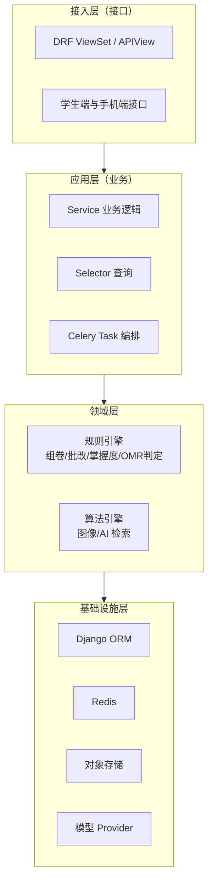
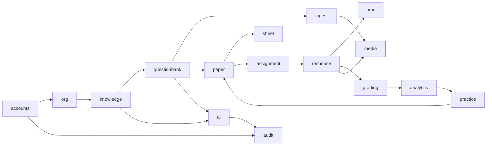
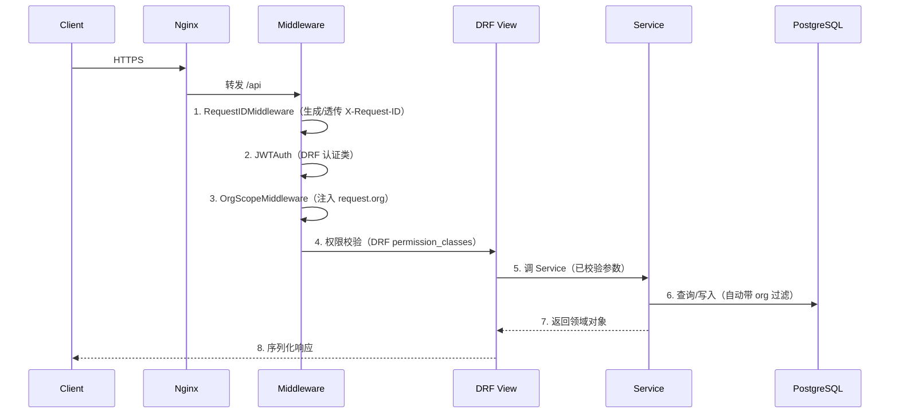

# 00 · 架构与工程约定

> 上游依据：[开发设计文档 v2.1](../知否-开发设计文档-v2.1.md) 第 4、15、17 章。
> 共享约定（命名/目录/枚举/错误码/异步契约）见 [README](README.md)，本文不重复。

---

## 一、架构总览

### 1.1 分层与依赖方向



**依赖铁律**（用 `import-linter` 在 CI 强制）：

| 规则 | 说明 |
| --- | --- |
| R1 | `apps/common` 不依赖任何 `apps.*` |
| R2 | `apps/ai` 不依赖任何业务模块（只接收 prompt + payload，返回结构化结果） |
| R3 | 业务模块不得直接 import 厂商 SDK（`dashscope`/`openai`/`zhipuai` 等只允许出现在 `apps/ai/providers/`） |
| R4 | 模块之间不得直接操作对方的 Model，必须走对方 `services.py` 暴露的函数 |
| R5 | `analytics` 与 `practice` 只读其他模块数据，不反向写业务表 |
| R6 | View 层不做业务计算，只做参数校验 + 调 Service + 序列化 |
| R7 | `apps/omr` 与 `apps/ai` 不得 import `apps/grading`、`apps/analytics`（保持纯函数性，便于单独测试） |

**模块依赖图**：



> 箭头表示「可以依赖」。例如 `paper --> questionbank` 表示组卷模块可以读题库模块的服务，反之不行。

### 1.2 三个"不可绕过"的工程保障

这三条在设计中反复强调，此处固化为架构级约束：

| 保障 | 实现手段 | CI 校验 |
| --- | --- | --- |
| **AI 请求强制脱敏** | `AIRequest.payload` 类型为 `SanitizedPayload`，业务代码无法构造未脱敏请求 | 断言 `ai_call_log.request_payload` 与日志中不含 `PROHIBITED_FIELDS` 原始值 |
| **DRAFT 题目不可组卷** | 组卷只能通过 `Question.objects.usable_for_paper()` 取题；该方法硬过滤 `status=APPROVED` | 断言 `DRAFT/PENDING_REVIEW` 题目不出现在任何组卷结果 |
| **未确认配图不可入库/定稿** | 三条门禁函数：`can_finalize_ingest_batch()` / `can_finalize_paper()` / `usable_for_paper()` 的配图过滤 | 断言存在 `PENDING` 配图时三条门禁全部返回失败 |

---

## 二、异步任务设计

### 2.1 队列分级（**不得新增队列**）

| 队列 | 任务类型 | 并发 | 超时 | 说明 |
| --- | --- | --- | --- | --- |
| `p0_critical` | OMR 识别、配图抽取与裁切、自动批改、手机端单卡识别 | 图像 worker：= CPU 核数；AI worker：8 | 单卡 60s；配图抽取 300s | 阻塞教师主流程，最高优先级 |
| `p1_generate` | AI 生题、解析生成、润色、打标、知识库向量化 | 4（受模型 API 限流约束） | 180s（视觉）/ 60s（文本） | 可延后 |
| `p2_recompute` | 统计重算、报告导出、练习 PDF 导出、成本报表、诊断快照 | 2 | 900s（导出类） | 可夜间跑 |

**Worker 部署划分**：

| Worker | 消费队列 | 说明 |
| --- | --- | --- |
| `worker-image` | `p0_critical`（图像类任务） | **独立进程/独立机器**，CPU 密集 |
| `worker-ai` | `p0_critical`（批改类）+ `p1_generate` | IO 密集，等模型响应 |
| `worker-stats` | `p2_recompute` | 长任务 |
| `beat` | 定时调度 | 单实例，禁止多副本 |

### 2.2 任务编写规范

```python
# apps/omr/tasks.py
from celery import shared_task
from celery.utils.log import get_task_logger

logger = get_task_logger(__name__)

@shared_task(
    bind=True,
    queue="p0_critical",              # 必须显式指定队列
    max_retries=2,
    acks_late=True,                   # 崩溃后可重投
    time_limit=60,                    # 硬超时
    soft_time_limit=55,               # 软超时，抛 SoftTimeLimitExceeded 以便清理
)
def recognize_card(self, card_id: int) -> dict:
    """识别单张答题卡。幂等：重复执行以 card_id 为准覆盖结果。"""
    ...
```

**规范要求**：

| 项 | 要求 |
| --- | --- |
| 参数 | **只传 ID，不传对象**（对象序列化会因模型变更而失败） |
| 幂等 | 任务必须可重复执行且结果一致（用状态判断 + 覆盖写） |
| 重试 | 网络类错误重试；参数错误/业务错误不重试（立即 `FAILURE`） |
| 进度 | 通过 `self.update_state(state="PROGRESS", meta={"progress": n, "message": "..."})` 回传 |
| 日志 | 必须带 `task_id` 与业务 ID；用 `logger.info("...", extra={"card_id": ...})` |
| 事务 | **任务内不长期持有事务**；DB 写入用短事务包住 |
| 大对象 | 图片走对象存储 key，不把 base64 塞进任务参数 |

### 2.3 任务状态与前端契约

见 [README 第七节](README.md#七异步任务返回契约跨端唯一口径)。任务状态表 `celery_task_meta`（Redis 存近期，DB 存关键任务的最终结果）。

**约定**：需要长时间保存结果的任务（导入批次、导出包、报告）**不用 Celery result backend 存业务结果**，而是写业务表（`ingest_batch`、`practice_set.export_zip_asset_id` 等），`task_id` 只作进度查询用。原因：result backend 会过期，业务结果不能丢。

---

## 三、请求生命周期与横切关注点

### 3.1 请求处理链



### 3.2 机构隔离的三层保障

```python
# apps/common/managers.py
class OrgScopedQuerySet(models.QuerySet):
    """所有带 org_id 的模型必须使用此 QuerySet。"""
    def for_org(self, org_id: int):
        return self.filter(org_id=org_id)

class OrgScopedManager(models.Manager.from_queryset(OrgScopedQuerySet)):
    pass
```

| 层 | 手段 | 说明 |
| --- | --- | --- |
| 中间件 | `OrgScopeMiddleware` 解析 JWT → 注入 `request.org_id` | 未认证请求为 None |
| 权限类 | `IsSameOrg` 校验目标对象归属 | 资源级，逐对象校验 |
| 查询层 | 自定义 Manager 强制 `org_id` 过滤 | **最后一道防线**，防止开发者漏写 |

**新增业务表时**：若表含 `org_id`，必须用 `OrgScopedManager`，并在移行测试中断言"跨机构查询返回空"。

### 3.3 日志与追踪

```python
# 统一日志字段（JSON 格式）
{
  "ts": "2026-10-01T12:00:00.123+08:00",
  "level": "INFO",
  "logger": "apps.omr.engine",
  "request_id": "a1b2c3d4-...",        # 贯穿 Web → Celery → AI 调用
  "task_id": "e5f6...",                # Celery 任务时才有
  "org_id": 12,
  "user_id": 33,
  "event": "card.recognized",
  "card_id": 9981,
  "confidence": 0.97,
  "latency_ms": 2140,
  "msg": "答题卡识别完成"
}
```

**并发传递 `request_id`**：Web 层生成后写入 Celery 任务参数与 AI 请求头，保证一条链路可追踪。

**脱敏红线（CI 强制）**：

```python
# tests/test_logging_masking.py
FORBIDDEN_IN_LOGS = ["student_name", "real_name", "phone", "id_card", "student_no"]

def test_no_pii_in_logs(caplog, client, assignment_with_scores):
    with caplog.at_level(logging.DEBUG):
        client.get(f"/api/v1/analytics/assignments/{assignment_with_scores.id}/overview/")
        client.post("/api/v1/ai/questions/1/explanation/")
    for record in caplog.records:
        text = record.getMessage() + json.dumps(getattr(record, "__dict__", {}), default=str)
        for field in FORBIDDEN_IN_LOGS:
            assert field not in text, f"日志中出现禁用字段 {field}"
```

---

## 四、缓存与并发

### 4.1 Redis 用途划分

| 用途 | Key 前缀 | TTL | 说明 |
| --- | --- | --- | --- |
| Celery broker | `celery:*` | — | 与缓存分 DB（broker 用 db0，缓存用 db1） |
| 学生作答会话 | `zf:session:{token}` | 剩余时间 + 1h | 绑定 assignment + student |
| 答题卡仲裁锁 | `zf:lock:card:{id}` | 60s | 防两个老师同时仲裁同一张卡 |
| AI 限流令牌桶 | `zf:rl:{scope}:{key}` | 滚动 60s | 三层限流 |
| 幂等结果缓存 | `zf:idem:{key}` | 24h | 防重复计费 |
| 热力图缓存 | `zf:cache:heatmap:{classroom}:{assignment}` | 10min | 或直接用预聚合表 |
| 手机端上传会话 | `zf:scan:session:{batch}` | 6h | 记录已上传图片数 |

**缓存原则**：**缓存只用于可重算的数据**。任何业务事实（成绩、作答、确认状态）不依赖缓存，Redis 挂掉后系统必须仍能正确工作（只变慢）。

### 4.2 并发控制点（**必须加锁的地方**）

| 场景 | 手段 | 失败处理 |
| --- | --- | --- |
| 教师仲裁同一张卡 | Redis 锁 `zf:lock:card:{id}` | 提示"该卡正在被 XXX 处理" |
| 同一学生同一任务重复提交 | DB 唯一约束 `(assignment_id, student_id)` on `student_total_score` | 幂等覆盖 |
| 成绩修正并发重算 | 单元格级锁 + 合并重算（`p2_recompute` 队列去重） | 后写覆盖 |
| 导出任务重复触发 | Redis 锁 `zf:lock:export:{practice_set_group}` | 返回 `EXPORT.TASK_RUNNING` |
| 练习生成重复触发 | 同上 | |
| 配图批量确认与单张确认并发 | 行级锁 `select_for_update()` | 后写覆盖，写审计 |

**性能要求**：单次成绩修正的重算 ≤ 30s（异步）。批量修正（如改了 50 处）**必须合并为一次重算**，不能触发 50 次。

```python
# apps/grading/tasks.py
RECOMPUTE_DEBOUNCE_SECONDS = 5

def schedule_recompute(assignment_id: int, student_id: int | None):
    """合并短时间内的多次重算请求。"""
    key = f"zf:recompute:pending:{assignment_id}:{student_id or 'all'}"
    redis.sadd(key, student_id or 0)
    redis.expire(key, RECOMPUTE_DEBOUNCE_SECONDS)
    recompute_after_score_change.apply_async(
        args=[assignment_id, student_id],
        countdown=RECOMPUTE_DEBOUNCE_SECONDS,   # 窗口内的多次请求只跑最后一次
        queue="p2_recompute",
    )
```

---

## 五、数据库访问约定

| 项 | 约定 |
| --- | --- |
| 事务边界 | **Service 层函数为事务边界**（`@transaction.atomic`），Task 内不包大事务 |
| 只读查询 | 使用 `.only()` / `.values()` 减少字段；统计查询走副本（满规模阶段） |
| N+1 | CI 中启用 `django-assert-num-queries` 或 `nplusone`，列表接口查询数上限：20 |
| 批量写入 | `bulk_create(batch_size=1000)`；评分结果、作答记录必须用批量 |
| 软删除 | `deleted_at is null` 的过滤封装在 Manager 的默认 `get_queryset()` |
| 迁移 | **禁止**在迁移中做数据计算（用 data migration + 批处理，且可回滚） |
| 索引 | 新增查询必须检查 `EXPLAIN`，全表扫描（`Seq Scan`）需在 PR 中说明理由 |
| 约束 | 唯一性与状态机用 DB 约束兜底（如 `CHECK (score <= max_score)`） |

---

## 六、文件与对象存储

### 6.1 Key 规范

```
zf/{org_id}/{kind}/{yyyy}/{mm}/{uuid}.{ext}
```

`kind` 取值与 `asset.kind` 一致：`QUESTION_FIGURE` / `SCAN_RAW` / `SCAN_RECTIFIED` / `PAPER_PDF` / `SHEET_PDF` / `UPLOAD_SOURCE` / `REPORT_PDF` / `KNOWLEDGE_ATTACH` / `EXPORT_ZIP`。

### 6.2 上传方式

| 场景 | 方式 | 说明 |
| --- | --- | --- |
| 教师上传试卷/教材 | 预签名 URL 直传 | 前端先申请 URL，再直传 OSS，最后通知后端登记 `asset` |
| **手机扫描逐张** | 预签名 URL 直传 + **小图可经后端** | 1–3MB 走直传；≤500KB 可简化 |
| 图片替换（配图换图） | 同上 | |
| 导出包 | 后端生成后写 OSS | 24h 后清理 |

### 6.3 生命周期

| 类型 | 保留期 | 清理方式 |
| --- | --- | --- |
| `SCAN_RAW` | 180 天（可配 `scan_raw_retain_days`） | 定时任务按 `asset.retain_until` + `ref_count=0` 清理 |
| `EXPORT_ZIP` | 24 小时 | 定时任务 |
| `UPLOAD_SOURCE` | 与 `ingest_batch` 同寿（默认 2 年） | |
| `QUESTION_FIGURE` / `PAPER_PDF` / `SHEET_PDF` | 永久（题库资产） | 仅 `ref_count=0` 且明确删除时 |
| 临时文件 | 处理完立即删 | 图像处理用 `tempfile`，`finally` 清理 |

**铁律**：删除任何 `asset` 前必须校验 `ref_count = 0`。图片可能被多道题、多份试卷快照引用。

---

## 七、环境与配置

### 7.1 环境矩阵

| 环境 | 用途 | 数据 | 模型 API | 对象存储 |
| --- | --- | --- | --- | --- |
| `local` | 开发 | `seed` 生成 | 真实 API（限低额度）或 mock | MinIO / 本地目录 |
| `staging` | 预发验证 | 脱敏的近似生产数据 | 真实 API | 独立 bucket |
| `production` | 生产 | 真实数据 | 真实 API | 生产 bucket |

### 7.2 Settings 组织

```
zhifou/settings/
├── base.py          # 通用配置，从环境变量读取
├── local.py         # DEBUG=True，本地存储，Celery eager 可选
├── staging.py       # 接近生产，开启 Sentry，只读保护开关
└── production.py    # 强制 HTTPS、严格 CORS、开启全部安全头
```

**环境变量清单**（`ZF_` 前缀）：

| 变量 | 必填 | 说明 |
| --- | --- | --- |
| `ZF_SECRET_KEY` | ✅ | Django secret |
| `ZF_DEBUG` | ✅ | |
| `ZF_DATABASE_URL` | ✅ | `postgres://...` |
| `ZF_REDIS_URL` | ✅ | |
| `ZF_ALLOWED_HOSTS` | ✅ | 逗号分隔 |
| `ZF_CORS_ORIGINS` | ✅ | |
| `ZF_OSS_*` | ✅ | endpoint / bucket / key / secret |
| `ZF_AI_QWEN_API_KEY` | ✅ | |
| `ZF_AI_DEEPSEEK_API_KEY` | ✅ | |
| `ZF_AI_ZHIPU_API_KEY` | ⭕ | 备用厂商 |
| `ZF_AI_DAILY_BUDGET_YUAN` | ⭕ | 全局默认预算 |
| `ZF_SENTRY_DSN` | ⭕ | |
| `ZF_MASK_PII` | ✅ | **生产必须为 true**，false 时启动告警 |
| `ZF_IMAGE_WORKER_CONCURRENCY` | ⭕ | 默认 = CPU 核数 |

**敏感配置禁止入库**：模型 API Key 只存环境变量，机构级只覆盖"用哪个模型/额度"，不覆盖 Key。

### 7.3 配置优先级（运行时配置）

```
数据库机构级配置（org.ai_config / org.grading_config）
  > 环境变量（全局默认）
  > 代码内默认值（apps/common/constants.py）
```

访问方式统一走 `apps/common/config.py`：

```python
from apps.common.config import get_config

# 取机构级配置，自动回退
filled = get_config("omr.fill_threshold_filled", org=org, channel="PHONE_H5")
```

**禁止**在业务代码里直接 `settings.XXX` 取可配置阈值，必须走 `get_config`（否则机构级覆盖失效）。完整配置项清单见 [13-配置项与提示词库.md](13-配置项与提示词库.md)。

---

## 八、可观测性

### 8.1 指标（Prometheus）

| 指标 | 类型 | 标签 | 用途 |
| --- | --- | --- | --- |
| `zf_http_requests_total` | Counter | method, path, status | 错误率 |
| `zf_http_request_duration_seconds` | Histogram | method, path | 延迟 P95 |
| `zf_celery_queue_depth` | Gauge | queue | 积压告警 |
| `zf_celery_task_duration_seconds` | Histogram | task_name | 任务耗时 |
| `zf_ai_calls_total` | Counter | provider, model, task, status | AI 失败率 |
| `zf_ai_tokens_total` | Counter | provider, model, direction | 用量 |
| `zf_ai_cost_yuan_total` | Counter | org, task | 成本 |
| `zf_ai_fallback_total` | Counter | task, from_model, to_model | 降级次数 |
| `zf_omr_card_total` | Counter | channel, status | 识别成功率 |
| `zf_omr_anchor_deviation` | Histogram | channel | 定位质量 |
| `zf_figure_extract_total` | Counter | src_path, status | 配图抽取成功率 |
| `zf_figure_confirm_total` | Counter | method | 确认方式分布 |
| `zf_figure_pending_count` | Gauge | org | 待确认配图积压 |
| `zf_kb_retrieval_total` | Counter | task, hit_bucket | 空召回率 |
| `zf_ai_citation_total` | Counter | task, valid | 引用有效率 |
| `zf_scan_upload_duration_seconds` | Histogram | channel | 手机端上传耗时 |

### 8.2 告警规则

| 告警 | 条件 | 级别 |
| --- | --- | --- |
| 接口错误率 | 5xx 占比 > 1%（5 分钟） | P1 |
| P95 延迟 | > 2s（10 分钟） | P2 |
| 队列积压 | `p0_critical` > 50 | P1 |
| AI 失败率 | > 10%（10 分钟） | P1 |
| AI 预算 | 日用量 > 90% | P2 |
| OMR 失败率 | > 5%（按批次） | P1 |
| 配图待确认积压 | 单机构 > 200 且 > 24h | P3 |
| 磁盘/存储 | > 80% | P1 |
| 备份失败 | 任一次失败 | P0 |

### 8.3 关键业务看板

| 看板 | 指标 |
| --- | --- |
| AI 价值看板 | 各 AI 功能的教师采纳率、引用有效率、平均耗时、成本 |
| 导入效率看板 | 导入批次完成耗时、配图确认耗时/张、切题正确率 |
| 扫描质量看板 | 手机 vs 网页通道的静默通过率、失败原因分布、学号识别失败率 |
| 闭环看板 | 组卷→发布→批改→学情→练习的转化率、个性化练习采纳率、效果提升 Δ |

---

## 九、CI/CD 门禁

```yaml
# .github/workflows/ci.yml（结构示意）
jobs:
  lint:            # ruff + black --check + mypy + eslint + prettier + stylelint
  test-unit:       # pytest，核心模块覆盖率 ≥ 80%，整体 ≥ 70%
  test-contract:   # OpenAPI schema 校验 + 前端类型生成一致性
  test-masking:    # ★ 脱敏断言（阻断）
  test-gates:      # ★ DRAFT/配图三闸门断言（阻断）
  test-omr:        # ★ OMR 回归（低于基线阻断）
  test-figure:     # ★ 配图识别回归（低于基线阻断）
  check-migrations: # makemigrations --check --dry-run
  check-enums:     # ★ 枚举一致性：代码枚举 ⊆ README 第五节
  check-imports:   # import-linter 依赖方向
  build:           # 构建镜像
  deploy-staging:  # 预发部署 + 冒烟
```

**门禁清单（合并 PR 前必须全绿）**：

| 门禁 | 命令 | 阻断 |
| --- | --- | --- |
| 代码风格 | `ruff check . && black --check .` | ✅ |
| 类型检查 | `mypy apps/`（核心模块 strict） | ✅ |
| 单测 | `pytest --cov` | ✅ |
| 迁移一致 | `python manage.py makemigrations --check --dry-run` | ✅ |
| 依赖方向 | `lint-imports` | ✅ |
| 脱敏断言 | `pytest tests/test_masking.py` | ✅ |
| 三闸门断言 | `pytest tests/test_gates.py` | ✅ |
| OMR 回归 | `pytest tests/omr/ --baseline=ci/omr_baseline.json` | ✅ |
| 配图回归 | `pytest tests/figure/ --baseline=ci/figure_baseline.json` | ✅ |
| 枚举一致 | `python scripts/check_enums.py` | ✅ |
| 契约一致 | `python scripts/export_openapi.py --check` | ✅ |
| AI 评估回归 | `python scripts/eval_ai.py --report` | ❌（仅留档） |

---

## 十、降级策略（**必读，影响架构选择**）

**核心原则：AI 与扫描是增强功能，不是必需功能。任何一个挂了，老师都能用基础功能完成教学工作。**

| 依赖失效 | 系统行为 | 实现要点 |
| --- | --- | --- |
| 模型 API 全不可用 | AI 按钮置灰并提示；其余功能正常 | `AIProvider` 抛 `AI.PROVIDER_UNAVAILABLE`，前端按错误码处理 |
| 知识库检索不可用 | **AI 生题直接禁用**（无依据不生成）；优化类任务提示暂不可用 | 检索失败按"召回为空"处理 |
| 图像 worker 全挂 | **提供"完全手工录入"兜底**：教师对着纸卡批量点选录分 | 必须实现该兜底通道（不是可选） |
| 对象存储不可用 | 上传失败明确提示；已有数据不受影响 | |
| Redis 不可用 | 队列推迟；缓存失效降级直查 DB（变慢但可用） | 缓存读取必须 `try/except` 回退 |
| 手机端网络不稳 | 图片存 IndexedDB，恢复后自动续传 | 前端实现 |

**降级优先顺序（预算超限时）**：先停 `generate_question` → 再停 `gen_explanation`/`design_distractors` → **批改与 OMR 永不降级**。

---

## 十一、代码评审检查清单（架构维度）

```
□ 新增表是否带 org_id 且使用 OrgScopedManager？
□ 新增查询是否检查了 EXPLAIN，有无 Seq Scan？
□ 新增 Celery 任务是否显式指定 queue 且幂等？
□ 是否只在 Service 层开事务？Task 内是否避免了长事务？
□ 新增阈值是否走 get_config，而非硬编码或直接读 settings？
□ 是否在业务层直接调用了厂商 SDK？（禁止）
□ 新增 AI 调用是否走了强制脱敏（payload 类型是否为 SanitizedPayload）？
□ 新增状态枚举是否回写了 README 第五节？
□ 新增错误码是否回写了 README 第六节？
□ 是否有 N+1（列表接口查询数是否 ≤ 20）？
□ 日志是否可能输出学生身份信息？
□ 新增文件上传是否走预签名直传？
□ 是否考虑了下游重算的触发（成绩变更 → 学情 → 练习标记 stale）？
□ 是否有对应测试，且覆盖了边界与降级路径？
```

---

## 变更记录

| 版本 | 日期 | 变更人 | 说明 |
| --- | --- | --- | --- |
| v1.0 | 2026-10-01 | — | 首版，对齐设计文档 v2.1 |

## 待确认问题

| 编号 | 问题 | 影响 |
| --- | --- | --- |
| Q-00-1 | 图像 worker 是独立机器还是与 Web 同机（一期）？ | 影响部署拓扑与一期规格；建议同机起步但限制并发 |
| Q-00-2 | 是否需要多区域部署（对象存储跨区备份）？ | 影响成本与运维复杂度 |
| Q-00-3 | 模型 API 是否需要走公司统一网关（统一计费/审计）？ | 影响 Provider 适配层的接入方式 |
