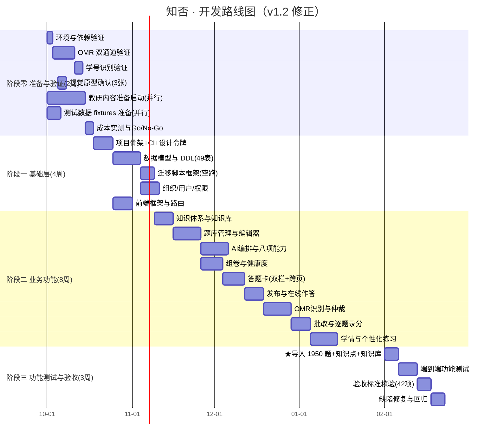
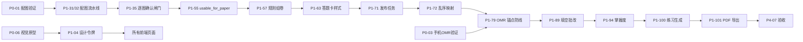

# 03 · 开发计划与任务分解

> 上游依据：[开发设计文档 v2.1](../知否-开发设计文档-v2.1.md) 第 19 章（排期与 42 条验收标准）、第 20 章（风险登记册）。
> 本文是**可执行的工作分解结构（WBS）**。每个任务必须能对应到 12 文档的测试用例或 19.1 的验收标准。

| 项 | 内容 |
| --- | --- |
| 计划基准日期 | 2026-10-01 |
| 团队假设 | 1 名后端（B1）+ 1 名全栈（B2，兼前端）+ 1 名前端（F1） |
| 单人开发换算 | **所有工期 × 1.8** |
| 总周期 | 阶段零 2 周 + 阶段一 4 周 + 阶段二 8 周 + 阶段三 3 周 = **约 17 周** |
| 一期交付 | 阶段零 + 阶段一 + **阶段二 + 阶段三**（**17 周**，见「七、里程碑」M7） |

> **★ 本文已有配套修订**：[`03b-任务与周期优化-v1.3.md`](03b-任务与周期优化-v1.3.md)（2026-10-05）。
> 它给出**实际进度对账**（后端 ~90% / 前端 ~45%）、**未进本 WBS 的 5 项发现**、
> 以及**按阻塞关系重排的周期**。
> 本文保留原样是为对照「原计划 vs 实际」；**排期冲突以 03b 为准**。

---

## 一、阶段总览

> **★ v1.2 排期修正（流程纠正，重要）**
>
> **纠正**：先前把「数据迁移」放在阶段一第 1 周，是错的。那时**数据模型（表）还没建**，导入脚本没有落点。
>
> **正确顺序**：**有模型才谈得上导入**。因此——
>
> | 工作 | 正确位置 | 为什么 |
> | --- | --- | --- |
> | **数据模型 / DDL / 迁移脚本** | 阶段一（基础层） | 表存在是先决条件 |
> | **实际数据导入** | **阶段三 · 功能测试阶段** | 功能跑通后导入才有意义，也才能验证导入结果 |
> | **测试数据（fixtures）准备** | 阶段零（可并行） | 已实测完成，不占关键路径 |
>
> **另一处纠正**：`题目资料.xlsx` 实测 **1,950 题**（不是 1,881 题）。原先登记为「无法归类、建议删除」的 `4.3` 章节 69 题，实际是**润滑与密封**内容，应保留并归入第六章。
>
> 详细依据：[16-开发前准备清单与开工判定.md](16-开发前准备清单与开工判定.md)、`docs/教材/题目导入报告.md`



**关键路径**：`骨架 → 数据模型 → 迁移脚本 → 知识体系 → 题库 → 组卷 → 答题卡 → 发布 → OMR → 批改 → 学情 → **导入** → 测试 → 验收`

**总周期约 17 周**：阶段零 2 周 + 阶段一（基础层）4 周 + 阶段二（业务功能）8 周 + 阶段三（功能测试）3 周。

**为什么从 15 周变成 17 周**：先前把「导入」当孤立任务塞进阶段一，漏掉了「模型 → 脚本 → 导入」这条链上的等待。**这 2 周是补回被忽略的基础层工作。**

> **★ 阶段三的「导入」不是跑个脚本就完事**——它属于功能测试，要验证：1,944 题的入库结果、章节映射是否正确、判断题 A/B 归一、填空答案切分、以及**导入后组卷能否正常抽到题**。这些是功能验收的一部分。

---

## 二、阶段零：准备与验证（2 周）

**目标：用真实数据证伪。产出「4 个数字 + 1 张图」，决定后面 3 个月的方向。**

| 任务 ID | 任务 | 交付物 | 判据（Go/No-Go） | 人日 | 负责人 | 依赖 |
| --- | --- | --- | --- | --- | --- | --- |
| **P0-01** | **配图抽取验证** | 30 份真实试卷（10 Word + 10 电子 PDF + 10 扫描件）跑通：对象抽取 + 版面检测 + 归属绑定 | 路径 1/2 召回率 ≥ 98%，路径 3 ≥ 80%；**公式误裁为图片 ≤ 5%**；教师配图校对 ≤ 90s/份 | 6 | B1+B2 | — |
| **P0-02** | **OMR 网页通道验证** | 100 张扫描件（含劣化）跑通：光照归一化 → 锚点 → 校正 → 涂点判定 | **静默通过率 ≥ 88%**，漏检率 ≤ 0.5% | 4 | B1 | — |
| **P0-03** | **OMR 手机通道验证** | 150 张手机拍摄（含阴影/透视/模糊）跑通 | **静默通过率 ≥ 75%**；若 < 60% 需重新评估手机通道可行性 | 5 | B1 | — |
| **P0-04** | **学号识别验证** | 40 张含学号异常样本（忘涂/错位/多涂/短学号/校验位错） | 学号识别准确率 ≥ 95% | 2 | B1 | P0-03 |
| **P0-05** | 视觉识题验证 | 5 份真实试卷 | 题干准确率 ≥ 90%，切题正确率 ≥ 85% | 2 | B2 | — |
| **P0-06** | **视觉风格原型** | **3 张静态 HTML 原型**（首页 / 题目编辑器 / 手机扫描页） | **产品负责人确认「没有 AI 味」** | 3 | F1 | — |
| **P0-07** | 成本实测 | 记录实际 token 消耗，校准成本模型 | 单份试卷导入成本 ≤ ¥0.5 | 1 | B2 | P0-01/05 |
| **P0-08** | 阈值标定 | 用 P0-02/03 的样本标定双通道 `fill_threshold_*`，输出 `threshold_version` | 标定报告 + 阈值写入 13 文档 | 2 | B1 | P0-02/03 |
| **P0-09** | **Go/No-Go 评审** | 验证报告（4 个数字 + 3 张原型截图 + 成本表） | 决策：继续 / 调整产品形态 / 停止 | 1 | 全员 | 全部 |

**阶段零产出物**：

| 产出 | 内容 |
| --- | --- |
| `docs/verification/配图识别验证报告.md` | 召回率/归属正确率/裁切完整率/公式误裁率/校对耗时 |
| `docs/verification/OMR验证报告.md` | 双通道静默通过率、漏检/误涂率、学号准确率、标定后的阈值 |
| `docs/verification/成本实测报告.md` | 各任务实际 token 与金额 |
| `prototype/*.html` | 3 张视觉原型 |
| 测试数据集 | 30 份试卷 + 250 张答题卡 + ground truth 标注 |

**★ 阶段零的决策意义**：

| 验证结果 | 决策 |
| --- | --- |
| 配图路径 3 召回率 < 60% | 扫描件导入改为「仅抽文本框 + 配图人工截取为主」 |
| 手机 OMR 静默通过率 < 60% | 手机通道改为「拍照留档 + 教师点选录分」，放弃自动识别 |
| 视觉原型被否 | 重做原型（**不要带着否定的视觉方向进入阶段一**） |
| 单份导入成本 > ¥2 | 重新评估模型选型或降低识别精度要求 |

---

## 三、阶段一：基础层（4 周）

**目标：把「表、骨架、迁移脚本」立起来。业务功能一行不写。**

> **★ v1.2 新增章节**。先前阶段一直接从业务功能起步，缺了这一层，导致「数据迁移」无处落地。
>
> **本阶段出口**：49 张表迁移全部就位；`docker compose up` 一键起环境；CI 全绿；迁移脚本可空跑（`--dry-run`）。

#### 3.1 基础层任务分解（11 人日）

> **编号约定**：基础层用 `P1-00a`～`P1-00f`；业务功能沿用 `P1-01`～`P1-105`（见下节）；验收类为 `P4-xx`（见阶段三）。
> 这样**不打断既有编号**，也不会出现两个 `P1-04`。

| ID | 任务 | 交付物 | 人日 | 负责 | 依赖 |
| --- | --- | --- | --- | --- | --- |
| P1-00a | 仓库初始化 | monorepo 结构、README、.gitignore、pre-commit | 0.5 | B2 | — |
| P1-00b | Django 骨架 | settings 分环境、common 模块（config/managers/exceptions/responses/storage）、健康检查 | 2 | B2 | P1-00a |
| P1-00c | Celery 骨架 | 三队列（p0_critical/p1_generate/p2_recompute）、worker 启动脚本、任务基类、进度回传 | 1 | B2 | P1-00b |
| **P1-00d** | ★ **数据模型与 DDL** | `02-数据模型与DDL.md` **全部 49 张表**迁移 + pgvector 扩展 + 索引 | **3** | B1 | P1-00b |
| **P1-00e** | ★ **迁移脚本框架** | `migrate_*.py` 骨架、`--dry-run` 模式、幂等键、校验报告产出 | **2** | B1 | P1-00d |
| **P1-00f** | ★ **职教结构迁移** | `major`/`course`/`task`/`task_knowledge` 四表；`chapter` 加 `part_seq`/`part_name`/`seq`；`knowledge_node` 加 `course_id`/`task_id` | **2** | B1 | P1-00d |
| P1-00g | seed 脚本骨架 | small/full 两档、覆盖异常场景 | 1.5 | B1 | P1-00d |

**（前端骨架、设计令牌、Zf 组件库、CI/CD、部署环境见下节 `P1-04`～`P1-09`，与业务功能同期启动）**

**阶段一出口条件**：

| 判据 | 标准 |
| --- | --- |
| 表结构 | 49 张表全部迁移成功，`\dt` 可列全 |
| 迁移脚本 | `--dry-run` 对 `docs/教材/` 的三份数据包跑通且无异常 |
| 环境 | `docker compose up` 一键起环境；`/health/` 返回 ok |
| CI | 全绿；含脱敏断言与三闸门检查 |
| 前端 | 设计令牌与 Zf 组件库可用；视觉走查模板可用 |

---

## 四、阶段二：业务功能（8 周）

**目标：一条完整闭环能跑通，每处可以是简单版本。**

> **★ 编号说明**：本阶段沿用原 `P1-xx` 编号。**`P1-00x` 归属阶段一基础层**；`P1-01`～`P1-09`、`P1-11` 为骨架与前端（见下节 W1）；`P1-27`～`P1-39` 已移出（导入→阶段三，配图→阶段四）；`P1-106`～`P1-111` 已移出（验收→阶段三 `P4-xx`）。
>
> **★ 阶段定位**：知识体系、题库、AI、组卷、答题卡、发布、OMR、批改、学情——**业务功能全在这里**。
>
> **★ 实际数据导入不在这里**。本阶段只写「迁移脚本」，用 fixtures 假数据测试；**真实数据（1,950 题 + 44 知识点 + 110 知识库条目）的导入放在阶段三功能测试**。

### 4.1 周计划总表（8 周）

| 周 | 主题 | 关键交付 | 负责 |
| --- | --- | --- | --- |
| W1 | 组织 + 知识体系 + 知识库 | 机构/班级/名册（含学号唯一性校验）、知识点树、章节、知识库条目 CRUD 与健康度 | B1+B2 |
| W1–W2 | 题库 + 编辑器 | 题目 CRUD、选项、知识点关联、列表筛选、去重、难度四字段 | B2 |
| W2–W3 | AI 编排 + 八项能力 | Provider/脱敏/路由/模板、打标/润色/解析/引证、**AI 生题四条硬规则** | B2 |
| W3–W4 | 组卷 + 健康度 | 三种组卷、Fisher-Yates、约束求解、等值校验、题库健康度 | B1 |
| W4–W5 | **答题卡样式与模板** | 纯比例排版引擎、ReportLab 生成、学号区（3–8 位）、绑定校验 | B1+B2 |
| W5–W6 | 发布 + 在线作答 | 发布任务、逐生乱序映射、二维码入口、学生 H5 作答 | B2+F1 |
| W6–W7 | **OMR + 仲裁 + 主观题录分** | 识别引擎、手机采集端、仲裁界面、逐题录分工作台 | B1+F1 |
| W7–W8 | **学情 + 个性化练习 + 导出** | 掌握度、热力图、错误统计、练习生成（结构约束）、PDF 批量导出 | B1+B2 |

> **已从本阶段移除**：「导入 + 配图流水线」（原 W5–W6，24 人日）。理由：① 实测全表 **0 张嵌入图片**，配图识别降为二期；② 数据导入移至阶段三功能测试。

### 4.2 详细任务分解


#### W1：设计系统与工程骨架（7 人日）

> ⚠ **本节已并入「三、阶段一：基础层」**。骨架与令牌类任务见 `P1-00a`～`P1-00c`；设计令牌与组件库见下表 `P1-04`～`P1-09`。
>
> 下表保留在阶段二，是因为它们与业务功能同期推进；但**「数据库迁移基线」已上移至阶段一**（见 `P1-00d`），此处不再重复。

| ID | 任务 | 交付物 | 人日 | 负责 | 依赖 |
| --- | --- | --- | --- | --- | --- |
| P1-01 | monorepo 结构 | 目录规范、README、.gitignore、pre-commit | 0.5 | B2 | — |
| P1-02 | common 模块 | config/managers/exceptions/responses/storage | 2 | B2 | P1-01 |
| P1-03 | 三队列与任务基类 | Celery 队列、进度回传工具 | 1 | B2 | P1-02 |
| P1-04 | **设计令牌落地** | tokens.css（完整）、reset.css、element-theme.scss、utilities.css | 2 | F1 | P1-01 |
| P1-05 | **Zf 组件库** | ZfButton/ZfCard/ZfTable/ZfTag/ZfStatusTag/ZfEmptyState/ZfPageHeader/ZfAsyncProgress | 3 | F1 | P1-04 |
| P1-06 | 前端骨架 | Vite + TS + Pinia + Router、layouts、axios client（拦截器/错误码）、任务轮询封装 | 2 | F1+B2 | P1-01 |
| P1-07 | CI/CD | GitHub Actions：lint/test/迁移检查/依赖方向/脱敏断言/三闸门 | 1.5 | B2 | P1-02 |
| P1-08 | 部署环境 | Dockerfile ×3、compose（local/staging）、Nginx、中文字体 | 1.5 | B2 | P1-02 |
| P1-09 | **stylelint/ESLint 强制约束** | 禁止硬编码色值字号的规则生效 | 0.5 | F1 | P1-04 |
| P1-11 | seed 脚本 | small/full 两档、覆盖异常场景 | 1.5 | B1 | P1-00d |

> **注**：`P1-10`（数据库迁移基线）已删除并上移为 `P1-00d`，表数由 45 更正为 **49**。

**W1 出口条件**：本地 `docker compose up` 一键起环境；CI 全绿；`/health/` 返回 ok；视觉走查模板可用。

**W1 出口条件**：本地 `docker compose up` 一键起环境；CI 全绿；`/health/` 返回 ok；视觉走查模板可用。

#### W1–W2：组织 + 知识体系 + 知识库（17 人日）

| ID | 任务 | 交付物 | 人日 | 负责 |
| --- | --- | --- | --- | --- |
| P1-12 | 用户与认证 | JWT、角色权限、机构中间件、机构隔离 Manager | 2 | B2 |
| P1-13 | 班级与名册 | CRUD、Excel 导入、**学号唯一性校验**、**学号位数一致性推断告警** | 2 | B2 |
| **P1-13b** | ★ 前端：班级与名册管理 | **`web/src/views/` 里缺这一页**（后端 `/org/classrooms/` 已就绪）；<br>班级 CRUD、名册 CRUD、**Excel 批量导入**、学号校验提示 | 2.5 | F1 |
| P1-14 | 知识点树 | CRUD、模板深拷贝、节点合并、物化路径维护、覆盖统计 | 2.5 | B1 |
| P1-15 | 章节 | CRUD、章节-知识点映射、模板应用 | 2 | B1 |
| P1-16 | **知识库** | 条目 CRUD（8 种类型）、章节/知识点关联、审核、健康度（覆盖率/利用率/采纳率） | 3 | B1 |
| **P1-16b** | 知识库条目 更新/删除 | `PATCH`/`DELETE /knowledge/entries/{id}/`；**依赖校验：该知识点下有题目则拒** | 1.5 | B1 |
| **P1-16c** | 前端：知识库条目编辑器 | 新建/编辑/删除；8 种类型；知识点关联；被引用时禁改删并说明原因 | 2 | F1 |
| P1-17 | 知识库向量化 | Embedding 任务、向量检索封装（供 AI 调用） | 1.5 | B2 |
| P1-18 | 知识库文档导入 | 文档切分（按标题层级）→ 校对归类 → 批量入库 | 2.5 | B2 |
| **P1-18b** | 知识库文件上传 | **.docx / .pdf / .txt** 上传 → 文本抽取（python-docx / PyMuPDF 已在依赖里） | 1.5 | B2 |
| **P1-18c** | ★ AI 文档解析 | **新增 AI 任务类型 `parse_kb_document`**：拆成多条 + 自动归类 8 种类型 + 建议知识点关联 | 2.5 | B1 |
| **P1-18d** | 前端：知识库导入向导 | 上传 → AI 解析预览（可编辑）→ 老师确认 → 批量入库 | 2 | F1 |
| P1-19 | 前端：知识体系页面 | 知识点树管理、章节管理、知识库列表与编辑器 | 3.5 | F1 |
| P1-20 | 平台模板数据 | 数学/物理/英语三科知识点树与章节模板（YAML + 导入脚本） | 2 | B1 |

**出口条件**：可建班导名册；可维护知识点树与章节；可录入知识库条目并检索。

> ★★ **配套前端（第二轮需求确认后新增）**：`P1-13b 前端：班级与名册管理` ——
> 后端 `/org/classrooms/` 早已就绪，但前端 13 个页面里**没有班级管理页**，
> 导致「建班 → 导入学生 → 发布作业 → 学生答题 → 批改 → 学情」这条链路
> **在第一步就断了，无法测试**。详见 [19-需求确认与增量计划.md](19-需求确认与增量计划.md)。

#### W2–W3：题库 + 编辑器（12 人日）

| ID | 任务 | 交付物 | 人日 | 负责 |
| --- | --- | --- | --- | --- |
| P1-21 | 题目 CRUD | 8 种题型、选项、答案结构、难度四字段 | 2.5 | B2 |
| P1-22 | 富文本处理 | 白名单净化、题干双存（HTML+Text）、公式（KaTeX）、图片占位 | 2 | B2 |
| P1-23 | 三层去重 | stem_hash、SimHash、Embedding 余弦；变式题关系建立 | 2 | B1 |
| P1-24 | 题库健康度 | 按知识点 × 难度档位聚合、缺口清单导出 | 1.5 | B1 |
| P1-25 | 前端：题库列表 | 多条件筛选、批量操作、含图标记、导出 | 2.5 | F1 |
| P1-26 | 前端：题目编辑器 | 编辑 + 配图管理 + AI 能力入口（AI 实现见 P1-31） | 3 | F1 |
| **P1-26b** | ★ 编辑**自动回退草稿** | 去掉确认弹窗；点编辑自动置草稿 + **页面显示一行状态变化**（不静默）<br>★ 依据：`PaperItem.snapshot_json` 是**题干快照**，改题库**不影响**已发布试卷<br>★ 一并修正 `questionbank/services.py` 里与机制不符的过时注释 | 0.5 | B1 |
| **P1-25b** | 题库筛选补全 | 题库页增加**科目**与**知识点**筛选控件（后端 `subject` / `node_id` 已支持） | 0.5 | F1 |
| P1-27 | 题库导入（结构化） | Excel 批量导入（已有整理好的题库） | 1 | B2 |

**出口条件**：可手工录题、可检索、可审核、可导出。

#### W3：AI 编排 + 八项能力（20 人日）

| ID | 任务 | 交付物 | 人日 | 负责 |
| --- | --- | --- | --- | --- |
| P1-40 | Provider 抽象 | AIRequest/AIResult/SanitizedPayload、qwen + deepseek 适配器 | 2.5 | B2 |
| P1-41 | **强制脱敏代理** | sanitize/restore、PII 映射表加密、科目白名单、**CI 脱敏断言** | 2 | B2 |
| P1-42 | 路由与降级 | routing.yaml、候选降级、成本估算、预算护栏 | 2 | B2 |
| P1-43 | 幂等/限流/重试/计量 | 三层令牌桶、幂等键、降级优先顺序、ai_call_log | 2.5 | B2 |
| P1-44 | 提示词模板中心 | 七段结构、版本管理、匹配优先级、术语注入与后置校验 | 2.5 | B2 |
| P1-45 | **知识库检索（L1）** | 三路召回 + 融合排序；**召回为空必须拒绝生成** | 2 | B1 |
| P1-46 | **防幻觉 L3 校验** | 引用有效性、引用覆盖率、术语一致性 | 1.5 | B2 |
| P1-47 | 能力：打标 | 知识点树注入、两级粗筛、node_id 硬校验、suggest_new_node | 1.5 | B2 |
| P1-48 | 能力：解析生成 | **concluded_answer 答案一致性三层自校验** | 1.5 | B2 |
| P1-49 | 能力：润色/干扰项/难度/引证 | 四项能力实现与 Schema | 2.5 | B2 |
| P1-50 | **能力：AI 生题** | 四条硬规则、能力可用性矩阵、审核界面数据契约 | 3 | B1 |
| P1-51 | 提示词模板内容 | 数学/物理/英语 × 8 任务 + 4 通用 = 28 个模板（需教研配合） | 3 | B1+教研 |
| P1-52 | AI 反馈采集 | ai_feedback 写入、diff 计算 | 1 | B2 |
| P1-53 | 前端：AI 交互 | 流式输出、diff 采纳/拒绝、AI 能力按钮组、可用性提示 | 3 | F1 |
| P1-54 | AI 用量与采纳率看板 | 成本报表、引用有效率 | 1.5 | F1 |

**出口条件（对应 A8–A10）**：编辑器内 AI 可用且成本可统计；**无知识库依据时拒绝生成**；生成结果 100% 带有效引用且为 DRAFT；DRAFT 不可组卷。

#### W3–W4：组卷 + 健康度（14 人日）

| ID | 任务 | 交付物 | 人日 | 负责 |
| --- | --- | --- | --- | --- |
| P1-55 | **usable_for_paper()** | 唯一取题入口（硬过滤 DRAFT 与 PENDING 配图） | 1 | B1 |
| P1-56 | Fisher-Yates | 实现 + 分布均匀性检验 + 可复现 | 1 | B1 |
| P1-57 | 规则组卷 | 候选筛选、约束求解、降级顺序、快照写入 | 3 | B1 |
| P1-58 | 学情组卷 | 权重计算、配额分配、组卷说明（rationale） | 2.5 | B1 |
| **P1-58b** | ★ **期望总分与配分建议** | 新增 `Paper.target_total_score` 字段（**需迁移**）；<br>按题型配额**建议配分** → 老师可改 → **定稿时校验是否等于期望总分**，不等则拦住 | 2 | B1 |
| P1-59 | 难度等值 | 期望得分率、替身搜索、局部搜索、明确报错 | 2.5 | B1 |
| P1-60 | 试卷排版与导出 | 预览（HTML）、PDF（ReportLab）、Word（草稿） | 3 | B2 |
| **P1-60b** | ★ **试卷格式参数落地** | `Paper.layout_config`：**页边距 / 行距 / 字号 / 选项排列方式**<br>（`1列4排` / `2列2排` / `4列1排`）<br>★ 作用域是**试卷**，不是答题卡；与 `option_order`（选项乱序）是两回事 | 2 | B2 |
| **P1-60c** | 试卷样式库 | **预置样式**（开箱即用）+ **可自定义保存**（可复用） | 1.5 | B2 |
| P1-61 | 前端：组卷工作台 | 三种组卷、实时指标、锁定换题、候选抽屉、健康度提示 | 4 | F1 |
| P1-62 | 前端：试卷预览与导出 | 排版预览、导出 | 2 | F1 |
| **P1-62b** | 前端：总分设置与试卷格式面板 | 期望总分输入 + 配分建议 + 校验提示；格式面板（页边距/行距/字号/选项排列）**实时预览**；样式库选用与另存 | 2 | F1 |

**出口条件（对应 A11–A13）**：约束满足率 100%；同 seed 可复现；AB 卷期望得分率差 ≤ 0.03。

#### W4–W5：★ 答题卡样式与模板（16 人日）

| ID | 任务 | 交付物 | 人日 | 负责 |
| --- | --- | --- | --- | --- |
| P1-63 | 样式系统 | sheet_style 全部字段、系统预设 ≥ 3 个、机构自定义"另存为" | 2 | B2 |
| P1-64 | **答题卡 PDF 生成** | ReportLab：锚点/学号区/客观题区/主观题手写区与得分框/页眉页脚 | 4 | B2 |
| P1-65 | **学号区 3–8 位** | `student_no_bubble(pos, digit)`、排版约束校验与建议文案（含注意事项区宽度联动） | 2.5 | B2 |
| P1-66 | layout_json 生成 | 相对坐标、positions 展开、模板版本只增不改 | 2 | B2 |
| P1-67 | **绑定校验** | 题量/题型结构/学号位数匹配；不匹配给具体差异 | 1.5 | B2 |
| P1-68 | 模板库与预览 | 模板列表、预览图、校准页生成 | 2 | B2 |
| P1-69 | 前端：样式编辑页 | 参数表单 + 右侧实时预览 | 3 | F1 |
| **P1-69b** | ★ **答题卡实时预览** | 改参数 → 右侧**即时重排**（复用 `layout.py`；<br>走 `POST /sheet/templates/preview/` **不落库**）<br>★ 需先修 `19` 文档 §三 的 D1–D4 四个版面缺陷 | 3 | F1 |
| **P1-69c** | **信息区版式库** | 手写区 / 准考证号区 / 注意事项区的**组合版式**：<br>老师能**新建 / 保存 / 选用**（一套版式一个模板） | 2 | F1 |
| P1-70 | 前端：答题卡管理与绑定 | 选样式/绑定已有模板/生成/下载 | 2.5 | F1 |
| **P1-70b** | 答题卡**绑定写入** | 界面接 `POST /sheet/papers/{id}/binding/`（现只做了「体检」只读，<br>界面永远显示「未绑定主卡」） | 1 | F1 |

**出口条件（对应 A14）**：可配置纸张（A3/A4/A5）与固定列数（选择 4 列 / 判断 6 列）；绑定校验能正确拒绝不匹配模板；3–8 位学号区可生成且识别端定位正确。

#### W5–W6：发布 + 在线作答（12 人日）

| ID | 任务 | 交付物 | 人日 | 负责 |
| --- | --- | --- | --- | --- |
| P1-71 | 发布任务 | 配置项、发布流程、时间窗 | 2 | B2 |
| **P1-71b** | ★ **发布门禁按渠道区分** | **决策 8 = A**：`ONLINE` / `PAPER_OMR` **不要求**绑定系统账号，<br>与「学号 + 姓名」双因子身份模型一致；不再「一个学生没绑就卡住整场考试」 | 1 | B2 |
| P1-72 | **逐生乱序映射** | question_order / option_order 生成与持久化；**禁止重新随机** | 2.5 | B2 |
| P1-73 | 学生入口 | publish_token、名册点选认人、重名用学号区分、会话管理 | 2.5 | B2 |
| P1-74 | 在线作答 | 自动保存、断网恢复、提交确认、时间到强制提交 | 2.5 | B2 |
| P1-75 | 作业看板 | 进入/提交/缺考实时；异常设备提示 | 1.5 | B1 |
| P1-76 | 前端：发布配置页 | 配置项 + 二维码 | 2.5 | F1 |
| P1-77 | 前端：学生作答页 | 题目渲染（含配图懒加载）、答题卡导航、自动保存 | 3.5 | F1 |

**出口条件（对应 A16）**：45 人 10 分钟内完成提交，无数据丢失。

#### W6–W7：★ OMR + 仲裁 + 主观题录分（22 人日）

| ID | 任务 | 交付物 | 人日 | 负责 |
| --- | --- | --- | --- | --- |
| P1-78 | 预处理与光照归一化 | 大核高斯 + divide + CLAHE | 1.5 | B1 |
| P1-79 | **锚点检测 + 回投影校验** | 检测算法 + **关键防线**（拦住整卡错答案） | 2.5 | B1 |
| P1-80 | 透视校正 | getPerspectiveTransform + warpPerspective + 质量分 | 1.5 | B1 |
| P1-81 | **学号区识别** | 每位 10 涂点、判定裕度转置信度、校验位、多涂处理 | 2.5 | B1 |
| P1-82 | 涂点判定 | 三档阈值、**双通道独立阈值** | 1.5 | B1 |
| P1-83 | 业务校验规则 | 9 条规则（0 涂/多涂/已涂率/规律检测/学号异常/冲突） | 2 | B1 |
| P1-84 | 整卡置信度与仲裁判定 | `0.6*min+0.4*mean`、进队列规则 | 1 | B1 |
| P1-85 | 批次与队列 | 扫描批次、任务编排、进度回传、质量报告 | 2 | B2 |
| P1-86 | **手机 H5 采集端** | getUserMedia、Web Worker 实时质量检测、IndexedDB 队列、拍一张传一张 | 4 | F1 |
| P1-87 | 前端：仲裁界面 | 学号确认置顶、异常题集中、原图联动高亮、存疑待定 | 3.5 | F1 |
| P1-88 | **批改引擎** | 客观题批改、多选题部分分开关 | 1.5 | B1 |
| P1-89 | **填空题六步算法** | 精确→归一→同义→模糊→AI→判错；存疑区间 | 3 | B1 |
| P1-90 | 归一化规则 | 通用规则 + 科目细分；α/a 不归一等反例 | 2 | B1 |
| P1-91 | **主观题逐题录分** | 单题/单生/粘贴/快速模式 | 2.5 | B2 |
| P1-92 | 评分状态机 | 合法流转校验 + 审计 | 1 | B2 |
| P1-93 | 前端：批改工作台 | 待确认队列、逐题录分（含原图对照）、键盘流 | 4 | F1 |

**出口条件（对应 A15、A17–A21）**：双通道识别达标；学号识别 ≥ 97%；逐题录分 45 人 ≤ 1 分钟。

#### W7–W8：★ 学情 + 个性化练习 + 导出（20 人日）

| ID | 任务 | 交付物 | 人日 | 负责 |
| --- | --- | --- | --- | --- |
| P1-94 | **掌握度算法** | 难度权重、时间衰减、置信度、加权分摊 | 3 | B1 |
| P1-95 | 增量与全量重算 | 两条路径、快照防抖、calc_version | 2.5 | B1 |
| P1-96 | **级联重算** | 六级重算链路、去抖合并、练习标记 stale | 2 | B1 |
| P1-97 | 班级热力图 | 树形聚合、n 展示、数据不足灰色、对比视图 | 2 | B1 |
| P1-98 | 高频错题与选项分布 | 错误率、选项分布、错因标签、抄袭检测 | 2.5 | B1 |
| P1-99 | 个体薄弱点 | 排序权重、**前置追溯只一层**、错题含配图 | 2 | B1 |
| P1-100 | **练习生成（结构约束）** | clone_paper_structure、目标知识点、难度分布、变式题优先、缺口报错 | 4 | B1 |
| **P1-100b** | ★ **题库难度快速打标页** | **决策 7 = A（按需求方修正后的口径）**：<br>**独立打标页**（不是启发式自动打标）—— 每次展示**一道题的题干与选项** + **难度选择（1–5）**，<br>提交后**自动跳下一道**；显示进度（已标/总数）、支持跳过、可回看已标；<br>写入 `difficulty_manual`（**人工优先级最高**）；<br>解决「1945 题只标了 3 题 → 练习生不出题」<br>★ 设计见 [20-难度快速打标页设计.md](20-难度快速打标页设计.md) | 2.5 | F1 |
| P1-101 | **PDF 批量导出** | 分片生成、ZIP 流式、Zip64、24h 清理、打印预览、导出前排版检查 | 3 | B2 |
| P1-102 | 效果追踪 | 前后掌握度对比、绕过短时记忆 | 1.5 | B1 |
| P1-103 | 报告导出 | 班级/学生/成绩单三种 | 2 | B2 |
| P1-104 | 前端：班级/学生学情 | 热力图（用 mastery 色阶）、错误分析、趋势图 | 4 | F1 |
| P1-105 | 前端：个性化练习与导出 | 抽样预览、逐人调整、发布、导出页 | 3.5 | F1 |

**出口条件（对应 A22–A26、A41–A42）**：闭环打通；45 份练习结构与源试卷一致；乱序映射正确；导出包正确。

#### 附：~~导入 + 配图流水线~~ ★ 已移出本阶段（原 W5–W6）

> **本节整体移除，原因有两条**：
>
> | 原因 | 说明 |
> | --- | --- |
> | **配图识别降为二期** | 实测 `题目资料.xlsx` **全表 0 张嵌入图片**，1,950 题无一含图。用户已确认「一期图只做资源管理」→ 配图抽取（路径 1/2/3）、归属绑定、逐图确认闸门、配图校对页**全部后移** |
> | **真实数据导入移至阶段三** | 「导入」属于功能测试，不是业务功能开发。本阶段只交付**迁移脚本**（`P1-00e`），用 fixtures 假数据测试 |
>
> **原 24 人日的任务去向**：
>
> | 原任务 | 去向 |
> | --- | --- |
> | P1-27 题库导入（结构化 Excel） | → **阶段三**（真实数据导入） |
> | P1-28～P1-30 解析策略/切题/结构化输出 | → **阶段三**（需要时，用于导入校验） |
> | P1-31～P1-36 配图抽取/绑定/质控/闸门 | → **二期**（阶段四 按需） |
> | P1-37～P1-39 前端导入向导/配图校对页/逐图确认页 | → **二期**（阶段四 按需） |
>
> **AI 生题不受影响**：知识库初稿（110 条）已由知识点清单直接提供，`KB_MIN_ENTRIES=2` 门禁已解开，不依赖配图流水线。

---

## 五、阶段三：功能测试与验收（3 周）

**目标：真实数据入库 + 端到端跑通 + 42 条验收标准逐条核验。**

> **★ v1.2 新增阶段**。这是「**题目导入应该放在功能测试阶段**」这条流程纠正的落地位置。
>
> **为什么导入在这里而不是开发阶段**：
>
> | 理由 | 说明 |
> | --- | --- |
> | **顺序** | 表（阶段一）→ 功能（阶段二）→ **导入数据才有意义**。开发期用 fixtures 假数据跑通功能即可 |
> | **验证** | 导入本身就是一次功能测试：要验证章节映射、答案归一、选项切分是否正确 |
> | **可回滚** | 功能未定型时导入真数据，表结构一改就要重导；定型后导入一次到位 |
>
> **本阶段入口条件**：阶段二出口全部达标；迁移脚本 `--dry-run` 通过；`docs/教材/` 三份数据包就位。

### 5.1 任务分解（20 人日）

| ID | 任务 | 交付物 | 人日 | 负责 |
| --- | --- | --- | --- | --- |
| **P4-01** | ★ **导入 1,944 题** | 按 `题目导入包.json` 入库；章节映射、判断题 A/B 归一、选项切分、填空答案数量校验 | **4** | B1 |
| **P4-02** | ★ **导入知识体系** | 3 篇 / 6 章 / 23 任务 / 44 知识点（按 `知识点树.json`）；编码落库 | **2** | B1 |
| **P4-03** | ★ **导入知识库初稿** | 110 条核心内容 → `KNOWLEDGE_ENTRY` 类型 `CONCEPT` | **1** | B1 |
| **P4-04** | ★ **导入结果核验** | 逐项对账：题量、任务覆盖、题型分布、答案有效性；产出对账报告 | **2** | B1 |
| **P4-05** | ★ **导入后组卷验证** | 按真实题库组卷能否正常抽到题；题型缺失降级是否按预期提示 | **2** | B2 |
| P4-06 | 端到端功能测试 | 完整闭环：命题→组卷→发布→答题→批改→分析（用真实数据） | 4 | 全员 |
| P4-07 | **42 条验收标准全跑** | 验收报告（逐条记录实测值 vs 阈值） | 3 | 全员 |
| P4-08 | 强制测试用例补齐 | 16.4 全部强制用例自动化 | 2 | B1+B2 |
| P4-09 | 性能调优 | 组卷 <5s、200 张 <12min、报告 <15s、导出 <3min | 2 | B1 |
| **P4-13** | **性能与稳定性** | 压测、慢查询治理、队列调优（原 `P2-10` 上移） | **4** | B1 |
| P4-10 | 视觉走查 | 4 个核心页面过 18 条 AI 味清单 | 1 | F1 |
| P4-11 | 缺陷修复与回归 | P0/P1 缺陷清零 | 2 | 全员 |
| P4-12 | 上线准备 | 部署手册执行、冒烟测试、备份验证 | 1 | B2 |

**阶段三出口条件**：

| 判据 | 标准 |
| --- | --- |
| 数据入库 | 1,944 题 + 44 知识点 + 110 知识库条目全部入库，对账 0 差异 |
| 答案正确性 | 判断题 A/B 归一正确；选择题答案全部落在选项范围内 |
| 组卷可用 | 能按真实题库组成一份完整试卷并导出 |
| 验收 | **42 条验收标准全部达标** |
| 遗留 | P0/P1 缺陷清零；P2 缺陷有明确处理计划 |

### 5.2 待教研输入的挂起项（不阻塞本阶段）

| 项 | 内容 | 影响 |
| --- | --- | --- |
| 4 道填空断句 | **已决定直接删除**（`已删除题目清单.csv`） | 题库定稿 **1,944 题**，不再等待裁决 |
| 2 个任务无题 | `待补题清单.csv`：`C03-T03 胀紧连接`、`C06-T02 密封` | 这两个知识点无法出题与做学情分析 |

---

## 六、阶段四：按需扩展（与质量提升项）

> **本节分两类内容**：
>
> | 类别 | 说明 | 是否占交付周期 |
> | --- | --- | --- |
> | **A. 按需扩展**（`P3-xx`） | 触发条件出现时才做 | **否** |
> | **B. 质量提升**（`P2-xx`） | 一期的**简单版本已在阶段二交付**，这里是把它们做精 | **否**（除非验收不达标） |
>
> **★ v1.2 重要变更**：原「阶段二 质量与体验（8 周）」**不再作为独立阶段**。理由：4 个月交付周期内无法承担额外 8 周；且其中多数项（配图识别、卷号区）依赖一期不做或不紧急的能力。
>
> **其中两项已上移**：`P2-03 个性化练习卷号区` → `P3-10`；`P2-10 性能与稳定性` → 阶段三 `P4-13`。

### 6.1 质量提升项（`P2-xx`）

| ID | 主题 | 内容 | 人日 | 目标 |
| --- | --- | --- | --- | --- |
| P2-01 | **配图识别优化** | 用真实样本优化版面检测与归属规则 | 6 | 路径 3 召回率 90%、归属 88% |
| P2-02 | **OMR 双通道优化** | 手机通道目标静默通过率 92%；阈值按通道重新标定 | 5 | 见 12 文档指标 |
| P2-04 | 知识库运营工具 | 文档批量导入增强、健康度看板、覆盖率提示 | 4 | 覆盖率可视化 |
| P2-05 | **AI 质量提升** | 用 ai_feedback 迭代提示词；引用有效率 ≥ 95% | 5 | 采纳率 ≥ 70% |
| P2-06 | 补考卷与知识点互补 | 与 A 卷知识点重叠率 ≤ 30% | 3 | — |
| P2-07 | 学情报告打磨 | 三种导出 + 家长版；报告 PDF 视觉 | 4 | — |
| P2-08 | 练习效果看板 | 掌握度提升追踪 | 3 | — |
| P2-09 | 教师效率优化 | 快捷键、批量操作、首页信息架构 | 4 | — |

### 6.2 按需扩展项（`P3-xx`）

| ID | 内容 | 触发条件 | 人日 |
| --- | --- | --- | --- |
| P3-01 | 微信小程序扫描端 | H5 相机在部分机型体验不足 | 10 |
| P3-02 | 图像 worker 独立机器 + Web 水平扩展 | 扫描量 > 200 张/天 | 5 |
| P3-03 | 多学科知识点与章节体系完整覆盖 | 多学科机构入驻 | 10（内容为主） |
| P3-04 | 题库共建与跨机构共享（版权控制） | 有机构愿共享 | 8 |
| P3-05 | 学生账号体系 / 家长端 | 明确需求 | 12 |
| P3-06 | 多租户计费与账单 | 商业化 | 10 |
| P3-07 | 私有化交付包 | 学校要求本地部署 | 8 |
| P3-08 | 语音主观题录分 | 录分效率成为瓶颈 | 6 |
| **P3-09** | **配图抽取与逐图确认流水线** | **出现含图试卷**（一期实测 0 题含图） | **24** |
| **P3-10** | **个性化练习卷号区** | **扫描量上来、需要卷卡匹配校验** | **4** |

---

## 七、里程碑与交付物

> **时间基准**：2026-10-01 启动，阶段零 2 周 → 阶段一 4 周 → 阶段二 8 周 → 阶段三 3 周，合计约 **17 周**（含并行），目标 **2027-01 末**完成一期验收。

| 里程碑 | 时间点 | 所属阶段 | 交付物 | 出口判据 | 决策人 |
| --- | --- | --- | --- | --- | --- |
| **M0 准备与验证通过** | 2026-10-15 | 阶段零 | OMR 验证报告 + 3 张原型 + 测试数据集 | OMR 双通道达标 + 原型确认 + Go 决策 | 产品+技术负责人 |
| **M1 环境与骨架就绪** | 2026-10-29 | 阶段一 | 49 张表 + 可运行空壳 + CI/CD + 设计系统 | `docker compose up` 一键起 + CI 绿 + 迁移脚本 `--dry-run` 通过 | 技术负责人 |
| **M2 知识体系与题库可用** | 2026-11-19 | 阶段二 | 知识点树/章节/知识库/题库 + 编辑器 | 可手工录题并打标 | 产品负责人 |
| **M3 组卷与答题卡可用** | 2026-12-10 | 阶段二 | 组卷引擎 + 答题卡生成 + 试卷导出 | 约束满足率 100%；答题卡三纸型可生成 | 产品负责人 |
| **M4 可考可扫可批** | 2027-01-07 | 阶段二 | 发布/作答/OMR/批改/录分 | A15–A21 达标 | 产品+技术 |
| **M5 闭环打通** | 2027-01-21 | 阶段二 | 学情 + 个性化练习 + 导出 | A22–A26、A41–A42 达标 | 产品负责人 |
| **M6 真实数据入库** | 2027-01-28 | 阶段三 | 1,944 题 + 44 知识点 + 110 知识库条目入库 | 对账 0 差异；导入后组卷可抽到题 | 产品+技术 |
| **M7 一期验收（交付）** | 2027-02-04 | 阶段三 | 端到端测试 + 验收报告 | **A1–A42 全部达标**；P0/P1 缺陷清零 | 产品负责人 + 试点教师 |
| **M8 质量提升** | 按需 | 阶段四 | `P2-xx` 各项 | 见 6.1 节目标 | 产品+技术 |
| **M9 规模化扩展** | 按需 | 阶段四 | `P3-xx` 各项 | 按触发条件 | 业务负责人 |

> **对比旧版的变化**：删除了「M3 导入与配图可用」（配图降为二期、导入移至阶段三），新增「M6 真实数据入库」与「M7 一期验收」两个独立里程碑。**导入不再是开发阶段的一件事，而是验收前的一次专项验证。**

---

## 八、人力与角色

| 角色 | 人数 | 职责 | 阶段一投入 |
| --- | --- | --- | --- |
| 后端工程师 B1 | 1 | 图像算法（OMR/配图）、组卷、批改、学情、练习生成 | 全周期 |
| 全栈工程师 B2 | 1 | AI 编排、答题卡生成、发布作答、导出、部署运维 | 全周期 |
| 前端工程师 F1 | 1 | 设计系统、核心页面、手机端 | 全周期 |
| 产品负责人 | 0.5 | 需求确认、原型评审、验收 | 关键节点 |
| **学科教研** | **0.5（关键）** | **知识点模板、知识库内容、提示词模板、术语表** | W2 起持续 |
| 测试 | 0.5（或开发兼） | 测试用例、测试数据集、验收执行 | W8 起 |

### ★ 容易被忽略的人力缺口：学科教研（0.5 人）

**以下工作不是开发工作，但缺了会导致 AI 能力无法解锁**：

| 工作 | 影响 | 若缺失的后果 |
| --- | --- | --- |
| 知识点树与章节模板（3 科） | 打标、学情、组卷全部依赖 | 系统能跑但分析无意义 |
| 知识库内容（每科 ≥ 100 条，含 `COMMON_ERROR`） | **AI 生题能力解锁的前提** | 生题按钮永远置灰（对应风险 R6） |
| 提示词模板（28 个）与术语表 | AI 输出质量 | 术语不准确，教师不信任 |
| 配图确认的学科判断标准 | 配图质量 | 教师确认效率低 |

**建议**：在 W2 就让教研介入，而不是等到 P1-51 才找人。**这是本项目最容易被低估的排期风险。**

---

## 九、关键路径与依赖



**关键路径上的高风险任务（必须优先保障资源）**：

| 任务 | 风险 | 缓解 |
| --- | --- | --- |
| P1-32 配图路径 3 | 视觉识别不稳定 | 阶段零先验证；路径 1/2 优先覆盖 Word/电子 PDF |
| P1-79 锚点回投影校验 | 漏了会导致整卡错答案 | 强制单测；阶段零实测 |
| P1-86 手机采集端 | 浏览器兼容 + 实时性能 | 微信内置浏览器必测；质量检测放 Web Worker |
| P1-72 乱序映射 | 错了全班串号 | 强制单测；映射持久化，禁止重新随机 |
| P1-100 练习生成 | 结构约束下的选题可能失败 | 题库缺口必须明确报错，不静默降级 |

---

## 十、风险应对计划（对应设计文档第 20 章 R1–R25）

| 风险 | 概率 | 影响 | 应对措施 | 责任 | 触发点 |
| --- | --- | --- | --- | --- | --- |
| R1 配图错误未被发现 | 高 | 高 | 三条路径优先对象抽取；SUSPECT_CROP 标记；**逐图确认零容忍**；沉默错误率专项实验 | B1 | 阶段零 |
| R2 手机 OMR 不达标 | 高 | 高 | 阶段零验证；拍前质量检测 + 拍后可重拍；低置信强制仲裁；手工录分兜底 | B1+F1 | P0-03 |
| R3 学号识别错误 | 中 | 高 | 阈值 0.98；校验位；多位多涂必进仲裁；不在名册提示指定；同学号冲突检测 | B1 | P1-81 |
| R4 数据合规 | 中 | 高 | **已接受脱敏**；架构强制脱敏；CI 断言；PII 表加密 | B2 | P1-41 |
| R5 AI 生成题有错 | 中 | 高 | 无依据拒生成；强制 DRAFT；组卷硬过滤；审核界面并排展示依据 | B1 | P1-50 |
| R6 知识库内容不足 | 高 | 中 | 能力可用性矩阵显式提示；文档批量导入降本；**教研 0.5 人必须到位** | 产品 | W2 |
| R7 题库覆盖不足 | 高 | 中 | 题库健康度 + 缺口清单导出；组卷明确提示不静默降级 | B1 | P1-24 |
| R8 导入校对比手工慢 | 中 | 高 | 键盘流 + 原文对照 + 配图可视化调整；A1/A6 验收标准 | F1 | P1-38 |
| R9 界面被评 AI 味重 | 中 | 中 | **设计系统先行 + 3 张原型确认（P0-06）+ 18 条走查** | F1 | P0-06 |
| R10 结构约束限制个性化 | 中 | 中 | 个性化空间放选题与难度分布；提供"结构例外申请" | B1 | P1-100 |
| R11 冷启动误导诊断 | 高 | 中 | 置信度门槛；数据不足显示灰色；首周只出描述性统计 | B1 | P1-94 |
| R12 AI 成本失控 | 低 | 中 | 识别/组卷/练习选题均无 AI；幂等+缓存+预算护栏+成本看板 | B2 | P1-43 |
| R13 扫描原图存储膨胀 | 高 | 中 | 180 天保留；删原图不影响业务；引用计数 | B2 | P1-34 |
| R14 批量扫描压垮服务 | 中 | 中 | 独立 worker + cpus 限制 + 队列分级；手机通道天然削峰 | B2 | P1-85 |
| R15 考试期间分数错误 | 低 | 高 | 全程审计；原图留存；重算能力；学号确认强制 | B1 | P1-92 |
| R16 题库/知识库版权 | 中 | 高 | source_type + copyright；机构协议明确责任；批量下架；平台预置内容严审版权 | 产品 | M2 |
| R17 知识点树同义词污染 | 中 | 中 | 禁止 AI 自创；**节点合并工具**；名称去重校验 | B1 | P1-14 |
| R18 一生一卷理解不一致 | 中 | 中 | **3.2 节口径由 C11 明确**，团队评审确认 | 产品 | M0 |
| R19 学生免登录被冒名 | 中 | 中 | token 一次性绑定；教师看板监控；重名用学号区分 | B2 | P1-73 |
| R20 富文本 XSS | 中 | 中 | 白名单净化；AI 生成与导入内容都必须净化 | B2 | P1-22 |
| R21 逐图确认被形式化 | 高 | 中 | 受限批量确认；`suspicious_speed` 标记并展示；阶段二抽检复核 | B2 | P1-35 |
| R22 重裁引入新错误 | 中 | 中 | `crop_history` 支持撤销；重裁后重跑质检；关口二复检 | B2 | P1-36 |
| R23 卷卡错配 | 中 | 高 | 一期页脚练习编号；**阶段二卷号填涂区 + 校验** | B2 | P2-03 |
| R24 导出占内存/存储 | 中 | 中 | 异步分片、ZIP 流式、Zip64、分包下载、24h 清理、缓存 | B2 | P1-101 |
| R25 学号位数不统一 | 中 | 中 | 导入名册自动统计并提示；机构级默认位数；位数不同视为不同模板 | B2 | P1-13 |

---

## 十一、质量门禁与出口判据

### 10.1 每个任务的完成定义（DoD）

```
□ 代码通过 lint / mypy / 单测（核心模块 ≥ 80%）
□ 新增表/字段已回写 02 文档，迁移独立提交
□ 新增枚举/错误码已回写 README 第五、六节
□ 新增配置项已回写 13 文档，且代码走 get_config
□ 新增接口已回写 05 文档，前端 api/ 封装已同步
□ 对应测试用例已加入 12 文档并有自动化覆盖
□ PR 自查清单（00 文档第十一节）全部勾选
□ 涉及前端的页面已过 AI 味走查清单
```

### 11.2 一期出口判据（**42 条验收标准全部达标**）

见 12 文档「验收追溯矩阵」。**任一条不达标不得进入阶段二。**

### 10.3 缺陷分级与响应

| 级别 | 定义 | 响应时限 | 示例 |
| --- | --- | --- | --- |
| **P0** | 数据正确性受损 / 服务不可用 | 立即（含夜间） | 成绩串号、分数算错、服务全挂、备份失败 |
| P1 | 核心功能不可用，无绕过方案 | 24 小时 | 无法导入、无法组卷、无法扫描 |
| P2 | 功能可用但体验受损 | 5 个工作日 | 页面卡顿、提示不清、效率低 |
| P3 | 视觉/文案/边缘场景 | 下个迭代 | 对齐问题、文案优化 |

**P0 缺陷必须写事故报告**（保留现场、根因、影响范围、修复、预防）。

---

## 十二、沟通与协作机制

| 机制 | 频率 | 参与 | 内容 |
| --- | --- | --- | --- |
| 每日站会 | 每工作日 15 分钟 | 全员 | 昨日/今日/阻塞 |
| 周评审 | 每周五 1 小时 | 全员 + 产品 | 演示本周成果，验收周交付物 |
| 里程碑评审 | 每个 M 节点 | 全员 + 产品 + 教研 | 按出口判据逐条验收 |
| 技术评审 | 按需 | 技术负责人 | 结构性变更、算法方案、迁移方案 |
| 教研协同会 | 每两周 | 产品 + 教研 + B1 | 知识库与提示词进展 |
| 风险回顾 | 每两周 | 技术负责人 | 更新风险登记册状态 |

**文档协作**：技术文件集（`docs/tech/`）与设计文档（`docs/知否-开发设计文档-v2.1.md`）是**唯一事实来源**。任何口头约定必须回写文档，否则视为未达成。

---

## 十三、预算

### 13.1 人力预算（一期 17 周：阶段零 2 + 阶段一 4 + 阶段二 8 + 阶段三 3）

| 角色 | 人日 | 说明 |
| --- | --- | --- |
| 后端工程师 B1 | 75 | 15 周 × 5 天 |
| 全栈工程师 B2 | 75 | |
| 前端工程师 F1 | 75 | |
| 产品负责人 | 37.5 | 0.5 人 |
| 学科教研 | 37.5 | 0.5 人（**关键，不可省**） |
| 测试 | 18.75 | 0.5 人 × 后期 |
| **合计** | **318.75 人日** | 约 3.2 人 × 15 周 |

### 12.2 基础设施与 AI 预算

| 项 | 阶段一（几班） | 满规模（100 班） |
| --- | --- | --- |
| 基础设施/月 | ¥700–1,500 | ¥2,800–6,000 |
| AI 用量/学期 | ≈ ¥200 | ≈ ¥4,700 |
| 一次性（域名/证书/初始存储） | ¥500 | ¥500 |

**成本控制要点**：扫描原图 180 天保留（最大杠杆）、配图优先对象抽取、AI 生题严格限制、提示词前缀缓存、Batch API、机构预算护栏。

---

## 变更记录

| 版本 | 日期 | 变更人 | 说明 |
| --- | --- | --- | --- |
| v1.0 | 2026-10-01 | — | 首版：阶段零/一/二/三共 111 个任务，对齐设计文档 v2.1 第 19 章 |
| **v1.1** | 2026-10-01 | — | 依据准备阶段实测：配图识别降为二期（实测 0 题含图）；阶段零 3 周→2 周 |
| **v1.2** | 2026-10-01 | — | **流程纠正（重要）**：① 新增「阶段一 基础层」，数据模型与迁移脚本归此；② **实际数据导入移至阶段三功能测试**（原误置于开发阶段）；③ 原「阶段二 质量与体验 8 周」不再作为独立阶段，并入阶段四；④ 表数更正 45→49；⑤ 题库量更正 1,881→**1,944**（`4.3` 的 69 题实为润滑与密封，应保留）；⑥ 总周期 15 周→**17 周**，里程碑重排为 M0–M9 |
| **v1.3** | 2026-10-05 | — | 新增配套修订文档 **`03b-任务与周期优化-v1.3.md`**（本文**保留不动**，以便对照「原计划 vs 实际」）。修订内容：① 修正第 12 行漏改的「一期 15 周」→**17 周**（v1.2 变更记录已改，正文遗漏）；② 补记实际进度——后端 ~90% 完成、**前端 ~45% 为唯一瓶颈**；③ 补记 5 项**未进原 WBS** 的发现（题库难度全为 3.00 挡住个性化练习、发布门禁、Celery 未接线、4 个 app 无 HTTP 出口、无 FK 派生表残留）；④ 按**阻塞关系**重排周期，并给出「无需裁决即可开工」的前两项 |
| **v1.4** | **2026-10-12** | — | **第二轮需求确认后新增 15 个任务**（见 [19-需求确认与增量计划.md](19-需求确认与增量计划.md)）：<br>`P1-13b` 前端班级与名册（**WBS 原缺此项 → 发布链路无法测试**）<br>`P1-16b/c` 知识库条目更新/删除 + 编辑器<br>`P1-18b/c/d` 文件上传（docx/pdf/txt）+ **AI 文档解析（新增 AI 任务类型 `parse_kb_document`）** + 导入向导<br>`P1-25b` 题库筛选补科目/知识点<br>`P1-26b` 编辑自动回退草稿（**依据：`PaperItem.snapshot_json` 是题干快照，改题库不影响已发布试卷**）<br>`P1-58b` 期望总分与配分建议（**新增 `Paper.target_total_score` 字段，需迁移**）<br>`P1-60b/c` 试卷格式参数（页边距/行距/字号/**选项排列方式** `1列4排`/`2列2排`/`4列1排`）+ 试卷样式库<br>`P1-62b` 前端总分设置与格式面板<br>`P1-69b/c` 答题卡实时预览 + 信息区版式库<br>`P1-70b` 答题卡绑定写入<br>**净增约 25.5 人日**；另有 6 个前置缺陷（含答题卡预览空白、版面重叠）须先修 |
| **v1.5** | **2026-10-12** | — | **下一周期范围与 4 项裁决落定**（见 [19-需求确认与增量计划.md](19-需求确认与增量计划.md) §八）：<br>**本周期（M3 收口 + 解锁测试）**：`P1-13b` 班级管理 2.5 + `P1-60/62` 试卷导出 5 + 答题卡 D1–D4 缺陷 3 + `P1-70b` 绑定写入 1 + **Celery 接线 3** = **14.5 人日**<br>**裁决落定**：<br>· **决策 8 = A** → 新增 `P1-71b` 发布门禁按渠道区分（不强制绑账号）1 人日<br>· **决策 7 = A** → 新增 `P1-100b` 难度启发式初值 + 人工抽检 2 人日<br>· **决策 9 = B** → **一期不含 OMR 纸扫**，采集端（`P1-86` 4）与仲裁界面（`P1-87` 3.5）**移二期**，本周期不做<br>· ★ 纠正 `03` 文档的错误数字：原写「去掉 OMR 省 22 人日」，实际后端 OMR 已基本实现，只缺采集端 + 仲裁界面 ≈ **7.5 人日** |

## 待确认问题

| 编号 | 问题 | 影响 |
| --- | --- | --- |
| Q-03-1 | 学科教研 0.5 人能否在阶段零期间到位？ | **最关键**；缺位会导致 AI 生题能力无法解锁（R6） |
| Q-03-2 | 团队实际规模是否确认为 3 人（B1+B2+F1）？ | 单人开发按 1.8 倍工期（约 30 周） |
| Q-03-4 | 验收由谁执行、以什么形式（现场演示 vs 数据报告）？ | 影响阶段三 P4-07 的准备工作 |

### ★ 已关闭的待确认项

| 编号 | 问题 | 决议 | 日期 |
| --- | --- | --- | --- |
| ~~Q-03-5~~ | `4.3` 全归润滑导致 `C06-T02 密封` 无题 | **不需要细分**。该知识点暂无题不影响系统运行，不影响验收 | 2026-10-01 |
| ~~Q-03-6~~ | 4 道填空断句由谁裁决 | **直接删除，不导入**。题库定稿为 **1,944 题**（原 1,950 − 2 重复 − 4 断句不清） | 2026-10-01 |
| ~~Q-03-3~~ | OMR 测试集（约 510 张）由谁采集 | **系统开发完成后再决定**。见下方风险说明 | 2026-10-01 |

### ★ OMR 测试集延后的风险（需在阶段二中期重新评估）

**决议**：系统开发完成后再决定采集方式。

**技术影响**：OMR 的**阈值标定**（`fill_threshold_filled` / `empty`、`anchor_max_deviation`）依赖真实学生填涂样本。如果开发期间完全没有样本，会有一个后果：

| 项 | 说明 |
| --- | --- |
| 代码可以写完 | 光照归一化、锚点检测、透视校正、涂点判定——算法能实现并用**合成样本**（系统生成的答题卡 + 模拟填涂）测试 |
| 但阈值标不准 | 真实填涂有铅笔轻重、涂出框、涂改擦不净、折皱——**合成样本标不出可用阈值** |
| 后果 | 阶段二出口指标（静默通过率 ≥88% / ≥75%）在阶段三验收时才第一次被真实检验。**若不达标，返工发生在交付前** |

**建议（不增加当前负担）**：不必现在专门组织采集，但**在阶段二 M4（可考可扫可批）出口前，至少拿到 100 张真实填涂样本**用于验算阈值。最省事的做法是让学校在期末考试时顺手扫描/拍照留存——**不用额外组织，只是别把卡扔掉**。

**若最终决定不做纸扫通道**：OMR 相关任务（`P1-78`～`P1-87`）可整体移除，约 22 人日；考试改为线上作答。这是个产品形态决策，建议在阶段二开始前明确。

