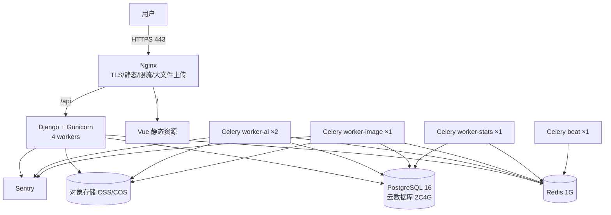

# 04 · 部署与运维手册

> 上游依据：[开发设计文档 v2.1](../知否-开发设计文档-v2.1.md) 第 15、17、18 章。
> 配置项见 [13-配置项与提示词库.md](13-配置项与提示词库.md)；架构约束见 [00-架构与工程约定.md](00-架构与工程约定.md)。

---

## 一、环境拓扑（两档）

### 1.1 一期：最小可用（几个班 / 约 500 学生）



| 组件 | 规格 | 说明 |
| --- | --- | --- |
| 应用服务器 | **4C8G**，系统盘 100G SSD + 数据盘 200G SSD | 承载 Nginx + Web + 三个 worker + beat |
| PostgreSQL | 云数据库 **2C4G**，50G 存储 | **强烈建议用云数据库**（自带备份、高可用、省运维） |
| Redis | 云 Redis **1G** | broker(db0) + 缓存(db1) |
| 对象存储 | OSS/COS 按量 | 主要存储成本 |
| 带宽 | 5 Mbps | 图片上传是主要流量 |
| 域名 + 证书 | Let's Encrypt 或云证书 | 自动续期 |

**一期资源约束的注意事项**：

| 事项 | 要求 |
| --- | --- |
| 图像 worker 并发 | **= CPU 核数（4）**，不要设 8。图像处理是计算密集型，超配反而变慢并拖垮 Web |
| 数据盘用途 | 图像处理的临时文件（`/tmp` 或专用目录），处理完立即删 |
| worker 内存 | 单张 300dpi A4 校正后约 25MB（300dpi × A4 ≈ 2480×3508 灰度）；并发 4 时峰值约 200MB，可接受 |
| Nginx 上传上限 | `client_max_body_size 50m`（扫描件可能较大） |
| 数据库连接数 | `web(4×5) + worker(4×5) + beat(1)` ≈ 50，云数据库 2C4G 默认 100 连接足够 |

### 1.2 满规模：100 班 / 5000 学生

| 变化 | 做法 | 触发时机 |
| --- | --- | --- |
| **图像 worker 独立机器** | 新增 4C8G 实例专跑 worker-image（并发 4） | 扫描量 > 200 张/天 |
| Web 水平扩展 | 2–3 台 Web + 负载均衡；Session 走 Redis | 在线 > 150 |
| 数据库升配 + 只读副本 | 主库 4C8G + 1 只读副本（统计查询走副本） | 慢查询增多或 CPU > 70% |
| worker 扩容 | worker-ai 扩到 4–8（受模型 API 并发约束）；worker-image 按核数 | 队列积压 > 100 |
| 对象存储生命周期 | 扫描原图 180 天后转低频/删除（保留判定结果） | 存储 > 200 GB |
| CDN | 静态资源与图片缩略图走 CDN | 带宽打满 |
| **分库分表** | **不做**（千万行级 PostgreSQL 完全够用） | 单表 > 1 亿行才考虑 |

**明确不建议过早做的事**：微服务拆分、分库分表、自建 Kubernetes。该规模用单体 + 云数据库 + 独立 worker 机器足够，过早复杂化会拖慢迭代。

---

## 二、部署方式

### 2.1 仓库部署文件

```
deploy/
├── docker/
│   ├── Dockerfile.web          # Django + Gunicorn
│   ├── Dockerfile.worker       # Celery worker（含 OpenCV 系统依赖）
│   └── Dockerfile.web-front    # 前端构建（多阶段）
├── compose/
│   ├── docker-compose.local.yml
│   ├── docker-compose.staging.yml
│   └── docker-compose.prod.yml
├── nginx/
│   ├── nginx.conf
│   └── conf.d/zhifou.conf
├── init/
│   ├── 01_extensions.sql       # pg_trgm / vector
│   ├── 02_preset_sheet_styles.sql
│   └── 03_platform_knowledge_templates.sh
└── .env.example
```

### 2.2 Dockerfile.worker 的关键点

```dockerfile
FROM python:3.12-slim

# ★ OpenCV 需要的系统库（漏装会导致 import cv2 失败）
RUN apt-get update && apt-get install -y --no-install-recommends \
    libgl1 libglib2.0-0 libsm6 libxext6 libxrender1 \
    fonts-noto-cjk fonts-noto-cjk-extra \
    && rm -rf /var/lib/apt/lists/*
# ★ fonts-noto-cjk 必须装：否则 ReportLab 生成的中文 PDF 全是方框

WORKDIR /app
COPY server/requirements.txt .
RUN pip install --no-cache-dir -r requirements.txt
COPY server/ .
CMD ["celery", "-A", "zhifou", "worker", "-Q", "p0_critical,p1_generate", "-c", "4", "-l", "info"]
```

**中文字体必须在镜像里**，这是生成试卷/答题卡/报告 PDF 的前置条件。字体路径写入配置：

```python
# zhifou/settings/base.py
REPORTLAB_CJK_FONT = "NotoSansCJKsc-Regular"
REPORTLAB_CJK_FONT_PATH = "/usr/share/fonts/opentype/noto/NotoSansCJK-Regular.ttc"
```

### 2.3 docker-compose.prod.yml（结构示意）

```yaml
services:
  postgres:
    image: pgvector/pgvector:pg16          # 必须用带 pgvector 的镜像
    environment:
      POSTGRES_DB: zhifou
      POSTGRES_PASSWORD: ${ZF_DB_PASSWORD}
    volumes:
      - pgdata:/var/lib/postgresql/data
      - ./init:/docker-entrypoint-initdb.d:ro
    healthcheck:
      test: ["CMD-SHELL", "pg_isready -U postgres"]
      interval: 10s
      retries: 5

  redis:
    image: redis:7-alpine
    command: redis-server --appendonly yes --maxmemory 900mb --maxmemory-policy allkeys-lru
    volumes: [redisdata:/data]

  web:
    build: {context: .., dockerfile: deploy/docker/Dockerfile.web}
    env_file: [.env]
    depends_on: {postgres: {condition: service_healthy}, redis: {condition: service_started}}
    command: gunicorn zhifou.wsgi:application -w 4 -k gthread --threads 4 -b 0.0.0.0:8000 --timeout 120
    restart: unless-stopped

  worker-image:
    build: {context: .., dockerfile: deploy/docker/Dockerfile.worker}
    command: celery -A zhifou worker -Q p0_critical -c ${ZF_IMAGE_WORKER_CONCURRENCY:-4} -l info
    # ★ 必须限制 CPU，否则会抢占 web 与 worker-ai
    deploy: {resources: {limits: {cpus: "3.0", memory: 2g}}}
    restart: unless-stopped

  worker-ai:
    build: {context: .., dockerfile: deploy/docker/Dockerfile.worker}
    command: celery -A zhifou worker -Q p0_critical,p1_generate -c 4 -l info
    restart: unless-stopped

  worker-stats:
    build: {context: .., dockerfile: deploy/docker/Dockerfile.worker}
    command: celery -A zhifou worker -Q p2_recompute -c 2 -l info
    restart: unless-stopped

  beat:
    build: {context: .., dockerfile: deploy/docker/Dockerfile.worker}
    command: celery -A zhifou beat -l info --scheduler django_celery_beat.schedulers:DatabaseScheduler
    restart: unless-stopped
    # ★ beat 必须单实例，多副本会导致定时任务重复触发

  nginx:
    image: nginx:1.27-alpine
    ports: ["80:80", "443:443"]
    volumes:
      - ./nginx/nginx.conf:/etc/nginx/nginx.conf:ro
      - ./nginx/conf.d:/etc/nginx/conf.d:ro
      - certs:/etc/letsencrypt:ro
      - static:/var/www/static:ro
    depends_on: [web]

volumes: {pgdata: {}, redisdata: {}, certs: {}, static: {}}
```

> **`worker-image` 的 `cpus: "3.0"` 限制是刻意的**：单机部署时，图像处理必须给 Web 让出资源。没有这个限制，一次 200 张卡的批量扫描会让整个系统卡死。

### 2.4 Nginx 关键配置

```nginx
server {
    listen 443 ssl http2;
    server_name zhifou.example.com;

    ssl_certificate     /etc/letsencrypt/live/zhifou.example.com/fullchain.pem;
    ssl_certificate_key /etc/letsencrypt/live/zhifou.example.com/privkey.pem;
    ssl_protocols TLSv1.2 TLSv1.3;

    # 安全头
    add_header Strict-Transport-Security "max-age=31536000" always;
    add_header X-Content-Type-Options nosniff always;
    add_header X-Frame-Options SAMEORIGIN always;

    # 上传上限（扫描件）
    client_max_body_size 50m;
    client_body_timeout 120s;

    # 前端静态资源（带 hash，长缓存）
    location /assets/ {
        alias /var/www/static/assets/;
        expires 1y;
        add_header Cache-Control "public, immutable";
    }
    # 其他静态（短缓存）
    location / {
        root /var/www/static;
        try_files $uri $uri/ /index.html;
        add_header Cache-Control "no-cache";
    }

    # API
    location /api/ {
        proxy_pass http://web:8000;
        proxy_set_header Host $host;
        proxy_set_header X-Real-IP $remote_addr;
        proxy_set_header X-Forwarded-For $proxy_add_x_forwarded_for;
        proxy_set_header X-Forwarded-Proto $scheme;
        proxy_read_timeout 180s;              # AI 类接口可能较慢
        limit_req zone=api burst=20 nodelay;
    }

    # 学生入口单独限流
    location /api/v1/s/ {
        proxy_pass http://web:8000;
        limit_req zone=student burst=10 nodelay;
    }

    # 手机扫描上传单独限流 + 放宽超时
    location /api/v1/scan/ {
        proxy_pass http://web:8000;
        client_max_body_size 20m;
        proxy_read_timeout 60s;
        limit_req zone=scan burst=30 nodelay;
    }

    # 指标仅内网
    location /metrics {
        allow 10.0.0.0/8;
        deny all;
        proxy_pass http://web:8000;
    }
}
```

**限流区定义**（`nginx.conf` 的 `http` 块）：

```nginx
limit_req_zone $binary_remote_addr zone=api:10m rate=10r/s;
limit_req_zone $binary_remote_addr zone=student:10m rate=2r/s;
limit_req_zone $binary_remote_addr zone=scan:10m rate=5r/s;
```

---

## 三、首次部署步骤（Checklist）

```bash
# 1. 准备环境
cp deploy/.env.example deploy/.env && vim deploy/.env     # 填全部 ZF_* 变量
# 必填：ZF_SECRET_KEY / ZF_DATABASE_URL / ZF_REDIS_URL / ZF_ALLOWED_HOSTS
#       ZF_OSS_* / ZF_AI_QWEN_API_KEY / ZF_AI_DEEPSEEK_API_KEY / ZF_MASK_PII=true

# 2. 生成 Django secret
python -c "import secrets; print(secrets.token_urlsafe(64))"

# 3. 启动数据库与 Redis
docker compose -f deploy/compose/docker-compose.prod.yml up -d postgres redis
docker compose -f deploy/compose/docker-compose.prod.yml exec postgres \
  psql -U postgres -d zhifou -c "CREATE EXTENSION IF NOT EXISTS vector; CREATE EXTENSION IF NOT EXISTS pg_trgm;"

# 4. 迁移
docker compose ... run --rm web python manage.py migrate

# 5. 建超级管理员
docker compose ... run --rm web python manage.py createsuperuser

# 6. 导入平台预置数据（知识点模板 / 章节模板 / 答题卡样式 / 提示词模板）
docker compose ... run --rm web python manage.py loaddata deploy/init/fixtures/*.json
docker compose ... run --rm web python scripts/import_platform_templates.py
docker compose ... run --rm web python scripts/import_prompt_templates.py --dir apps/ai/prompts/

# 7. 构建前端
cd web && pnpm install && pnpm build       # 产物拷到 volume static

# 8. 启动全部服务
docker compose -f deploy/compose/docker-compose.prod.yml up -d

# 9. 冒烟测试（见第七节）
```

**上线检查清单（**发布前逐项打勾**）**：

```
□ HTTPS 证书有效且自动续期已配置
□ ZF_DEBUG=false，ZF_MASK_PII=true
□ 数据库连接池配置正确（worker 数 × 连接数 ≤ 上限）
□ Celery 队列分级（p0/p1/p2）与并发上限已设
□ 图像 worker 并发 = CPU 核数，且已限制 cpus
□ beat 单实例
□ 对象存储 CORS 配置（允许前端域名直传）与私有读
□ 签名 URL 有效期 ≤ 300s
□ ★ 脱敏回归测试通过（日志与请求体无身份字段）
□ ★ OMR 双通道测试集回归通过（手机/扫描仪分别达标）
□ ★ 配图识别测试集回归通过（召回/归属/裁切达标）
□ 限流规则生效（api / student / scan 三区）
□ 备份任务与告警已配置并验证过恢复
□ 敏感操作审计生效（成绩修改、学号重绑、配图修改）
□ Sentry 前后端已接入
□ 平台知识点模板 + 章节模板已导入（至少数学/物理/英语）
□ 答题卡样式预设 ≥ 3 个（8 位 / 6 位 / 12 位多行）与默认样式已配置
□ 提示词模板已初始化（≥ 28 个：3 科 × 8 任务 + 4 通用）
□ 演示数据 seed 可用（staging 用）
□ 视觉走查通过（首页、题目编辑器、手机扫描页对照 AI 味清单）
□ 全链路冒烟：导入(含配图确认) → 组卷 → 绑定答题卡 → 发布 → 作答/扫描 → 批改(含主观题录分) → 学情 → 练习 → 导出
```

---

## 四、备份与恢复

### 4.1 备份策略

| 对象 | 策略 | 保留 | 演练频率 |
| --- | --- | --- | --- |
| PostgreSQL | 每日全量 + WAL 持续归档（PITR） | 30 天 | **每季度恢复演练** |
| 对象存储 | 跨区域复制或定时同步到独立 bucket | 与源一致 | 每半年 |
| 配置与密钥 | 加密存于密钥管理服务（KMS/Vault） | — | 每次变更 |
| Redis | **不备份**（仅缓存与队列，丢失后重建） | — | — |

**恢复目标**：RPO ≤ 15 分钟，RTO ≤ 2 小时。

### 4.2 ★ 扫描原图的特殊性（必须理解）

| 问题 | 说明 |
| --- | --- |
| 数据库有判定结果，但没有原图 | 数据库存的是"张三第 7 题选 B，置信度 0.94"，原图在对象存储 |
| 原图丢失的影响 | **无法复核历史识别结果**；不影响成绩、统计、报告、学情 |
| 因此的备份策略 | 对象存储必须跨区备份；且**必须在文档中明确"原图丢失不影响业务正确性"**，以便出问题时快速决策 |
| 清理的铁律 | 删除前必须 `asset.ref_count = 0` 且超过 `retain_until` |

### 4.3 恢复演练流程（每季度一次）

```bash
# 1. 从备份恢复到一个临时库
pg_restore -h temp-host -U postgres -d zhifou_restore latest.dump

# 2. 指向临时库验证
ZF_DATABASE_URL=postgres://.../zhifou_restore python manage.py check
python manage.py shell -c "
from apps.questionbank.models import Question
from apps.grading.models import ScoreResult
print('题目数', Question.objects.count())
print('评分记录数', ScoreResult.objects.count())
print('最近一次作业成绩', ScoreResult.objects.filter(assignment__isnull=False).count())
"

# 3. 验证对象存储可达（抽样 10 个 asset 的签名 URL）
python scripts/verify_assets.py --sample 10

# 4. 记录演练结果（RTO 实测值）到运维记录
```

### 4.4 破坏性操作前的强制检查

```bash
# 清理脚本默认 dry-run，必须显式 --execute
python manage.py cleanup_assets --kind SCAN_RAW --execute
```

**铁律**：任何删除/移动操作前，脚本必须打印**解析后的绝对路径/对象 key 列表**并要求确认。生产环境执行前先在 staging 跑一次 dry-run。

---

## 五、监控与告警

### 5.1 指标采集

| 层 | 采集方式 |
| --- | --- |
| 应用 | `django-prometheus` 暴露 `/metrics`（仅内网） |
| Celery | `celery-exporter` 或自定义 exporter 读 Redis |
| 数据库 | 云数据库自带监控 + `postgres_exporter` |
| Redis | `redis_exporter` |
| 主机 | `node_exporter` |
| 日志 | 结构化 JSON → Loki 或云日志服务 |
| 异常 | Sentry（前后端） |

### 5.2 告警规则（**按级别与响应时限**）

| 告警 | 条件 | 级别 | 响应时限 | 处置 |
| --- | --- | --- | --- | --- |
| 备份失败 | 任一次失败 | **P0** | 30 分钟 | 见 8.3 |
| 服务不可用 | 健康检查连续 3 次失败 | **P0** | 15 分钟 | 见 8.1 |
| 接口错误率 | 5xx > 1%（5 分钟） | P1 | 1 小时 | 看 Sentry 定位 |
| P0 队列积压 | `p0_critical` > 50 | P1 | 1 小时 | 加 worker 或查阻塞任务 |
| AI 失败率 | > 10%（10 分钟） | P1 | 2 小时 | 查厂商状态页，确认降级生效 |
| OMR 失败率 | > 5%（按批次） | P1 | 2 小时 | 看批次质量报告定位原因 |
| 磁盘/存储 | > 80% | P1 | 4 小时 | 清理或扩容 |
| P95 延迟 | > 2s（10 分钟） | P2 | 1 天 | 查慢查询 |
| AI 预算 | 日用量 > 90% | P2 | 1 天 | 通知管理员 |
| 配图待确认积压 | 单机构 > 200 且 > 24h | P3 | 3 天 | 提醒教师处理 |
| 扫描原图存储增长异常 | 周环比 > 50% | P3 | 3 天 | 检查保留策略是否生效 |

### 5.3 关键业务看板（Grafana）

| 看板 | 核心图表 |
| --- | --- |
| **AI 价值** | 各功能采纳率趋势、引用有效率、平均耗时、按机构/任务成本堆叠图 |
| **导入效率** | 批次完成耗时分布、配图确认耗时/张、切题正确率、`suspicious_speed` 批次占比 |
| **扫描质量** | 手机 vs 网页通道静默通过率对比、失败原因分布饼图、学号识别失败率 |
| **闭环** | 组卷→发布→批改→学情→练习转化率、个性化练习采纳率、效果提升 Δ 分布 |
| **系统健康** | QPS、P95、错误率、队列深度、worker 利用率、DB 连接数 |

---

## 六、定时任务（Celery Beat）

| 任务 | 频率 | 说明 |
| --- | --- | --- |
| `cleanup_expired_assets` | 每日 03:00 | 按 `retain_until` + `ref_count=0` 清理（默认 dry-run 开关可控） |
| `cleanup_export_zips` | 每小时 | 清理超 24h 的导出包 |
| `recalc_all_mastery` | 每日 02:00 | 全量重算掌握度（校正增量衰减偏差），分机构分批 |
| `take_scheduled_snapshots` | 每日 02:30 | 定时诊断快照（有数据的班级） |
| `check_knowledge_graph_cycles` | 每周一 04:00 | 检测 `PREREQUISITE` 环，发现则告警 |
| `check_bank_health` | 每日 05:00 | 统计题库健康度，缺口写入缓存供首页展示 |
| `measure_practice_effect` | 每日 06:00 | 计算到期的练习效果（`effect_measure_delay_days`） |
| `aggregate_question_error_stats` | 每日 06:30 | 重算题目错误统计（班级/年级维度） |
| `refresh_kb_health` | 每日 07:00 | 知识库健康度（覆盖率/利用率/采纳率） |
| `mark_stale_practice_sets` | 每小时 | 标记需要重新评估的练习 |
| `report_ai_cost` | 每日 08:00 | 生成前一日 AI 成本报表，超预算告警 |
| `verify_asset_refcount` | 每周日 03:00 | 校验 `asset.ref_count` 与实际引用是否一致，不一致则修正并告警 |
| `expire_pii_mappings` | 每日 04:30 | 清理过期的脱敏映射 |

**beat 单实例铁律**：多副本会导致所有定时任务重复执行（重复清理、重复重算）。

**任务幂等要求**：所有定时任务必须可重复执行且结果一致。清理类任务默认 dry-run（`storage.cleanup_dry_run=true`），首次上线必须 dry-run 观察至少一周。

---

## 七、冒烟测试（部署后必跑）

```bash
python scripts/smoke_test.py --base-url https://zhifou.example.com --token $TEACHER_TOKEN
```

**冒烟项**：

| # | 项 | 断言 |
| --- | --- | --- |
| 1 | `GET /health/` | 200，DB 与 Redis 均 ok |
| 2 | `GET /api/v1/org/current/` | 返回机构信息 |
| 3 | 上传一份测试试卷 → 导入批次 | 批次创建成功，返回 task_id |
| 4 | 轮询解析任务 | 最终 `SUCCESS`，检出题目数 > 0 |
| 5 | **存在 PENDING 配图时尝试完成批次** | **返回 `FIGURE.PENDING_CONFIRM`（门禁生效）** |
| 6 | 逐图确认全部配图 | 批次可完成 |
| 7 | 规则组卷 | 返回试卷，题量/总分符合配置 |
| 8 | 生成答题卡 | 返回 PDF URL，可下载且为 PDF 魔数 |
| 9 | 发布任务 | 返回 publish_token 与二维码 |
| 10 | 学生入口 `GET /s/{token}/` | 200 |
| 11 | 上传一张答题卡扫描图 | 识别成功或进仲裁队列 |
| 12 | 自动批改 | 客观题生成 `score_result` |
| 13 | 主观题逐题录分 | 写入成功，总分正确 |
| 14 | 确认成绩 | 触发重算，30s 内学情可查 |
| 15 | 生成个性化练习 | 45 份，题量与源试卷一致 |
| 16 | 导出练习 PDF 包 | ZIP 可下载，含 45 份卷 + 1 份通用答题卡 |
| 17 | `GET /api/v1/ai/usage/` | 返回成本数据 |
| 18 | 关闭 AI（mock 失败）后重试步骤 12 | 系统仍可用，AI 按钮报 `AI.PROVIDER_UNAVAILABLE` |

**冒烟失败即回滚**（见 8.4）。

---

## 八、故障处置手册

### 8.1 服务不可用

```bash
# 1. 确认范围
curl -s https://zhifou.example.com/health/ | jq
docker compose ps

# 2. 常见原因速查
#   a) DB 连接耗尽     → 看 pg_stat_activity，杀长事务
#   b) 内存 OOM        → dmesg | tail，看被 kill 的进程
#   c) 磁盘满          → df -h，先清 /tmp 与日志
#   d) worker 全挂     → 重启 worker，检查是否有毒任务（同一任务反复失败）
#   e) 图像处理拖垮    → 确认 worker-image 的 cpus 限制是否生效

# 3. 快速恢复（优先保 Web 可用）
docker compose restart web
docker compose stop worker-image        # 必要时停图像处理，保 Web
```

**降级顺序**（保核心教学流程）：

```
1. 停 worker-image（扫描降级为手工录入）
2. 停 p1_generate（AI 生成类暂停）
3. 保 p0_critical 中的批改
4. 保 Web 主流程
```

### 8.2 队列积压

```bash
# 查看各队列深度
redis-cli -n 0 llen p0_critical
redis-cli -n 0 llen p1_generate
redis-cli -n 0 llen p2_recompute

# 查看正在执行的任务
celery -A zhifou inspect active

# 找出毒任务（同一任务反复重试）
celery -A zhifou inspect scheduled
```

| 原因 | 处置 |
| --- | --- |
| worker 数不足 | 临时扩 worker（注意图像任务不要超核数） |
| 有毒任务反复失败 | `celery -A zhifou purge -Q <queue>` **前先确认不会丢业务数据**；然后定位任务本身 |
| 模型 API 限流导致 p1 堆积 | 降低 p1 并发，等限流窗口过去 |
| 大批量扫描涌入 | 正常，向教师展示进度；必要时临时提高 worker-image 并发（不超过核数） |

### 8.3 备份失败

| 步骤 | 操作 |
| --- | --- |
| 1 | 立即手动触发一次全量备份 |
| 2 | 检查数据库磁盘空间与备份账号权限 |
| 3 | 若连续 2 天失败，升级为 P0 并暂停生产写入变更 |
| 4 | 记录到运维日志，24 小时内补齐备份链 |

### 8.4 回滚流程

```bash
# 应用回滚（镜像 tag 回退）
docker compose -f deploy/compose/docker-compose.prod.yml \
  up -d --no-deps --force-recreate web \
  -e ZF_IMAGE_TAG=<previous-tag>

# 数据库回滚（迁移）
docker compose ... run --rm web python manage.py migrate <app> <previous_migration_name>

# ★ 数据回滚（成绩类不可逆操作的唯一保障）
#   从 PITR 恢复到指定时间点 → 导出受影响的表 → 人工核对后导入
#   这是最后手段，必须技术负责人批准
```

**回滚判定**：冒烟测试失败、核心接口错误率 > 5%、出现数据正确性问题（分数算错、串号）→ **立即回滚**。

### 8.5 数据正确性问题（最严重）

| 症状 | 排查 | 处置 |
| --- | --- | --- |
| 全班成绩串号 | 检查 `assignment_student.question_order` 是否逐生不同且已持久化 | 立即冻结该任务的成绩发布；用 `question_order` 重算答案映射；写事故报告 |
| 学号识别错导致记错人 | 查 `scan_card.recognized_student_no` 与 `student_no_confidence` | 该批次全部进人工复核；调低 `student_no_confidence_threshold` 更保守 |
| 配图张冠李戴 | 查 `question_image.binding_method` 与 `binding_confidence` | 该批次配图全部重新确认；检查归属规则是否有 bug |
| 难度统计异常 | 查 `difficulty_source` 与样本数 | 若 `difficulty_source=STAT` 但样本 < 30，说明切换规则有 bug |

**铁律**：任何数据正确性问题都必须**保留现场**（不改数据、不删记录），先备份相关表再处置，并写事故报告。

### 8.6 模型 API 故障

```bash
# 确认降级是否生效
redis-cli -n 1 get zf:rl:ai:global
curl -s https://status.deepseek.com/ | head
```

| 情况 | 处置 |
| --- | --- |
| 单一厂商不可用 | 路由自动降级到候选模型（检查 `fallback_used` 指标） |
| 全部厂商不可用 | AI 按钮置灰，业务继续；通知教师 |
| 厂商涨价 | 改 `routing.yaml` 优先级或 `ai_config.model_preference` |
| 用量异常激增 | 检查是否有人刷接口；临时降 `ai.rate_limit.per_org_per_minute` |

---

## 九、扩容操作手册

### 9.1 扩容判定表

| 观测 | 阈值 | 扩容动作 |
| --- | --- | --- |
| Web CPU | > 70% 持续 15 分钟 | 加 Web 实例（先确认 Session 已走 Redis） |
| p0 队列深度 | > 50 持续 10 分钟 | 加 worker-image（不超过核数）或独立机器 |
| DB CPU | > 70% | 升配或加只读副本（统计查询走副本） |
| DB 连接数 | > 80% | 加连接池或升配 |
| 对象存储 | > 200 GB | 检查保留策略是否生效；必要时缩短 `scan_raw_retain_days` |
| 带宽 | > 80% | 上 CDN |

### 9.2 水平扩容 Web 的关键前提

| 前提 | 说明 |
| --- | --- |
| Session 存储 | 学生作答会话在 Redis（已满足），Django Session 也要改 Redis |
| 静态资源 | 由 Nginx/CDN 提供，不依赖单机 |
| 文件上传 | 走对象存储（已满足） |
| 定时任务 | **beat 仍然单实例**（扩容 Web 不影响） |
| 上传会话 | 手机端上传会话在 Redis（已满足） |

### 9.3 数据库只读副本的使用

| 查询类型 | 走哪 |
| --- | --- |
| 统计聚合（热力图、错误统计、成本报表） | 副本 |
| 列表与详情 | 主库（避免主从延迟导致"刚改完看不到"） |
| 写入 | 主库 |

**实现**：Django database router + 显式 `.using("replica")`；**默认走主库**，只有明确标记的统计查询走副本（避免主从延迟引发的诡异 bug）。

---

## 十、成本监控

| 项 | 一期（几班） | 满规模（100 班） |
| --- | --- | --- |
| Web 服务器 | ¥200–400/月 | ¥600–1,200/月（2–3 台） |
| 图像 worker 机器 | 与 Web 同机 | ¥200–400/月（独立） |
| 云数据库 | ¥300–600/月 | ¥800–1,500/月 |
| Redis | ¥50–100/月 | ¥150–300/月 |
| 对象存储 + 流量 | ¥50–200/月 | **¥800–2,000/月** |
| 监控/告警 | ¥0–200/月 | ¥200–500/月 |
| **合计** | **≈ ¥700–1,500/月** | **≈ ¥2,800–6,000/月** |

**AI 用量成本**（5000 学生一学期）≈ **¥4,700**（详见设计文档 18 章，识别/组卷/练习选题均无 AI 成本）。

**成本控制要点**：

| 措施 | 效果 |
| --- | --- |
| 扫描原图 180 天保留 | **存储成本最大杠杆**；不清理两年后到 600 GB+ |
| 配图优先走对象抽取 | 准确率更高且 AI 成本为 0 |
| AI 生题严格限制 | 占总成本比例很小 |
| 提示词前缀缓存 | 输入成本降 80% |
| Batch API | 批量任务 5 折 |
| 导出包 24h 清理 | 防存储堆积 |
| 机构预算护栏 | 防异常调用打光额度 |

---

## 十一、运维日常检查表

**每日**：

```
□ 服务健康检查（/health/）
□ 队列深度（三个队列）
□ 错误率与告警回顾
□ 备份成功确认
□ AI 成本是否异常
□ 存储增长趋势
```

**每周**：

```
□ `asset.ref_count` 一致性校验结果
□ 题库健康度缺口变化
□ 知识库覆盖率变化
□ 配图待确认积压情况
□ 慢查询 Top 10 回顾
```

**每月**：

```
□ 依赖版本安全更新（CVE）
□ 容量趋势评估（是否需扩容）
□ 成本对账
□ 恢复演练记录检查（每季度一次）
□ 日志中是否出现 PII（抽查）
```

---

## 变更记录

| 版本 | 日期 | 变更人 | 说明 |
| --- | --- | --- | --- |
| v1.0 | 2026-10-01 | — | 首版，对齐设计文档 v2.1 第 15、17、18 章 |

## 待确认问题

| 编号 | 问题 | 影响 |
| --- | --- | --- |
| Q-04-1 | 对象存储选阿里云 OSS 还是腾讯云 COS？ | 影响 SDK 与跨区复制配置；建议与云服务器同厂商降低流量成本 |
| Q-04-2 | 一期图像 worker 是否与 Web 同机？（同机需严格限制 cpus） | 影响一期规格与稳定性 |
| Q-04-3 | 是否需要多可用区部署？ | 影响成本与可用性等级 |
| Q-04-4 | 云数据库是否开启自动扩容？ | 影响成本可控性 |
| Q-04-5 | 是否使用公司统一下发的中文字体授权（Noto 为开源可商用）？ | 影响镜像构建 |
