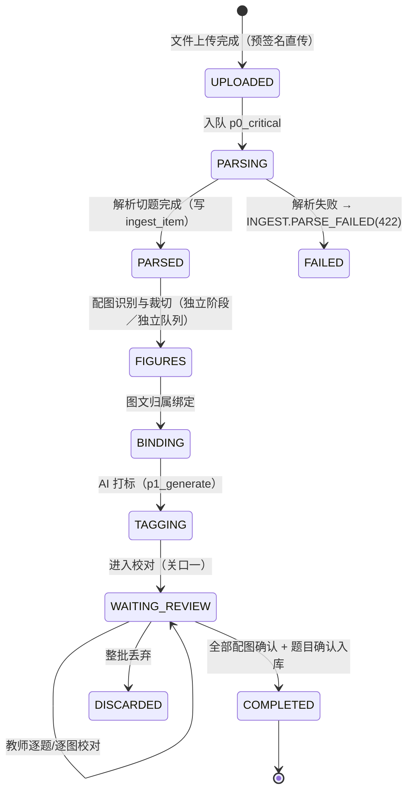
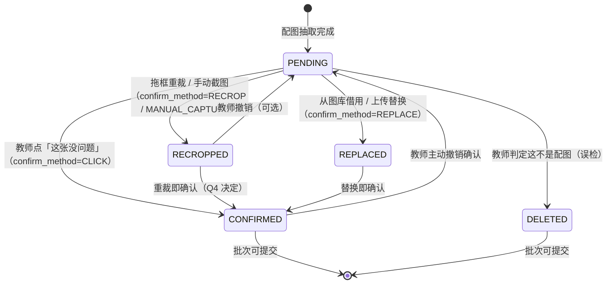

# 07 · 导入与配图识别规格

> **上游依据**：设计文档 v2.1 第 7.1–7.2（知识体系与知识库）、7.3（导入流水线）、**7.4 全节（配图识别专项，含 7.4.8 逐图确认）**、7.5（切题）、7.6（去重与相似题）、7.7（AI 能力边界）、12.4（`question` / `question_option` / `question_image` / `question_relation` / `asset`）、12.7（`scan_card`）、13.2（接口清单）、14.1（页面清单）、16.3（配图测试集）、16.4（强制测试用例）、附录 F（配置项）。
>
> **共享约定**：命名、状态枚举、错误码、异步契约、坐标用相对比例一律遵守 [README.md](README.md)。阈值名称与默认值以附录 F 为准（13 文档为唯一事实来源），本文只落地实现。
>
> **本文核心风险**：配图错误是**沉默错误**——题干文字是对的，只是图错了或丢了，教师校对时容易只看文字、忽略图，于是错误进入题库并最终出现在学生试卷上。7.4.8 的「强制逐图确认」就是为了兜住它。

---

## 一、导入流水线

### 1.1 状态机与阶段



| 阶段 | 输入 | 输出 | 队列 | 进度权重 |
| --- | --- | --- | --- | --- |
| `UPLOADED` | 原始文件 bytes（`asset.kind=UPLOAD_SOURCE`） | `ingest_batch` 行 | — | 0–5 |
| `PARSING` | 文件 | 文本流 + 页面图（300dpi）+ `ingest_item[]`（初切） | `p0_critical` | 5–35 |
| `FIGURES` | 页面图 + `ingest_item[]` 边界 | `question_image[]`（`review_status=PENDING`） | `p0_critical` | 35–75 |
| `BINDING` | `question_image[]` + 题目边界 | `binding_method` / `binding_confidence` 写入 | `p0_critical` | 75–85 |
| `TAGGING` | `ingest_item[]` | `knowledge_tags` / `type` / `difficulty_ai` 建议 | `p1_generate` | 85–95 |
| `WAITING_REVIEW` | 全部产物 | 教师校对结果 | — | 95–100 |
| `COMPLETED` | — | `question` + `question_image` + `asset` 入库 | — | 100 |

**表与字段（12.4 / 12.7）**：

| 表 | 关键字段 | 说明 |
| --- | --- | --- |
| `ingest_batch` | `id` `org_id` `file_asset_id` `status` `total_items` `confirmed_items` `figure_pending_count` `threshold_version` `error_code` | `status` ∈ `UPLOADED / PARSING / PARSED / FIGURES / BINDING / TAGGING / WAITING_REVIEW / COMPLETED / FAILED / DISCARDED` |
| `ingest_item` | `id` `batch_id` `seq` `stem_html` `options` `answer` `explanation` `has_figure` `images` `source_ref` `recognition_confidence` `warnings` `review_status` | `review_status` ∈ `PENDING / CONFIRMED / DISCARDED` |
| `question_image` | 见 7.4.8.6 全字段 | **`ingest_batch_id` 是批次完成门禁的依据** |

**异步返回契约（README 第七节）**：`POST /ingest/batches/` 返回 `202 + {task_id, task_type: "ingest.parse", status: "PENDING", queue: "p0_critical", progress: 0}`。

```python
# apps/ingest/tasks.py
@shared_task(queue="p0_critical", bind=True, max_retries=2)
def parse_ingest_batch(self, batch_id: int) -> dict:
    """导入主流程。各阶段独立可重试，进度按 1.1 的权重回传。"""
    batch = IngestBatch.objects.get(id=batch_id)
    try:
        _set_progress(batch, 5, "正在识别文件类型")
        parsed = parse_document(batch.file_asset)               # 第二节
        items = segment_questions(parsed)                       # 第三节
        _set_progress(batch, 35, f"已切出 {len(items)} 道题")

        figures = extract_and_bind_figures(parsed, items)       # 第四、五、六节
        _set_progress(batch, 85, f"已识别 {len(figures)} 张配图")

        consistency_recheck(items, figures)                     # 3.3 三轮迭代
        tag_questions.apply_async(args=[batch_id], queue="p1_generate")   # 打标走 P1
        batch.status = "WAITING_REVIEW"
        _set_progress(batch, 95, "等待校对")
        return {"item_count": len(items), "figure_count": len(figures)}
    except ParseFailed as e:
        batch.status, batch.error_code = "FAILED", "INGEST.PARSE_FAILED"
        raise self.retry(exc=e, countdown=10) from e
```

**进度回传规则**：`progress` 为 0–100 整数；无进度概念的子任务恒为 0，`SUCCESS` 时置 100。前端轮询按 README 第七节节奏。

---

## 二、解析策略选择

### 2.1 判定与分支

```python
# apps/ingest/parser/__init__.py
def parse_document(asset) -> ParsedDocument:
    """按文件类型与文本层可用性分流。混合场景走 MIXED。"""
    kind = sniff_file_kind(asset)          # 魔数优先，扩展名兜底

    if kind == "DOCX":
        return parse_docx(asset)           # python-docx：路径 2 的直接抽取（见 4.2）
    if kind == "PDF":
        doc = fitz.open(stream=asset.read(), filetype="pdf")
        text_chars = sum(len(p.get_text("text").strip()) for p in doc)
        if text_chars / max(len(doc), 1) < MIN_CHARS_PER_PAGE:
            return parse_scanned_pdf(asset, doc)    # 扫描件：转图 → 路径 3
        # 文本层存在，但可能存在「文字可抽 + 公式是图片」的混合情形
        if has_latex_like_images(doc) or page_has_vector_formula(doc):
            return parse_mixed_pdf(asset, doc)      # 见 2.2
        return parse_text_pdf(asset, doc)           # 路径 1：矢量/位图对象直接抽取
    if kind in ("PNG", "JPEG", "TIFF"):
        return parse_image_as_scan(asset)
    raise ParseFailed(f"不支持的文件类型：{kind}")


MIN_CHARS_PER_PAGE = 100        # 需标定：低于此值视为无有效文本层
SCAN_RENDER_DPI = 300           # 设计文档 7.3：扫描件页面转图 300dpi
```

| 分支 | 判定 | 处理 | 配图路径 |
| --- | --- | --- | --- |
| `TEXT_PDF` | 有文本层，无公式图/矢量公式 | PyMuPDF 抽文本 + 版面块 → 切题 | **路径 1**（`page.get_images()` / `page.get_drawings()`） |
| `SCANNED_PDF` | 平均每页字符 < 100 | 逐页渲染 300dpi PNG → 视觉识别 | **路径 3** |
| `DOCX` | .docx | python-docx 按文档流抽文本 + `inline_shapes` | **路径 2** |
| `IMAGE_SCAN` | 图片文件 | 直接进路径 3 | 路径 3 |
| `MIXED` | 文本层可用 + 存在公式类图片对象 | 文本走 PyMuPDF，公式区域走视觉模型转 LaTeX | 路径 1 + 路径 3 |

### 2.2 混合场景（文本层拿文字 + 视觉模型补公式）

```python
def parse_mixed_pdf(asset, doc) -> ParsedDocument:
    """混合场景：文本层负责文字与排版；公式区域交给视觉模型转 LaTeX，绝不裁成图片。"""
    pages = []
    for page in doc:
        text_blocks = [b for b in page.get_text("dict")["blocks"] if b["type"] == 0]
        # 1) 找出"疑似公式"的位图/矢量对象：面积小、宽高比异常、附近无完整句子
        formula_boxes = detect_formula_candidates(page)
        # 2) 用公式区域的 bbox 从 text_blocks 中挖掉对应文字（避免重复）
        text_blocks = subtract_boxes(text_blocks, formula_boxes)
        pages.append(PageText(page_no=page.number + 1, blocks=text_blocks,
                              formula_boxes=formula_boxes,
                              images=page.get_images(full=True)))
    # 3) 公式区域成批送视觉模型 → LaTeX（见 4.3.3）
    formulas = batch_formula_to_latex(asset, pages)
    return ParsedDocument(pages=pages, formulas=formulas, source_kind="MIXED_PDF")


def detect_formula_candidates(page) -> list[tuple[float, float, float, float]]:
    """疑似公式的启发式判据（高召回，允许误检由视觉模型过滤）：
    ① 内嵌图片且 高度 < 页面高度 8%（公式通常矮而宽）
    ② 文字块中含大量数学字体字形（CJK 占比 < 15% 且含 ∈ ∑ ∫ √ 等）
    ③ 矢量对象集中在同一基线上
    阈值均需在真实数据上标定。
    """
    ...
```

| 场景 | 规则 | 依据 |
| --- | --- | --- |
| 文字 | 一律以文本层为准（准确率 100%） | 7.4.2「能用前一条就不走后一条」 |
| 公式 | 文本层抽出的是**乱码/散字** → 用视觉模型转 LaTeX，**绝不裁图** | 7.4.3 关键分类决策 |
| 图片 | 走路径 1 直接抽取 PDF 对象 | 7.4.2 |
| 表格 | 文本层可重建 → HTML 表格；否则裁图 | 7.4.3 |

---

## 三、切题算法

### 3.1 三级策略

```python
# apps/ingest/segmenter.py
LEVEL1_MIN_MATCHES = 3          # 正则策略的最低命中数（低于此值说明模式不成立）


def segment_questions(parsed: ParsedDocument) -> list[IngestItem]:
    """三级策略：正则题号模式表 → 版面行距一维聚类 → 视觉模型兜底。"""
    # ── Level 1：正则题号模式表 ─────────────────────────────────
    try:
        items = segment_by_patterns(parsed)
        if len(items) >= LEVEL1_MIN_MATCHES and quality_gate(items, parsed)["ok"]:
            return items
    except SegmentError:
        pass

    # ── Level 2：版面行距一维聚类 ───────────────────────────────
    items = segment_by_layout_clustering(parsed)
    q = quality_gate(items, parsed)
    if q["ok"]:
        return items

    # ── Level 3：视觉模型兜底 ───────────────────────────────────
    items = segment_by_vision(parsed, hint=q)
    for it in items:
        it.warnings.append("SEGMENT_BY_VISION")     # 必须标记，供校对界面高亮
    return items
```

**Level 1：题号模式表**（每种学科各一套，存 13 文档）

```python
# apps/ingest/patterns.py
QUESTION_PATTERNS = [
    r"^\s*(?P<seq>\d{1,2})\s*[.、．]\s*(?P<rest>.+)$",                 # 1. / 1、 / 1．
    r"^\s*[(（]\s*(?P<seq>\d{1,2})\s*[)）]\s*(?P<rest>.+)$",            # (1) （1）
    r"^\s*第\s*(?P<seq>\d{1,2})\s*题[.、:：]?\s*(?P<rest>.*)$",        # 第1题
]
GROUP_PATTERNS = [
    r"^\s*(?P<title>[一二三四五六七八九十]+\s*[、.．]\s*[^\n]{0,40}(题|部分).*)$",  # 一、选择题
    r"^\s*(?P<title>第\s*[一二三四五六七八九十]+\s*部分.*)$",                        # 第二部分
    r"^\s*(?P<title>[（(]\s*[一二三四五六七八九十]+\s*[)）]\s*.*)$",                # （一）单选题
]
OPTION_PATTERN = r"^\s*(?P<label>[A-HＡ-Ｈ])\s*[.、．:：]?\s*(?P<content>.+)$"
```

**Level 2：版面行距一维聚类**

```python
def segment_by_layout_clustering(parsed: ParsedDocument) -> list[IngestItem]:
    """按行间距对文本行做一维聚类：题与题之间的留白显著大于行内行距。
    1) 收集所有文本行的 y 中心 → 2) 计算相邻间距 → 3) 用 1.5×中位行距作阈值切段
    4) 段内再用题型启发式（选项数、答案位置）定界
    阈值需在真实数据上标定。
    """
    lines = collect_text_lines(parsed)                 # [{y, text, page}]
    gaps = np.diff([l.y for l in lines])
    median_gap = float(np.median(gaps))
    cut_threshold = median_gap * LINE_GAP_FACTOR
    segments = split_by_gaps(lines, cut_threshold)
    return [build_item(seg) for seg in segments]


LINE_GAP_FACTOR = 1.5       # 需标定
```

**Level 3：视觉模型兜底**：把整页图 + Level 1/2 的失败原因一起送入视觉模型，要求返回题目边界（页内 bbox 相对比例）与题型。**返回必须经 Schema 校验**（第七节），失败则整批转人工。

### 3.2 大题分组识别

```python
def assign_group_titles(items: list[IngestItem], parsed: ParsedDocument) -> None:
    """识别「一、选择题」这类大题标题，并写入 paper_item.section_title 的来源字段。"""
    current = None
    for block in parsed.ordered_blocks:
        if m := match_any(GROUP_PATTERNS, block.text):
            current = GroupTitle(title=normalize_title(m["title"]),
                                 infer_type=infer_section_type(m["title"]))
        elif block.item_ref:
            items_by_ref[block.item_ref].group_title = current.title if current else None
            items_by_ref[block.item_ref].inferred_type = current.infer_type if current else None


SECTION_TYPE_HINTS = {"选择题": "SINGLE_CHOICE", "多选题": "MULTI_CHOICE",
                      "判断题": "TRUE_FALSE", "填空题": "FILL_BLANK",
                      "解答题": "CALCULATION", "计算题": "CALCULATION", "证明题": "PROOF",
                      "实验题": "SHORT_ANSWER", "简答题": "SHORT_ANSWER", "作文": "ESSAY"}
```

### 3.3 切题质量自检规则表

```python
# apps/ingest/quality.py
def quality_gate(items: list[IngestItem], parsed: ParsedDocument) -> dict:
    """切题质量自检。返回 {"ok": bool, "issues": [...]}。
    不通过 → 降级到下一级策略；三级都不通过 → 整批标记 SEGMENT_UNCERTAIN 转人工。
    同时把 issues 作为 ingest_item.warnings 落库，供校对界面高亮。"""
    issues = []
    pages = parsed.page_count
    expect = parsed.expected_question_count          # 由题号正则的最大值 / 大纲解析推断

    if expect and not (expect * 0.8 <= len(items) <= expect * 1.2):
        issues.append(f"QUESTION_COUNT_MISMATCH: 期望 ≈{expect}，实际 {len(items)}")
    for it in items:
        if len(it.stem_text) < MIN_STEM_CHARS:
            issues.append(f"SHORT_STEM_Q{it.seq}")
        if len(it.stem_text) > MAX_STEM_CHARS:
            issues.append(f"LONG_STEM_Q{it.seq}")
        if it.type in OBJECTIVE_TYPES:
            n = len(it.options)
            if n not in (2, 3, 4, 5, 6):
                issues.append(f"OPTION_COUNT_ANOMALY_Q{it.seq}:{n}")
        if it.type in ("SINGLE_CHOICE", "MULTI_CHOICE", "TRUE_FALSE", "FILL_BLANK") and not it.answer:
            issues.append(f"NO_ANSWER_Q{it.seq}")
    # 单页 0 题：只对「应当是题目页」的页报警（首页可能是封面）
    for p in range(2, pages + 1):
        if not any(it.source_ref["page"] == p for it in items):
            issues.append(f"ZERO_QUESTIONS_ON_PAGE_{p}")

    return {"ok": len([i for i in issues if not i.startswith("NO_ANSWER")]) == 0,
            "issues": issues}


MIN_STEM_CHARS, MAX_STEM_CHARS = 8, 2000    # 需标定
```

| 规则 | 判定 | 处理 |
| --- | --- | --- |
| 题量不符 | `len(items)` 超出期望 ±20% | 降级策略 / 标记 `SEGMENT_UNCERTAIN` |
| 长度异常 | 题干 < 8 字 或 > 2000 字 | 高亮，转人工 |
| 选项数异常 | 客观题选项数 ∉ {2,3,4,5,6} | 高亮，转人工 |
| 无答案 | 客观题/填空题无答案 | 高亮（**不阻断**，可由教师补） |
| 单页 0 题 | 第 2 页起存在无题页 | 高亮（可能是切题边界错） |

### 3.4 切题与配图联合决策（三轮迭代）

```
第一轮：仅用文本切题 → 得到初始题目边界
第二轮：版面检测找图 → 按初始边界做图文归属（第六节）
第三轮：一致性检查
   - 若某题的图落在「题目文本区域」内部（与文字重叠）→ 可能切题边界错了 → 局部重切
   - 若某题范围内图数 > 0 但题干不含任何引用词（「如图」「下表」）→ 可能归属错 → 标记待确认
   - 若图落在两题边界正中间 → 标记待确认
```

```python
def consistency_recheck(items, figures, max_rounds: int = 2) -> None:
    """第三轮：不一致则局部重切并重新归属（最多 2 轮，避免震荡）。"""
    for _ in range(max_rounds):
        changed = False
        for fig in figures:
            if fig.binding_method == "NEEDS_REVIEW":
                continue
            host = find_item(items, fig.question_id)
            if host and overlaps(fig.source_ref["bbox"], host.text_bbox):
                # 图与文字重叠 → 局部重切
                local_resegment(items, host, padding_pages=1)
                reassign_figures(figures, items)
                changed = True
            elif host and not has_reference_word(host.stem_text):
                fig.binding_method, fig.binding_confidence = "NEEDS_REVIEW", 0.0
                fig.warnings.append("FIGURE_WITHOUT_REFERENCE_WORD")
                changed = True
        if not changed:
            return


REFERENCE_WORDS = ("如图", "见图", "图中", "图所示", "下表", "如下表", "下图", "上图",
                   "图1", "图2", "图3", "图甲", "图乙", "如图所示")
```

> **这个「三轮迭代」比「先切题再找图」的串行流程准确率高**（7.5）：因为切题错误和配图错误会互相暴露。

---

## 四、★ 配图识别三条路径

### 4.1 路径 1：PDF 矢量/位图对象直接抽取

```python
# apps/ingest/figures/path1_pdf_object.py
VECTOR_RENDER_ZOOM = 4.0          # 矢量渲染倍率：300dpi × 4 ≈ 1200dpi，保证印刷可用
                                  # 7.4.7：印刷需 300dpi，必须保留原图不覆盖
MIN_OBJECT_AREA_RATIO = 0.002     # 对象面积 / 页面面积，低于此值视为装饰/公式碎片


def extract_pdf_objects(doc, page_no: int) -> list[RawFigure]:
    """路径 1：抽取 PDF 中的位图对象与矢量图形。准确率 ≥ 98%（7.4.2）。"""
    page = doc[page_no - 1]
    page_area = abs(page.rect.width * page.rect.height)
    out: list[RawFigure] = []

    # ── 位图对象：page.get_images() + page.get_image_rects() ─────────
    for xref, *_ in page.get_images(full=True):
        for rect in page.get_image_rects(xref):
            if abs(rect.width * rect.height) / page_area < MIN_OBJECT_AREA_RATIO:
                continue
            pix = fitz.Pixmap(doc, xref)
            if pix.n - pix.alpha >= 4:                 # CMYK → RGB
                pix = fitz.Pixmap(fitz.csRGB, pix)
            out.append(RawFigure(
                src_path="PDF_OBJECT", source_kind="RASTER",
                src_page=page_no, src_bbox=to_relative(rect, page.rect),
                png_bytes=pix.tobytes("png"),
                dpi_estimate=estimate_dpi(pix, rect),
                original_size=(pix.width, pix.height),
                original_format="png"))

    # ── 矢量图形：page.get_drawings() 按连通性聚类后渲染为高分辨率 PNG ──
    for cluster in cluster_drawings(page.get_drawings(), page):
        rect = cluster.bbox
        if abs(rect.width * rect.height) / page_area < MIN_OBJECT_AREA_RATIO:
            continue
        # ★ 矢量必须渲染为高分辨率 PNG，不做屏幕截图（否则印刷会糊）
        pix = page.get_pixmap(matrix=fitz.Matrix(VECTOR_RENDER_ZOOM, VECTOR_RENDER_ZOOM),
                              clip=rect, alpha=False)
        out.append(RawFigure(
            src_path="PDF_OBJECT", source_kind="VECTOR",
            src_page=page_no, src_bbox=to_relative(rect, page.rect),
            png_bytes=pix.tobytes("png"),
            dpi_estimate=int(72 * VECTOR_RENDER_ZOOM),
            original_size=(pix.width, pix.height), original_format="png",
            # 矢量图保存原始绘图指令，便于后续重绘（见下）
            vector_ops=serialize_drawings(cluster.paths)))

    return out


def estimate_dpi(pix, rect) -> int:
    """位图的有效 dpi = 像素宽 / 物理宽（英寸）。"""
    return int(round(pix.width / max(rect.width / 72.0, 1e-6)))


def to_relative(rect, page_rect) -> list[float]:
    """★ 坐标一律用相对比例 0–1（README 第八节），禁止像素。"""
    return [round(rect.x0 / page_rect.width, 4), round(rect.y0 / page_rect.height, 4),
            round(rect.x1 / page_rect.width, 4), round(rect.y1 / page_rect.height, 4)]
```

| 要点 | 规定 |
| --- | --- |
| 矢量渲染倍率 | `VECTOR_RENDER_ZOOM = 4.0`（约 1200dpi），保证印刷 300dpi 与大尺寸排版都不糊 |
| 位图 | 直接取 xref 原始流（**不重采样**），保留最大信息量 |
| 原图保留 | `asset` 存**原始文件**（未处理版本），处理后的 1200px 版本另存（7.4.7 硬要求） |
| 坐标 | `source_ref.bbox` 用相对比例 0–1 |
| 矢量重绘 | 保留 `vector_ops`，为「需重绘」（`needs_redraw`）与后续编辑留余地 |

### 4.2 路径 2：Word 内嵌图片抽取

```python
# apps/ingest/figures/path2_docx_inline.py
from docx.document import Document as DocxDocument
from docx.oxml.ns import qn
from docx.text.paragraph import Paragraph

DOCX_EMU_PER_MM = 36000          # 1mm = 36000 EMU


def extract_docx_images(doc: DocxDocument) -> list[RawFigure]:
    """路径 2：按文档流顺序抽取内嵌图片。准确率 ≥ 98%（7.4.2）。

    两类来源都要覆盖：
    ① document.inline_shapes（浮动/内联图形，含 rId 与 尺寸）
    ② paragraph.runs 中的 <w:drawing>（可拿到更精确的文档流位置）
    """
    out: list[RawFigure] = []

    for idx, shape in enumerate(doc.inline_shapes):
        rid = shape._inline.graphic.graphicData.pic.blipFill.blip.embed
        blob = doc.part.related_parts[rid].blob
        ext = doc.part.related_parts[rid].partname.ext
        out.append(RawFigure(
            src_path="WORD_INLINE", source_kind="INLINE_SHAPE",
            src_page=None, src_bbox=None,
            # 文档流位置：段落序号 + run 序号，是归属判定的主要依据（见 6.1 顺序规则）
            doc_order=("inline_shape", idx),
            paragraph_index=find_owning_paragraph_index(doc, shape),
            png_bytes=normalize_to_png(blob, ext),      # 统一转 PNG
            original_size=(shape.width.mm, shape.height.mm),   # 物理尺寸（mm）
            original_format=ext))

    # ② 遍历段落中的 drawing（覆盖 inline_shapes 漏掉的浮动图形）
    for p_idx, para in enumerate(iter_block_items(doc)):
        for r_idx, run in enumerate(para.runs):
            for drawing in run._element.findall(qn("w:drawing")):
                rid = extract_rid(drawing)
                if not rid or rid in seen_rids:
                    continue
                part = doc.part.related_parts[rid]
                out.append(RawFigure(
                    src_path="WORD_INLINE", source_kind="RUN_DRAWING",
                    doc_order=("paragraph", p_idx, "run", r_idx),
                    paragraph_index=p_idx,
                    png_bytes=normalize_to_png(part.blob, part.partname.ext),
                    original_format=part.partname.ext))
    return sorted(out, key=lambda f: flow_sort_key(f.doc_order))


def find_owning_paragraph_index(doc, shape) -> int:
    """内联图形所属段落序号 —— 图文归属「顺序规则」的关键输入。"""
    target = shape._inline
    for i, para in enumerate(iter_block_items(doc)):
        if target in para._element.iter():
            return i
    return -1
```

### 4.3 路径 3：视觉识别（版面区域检测 + 分类 + 公式转 LaTeX）

#### 4.3.1 版面区域检测（完整可运行代码）

```python
# apps/ingest/figures/path3_layout.py
import cv2
import numpy as np
from dataclasses import dataclass

# ⚠ 以下阈值需在真实数据上标定。默认值取自设计文档 7.4.3，并按真实页宽补齐量纲。
ADAPTIVE_BLOCK, ADAPTIVE_C = 25, 10
TEXT_KERNEL_W_RATIO = 0.02       # 水平核宽 = 页宽 × 该比例（≈40px @2000px 页宽）
MERGE_KERNEL = (15, 15)          # 椭圆膨胀核
MERGE_ITER = 2
MIN_REGION_W_RATIO = 0.06        # 太窄 → 可能是符号（7.4.3 过滤规则）
MIN_REGION_H_RATIO = 0.03        # 太扁 → 可能是下划线
MIN_DENSITY = 0.02               # 太空 → 可能是噪点


@dataclass
class Region:
    region_id: str
    bbox: tuple[int, int, int, int]      # x, y, w, h（像素）
    density: float
    strokes: int
    bbox_relative: tuple[float, float, float, float]   # 0–1 相对比例


def detect_figure_regions(page_img: np.ndarray) -> list[Region]:
    """在版面中找到"可能是图"的区域。目标：高召回、允许误检（后续由分类器过滤）。"""
    gray = cv2.cvtColor(page_img, cv2.COLOR_BGR2GRAY)
    binary = cv2.adaptiveThreshold(gray, 255, cv2.ADAPTIVE_THRESH_MEAN_C,
                                   cv2.THRESH_BINARY_INV, ADAPTIVE_BLOCK, ADAPTIVE_C)

    # 1) 去掉文字行：文字行的形态学特征是"细长水平条"
    h_kernel = cv2.getStructuringElement(
        cv2.MORPH_RECT, (int(page_img.shape[1] * TEXT_KERNEL_W_RATIO), 1))
    text_lines = cv2.morphologyEx(binary, cv2.MORPH_OPEN, h_kernel)

    # 2) 剩下的非文字墨迹
    non_text = cv2.subtract(binary, text_lines)

    # 3) 膨胀连通，用以合并同一张图的分散笔画（电路图的线段是分散的）
    merged = cv2.dilate(non_text, cv2.getStructuringElement(cv2.MORPH_ELLIPSE, MERGE_KERNEL),
                        iterations=MERGE_ITER)

    contours, _ = cv2.findContours(merged, cv2.RETR_EXTERNAL, cv2.CHAIN_APPROX_SIMPLE)
    H, W = page_img.shape[:2]
    regions = []
    for i, c in enumerate(contours):
        x, y, w, h = cv2.boundingRect(c)
        if w < W * MIN_REGION_W_RATIO:          # 太窄，可能是符号
            continue
        if h < H * MIN_REGION_H_RATIO:          # 太扁，可能是下划线
            continue
        density = cv2.countNonZero(non_text[y:y + h, x:x + w]) / float(w * h)
        if density < MIN_DENSITY:               # 太空，可能是噪点
            continue
        regions.append(Region(
            region_id=f"r{i + 1}", bbox=(x, y, w, h), density=float(density),
            strokes=count_strokes(non_text, (x, y, w, h)),
            bbox_relative=(round(x / W, 4), round(y / H, 4),
                           round((x + w) / W, 4), round((y + h) / H, 4))))
    return merge_overlapping_regions(regions)


def count_strokes(non_text, bbox) -> int:
    """区域内独立连通分量数：多分量 = 可能是多张图被裁在一起（MULTI_FIGURE_MERGED）。"""
    x, y, w, h = bbox
    n, _ = cv2.connectedComponents(non_text[y:y + h, x:x + w])
    return int(n - 1)
```

#### 4.3.2 区域分类（批处理请求 Schema）

对每个候选区域裁切出来，**成批送给视觉模型**（一个请求带 5–10 张小图，比一张一请求便宜得多）。

```jsonc
// 请求（apps/ai 编排层，见 06 文档；不得在业务层直调厂商 SDK）
{
  "task": "figure_region_classify",
  "prompt_template_key": "common.figure_region_classify",
  "payload": {
    "page_context": { "subject": "PHYSICS", "grade_band": "SENIOR", "page_no": 2 },
    "regions": [
      { "region_id": "r1", "image": "<base64 或签名 URL>",
        "nearby_text": "12. 如图所示的电路中，电源电动势为 6V…", "strokes": 7 }
    ]
  },
  "output_schema": "FIGURE_REGION_CLASSIFY_SCHEMA"
}

// 响应
{
  "regions": [
    {
      "region_id": "r1",
      "category": "FIGURE",          // FIGURE / FORMULA / TABLE / TEXT / HEADER / DECORATION / NOISE
      "sub_type": "CIRCUIT",        // GEOMETRY / FUNCTION_GRAPH / CIRCUIT / FORCE_DIAGRAM /
                                    // APPARATUS / CHEM_STRUCTURE / MAP / CHART / PHOTO / OTHER
      "caption": "图1",
      "has_text_inside": true,
      "description": "一个直流电路图，含电源、两个电阻和一个电流表",
      "needs_redraw": false,
      "confidence": 0.88
    }
  ]
}
```

> **`figure_category` 的落库值必须来自 12.4 的枚举**：`GEOMETRY / FUNCTION_GRAPH / CIRCUIT / FORCE_DIAGRAM / APPARATUS / CHEM_STRUCTURE / MAP / CHART / PHOTO / TABLE / OTHER`。视觉模型返回的 `sub_type` 需映射到该枚举（`sub_type` 与 `figure_category` 是同一组值，不要把 `CATEGORY` 值 `FIGURE` 写进 `figure_category`）。

```python
CATEGORY_TO_ACTION = {
    "FIGURE": "CROP_AND_STORE",          # 裁切为独立图片存入对象存储
    "FORMULA": "CONVERT_TO_LATEX",       # ★ 不裁切为图片，转 LaTeX 后插入题干
    "TABLE": "HTML_IF_SIMPLE",           # ≤5 列且无合并单元格 → HTML；否则裁图
    "TEXT": "DISCARD",                   # 版面检测误检
    "HEADER": "DISCARD",
    "DECORATION": "DISCARD",             # 装饰线、水印
    "NOISE": "DISCARD",
}
SIMPLE_TABLE_MAX_COLS = 5
```

#### 4.3.3 「公式必须转 LaTeX 不得裁图」的判定与实现

**为什么**：一张公式图片在试卷里意味着学生端无法自适应缩放、无法复制、搜索不到、无法被 AI 处理。LaTeX 公式可以（7.4.3）。

```python
# apps/ingest/figures/formula.py
def handle_formula(region, page_img, ai) -> FormulaResult:
    """公式处理：转 LaTeX 而非裁图。转换后必须教师确认（公式识别错误率不低）。"""
    if not CONFIG.formula_to_latex:            # 配置项 formula_to_latex 默认 true
        return FormulaResult(kind="IMAGE_FALLBACK", needs_confirmation=True)

    crop = crop_region(page_img, region.bbox)
    result = ai.invoke(AIRequest(
        task="formula_to_latex",
        prompt_template_key="common.formula_to_latex",
        payload=sanitize({"image": to_base64(crop), "subject": region.subject})[0],
        output_schema=FORMULA_SCHEMA))         # {"latex", "confidence", "plain_text"}

    if result.data["confidence"] < FORMULA_LATEX_MIN_CONFIDENCE:
        # 低置信度不硬用：退回图片并强制教师确认（不静默把图片塞进题干）
        return FormulaResult(kind="IMAGE_FALLBACK", latex=result.data["latex"],
                             confidence=result.data["confidence"], needs_confirmation=True)

    if not latex_compiles(result.data["latex"]):        # KaTeX 服务端编译校验
        return FormulaResult(kind="IMAGE_FALLBACK", latex=result.data["latex"],
                             confidence=result.data["confidence"], needs_confirmation=True)

    return FormulaResult(kind="LATEX", latex=result.data["latex"],
                         confidence=result.data["confidence"], needs_confirmation=True)


FORMULA_LATEX_MIN_CONFIDENCE = 0.75    # 需标定。低于此值不产出 LaTeX，退回图片
```

**硬规则**（16.4 强制测试用例）：

| 规则 | 断言 |
| --- | --- |
| 公式不得被裁为图片 | 输入含公式的试卷，断言 `category=FORMULA` 的区域**未产生 `question_image` 记录** |
| LaTeX 必须编译通过 | 用 KaTeX 服务端编译；失败则退回图片并标 `needs_confirmation` |
| 教师必须确认 | `FormulaResult.needs_confirmation` 恒为 `True`（公式识别错误率不低） |
| 公式以公式形式插入 | 落库为 `stem_html` 中的 `<span class="zf-formula" data-latex="...">`，**不是 ``** |

### 4.4 三路径成本与准确率对比

| 维度 | 路径 1（PDF 对象） | 路径 2（Word 内嵌） | 路径 3（视觉识别） |
| --- | --- | --- | --- |
| 适用 | 电子版 PDF（Word 导出的 PDF 多为此类） | .docx | 扫描件、拍照 |
| 配图召回率 | **≥ 99%** | ≥ 99% | **≥ 88%**（一期门槛 80%） |
| 误报率 | ≤ 1% | ≤ 1% | ≤ 12% |
| 归属正确率 | ≥ 98% | ≥ 98% | ≥ 82%（一期 75%） |
| 裁切完整率 | ≥ 99% | ≥ 99% | ≥ 90%（一期 85%） |
| 单份 20 题 6 图成本 | **¥0** | **¥0** | ¥0.1–0.3 |
| 耗时 | 秒级 | 秒级 | 分钟级（含视觉模型调用） |
| 是否需人工校对 | 仍需（强制逐图确认，7.4.8） | 仍需 | **大量** |

> **原则**：不要把配图全都交给视觉模型。教师上传的试卷大部分是 Word 或 Word 导出的 PDF，这类文件的图片是**原始无损对象**，直接抽出来即可，且 100% 准确（7.4.2）。

---

## 五、图文归属绑定

### 5.1 6 条规则的完整实现

```python
# apps/ingest/figures/binding.py
from dataclasses import dataclass

R_CONF = {"REFERENCE_TEXT": 0.98, "CAPTION": 0.97, "SEQUENCE": 0.90,
          "OPTION_POS": 0.90, "CROSS_PAGE": 0.75, "SHARED_MULTI": 0.60}
BINDING_MIN_CONFIDENCE = 0.85          # 配置项 figure_binding_min_confidence


@dataclass
class BindingResult:
    question_id: int | None
    paper_item_id: int | None
    attach_point: str                  # STEM / OPTION_A~Z / MATERIAL
    method: str                        # SEQUENCE / REFERENCE_TEXT / CAPTION / OPTION_POS /
                                       # CROSS_PAGE / MANUAL
    confidence: float
    shared_figure: bool = False
    warnings: list[str] = None


def bind_figure(fig: RawFigure, items: list[IngestItem]) -> BindingResult:
    """按优先级依次尝试 6 条规则。**无法判定时必须 NEEDS_REVIEW，不允许猜测**（7.4.3 硬规则）。"""

    # ── 规则 2：引用文本匹配（最高优先级之一，0.98）─────────────────
    # 图在某题范围内，且该题题干含引用词，且该题范围内只有这一张图
    for it in items:
        if in_range(fig, it) and has_reference_word(it.stem_text):
            if count_figures_in_range(fig.parent_batch, it) == 1:
                return BindingResult(it.question_id, it.paper_item_id, "STEM",
                                     "REFERENCE_TEXT", R_CONF["REFERENCE_TEXT"])

    # ── 规则 3：题注匹配（0.97）────────────────────────────────────
    if fig.caption:
        for it in items:
            if fig.caption in it.stem_text and in_range(fig, it, slack_pages=1):
                return BindingResult(it.question_id, it.paper_item_id, "STEM",
                                     "CAPTION", R_CONF["CAPTION"])

    # ── 规则 4：选项位置规则（0.90）────────────────────────────────
    # 图紧邻选项 A/B/C/D 的标记 → 归属该选项
    opt = nearest_option_marker(fig, items)
    if opt and distance(fig, opt) < OPTION_PROXIMITY_MM / MM_PER_UNIT:
        return BindingResult(opt.question_id, opt.paper_item_id, f"OPTION_{opt.label}",
                             "OPTION_POS", R_CONF["OPTION_POS"])

    # ── 规则 1：顺序规则（0.90）────────────────────────────────────
    # 图在题号 N 与题号 N+1 之间 → 归属题目 N（题号之间的所有图默认属于上一题）
    prev_item = last_item_before(fig, items)
    if prev_item:
        return BindingResult(prev_item.question_id, prev_item.paper_item_id, "STEM",
                             "SEQUENCE", R_CONF["SEQUENCE"])

    # ── 规则 5：跨页规则（0.75，需人工确认）─────────────────────────
    if fig.src_page and prev_item and prev_item.last_page == fig.src_page - 1 \
            and has_reference_word(prev_item.stem_text) and fig.is_at_page_top:
        return BindingResult(prev_item.question_id, prev_item.paper_item_id, "STEM",
                             "CROSS_PAGE", R_CONF["CROSS_PAGE"],
                             warnings=["CROSS_PAGE_NEEDS_CONFIRM"])

    # ── 规则 6：一图多题（材料题）──────────────────────────────────
    # 图在一组小问之前，且各小问都含「如图」→ 多题共用
    group = find_group_after(fig, items)
    if group and len(group) >= 2 and all(has_reference_word(i.stem_text) for i in group):
        return BindingResult(None, None, "MATERIAL", "SHARED_MULTI", R_CONF["SHARED_MULTI"],
                             shared_figure=True, warnings=["SHARED_NEEDS_CONFIRM"])

    # ── 无法判定：必须人工处理，不允许猜测（7.4.3 硬规则）───────────
    return BindingResult(None, None, "STEM", "NEEDS_REVIEW", 0.0,
                         warnings=["BINDING_UNDETERMINED"])
```

| 规则 | 说明 | `binding_method` | 置信度 | 处理 |
| --- | --- | --- | --- | --- |
| **引用文本匹配** | 题干含「如图」「见图」「图中」且该题范围内只有一张图 | `REFERENCE_TEXT` | 极高 0.98 | 自动绑定 |
| **题注匹配** | 图附近有「图1」，题干含「图1」 | `CAPTION` | 极高 0.97 | 自动绑定 |
| **顺序规则** | 图在题号 N 与 N+1 之间 → 归属 N | `SEQUENCE` | 高 0.90 | 自动绑定 |
| **选项位置规则** | 图紧邻选项 A/B/C/D 标记 → 归属该选项 | `OPTION_POS` | 高 0.90 | 自动绑定，`attach_point=OPTION_x` |
| **跨页规则** | 图在下一页顶部，上一页末尾题目含「如图」 | `CROSS_PAGE` | 中 0.75 | 需人工确认 |
| **一图多题** | 图在一组小问之前，各小问都含「如图」 | `SHARED_MULTI` | 中 | 建 `paper_item.shared_figure`，需人工确认 |
| **无法判定** | 以上都不满足 | `NEEDS_REVIEW` | 0.0 | **必须人工处理** |

> **「无法判定时必须人工处理」是一条硬规则**（7.4.3）。猜错的图会让老师产生「系统乱放图」的强烈不信任感，比让老师手动拖一张图严重得多。

### 5.2 落库与 `NEEDS_REVIEW` 处理

```python
def persist_binding(fig, result: BindingResult, batch_id: int) -> QuestionImage:
    img = QuestionImage.objects.create(
        org_id=fig.org_id, question_id=result.question_id,
        paper_item_id=result.paper_item_id, attach_point=result.attach_point,
        asset_id=fig.asset_id, seq_in_question=fig.seq_in_question,
        src_path=fig.src_path,                              # 必须来自 12.4 的枚举
        source_ref={"page": fig.src_page, "bbox": fig.src_bbox,
                    "anchor_id": fig.anchor_id},
        caption=fig.caption, figure_category=fig.figure_category,
        description=fig.description, text_inside=fig.text_inside,
        quality_score=fig.quality_score, quality_flags=fig.quality_flags,
        binding_confidence=result.confidence, binding_method=result.method,
        # ★ 关键：无法判定 → NEEDS_REVIEW 对应的落库值是 PENDING
        review_status="PENDING" if (result.method == "NEEDS_REVIEW"
                                    or result.confidence < BINDING_MIN_CONFIDENCE)
                       else "PENDING",                       # v2.1：所有图都是 PENDING，等教师确认
        ingest_batch_id=batch_id)
    return img
```

> **v2.1 的口径变化**：`review_status` 不再有 `AUTO` / `NEEDS_REVIEW` 两个终态，**所有配图初始都是 `PENDING`**，必须教师确认（7.4.8.1 与 12.4 的字段注释）。`binding_confidence` 与 `binding_method` 仅用于**排序与批量确认的筛选条件**，不再决定是否阻断。

---

## 六、图片质控流水线

### 6.1 九步处理

```python
# apps/ingest/figures/qc.py
def process_figure(raw: RawFigure) -> ProcessedFigure:
    """裁切出来的图不能直接入库，必须过一遍质量检查与标准化（7.4.4）。"""
    img = imdecode(raw.png_bytes)

    img = expand_margin(img, EXPAND_PX)                    # ① 边距扩展 3–5px
    img = crop_white_borders(img, WHITE_TOLERANCE)         # ② 白边裁剪（投影法）
    img = normalize_resolution(img, TARGET_WIDTH)          # ③ 分辨率标准化
    if raw.src_path == "VISION_EXTRACT":                   # ④⑤⑥⑦ 仅对扫描件/照片
        img = whiten_background(img)                       # ④ 背景纯白化
        img = cv2.medianBlur(img, 3)                       # ⑤ 噪点去除（中值滤波）
        angle = detect_main_line_angle(img)
        if abs(angle) > TILT_CORRECT_DEG:
            img = rotate(img, angle)                       # ⑥ 倾斜校正
        img = remove_binding_line_if_confirmed(img)        # ⑦ 去装订线（需教师确认）
    fig = store_and_hash(img, raw)                         # ⑧ pHash 去重
    fig.quality_flags = evaluate_quality_flags(img, raw)   # ⑨ 八类质量标记
    return fig


EXPAND_PX = 4                  # 边界扩展像素（避免切掉箭头、坐标轴刻度）
WHITE_TOLERANCE = 245          # 白边判定阈值
TARGET_WIDTH = 1200            # 分辨率标准化目标宽度（7.4.4）
MAX_KEEP_WIDTH = 2400          # 超过此宽度降采样
TILT_CORRECT_DEG = 2.0         # 倾斜 > 2° 时校正（7.4.4）
TILT_FLAG_DEG = 3.0            # > 3° 打 TILTED 标记（7.4.4 质量标记表）


def store_and_hash(img, raw) -> ProcessedFigure:
    """⑧ pHash 去重：同图重复出现则复用同一 asset 记录（ref_count += 1）。"""
    ph = imagehash.phash(Image.fromarray(cv2.cvtColor(img, cv2.COLOR_BGR2GRAY)))
    ph_int = int(str(ph), 16)
    existing = Asset.objects.filter(org_id=raw.org_id, kind="QUESTION_FIGURE",
                                    phash=ph_int, deleted_at__isnull=True).first()
    if existing and same_aspect_ratio(existing, img):
        Asset.objects.filter(pk=existing.pk).update(ref_count=F("ref_count") + 1)
        return ProcessedFigure(asset_id=existing.id, reused=True, phash=ph_int)
    asset = Asset.objects.create(org_id=raw.org_id, kind="QUESTION_FIGURE",
                                 oss_key=put_object(raw.org_id, "QUESTION_FIGURE", img),
                                 width=img.shape[1], height=img.shape[0],
                                 dpi=raw.dpi_estimate, phash=ph_int, ref_count=1,
                                 thumb_keys=build_thumbs(img))     # 多档缩略图
    return ProcessedFigure(asset_id=asset.id, reused=False, phash=ph_int)


PHASH_REUSE_THRESHOLD = 5      # 汉明距离 ≤ 5 视为同一张图（配合宽高比校验）
```

| 步骤 | 处理 | 理由 | 适用路径 |
| --- | --- | --- | --- |
| 边距扩展 | bbox 外扩 3–5px | 避免切掉箭头、坐标轴刻度 | 路径 3（路径 1/2 用对象原边界） |
| 白边裁剪 | 投影法去四周纯白边框 | 去掉试卷里的空白，插入题干更紧凑 | 全部 |
| 分辨率标准化 | 宽度统一 1200px（等比）；> 2400px 降采样 | 控制存储与渲染性能 | 全部 |
| 背景纯白化 | 自适应阈值转纯白 | 灰底图插白底试卷会显得脏 | 路径 3 |
| 噪点去除 | 中值滤波 | 复印/扫描噪点 | 路径 3 |
| 倾斜校正 | 主要直线方向检测，> 2° 校正 | 扫描件常见整页倾斜 | 路径 3 |
| 去装订线/污点 | 检测贯穿长直线 → **提示教师确认删除** | 复印卷常见 | 路径 3 |
| pHash 去重 | pHash + 宽高比；复用时 `ref_count += 1` | 省存储，便于「同图多题」关联 | 全部 |

### 6.2 `quality_flags` 八类标记的判定实现

```python
# apps/ingest/figures/quality_flags.py
LOW_RESOLUTION_WIDTH = 400        # 有效宽度 < 400px
LOW_CONTRAST_THRESHOLD = 0.35     # 前景/背景对比度阈值（需标定）
BLURRY_LAPLACIAN = 60.0           # 拉普拉斯方差阈值（需标定）
TILTED_ANGLE = 3.0                # 主要直线倾角 > 3°
SUSPECT_CROP_EDGE_MARGIN = 3      # 配置项 suspect_crop_edge_margin：图形距 bbox 边界 < 3px
TEXT_OCR_CONF_MIN = 0.75


def evaluate_quality_flags(img, raw) -> list[str]:
    """八类标记（7.4.4）。返回标记列表，写入 question_image.quality_flags。"""
    flags = []
    gray = cv2.cvtColor(img, cv2.COLOR_BGR2GRAY)
    h, w = gray.shape[:2]

    if w < LOW_RESOLUTION_WIDTH:
        flags.append("LOW_RESOLUTION")                       # 「建议替换为清晰图片」
    if contrast_ratio(gray) < LOW_CONTRAST_THRESHOLD:
        flags.append("LOW_CONTRAST")                         # 「图片偏灰，建议增强或替换」
    if cv2.Laplacian(gray, cv2.CV_64F).var() < BLURRY_LAPLACIAN:
        flags.append("BLURRY")                               # 「图片模糊」
    angle = detect_main_line_angle(img)
    if abs(angle) > TILTED_ANGLE:
        flags.append("TILTED")                               # 「图片倾斜，已自动校正 / 建议重拍」
    if has_full_span_line(gray):
        flags.append("HAS_BINDING_LINE")                     # 「疑似装订线穿过，请确认」
    if is_suspect_crop(img):
        flags.append("SUSPECT_CROP")                         # ★「疑似裁切不全，请检查」最重要
    if raw.strokes > MULTI_FIGURE_STROKE_THRESHOLD and is_multi_figure(img):
        flags.append("MULTI_FIGURE_MERGED")                  # 「疑似多张图被裁在一起，建议拆分」
    if raw.text_inside and (raw.ocr_confidence or 1.0) < TEXT_OCR_CONF_MIN:
        flags.append("TEXT_OCR_FAILED")                      # 「图内文字可能识别错误」
    return flags


MULTI_FIGURE_STROKE_THRESHOLD = 5


def is_suspect_crop(img) -> bool:
    """★ SUSPECT_CROP 是最高优先级标记（7.4.4）。

    判据一：图形墨迹紧贴 bbox 四边（若紧贴则说明可能被截断）
    判据二：图与题干文字区域重叠（由调用方传入 text_bboxes，见 3.4 一致性检查）

    裁切不全的图（少了一个坐标轴、少了一个元件）是「看起来正常但实际错误」的典型。
    """
    gray = cv2.cvtColor(img, cv2.COLOR_BGR2GRAY)
    ink = gray < INK_THRESHOLD                     # 墨迹掩码
    if cv2.countNonZero(ink) == 0:
        return False

    # 逐边：若该边 SUSPECT_CROP_EDGE_MARGIN 像素带内存在"足量"墨迹 → 紧贴
    m = SUSPECT_CROP_EDGE_MARGIN
    bands = {"top": ink[:m, :], "bottom": ink[-m:, :],
             "left": ink[:, :m], "right": ink[:, -m:]}
    # 用「该边墨迹占比 > 该边长度 × EDGE_INK_RATIO_MIN」而不是"存在任一像素"，
    # 否则一个普通的噪点就会误报
    for band in bands.values():
        if cv2.countNonZero(band) / float(band.size) > EDGE_INK_RATIO_MIN:
            return True
    return False


INK_THRESHOLD = 200            # 墨迹灰度上限
EDGE_INK_RATIO_MIN = 0.02      # 边缘带的墨迹占比阈值（需标定）
```

| 标记 | 判定 | 建议文案 | 优先级 |
| --- | --- | --- | --- |
| `LOW_RESOLUTION` | 有效宽度 < 400px | 「建议替换为清晰图片」 | 中 |
| `LOW_CONTRAST` | 前景/背景对比度 < 阈值 | 「图片偏灰，建议增强或替换」 | 中 |
| `BLURRY` | 拉普拉斯方差 < 阈值 | 「图片模糊」 | 中 |
| `TILTED` | 主要直线倾角 > 3° | 「图片倾斜，已自动校正 / 建议重拍」 | 中 |
| `HAS_BINDING_LINE` | 检测到贯穿直线 | 「疑似装订线穿过，请确认」 | 中 |
| **`SUSPECT_CROP`** | 图形触碰 bbox 边界（边缘带墨迹占比超阈值） | **「疑似裁切不全，请检查」** | **最高** |
| `MULTI_FIGURE_MERGED` | 一个区域里检测到多个独立图形 | 「疑似多张图被裁在一起，建议拆分」 | 高 |
| `TEXT_OCR_FAILED` | 图内文字识别置信度 < 0.75 | 「图内文字可能识别错误」 | 低 |

**必须记录的质量元数据（写入 `question_image.source_ref` 与 `asset`）**：

```jsonc
{
  "src_path": "PDF_OBJECT",              // PDF_OBJECT / WORD_INLINE / VISION_EXTRACT / MANUAL
  "src_page": 2,
  "src_bbox": [0.0600, 0.3800, 0.2500, 0.5600],
  "original_format": "png",
  "original_size": [1420, 980],
  "processed_size": [1200, 828],
  "dpi_estimate": 300,
  "quality_flags": ["LOW_CONTRAST"],
  "quality_score": 0.72,
  "text_inside": ["R1", "R2", "6V"],
  "ocr_confidence": 0.81
}
```

---

## 七、结构化输出 Schema

```jsonc
// apps/ingest/schemas/question_set.json  —— 切题与配图阶段的统一产物
// 校验失败处理：写入 ingest_batch.error_code = "AI.SCHEMA_INVALID"（502），内部重试 ≤ max_retry，
// 超限则整批 FAILED 并保留原始输出供排查；绝不允许"部分字段缺失就落库"。
{
  "$schema": "https://json-schema.org/draft/2020-12/schema",
  "title": "IngestQuestionSet",
  "type": "object",
  "required": ["batch_id", "source_kind", "questions"],
  "additionalProperties": false,
  "properties": {
    "batch_id": { "type": "integer" },
    "source_kind": { "enum": ["TEXT_PDF", "SCANNED_PDF", "DOCX", "IMAGE_SCAN", "MIXED_PDF"] },
    "questions": {
      "type": "array",
      "items": {
        "type": "object",
        "required": ["seq", "type", "stem_html", "recognition_confidence", "source_ref"],
        "additionalProperties": false,
        "properties": {
          "seq": { "type": "integer", "minimum": 1 },
          "group_title": { "type": ["string", "null"], "maxLength": 200 },
          "type": {
            "enum": ["SINGLE_CHOICE", "MULTI_CHOICE", "TRUE_FALSE", "FILL_BLANK",
                     "SHORT_ANSWER", "CALCULATION", "PROOF", "ESSAY"]
          },
          "stem_html": { "type": "string", "minLength": 1 },
          "options": {
            "type": "array",
            "items": {
              "type": "object",
              "required": ["label", "content_html"],
              "additionalProperties": false,
              "properties": {
                "label": { "type": "string", "pattern": "^[A-H]$" },
                "content_html": { "type": "string" },
                "image_ref": { "type": ["integer", "null"] }
              }
            }
          },
          "answer": {
            "type": ["array", "string", "null"],
            "items": { "type": "string" }
          },
          "explanation": { "type": ["string", "null"] },
          "images": {
            "type": "array",
            "items": {
              "type": "object",
              "required": ["temp_id", "attach_point", "binding_method", "binding_confidence"],
              "additionalProperties": false,
              "properties": {
                "temp_id": { "type": "string" },
                "attach_point": { "type": "string", "pattern": "^(STEM|MATERIAL|OPTION_[A-H])$" },
                "caption": { "type": ["string", "null"], "maxLength": 100 },
                "figure_category": {
                  "enum": ["GEOMETRY", "FUNCTION_GRAPH", "CIRCUIT", "FORCE_DIAGRAM",
                           "APPARATUS", "CHEM_STRUCTURE", "MAP", "CHART", "PHOTO",
                           "TABLE", "OTHER", null]
                },
                "src_path": { "enum": ["PDF_OBJECT", "WORD_INLINE", "VISION_EXTRACT", "MANUAL"] },
                "binding_method": {
                  "enum": ["SEQUENCE", "REFERENCE_TEXT", "CAPTION", "OPTION_POS",
                           "CROSS_PAGE", "MANUAL", "NEEDS_REVIEW", "SHARED_MULTI"]
                },
                "binding_confidence": { "type": "number", "minimum": 0, "maximum": 1 },
                "quality_flags": {
                  "type": "array",
                  "items": { "enum": ["LOW_RESOLUTION", "LOW_CONTRAST", "BLURRY", "TILTED",
                                      "HAS_BINDING_LINE", "SUSPECT_CROP",
                                      "MULTI_FIGURE_MERGED", "TEXT_OCR_FAILED"] }
                },
                "source_ref": { "type": "object" }
              }
            }
          },
          "has_formula": { "type": "boolean" },
          "source_ref": {
            "type": "object",
            "required": ["page"],
            "properties": { "page": { "type": "integer" }, "bbox": { "type": "array" } }
          },
          "recognition_confidence": { "type": "number", "minimum": 0, "maximum": 1 },
          "warnings": { "type": "array", "items": { "type": "string" } }
        }
      }
    }
  }
}
```

**校验失败的处理**：

| 情形 | 处理 |
| --- | --- |
| JSON 不可解析 / 必填缺失 / 枚举越界 | `AI.SCHEMA_INVALID`(502)；内部重试 ≤ `max_retry`(2)，**超限则整批 FAILED**，保留原始输出 |
| 只有个别题不合规 | **不允许丢弃该题静默通过**：整批降级为 `WAITING_REVIEW`，把不合规题标 `warnings=["SCHEMA_PARTIAL"]` 强制人工 |
| `figure_category` 用了 `FIGURE`（分类值而非图类别） | 视为枚举越界 → 同上，并记 `ai_meta` 便于修提示词 |
| `binding_method="NEEDS_REVIEW"` | **合法值**，不报错；`review_status` 置 `PENDING` |

---

## 八、★ 配图强制逐图确认（7.4.8 落地）

### 8.1 状态机与 `confirm_method` 写入规则



| `review_status` | 含义 | 是否满足门禁 | 允许的 `confirm_method` |
| --- | --- | --- | --- |
| `PENDING` | 待确认 | ❌ 阻断 | —（`confirm_method` 必须为 null） |
| `RECROPPED` | 已重裁（**瞬时态，随即转 CONFIRMED**） | ❌ 阻断 | `RECROP` / `MANUAL_CAPTURE` |
| `REPLACED` | 已换图（**瞬时态**） | ❌ 阻断 | `REPLACE` |
| `CONFIRMED` | 已确认 | ✅ | `CLICK` / `RECROP` / `REPLACE` / `MANUAL_CAPTURE` / `BATCH` |
| `DELETED` | 判定为非配图 | ✅ | `CLICK`（判定动作） |

```python
# apps/questionbank/models.py（节选）
ALLOWED_CONFIRM_METHOD = {
    "CONFIRMED": {"CLICK", "RECROP", "REPLACE", "MANUAL_CAPTURE", "BATCH"},
    "DELETED": {"CLICK"},
    "RECROPPED": {"RECROP", "MANUAL_CAPTURE"},
    "REPLACED": {"REPLACE"},
    "PENDING": set(),
}


def set_review_status(img: QuestionImage, status: str, method: str | None,
                      teacher, evidence: dict | None = None) -> None:
    """唯一的 review_status 写入口。**禁止在别处直接 update review_status**。"""
    if status not in ALLOWED_CONFIRM_METHOD:
        raise ValueError(f"非法 review_status：{status}")
    if method not in ALLOWED_CONFIRM_METHOD[status]:
        raise ValueError(f"review_status={status} 不允许 confirm_method={method}")
    if status in ("RECROPPED", "REPLACED"):
        # 瞬时态：同一事务内立即转 CONFIRMED，避免残留（A32 明确断言「不残留 PENDING」）
        img.review_status, img.confirm_method = status, method
        img.confirm_evidence = {**(evidence or {}), "transient_from": status}
        img.save(update_fields=["review_status", "confirm_method", "confirm_evidence"])
        status = "CONFIRMED"
    img.review_status, img.confirm_method = status, method
    if status == "CONFIRMED":
        img.confirmed_by, img.confirmed_at = teacher.id, now()
    if evidence:
        img.confirm_evidence = {**(img.confirm_evidence or {}), **evidence}
    img.save(update_fields=["review_status", "confirm_method", "confirm_evidence",
                            "confirmed_by", "confirmed_at"])
```

### 8.2 ★ 三条硬闸门（完整实现）

```python
# apps/questionbank/gates.py
"""
三条硬闸门是「强制」的落地。每条都必须写反例单元测试（16.4 v2.1 强制用例）。
"""


def can_finalize_ingest_batch(batch_id: int) -> tuple[bool, list[str]]:
    """闸门 ①：批次完成门禁。存在任一 review_status=PENDING 的配图 → 不允许 COMPLETED。"""
    pending = QuestionImage.objects.filter(
        ingest_batch_id=batch_id, review_status="PENDING").count()
    if pending:
        return False, [f"还有 {pending} 张配图未确认"]        # → FIGURE.PENDING_CONFIRM(409)
    return True, []


def can_finalize_paper(paper_id: int) -> tuple[bool, list[str]]:
    """闸门 ②：试卷定稿门禁。所有被引用的配图必须 CONFIRMED 或 DELETED。"""
    errors = []
    pending = QuestionImage.objects.filter(
        question__paper_item__paper_id=paper_id, review_status="PENDING").count()
    if pending:
        errors.append(f"还有 {pending} 张配图未确认")

    missing = check_figure_mentioned_but_absent(paper_id)      # 见 11.2（防误报实现：三条件同时满足）
    if missing and CONFIG.layout_check_block_on_missing:
        errors.append(f"{len(missing)} 道题提到图片但缺少配图：第 {missing} 题")
        # → FIGURE.MISSING_REFERENCED(409)

    split = count_layout_flag(paper_id, "SPLIT_BY_PAGE")
    if split:
        errors.append(f"{split} 张图会被分页切断，需调整")      # → FIGURE.SPLIT_BY_PAGE(409)
    return (not errors), errors


def usable_for_paper(self):
    """闸门 ③：组卷硬过滤。含 PENDING 配图的题目不可被抽中（等价于 DRAFT 的处理方式）。

    ⚠ 这是本题库唯一的候选池入口（7.7.4 规则 3）。漏写一次就是一次教学事故。
    """
    return self.filter(
        status="APPROVED",
        deleted_at__isnull=True,
    ).exclude(
        id__in=QuestionImage.objects.filter(review_status="PENDING")
                                    .values_list("question_id", flat=True)
    )
```

**三条闸门与错误码对照**：

| 闸门 | 触发 | 错误码 | 前端处理 |
| --- | --- | --- | --- |
| ① 批次完成 | 批次内存在 `PENDING` 配图 | `FIGURE.PENDING_CONFIRM`(409) | 提示「还有 N 张配图未确认」并跳转逐图确认页 |
| ② 试卷定稿 | 被引用配图存在 `PENDING` | `FIGURE.PENDING_CONFIRM`(409) | 跳转关口二 |
| ② 试卷定稿 | 题干提到图但无配图 | `FIGURE.MISSING_REFERENCED`(409) | 阻断定稿，跳转处理 |
| ② 试卷定稿 | 图被分页切断 | `FIGURE.SPLIT_BY_PAGE`(409) | 跳转调整 |
| ③ 组卷 | 题目含 `PENDING` 配图 | —（静默过滤） | 该题在候选池中不出现 |

### 8.3 逐图确认队列的接口与排序规则

```jsonc
// GET /api/v1/ingest/batches/{id}/figure-review/
{
  "data": {
    "batch_id": 3312,
    "progress": { "total": 12, "confirmed": 3, "pending": 9, "deleted": 0 },
    "items": [
      {
        "id": 90881, "seq_in_question": 1,
        "question_seq": 3, "question_id": 55210, "paper_item_id": null,
        "attach_point": "STEM", "caption": "图1",
        "figure_category": "CIRCUIT", "src_path": "PDF_OBJECT",
        "binding_method": "REFERENCE_TEXT", "binding_confidence": 0.98,
        "quality_flags": ["SUSPECT_CROP"], "quality_score": 0.72,
        "review_status": "PENDING", "confirm_method": null,
        "crop_url": "https://oss.../qfig/90881.png?sig=...&exp=300",
        "source_page_url": "https://oss.../page/2.png?sig=...&exp=300",
        "source_ref": { "page": 2, "bbox": [0.06, 0.38, 0.25, 0.56] },
        "text_inside": ["R1", "R2", "6V"], "ocr_confidence": 0.62,
        "description": "一个直流电路图，含电源、两个电阻和一个电流表",
        "crop_history": []
      }
    ]
  }
}
```

**排序规则（服务端固定，前端不得重排）**：

```
ORDER BY
  (quality_flags 含 'SUSPECT_CROP') DESC,     -- 最可能出错的排最前
  (binding_method = 'NEEDS_REVIEW') DESC,     -- 归属待定的优先
  binding_confidence ASC,                     -- 置信度低的优先（先看难的）
  question_seq ASC, seq_in_question ASC, id ASC   -- 与试卷顺序一致，便于对照原文件
```

| 前端渲染要点（细节见 11 文档） | 规定 |
| --- | --- |
| 一次一图 | **不允许多图同屏确认**（除受限批量确认面板，见 8.4） |
| 必须看原图 | 左栏显示原图并自动定位到本题图区，用 `source_ref.bbox` 画黄色框（当前裁切）、蓝色框（相邻题归属） |
| 检查清单 | 把系统不确定性显式列出：来源路径、引用匹配、裁切完整性、图内文字置信度 |
| 键盘流 | `Enter/Space` 确认 · `X` 非配图 · `R` 重裁 · `S` 手动截图 · `V` 换图 · `←/→` 上一/下一张未确认 · `Shift+Enter` 确认并进入下一题 |
| 性能目标 | **一张图确认 ≤ 5 秒**；一份 6 图试卷配图确认 **≤ 40 秒**（7.4.8.2 / A36） |

### 8.4 受限批量确认（完整实现）

```python
# apps/questionbank/services/batch_confirm.py
BATCH_CONFIRM_MIN_CONFIDENCE = 0.97     # 配置项 batch_confirm_min_confidence
BATCH_CONFIRM_SRC_PATHS = ["PDF_OBJECT", "WORD_INLINE"]   # 配置项 batch_confirm_src_paths
BATCH_CONFIRM_SUSPICIOUS_SPP = 2.0      # 配置项 batch_confirm_suspicious_seconds_per_figure


def validate_batch_criteria(criteria: dict) -> None:
    """四项硬性证据要求，任一不满足 → FIGURE.BATCH_CONFIRM_REJECTED(400)。"""
    if not criteria or criteria.get("all") is True:
        raise FigureBatchConfirmRejected("不支持全选批量确认，必须给出筛选条件")
    if float(criteria.get("min_binding_confidence", 0)) < BATCH_CONFIRM_MIN_CONFIDENCE:
        raise FigureBatchConfirmRejected(
            f"批量确认要求归属置信度 ≥ {BATCH_CONFIRM_MIN_CONFIDENCE}")
    src_paths = set(criteria.get("src_paths") or [])
    if not src_paths or (src_paths - set(BATCH_CONFIRM_SRC_PATHS)):
        raise FigureBatchConfirmRejected(
            f"批量确认仅限对象抽取路径的配图：{BATCH_CONFIRM_SRC_PATHS}")
    if not criteria.get("viewed_confirmed"):
        raise FigureBatchConfirmRejected("必须在前端确认已逐张查看")


def batch_confirm(batch_id: int, criteria: dict, viewed_seconds: float, teacher,
                  org_id: int) -> int:
    """受限批量确认。只允许对「三重高置信证据」的图批量操作（7.4.8.3）。"""
    validate_batch_criteria(criteria)

    qs = QuestionImage.objects.filter(
        ingest_batch_id=batch_id, org_id=org_id, review_status="PENDING",
        binding_confidence__gte=float(criteria["min_binding_confidence"]),
        src_path__in=list(criteria["src_paths"]),
    )
    if criteria.get("binding_methods"):
        qs = qs.filter(binding_method__in=list(criteria["binding_methods"]))
    if criteria.get("exclude_quality_flags"):
        # JSONB 反向包含：排除带有任一指定 flag 的图
        qs = qs.exclude(quality_flags__overlap=list(criteria["exclude_quality_flags"]))

    count = qs.count()
    if count == 0:
        return 0
    if count > BATCH_CONFIRM_MAX_COUNT:
        raise FigureBatchConfirmRejected(
            f"单次批量确认不得超过 {BATCH_CONFIRM_MAX_COUNT} 张（当前命中 {count} 张）")

    evidence = {"criteria": criteria, "viewed_seconds": viewed_seconds, "count": count,
                "suspicious_speed": viewed_seconds / max(count, 1) < BATCH_CONFIRM_SUSPICIOUS_SPP}
    # ★ 必须写审计（15.3：配图修改必须写审计）
    with transaction.atomic():
        affected = qs.update(review_status="CONFIRMED", confirm_method="BATCH",
                             confirmed_by=teacher.id, confirmed_at=now(),
                             confirm_evidence=evidence)
        AuditLog.write(action="question_image.batch_confirm", actor=teacher,
                       target={"batch_id": batch_id, "affected": affected, **evidence})
    if evidence["suspicious_speed"]:
        # ★ 标记价值：质量报告里会显示「12 张图在 8 秒内被批量确认，平均 0.67 秒/张」，
        #   让教师自己意识到点得太快，也让质量分析知道哪些数据不可信
        QualityReport.record_suspicious_batch_confirm(batch_id, evidence)
    return affected


BATCH_CONFIRM_MAX_COUNT = 50        # 需标定
```

| 条件 | 说明 | 拒绝错误码 |
| --- | --- | --- |
| **必须先查看** | 批量确认面板**强制展示所有候选图的缩略图网格**（一屏可见），点击「我已逐张查看」才能启用按钮 | `FIGURE.BATCH_CONFIRM_REJECTED`(400) |
| **只能按「同一类别」批量** | 例如「确认所有 `src_path=PDF_OBJECT` 且 `binding_method=REFERENCE_TEXT` 的图」——三重证据（置信度 ≥0.97 + 对象抽取 + 引用文本匹配） | 同上 |
| **必须记录证据与耗时** | 写 `confirm_method=BATCH`、`criteria`、`viewed_seconds`、`count`；`viewed_seconds/图数 < 2 秒` 标 `suspicious_speed` | 同上（`suspicious_speed` 不拒绝，只标记） |
| 单次数量上限 | ≤ 50 张（需标定） | 同上 |

### 8.5 重裁即确认、手动截图、换图/借用

#### 8.5.1 重裁（RECROP）

```python
# POST /question-figures/{id}/recrop/   body: {bbox, reason?}
def recrop_figure(image_id: int, bbox: list[float], teacher) -> QuestionImage:
    """重裁。★ 重裁即确认（Q4 决定）：review_status → CONFIRMED，confirm_method=RECROP。"""
    img = QuestionImage.objects.select_for_update().get(id=image_id)
    validate_bbox(bbox)                       # 0–1 相对比例，x0<x1，y0<y1
    raw = load_source_page(img)               # ★ 用原始上传页，不用校正后页（7.4.8.4 第 5 点）
    crop = crop_relative(raw, bbox)

    with transaction.atomic():
        # 1) 新图入库（新 asset 或复用 pHash 命中的 asset）
        asset_id, reused = store_and_hash(crop, src_path=img.src_path)
        # 2) 裁切历史追加（支持撤销与审计）
        img.crop_history = (img.crop_history or []) + [{
            "bbox": bbox, "at": iso_now(), "by": teacher.id, "method": "RECROP",
            "from_asset_id": img.asset_id}]
        img.asset_id = asset_id
        img.source_ref = {**img.source_ref, "bbox": bbox}
        # 3) 质检重跑（16.4 强制用例明确要求）
        flags, score = rerun_quality_check(crop, img)
        img.quality_flags, img.quality_score = flags, score
        # 4) 重裁即确认（内部处理瞬时态 RECROPPED → CONFIRMED，不残留 PENDING）
        set_review_status(img, "RECROPPED", "RECROP", teacher,
                          evidence={"new_bbox": bbox, "reused_asset": reused})
        AuditLog.write(action="question_image.recrop", actor=teacher,
                       target={"image_id": img.id, "bbox": bbox})
    return img
```

#### 8.5.2 手动截图（MANUAL_CAPTURE，新增遗漏图）

```python
# POST /question-figures/{id}/capture/   body: {bbox, question_id?, attach_point?}
MANUAL_CAPTURE_MIN_PAGE_WIDTH = 2000      # 原图必须 ≥ 2000px 宽，否则印刷分辨率不够


def manual_capture(image_id: int, bbox: list[float], teacher,
                   question_id: int | None = None,
                   attach_point: str = "STEM") -> QuestionImage:
    """手动截图：系统漏检了一张图，教师框选补充。
    要点（7.4.8.4）：原图必须是大图；框选后弹层预览 + 归属选择；
    默认归属「当前正在确认的这道题」；生成新记录时走与自动抽取相同的质检流程；
    phash 参与去重；记录 created_by / created_at。
    """
    anchor_img = QuestionImage.objects.get(id=image_id)      # 借它定位批次与原页
    raw = load_source_page(anchor_img, prefer_original=True)
    if raw.shape[1] < MANUAL_CAPTURE_MIN_PAGE_WIDTH:
        raise ApiError("COMMON.VALIDATION_ERROR", 400,
                       f"原图宽度 {raw.shape[1]}px 不足 {MANUAL_CAPTURE_MIN_PAGE_WIDTH}px，"
                       f"截出来的图分辨率不够印刷")
    validate_bbox(bbox)
    crop = crop_relative(raw, bbox)

    # pHash 查重：命中已有图 → 提示重复而非新建（16.4 强制用例）
    ph = compute_phash(crop)
    dup = Asset.objects.filter(org_id=anchor_img.org_id, kind="QUESTION_FIGURE",
                               phash=ph).first()
    if dup and hamming_ok(dup, crop):
        return ExistingFigureHint(asset_id=dup.id,
                                 message="该区域与已有配图重复，建议直接借用而不是新建")

    with transaction.atomic():
        asset_id, _ = store_and_hash(crop, src_path="MANUAL")
        flags, score = rerun_quality_check(crop, anchor_img)
        new_img = QuestionImage.objects.create(
            org_id=anchor_img.org_id,
            question_id=question_id or anchor_img.question_id,      # 默认当前题
            paper_item_id=anchor_img.paper_item_id,
            attach_point=attach_point, asset_id=asset_id,
            seq_in_question=next_seq_in_question(question_id or anchor_img.question_id),
            src_path="MANUAL",
            source_ref={"page": anchor_img.source_ref.get("page"), "bbox": bbox,
                        "anchor_id": None},
            quality_flags=flags, quality_score=score,
            binding_method="MANUAL", binding_confidence=1.0,
            origin_image_id=None, ingest_batch_id=anchor_img.ingest_batch_id,
            created_by=teacher.id)
        set_review_status(new_img, "RECROPPED", "MANUAL_CAPTURE", teacher,
                          evidence={"new_bbox": bbox, "captured_by": teacher.id})
        bump_question_figure_count(new_img.question_id)
        AuditLog.write(action="question_image.manual_capture", actor=teacher,
                       target={"image_id": new_img.id, "bbox": bbox})
    return new_img
```

#### 8.5.3 换图 / 借用（REPLACE）

```python
# POST /question-figures/{id}/replace/  body: {mode: BORROW|LIBRARY|UPLOAD, source_image_id?, asset_id?}
def replace_figure(image_id: int, mode: str, teacher,
                   source_image_id: int | None = None, asset_id: int | None = None):
    """换图：① 从本批次其他图借用 ② 从图库检索 ③ 上传本地图片。
    ★ 借用不复制文件，只新增一条 question_image 指向同一 asset_id，ref_count +1（7.4.8.4）。"""
    img = QuestionImage.objects.select_for_update().get(id=image_id)

    if mode == "BORROW":
        src = QuestionImage.objects.get(id=source_image_id)
        require_same_batch_or_library(img, src)
        new_asset_id, origin_id = src.asset_id, src.id
        Asset.objects.filter(pk=src.asset_id).update(ref_count=F("ref_count") + 1)
    elif mode == "LIBRARY":
        new_asset_id, origin_id = asset_id, None
        Asset.objects.filter(pk=asset_id).update(ref_count=F("ref_count") + 1)
    elif mode == "UPLOAD":
        new_asset_id, origin_id = store_uploaded_asset(asset_id, img.org_id), None
    else:
        raise ApiError("COMMON.VALIDATION_ERROR", 400, f"非法换图模式：{mode}")

    old_asset_id = img.asset_id
    with transaction.atomic():
        img.asset_id, img.origin_image_id = new_asset_id, origin_id
        crop = load_asset_image(new_asset_id)
        img.quality_flags, img.quality_score = rerun_quality_check(crop, img)
        set_review_status(img, "REPLACED", "REPLACE", teacher,
                          evidence={"mode": mode, "source_image_id": source_image_id,
                                    "old_asset_id": old_asset_id})
        # 被替换掉的旧 asset 引用计数递减（可能导致其可被清理）
        if old_asset_id and old_asset_id != new_asset_id:
            Asset.objects.filter(pk=old_asset_id, ref_count__gt=0).update(
                ref_count=F("ref_count") - 1)
        AuditLog.write(action="question_image.replace", actor=teacher,
                       target={"image_id": img.id, "mode": mode,
                               "from": old_asset_id, "to": new_asset_id})
    return img
```

| 动作 | 场景 | 交互 | 确认状态 | `confirm_method` |
| --- | --- | --- | --- | --- |
| **重裁（拖框）** | 裁切范围不对 | 原图上拖拽调整四边，实时预览 | `RECROPPED` → **自动 `CONFIRMED`** | `RECROP` |
| **手动截图** | 系统漏检了一张图 | 框选模式拖出矩形 → 生成新配图记录 | **自动 `CONFIRMED`** | `MANUAL_CAPTURE` |
| **换一张图** | 归属错了 / 裁错了对象 | ① 本批次其他图借用 ② 图库检索 ③ 上传本地图片 | `REPLACED` → **自动 `CONFIRMED`** | `REPLACE` |

**`asset.ref_count` 规则**：借用/换图/手动截图都会 +1；删除 `question_image` 记录时必须 -1；清理任务只在 `ref_count = 0 AND retain_until < now()` 时真正删除文件。

---

## 九、关口一与关口二的数据契约

### 9.1 关口一：导入校对界面

| 接口 | 返回要点 |
| --- | --- |
| `GET /ingest/batches/{id}/items/` | 待校对题目列表：`seq` / `group_title` / `type` / `stem_html` / `options` / `answer` / `has_figure` / `figure_count` / `recognition_confidence` / `warnings` / `source_ref`（页 + bbox） |
| `GET /ingest/batches/{id}/figures/` | 批次配图列表（含归属与质量）——关口一的图区数据源 |
| `GET /ingest/batches/{id}/figure-review/` | **逐图确认队列**（按 8.3 排序，含 `progress`） |
| `PATCH /ingest/items/{id}/` | 校对单题（题干/选项/答案/知识点） |
| `POST /ingest/items/{id}/confirm/` | 确认入库（内部会调闸门 ①） |
| `POST /ingest/batches/{id}/confirm-all/` | 批量确认高置信度**题目**（注意：不是配图） |
| `POST /question-figures/batch-confirm/` | 受限批量确认**配图**（8.4） |

**前端渲染要点**：原文件预览用相对 bbox 画彩色框（黄 = 当前裁切、蓝 = 相邻题归属、灰 = 待定）；右侧「配图检查清单」把系统不确定性显式列出；裁切框可直接拖拽；底部「待定归属」计数与高亮，**不允许静默跳过**。

### 9.2 关口二：试卷校验界面（7.4.8.5）

| 接口 | 返回要点 |
| --- | --- |
| `GET /papers/{id}/figure-verify/` | 试卷内全部配图 + 每张的 `layout_flags` + `display_scale` + 归属题号 + 排版检查汇总 |
| `POST /papers/{id}/figure-verify/confirm-all/` | 全部确认后定稿（内部调闸门 ②） |
| `POST /question-figures/{id}/display-scale/` | 调整显示比例（关口二专属，写 `display_scale`） |
| `POST /papers/{id}/export/`、`GET /practice/export/layout-check/` | 导出前排版检查（复用同一套 `layout_flags`） |

**关口二比关口一多出的检查**：

| 检查 | 规则 | 处理 | `layout_flags` |
| --- | --- | --- | --- |
| 分页切断 | 图片 bbox 与分页线相交 | ⚠ 提供「下移图片 / 缩小图片 / 调整页面留白」三个快捷动作 | `SPLIT_BY_PAGE` |
| 尺寸异常 | 图宽 > 栏宽 × 0.95，或 < 栏宽 × 0.15 | ⚠ 提示「过宽/过小」 | `TOO_WIDE` / `TOO_SMALL` |
| 位置异常 | 图与题干文字重叠；图出现在题号之前；图与所属题不在同一页 | ⚠ 提示 | `OVERLAP` |
| 缺失检查 | 题干含「如图」**且** `has_figure = true` **且** 配图数 = 0 | ✕ **阻断定稿** | —（错误码 `FIGURE.MISSING_REFERENCED`） |
| 重复检查 | 同一张图在同一份试卷中出现多次（可能是误借用） | ⚠ 提示 | `DUP_IN_PAPER` |

> **「图被分页线切断」是导入阶段绝对发现不了、但直接毁掉试卷的问题**，这也是关口二必须存在的原因（7.4.8.5）。

---

## 十、去重与相似题

### 10.1 三层去重

```python
# apps/questionbank/dedup.py
SIMHASH_HAMMING_DUP = 3          # 近似重复阈值
EMBEDDING_COSINE_DUP = 0.95      # 语义重复阈值
FIGURE_PHASH_VARIANT = 0.95      # 配图 pHash 相似度 → 优先提示为变式题候选


def dedup_on_ingest(item: IngestItem, org_id: int) -> DedupVerdict:
    """三层：题干哈希（精确） → SimHash（近似） → Embedding 余弦（语义）。
    v2.0 新增：配图 pHash 参与变式题判定。"""
    # L1 精确：stem_hash = sha256(normalize(stem_text))
    if q := Question.objects.filter(org_id=org_id, stem_hash=item.stem_hash,
                                    deleted_at__isnull=True).first():
        return DedupVerdict(kind="DUPLICATE_EXACT", question_id=q.id, similarity=1.0,
                            error_code="QUESTION.DUPLICATE")     # 409

    # L2 近似：SimHash 汉明距离
    for q in Question.objects.filter(org_id=org_id, deleted_at__isnull=True).only(
            "id", "simhash", "embed_vector"):
        if hamming(item.simhash, q.simhash) <= SIMHASH_HAMMING_DUP:
            return DedupVerdict(kind="DUPLICATE_NEAR", question_id=q.id,
                                similarity=1 - hamming(item.simhash, q.simhash) / 64)

    # L3 语义：Embedding 余弦
    best = top1_cosine(item.embed_vector, org_id)
    if best and best.score >= EMBEDDING_COSINE_DUP:
        return DedupVerdict(kind="DUPLICATE_SEMANTIC", question_id=best.id,
                            similarity=best.score)

    # ★ 配图 pHash 参与变式题判定：文字相似度可能不高（数值不同），但图几乎一样
    for f in item.figures:
        for cand in QuestionImage.objects.filter(org_id=org_id, phash=f.phash).exclude(
                question_id__isnull=True).select_related("question"):
            if phash_similarity(f.phash, cand.phash) > FIGURE_PHASH_VARIANT:
                return DedupVerdict(kind="VARIANT_CANDIDATE",          # 优先提示为变式题
                                    question_id=cand.question_id,
                                    relation="VARIANT",
                                    similarity=phash_similarity(f.phash, cand.phash),
                                    reason="同一张配图 + 数值/情境不同")

    return DedupVerdict(kind="NEW")
```

| 层级 | 方法 | 阈值 | 结论 |
| --- | --- | --- | --- |
| L1 精确 | `stem_hash`（sha256 of 归一化题干） | 完全相等 | `DUPLICATE_EXACT` → `QUESTION.DUPLICATE`(409) |
| L2 近似 | SimHash 汉明距离 | ≤ 3 | `DUPLICATE_NEAR` |
| L3 语义 | Embedding 余弦 | ≥ 0.95 | `DUPLICATE_SEMANTIC` |
| **配图** | **pHash 相似度** | **> 0.95** | **`VARIANT_CANDIDATE` → 建 `question_relation.VARIANT`** |

> **配图参与去重的价值**：「同一张电路图 + 换了数值」是典型变式题，而文字相似度可能不高（7.6）。因此 pHash 命中时**优先提示为变式题候选**（`question_relation.relation="VARIANT"`），而不是判为重复题。

---

## 十一、配图的后续使用

### 11.1 各环节用途与数据要求（7.4.7）

| 环节 | 用途 | 数据要求 |
| --- | --- | --- |
| 组卷 | 图片必须随题目进入试卷快照 | `paper_item.snapshot_json` 含图片引用 |
| 试卷排版 | 按版面参数缩放、定位 | 需要原始尺寸与 DPI 元数据（`asset.width/height/dpi`） |
| 答题卡 | 客观题的图**不印**在答题卡上（只印题号）；材料题的材料图印在**试卷**而非答题卡 | 需要「图是否随卷印刷」的标记 |
| 学生端作答 | 懒加载 + 点击放大 | `asset.thumb_keys` 多档尺寸 |
| 扫描识别 | 材料题的多图共用关系影响题号映射 | `paper_item.shared_figure` 关联 |
| 考试印刷 | **300dpi 印刷质量** | **保留原始文件，不覆盖** |
| AI 解析生成 | 解析需要能引用题目图 | AI 调用时把图一并传入（视觉模型） |

**硬要求**：**必须保留图片原图，不能只留处理后的版本**——印刷需 300dpi，界面展示只需 1200px 宽（7.4.7）。

### 11.2 ★ `check_figure_mentioned_but_absent` 的防误报实现

```python
# apps/questionbank/checks.py
def check_figure_mentioned_but_absent(paper_id: int) -> list[int]:
    """「题干提到图但无配图」检查（7.4.8.6 的防误报实现）。

    ★ 判定必须同时满足三个条件：
      ① 题干含图引用词
      ② 题目曾被识别出 has_figure = true
      ③ 当前配图数为 0

    为什么必须三条件：有些题目里的「如图」是文字的一部分
    （如「如图所示的方法」实际没有图），**纯文本匹配会产生大量误报，
    让老师对提示失去信任**。宁可漏报也不能滥报。
    """
    result = []
    items = PaperItem.objects.filter(paper_id=paper_id).select_related("question")
    for item in items:
        stem = item.snapshot_json.get("stem_text") or item.question.stem_text
        if not contains_figure_reference(stem):            # ①
            continue
        has_figure = item.snapshot_json.get("has_figure", item.question.has_figure)
        if not has_figure:                                 # ② 不报错，避免误报
            continue
        live_count = QuestionImage.objects.filter(
            question_id=item.question_id, review_status__in=["CONFIRMED", "PENDING"]
        ).count()
        if live_count == 0:                                # ③
            result.append(item.seq)
    return sorted(result)


def contains_figure_reference(text: str) -> bool:
    return any(w in text for w in REFERENCE_WORDS)
```

**16.4 强制用例对应的四种输入**：

| 输入 | 期望 |
| --- | --- |
| 图跨分页线 | 打 `SPLIT_BY_PAGE` |
| 图宽 > 栏宽 | 打 `TOO_WIDE` |
| 题干含「如图」+ `has_figure=true` + 配图数 0 | 缺失，**阻断定稿** |
| 题干含「如图」+ `has_figure=false` | **不报错**（防误报） |

---

## 十二、测试与验收

### 12.1 配图识别测试集（16.3，≈265 份）可执行测试计划表

| # | 样本类型 | 数量 | 采集方式 | 验证点 | 通过阈值 |
| --- | --- | --- | --- | --- | --- |
| 1 | Word 试卷（含内嵌图） | 30 份 | 教师真实上传 | 路径 2：内嵌图片抽取应 100% 正确 | 召回 ≥ 99%，误报 ≤ 1% |
| 2 | 电子版 PDF（Word 导出） | 30 份 | 教师真实上传 | 路径 1：PDF 对象抽取 | 召回 ≥ 99%，误报 ≤ 1% |
| 3 | 扫描 PDF（含图） | 30 份 | 学校扫描仪 | 路径 3：视觉识别 + 版面检测 | 召回 ≥ 88%，误报 ≤ 12% |
| 4 | 手机拍摄试卷（含图） | 20 份 | 多款手机，最恶劣条件 | 全链路鲁棒性 | 召回 ≥ 80% |
| 5 | **公式密集试卷** | 20 份 | 数理化真实卷 | **公式转 LaTeX；公式不得被误裁为图片** | 误裁率 ≤ 5%，LaTeX 可用率 ≥ 70%（一期） |
| 6 | **几何/电路/受力图密集** | 30 份 | 真实卷 | 图形裁切完整性 | 裁切完整率 ≥ 98%（对象）/ ≥ 85%（视觉） |
| 7 | **表格密集** | 15 份 | 真实卷 | 简单表格（≤5 列无合并）转 HTML、复杂表格裁图 | 分类正确率 ≥ 90% |
| 8 | **一图多题（材料题）** | 20 份 | 教研组标注 | 归属与共用关系（`shared_figure`） | 归属正确率 ≥ 95% |
| 9 | **跨页图** | 15 份 | 教研组构造 | 跨页归属（`CROSS_PAGE`） | 标注为需人工确认的比例 100% |
| 10 | 选项配图 | 15 份 | 教研组构造 | 选项级配图归属（`OPTION_POS`） | 归属正确率 ≥ 95% |
| 11 | **图注（图1、图2）** | 20 份 | 教研组构造 | 题注匹配（`CAPTION`） | 匹配率 ≥ 90% |
| 12 | 劣化（复印多次、装订线穿过、倾斜） | 20 份 | 人工制造 | 质量标记与提醒 | `HAS_BINDING_LINE`/`TILTED` 检出率 ≥ 85% |
| | **合计** | **≈ 265 份** | | | |

**沉默错误率测量实验（必须专门设计）**：让 3 位教师各自正常校对 20 份试卷（**不做任何提示**），然后由另 1 人逐题核对图文是否正确，统计「教师漏掉的错误数 / 总错误数」。**一期目标 ≤ 2%**（A7）。

### 12.2 OMR 测试集（16.2 的配图相关子集）

| # | 样本类型 | 数量 | 采集方式 | 本文相关验证点 |
| --- | --- | --- | --- | --- |
| 1 | **材料题多图共用 + 一人一卷乱序** | 30 张 | 专门构造（见 16.4） | `shared_figure` 关系与题号映射不影响配图归属 |
| 2 | 锚点缺失/被遮挡 | 20 张 | 手工遮挡 | 图区裁切在定位失败时的降级行为（不应产出错归属配图） |
| 3 | 扫描仪标准扫描件 | 100 张 | 学校扫描仪 300dpi | 配图区与答题卡的干扰（答题卡不印客观题图） |
| | 其余 360 张 | — | 见 16.2 | 与本文无直接关系，由 08 文档负责 |

### 12.3 16.4 中与本文相关的强制测试用例（全部）

| # | 模块 | 用例 | 实施方式 |
| --- | --- | --- | --- |
| 1 | **★图文归属规则** | 6 条归属规则各自的正例与反例；无法判定时必须是 `NEEDS_REVIEW`（不允许猜测） | 单测：构造 6 组正例 + 6 组反例（含「题干有「如图」但题干范围内有 2 张图 → 不得用 `REFERENCE_TEXT`」）；断言 `binding_method == "NEEDS_REVIEW"` 且 `binding_confidence == 0` |
| 2 | **★公式不得被裁为图片** | 输入含公式试卷，断言公式转 LaTeX、未产生图片记录 | 集成测试：用 20 份公式密集卷跑路径 3，断言 `category=FORMULA` 的区域**无** `question_image` 记录，且 `stem_html` 含 `class="zf-formula"` |
| 3 | **★SUSPECT_CROP 检测** | 图紧贴 bbox 边界时必须打 `SUSPECT_CROP` 标记 | 单测：构造边缘带墨迹占比 1%/3%/10% 的三张图，断言 1% 不打标、3% 与 10% 打标 |
| 4 | **★配图去重** | 同一张图在文档中出现两次 → 复用同一 `asset` 记录（`ref_count=2`） | 集成测试：构造同图两处的 docx，断言 `Asset.objects.count()==1` 且 `ref_count==2` |
| 5 | **★配图确认三闸门** | 有未确认配图时：① 批次不能 `COMPLETED` ② 试卷不能 `FINALIZED` ③ 含该图的题不能被 `usable_for_paper()` 返回 | 三个独立反例测试，每个都要断言错误码（①②）与候选池不含该题（③） |
| 6 | **★重裁即确认** | `recrop` 提交 bbox 后 `review_status=CONFIRMED`、`confirm_method=RECROP`；`crop_history` 追加一条；`quality_flags` 重算；**不残留 PENDING** | 接口测试 + 断言 `QuestionImage.objects.filter(review_status="PENDING").count()==0` |
| 7 | **★手动截图** | 提交 bbox + 归属后生成新 `question_image`（`src_path=MANUAL`、自动确认）；pHash 命中已有图时提示重复而非新建 | 接口测试：正常路径断言新建成功；重复路径断言返回 `ExistingFigureHint` 且 `count` 不增 |
| 8 | **★换图与借用** | 借用时不复制文件、`asset.ref_count += 1`、`origin_image_id` 指回来源；删除借用记录时 `ref_count` 正确递减 | 单测 + 断言 OSS 对象数不变 |
| 9 | **★受限批量确认** | 无筛选条件 → 拒绝；`min_binding_confidence < 0.97` → 拒绝；`src_paths` 含 `VISION_EXTRACT` → 拒绝；`viewed_confirmed=false` → 拒绝；正常条件下 `viewed_seconds/count < 2` 被标 `suspicious_speed` | 5 个反例 + 1 个正例（正例断言 `confirm_evidence.suspicious_speed is True`） |
| 10 | **★关口二排版检查** | 构造「图跨分页线」「图宽 > 栏宽」「题干含'如图'但无配图」「题干含'如图'且 `has_figure=false`」四种输入，断言前三类分别打上 `SPLIT_BY_PAGE`/`TOO_WIDE`/缺失且缺失阻断定稿，**第四类不报错**（避免误报） | 4 个测试，第 4 个断言 `check_figure_mentioned_but_absent() == []` |
| 11 | **★脱敏** | AI 请求 payload 与日志中不含姓名/学号/手机号；题目内人名被替换为占位符并可正确还原 | 见 06 文档；本文中配图描述生成（`description`）与公式转 LaTeX 也必须走 `sanitize()` |
| 12 | **★学号排版约束**（配图侧无关联，但共用 `layout_json`） | 见 08 文档 | — |
| 13 | **★导出前排版检查** | 存在 `SPLIT_BY_PAGE` 时接口返回问题清单而非静默导出；「自动修正」后重检通过 | 见 `GET /practice/export/layout-check/`；`auto_fix_layout_on_export` 默认 `false` |
| 14 | **★卷卡错配防护** | 一期只能靠页脚编号人工发现（已知风险）；阶段二卷号区启用后系统拦截 | 见 11.7.5 与 08 文档；本文需保证配图归属不受卷卡错配影响（按 `paper_item_id` 对齐） |

### 12.4 验收指标对照（7.4.6 + 19.1）

| 指标 | 定义 | 路径 1/2 | 路径 3 | 阶段一验收项 |
| --- | --- | --- | --- | --- |
| 配图召回率 | 正确抽出的图数 / 实际图总数 | ≥ 99% | ≥ 88%（一期 80%） | A3 ≥98% / A4 ≥80% |
| 误报率 | 误把非图内容当图 / 抽取总数 | ≤ 1% | ≤ 12% | — |
| 归属正确率 | 图文绑定正确的图数 / 总图数 | ≥ 98% | ≥ 82%（一期 75%） | A3 ≥95% / A4 ≥75% |
| 裁切完整率 | 未发生截断的图数 / 总图数 | ≥ 99% | ≥ 90%（一期 85%） | A3 ≥98% / A4 ≥85% |
| 公式转 LaTeX 可用率 | 编译通过且教师只需小改 | — | ≥ 80%（一期 70%） | A5 ≥70%，误裁率 ≤5% |
| 配图校对耗时 | 教师处理含 6 图的试卷 | ≤ 45s | ≤ 120s | A6 ≤90s（v2.1 收紧为 **≤40s**，A36） |
| **沉默错误率** | 错误图中教师未发现而确认入库的比例 | **≤ 0.5%** | **≤ 2%** | A7 ≤2% |

---

## 变更记录

| 版本 | 日期 | 变更内容 | 作者 |
| --- | --- | --- | --- |
| v1.0 | 2026-10-01 | 首版。落地设计文档 v2.1 第 7.3–7.6、7.4 全节（含 7.4.8）、12.4、13.2、16.3、16.4、附录 F：导入流水线状态机与阶段划分、解析策略五分支（含混合场景公式补全）、切题三级策略与质量自检、切题与配图三轮联合决策、结构化输出 JSON Schema 与校验失败处理、配图三路径（PDF 对象抽取 / Word 内嵌 / 视觉识别 + 公式转 LaTeX）、6 条归属规则完整实现、图片质控九步与八类质量标记、强制逐图确认状态机与三条硬闸门、受限批量确认、重裁/手动截图/换图实现、关口二排版检查与防误报实现、三层去重与配图参与变式题判定、后续使用要求、可执行测试计划表与 16.4 强制用例实施方式 | 图像算法与后端工程 |

---

## 待确认问题

> 均需回写设计文档或 13 文档。编号 `Q-07-xx` 供 issue 引用。

| 编号 | 问题 | 影响 | 建议 |
| --- | --- | --- | --- |
| **Q-07-01** | 7.4.8.3 的 `batch_confirm` 代码用 `QuestionImage.objects.filter(ingest_batch_id=..., review_status="PENDING")` 建立 `qs`，随后 `update(**build_filter(criteria))`，但 `confirm_evidence.count` 取的是 **`qs.count()`（全部 PENDING 数）而不是实际命中数**；且 `suspicious_speed` 用 `qs.count()` 计算 | 证据中的数量与速度标记失真，质量报告不可信 | 改为在 `build_filter` 之后先 `count()`，再用同一 qs 做 update（本文 8.4 已按此实现） |
| **Q-07-02** | 7.4.4 的 `quality_flags` 表列了 8 类，12.4 的 `question_image.layout_flags` 注释列了 5 类（含 `DUP_IN_PAPER`），而 7.4.8.5 的检查表**只列了 4 类排版检查**（缺「重复检查→`DUP_IN_PAPER`」） | `DUP_IN_PAPER` 无出处、无实现归属 | 在 7.4.8.5 补「重复检查 → `DUP_IN_PAPER`」一行（本文 9.2 已补） |
| **Q-07-03** | 7.4.8.6 的接口叫 `POST /question-figures/batch-confirm/`，而 13.2 的导入接口表叫 `POST /ingest/batches/{id}/figures/confirm-all/`；**同一功能的两个路径并存** | 前端不知调哪个，易做成两套 | 统一为一个路径，另一处标注「已废弃（替代：见 xxx）」 |
| **Q-07-04** | 7.4.8.6 的 `can_finalize_paper` 用 `QuestionImage.objects.filter(paper_item__paper_id=paper_id)` 取试卷配图 —— 语法上跨表 lookup 合法，**但 `question_image.paper_item_id` 在普通题目上为 null（只有材料题共用才填），`question_id` 才是主关联**，因此这道闸门对绝大多数题目**根本不生效** | 试卷定稿门禁形同虚设 → 未确认配图可能进试卷 | 闸门② 应基于 `question_id` 反查：`QuestionImage.objects.filter(question_id__in=[i.question_id for i in paper.items.all()], review_status="PENDING")`（本文 8.2 已按此实现） |
| **Q-07-05** | 7.4.8.6 用 `qs.filter(layout_flags__contains=["SPLIT_BY_PAGE"])` —— Django 的 `__contains` 对 JSONB 数组需要传 JSON 字符串或使用 `__contains` 的正确 lookup；且 `layout_flags` 是**排版相关**字段（与试卷版面绑定），却挂在 `question_image` 上，**与「同一张图被多份试卷引用、`display_scale` 各不相同」的复用设计相冲突** | 排版标记与显示比例会被多份试卷互相覆盖 | 把 `layout_flags` / `display_scale` 迁到「试卷 × 配图」的关联表（如 `paper_item_figure`）；本文在 8.2 / 9.2 中把闸门②与排版检查统一收敛为「按试卷查询」，不改字段结构（见 Q-07-08） |
| **Q-07-06** | 7.4.8.3 的批量确认函数名 `batch_confirm` 与 `build_filter` / `BatchCriteria` **均未定义**；`PermissionError` 不是本项目错误码体系（应为 `FIGURE.BATCH_CONFIRM_REJECTED` 400） | 直接照抄会抛 500 | 本文 8.4 已改为抛 `FigureBatchConfirmRejected`（映射 `FIGURE.BATCH_CONFIRM_REJECTED`） |
| **Q-07-07** | 7.4.3 的区域分类返回 `category`（`FIGURE`/`FORMULA`/…）与 `sub_type`（`GEOMETRY`/`CIRCUIT`/…），而 12.4 的 `question_image.figure_category` 枚举与 `sub_type` 同域、**没有 `FIGURE` 这个值** | 若实现者把 `category` 写进 `figure_category` 会违反枚举一致性测试 | 明确：`figure_category` 只接受 `sub_type` 域的值；`category` 只用于决定处理动作（本文 4.3.2 已明确） |
| **Q-07-08** | 7.4.8.6 的 `layout_flags` / `display_scale` 挂在 `question_image`，但 7.4.8.4 明确「借用不复制文件，只新增一条 `question_image` 指向同一个 `asset_id`」。**同一 asset 被多条 `question_image` 引用时，排版标记应属于哪一条？** 且 9.2.1 说「客观题的图不印在答题卡上」，与关口二的「试卷版面检查」需要明确是**试卷 PDF 版面**而非答题卡版面 | 排版问题可能记错对象或互相覆盖 | 明确排版检查对象是**试卷 PDF**；把 `layout_flags`/`display_scale` 迁到 `paper_item` 与 `question_image` 的关联记录 |
| **Q-07-09** | 7.4.8.4 手动截图要点第 5 条说「用**原始上传页**：因为校正可能引入插值模糊」，但同时要求「原图必须 ≥ 2000px 宽」——手机通道的有效卡面可能只有 1200×1600（见 9.3.4 测试条件），**该通道无法满足手动截图的分辨率要求** | 手机拍摄的试卷无法手动补图，或补出来的图不够印刷 | 明确分通道策略：手机通道手动截图后标 `LOW_RESOLUTION` 并提示「仅可用于屏幕展示，印刷需重新提供原卷」 |
| **Q-07-10** | 7.4.6 的「沉默错误率」一期目标 ≤ 2%，7.4.8 的强制逐图确认把该指标改成了「零容忍」，但 19.1 的 A7 仍写 ≤ 2%。**两个口径未同步** | 验收标准自相矛盾 | 明确：A7 改为「配图确认覆盖率 100%」，沉默错误率作为观测指标而非门禁 |
| **Q-07-11** | 7.4.5 的校对界面要求「底部有『待定归属』计数并高亮，不允许静默跳过」，但接口清单（13.2）中**没有返回「待定归属计数」的字段**；同样 7.4.5 的「配图检查清单（引用匹配/裁切完整性/图内文字置信度）」也无对应接口字段 | 界面无法实现设计要求 | 在 `GET /ingest/batches/{id}/figures/` 的响应中补 `pending_binding_count` 与每图的 `checklist` 结构 |
| **Q-07-12** | 7.4.8.5 的关口二检查与 11.7.5 的练习导出检查**共用同一套 `layout_flags_for_item`**，但 11.7.5 又说「个性化练习的 PDF 导出不需要再做配图逐图确认，但需要做一次排版检查」。**两者复用关系与数据来源未定义** | 两处实现可能不一致 | 明确 `layout_flags_for_item(paper_item)` 为唯一入口，关口二与导出检查都调用它 |
| **Q-07-13** | 7.4.3 的版面检测过滤规则写的是 `if w < page_img.shape[1] * 0.06`，这个 `0.06` 与附录 F 的 `figure_min_area_ratio = 0.06` **同名不同义**（一个是宽度比例，一个是面积比例） | 配置项语义混淆，调参时会调错 | 拆成两个配置项：`figure_min_width_ratio` 与 `figure_min_area_ratio` |
| **Q-07-14** | `question_image` 同时有 `question_id`（所属题目）与 `paper_item_id`（关联卷面题），但 `question` 与 `paper` 之间**没有直接外键**；材料题「一图多题共用」到底用 `question.attach_point=MATERIAL` + 多条记录，还是用 `paper_item.shared_figure`（7.4.3 提到）**未在数据模型中定义** | 共用图的实现方式不确定，扫描端题号映射会受影响 | 明确共用图的落库方式，并在 12.4 补上 `shared_figure` 的实际字段 |
| **Q-07-15** | 7.4.4 只规定「去装订线 → **提示**教师确认删除」，但未定义确认后的处理（删除的是裁切结果还是原页？是否影响 `source_ref`？） | 实现者可能直接改原图 | 明确：只对本次裁切结果做去线处理，原页不动；`crop_history` 记录该动作 |
| **Q-07-16** | `auto_fix_layout_on_export` 默认 `false`（附录 F），但 7.4.8.5 的分页切断处理给了「下移图片 / 缩小图片 / 调整页面留白」三个快捷动作，**这些动作会改变 `display_scale`，而 `display_scale` 是 `question_image` 上的字段（Q-07-08）**，可能影响其他试卷 | 修一份试卷会改到其他试卷 | 与 Q-07-08 一并解决 |
