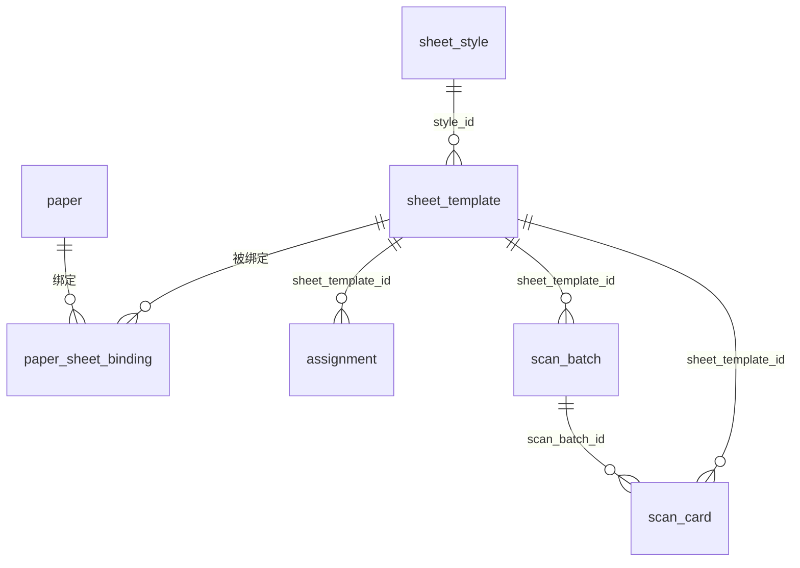
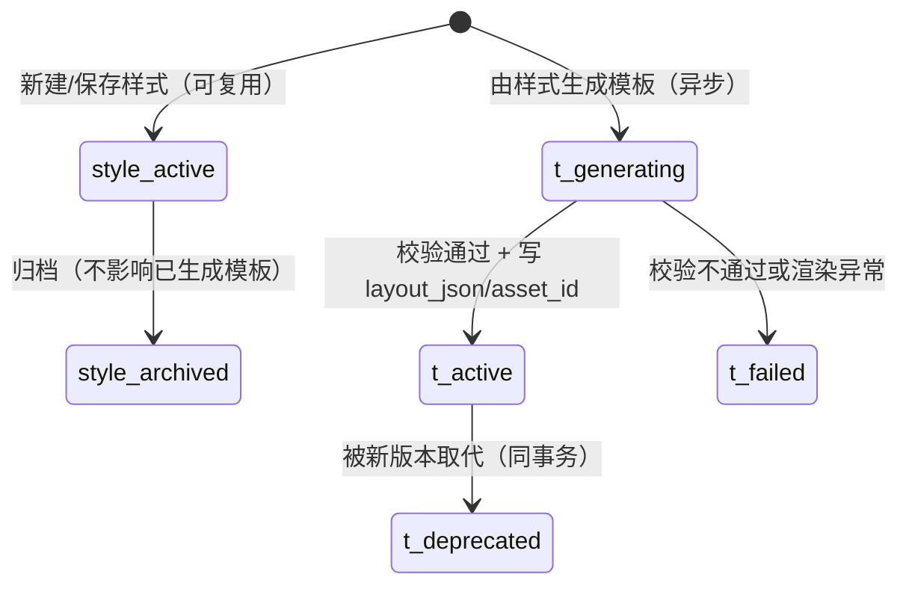
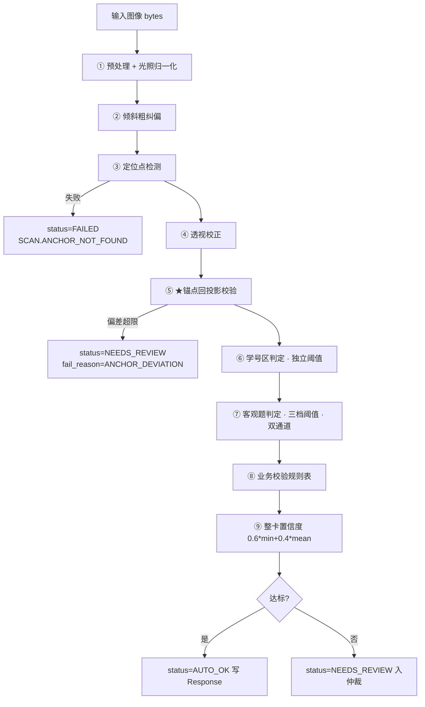
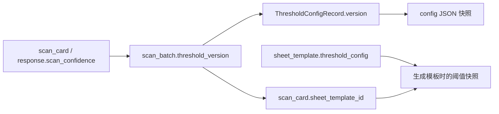
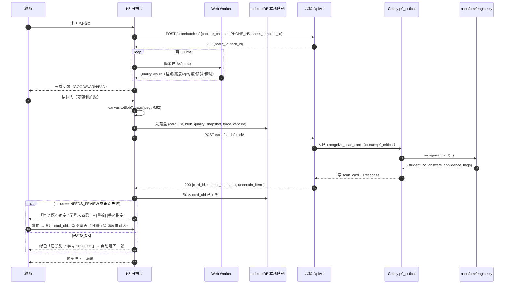
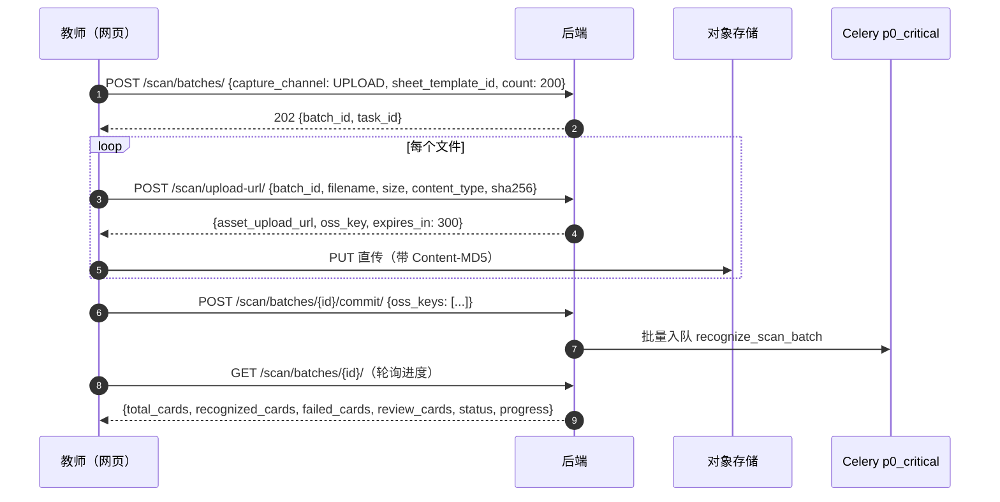

# 08 · 答题卡与 OMR 规格

> **上游依据**：设计文档 v2.1 第 8.5（试卷与答题卡绑定）、9.2（答题卡与样式系统）、9.3（OMR 识别流水线）、9.4（仲裁界面）、9.6（双通道合并）、12.6（三张答题卡表）、12.7（`scan_batch`/`scan_card`）、16.2/16.4（测试）、附录 D（答题卡设计规范）、附录 F（配置项）。
>
> **共享约定**：命名、状态枚举、错误码、异步契约一律遵守 [README.md](README.md)；坐标在 v2 已改为**毫米直算**（见下方 v2 说明），不再使用相对比例。阈值名称与默认值以附录 F 为准（13 文档为唯一事实来源），本文只落地实现。
>
> **风险提示**：本模块两个错误后果最严重——**学号识别错 = 成绩记到别人头上**；**锚点校正错 = 整卡答案全错但看起来正常**。本文对这两处给出独立防线与强制测试。

---

## ★ v2 改造说明（2026-10-18，当前实现以此为准）

本节记录本轮重做与下方旧章节的差异；**旧章节保留作历史依据，冲突处以本节为准**。

| 主题 | 旧版 | v2（当前） |
| --- | --- | --- |
| 几何单位 | 比例（`margin_ratio` / `box_aspect` / …） | **毫米/pt 直算**；`sheet_style` 只存 `margin_mm` / `base_font_pt` / `title_font_pt` / `info_config` |
| 样式 | 含题量、栏数、学号区、主观题区、比例常数 | **只做页面设置**（纸张/页边距/字号/信息区/分栏） |
| 模板 | 由样式+题型生成；`templates/generate`、`templates/from-paper` | **手工建卡**；`sections` 为语义参数，发布才展开 `layout_json` |
| 由试卷生成 | 有（`from-paper/`、`sections_from_paper()`） | **已下线**（路由/服务/前端入口/测试一并删除） |
| 题目区域 | 按题型分组、题号自动 | 大题列表，题号全卷连续；四类大题（选择/判断、填空、解答、作文）逐题配置 |
| 定位块 | 四角锚点 + 组块 | 四角主块（A4 6 / A3 8 / A5 5mm）+ **每列列首 3×3**（`page.column_markers`）+ **考号区 4×4** + **页定位块 N 个 4×4** |
| 页数 | 无硬上限（告警） | **最多 4 页**；发布时超限阻断 |
| 识别页码 | 无 | 页定位块计数；数不清 → 待处理，**不猜页号** |
| 多页合成 | 无 | 按「考号 + 模板版本」聚合；页码齐 1..N 才算完整，缺页待处理 |
| 作业通道 | `assignment.channel`（ONLINE / PAPER_OMR / BOTH） | **删除 channel**；所有作业统一「线上 + 线下」 |
| 绑定校验 | 题型签名（题量/选项数） | **逐题校验**：题号连续、题型、选项数、填空空数、每题分值、总分；差异带「第几题/期望/实际」 |
| 绑定入口 | 试卷详情页写 `paper_sheet_binding` | **只在作业详情页**：一次写 `paper_sheet_binding` + `assignment.sheet_template`；新建/改作业同服务；扫描端空字段回退主绑定并回写 |
| 版式参数 | 无方向/分栏/框缩放 | `orientation`、`columns`、`margin_mm(12–30 默认12)`、`box_scale`、`row_gap_mm`、`col_gap_mm`、`band_gap_mm`、填空 `new_line`；`layout_version=4` |
| 大题边框 | 无 | `page.section_titles[]` + `page.section_boxes[]`；框顶 = 标题基线+字高+`section_title_gap_mm`（默认 2.5）、框内边距 3mm；续段「（续）」 |
| 卷头 | 标题 + 左信息/右考号 | 三段：标题 → 手写一行 → 左考号/右注意事项；带间 4mm；考号区/注意事项 0.4mm 边框且同顶同底 |

**判断题口径**：卡面选项框印 **A=正确 / B=错误**（不是 T/F），组标题后印一次图例「（正确涂 A，错误涂 B）」。识别端认框位，写回 `Response` 时按 A/B 存储；`record_scanned` 仍兼容 T/F 输入并归一化为 A/B。

### v2.1 卷头 / 考号 / 列首块（2026-10-18 晚）

- 卷头顺序分带：`title_bottom = title.y_mm + title.height_mm`；`info_top = title_bottom + 4.0`；`student_no.top_mm == info_top`。标题 `y_mm` 是顶边，PDF 用 `baseline_mm`。
- 考号区：锚点带 6mm → 手写框行 8mm → 10 个长方形涂点；`handwrite_box.boxes` 数量 = 位数，宽 = 列宽，x 与涂点列中心对齐；框内不印位号。
- 辅助定位块：考号区左上角内侧 1mm，中心 `(sn_left+3, sn_top+3)`；4×4mm，下沿与手写框留 1mm；不得进入标题带（`aux.y - 2 ≥ title_bottom + 2`）。
- 选择题：**固定 5 题一列、列横向排列**；每列 3×3 列首块；旧模板只有 `row_markers` 时识别端自动回退。
- 填空：默认 1 空 / 每行 1 空；`blank_scores` 长度严格 = `blanks`；作文格间距 `cell_gap_mm` 默认 0.6；解答行距 `line_spacing` 默认 1.8。
- 绑定作业额外校验：名册学号去重后长度必须一致，且 = 卡面 `student_no.digits`；未启用考号区不允许绑定。

### v2.2 版式 / 方向 / 分栏（2026-10-18 晚）

- 页面设置新增 `orientation(PORTRAIT/LANDSCAPE)`、`columns(1/2)`、`margin_mm(12–30 默认12)`、`box_scale(0.7–1.5)`、`row_gap_mm(0–6 默认1.2)`、`col_gap_mm(0–20 默认6)`、`band_gap_mm(0–30 默认10)`；填空 `items[].new_line`。
- `layout_version=4`；`page.section_titles[]` / `page.section_boxes[]` 为边框/标题唯一坐标；`page.columns` / `page.column_x_mm[]` / `page.divider_x_mm` 描述分栏。
- 参数归一化：方向/分栏枚举非法 400；页边距/框缩放/行间距/列间距/带间距数值越界夹到区间。
- **全双栏**：卷头、选择、判断、填空、解答、作文全部按栏流动；左栏到底再右栏；解答/作文按栏宽排；栏间 6mm，分界线 0.3mm。
- 考号区/注意事项各 0.4mm 边框，同顶同底；栏宽不足时考号自动减少每行位数、增加行数，涂点 ≥2.5mm。
- 取消整页外框与 padding；旧样式里的 `frame / padding_mm / show_page_border / group_gap_mm` 忽略、不迁移、不报错。
- 旧 `layout_version=3` 模板没有新字段，识别端仍按 `objectives / fill_blanks / student_no / markers` 读取；已发布老卡不重排。

验收脚本：
- `scripts/verify_sheet_layout.py`（几何）
- `scripts/verify_sheet_render.py`（PDF/定位块）
- `scripts/verify_sheet_scan_e2e.py`（合成样本识别）
- `scripts/verify_sheet_binding.py`（逐题绑定校验）
- `scripts/verify_sheet_assignment_flow.py`（作业/扫描/合并）
- `scripts/verify_sheet_list_filter.py`（列表 `page_size`/`paper_size` 回归）
- `scripts/verify_sheet_perf.py`（性能）
- `scripts/gen_sheet_samples.py`（A4/A5 样张 PDF + 300dpi PNG）
- `scripts/omr/calibrate_thresholds.py`（真实样本校准）

---

## 一、答题卡领域模型

### 1.1 三张表的关系

| 表 | 角色 | 可变性 | 关键字段 |
| --- | --- | --- | --- |
| `sheet_style` | **样式定义**（配置，不含具体题目） | 可改（只影响新生成的模板） | `page_size` `sides` `layout_mode` `columns` `student_no_*` `subjective_zone*` `margin_config` `header_config` |
| `sheet_template` | **模板实例**（可打印的卡，含题号与涂点坐标） | **只增不改**（`version` 递增） | `style_id` `version` `layout_json` `threshold_config` `asset_id` `objective_item_count` `question_types` `status` |
| `paper_sheet_binding` | **试卷与模板的绑定关系** | 可增删（审计留痕） | `paper_id` `sheet_template_id` `is_primary` `bound_by` `bound_at` |



**唯一事实来源是 `paper_sheet_binding`。** `assignment.sheet_template_id` 是发布时的快照引用；**禁止出现「assignment 指向的模板不在该 paper 的 binding 列表里」**（发布前校验）。

### 1.2 生命周期



| 状态 | 值 | 可绑定 | 可打印 | 可识别 |
| --- | --- | --- | --- | --- |
| 可用 | `ACTIVE` | ✅ | ✅ | ✅ |
| 已废弃 | `DEPRECATED` | ❌ | ✅（历史卷仍要能打印） | ✅（历史卡仍要能识别） |

> `DEPRECATED` **不允许删除** `layout_json` 与 `asset_id`：历史扫描件必须永远可识别，否则一年前印出去的卡会变成废纸。

### 1.3 「版本只增不改」的落地规则

| 规则 | 实现 |
| --- | --- |
| R1 | `status=ACTIVE` 后**禁止 UPDATE** `layout_json` / `threshold_config` / `asset_id` / `objective_item_count` / `question_types` / `page_count` / `style_id` |
| R2 | 任何结构变化（题量、题型、学号位数、页边距、纸张、栏数）→ 新建一行，`version = max(version)+1` |
| R3 | 新建成功后旧行置 `DEPRECATED`（同事务） |
| R4 | 唯一约束 `uq_sheet_template_org_name_version (org_id, name, version)` |
| R5 | 数据库 `BEFORE UPDATE` 触发器兜底，**不只靠应用层自觉** |

```python
# apps/sheet/models.py
IMMUTABLE_AFTER_ACTIVE = ("layout_json", "threshold_config", "asset_id",
                          "objective_item_count", "question_types", "page_count", "style_id")


def clone_template_as_new_version(tpl, *, layout_json, asset_id, **overrides):
    """任何结构变化都走这里，返回新版本 SheetTemplate。"""
    with transaction.atomic():
        next_version = (SheetTemplate.objects.select_for_update()
                        .filter(org_id=tpl.org_id, name=tpl.name)
                        .aggregate(m=models.Max("version"))["m"] or 0) + 1
        new = SheetTemplate.objects.create(
            org_id=tpl.org_id, style_id=overrides.get("style_id", tpl.style_id),
            name=tpl.name, version=next_version,
            page_count=overrides.get("page_count", tpl.page_count),
            objective_item_count=overrides.get("objective_item_count", tpl.objective_item_count),
            question_types=overrides.get("question_types", tpl.question_types),
            layout_json=layout_json,
            threshold_config=overrides.get("threshold_config", tpl.threshold_config),
            asset_id=asset_id, status="ACTIVE", created_by=overrides.get("created_by"))
        SheetTemplate.objects.filter(pk=tpl.pk).update(status="DEPRECATED")
        return new
```

```sql
-- 02 文档迁移必须包含：兜住绕过 ORM 的写入
CREATE OR REPLACE FUNCTION zf_sheet_template_guard() RETURNS trigger AS $$
BEGIN
  IF OLD.status = 'ACTIVE' AND NEW.status <> 'DEPRECATED'
     AND (OLD.layout_json, OLD.threshold_config, OLD.asset_id, OLD.objective_item_count,
          OLD.question_types, OLD.page_count, OLD.style_id) IS DISTINCT FROM
         (NEW.layout_json, NEW.threshold_config, NEW.asset_id, NEW.objective_item_count,
          NEW.question_types, NEW.page_count, NEW.style_id) THEN
    RAISE EXCEPTION 'sheet_template is immutable once ACTIVE: create a new version';
  END IF;
  RETURN NEW;
END $$ LANGUAGE plpgsql;
CREATE TRIGGER trg_sheet_template_guard BEFORE UPDATE ON sheet_template
FOR EACH ROW EXECUTE FUNCTION zf_sheet_template_guard();
```

### 1.4 绑定校验规则（设计文档 8.5）

```python
# apps/sheet/services.py
def check_paper_template_binding(paper, template) -> BindCheckResult:
    """三条规则：客观题题量 / 题型结构 / 学号位数。返回 errors + suggestions。"""
    errors, suggestions = [], []

    # ── 规则 1：客观题题量 == 模板涂点区行数（精确相等，无容差）──────
    paper_objective = count_objective_items(paper)      # 不含 FILL_BLANK 与主观题
    tpl_count = template.objective_item_count
    if paper_objective != tpl_count:
        diff = paper_objective - tpl_count
        errors.append(f"该模板是为 {tpl_count} 道客观题设计的，当前试卷有 {paper_objective} 道"
                      f"客观题，无法直接绑定"
                      + (f"（多 {diff} 道）" if diff > 0 else f"（少 {-diff} 道）"))
        suggestions += ["新建模板（按当前试卷题量生成）", "选择其他模板", "修改试卷题型配额"]

    # ── 规则 2：试卷客观题题型结构 ⊆ 模板支持的结构 ────────────────
    paper_types = collect_objective_types(paper)        # {"SINGLE_CHOICE": 10, "TRUE_FALSE": 5}
    tpl_types = template.question_types or {}
    unsupported = {t: n for t, n in paper_types.items() if t not in tpl_types}
    if unsupported:
        errors.append("模板不支持的题型：" + "、".join(f"{t}×{n}" for t, n in unsupported.items()))
        suggestions.append("新建模板并勾选该题型")
    else:
        overflow = {t: n for t, n in paper_types.items()
                    if (tpl_types.get(t) or {}).get("max_count") is not None
                    and n > tpl_types[t]["max_count"]}
        if overflow:
            errors.append("题型题量超出模板容量："
                          + "、".join(f"{t} 需 {n}" for t, n in overflow.items()))

    # ── 规则 3：试卷的学号位数需求 <= 模板的学号位数 ──────────────────
    # 8.5 原文口径为 <=：模板位数更长时短学号「留空不涂」（9.2.4）。见 Q-08-07。
    need_digits = paper.student_no_digits_requirement or 0      # 0 = 本卷不用学号区
    tpl_digits = template_style(template).student_no_digits
    if need_digits > tpl_digits:
        errors.append(f"该模板学号区为 {tpl_digits} 位，当前试卷/名册需 {need_digits} 位，无法绑定")
        suggestions.append(f"新建样式并把学号位数设为 {need_digits} 位")

    return BindCheckResult(ok=not errors, errors=errors, suggestions=suggestions)


def bind_paper_to_template(paper, template, teacher, is_primary: bool = True):
    result = check_paper_template_binding(paper, template)
    if not result.ok:
        raise SheetBindMismatch(result.errors, result.suggestions)
        # → SHEET.BIND_MISMATCH(409)，前端展示具体差异
    with transaction.atomic():
        if is_primary:
            PaperSheetBinding.objects.filter(paper=paper, is_primary=True).update(is_primary=False)
        binding, _ = PaperSheetBinding.objects.get_or_create(
            paper=paper, sheet_template_id=template.id,
            defaults={"is_primary": is_primary, "bound_by": teacher.id})
        AuditLog.write(action="paper.sheet_binding.create", target=binding, actor=teacher)
    return binding
```

**发布前额外校验**：`assignment.sheet_template_id` 必须 ∈ `PaperSheetBinding.objects.filter(paper=paper).values_list("sheet_template_id", flat=True)`，否则拒绝发布。

---

## 二、答题卡生成（ReportLab 实现规格）

### 2.1 版式参数常量表

> 全部常量集中在 `apps/sheet/constants.py`，**禁止在渲染函数内写魔法数字**（README 十.6）。单位 mm，渲染时按 `1mm = 72/25.4 pt` 换算。

| 常量名 | 值 | 依据 | 需标定 |
| --- | --- | --- | --- |
| `ANCHOR_SIZE_MM` | 5.0 | 9.2.3 边长 5mm | 否 |
| `ANCHOR_MARGIN_MM` | 8.0 | 9.2.3 距页边 8mm | 否 |
| `ANCHOR_FILL_K` | 100 | 9.2.3 纯黑 K=100 | 否 |
| `BUBBLE_DIAMETER_MM` | 4.5 | 9.2.3 | 否 |
| `BUBBLE_BORDER_K` / `BUBBLE_BORDER_WIDTH_MM` | 30 / 0.3 | 9.2.3 浅灰边框 | 否 |
| `BUBBLE_COL_PITCH_MM` | 9.0 | 行内 ≥ 8mm（留 1mm 余量） | **是** |
| `BUBBLE_ROW_PITCH_MM` | 10.5 | 行间 ≥ 10mm | **是** |
| `BUBBLE_MIN_COL_GAP_MM` / `BUBBLE_MIN_ROW_GAP_MM` | 8.0 / 10.0 | 9.2.3 硬下限（校验用） | 否 |
| `NO_LABEL_W_MM` | 6.0 | 学号 0–9 数字标签列宽 | 否 |
| `NO_GROUP_GAP_MM` / `NO_GROUP_LINE_K` | 4.0 / 25 | 每 `student_no_group_size` 位后的分隔 | 否 |
| `QUESTION_NO_FONT_PT` | 10.0 | 9.2.3 题号 ≥ 10pt 加粗 | 否 |
| `DIGIT_LABEL_FONT_PT` | 9.0 | 9.2.4 数字标签 ≥ 9pt | 否 |
| `SEPARATOR_EVERY_N` / `SEPARATOR_LINE_K` | 5 / 20 | 9.2.3 每 5 题一条浅灰线 K=20 | 否 |
| `PRINT_SAFE_MARGIN_MM` / `MIN_MARGIN_MM` | 10.0 | 附录 D 打印安全区 ≥ 10mm | 否 |
| `QUIET_ZONE_MM` | 10.0 | 9.2.3 涂点附近 10mm 内不得有深色图案 | 否 |
| `SUBJECTIVE_MM_PER_SCORE` / `SUBJECTIVE_MIN_H_MM` | 8.0 / 25.0 | 9.2.5 | 否 |
| `SUBJECTIVE_MAX_PER_PAGE` | 4 | 9.2.5 一页不超过 4 道大题 | 否 |
| `SCORE_BOX_W_MM` / `SCORE_BOX_H_MM` | 14.0 / 8.0 | 9.2.5 得分框 | 否 |
| `PAPER_GSM_MIN` | 70 | 9.2.3（印刷要求，写入打印说明，非代码约束） | 否 |

```python
# apps/sheet/constants.py
PAPER_SIZES_MM = {
    "A4": (210.0, 297.0), "A3": (297.0, 420.0),
    "B4": (250.0, 353.0),      # JIS B4；若机构用 ISO B4 需配置确认
    "16K": (184.0, 260.0),     # 大 16 开 210×285 亦常见，需机构配置
}
GRAY_K = lambda k: Color(1 - k / 100.0, 1 - k / 100.0, 1 - k / 100.0)   # K → RGB


def page_usable_width_mm(style) -> float:
    """扣掉页边距与锚点安全区（9.2.4.1 的 usable_w 语义）。"""
    w = PAPER_SIZES_MM[style.page_size][0]
    m = style.margin_config or {}
    left = max(m.get("left_mm", 15.0), ANCHOR_MARGIN_MM + ANCHOR_SIZE_MM + 2.0)
    right = max(m.get("right_mm", 15.0), ANCHOR_MARGIN_MM + ANCHOR_SIZE_MM + 2.0)
    return w - left - right


def page_usable_height_mm(style) -> float:
    h = PAPER_SIZES_MM[style.page_size][1]
    m = style.margin_config or {}
    top = max(m.get("top_mm", 15.0), ANCHOR_MARGIN_MM + ANCHOR_SIZE_MM + 2.0)
    return h - top - max(m.get("bottom_mm", 15.0), PRINT_SAFE_MARGIN_MM)
```

### 2.2 生成入口、锚点与页眉页脚

```python
# apps/sheet/generator.py
def generate_sheet_pdf(style, paper, template_meta) -> tuple[bytes, dict]:
    """入口。返回 (PDF bytes, layout_json)。纯矢量输出，不位图化。"""
    page_w_mm, page_h_mm = PAPER_SIZES_MM[style.page_size]
    buf = io.BytesIO()
    c = rl_canvas.Canvas(buf, pagesize=(page_w_mm * mm, page_h_mm * mm))
    c.setTitle(f"{paper.title} 答题卡")
    c.setSubject(f"sheet_template v{template_meta['version']} / style#{style.id}")
    register_cjk_font(c)                       # 中文字体必须嵌入（附录 D）

    ctx = RenderContext(style, paper, page_w_mm, page_h_mm)
    ctx.layout = {"version": template_meta["version"], "page_size": style.page_size,
                  "dpi_reference": 300, "anchors": [], "anchors_by_page": [],
                  "student_no": {"enabled": False, "digits": style.student_no_digits,
                                 "has_checksum": style.student_no_checksum, "positions": []},
                  "objective": {"layout_mode": style.layout_mode, "items": []},
                  "subjective_zones": []}

    _draw_anchors(c, ctx)                      # 四角锚点：必须最先、最底层
    _draw_header(c, ctx)
    y = _draw_student_no_zone(c, ctx)          # 学号区 → 返回新 y 游标
    y = _draw_objective_zone(c, ctx, y)
    _draw_subjective_zones(c, ctx, y)          # 可能触发 showPage()
    _draw_footer(c, ctx)
    _draw_calibration_page(c, ctx)             # 附录 D 校准卡（另起一页）
    c.save()
    return buf.getvalue(), build_relative_layout(ctx)


def _draw_anchors(c, ctx) -> None:
    """纯矢量实心方块，K=100。绘制在所有内容之下，避免被框线覆盖导致形心偏移。"""
    m, s = ANCHOR_MARGIN_MM, ANCHOR_SIZE_MM
    W, H = ctx.page_w_mm, ctx.page_h_mm
    pts = {"TL": (m, m), "TR": (W - m - s, m), "BL": (m, H - m - s), "BR": (W - m - s, H - m - s)}
    c.setFillColorRGB(0, 0, 0)
    for anchor_id, (x_mm, y_mm) in pts.items():
        # ReportLab 原点在左下；layout_json 用「左上原点、y 向下」，与 cv2 一致
        c.rect(x_mm * mm, (H - y_mm - s) * mm, s * mm, s * mm, stroke=0, fill=1)
        ctx.layout["anchors"].append({"id": anchor_id,           # ★ 存锚点中心
                                      "x": (x_mm + s / 2) / W, "y": (y_mm + s / 2) / H})
    ctx.layout["anchors_by_page"].append({"page": ctx.page_index,
                                          "anchors": list(ctx.layout["anchors"])})


DEFAULT_NOTICE = ("注意事项：1. 用 2B 铅笔填涂，涂满涂黑；2. 修改时用橡皮擦干净，不留痕迹；"
                  "3. 禁止折叠、禁止污损定位点；4. 学号不足位数时留空，不要涂 0；"
                  "5. 主观题在作答框内书写，不得超出框线。")


def _draw_header(c, ctx) -> None:
    hc = ctx.style.header_config or {}
    _draw_text(c, hc.get("org_name") or ctx.paper.org.short_name or ctx.paper.org.name,
               ctx.page_w_mm / 2, 14.0, size=9.0, center=True)
    _draw_text(c, hc.get("title") or f"{ctx.paper.title} 答题卡",
               ctx.page_w_mm / 2, 20.0, size=14.0, center=True, bold=True)
    _draw_text(c, f"第 {ctx.page_index + 1} 页", ctx.page_w_mm - 15.0, 14.0, size=8.0)
    _draw_text(c, "姓名 ______________  班级 ______________  考号 ______________",
               ctx.page_w_mm / 2, 27.0, size=9.0, center=True)      # 手写区


def _draw_footer(c, ctx) -> None:
    notice = (ctx.style.header_config or {}).get("notice") or DEFAULT_NOTICE
    _draw_text(c, notice, 15.0, ctx.page_h_mm - 8.0, size=7.0,
               wrap_width_mm=ctx.page_w_mm - 30)
    # 附录 D：印模板版本号便于问题追溯
    _draw_text(c, f"模板 v{ctx.layout['version']} · {ctx.style.page_size}",
               ctx.page_w_mm - 15.0, ctx.page_h_mm - 4.0, size=5.5)
```

> **锚点中心 vs 左上角必须全系统统一**：12.6 示例数值 `0.0635 ≈ (8+2.5)/210` 是**中心**。生成端与 `detect_anchors` 都返回中心，否则校正整体偏移 2.5mm。**必须写单元测试。**

### 2.3 学号区绘制

```python
def _no_block_width_mm(per_row: int, group_size: int, has_label: bool) -> float:
    """一个「行块」（一行内 per_row 位）的总宽度（mm）。"""
    label_w = NO_LABEL_W_MM if has_label else 0.0
    groups = 0 if group_size in (0, 1) else (per_row - 1) // group_size
    return label_w + per_row * BUBBLE_COL_PITCH_MM + groups * NO_GROUP_GAP_MM


def _draw_student_no_zone(c, ctx) -> float:
    st = ctx.style
    if st.student_no_digits == 0:
        ctx.layout["student_no"]["enabled"] = False
        return _content_top_mm(ctx)

    issues = validate_student_no_layout(st)          # 见 3.2
    if issues:
        raise StudentNoOverflow(issues)              # → SHEET.STUDENT_NO_OVERFLOW(400)

    mode = resolve_student_no_layout(st)             # SINGLE_ROW / MULTI_ROW
    per_row = st.student_no_per_row if mode == "MULTI_ROW" else st.student_no_digits
    has_label = st.student_no_label_side == "LEFT"
    label_w = NO_LABEL_W_MM if has_label else 0.0
    block_w = _no_block_width_mm(per_row, st.student_no_group_size, has_label)
    total_w = block_w if mode == "MULTI_ROW" else block_w * math.ceil(st.student_no_digits / per_row)
    x0, y0 = (ctx.page_w_mm - total_w) / 2, _content_top_mm(ctx) + 6.0
    ctx.layout["student_no"].update({
        "enabled": True, "layout": mode, "per_row": per_row, "digits": st.student_no_digits,
        "group_size": st.student_no_group_size, "label_side": st.student_no_label_side,
        "block_width": block_w / ctx.page_w_mm})

    for pos in range(st.student_no_digits):
        row, col = (0, pos) if mode == "SINGLE_ROW" else divmod(pos, per_row)
        base_x = x0 + (col // st.student_no_group_size) * NO_GROUP_GAP_MM + label_w
        cx = base_x + col * BUBBLE_COL_PITCH_MM + BUBBLE_DIAMETER_MM / 2
        bubbles = []
        for d in range(10):
            cy = y0 + d * BUBBLE_ROW_PITCH_MM + BUBBLE_DIAMETER_MM / 2
            _draw_bubble(c, ctx, cx, cy)
            bubbles.append({"d": d, "cx": cx / ctx.page_w_mm, "cy": cy / ctx.page_h_mm,
                            "r": (BUBBLE_DIAMETER_MM / 2) / ctx.page_w_mm})
            if has_label and col == 0:
                _draw_text(c, str(d), x0, cy, size=DIGIT_LABEL_FONT_PT)
        ctx.layout["student_no"]["positions"].append(
            {"pos": pos, "row": row, "col": col, "bubbles": bubbles})

    _draw_no_group_lines(c, ctx, x0, y0, per_row, st.student_no_group_size, label_w)
    if mode == "MULTI_ROW":
        # 9.2.4.1：多行时必须标「第 a-b 位」列头，否则学生会把第 7 位涂到第二行第 1 列
        _draw_no_row_captions(c, ctx, x0, y0, per_row, st.student_no_digits)
    return y0 + 10 * BUBBLE_ROW_PITCH_MM + 8.0


def resolve_student_no_layout(style) -> str:
    """student_no_layout 默认「自动」→ 需要确定性推断（9.2.4.1）。"""
    if style.student_no_layout in ("SINGLE_ROW", "MULTI_ROW"):
        return style.student_no_layout
    need = _no_block_width_mm(style.student_no_digits, style.student_no_group_size,
                              style.student_no_label_side == "LEFT")
    return "SINGLE_ROW" if need <= page_usable_width_mm(style) else "MULTI_ROW"
```

**分组规则**：每 `student_no_group_size` 位后插入 `NO_GROUP_GAP_MM` 额外列间距，并在该处画一条贯穿 0–9 行的竖线（K=25）。`group_size ∈ {0, 1}` 视为不分组。

### 2.4 客观题区

```python
def _draw_objective_zone(c, ctx, y_top_mm: float) -> float:
    st, paper = ctx.style, ctx.paper
    items = list(paper.items.filter(type__in=OBJECTIVE_TYPES).order_by("seq"))
    if not items:
        return y_top_mm

    per_row = 1 if st.layout_mode == "1_PER_ROW" else 2
    margin = (st.margin_config or {}).get("left_mm", 15.0)
    col_gap = 8.0
    usable_w = ctx.page_w_mm - 2 * margin
    col_w = (usable_w - col_gap * (per_row - 1)) / per_row
    max_options = max(len(option_labels(it)) for it in items)

    required = QUESTION_NO_W_MM + max_options * BUBBLE_COL_PITCH_MM
    if required > col_w:
        raise SheetLayoutError(
            f"选项过多：单列需 {required:.1f}mm，可用 {col_w:.1f}mm。建议：① 改为 "
            f"{math.ceil(required / col_w)} 列/行 ② 选项竖排 ③ 增大纸张")

    y = y_top_mm
    for idx, item in enumerate(items):
        row_idx, col_idx = divmod(idx, per_row)
        x = margin + col_idx * (col_w + col_gap)
        y_item = y_top_mm - row_idx * BUBBLE_ROW_PITCH_MM
        _draw_text(c, str(item.seq), x, y_item, size=QUESTION_NO_FONT_PT, bold=True)

        bubbles = []
        for j, label in enumerate(option_labels(item)):
            cx = x + QUESTION_NO_W_MM + j * BUBBLE_COL_PITCH_MM + BUBBLE_DIAMETER_MM / 2
            cy = y_item + BUBBLE_DIAMETER_MM / 2
            _draw_bubble(c, ctx, cx, cy)
            _draw_text(c, label, cx - 1.0, cy - BUBBLE_ROW_PITCH_MM * 0.42, size=7.0, center=True)
            bubbles.append({"label": label, "cx": cx / ctx.page_w_mm, "cy": cy / ctx.page_h_mm,
                            "r": (BUBBLE_DIAMETER_MM / 2) / ctx.page_w_mm})
        ctx.layout["objective"]["items"].append({"seq": item.seq, "bubbles": bubbles})

        # 每 5 题一条浅灰分隔线（K=20）；双列时只在本行最后一列后画
        if (idx + 1) % SEPARATOR_EVERY_N == 0 and idx + 1 < len(items) \
                and (col_idx == per_row - 1 or per_row == 1):
            line_y = y_item - (BUBBLE_ROW_PITCH_MM - BUBBLE_DIAMETER_MM) / 2
            c.setStrokeColor(GRAY_K(SEPARATOR_LINE_K))
            c.setLineWidth(0.4 * mm)
            c.line(margin * mm, (ctx.page_h_mm - line_y) * mm,
                   (margin + usable_w) * mm, (ctx.page_h_mm - line_y) * mm)
        y = min(y, y_item)
    return y - BUBBLE_ROW_PITCH_MM
```

### 2.5 主观题手写区与得分框

```python
def _draw_subjective_zones(c, ctx, y_top_mm: float) -> None:
    """9.2.5：框高 = 分值 × 8mm（最小 25mm）；右侧固定「得分」框；一页 ≤ 4 道大题。"""
    st, paper = ctx.style, ctx.paper
    if st.subjective_zone == "NONE":
        return
    subs = list(paper.items.filter(type__in=SUBJECTIVE_TYPES).order_by("seq"))
    margin = (st.margin_config or {}).get("left_mm", 15.0)
    zone_w = ctx.page_w_mm - 2 * margin - SCORE_BOX_W_MM - 3.0
    y, drawn = y_top_mm, 0

    for item in subs:
        h = max(SUBJECTIVE_MIN_H_MM, float(item.score) * SUBJECTIVE_MM_PER_SCORE)
        if st.subjective_zone == "CUSTOM":
            h = (st.subjective_zone_config or {}).get(str(item.seq), {}).get("height_mm", h)
        if drawn >= SUBJECTIVE_MAX_PER_PAGE or y - h < PRINT_SAFE_MARGIN_MM + 12:
            c.showPage()
            ctx.page_index += 1
            _draw_anchors(c, ctx)                    # ★ 每页独立锚点（双面/多页）
            _draw_header(c, ctx)
            y, drawn = _content_top_mm(ctx), 0

        _draw_text(c, f"{item.seq} 题（{item.score} 分）", margin, y, size=QUESTION_NO_FONT_PT)
        top = y - 5.0
        c.setStrokeColorRGB(0.55, 0.55, 0.55)
        c.setLineWidth(0.4 * mm)
        c.rect(margin * mm, (ctx.page_h_mm - top - h) * mm, zone_w * mm, h * mm, stroke=1, fill=0)

        sx = margin + zone_w + 3.0                   # 得分框（教师手写，学生不涂）
        c.rect(sx * mm, (ctx.page_h_mm - top - SCORE_BOX_H_MM) * mm,
               SCORE_BOX_W_MM * mm, SCORE_BOX_H_MM * mm, stroke=1, fill=0)
        _draw_text(c, "得分", sx + SCORE_BOX_W_MM / 2, top + SCORE_BOX_H_MM * 0.35,
                   size=7.0, center=True)

        ctx.layout["subjective_zones"].append({
            "seq": item.seq, "page": ctx.page_index,
            "x": margin / ctx.page_w_mm, "y": top / ctx.page_h_mm,
            "w": zone_w / ctx.page_w_mm, "h": h / ctx.page_h_mm,
            "score_box": {"x": sx / ctx.page_w_mm, "y": top / ctx.page_h_mm,
                          "w": SCORE_BOX_W_MM / ctx.page_w_mm,
                          "h": SCORE_BOX_H_MM / ctx.page_h_mm}})
        y, drawn = top - h - 4.0, drawn + 1
```

### 2.6 `layout_json` 的完整生成逻辑

**必须在生成 PDF 的同一遍里累积 `layout_json`**，不允许事后解析 PDF 反推坐标——两套算法必然漂移。

```python
# apps/sheet/layout.py
def build_relative_layout(ctx) -> dict:
    """mm 绝对坐标 → 0–1 相对比例。y 统一「左上原点、向下」，与 cv2 一致。"""
    layout = {"version": ctx.layout["version"], "page_size": ctx.layout["page_size"],
              "dpi_reference": ctx.layout["dpi_reference"], "page_count": ctx.page_index + 1,
              "anchors": ctx.layout["anchors"], "anchors_by_page": ctx.layout["anchors_by_page"],
              "student_no": ctx.layout["student_no"], "objective": ctx.layout["objective"],
              "subjective_zones": ctx.layout["subjective_zones"]}
    assert_layout_sanity(layout)          # 生成即自检
    return layout


def assert_layout_sanity(layout: dict) -> None:
    """任何一条不满足都不允许入库（宁可拒绝生成，也不要错卡）。"""
    sn = layout["student_no"]
    if sn.get("enabled"):
        assert len(sn["positions"]) == sn["digits"], "positions 数量与 digits 不一致"
        for p in sn["positions"]:
            expect = (0, p["pos"]) if sn["layout"] == "SINGLE_ROW" \
                else divmod(p["pos"], sn["per_row"])
            assert (p["row"], p["col"]) == expect, f"pos {p['pos']} 行列与排布模式不符"
            assert len(p["bubbles"]) == 10, f"pos {p['pos']} 应有 10 个涂点"
            assert [b["d"] for b in p["bubbles"]] == list(range(10)), "涂点数字必须 0-9 有序"
    for a in layout["anchors"]:
        assert 0 < a["x"] < 1 and 0 < a["y"] < 1, "锚点坐标必须为 0–1 相对比例"
    assert_quiet_zones(layout)             # 涂点不得进入打印安全区，且不得侵入锚点静默区
```

**`layout_json` schema（与 12.6 示例兼容，仅补充多页字段）**：

```json
{
  "version": 3, "page_size": "A4", "dpi_reference": 300, "page_count": 2,
  "anchors": [{"id": "TL", "x": 0.0635, "y": 0.0423}, {"id": "TR", "x": 0.9365, "y": 0.0423},
              {"id": "BL", "x": 0.0635, "y": 0.9577}, {"id": "BR", "x": 0.9365, "y": 0.9577}],
  "anchors_by_page": [{"page": 0, "anchors": [{"id": "TL", "x": 0.0635, "y": 0.0423}]},
                      {"page": 1, "anchors": [{"id": "TL", "x": 0.0635, "y": 0.0423}]}],
  "student_no": {
    "enabled": true, "layout": "SINGLE_ROW", "per_row": 8, "digits": 8,
    "group_size": 4, "has_checksum": false, "label_side": "LEFT", "block_width": 0.42,
    "positions": [{"pos": 0, "row": 0, "col": 0,
                   "bubbles": [{"d": 0, "cx": 0.0820, "cy": 0.1050, "r": 0.0085}]}]
  },
  "objective": {"layout_mode": "1_PER_ROW", "items": [{"seq": 1, "bubbles": []}]},
  "subjective_zones": [{"seq": 21, "page": 1, "x": 0.08, "y": 0.70, "w": 0.84, "h": 0.12,
                        "score_box": {"x": 0.90, "y": 0.70, "w": 0.05, "h": 0.02}}]
}
```

---

## 三、学号填涂区（自由位数）

### 3.1 识别端坐标推导 `student_no_bubble(pos, digit)`

```python
# apps/omr/template.py
@dataclass(frozen=True)
class Bubble:
    cx: float      # 相对比例 0–1
    cy: float
    r: float       # 相对页面宽度的半径比例


class SheetLayout:
    """layout_json 的只读封装。优先读 positions；只在缺失时用排布算法推导。"""

    def __init__(self, layout_json: dict):
        self.raw = layout_json
        self.version = layout_json["version"]
        self.page_count = layout_json.get("page_count", 1)
        sn = layout_json.get("student_no", {}) or {}
        self.student_no_enabled = bool(sn.get("enabled"))
        self.student_no_digits = int(sn.get("digits", 0))
        self.student_no_layout = sn.get("layout", "SINGLE_ROW")
        self.student_no_per_row = int(sn.get("per_row", self.student_no_digits or 1))
        self.no_label_w = NO_LABEL_W_MM if sn.get("label_side", "LEFT") == "LEFT" else 0.0
        self._positions = {
            (int(p["pos"]), int(b["d"])): Bubble(float(b["cx"]), float(b["cy"]), float(b["r"]))
            for p in (sn.get("positions") or []) for b in p.get("bubbles", [])}
        self._objective_index = {
            int(it["seq"]): {b["label"]: Bubble(b["cx"], b["cy"], b["r"]) for b in it["bubbles"]}
            for it in layout_json["objective"]["items"]}

    def student_no_row_col(self, pos: int) -> tuple[int, int]:
        """9.2.4.1：单行 → (0, pos)；多行 → divmod(pos, per_row)。"""
        if self.student_no_layout == "SINGLE_ROW":
            return 0, pos
        return divmod(pos, self.student_no_per_row)

    def student_no_bubble(self, pos: int, digit: int) -> Bubble:
        """pos 从 0 开始。支持单行与多行排布。"""
        if not (0 <= pos < self.student_no_digits):
            raise IndexError(f"学号位序 pos={pos} 超出 0–{self.student_no_digits - 1}")
        if not (0 <= digit <= 9):
            raise ValueError(f"数字 digit={digit} 必须在 0–9")

        cached = self._positions.get((pos, digit))
        if cached is not None:
            return cached                    # 首选：生成端展开的坐标，避免两套排布算法漂移

        row, col = self.student_no_row_col(pos)      # 兜底：旧版 layout_json 缺 positions
        cx = self.no_zone_x + row * self.no_zone_block_width + self.no_label_w \
            + col * self.bubble_col_pitch
        cy = self.no_zone_y + digit * self.bubble_row_pitch
        return Bubble(cx=cx, cy=cy, r=self.bubble_radius)

    def objective_bubble(self, seq: int, label: str) -> Bubble:
        item = self._objective_index.get(seq)
        if item is None:
            raise KeyError(f"layout_json 中没有第 {seq} 题的涂点")
        if label not in item:
            raise KeyError(f"第 {seq} 题没有选项 {label} 的涂点")
        return item[label]
```

### 3.2 排版约束校验函数（完整实现 + 建议文案）

```python
# apps/sheet/validators.py
DIGIT_MIN, DIGIT_MAX = 1, 12         # 9.2.4.1：1–12 任意整数（0 = 不印学号区）
PER_ROW_MIN, PER_ROW_MAX = 2, 12     # 9.2.4：每行位数 2–12
GROUP_SIZE_RANGE = (2, 4)            # 9.2.4.1：student_no_group_size ∈ 2–4
NO_ZONE_MAX_HEIGHT_RATIO = 0.25      # 9.2.4.1：多行不得超过可用高度的 25%（见 Q-08-03）
MULTI_ROW_EXTRA_MM = 4.0


def validate_student_no_layout(style) -> list[str]:
    """校验学号区能否放进页面。返回问题列表（空 = 通过）。"""
    issues: list[str] = []
    digits = int(style.student_no_digits)
    if digits == 0:
        return []                                    # 不印学号区
    if not (DIGIT_MIN <= digits <= DIGIT_MAX):
        return [f"学号位数 {digits} 超出支持范围 {DIGIT_MIN}–{DIGIT_MAX}"]
    if style.student_no_layout == "MULTI_ROW" and \
            not (PER_ROW_MIN <= style.student_no_per_row <= PER_ROW_MAX):
        issues.append(f"每行位数 {style.student_no_per_row} 超出范围 {PER_ROW_MIN}–{PER_ROW_MAX}")
    if style.student_no_group_size not in (0, 1) and \
            not (GROUP_SIZE_RANGE[0] <= style.student_no_group_size <= GROUP_SIZE_RANGE[1]):
        issues.append(f"分组大小 {style.student_no_group_size} 超出范围 2–4")

    usable_w, usable_h = page_usable_width_mm(style), page_usable_height_mm(style)
    label_w = NO_LABEL_W_MM if style.student_no_label_side == "LEFT" else 0.0
    gs = style.student_no_group_size

    # ── 单行：宽度校验（9.2.4.1 的示例代码漏了这一条，见 Q-08-02）──────
    if style.student_no_layout == "SINGLE_ROW":
        need_w = _no_block_width_mm(digits, gs, bool(label_w))
        if need_w > usable_w:
            suggest = max(PER_ROW_MIN, min(int((usable_w - label_w) // _eff_pitch(gs)), PER_ROW_MAX))
            issues.append(
                f"学号区单行需要 {need_w:.0f}mm，超出可用宽度 {usable_w:.0f}mm。"
                f"建议：① 改为多行排布（每行 {suggest} 位，共 {math.ceil(digits / suggest)} 行）"
                f"② 减少位数 ③ 改横向纸张（{_landscape_hint(style.page_size)}）")
        return issues

    # ── 多行：高度校验 ────────────────────────────────────────────
    rows = math.ceil(digits / style.student_no_per_row)
    need_h = rows * (10 * BUBBLE_ROW_PITCH_MM + MULTI_ROW_EXTRA_MM)
    budget = usable_h * NO_ZONE_MAX_HEIGHT_RATIO
    if need_h > budget:
        max_rows = max(1, int(budget // (10 * BUBBLE_ROW_PITCH_MM + MULTI_ROW_EXTRA_MM)))
        suggest = min(PER_ROW_MAX, math.ceil(digits / max_rows))
        issues.append(
            f"学号区多行排布需要 {need_h:.0f}mm 高度，超过页面可用高度的 25%（{budget:.0f}mm）。"
            f"建议：① 每行放 {suggest} 位（共 {math.ceil(digits / suggest)} 行）"
            f"② 减少学号位数 ③ 改更大纸张")

    # ── 多行：每行宽度也要过 ──────────────────────────────────────
    per_row_w = _no_block_width_mm(min(style.student_no_per_row, digits), gs, bool(label_w))
    if per_row_w > usable_w:
        suggest = int((usable_w - label_w) // _eff_pitch(gs))
        issues.append(f"每行 {style.student_no_per_row} 位需要 {per_row_w:.0f}mm，"
                      f"超出可用宽度 {usable_w:.0f}mm。建议每行不超过 "
                      f"{max(PER_ROW_MIN, suggest)} 位")
    return issues


def _eff_pitch(group_size: int) -> float:
    """含分组留白的等效列距，用于反推建议位数。"""
    return BUBBLE_COL_PITCH_MM if group_size in (0, 1) \
        else BUBBLE_COL_PITCH_MM + NO_GROUP_GAP_MM / group_size


def _landscape_hint(page_size: str) -> str:
    return {"A4": "A4 横向", "A3": "A3 横向", "B4": "B4 横向", "16K": "16 开横向"} \
        .get(page_size, "横向")
```

### 3.3 名册位数一致性推断

```python
# apps/accounts/services/roster_service.py
DEFAULT_DIGITS, MAX_DIGITS = 8, 12    # student_no_default_digits / student_no_max_digits


def infer_roster_student_no_digits(classroom_id: int) -> dict:
    """导入名册时统计学号位数分布；不一致必须提示（9.2.4.1 / A38）。"""
    nos = list(ClassroomStudent.objects.filter(classroom_id=classroom_id, status="ACTIVE")
               .values_list("student_no", flat=True))
    dist = Counter(len(strip_leading_zeros(n)) for n in nos if n)
    if not dist:
        return {"consistent": True, "digits": DEFAULT_DIGITS, "distribution": {},
                "warnings": ["名册为空，无法推断学号位数"], "duplicates": []}

    digits_set, duplicates = set(dist), find_duplicate_student_no(classroom_id)
    warnings = []
    if len(digits_set) > 1:
        detail = "、".join(f"{d} 位×{c}" for d, c in sorted(dist.items()))
        warnings.append(f"名册内学号位数不一致（{detail}），答题卡无法统一。请统一学号位数，"
                        f"或改用「取最大位数（{max(digits_set)} 位）+ 短学号留空」的模板。")
    if duplicates:
        warnings.append(f"发现 {len(duplicates)} 组重复学号：" +
                        "、".join(f"{no}（{len(ids)} 人）" for no, ids in duplicates[:5]) +
                        "。学号是答题卡认人的唯一依据，重复会导致成绩记错人，导入将被拒绝。")
    if max(digits_set) > MAX_DIGITS:
        warnings.append(f"学号最长 {max(digits_set)} 位，超过系统上限 {MAX_DIGITS} 位，无法印答题卡")

    return {"consistent": len(digits_set) == 1 and not duplicates, "digits": max(digits_set),
            "suggested_template_digits": max(digits_set),
            "distribution": {str(k): v for k, v in sorted(dist.items())},
            "warnings": warnings,
            "duplicates": [{"student_no": no, "count": len(ids)} for no, ids in duplicates]}
```

> 接口 `POST /classrooms/{id}/students/validate/`（13.2）：位数不一致返回 200 + `warnings`；学号重复返回 `COMMON.VALIDATION_ERROR`(400)。

---

## 四、OMR 识别引擎（`apps/omr/`）

### 4.1 模块清单

| 文件 | 职责 | 关键函数/类 |
| --- | --- | --- |
| `constants.py` / `errors.py` | 命名常量；`AnchorNotFound` `AnchorDeviationExceeded` `TemplateMismatch` `ImageUnreadable` | — |
| `preprocess.py` | ①② | `normalize_illumination` `preprocess` `estimate_skew` `coarse_deskew` |
| `anchor.py` | ③⑤ | `detect_anchors` `pick_four_corners` `validate_by_reprojection` `anchor_quality_score` |
| `rectify.py` | ④ | `rectify` `template_anchor_px` `pixel_size_at_dpi` |
| `bubble.py` | 涂点填充率 | `fill_ratio` `classify_fill` |
| `student_no.py` | ⑥ | `read_student_no` `_margin_to_confidence` `verify_checksum` |
| `objective.py` | ⑦ | `read_objective_items` `compensate_phone` |
| `validators.py` | ⑧ | `check_business_rules` `is_regular_pattern` |
| `confidence.py` | ⑨ | `card_confidence` |
| `template.py` | 模板封装 | `SheetLayout`（见 3.1） |
| `thresholds.py` | 阈值加载与版本 | `load_threshold_config` `ThresholdConfig` |
| `engine.py` / `tasks.py` | 编排与 Celery 任务（`queue="p0_critical"`） | `recognize_card` `recognize_scan_card` `recognize_scan_batch` |
| `quality_gate.py` | 质检合格性（决定是否计入指标分母） | `is_quality_qualified` |



### 4.2 ①② 预处理、光照归一化与倾斜粗纠偏

```python
# apps/omr/preprocess.py
# ⚠ 以下常量需在真实数据上标定（见第五节）
ILLUM_SIGMA_FRACTION = 0.04                            # sigma = max(w,h) × 该比例
ILLUM_SIGMA_MIN, ILLUM_SIGMA_MAX = 21, 61
CLAHE_CLIP_LIMIT, CLAHE_TILE = 2.0, (8, 8)
MAX_WORKING_WIDTH = 2480                               # 300dpi A4 宽度
COARSE_DESKEW_MAX_ANGLE = 10.0                         # ⚠ 未登记在附录 F，见 Q-08-12


def normalize_illumination(gray, sigma_fraction=ILLUM_SIGMA_FRACTION):
    """用大核高斯模糊估计背景光照，再相除，最后 CLAHE 提局部对比度。
    手机拍摄场景下比全局阈值可靠得多（9.3.2 ①）。"""
    h, w = gray.shape[:2]
    sigma = int(np.clip(max(w, h) * sigma_fraction, ILLUM_SIGMA_MIN, ILLUM_SIGMA_MAX))
    sigma = sigma if sigma % 2 == 1 else sigma + 1
    bg = np.maximum(cv2.GaussianBlur(gray, (0, 0), sigmaX=sigma, sigmaY=sigma), 1)
    normalized = cv2.divide(gray, bg, scale=255).astype(np.uint8)
    return cv2.createCLAHE(clipLimit=CLAHE_CLIP_LIMIT, tileGridSize=CLAHE_TILE).apply(normalized)


def preprocess(img, channel: str):
    """返回 (彩色图用于裁图存档, 归一化灰度图用于识别)。
    channel ∈ {"PHONE_H5","UPLOAD"}：手机通道预处理更激进（9.3.1 参数表）。"""
    if img is None or img.size == 0:
        raise ImageUnreadable("空图像或解码失败")
    h, w = img.shape[:2]
    if w > MAX_WORKING_WIDTH:
        img = cv2.resize(img, (MAX_WORKING_WIDTH, int(round(h * MAX_WORKING_WIDTH / w))),
                         interpolation=cv2.INTER_AREA)
    gray = cv2.cvtColor(img, cv2.COLOR_BGR2GRAY) if img.ndim == 3 else img
    normalized = cv2.medianBlur(normalize_illumination(gray), 3)
    if channel == "PHONE_H5":
        blur = cv2.GaussianBlur(normalized, (0, 0), 1.2)
        normalized = cv2.addWeighted(normalized, 1.5, blur, -0.5, 0)   # 轻度非锐化掩模
    return img, normalized


def estimate_skew(gray, max_angle=COARSE_DESKEW_MAX_ANGLE) -> float:
    """Hough 直线角度投票取中位数，返回整页倾斜角（度，正 = 顺时针）。"""
    edges = cv2.Canny(gray, 50, 150, apertureSize=3)
    lines = cv2.HoughLinesP(edges, 1, np.pi / 360, threshold=120,
                            minLineLength=gray.shape[1] * 0.25, maxLineGap=20)
    if lines is None:
        return 0.0
    angles = []
    for x1, y1, x2, y2 in lines[:, 0]:
        ang = np.degrees(np.arctan2(y2 - y1, x2 - x1))
        ang = ang + 180 if ang < -90 else (ang - 180 if ang > 90 else ang)
        if 0.3 < abs(ang) <= max_angle:            # 忽略 0°（水平线本身即正）
            angles.append(ang)
    return float(np.median(angles)) if len(angles) >= 5 else 0.0


def coarse_deskew(gray, angle):
    """返回（纠偏后灰度, 2x3 仿射矩阵）。粗纠偏只为锚点检测降难度，
    真正的几何归一化由透视校正完成。"""
    h, w = gray.shape[:2]
    M = cv2.getRotationMatrix2D((w / 2, h / 2), angle, 1.0)
    return cv2.warpAffine(gray, M, (w, h), flags=cv2.INTER_LINEAR,
                          borderMode=cv2.BORDER_REPLICATE), M
```

### 4.3 ③ 定位点检测

```python
# apps/omr/anchor.py
# ⚠ 以下阈值需在真实数据上标定；默认值取自 9.3.2 ②
ANCHOR_AREA_RATIO_MIN, ANCHOR_AREA_RATIO_MAX = 1e-5, 4e-3   # 面积 / 页面面积
ANCHOR_ASPECT_MIN, ANCHOR_ASPECT_MAX = 0.6, 1.7             # 宽高比（手机透视下放宽）
ANCHOR_SOLIDITY_MIN = 0.75                                  # 轮廓面积 / bbox 面积
ANCHOR_OPEN_KERNEL, ANCHOR_OPEN_ITER = (5, 5), 2
ANCHOR_QUAD_AREA_RATIO_MIN = 0.08                           # 四锚点凸包至少占画面 8%


@dataclass
class AnchorCandidate:
    cx: float
    cy: float
    area: float
    bbox: tuple[int, int, int, int]
    solidity: float


def detect_anchors(gray) -> list[tuple[float, float]]:
    """返回四个锚点中心（TL/TR/BL/BR 顺序）。不足四个则抛 AnchorNotFound。"""
    _, binary = cv2.threshold(gray, 0, 255, cv2.THRESH_BINARY_INV + cv2.THRESH_OTSU)
    kernel = cv2.getStructuringElement(cv2.MORPH_RECT, ANCHOR_OPEN_KERNEL)
    opened = cv2.morphologyEx(binary, cv2.MORPH_OPEN, kernel, iterations=ANCHOR_OPEN_ITER)
    contours, _ = cv2.findContours(opened, cv2.RETR_EXTERNAL, cv2.CHAIN_APPROX_SIMPLE)

    h, w = gray.shape[:2]
    page_area = float(h * w)
    candidates = []
    for c in contours:
        area = cv2.contourArea(c)
        if not (page_area * ANCHOR_AREA_RATIO_MIN < area < page_area * ANCHOR_AREA_RATIO_MAX):
            continue
        x, y, bw, bh = cv2.boundingRect(c)
        if bh == 0 or not (ANCHOR_ASPECT_MIN < bw / bh < ANCHOR_ASPECT_MAX):
            continue
        solidity = area / float(bw * bh)          # 实心度：平行四边形/细线会被淘汰
        if solidity < ANCHOR_SOLIDITY_MIN:
            continue
        candidates.append(AnchorCandidate(x + bw / 2, y + bh / 2, area, (x, y, bw, bh), solidity))

    anchors = pick_four_corners(candidates, w, h)
    if len(anchors) < 4:
        raise AnchorNotFound(f"仅检测到 {len(anchors)} 个锚点（候选 {len(candidates)} 个）")
        # → SCAN.ANCHOR_NOT_FOUND(422)
    return anchors


def pick_four_corners(cands, w: int, h: int) -> list[tuple[float, float]]:
    """按「到理想页角的加权距离」筛选，而非硬性要求靠近图像四角
    （手机拍摄时卡未必居中）。每次取全局最优并剔除同角候选。"""
    if len(cands) < 4:
        return []
    diag = float(np.hypot(w, h))
    ideal = {"TL": (0.0, 0.0), "TR": (float(w), 0.0),
             "BL": (0.0, float(h)), "BR": (float(w), float(h))}
    area_med = float(np.median([c.area for c in cands]))

    def score(c, corner):
        ix, iy = ideal[corner]
        d = np.hypot(c.cx - ix, c.cy - iy) / diag
        return (d ** 2 * 4.0
                + abs((c.bbox[2] / max(c.bbox[3], 1)) - 1.0) * 0.3      # 方形度惩罚
                + abs(np.log(max(c.area, 1e-6) / area_med)) * 0.2)       # 面积离群惩罚

    picked, used = {}, set()
    for corner in ("TL", "TR", "BL", "BR"):
        ranked = sorted((c for i, c in enumerate(cands) if i not in used),
                        key=lambda c: score(c, corner))
        if not ranked:
            break
        picked[corner] = ranked[0]
        used.add(cands.index(ranked[0]))

    pts = [(picked[k].cx, picked[k].cy) for k in ("TL", "TR", "BL", "BR") if k in picked]
    if len(pts) == 4:
        quad_area = cv2.contourArea(np.float32(pts))
        if quad_area < w * h * ANCHOR_QUAD_AREA_RATIO_MIN:
            # 凸包太小 → 多半不是卡面锚点。宁可判失败，也不要错校正
            raise AnchorNotFound(f"四锚点凸包仅占画面 {quad_area / (w * h):.1%}，疑似误检")
    return pts
```

### 4.4 ④ 透视校正

```python
# apps/omr/rectify.py
def pixel_size_at_dpi(page_size: str, dpi: int) -> tuple[int, int]:
    """A4 @300dpi = 2480×3508。"""
    w_mm, h_mm = PAPER_SIZES_MM[page_size]
    return int(round(w_mm / 25.4 * dpi)), int(round(h_mm / 25.4 * dpi))


def template_anchor_px(layout, page_idx: int, dst_w: int, dst_h: int):
    """模板四锚点像素坐标（TL/TR/BL/BR），优先取该页的锚点。"""
    by_page = {p["page"]: p["anchors"] for p in layout.raw.get("anchors_by_page", [])}
    index = {a["id"]: a for a in (by_page.get(page_idx) or layout.raw["anchors"])}
    return np.float32([[index[k]["x"] * dst_w, index[k]["y"] * dst_h]
                       for k in ("TL", "TR", "BL", "BR")])


def rectify(img, detected, layout, page_idx=0, dpi=300) -> RectifyResult:
    dst_w, dst_h = pixel_size_at_dpi(layout.raw["page_size"], dpi)
    dst_pts = template_anchor_px(layout, page_idx, dst_w, dst_h)
    src_pts = np.float32(detected)
    M = cv2.getPerspectiveTransform(src_pts, dst_pts)
    warped = cv2.warpPerspective(img, M, (dst_w, dst_h), flags=cv2.INTER_LINEAR)
    return RectifyResult(warped=warped, M=M, M_inv=np.linalg.inv(M),
                         dst_pts=dst_pts, detected_pts=src_pts)
```

### 4.5 ★⑤ 锚点回投影校验（关键防线）

**原理**：把模板锚点用 `M_inv` 投影回**原图坐标系**，与实际检测到的锚点逐点比对。校正矩阵正确则必然重合；若把印刷边框角/页眉黑块当成锚点，四点几何关系与模板不符，偏差会显著超标。

```python
ANCHOR_MAX_DEVIATION = 0.01        # 配置项 anchor_max_deviation（页面宽度的 1%）
ANCHOR_DEVIATION_WARN = 0.005      # 超过写入 warning，不阻断
ANCHOR_RELATIVE_SHAPE_TOL = 0.015  # 四点形状指纹容差


@dataclass
class AnchorValidation:
    ok: bool
    deviation: float               # 最大偏差占参考边长的比例 → scan_card.anchor_deviation
    per_point_px: list[float]
    shape_error: float
    reason: str | None


def validate_by_reprojection(res, layout, page_idx=0) -> AnchorValidation:
    """回投影校验。这是拦住「整卡错答案」的最后一道闸门（9.3.2 ③）。

    为什么必须做：锚点识别错了 → 校正后整卡偏移 → 所有涂点位置错位；
    最坏情况是每个位置恰好都落在一个涂点上，输出一整张「看似正常但完全错误」的答案。
    """
    # 1) 模板锚点（齐次）→ 逆变换回原图
    tmpl_h = np.hstack([res.dst_pts, np.ones((4, 1), dtype=np.float32)])
    reproj = (res.M_inv @ tmpl_h.T).T
    reproj = reproj[:, :2] / reproj[:, 2:3]

    # 2) 逐点欧氏偏差
    per_point = np.linalg.norm(reproj - res.detected_pts, axis=1)

    # 3) 归一化：用「检测到的四锚点平均边长」——与校正矩阵 dst 尺度无关。
    #    ⚠ 设计文档原文的 `1 - contourArea(anchors)/(dst_w*dst_h)` 量纲错误、
    #      恒接近 1、不具判别力，不可用（见 Q-08-01）。此处为替代实现。
    edges = [np.linalg.norm(res.detected_pts[1] - res.detected_pts[0]),
             np.linalg.norm(res.detected_pts[3] - res.detected_pts[2]),
             np.linalg.norm(res.detected_pts[2] - res.detected_pts[0]),
             np.linalg.norm(res.detected_pts[3] - res.detected_pts[1])]
    deviation = float(per_point.max() / (float(np.mean(edges)) or 1.0))

    # 4) 形状校验：对「四点是另一个矩形」这类系统性误检更敏感
    shape_error = float(max(abs(a - b) for a, b in
                            zip(_edge_ratio(res.detected_pts), _edge_ratio(res.dst_pts))))

    if deviation > ANCHOR_MAX_DEVIATION:
        return AnchorValidation(False, deviation, per_point.tolist(), shape_error,
                                f"锚点回投影偏差 {deviation:.2%} > 上限 {ANCHOR_MAX_DEVIATION:.2%}")
    if shape_error > ANCHOR_RELATIVE_SHAPE_TOL:
        return AnchorValidation(False, deviation, per_point.tolist(), shape_error,
                                f"四锚点相对形状误差 {shape_error:.3f} 超限，疑似误检锚点")
    return AnchorValidation(True, deviation, per_point.tolist(), shape_error, None)


def _edge_ratio(pts) -> tuple[float, float, float]:
    """四点形状指纹：对边比 ×2 + 对角线比。与绝对尺度无关，便于跨设备比较。"""
    tl, tr, bl, br = pts
    return (np.linalg.norm(tr - tl) / max(np.linalg.norm(br - bl), 1e-6),
            np.linalg.norm(bl - tl) / max(np.linalg.norm(br - tr), 1e-6),
            np.linalg.norm(br - tl) / max(np.linalg.norm(bl - tr), 1e-6))


def anchor_quality_score(validation, anchor_count: int, mean_solidity: float) -> float:
    """校正质量分 → scan_card.anchor_quality。替代设计文档中失效的公式（Q-08-01）。"""
    if anchor_count < 4:
        return 0.0
    dev_term = max(0.0, 1.0 - validation.deviation / ANCHOR_MAX_DEVIATION)
    shape_term = max(0.0, 1.0 - validation.shape_error / ANCHOR_RELATIVE_SHAPE_TOL)
    return round(float(0.5 * dev_term + 0.3 * shape_term
                       + 0.1 * (anchor_count / 4.0) + 0.1 * min(1.0, mean_solidity)), 3)
```

| 指标 | 落库字段 | 阈值 | 超限后果 |
| --- | --- | --- | --- |
| 回投影最大偏差 | `scan_card.anchor_deviation` | `anchor_max_deviation = 0.01` | `NEEDS_REVIEW` + `fail_reason=ANCHOR_DEVIATION` |
| 偏差预警 | `uncertain_items` | `0.005` | 记 warning，仍可静默通过 |
| 形状误差 | 内部 | `0.015` | 硬失败 |
| 校正质量分 | `scan_card.anchor_quality` | 参考 0.6（**本文新增，需标定**） | 降级 `NEEDS_REVIEW` |

### 4.6 ⑥ 学号区识别

```python
# apps/omr/student_no.py
@dataclass
class StudentNoResult:
    digits: list[int | None]
    text: str                      # 未涂位用 "_"
    confidence: float
    per_digit_confidence: list[float]
    flags: list[str] = field(default_factory=list)
    checksum_ok: bool | None = None
    matched_student_id: int | None = None


def _margin_to_confidence(f1: float, f2: float, filled_threshold: float = 0.50) -> float:
    """判定裕度 → 置信度。裕度 = 最可能 − 次可能（9.3.2 ④）。
    用裕度而非绝对 fill_ratio，因为裕度更能反映「是不是涂错了位置」。"""
    return float(min(1.0, max(0.0, f1 - f2) / max(1e-6, filled_threshold)))


def read_student_no(warped, layout: SheetLayout, threshold_cfg) -> StudentNoResult:
    digits, confidences, flags = [], [], []
    for pos in range(layout.student_no_digits):
        fills = [fill_ratio(warped, layout.student_no_bubble(pos, d)) for d in range(10)]
        top2 = sorted(fills, reverse=True)[:2]
        filled = [d for d, f in enumerate(fills) if f >= threshold_cfg.student_no_filled]
        uncertain = [d for d, f in enumerate(fills)
                     if threshold_cfg.student_no_empty <= f < threshold_cfg.student_no_filled]

        if len(filled) == 0:
            digits.append(None)
            # 未涂位的置信度为 1.0（空是确定的事实），但有灰色涂点痕迹时降为 0.6
            confidences.append(0.6 if uncertain else 1.0)
            if uncertain:
                flags.append(f"UNCERTAIN_EMPTY_POS{pos}")
        elif len(filled) == 1:
            digits.append(filled[0])
            confidences.append(_margin_to_confidence(top2[0], top2[1],
                                                     threshold_cfg.student_no_filled))
        else:
            # 学号是关键字段：多涂一律置 None 并标记，绝不猜（9.2.4 校验规则表）
            digits.append(None)
            confidences.append(0.0)
            flags.append(f"MULTI_MARK_POS{pos}:{','.join(map(str, filled))}")

    # 中间位为空但后面有涂 → 可疑（9.2.4）
    last_filled = max((i for i, d in enumerate(digits) if d is not None), default=-1)
    for i, d in enumerate(digits):
        if d is None and i < last_filled:
            flags.append(f"GAP_AT_POS{i}")
            confidences[i] = min(confidences[i], 0.5)

    text = "".join(str(d) if d is not None else "_" for d in digits)
    checksum_ok = None
    if layout.raw["student_no"].get("has_checksum") and "_" not in text:
        checksum_ok = verify_checksum(text)
        if not checksum_ok:
            flags.append("CHECKSUM_MISMATCH")

    return StudentNoResult(digits, text,
                           min(confidences) if confidences else 0.0,   # 最小值主导
                           confidences, flags, checksum_ok)


def verify_checksum(text: str) -> bool:
    """默认：前 n-1 位按 1..n-1 循环加权求和 mod 11；余数 10 视为不可用。
    学校自有规则（如 Luhn）通过 org.grading_config["student_no_checksum_rule"] 覆盖。
    ⚠ 默认算法设计文档未定义，见 Q-08-11。"""
    if len(text) < 2:
        return False
    rem = sum(int(ch) * (i + 1) for i, ch in enumerate(text[:-1])) % 11
    return rem != 10 and str(rem) == text[-1]
```

**学号结果分流规则（9.2.4 + README 错误码）**：

| 情形 | `scan_card.status` | 错误码 / 提示 | 进人工队列 |
| --- | --- | --- | --- |
| 全部位识别成功且在名册 | 视整卡置信度 → `AUTO_OK` | — | ❌ |
| 某位空（短学号），无其他异常 | 允许 | — | ❌ |
| 单一位多涂 / 多位多涂 | `NEEDS_REVIEW` | `SCAN.STUDENT_NO_AMBIGUOUS`(409) | ✅ |
| 识别位数与模板不符（后几位全空） | `NEEDS_REVIEW` | 「可能是短学号或漏涂」 | ✅ |
| 不在班级名册 | `NEEDS_REVIEW` | `SCAN.STUDENT_NO_UNMATCHED`(**HTTP 200，非错误**) | ⚠ 走「指定学生」而非仲裁 |
| 学号全部未涂 | `NEEDS_REVIEW` | 整卡进人工队列 | ✅ |
| 校验位不符 | `NEEDS_REVIEW` | 「校验位不符，可能涂错或识别错误」 | ✅ |
| 同一学号两张卡 | 两张均 `NEEDS_REVIEW` | `SCAN.STUDENT_NO_AMBIGUOUS` | ✅ 两张 |
| 同一学生两张卡 | 提示教师选择 | **不自动覆盖** | ✅ 两张 |

### 4.7 ⑦ 客观题涂点判定与双通道阈值

```python
# apps/omr/bubble.py
FILL_SAMPLE_RADIUS_RATIO = 0.80    # 采样半径 / 涂点半径（留边避开边框与相邻涂点）需标定
DARK_PIXEL_THRESHOLD = 160         # 铅笔涂痕灰度上限，需标定（两通道可不同）


def fill_ratio(gray, bubble) -> float:
    """涂点填充率 = 圆内暗像素占比。"""
    H, W = gray.shape[:2]
    cx, cy = int(round(bubble.cx * W)), int(round(bubble.cy * H))
    r = max(2, int(round(bubble.r * W * FILL_SAMPLE_RADIUS_RATIO)))
    x0, y0, x1, y1 = max(0, cx - r), max(0, cy - r), min(W, cx + r + 1), min(H, cy + r + 1)
    if x1 <= x0 or y1 <= y0:
        return 0.0
    yy, xx = np.ogrid[y0 - cy:y1 - cy, x0 - cx:x1 - cx]
    mask = (xx ** 2 + yy ** 2) <= r ** 2
    if mask.sum() == 0:
        return 0.0
    patch = gray[y0:y1, x0:x1]
    return float(np.count_nonzero((patch < DARK_PIXEL_THRESHOLD) & mask)) / float(mask.sum())


def classify_fill(fr: float, cfg) -> str:
    """三档判定（9.3.2 ⑤）。cfg 必须来自 scan_batch.threshold_version 对应的快照。"""
    if fr >= cfg.fill_threshold_filled:
        return "FILLED"
    return "UNCERTAIN" if fr >= cfg.fill_threshold_empty else "EMPTY"
```

> **实现补充（2026-10-19 实测）**：手机拍照的灰色铅笔常 >128，
>   固定 128 会把「已涂满」判成空。`apps/omr/bubbles.py` 现按
>   `纸面中位灰度 - 40` 取自适应暗像素阈值，夹在 **110–190**；
>   空白框的印刷字母仍低于 `fill_threshold_filled`。该阈值只用于
>   客观题涂点，不改变页定位块/锚点的固定黑色判定。

**★双通道独立阈值（附录 F 已定义，两套不得混用）**：

| 通道 | `fill_threshold_filled` | `fill_threshold_empty` | 依据 |
| --- | --- | --- | --- |
| `UPLOAD` | **0.45** | **0.15** | 附录 F「OMR（网页）」 |
| `PHONE_H5` | **0.50** | **0.20** | 附录 F「OMR（手机）」，光照影响大 |

```python
# apps/omr/thresholds.py
@dataclass(frozen=True)
class ThresholdConfig:
    fill_threshold_filled: float
    fill_threshold_empty: float
    student_no_filled: float
    student_no_empty: float
    card_confidence_threshold: float
    student_no_confidence_threshold: float
    anchor_max_deviation: float
    threshold_version: str


CHANNEL_TO_CONFIG_KEY = {"PHONE_H5": "omr_phone", "UPLOAD": "omr_upload"}


def load_threshold_config(org_id: int, channel: str) -> ThresholdConfig:
    """优先级：模板 threshold_config > 机构 grading_config > 平台默认（附录 F）。
    返回的 threshold_version 写入 scan_batch，保证历史批次可追溯（见 5.4）。"""
    org_cfg = Org.objects.only("grading_config").get(id=org_id).grading_config or {}
    merged = {**PLATFORM_DEFAULTS[CHANNEL_TO_CONFIG_KEY[channel]],
              **(org_cfg.get(CHANNEL_TO_CONFIG_KEY[channel]) or {})}
    return ThresholdConfig(
        fill_threshold_filled=float(merged["fill_threshold_filled"]),
        fill_threshold_empty=float(merged["fill_threshold_empty"]),
        # 学号用更严的一档（9.2.4：0.98 vs 0.95）
        student_no_filled=float(merged.get("student_no_filled",
                                           merged["fill_threshold_filled"] + 0.05)),
        student_no_empty=float(merged.get("student_no_empty", merged["fill_threshold_empty"])),
        card_confidence_threshold=float(merged["card_confidence_threshold"]),
        student_no_confidence_threshold=float(merged["student_no_confidence_threshold"]),
        anchor_max_deviation=float(merged["anchor_max_deviation"]),
        threshold_version=str(merged["threshold_version"]))


# apps/omr/objective.py
def read_objective_items(warped, layout, paper_items, threshold_cfg, channel) -> list[ItemResult]:
    """paper_items: [{"seq", "type", "labels", "answer_count"}]。
    此处只做逐题测量与三档判定，业务校验统一在 validators.py。"""
    results = []
    for it in paper_items:
        measured = []
        for label in it["labels"]:
            fr = fill_ratio(warped, layout.objective_bubble(it["seq"], label))
            measured.append((label, fr, classify_fill(fr, threshold_cfg)))
        if channel == "PHONE_H5":
            measured = compensate_phone(measured)     # 手机通道亮度/对比度补偿
        results.append(ItemResult(seq=it["seq"], type=it["type"], measured=measured,
                                  answer_count=it["answer_count"]))
    return results
```

### 4.8 ⑧ 业务校验规则表

```python
# apps/omr/validators.py
MIN_FILLED_RATIO = 0.30          # 已涂题数占比下限
REGULAR_PATTERN_MIN_RUN = 8      # 「规律答案」判定的最小长度
SINGLE_CHOICE_TYPES = {"SINGLE_CHOICE", "TRUE_FALSE"}


def check_business_rules(items, student_no, layout, threshold_cfg, roster) -> BusinessCheckResult:
    out = BusinessCheckResult(card_status="AUTO_OK")

    for it in items:
        filled = [l for l, fr, cls in it.measured if cls == "FILLED"]
        uncertain = [l for l, fr, cls in it.measured if cls == "UNCERTAIN"]
        fr_map = {l: fr for l, fr, _ in it.measured}

        if it.type in SINGLE_CHOICE_TYPES:
            if len(filled) == 0:                       # 单选 0 涂：缺答 → 进仲裁
                out.uncertain_items.append(it.seq)
                out.card_flags.append(f"NO_MARK_Q{it.seq}")
                continue
            if len(filled) >= 2:                       # 单选多涂：取最高者 + 必须进仲裁
                out.resolved_answers[it.seq] = [max(filled, key=lambda l: fr_map[l])]
                out.uncertain_items.append(it.seq)
                out.card_flags.append(f"MULTI_MARK_Q{it.seq}:{','.join(filled)}")
                continue
            if uncertain:
                out.uncertain_items.append(it.seq)
                out.card_flags.append(f"UNCERTAIN_Q{it.seq}")
            out.resolved_answers[it.seq] = filled
        else:                                          # 多选
            if len(filled) > len(it.labels) or (not filled and not uncertain):
                out.uncertain_items.append(it.seq)
                out.card_flags.append(f"OVER_MARK_Q{it.seq}" if filled else f"NO_MARK_Q{it.seq}")
                continue
            if uncertain:
                out.uncertain_items.append(it.seq)
                out.card_flags.append(f"UNCERTAIN_Q{it.seq}")
            out.resolved_answers[it.seq] = filled

    # ── 整卡级规则 ────────────────────────────────────────────────
    total = len(items)
    answered = sum(1 for it in items if out.resolved_answers.get(it.seq))
    if total and answered / total < MIN_FILLED_RATIO:
        out.card_flags.append(f"LOW_FILL_RATE:{answered}/{total}")
        out.card_status = "NEEDS_REVIEW"
    if total and answered == total and is_regular_pattern(out.resolved_answers, items):
        out.card_flags.append("REGULAR_PATTERN")       # 100% 已涂且规律 → 整卡可疑
        out.card_status = "NEEDS_REVIEW"
    if all(d is None for d in student_no.digits):
        out.card_flags.append("STUDENT_NO_EMPTY")
        out.card_status, out.fail_reason = "NEEDS_REVIEW", "学号区全部未涂"
    if student_no.flags:
        out.card_status = "NEEDS_REVIEW"
    if student_no.confidence < threshold_cfg.student_no_confidence_threshold:
        out.card_status = "NEEDS_REVIEW"
        out.card_flags.append(f"STUDENT_NO_LOW_CONFIDENCE:{student_no.confidence:.3f}")
    if "_" not in student_no.text and student_no.text not in roster:
        # 不在名册 → HTTP 200 + SCAN.STUDENT_NO_UNMATCHED，走「指定学生」流程
        out.card_flags.append("STUDENT_NO_UNMATCHED")
        out.card_status = "NEEDS_REVIEW"
    if out.uncertain_items:
        out.card_status = "NEEDS_REVIEW"
    return out


def is_regular_pattern(answers, items) -> bool:
    """整列答案构成周期 ≤4 的重复序列，或全部同值。
    只触发仲裁，不直接判废（避免误杀「真的全对且答案恰好规律」）。"""
    seq = [answers.get(it.seq, [""])[0] for it in items if it.type in SINGLE_CHOICE_TYPES]
    if len(seq) < REGULAR_PATTERN_MIN_RUN:
        return False
    if len(set(seq)) == 1:
        return True
    return any(all(seq[i] == seq[:p][i % p] for i in range(len(seq))) for p in (2, 3, 4))
```

| # | 规则 | 判定 | 动作 | `card_flags` |
| --- | --- | --- | --- | --- |
| 1 | 单选 0 涂 | `len(filled)==0` | 进仲裁，置信度 0 | `NO_MARK_Q{seq}` |
| 2 | 单选 ≥2 涂 | `len(filled)>=2` | 取最高者 + 进仲裁 | `MULTI_MARK_Q{seq}` |
| 3 | 多选涂点数 > 选项数 | 防御性检查 | 进仲裁 | `OVER_MARK_Q{seq}` |
| 4 | 已涂题数 < 30% | `answered/total < 0.30` | 整卡进人工队列 | `LOW_FILL_RATE:a/t` |
| 5 | 已涂 100% 且规律 | `answered==total && is_regular_pattern` | 进仲裁 | `REGULAR_PATTERN` |
| 6 | 学号全空 | 所有位 `None` | 整卡进人工队列 | `STUDENT_NO_EMPTY` |
| 7 | 学号不在名册 | `text not in roster` | 提示指定学生 | `STUDENT_NO_UNMATCHED` |
| 8 | 同一学生两张卡 | 批次内 `student_id` 重复 | 提示选择，**不自动覆盖** | `DUP_STUDENT` |
| 9 | 同一学号两张卡 | 批次内 `recognized_student_no` 重复 | 两张都进人工队列 | `DUP_STUDENT_NO` |
| 10 | 存在 uncertain 涂点 | 任一题含 `UNCERTAIN` | 该题进仲裁 | `UNCERTAIN_Q{seq}` |
| 11 | 学号置信度不达标 | `< 0.98` | 进仲裁 | `STUDENT_NO_LOW_CONFIDENCE` |
| 12 | 校验位不符 | `checksum_ok is False` | 进仲裁 | `CHECKSUM_MISMATCH` |

> 规则 8/9 是**批次级**校验，必须在 `recognize_scan_batch` 收尾阶段跨卡执行，不能放在单卡函数里。

### 4.9 ⑨ 整卡置信度

```python
# apps/omr/confidence.py
W_MIN, W_MEAN = 0.6, 0.4
STUDENT_NO_WEIGHT = 0.40      # 需标定；学号权重必须显著高于单题（学号错 = 成绩记错人）


def card_confidence(item_confidences: list[float], student_no_confidence: float) -> float:
    """整卡置信度 = 0.6*min + 0.4*mean，再与学号置信度加权合成。
    ⚠ 设计文档未给出公式，本文为实现口径，见 Q-08-06。"""
    if not item_confidences:
        return round(student_no_confidence, 3)
    item_conf = (W_MIN * min(item_confidences)
                 + W_MEAN * (sum(item_confidences) / len(item_confidences)))
    return round((1 - STUDENT_NO_WEIGHT) * item_conf
                 + STUDENT_NO_WEIGHT * student_no_confidence, 3)
```

| 单题情形 | `item_confidence` |
| --- | --- |
| 唯一 `FILLED` 且次高为 `EMPTY` | `min(1.0, margin / (filled − empty))` |
| 含 `UNCERTAIN` 涂点 | `0.5 × margin`（乘 0.5 惩罚） |
| 单选多涂 | `0.3` |
| 单选 0 涂 | `0.0` |
| 多选无 `UNCERTAIN` | `min(逐涂点裕度)` |

---

## 五、阈值标定方法

### 5.1 采集要求

| 项 | 要求 |
| --- | --- |
| 数量 | **≥ 200 张真实答题卡**；手机与扫描仪**各 ≥ 100 张** |
| 来源 | ≥ 2 所学校、3 台扫描仪、4 款手机（含 1 款千元机） |
| 覆盖 | 必须覆盖 16.2 的全部劣化类型（阴影/反光/斜拍/模糊/折痕/涂改/轻涂） |
| 印刷 | **必须用本系统生成的答题卡**（`layout_json` 已知），不能手工画格子 |
| 标注 | 每卡由 2 人独立标注每题答案与学号，不一致的卡作废重采 |
| 存储 | 原图 + 标注 JSON 一起入库，标注用与 `layout_json` 相同的坐标口径 |

### 5.2 分布统计与交界区间

```python
# scripts/omr/calibrate_thresholds.py
def calibrate(dataset_dir: str, channel: str) -> dict:
    """产出已涂/未涂 fill_ratio 分布 + 建议阈值 + 分离度。阈值只增不改。"""
    filled, empty = [], []
    for case in load_cases(dataset_dir, channel):
        warped, layout = rectify_case(case)          # 复用线上校正链路，保证同分布
        for seq, labels in case["ground_truth"]["answers"].items():
            for label in layout.labels_of(seq):
                fr = fill_ratio(warped, layout.objective_bubble(seq, label))
                (filled if label in labels else empty).append(fr)

    f, e = np.array(filled), np.array(empty)
    lo, hi = float(np.percentile(e, 99)), float(np.percentile(f, 5))
    if hi <= lo:
        raise SystemExit(
            f"分布重叠（empty p99={lo:.3f} ≥ filled p05={hi:.3f}）：该通道当前不可用，"
            f"先解决采集质量（光照/对焦/印刷），不要靠调阈值硬凑")

    from sklearn.metrics import roc_curve
    fpr, tpr, thr = roc_curve(np.r_[np.ones_like(f), np.zeros_like(e)], np.r_[f, e])
    j = tpr - fpr
    best = int(np.argmax(j))

    return {
        "channel": channel, "generated_at": iso_now(),
        "stats": {"filled": {"n": int(f.size), "p05": float(np.percentile(f, 5)),
                             "p50": float(np.percentile(f, 50))},
                  "empty": {"n": int(e.size), "p95": float(np.percentile(e, 95)),
                            "p99": lo, "p50": float(np.percentile(e, 50))}},
        # EMPTY 取交界下沿、FILLED 取交界上沿：偏保守，宁可多进仲裁
        "suggest": {"fill_threshold_empty": round(lo, 3),
                    "fill_threshold_filled": round(hi, 3),
                    "youden_optimal": round(float(thr[best]), 3),
                    "youden_j": round(float(j[best]), 3)},
        "samples": {"filled_points": int(f.size), "empty_points": int(e.size)}}
```

| 自检门槛 | 要求 | 不达标怎么办 |
| --- | --- | --- |
| 样本量 | filled ≥ 3000 涂点、empty ≥ 12000 涂点 | 扩采，**不准缩样本** |
| 分离度 | Youden J ≥ 0.95 | 查采集质量（多半是光照/对焦/印刷，不是算法） |
| UNCERTAIN 带宽 | `filled − empty` ∈ [0.10, 0.35] | < 0.10 分不开（换铅笔/换纸）；> 0.35 样本劣化过重 |

### 5.3 阈值版本管理与历史批次追溯

```python
def publish_threshold_config(org_id: int, channel: str, cfg: dict, operator) -> str:
    """发布新阈值版本：只增不改。返回如 "v3"。"""
    with transaction.atomic():
        new_version = f"v{_max_version(org_id, channel) + 1}"     # 附录 F 默认 "v1"
        cfg["threshold_version"] = new_version
        ThresholdConfigRecord.objects.create(org_id=org_id, channel=channel,
                                             version=new_version, config=cfg,
                                             created_by=operator.id, note=cfg.get("note", ""))
        AuditLog.write(action="omr.threshold.publish",
                       target={"version": new_version, "channel": channel}, actor=operator)
    return new_version
```



| 要求 | 实现 |
| --- | --- |
| 批次创建时**冻结**阈值版本 | `scan_batch.threshold_version` 必须与识别实际使用的配置一致 |
| 换阈值后**不自动重识别**已完成批次 | 必须由教师显式点「用新阈值重跑本批次」，且写审计 |
| 质量报告按版本分组 | `scan_batch.quality_report` 必须含 `threshold_version`，否则跨版本比较无意义 |
| 灰度切换 | 新版本先在一个班级批次上跑，对比「整卡静默通过率」「漏检率」再全量 |

---

## 六、手机 H5 采集端规格

### 6.1 `getUserMedia` 参数

```typescript
// apps/web/src/views/scan/useCamera.ts
export const CAMERA_CONSTRAINTS: MediaStreamConstraints = {
  audio: false,
  video: {
    facingMode: { ideal: 'environment' },       // 手机扫描必然用后置
    width: { ideal: 1920, min: 1280 },          // OMR 需足够分辨率读 4.5mm 涂点
    height: { ideal: 1080, min: 960 },
    frameRate: { ideal: 30, max: 30 },
    // @ts-expect-error 非标准约束，不支持的浏览器静默忽略
    focusMode: 'continuous',
    // @ts-expect-error 非标准约束
    advanced: [{ focusMode: 'continuous' }, { exposureMode: 'continuous' }],
  },
};

export const SCAN_FRAME_INTERVAL_MS = 300;   // 实时检测节奏
export const SCAN_DOWNSCALE_WIDTH = 640;     // 降采样宽度（避免卡顿）
export const CAPTURE_JPEG_QUALITY = 0.92;    // 质量与体积的平衡点（9.3.3）
export const RETAIN_LAST_RAW_MS = 30_000;    // 保留原图 30 秒便于对照

export async function openCamera(video: HTMLVideoElement): Promise<MediaStream> {
  const stream = await navigator.mediaDevices.getUserMedia(CAMERA_CONSTRAINTS);
  video.srcObject = stream;
  video.setAttribute('playsinline', 'true');   // iOS Safari 必须
  await video.play();

  const track = stream.getVideoTracks()[0];    // ImageCapture 可用时做精细控制
  const caps = (track.getCapabilities?.() ?? {}) as Record<string, unknown>;
  if ('focusMode' in caps) {
    // @ts-expect-error 非标准约束
    await track.applyConstraints({ advanced: [{ focusMode: 'continuous' }] });
  } else {
    showFocusHint('请点击屏幕对焦到答题卡上');   // 失焦是手机扫描失败的主因之一
  }
  return stream;
}
```

### 6.2 实时质量检测五项（Web Worker 完整实现）

```typescript
// apps/web/src/views/scan/quality.worker.ts
/// <reference lib="webworker" />
const CTX = new OffscreenCanvas(1, 1).getContext('2d', { willReadFrequently: true })!;

self.onmessage = (ev: MessageEvent<{ bitmap: ImageBitmap; config: ScanQualityConfig }>) => {
  const { bitmap, config } = ev.data;              // bitmap 已降采样到 640px 宽
  const w = bitmap.width, h = bitmap.height;
  CTX.canvas.width = w; CTX.canvas.height = h;
  CTX.drawImage(bitmap, 0, 0); bitmap.close();

  const gray = toGray(CTX.getImageData(0, 0, w, h));
  const anchors = detectAnchorsFast(gray, w, h);   // 轻量版：形态学 + 轮廓 + 面积/方形度筛选
  const brightness = meanIntensity(gray);
  const uniformity = 1 - normalizedStdOfBlocks(gray, w, h, 8);
  const blurScore = laplacianVariance(gray, w, h);
  const tiltAngle = anchors.length === 4 ? quadTiltDeg(anchors) : 0;

  const messages: string[] = [];
  if (anchors.length < config.quality_min_anchors) messages.push('请将答题卡四个角对齐框内');
  if (brightness < config.quality_min_brightness) messages.push('光线过暗，请到明亮处');
  if (brightness > config.quality_max_brightness) messages.push('画面过曝，请避开强光');
  if (uniformity < config.quality_min_uniformity) messages.push('光线不均，请避免阴影遮挡');
  if (Math.abs(tiltAngle) > config.quality_max_tilt)
    messages.push(`画面倾斜 ${tiltAngle.toFixed(1)}°，请正对拍摄`);
  if (blurScore < config.quality_min_blur) messages.push('画面模糊，请稳住手机');

  self.postMessage({
    anchorsFound: anchors.length, brightness, uniformity, tiltAngle, blurScore,
    ok: messages.length === 0, messages,
  } as QualityResult);
};

function toGray(img: ImageData): Uint8ClampedArray {
  const { data, width, height } = img;
  const out = new Uint8ClampedArray(width * height);
  for (let i = 0, p = 0; i < data.length; i += 4, p++)
    out[p] = (data[i] * 299 + data[i + 1] * 587 + data[i + 2] * 114) / 1000;
  return out;
}

function meanIntensity(gray: Uint8ClampedArray): number {
  let s = 0;
  for (let i = 0; i < gray.length; i++) s += gray[i];
  return s / gray.length / 255;
}

/** 8×8 分块，1 - 归一化块均值标准差；越低说明一半亮一半暗 */
function normalizedStdOfBlocks(gray: Uint8ClampedArray, w: number, h: number, n: number): number {
  const bw = Math.floor(w / n), bh = Math.floor(h / n), means: number[] = [];
  for (let by = 0; by < n; by++) for (let bx = 0; bx < n; bx++) {
    let s = 0, c = 0;
    for (let y = by * bh; y < (by + 1) * bh; y++)
      for (let x = bx * bw; x < (bx + 1) * bw; x++) { s += gray[y * w + x]; c++; }
    means.push(s / c);
  }
  const m = means.reduce((a, b) => a + b, 0) / means.length;
  const v = means.reduce((a, b) => a + (b - m) ** 2, 0) / means.length;
  return Math.sqrt(v) / 128;
}
```

```typescript
// apps/web/src/views/scan/useQualityCheck.ts
export interface QualityResult {
  anchorsFound: number;   // 0-4
  brightness: number;     // 0-1
  uniformity: number;     // 0-1
  tiltAngle: number;      // 度
  blurScore: number;      // 拉普拉斯方差
  ok: boolean;
  messages: string[];
}

export function useQualityCheck(videoRef: Ref<HTMLVideoElement | undefined>,
                               config: ScanQualityConfig) {
  const worker = new QualityWorker();
  const result = ref<QualityResult | null>(null);
  let timer: number | null = null;
  worker.onmessage = (e: MessageEvent<QualityResult>) => { result.value = e.data; };

  async function tick() {
    const video = videoRef.value;
    if (!video || video.readyState < 2) return;
    const scale = SCAN_DOWNSCALE_WIDTH / video.videoWidth;
    const bitmap = await createImageBitmap(video, {
      resizeWidth: SCAN_DOWNSCALE_WIDTH,
      resizeHeight: Math.round(video.videoHeight * scale),
      resizeQuality: 'low',
    });
    worker.postMessage({ bitmap, config }, [bitmap]);
  }

  onMounted(() => { timer = window.setInterval(tick, SCAN_FRAME_INTERVAL_MS); });
  onUnmounted(() => { if (timer) clearInterval(timer); worker.terminate(); });

  // 三态反馈：GOOD / WARN / BAD
  const state = computed<'GOOD' | 'WARN' | 'BAD'>(() => {
    const r = result.value;
    if (!r) return 'WARN';
    if (r.anchorsFound < config.quality_min_anchors) return 'BAD';
    if (r.brightness < config.quality_min_brightness * 0.8) return 'BAD';
    return r.ok ? 'GOOD' : 'WARN';
  });

  return { result, state };
}
```

**三态反馈与「允许强制拍摄」**：

| 状态 | 触发 | 界面表现 | 快门 |
| --- | --- | --- | --- |
| `GOOD` | `ok === true` | 取景框绿色 +「质量良好」 | 可用 |
| `WARN` | 有提示但不致命（倾斜/轻微不均/轻微模糊） | 取景框琥珀色 + 逐条提示 | **可用** |
| `BAD` | 锚点 < 4，或亮度 < 阈值 × 0.8，或完全失焦 | 取景框红色 + 强提示 | **仍可用** |

> **9.3.3 的明确决策：提示但不阻断（快门始终可用）。** 教室现场情况复杂（反光无法避免），硬性禁止会把老师卡死。**但强制拍摄必须留痕**：① 上传请求体带 `force_capture: true` 与 `quality_snapshot`；② 结果页明确告知「这张卡质量一般」，并在 `scan_card.fail_reason` / `uncertain_items` 中标注，仲裁界面优先展示。**「系统的判断可能错，老师的判断是对的」——但判断依据必须留档。**

### 6.3 「拍一张传一张 + 立即识别 + 可重拍」时序图



**目标时延**：`POST /scan/cards/quick/` 端到端 **≤ 2s**（9.3.3 与 13.2），最差 ≤ 3s（15.1）。超时必须**同步降级返回** `202 + task_id`，由 H5 按 README 第七节的节奏轮询，不允许页面白屏。

### 6.4 IndexedDB 本地队列与断网续传

```typescript
// apps/web/src/views/scan/scanQueue.ts
const DB_NAME = 'zf_scan_queue';    // README：前端 key 前缀 zf_
const STORE = 'cards';

export interface QueuedCard {
  card_uid: string;                 // UUIDv4，同时作为幂等键的一部分
  batch_id: number;
  blob: Blob;
  created_at: number;
  quality_snapshot: QualityResult | null;
  force_capture: boolean;
  status: 'PENDING' | 'UPLOADING' | 'SYNCED' | 'FAILED';
  attempts: number;
  last_error?: string;
}

export async function enqueue(card: QueuedCard): Promise<void> {
  (await openDB()).put(STORE, card);          // 先落盘再上传
}

export async function syncLoop(api: ScanApi): Promise<void> {
  const db = await openDB();
  const cards = (await db.getAll(STORE) as QueuedCard[])
    .filter(c => c.status !== 'SYNCED')
    .sort((a, b) => a.created_at - b.created_at);   // 严格按拍摄顺序

  for (const card of cards) {
    if (!navigator.onLine) { notifyOfflineQueue(cards.length); return; }
    try {
      await db.put(STORE, { ...card, status: 'UPLOADING' });
      const res = await api.quickRecognize(card);   // POST /scan/cards/quick/
      await db.put(STORE, { ...card, status: 'SYNCED' });
      emitResult(res);
    } catch (e) {
      const attempts = card.attempts + 1;
      await db.put(STORE, { ...card, attempts,
        status: attempts >= 5 ? 'FAILED' : 'PENDING', last_error: String(e) });
      if (attempts >= 5) notifyNeedsManual(card.card_uid);   // 走手工录入兜底（15.2）
    }
  }
}

// 续传触发：online 事件 + 页面重新可见 + 每 15s 兜底轮询
window.addEventListener('online', () => void syncLoop(api));
document.addEventListener('visibilitychange', () => {
  if (document.visibilityState === 'visible') void syncLoop(api);
});
```

| 要求 | 实现 |
| --- | --- |
| 断网不丢数据 | 拍完立即写 IndexedDB，**先落盘再上传** |
| 幂等 | `card_uid` 参与幂等键 `<scan.quick>:<card_uid>:<template_version>`；服务端以 `COMMON.IDEMPOTENT_CONFLICT`(409) 防重复 |
| 顺序 | 严格按 `created_at` 上传，不允许并发乱序 |
| 本地清理 | `SYNCED` 且超 24h 清理；`FAILED` 保留至教师确认 |
| 配额 | `QuotaExceededError` 时先删 `SYNCED`，仍不足则强提示教师联网 |

---

## 七、网页批量上传通道

### 7.1 预签名直传与批次创建



| 环节 | 规定 |
| --- | --- |
| 签名 URL 有效期 | **≤ 5 分钟**（README 九） |
| 单文件大小 | 建议 ≤ 15MB；超限前端先压缩或拒绝 |
| 类型校验 | 魔数 + MIME 白名单（`image/jpeg` `image/png` `image/tiff` `application/pdf`）；PDF 扫描件服务端按 300dpi 转图 |
| 幂等 | 同批次 `sha256` 重复 → 拒绝入队 |
| 队列 | **只允许入 `p0_critical`**（README 二：不得新增队列） |

### 7.2 队列与并发

| 项 | 值 | 依据 |
| --- | --- | --- |
| 图像 worker 并发 | **= CPU 核数 × 1** | 4.4 + 15.1：图像处理是计算密集型，超配反而变慢 |
| 单 worker 并发 | 1（进程内不再开线程池） | 避免 CPU 争抢 |
| 前端上传并发 | 3 | 断点续传友好；过高会打满带宽拖慢轮询 |
| 任务粒度 | 一张卡一个 `recognize_scan_card`；批次是编排任务 | 单卡失败不阻塞整批 |
| 重试 / 超时 | 最多 2 次；单卡 30s（15.1 目标 5s，留 6 倍余量） | |
| 200 张目标 | **< 12 分钟** | 15.1 / A28 |

### 7.3 进度反馈

```
progress = 10                                    # 上传完成
         + 15 * (uploaded_cards / total_cards)   # 直传完成度
         + 55 * (recognized_cards / total_cards) # 识别完成度
         + 10 * (review_resolved / review_cards) # 仲裁完成度（未进仲裁直接给满）
         + 10                                    # 写库与业务校验完成
```

`GET /scan/batches/{id}/` 返回 `{total_cards, recognized_cards, failed_cards, review_cards, status, progress, message}`，`message` 用人话：「正在识别第 132/200 张」。

---

## 八、仲裁流程

### 8.1 待仲裁队列判定规则表

| # | 来源 | 触发条件 | `scan_card.status` | 队列优先级 |
| --- | --- | --- | --- | --- |
| 1 | 锚点 | `SCAN.ANCHOR_NOT_FOUND`（检出 < 4） | `FAILED` | P0（重拍或手工） |
| 2 | 锚点 | 回投影偏差 > `anchor_max_deviation` | `NEEDS_REVIEW` | P0 |
| 3 | 锚点 | `anchor_quality < 0.6`（本文新增阈值，需标定） | `NEEDS_REVIEW` | P1 |
| 4 | 学号 | 任一位多涂（`MULTI_MARK_POS*`） | `NEEDS_REVIEW` | **P0 置顶** |
| 5 | 学号 | 校验位不符（`CHECKSUM_MISMATCH`） | `NEEDS_REVIEW` | **P0 置顶** |
| 6 | 学号 | 学号全空（`STUDENT_NO_EMPTY`） | `NEEDS_REVIEW` | **P0 置顶** |
| 7 | 学号 | 置信度 < `student_no_confidence_threshold`(0.98) | `NEEDS_REVIEW` | **P0 置顶** |
| 8 | 学号 | 不在名册（`STUDENT_NO_UNMATCHED`） | `NEEDS_REVIEW` | P0（指定学生流程） |
| 9 | 学号 | 同一学号两张卡（`DUP_STUDENT_NO`） | 两张均 `NEEDS_REVIEW` | P0（成对展示） |
| 10 | 学号 | 同一学生两张卡（`DUP_STUDENT`） | 两张均 `NEEDS_REVIEW` | P1 |
| 11 | 客观题 | 任一题 `UNCERTAIN_Q{seq}` | `NEEDS_REVIEW` | P2 |
| 12 | 客观题 | 单选多涂 / 0 涂 | `NEEDS_REVIEW` | P2 |
| 13 | 整卡 | 已涂率 < 30%（`LOW_FILL_RATE`） | `NEEDS_REVIEW` | P1（可能是整卡识别失败） |
| 14 | 整卡 | 100% 已涂且规律（`REGULAR_PATTERN`） | `NEEDS_REVIEW` | P1 |
| 15 | 整卡 | `< card_confidence_threshold`(0.95) | `NEEDS_REVIEW` | P2 |
| 16 | 教师 | 主动「存疑待定」 | 保持 `NEEDS_REVIEW` + `hold_reason` | 不阻塞批次完成 |
| 17 | 教师 | 主动「整卡作废」 | `VOID` | — |

**排序规则（默认顺序）**：

```
ORDER BY
  学号类问题 DESC,            -- 规则 4–10 全部置顶：学号错 = 成绩记错人
  (status = 'FAILED') DESC,   -- 未识别成功的优先（要重拍）
  card_confidence ASC,        -- 置信度低的优先
  scan_card.id ASC            -- 同分按提交顺序，保证可复现
```

### 8.2 仲裁界面的数据契约

```jsonc
// GET /api/v1/scan/cards/{id}/
{
  "data": {
    "id": 92831, "scan_batch_id": 20261012, "sheet_template_id": 77,
    "capture_channel": "PHONE_H5", "status": "NEEDS_REVIEW",
    "overall_confidence": 0.71, "anchor_quality": 0.86, "anchor_deviation": 0.0042,
    "raw_image_url": "https://oss.../scan/raw/...?sig=...&exp=300",
    "rectified_image_url": "https://oss.../scan/rect/...?sig=...&exp=300",
    "student_no": {
      "recognized": "2026031_",
      "digits": [2, 0, 2, 6, 0, 3, 1, null],
      "confidence": 0.71,
      "flags": ["MULTI_MARK_POS7:1,2", "CHECKSUM_MISMATCH"],
      "checksum_ok": false,
      "matched": { "student_id": 5512, "name": "张三", "classroom": "高二3班",
                   "student_no": "20260312", "match_type": "FUZZY_ONE_DIGIT" },
      "candidates": [
        { "student_id": 5512, "name": "张三", "student_no": "20260312", "distance": 1 },
        { "student_id": 5533, "name": "张山", "student_no": "20260311", "distance": 2 }
      ],
      "must_confirm": true
    },
    "items": [
      { "seq": 7, "paper_item_id": 88121, "type": "SINGLE_CHOICE", "labels": ["A","B","C","D"],
        "measured": [ {"label":"A","fill_ratio":0.06,"class":"EMPTY"},
                      {"label":"B","fill_ratio":0.23,"class":"UNCERTAIN"},
                      {"label":"C","fill_ratio":0.09,"class":"EMPTY"},
                      {"label":"D","fill_ratio":0.11,"class":"EMPTY"} ],
        "resolved": null, "confidence": 0.42,
        "crop_url": "https://oss.../scan/crop/88121.png?sig=...", "flags": ["UNCERTAIN_Q7"] },
      { "seq": 12, "paper_item_id": 88126, "type": "SINGLE_CHOICE",
        "measured": [ {"label":"B","fill_ratio":0.51,"class":"FILLED"},
                      {"label":"D","fill_ratio":0.47,"class":"FILLED"} ],
        "resolved": ["B"], "confidence": 0.30, "flags": ["MULTI_MARK_Q12"] }
    ],
    "subjective_items": [
      { "seq": 21, "paper_item_id": 88135, "max_score": 8, "entered_score": 6,
        "crop_url": "https://oss.../scan/subj/88135.png?sig=..." }
    ],
    "threshold_version": "v2", "reviewed_by": null, "reviewed_at": null
  }
}
```

| 前端渲染要点（细节见 11 文档） | 规定 |
| --- | --- |
| 学号区置顶 | `must_confirm === true` 时学号块渲染在最上方，**未确认学号前「确认并下一张」disabled** |
| 点击联动高亮 | 点题号/学号位 → 用 `layout_json` 的 `cx/cy/r` 在原图上画高亮并放大（**不接收后端像素框**，以免与模板漂移） |
| 只显示有问题的题 | `items` 已由后端过滤（含 `UNCERTAIN`/多涂/0 涂），前端不重复过滤 |
| 多涂对比 | 展示各涂点 `fill_ratio`，让教师判断哪个是真涂 |
| 主观题并排原图 | `subjective_items[].crop_url` 与输入框并排（9.4 关键设计 3） |
| 三个出口 | `[整卡作废]`→`/void/`、`[存疑待定]`→`/hold/`、`[确认并下一张]`→`/confirm/` |

### 8.3 确认后的重算触发

```python
# apps/scan/services.py
CHANNEL_PRIORITY = {"MANUAL": 3, "SCAN_PHONE": 2, "SCAN_UPLOAD": 2, "ONLINE": 1}


def confirm_card(card_id: int, payload: CardConfirmPayload, teacher) -> None:
    card = ScanCard.objects.select_for_update().get(id=card_id)

    # 1) 学号必须已确认（8.2 的 must_confirm 硬规则）
    if card.student_no_flags and not payload.student_id:
        raise ApiError("SCAN.STUDENT_NO_AMBIGUOUS", 409, "学号未确认，不能保存")

    with transaction.atomic():
        # 2) 学号重绑必须写审计（15.3 明确要求）
        if payload.student_id and payload.student_id != card.student_id:
            AuditLog.write(action="scan.card.rebind_student",
                           target={"card_id": card.id, "from": card.student_id,
                                   "to": payload.student_id}, actor=teacher)

        # 3) 写 Response：教师改过的题记 MANUAL，未改的保持原通道
        for item in payload.items:
            source = ("MANUAL" if item.modified else
                      ("SCAN_PHONE" if card.capture_channel == "PHONE_H5" else "SCAN_UPLOAD"))
            Response.objects.create(
                assignment_id=card.scan_batch.assignment_id, student_id=payload.student_id,
                paper_item_id=item.paper_item_id, source=source, scan_card_id=card.id,
                scan_confidence=item.confidence)
            merge_responses(card.scan_batch.assignment_id, payload.student_id,   # 见 9.1
                            item.paper_item_id)
        card.status = "REVIEWED"
        card.reviewed_by, card.reviewed_at = teacher.id, now()
        card.save(update_fields=["status", "reviewed_by", "reviewed_at"])

    # 4) 事务提交后触发重算（P2）
    recompute_after_response_change.delay(assignment_id=card.scan_batch.assignment_id,
                                          student_ids=[payload.student_id],
                                          queue="p2_recompute")
```

| 触发 | 重算范围 | 目标延迟 |
| --- | --- | --- |
| 单卡仲裁确认 | 该生该任务评分 → 总分 → 学情快照 | **≤ 30s**（A22） |
| 学号重绑 | 旧学生与新学生**各重算一次**（旧的要撤销成绩） | ≤ 30s |
| 整卡作废 | 撤销该生该任务 Response + 重算总分 | ≤ 30s |
| 批次完成 | 班级聚合与热力图 | ≤ 5min（P2） |

---

## 九、双通道合并与乱序映射

### 9.1 通道优先级与合并

```python
def merge_responses(assignment_id: int, student_id: int, paper_item_id: int) -> Response:
    """同一学生对同一题可能有多条记录。
    规则：取优先级最高；并列时取 answered_at 最晚；其余写 superseded_by（不物理删除）。"""
    qs = list(Response.objects.filter(
        assignment_id=assignment_id, student_id=student_id,
        paper_item_id=paper_item_id, superseded_by__isnull=True).order_by("-answered_at"))
    if not qs:
        raise ApiError("GRADING.NO_RESPONSE", 409, "无作答记录，无法批改")
    winner = max(qs, key=lambda r: (CHANNEL_PRIORITY[r.source], r.answered_at))
    for r in qs:
        if r.id != winner.id:
            r.superseded_by = winner.id
            r.save(update_fields=["superseded_by"])
    return winner
```

### 9.2 ★乱序映射的完整算法（含一人一卷）

| 字段 | 形态 | 含义 |
| --- | --- | --- |
| `assignment_student.question_order` | `[paper_item_id, ...]` | 该生卷面题序；**索引 i = 卷面第 (i+1) 题** |
| `assignment_student.option_order` | `{paper_item_id: ["C","A","D","B"]}` | 该生每题**卷面选项顺序**，值是该位置印的**原题选项标识** |
| `paper_item.option_order` | jsonb | 该卷面的选项顺序（非一人一卷时用） |

```python
# apps/response/ordering.py
"""
乱序映射。风险等级：最高。
映射错的后果：全班串号——张三的成绩记到李四头上，而且看起来完全正常。
因此本模块必须是纯函数（无 IO、无随机、无时间依赖），便于穷举测试。
"""


class OrderingError(Exception):
    """映射不可复现或数据不一致。绝不允许 fallback 到「猜一个顺序」。"""


@dataclass(frozen=True)
class StudentOrdering:
    student_id: int
    question_order: list[int]                       # [paper_item_id, ...]
    option_order: dict[int, list[str]]              # {paper_item_id: 卷面选项顺序}
    paper_item_option_labels: dict[int, list[str]]  # {paper_item_id: 原题选项标识}

    def validate(self) -> None:
        if len(set(self.question_order)) != len(self.question_order):
            raise OrderingError(f"question_order 存在重复：{self.question_order}")
        for pid, seq in self.option_order.items():
            if pid not in self.paper_item_option_labels:
                raise OrderingError(f"option_order 含未知 paper_item_id={pid}")
            if sorted(seq) != sorted(self.paper_item_option_labels[pid]):
                raise OrderingError(f"paper_item {pid} 的 option_order {seq} 与原题选项 "
                                    f"{self.paper_item_option_labels[pid]} 不是同一集合")


def sheet_seq_to_paper_item(ordering: StudentOrdering, sheet_seq: int) -> int:
    """★ 卡上第 sheet_seq 题（1 起） → 该生实际的 paper_item_id。
    这是「一人一卷」的核心映射（9.6 与 16.4 的一等测试用例）。"""
    if not (1 <= sheet_seq <= len(ordering.question_order)):
        raise OrderingError(
            f"卷面题号 {sheet_seq} 超出该生卷面题数 {len(ordering.question_order)}")
    return ordering.question_order[sheet_seq - 1]


def normalize_scanned_answer(ordering: StudentOrdering, sheet_seq: int,
                             marked_labels: list[str]) -> tuple[int, list[str]]:
    """把「学生在卷面上涂的字母」还原成「原题的选项标识」。

    例：某生第 7 题卷面顺序是 ["C","A","D","B"]，即卷面 A 位印原题 C、卷面 B 位印原题 A；
        学生涂了卷面的 "B" → 实际选的是原题 A → 返回 ["A"]。

    ⚠ 严禁用卷面字母直接比对答案（会导致整班错乱）。
    """
    pid = sheet_seq_to_paper_item(ordering, sheet_seq)
    printed = ordering.option_order.get(pid)
    if printed is None:                        # 未启用选项乱序 → 卷面字母即原题字母
        return pid, list(marked_labels)

    restored = []
    for pos_label in marked_labels:
        idx = _label_index(pos_label)
        if idx >= len(printed):
            raise OrderingError(
                f"卷面选项 {pos_label} 超出第 {sheet_seq} 题的卷面选项数 {len(printed)}")
        restored.append(printed[idx])
    return pid, restored


def _label_index(label: str) -> int:
    """卷面选项标识 → 位置索引：A→0，B→1 …（支持 A–Z）"""
    label = label.strip().upper()
    if len(label) != 1 or not ("A" <= label <= "Z"):
        raise OrderingError(f"非法选项标识：{label!r}")
    return ord(label) - ord("A")


def build_student_ordering(paper_items: list[dict], student_seed: int,
                           shuffle_questions: bool, shuffle_options: bool) -> StudentOrdering:
    """发布时调用一次，结果持久化到 assignment_student（9.6 硬要求：
    不允许每次读取重算，否则无法复现扫描结果）。"""
    rng = random.Random(f"zf:order:{student_seed}")     # 字符串种子，跨进程稳定

    ids = [it["id"] for it in paper_items]
    if shuffle_questions:
        for i in range(len(ids) - 1, 0, -1):
            j = rng.randint(0, i)
            ids[i], ids[j] = ids[j], ids[i]

    option_order, labels_by_item = {}, {}
    for it in paper_items:
        labels_by_item[it["id"]] = list(it["option_labels"])
        if shuffle_options and len(it["option_labels"]) > 1:
            shuffled = list(it["option_labels"])
            for i in range(len(shuffled) - 1, 0, -1):
                j = rng.randint(0, i)
                shuffled[i], shuffled[j] = shuffled[j], shuffled[i]
            option_order[it["id"]] = shuffled

    ordering = StudentOrdering(student_seed, ids, option_order, labels_by_item)
    ordering.validate()
    return ordering
```

### 9.3 单元测试思路（必须写的反例）

```python
# tests/unit/test_ordering_mapping.py
def test_sheet_seq_7_maps_to_correct_paper_item():
    """16.4 一等用例：卡上第 7 题 → question_order[6]。"""
    o = make_ordering(question_order=[101, 102, 103, 104, 105, 106, 107, 108])
    assert sheet_seq_to_paper_item(o, 7) == 107


def test_two_students_do_not_cross_map():
    """★最关键的反例：不同学生不同映射互不串号。"""
    a = make_ordering(question_order=[101, 102, 103, 104])
    b = make_ordering(question_order=[104, 103, 102, 101])
    assert sheet_seq_to_paper_item(a, 1) == 101
    assert sheet_seq_to_paper_item(b, 1) == 104
    assert sheet_seq_to_paper_item(a, 4) != sheet_seq_to_paper_item(b, 4)


def test_option_shuffle_restores_original_label():
    """卷面顺序 ["C","A","D","B"]，学生涂卷面 B → 原题 A。"""
    o = make_ordering(question_order=[101], option_order={101: ["C", "A", "D", "B"]})
    assert normalize_scanned_answer(o, 1, ["B"]) == (101, ["A"])


def test_ordering_is_reproducible():
    """同一 seed 必须复现；不可复现则报错，不静默换顺序。"""
    items = [{"id": i, "option_labels": ["A", "B", "C", "D"]} for i in range(1, 11)]
    assert build_student_ordering(items, 42, True, True).question_order == \
           build_student_ordering(items, 42, True, True).question_order


def test_multi_choice_option_order_roundtrip():
    """多选：任意子集位置乱序后都能还原。"""
    o = make_ordering(question_order=[101], option_order={101: ["D", "C", "B", "A"]})
    for marks in (["A"], ["A", "B"], ["A", "C", "D"], ["A", "B", "C", "D"]):
        assert normalize_scanned_answer(o, 1, marks)[1] == \
               [["D", "C", "B", "A"][_label_index(m)] for m in marks]


def test_out_of_range_seq_raises():
    with pytest.raises(OrderingError):
        sheet_seq_to_paper_item(make_ordering(question_order=[101, 102]), 3)


def test_option_order_must_be_same_set():
    with pytest.raises(OrderingError):
        make_ordering(question_order=[101], option_order={101: ["A", "B", "C", "E"]}).validate()
```

### 9.4 「映射错 = 全班串号」的严重性（必须写进代码注释与值班手册）

1. **静默性**：映射错误不抛异常。每张卡都能识别成功、每题都有答案、置信度正常，系统无任何告警。
2. **放大性**：一人一卷场景下每人映射都不同，错误影响**全班每一个人**，而非某一道题。
3. **不可逆性**：一旦按错误映射写入 `Response` 与 `score_result`，学情、掌握度、个性化练习都会基于错误数据继续派生；修复必须回滚整批并重算。
4. **发现难**：教师看到「张三 62 分」，分数本身合理，不会引起怀疑。**唯一早期信号是学生来找老师说这不是我的分。**
5. **三重防线（缺一不可）**：
   - 发布时持久化 `question_order` / `option_order`，**禁止读取时重算**；
   - 用确定性种子生成，并把 seed 存下来以便复现校验；
   - 批次开始时快照映射，全批使用同一份；**识别过程中映射变化必须整批失败**。

```python
def assert_ordering_frozen(batch_id: int, assignment_student_ids: list[int]) -> None:
    """批次开始时冻结映射；识别过程中被改 → 整批失败，绝不半途换映射。"""
    snap = ScanBatch.objects.get(id=batch_id).ordering_snapshot
    current = {a.id: a.question_order for a in
               AssignmentStudent.objects.filter(id__in=assignment_student_ids)}
    if snap != current:
        raise OrderingError("本批次的乱序映射已被修改，禁止继续识别（否则会出现全班串号）。"
                            "请作废本批次并用新映射重扫。")
```

---

## 十、验收指标

### 10.1 测试条件集与指标表

**测试条件集（不满足的卡单独统计为「质检不合格卡」，不计入分母，但必须记录并展示）**：

| 条件 | 手机通道 | 扫描仪通道 |
| --- | --- | --- |
| 设备 | 主流手机（3000 元以上，含 1 款千元机） | 馈纸式扫描仪 |
| 分辨率 | ≥ 1200×1600（有效卡面区域） | 300 dpi |
| 光照 | 教室顶灯，无阳光直射、无强反光 | 设备自带光源 |
| 卡片状态 | 平整、无折叠 | 平整、无折叠 |
| 印刷 / 填涂 | 系统生成的答题卡，激光打印；2B 铅笔正常填涂 | 同左 |

```python
# apps/omr/quality_gate.py
def is_quality_qualified(card: dict, channel: str) -> tuple[bool, str | None]:
    """决定一张卡是否计入指标分母（9.3.4）。不满足条件的卡不计入分母，但必须记录展示。"""
    if card["anchor_count"] < 4:
        return False, "ANCHOR_INSUFFICIENT"
    if channel == "PHONE_H5":
        if card["effective_card_width"] < 1200 or card["effective_card_height"] < 1600:
            return False, "RESOLUTION_TOO_LOW"
        if not (0.25 <= card["brightness"] <= 0.92):
            return False, "EXPOSURE_OUT_OF_RANGE"
        if card["uniformity"] < 0.60:
            return False, "UNEVEN_ILLUMINATION"
        if abs(card["tilt_angle"]) > 8.0:
            return False, "TILT_EXCEEDED"
        if card["blur_score"] < 40:
            return False, "BLURRY"
    else:
        if card["dpi"] < 300:
            return False, "DPI_TOO_LOW"
        if card["skew_angle"] is not None and abs(card["skew_angle"]) > 3.0:
            return False, "SKEW_EXCEEDED"
    if card["folded"]:
        return False, "FOLDED"
    return True, None
```

| 指标 | 定义（分母口径） | 手机一期 | 手机优化后 | 扫描仪 | 落库/来源 |
| --- | --- | --- | --- | --- | --- |
| 单题判定准确率 | 判定正确的涂点数 / 全部涂点数（含 EMPTY） | ≥ 98.5% | ≥ 99.5% | ≥ 99.5% | `response.scan_confidence` 汇总 |
| **整卡静默通过率** | `status=AUTO_OK` 卡数 / **质检合格**卡数 | **≥ 80%** | **≥ 92%** | **≥ 92%** | `scan_batch.quality_report` |
| 漏检率（已涂判未涂） | 漏检涂点数 / 全部**已涂**涂点数 | ≤ 0.8% | ≤ 0.3% | ≤ 0.3% | 同上 |
| 误涂率（未涂判已涂） | 误涂点数 / 全部**未涂**涂点数 | ≤ 0.8% | ≤ 0.3% | ≤ 0.3% | 同上 |
| **学号识别准确率** | 完全正确的卡数 / 质检合格且学号可读的卡数 | ≥ 97% | ≥ 99% | ≥ 99% | `scan_card.student_no_confidence` |
| 定位失败率 | `fail_reason=ANCHOR_*` 卡数 / 全部卡数 | ≤ 5% | ≤ 2% | ≤ 1% | `scan_card.fail_reason` |
| 单卡处理耗时 | P95（不含排队） | ≤ 3s | ≤ 2s | ≤ 5s | Celery task duration |
| 校准页自检通过率 | 校准卡全部涂点判定正确 | 100% | 100% | 100% | 上线门禁 |

> **必须让产品负责人理解的数学关系**（9.3.4）：单题准确率 99% 落到一张 40 题的卡上，**至少错一题的概率是 33%**。所以「整卡正确」不能靠提高单题准确率达成，**只能靠仲裁机制**。这是「整卡静默通过率」作为第一指标的原因。

### 10.2 指标计算要求

| 要求 | 规定 |
| --- | --- |
| 分母口径写死 | 只有 `is_quality_qualified == True` 的卡进分母；不合格卡数量单独展示 |
| 阈值版本一致 | 跨版本比较必须在报告中标注 `threshold_version`，否则数字不可比 |
| ground truth 来源 | 16.2 数据集的标注 JSON；**不允许用「教师确认后的结果」当 ground truth**（循环论证） |
| 报告字段 | `scan_batch.quality_report` 必须含 `total / qualified / unqualified_by_reason / auto_ok / needs_review / item_accuracy / miss_rate / false_fill_rate / student_no_accuracy / anchor_fail_rate / p95_latency_ms / threshold_version` |
| CI 门禁 | 阶段零结束时用固定数据集跑出的指标必须 ≥ 一期目标，否则不允许进入阶段一（12 文档） |

---

## 变更记录

| 版本 | 日期 | 变更内容 | 作者 |
| --- | --- | --- | --- |
| v1.0 | 2026-10-01 | 首版。落地设计文档 v2.1 第 8.5 / 9.2 / 9.3 / 9.4 / 9.6、12.6 / 12.7、16.2 / 16.4、附录 D / F：三表领域模型与版本不可变规则、ReportLab 版式常量表与生成骨架、`layout_json` 生成逻辑、学号区自由位数与排版校验、名册位数推断、OMR 九步算法（含锚点回投影校验、双通道阈值、业务校验规则表、整卡置信度）、阈值标定与版本管理、H5 采集端（五项实时质检 + IndexedDB 续传）、批量上传通道、仲裁流程与数据契约、乱序映射算法与单测、分通道验收指标与测试条件集 | 图像算法与后端工程 |

---

## 待确认问题

> 均需回写设计文档或 13 文档。编号 `Q-08-xx` 供 issue 引用。

| 编号 | 问题 | 影响 | 建议 |
| --- | --- | --- | --- |
| **Q-08-01** | 9.3.2 ③ 的 `anchor_quality = 1 - contourArea(anchors)/(dst_w*dst_h)` **量纲错误**：`anchors` 在原图坐标系，`dst_w×dst_h` 是校正图像素面积，尺度不同，且四锚点凸包面积通常远小于页面面积 → 该值恒接近 1（如 0.99），**完全不具判别力** | 校正质量分失效，锚点误检无法拦截 | 采用本文 4.5 的 `anchor_quality_score`（偏差 + 形状 + 锚点数 + 实心度加权） |
| **Q-08-02** | 9.2.4.1 的 `validate_student_no_layout` **只校验高度不校验单行宽度**，与同节正文「超出页宽会被拒绝生成」矛盾 | 单行 12 位可能静默超宽 | 采用本文 3.2 的双向校验（单行查宽、多行查高 + 每行宽） |
| **Q-08-03** | 多行高度约束写死 `> usable_h × 0.25`，未列为配置项。A4 可用高约 247mm，25% = 61.75mm，而 10 行 × 10.5mm = 105mm → **单块必然超限，多行排布在 A4 上几乎必然被拒** | 多行排布功能可能完全不可用 | 改为「≤ 可用高度 45%」或把阈值配置化，请确认 |
| **Q-08-04** | 9.2.4.1 的 `student_no_bubble` 引用 `no_zone_x` / `no_zone_block_width` / `bubble_col_pitch` / `bubble_row_pitch` / `bubble_radius` 五个属性，但**附录 F 与 12.6 都没有定义这些几何常量** | 生成端与识别端可能取不同默认值 → 整体错位 | 把这些常量补进 13 文档答题卡配置域 |
| **Q-08-05** | OMR 阈值在 9.3.2 ⑤ 只有一组（0.45/0.15），附录 F 却给了两套（网页 0.45/0.15、手机 0.50/0.20）；9.3.1 又说「两个通道共用同一套识别逻辑」，**「同一套算法」与「两套阈值」的关系未说明** | 实现者可能只用一套阈值 | 在 9.3.1 补一句：共用同一套**算法**，阈值**分通道** |
| **Q-08-06** | 整卡置信度公式与学号置信度的合成方式**设计文档完全未定义**，只给了 `card_confidence_threshold` / `student_no_confidence_threshold` 两个阈值 | 静默通过率不可预测 | 采用本文 4.9 的公式，并把 `STUDENT_NO_WEIGHT` 列入配置 |
| **Q-08-07** | 8.5 要求「学号位数需求 `<=` 模板位数」，9.2.4.1 与 12.6 注释倾向「不同位数 = 不同模板」（隐含 `==`） | 绑定校验宽严不一，可能出现「模板 8 位、名册 6 位」的卡 | 确认取 `==` 还是 `<=`；取 `==` 需同步改 8.5 文案 |
| **Q-08-08** | `sheet_template.layout_json` 是**单页结构**（`anchors` 单一数组、`positions` 不分页），但 9.2.2 支持 `sides=DOUBLE`（「双面时每面独立锚点」）、9.2.5 支持翻页 → **多页/双面的坐标表达缺失** | 双面卡与多页卡无法正确识别 | 本文补了 `page_count` / `anchors_by_page` / `subjective_zones[].page`，请回写 12.6 |
| **Q-08-09** | 附录 F 的 `student_no_layout` 默认是「自动」，而字段枚举只有 `SINGLE_ROW / MULTI_ROW`（无 `AUTO`）→ **默认值不在枚举内** | 数据约束与默认值冲突 | 要么加 `AUTO` 枚举，要么默认值改 `SINGLE_ROW` |
| **Q-08-10** | 9.2.4 表「行间距 ≥ 4.5mm（涂点间距）」与 9.2.3「行间 ≥ 10mm」**冲突**，且未说明学号区是否豁免 10mm | 生成端若取 4.5mm，相邻数字涂点会粘连 | 明确：客观题行间 ≥10mm、学号区 ≥4.5mm（本文默认 10.5mm 更安全，需确认是否浪费版面） |
| **Q-08-11** | 学号校验位算法（9.2.4 只写「如 Luhn 或学校规则」）**未定义默认算法** | 校验位功能无法实现 | 确认默认算法；本文暂用模 11 加权 |
| **Q-08-12** | 角度阈值**四处口径不一**：图片倾斜 > 2° 校正、`TILTED` 标记 > 3°、手机提示 > 8°、粗纠偏上限（本文取 10°），附录 F 只登记了 `quality_max_tilt = 8` | 阈值散落无法统一标定 | 在 13 文档登记四个独立配置项并注明各自用途 |
| **Q-08-13** | `threshold_version` 只在 `scan_batch`，`scan_card` 无该字段；`sheet_template.threshold_config` 又是生成时快照 → **三者优先级未定义** | 换阈值后旧批次重跑可能拿到不同配置 | 明确优先级：模板快照 > 机构配置 > 平台默认；`scan_card` 冗余存实际使用版本 |
| **Q-08-14** | 手机端目标 2s 与 15.1 的 3s 不一致，且识别链路含七步图像运算；**缺少真实设备上的耗时基准数据** | 2s 目标可能不可达，A19 验收有风险 | 阶段零必须做耗时基准；不可达时改为「先返学号与张数，答案异步回填」 |
| **Q-08-15** | 设计文档未定义 `layout_flags` 的**确认/解决机制**（关口二提示「图被分页切断」后如何处理、谁清标记、是否留痕） | 警告可能永久残留或静默丢失 | 增加 `layout_flags_resolved_at` / `resolved_by` 或独立问题清单表 |
