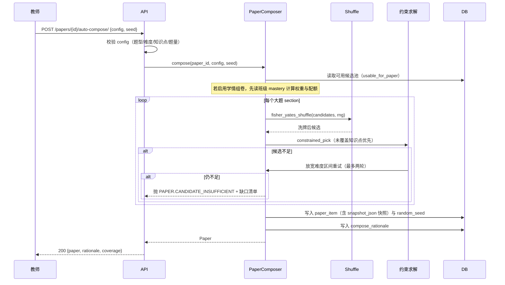
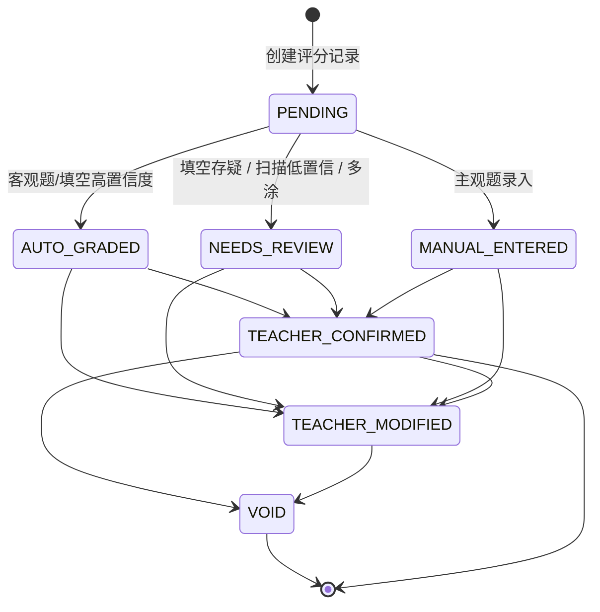

# 09 · 组卷与批改规格

> 上游依据：[开发设计文档 v2.1](../知否-开发设计文档-v2.1.md) 第 7.8、8、10 章。
> 字段定义见 [02-数据模型与DDL.md](02-数据模型与DDL.md)；接口见 [05-API契约规范.md](05-API契约规范.md)；配置项见 [13-配置项与提示词库.md](13-配置项与提示词库.md)。

**本文件覆盖两个模块：组卷（`apps/paper`）与批改（`apps/grading`）。两者都在"纯算法"范畴，无 AI 生成，因此可控性高、可测试性强。**

---

# 第一部分：组卷

## 一、模块职责与边界

| 项 | 说明 |
| --- | --- |
| 输入 | 组卷规则配置、题库候选池、班级学情诊断（学情组卷时）、随机种子 |
| 输出 | `paper` + `paper_item[]`（含快照）、`compose_rationale`（可解释性说明） |
| 不做 | ❌ 不生成新题（**C5 硬约束**）、❌ 不调用 AI、❌ 不修改题库题目 |
| 依赖 | `questionbank.selectors.usable_for_paper()`（唯一取题入口） |

**三条不可绕过的约束**：

| 约束 | 实现位置 | 校验 |
| --- | --- | --- |
| 只能取 `status=APPROVED` 且无 PENDING 配图的题 | `QuestionSelector.usable_for_paper()` | CI 断言 `test_gates.py` |
| Fisher-Yates 必须等概率 | `apps/paper/shuffle.py` | 100 万次洗牌分布检验 |
| 同 seed 必须可复现 | `paper.random_seed` 持久化 | 单测：同 seed 两次组卷结果一致 |

---

## 二、候选池筛选（第一步）

```python
# apps/questionbank/selectors.py
class QuestionSelector:
    @staticmethod
    def usable_for_paper() -> QuerySet[Question]:
        """
        组卷可用的题目。这是唯一的取题入口，其他任何地方不得绕开。

        过滤条件：
          1. status = 'APPROVED'          —— DRAFT/PENDING_REVIEW 绝不可组卷
          2. deleted_at IS NULL
          3. 无 review_status='PENDING' 的配图 —— 配图未确认的题不可用
        """
        return (
            Question.objects
            .filter(status=QuestionStatus.APPROVED, deleted_at__isnull=True)
            .exclude(images__review_status=FigureReviewStatus.PENDING)
            .distinct()
        )
```

> **为什么用 `exclude(images__review_status='PENDING')` 而不是在业务层判断**：业务层判断会漏（开发者忘记写）。放在唯一的 Selector 里，漏不掉。

**候选池筛选条件**（SQL 层，带索引）：

| 条件 | 字段 | 索引 |
| --- | --- | --- |
| 机构 | `org_id = :org` | `idx_question_org_scope` |
| 学科/学段 | `subject` / `grade_band` | 同上 |
| 题型 | `type = :type` | 同上 |
| 难度区间 | `difficulty_effective BETWEEN :lo AND :hi` | `idx_question_difficulty` |
| 知识点 | `EXISTS (question_knowledge WHERE knowledge_node_id IN (...))` | `idx_qk_node` |
| 排除近期已用 | `NOT EXISTS (paper_item ... assignment ... 近 N 天)` | `idx_paper_item_question` |
| 排除已选 | `id NOT IN :used_ids` | PK |

```python
def fetch_candidates(
    *,
    org_id: int,
    subject: str,
    section: SectionConfig,
    knowledge_nodes: list[int] | None,
    difficulty_range: tuple[float, float],
    exclude_question_ids: set[int],
    classroom_id: int | None = None,
    exclude_recent_days: int = 90,
) -> list[QuestionCandidate]:
    """第一步：候选池筛选。目标是快（索引命中），不做随机。"""
    qs = QuestionSelector.usable_for_paper().filter(
        org_id=org_id,
        subject=subject,
        type=section.type,
        difficulty_effective__gte=difficulty_range[0],
        difficulty_effective__lte=difficulty_range[1],
    )
    if knowledge_nodes:
        qs = qs.filter(knowledge_tags__knowledge_node_id__in=knowledge_nodes)
    if exclude_question_ids:
        qs = qs.exclude(id__in=exclude_question_ids)
    if classroom_id and exclude_recent_days:
        recent = recent_used_question_ids(classroom_id, days=exclude_recent_days)
        if recent:
            qs = qs.exclude(id__in=recent)
    return [
        QuestionCandidate(
            id=q.id,
            difficulty=float(q.difficulty_effective),
            difficulty_source=q.difficulty_source,
            knowledge_node_ids=q.knowledge_node_ids,     # 预取，避免 N+1
            has_figure=q.has_figure,
            is_variant_of=set(q.variant_source_ids),
        )
        for q in qs.prefetch_related("knowledge_tags").only(
            "id", "difficulty_effective", "difficulty_source", "has_figure"
        )
    ]
```

**性能要求**：2 万题规模下，单题型候选筛选 < 300ms。若超时，检查是否命中 `idx_question_org_scope` 与 `idx_qk_node`。

---

## 三、Fisher-Yates 洗牌（第二步）

```python
# apps/paper/shuffle.py
import random
from typing import Sequence, TypeVar

T = TypeVar("T")


def fisher_yates_shuffle(items: Sequence[T], rng: random.Random) -> list[T]:
    """
    标准 Fisher-Yates（Knuth shuffle），O(n)，等概率。

    必须从后往前遍历，j 取值 [0, i]（含 i）。
    常见错误：j 取 [0, i-1] 会使排列不等概率。

    可复现：调用方必须传入用固定种子初始化的 rng。
    """
    arr = list(items)
    for i in range(len(arr) - 1, 0, -1):
        j = rng.randint(0, i)
        arr[i], arr[j] = arr[j], arr[i]
    return arr


def build_seed(*parts) -> int:
    """由业务标识生成确定性种子（同参数必然同结果）。"""
    raw = "|".join(str(p) for p in parts)
    return int(hashlib.sha256(raw.encode()).hexdigest()[:16], 16)
```

**必须测的边界**：

```python
def test_fisher_yates_uniformity():
    """100 万次洗牌后，每个元素出现在每个位置的概率应接近 1/n。"""
    n, trials = 5, 200_000
    counts = [[0] * n for _ in range(n)]
    rng = random.Random(42)
    for _ in range(trials):
        arr = fisher_yates_shuffle(list(range(n)), rng)
        for pos, val in enumerate(arr):
            counts[val][pos] += 1
    expected = trials / n
    for val in range(n):
        for pos in range(n):
            # 卡方近似：偏差不超过 5%
            assert abs(counts[val][pos] - expected) / expected < 0.05


def test_fisher_yates_reproducible():
    a = fisher_yates_shuffle(list(range(100)), random.Random(42))
    b = fisher_yates_shuffle(list(range(100)), random.Random(42))
    assert a == b
```

> **Fisher-Yates 的定位**：保证「同难度同知识点的题等概率被选中」，避免总是抽到最早录入的题。**它不是约束求解器**——满足覆盖率与难度等值靠第三步。

---

## 四、约束求解（第三步）

### 4.1 抽取顺序（**降级顺序是关键**）

```
对每个大题（section）：
  ① 按「未覆盖知识点优先」排序候选
  ② 在同等优先级内用 Fisher-Yates 随机
  ③ 依次取题，直到满足该 section 的题量
  ④ 若候选不足：
       a. 放宽难度区间（±0.5，最多放宽两轮）
       b. 放宽知识点范围（从指定知识点扩展到同章节其他知识点）
       c. 仍不足 → 记录缺口，抛 PAPER.CANDIDATE_INSUFFICIENT
```

**★ 降级顺序不可颠倒**：先放宽难度，后放宽知识点。原因：知识点覆盖是组卷的教学目标，难度是技术指标。**放宽知识点会让卷子考不到该考的内容，教学上不可接受。**

```python
def constrained_pick(
    candidates: list[QuestionCandidate],
    *,
    section: SectionConfig,
    target_nodes: list[int],
    rng: random.Random,
) -> list[QuestionCandidate]:
    """带约束的贪心抽取：未覆盖知识点优先，同级内随机。"""
    picked: list[QuestionCandidate] = []
    covered: set[int] = set()
    pool = fisher_yates_shuffle(candidates, rng)          # 先整体洗牌保证随机性

    for _ in range(section.count):
        # 优先选能覆盖"尚未被覆盖的目标知识点"的题
        fresh = [c for c in pool if set(c.knowledge_node_ids) & (set(target_nodes) - covered)]
        bucket = fresh or [c for c in pool if c.id not in {p.id for p in picked}]
        if not bucket:
            break
        choice = bucket[0]                                 # 已被洗牌，取第一个即随机
        picked.append(choice)
        covered |= set(choice.knowledge_node_ids)
        pool.remove(choice)
    return picked
```

### 4.2 配额分配（学情组卷）

```python
def allocate_quota(
    weights: dict[int, float],
    total_score: Decimal,
    weak_quota: float = 0.65,
) -> dict[int, Decimal]:
    """
    把卷面分值按知识点权重分配。
    weak_quota 控制"薄弱知识点合计占卷面分值的比例"，其余留给优势知识点巩固。
    """
    weak = {n: w for n, w in weights.items() if w > 1.0}    # 权重 > 1 视为薄弱
    strong = {n: w for n, w in weights.items() if w <= 1.0}
    quota: dict[int, Decimal] = {}

    def distribute(group: dict[int, float], budget: Decimal) -> None:
        if not group or budget <= 0:
            return
        total = sum(group.values())
        for node, w in group.items():
            quota[node] = (budget * Decimal(str(w / total))).quantize(Decimal("0.01"))

    distribute(weak, total_score * Decimal(str(weak_quota)))
    distribute(strong, total_score * (1 - Decimal(str(weak_quota))))
    return quota
```

### 4.3 知识点权重计算（学情组卷）

```python
def compute_node_weights(mastery: dict[int, MasteryInfo]) -> dict[int, float]:
    """
    权重 = (1 + 薄弱程度 × 增幅) × 考纲权重 × 近期系数
    数据不足（confidence < 阈值）的知识点给中性权重 1.0，不参与加权。
    """
    weights: dict[int, float] = {}
    for node_id, m in mastery.items():
        if m.confidence < MIN_CONFIDENCE_FOR_WEIGHT:        # 默认 0.5
            weights[node_id] = 1.0
            continue
        weak_score = max(0.0, WEAK_THRESHOLD - m.mastery)   # 默认 0.60
        exam_weight = float(node_exam_weight(node_id))
        recency = recency_factor(m.last_answered_at)        # 近期考过略降权（0.8–1.0）
        weights[node_id] = (1 + weak_score * WEAK_BOOST) * exam_weight * recency
    return weights                                                  # WEAK_BOOST 默认 2.0
```

### 4.4 组卷说明（可解释性，**不可省**）

```python
def build_rationale(
    quota: dict[int, Decimal],
    mastery: dict[int, MasteryInfo],
) -> dict:
    """生成"本卷针对哪些薄弱点"的说明，前端必须展示。"""
    items = sorted(quota.items(), key=lambda kv: kv[1], reverse=True)
    return {
        "strategy": "WEAK_FIRST",
        "weak_quota": 0.65,
        "targets": [
            {
                "node_id": node_id,
                "node_name": node_name(node_id),
                "mastery": float(mastery[node_id].mastery),
                "confidence": float(mastery[node_id].confidence),
                "score_allocated": str(score),
            }
            for node_id, score in items[:8]
        ],
    }
```

前端展示：`本卷重点覆盖：动量守恒（班级掌握度 43%，占 22 分）、机械能守恒（41%，占 18 分）`。**老师看懂了这个才会相信学情组卷。**

---

## 五、难度等值（A/B 卷、补考卷）

### 5.1 计算公式

```
单题期望得分率 P_i = (6 - difficulty_i) / 5         # 难度 1→1.0，难度 5→0.2
卷面期望得分率 P_paper = Σ(score_i × P_i) / Σ(score_i)
```

### 5.2 等值判定阈值

| 指标 | 阈值 | 配置项 |
| --- | --- | --- |
| 卷面期望得分率差 | `|P_A − P_B| ≤ 0.03` | `paper.equivalence_max_diff` |
| 满分 | 必须完全相同 | — |
| 题型结构 | 必须完全相同 | — |
| 知识点 Jaccard 相似度 | ≥ 0.80 | `paper.equivalence_min_jaccard` |
| 难度分布差异 | ≤ 1 题 / 4 分 | — |

```python
# apps/paper/equivalence.py
@dataclass
class EquivalenceResult:
    expect_rate_a: Decimal
    expect_rate_b: Decimal
    diff: Decimal
    knowledge_jaccard: Decimal
    passed: bool
    detail: list[dict]          # 逐题难度对比
    suggestions: list[str]      # 不达标时的具体建议


def compute_expect_rate(items: list[PaperItem]) -> Decimal:
    total_score = sum(i.score for i in items)
    if not total_score:
        return Decimal("0")
    weighted = sum(i.score * (Decimal("6") - i.difficulty) / Decimal("5") for i in items)
    return (weighted / total_score).quantize(Decimal("0.001"))


def generate_variant(
    paper: Paper, *, label: str, max_iterations: int = 20
) -> tuple[Paper, EquivalenceResult]:
    """
    生成 A/B 卷或补考卷。

    A/B 卷：按 (题型, 难度, 知识点) 三元组找等值替身
    补考卷：额外要求与 A 卷知识点重叠率 <= 30%（知识点互补）
    """
    rng = random.Random(paper.random_seed)
    variant_items = []
    for item in paper.items.all():
        substitutes = find_equivalent_substitutes(item)      # 同三元组的其他可用题
        if not substitutes:
            raise BusinessError(PAPER_CANDIDATE_INSUFFICIENT, detail={
                "paper_item_id": item.id,
                "node": node_name_of(item),
                "difficulty": str(item.difficulty),
                "message": "该知识点该难度下没有替身题，无法生成等值变体",
            })
        variant_items.append(fisher_yates_shuffle(substitutes, rng)[0])

    # 局部搜索：对差值贡献最大的题重新选替身
    for _ in range(max_iterations):
        result = evaluate_equivalence(paper, variant_items)
        if result.passed:
            break
        worst = find_worst_contributor(paper, variant_items)
        resubstitute(worst, variant_items, rng)
    return create_variant_paper(paper, variant_items, label=label), result
```

**★ 找不到替身时必须明确告知老师，不偷偷降低标准**：

```
动量守恒知识点下只有 2 道难度 4 的题，不足以生成等值 B 卷。
建议：① 降低难度等值要求（当前 0.03 → 0.05）
      ② 补充该知识点题目（难度 4 缺 3 道）
      ③ 改为手工调整 B 卷
```

---

## 六、题目与选项乱序

```python
def assign_shuffle_mapping(
    assignment: Assignment,
    students: list[User],
) -> list[AssignmentStudent]:
    """
    为每个学生生成独立的乱序映射，发布时持久化。

    ★ 禁止每次读取时重新随机——扫描结果必须可复现。
    """
    paper_items = list(assignment.paper.items.order_by("seq"))
    records = []
    for student in students:
        rng = random.Random(build_seed(assignment.id, student.id))
        if assignment.shuffle_questions:
            q_order = [i.id for i in fisher_yates_shuffle(paper_items, rng)]
        else:
            q_order = [i.id for i in paper_items]

        opt_order: dict[str, list[str]] = {}
        if assignment.shuffle_options:
            for item in paper_items:
                if not is_choice_type(item.question.type):
                    continue
                labels = [o.label for o in item.snapshot_options]
                # 判断题不打乱（只有两个选项，打乱无意义且易出错）
                if item.question.type == QuestionType.TRUE_FALSE:
                    continue
                opt_order[str(item.id)] = fisher_yates_shuffle(labels, rng)

        records.append(AssignmentStudent(
            org_id=assignment.org_id,
            assignment=assignment,
            student=student,
            question_order=q_order,
            option_order=opt_order,
            status=AssignmentStudentStatus.NOT_STARTED,
        ))
    return AssignmentStudent.objects.bulk_create(records)
```

**映射表 key 的选择**：`option_order` 的 key 用 `paper_item_id`（不用 `seq`）。原因：一人一卷时不同学生的 `seq` 对应不同题目，用 `seq` 会串号。

**乱序版率一致性提示**：因为结构一致（C11），乱序只影响顺序不影响题量，**答题卡模板不需要改动**（涂点区按题号位置固定，题号→实际题目由 `question_order` 决定）。

---

## 七、题库健康度检查（8.7 落地）

```python
# apps/questionbank/health.py
@dataclass
class NodeHealth:
    node_id: int
    node_name: str
    counts_by_difficulty: dict[int, int]     # {1: 8, 2: 6, 3: 2, 4: 0, 5: 0}
    total: int
    verdict: str                             # OK / THIN / EMPTY
    suggestions: list[str]


def check_bank_health(
    org_id: int, subject: str, grade_band: str, *, min_per_level: int = 5
) -> BankHealthReport:
    """
    题库健康度：按知识点 × 难度档位统计可用题量。
    verdict: OK（各档 ≥5）/ THIN（总量 ≥10 但某档不足）/ EMPTY（总量 <10）
    """
    nodes = KnowledgeNode.objects.filter(
        org_id=org_id, subject=subject, grade_band=grade_band, deleted_at__isnull=True
    )
    usable = QuestionSelector.usable_for_paper().filter(
        org_id=org_id, subject=subject, grade_band=grade_band
    )
    # 一次聚合查询，避免 N+1（每个知识点一次 count 会非常慢）
    rows = (
        usable
        .values("knowledge_tags__knowledge_node_id", "difficulty_band")
        .annotate(cnt=Count("id"))
    )
    grouped: dict[tuple[int, int], int] = {
        (r["knowledge_tags__knowledge_node_id"], r["difficulty_band"]): r["cnt"] for r in rows
    }
    ...
```

**展示要求**：首页显示摘要（"动量守恒、机械能守恒 难题不足"），组卷前显示完整报告，支持导出缺口清单。

---

## 八、组卷主流程（完整时序）



**快照写入（必须）**：

```python
def build_snapshot(item_question: Question, option_order: list[str] | None) -> dict:
    """卷面题快照。题库改题不影响已发布试卷。"""
    options = list(item_question.options.order_by("sort_order"))
    if option_order:                                     # 该卷面的选项顺序
        options = sorted(options, key=lambda o: option_order.index(o.label))
    return {
        "stem_html": item_question.stem_html,
        "stem_text": item_question.stem_text,
        "type": item_question.type,
        "options": [
            {"label": o.label, "content_html": o.content_html,
             "content_text": o.content_text, "image_asset_id": o.image_asset_id}
            for o in options
        ],
        "answer": item_question.answer,
        "answer_text": item_question.answer_text,
        "explanation_html": item_question.explanation_html,
        "figures": [
            {"asset_id": f.asset_id, "attach_point": f.attach_point,
             "caption": f.caption, "display_scale": f.display_scale}
            for f in item_question.images.filter(review_status__in=["CONFIRMED", "DELETED"])
        ],
        "snapshot_at": timezone.now().isoformat(),
    }
```

> **只快照 `CONFIRMED`/`DELETED` 的配图**：`PENDING` 的图不能被组卷（Selector 已过滤），因此不会出现在这里。但为防御性编程，此处仍显式过滤。

---

# 第二部分：批改

## 九、批改范围（**C1/D6/D10 硬边界**）

| 题型 | 是否自动批改 | 处理方式 |
| --- | --- | --- |
| 单选 / 多选 / 判断 | ✅ 自动 | 直接比对，高置信度直接生效 |
| 填空题 | ✅ 自动 | 六步算法，不确定的进存疑队列 |
| 简答 / 计算 / 证明 / 作文 | ❌ **不批改** | **教师线下批改、线上逐题录入** |

**因此系统内不存在**：AI 评分、评分建议分、主观题置信度。`score_result.score_points` 字段保留但不写入。

---

## 十、客观题批改

```python
# apps/grading/normalize.py
CHOICE_ALIASES: dict[str, set[str]] = {
    "A": {"A", "a", "1", "①", "１"},
    "B": {"B", "b", "2", "②", "２"},
    "C": {"C", "c", "3", "③", "３"},
    "D": {"D", "d", "4", "④", "４"},
    "E": {"E", "e", "5", "⑤", "５"},
}

BOOL_ALIASES: dict[bool, set[str]] = {
    True:  {"T", "t", "对", "正确", "√", "✓", "true", "True", "1", "Y", "y", "是"},
    False: {"F", "f", "错", "错误", "×", "✗", "x", "false", "False", "0", "N", "n", "否"},
}

def normalize_choice(raw: str) -> str | None:
    """把各种写法归一到标准字母。无法归一返回 None。"""
    s = (raw or "").strip()
    for label, aliases in CHOICE_ALIASES.items():
        if s in aliases:
            return label
    return None

def normalize_bool(raw: str) -> bool | None:
    s = (raw or "").strip()
    for value, aliases in BOOL_ALIASES.items():
        if s in aliases:
            return value
    return None
```

| 题型 | 判定 | 边界处理 |
| --- | --- | --- |
| 单选 | `normalize_choice(学生) == normalize_choice(答案)` | 多涂 → 0 分 + 进仲裁 |
| 多选 | 完全匹配满分 | 漏选按配置给部分分；有错选给 0 |
| 判断 | `normalize_bool(学生) == normalize_bool(答案)` | 归一表必须覆盖 √/×/对/错/T/F |

**多选部分分规则（默认关闭）**：

```python
def grade_multi(student: set[str], correct: set[str], cfg: MultiChoiceConfig) -> GradingOutcome:
    if student == correct:
        return GradingOutcome(ratio=1.0, method=GradingMethod.AUTO_EXACT)
    if not cfg.allow_partial:
        return GradingOutcome(ratio=0.0, method=GradingMethod.AUTO_EXACT, needs_review=False)
    if student & (correct - student):          # 有错选 → 0 分
        if student - correct:
            return GradingOutcome(ratio=0.0, method=GradingMethod.AUTO_EXACT)
    if student < correct:                      # 纯漏选
        ratio = len(student) / len(correct) * cfg.partial_factor   # factor 默认 0.5
        return GradingOutcome(ratio=Decimal(str(ratio)).quantize(Decimal("0.01")),
                              method=GradingMethod.AUTO_EXACT)
    return GradingOutcome(ratio=0.0, method=GradingMethod.AUTO_EXACT)
```

> **多选部分分默认关闭**：不同学校规则差异大（有的漏选给分有的不给），系统不替老师决定。提供开关，且必须在试卷属性里由老师显式确认。

---

## 十一、填空题批改（六步算法，核心）

**核心原则：宁可判「存疑」交给老师，也不放过错误答案。**

```python
# apps/grading/fill_blank.py
@dataclass
class BlankGradeResult:
    score_ratio: float
    method: str                 # EXACT / NORMALIZED / SYNONYM / FUZZY / AI / UNSURE / UNANSWERED
    confidence: float
    matched_answer: str | None
    needs_review: bool
    detail: str


def grade_blank(
    student_raw: str,
    std_answers: list[BlankAnswer],
    cfg: BlankConfig,
    *,
    subject: str,
) -> BlankGradeResult:
    # ── 第 0 步：空值 ──────────────────────────────────────
    s = (student_raw or "").strip()
    if not s:
        return BlankGradeResult(0.0, "UNANSWERED", 1.0, None, False, "未作答")

    # ── 第 1 步：精确匹配（最快最准，命中即返回）────────────
    for std in std_answers:
        if s == std.text:
            return BlankGradeResult(1.0, "EXACT", 1.0, std.text, False, "精确匹配")

    # ── 第 2 步：归一化匹配 ────────────────────────────────
    s_norm = normalize_text(s, cfg.normalize_rules, subject=subject)
    for std in std_answers:
        if s_norm == normalize_text(std.text, cfg.normalize_rules, subject=subject):
            return BlankGradeResult(1.0, "NORMALIZED", 0.98, std.text, False, "归一化后一致")

    # ── 第 3 步：同义词 / 等价表述（按科目配置）─────────────
    for std in std_answers:
        cands = list(cfg.synonyms.get(std.text, [])) + [std.text]
        if s_norm in {normalize_text(c, cfg.normalize_rules, subject=subject) for c in cands}:
            return BlankGradeResult(1.0, "SYNONYM", 0.95, std.text, False, "同义表述匹配")

    # ── 第 4 步：模糊匹配（仅短答案）────────────────────────
    if len(s_norm) <= cfg.fuzzy_max_len:                       # 默认 12
        best, best_std = 0.0, None
        for std in std_answers:
            t = normalize_text(std.text, cfg.normalize_rules, subject=subject)
            ratio = 1 - levenshtein(s_norm, t) / max(len(s_norm), len(t))
            if ratio > best:
                best, best_std = ratio, std.text
        if best >= cfg.fuzzy_accept:                           # 默认 0.92
            return BlankGradeResult(1.0, "FUZZY", best, best_std, False, f"模糊匹配 {best:.2f}")
        if best >= cfg.fuzzy_review:                           # 默认 0.75
            # ★ 关键区间：不自己判，交老师
            return BlankGradeResult(
                0.0, "UNSURE", best, best_std, True,
                f"与「{best_std}」相似度 {best:.2f}，需人工确认",
            )

    # ── 第 5 步：AI 等价判定（可选）─────────────────────────
    if cfg.enable_ai:
        ai = ai_grade_blank_equivalence(s, [a.text for a in std_answers], subject)
        if ai.ok and ai.data["equivalent"] and ai.data["confidence"] >= cfg.ai_min_confidence:
            return BlankGradeResult(
                1.0, "AI", ai.data["confidence"], ai.data["matched"],
                ai.data["confidence"] < 0.95,          # 低于 0.95 仍需老师确认
                ai.data["reason"],
            )

    # ── 第 6 步：不匹配 ────────────────────────────────────
    return BlankGradeResult(0.0, "EXACT", 0.9, None, False, "不匹配")
```

### 11.1 归一化规则（**按科目细分，禁做通用规则**）

```python
# apps/grading/normalize.py
GENERIC_RULES = [
    ("fullwidth_to_halfwidth", None),      # Ａ→A，１→1，（）→()
    ("strip_whitespace", None),            # 首尾与内部冗余空白
    ("lowercase", None),                   # 仅对含拉丁字母的答案
    ("cn_punct_to_en", None),              # ，→,  ：→:
    ("normalize_subscript", None),         # CO2 ↔ CO₂，x2 ↔ x²
    ("normalize_unit_space", None),        # "5 N" → "5N"，"5 牛" → "5牛"
    ("trim_trailing_punct", None),         # 去掉句末的 。．
]

SUBJECT_SPECIFIC_RULES = {
    "physics": [
        # ★ 危险项：α 与 a 在物理里是两个不同的量，禁止归一
        # 明确列入"不归一白名单"
    ],
    "chemistry": [
        ("normalize_chem_formula", None),  # Ca(OH)2 ↔ Ca(OH)₂
    ],
}

NEVER_NORMALIZE = {
    "physics": [("α", "a"), ("β", "b"), ("γ", "c"), ("μ", "u")],
    "math": [("x", "×")],
}
```

**归一化必须处理**：全角/半角、大小写、中英标点、上下标（`CO2`/`CO₂`）、单位空格与中英文（`5 N`/`5N`/`5牛`）、化学式写法、首尾空白与换行。

**不自动归一（交 AI 或判存疑）**：分数与小数（`0.5` vs `1/2`）、数量级写法（`1×10³` vs `1000`）、希腊字母与拉丁字母。

### 11.2 配置项

| 配置项 | 默认 | 说明 |
| --- | --- | --- |
| `grading.fill_blank.fuzzy_max_len` | 12 | 超过不做编辑距离 |
| `grading.fill_blank.fuzzy_accept` | 0.92 | 高于此值直接判对 |
| `grading.fill_blank.fuzzy_review` | 0.75 | 此值到 accept 之间判存疑 |
| `grading.fill_blank.enable_ai` | true | 是否启用 AI 等价判定 |
| `grading.fill_blank.ai_min_confidence` | 0.85 | AI 判等价的最低置信度 |

### 11.3 阈值标定方法（**不拍脑袋定阈值**）

```python
# apps/grading/calibrate.py
def calibrate_fuzzy_thresholds(org_id: int, subject: str) -> CalibrationReport:
    """
    用教师的历史判定结果做 ROC 分析，找出最优的 accept / review 阈值。

    数据来源：ai_feedback / score_result 中 method='UNSURE' 且被教师明确判对/判错的记录。
    """
    ...
```

**前提**：需要有足够的历史存疑判定结果（建议 ≥ 300 条）。**冷启动阶段用默认值，积累后自动给出建议阈值并提示管理员。**

---

## 十二、评分状态机



**非法流转必须在数据库层面拒绝**：

```python
# apps/grading/state.py
ALLOWED_TRANSITIONS: dict[str, set[str]] = {
    ScoreState.PENDING: {ScoreState.AUTO_GRADED, ScoreState.NEEDS_REVIEW,
                         ScoreState.MANUAL_ENTERED, ScoreState.VOID},
    ScoreState.AUTO_GRADED: {ScoreState.TEACHER_CONFIRMED, ScoreState.TEACHER_MODIFIED, ScoreState.VOID},
    ScoreState.NEEDS_REVIEW: {ScoreState.TEACHER_CONFIRMED, ScoreState.TEACHER_MODIFIED, ScoreState.VOID},
    ScoreState.MANUAL_ENTERED: {ScoreState.TEACHER_CONFIRMED, ScoreState.TEACHER_MODIFIED, ScoreState.VOID},
    ScoreState.TEACHER_CONFIRMED: {ScoreState.TEACHER_MODIFIED, ScoreState.VOID},
    ScoreState.TEACHER_MODIFIED: {ScoreState.VOID},
    ScoreState.VOID: set(),
}


def transition(result: ScoreResult, to_state: str, operator_id: int, reason: str | None = None) -> ScoreResult:
    if to_state not in ALLOWED_TRANSITIONS[result.state]:
        raise BusinessError(
            COMMON_VALIDATION_ERROR,
            detail={"from": result.state, "to": to_state, "message": "非法的评分状态流转"},
        )
    before = {"state": result.state, "score": str(result.score)}
    result.state = to_state
    result.save(update_fields=["state", "updated_at"])
    audit_log.record("score_result.transition", result, operator_id,
                     before=before, after={"state": to_state}, reason=reason)
    return result
```

**「自动生效 vs 需教师确认」的产品决策**：

| 方案 | 采用 |
| --- | --- |
| 客观题自动生效 + 一键复核入口 + 异常项强制确认 | ✅ **默认** |
| 全部需教师确认 | 提供开关 `require_confirm_all` |
| 完全自动无复核入口 | ❌ 不提供（扫描错误无法拦截） |

---

## 十三、主观题逐题录分（v2.1）

### 13.1 三种录入模式

| 模式 | 接口参数 | 适用 | 效率目标 |
| --- | --- | --- | --- |
| **单题视图**（默认） | `view=BY_QUESTION&paper_item_id=` | 一次专注一道题，看着卡批量录 | 45 人 ≤ 1 分钟 |
| **单生视图** | `view=BY_STUDENT&student_id=` | 一侧原图，一侧该生所有主观题 | 4 题 ≤ 30 秒 |
| **粘贴导入** | `POST .../paste/` | 老师已在 Excel 录好 | 秒级 |
| **快速模式** | `POST .../aggregate/` | 只录总分（精度降级，需声明） | 45 人 ≤ 30 秒 |

### 13.2 逐题录入的核心实现

```python
# apps/grading/subjective.py
@transaction.atomic
def bulk_enter_by_question(
    *,
    assignment_id: int,
    paper_item_id: int,
    entries: list[tuple[int, Decimal]],      # [(student_id, score)]
    operator_id: int,
) -> SubjectiveEntryResult:
    """
    单题视图：为一整道题批量录入全班分数。

    校验：
      - 每题分数不超过该题配分（超限整批拒绝，指出具体学生）
      - 学生必须属于该任务的班级
      - 只允许主观题题型
    幂等：同一 (assignment, student, item) 覆盖写，旧值写审计
    """
    item = PaperItemSelector.get(paper_item_id)
    if not is_subjective_type(item.snapshot_json["type"]):
        raise BusinessError(COMMON_VALIDATION_ERROR, detail={"message": "该题不是主观题"})

    max_score = item.score
    errors = [
        {"student_id": sid, "score": str(score), "max": str(max_score)}
        for sid, score in entries if score > max_score or score < 0
    ]
    if errors:
        raise BusinessError(GRADING_SCORE_EXCEED_MAX, detail={"errors": errors})

    existing = {
        r.student_id: r
        for r in ScoreResult.objects.filter(
            assignment_id=assignment_id, paper_item_id=paper_item_id,
            student_id__in=[sid for sid, _ in entries],
        )
    }
    to_create, to_update, audit_records = [], [], []
    for student_id, score in entries:
        prior = existing.get(student_id)
        if prior is None:
            to_create.append(ScoreResult(
                org_id=item.org_id, assignment_id=assignment_id, student_id=student_id,
                paper_item_id=paper_item_id, score=score, max_score=max_score,
                is_correct=(score == max_score),
                method=ScoreMethod.MANUAL, state=ScoreState.MANUAL_ENTERED,
                graded_by_id=operator_id, graded_at=timezone.now(),
            ))
        else:
            audit_records.append((prior, score))
            prior.score = score
            prior.is_correct = (score == max_score)
            prior.method = ScoreMethod.MANUAL
            prior.state = ScoreState.MANUAL_ENTERED
            prior.graded_by_id = operator_id
            prior.graded_at = timezone.now()
            to_update.append(prior)

    ScoreResult.objects.bulk_create(to_create, batch_size=1000)
    ScoreResult.objects.bulk_update(
        to_update, ["score", "is_correct", "method", "state", "graded_by", "graded_at",
                    "updated_at"], batch_size=1000,
    )
    for prior, new_score in audit_records:
        audit_log.record("score_result.modify", prior, operator_id,
                         before={"score": str(prior.score)}, after={"score": str(new_score)})
    schedule_recompute(assignment_id, None)      # 合并去抖，一次重算
    return SubjectiveEntryResult(created=len(to_create), updated=len(to_update))
```

### 13.3 快速模式（只录总分）

```python
@transaction.atomic
def enter_aggregate_score(
    *,
    assignment_id: int,
    student_id: int,
    total: Decimal,
    operator_id: int,
) -> list[ScoreResult]:
    """
    只录总分，按**各题满分比例**分摊到各主观题。

    ★ 必须按满分比例而非题量平均：主观题各题满分通常不等（如 8/10/12/10 分），
      按题量平均会使 10 分的题被摊到与 8 分题相同的分数，导致
      ① 单题得分可能超过该题满分（触发 CHECK 约束失败）
      ② 得分为负数（总分低于已分摊额时）
      ③ 知识点归因完全失真。

    标记 method=MANUAL_AGGREGATE，学情报告必须显示精度提示。
    """
    items = list(PaperItemSelector.subjective_items(assignment_id))
    total_max = sum(i.score for i in items)
    if total > total_max:
        raise BusinessError(GRADING_SCORE_EXCEED_MAX, detail={"max": str(total_max)})

    # 按满分比例分摊；最后一个题位吸收四舍五入误差，保证合计恰好等于 total
    results, remaining, remaining_max = [], total, total_max
    for idx, item in enumerate(items):
        if idx == len(items) - 1:
            share = remaining
        else:
            share = (total * item.score / total_max).quantize(Decimal("0.01"))
            # 防御：单题分摊额不得超过该题满分（比例分摊理论上不会超，但需兜底）
            share = min(share, item.score)
            remaining -= share
            remaining_max -= item.score
        results.append(ScoreResult(
            ..., score=share, max_score=item.score,
            method=ScoreMethod.MANUAL_AGGREGATE, state=ScoreState.MANUAL_ENTERED,
        ))
    ScoreResult.objects.bulk_create(results)
    schedule_recompute(assignment_id, student_id)
    return results
```

**示例**（满分 8/10/12/10，共 40 分；录总分 26 分）：

| 题号 | 满分 | 按满分比例分摊 | 按题量平均（❌ 错误做法） |
| --- | --- | --- | --- |
| 21 | 8 | 26×8/40 = **5.20** | 6.50 |
| 22 | 10 | 26×10/40 = **6.50** | 6.50 |
| 23 | 12 | 26×12/40 = **7.80** | 6.50 |
| 24 | 10 | 26−5.20−6.50−7.80 = **6.50** | 6.50 |
| 合计 | 40 | **26.00** ✅ | 26.00（但各题失真） |

**为什么按题量平均是错的**：上例中 8 分题被摊到 6.5 分、12 分题被摊到 6.5 分。当录总分 30 分时，8 分题会被摊到 7.5 分（**超过满分 8 分**？不超；但录总分 38 分时会摊到 9.5 分 > 满分 8），直接触发 `CHECK (score <= max_score)` 约束失败，整批录入报错。**这是必须在实现层避免的。**

**精度声明**：`MANUAL_AGGREGATE` 的成绩在学情报告中标注「本次主观题采用总分分摊，**知识点归因不精确**」。这样老师知道该次数据的可信度。

### 13.4 缺考与部分作答

| 情况 | 处理 |
| --- | --- |
| 缺考 | `assignment_student.status = ABSENT`；所有题目标记；**不计入班级平均分** |
| 部分作答（只做了前两题） | 未作答的题录 0 分，`blank_count` +1；**这个标记本身是重要学情信号**（不会做 vs 时间不够） |
| 整题空白 | `answer_raw` 为空 → 自动判 `blank_count`，不计入 `correct_rate` 分母（可配） |

```python
def compute_student_total(assignment_id: int, student_id: int) -> StudentTotalScore:
    results = ScoreResult.objects.filter(
        assignment_id=assignment_id, student_id=student_id
    ).exclude(state=ScoreState.VOID)
    total = sum(r.score for r in results)
    objective = sum(r.score for r in results if r.method.startswith("AUTO") or r.method == "AI_EQUIV")
    subjective = total - objective
    blank = sum(1 for r in results if not r.response_id or not r.response.answer_raw)
    ...
```

---

## 十四、级联重算（成绩修正后必须自动更新下游）

```python
# apps/grading/recompute.py
@shared_task(queue="p2_recompute", bind=True, max_retries=2)
def recompute_after_score_change(self, assignment_id: int, student_id: int | None = None) -> dict:
    """
    成绩变更后的级联重算。用单个任务串起来，避免遗漏。

    性能要求：单次修正 <= 30s。批量修正必须合并为一次（见 schedule_recompute 去抖）。
    """
    affected_students = [student_id] if student_id else list(
        assignment_student_ids(assignment_id)
    )
    out = {}

    # 1) 学生总分
    for sid in affected_students:
        recalc_student_total(assignment_id, sid)
    out["total_score"] = len(affected_students)

    # 2) 班级统计（平均分、分布、排名）
    recalc_classroom_stats(assignment_id)
    out["classroom_stats"] = True

    # 3) 题目错误统计（得分率、选项分布）
    recalc_question_error_stats(assignment_id)
    out["question_stats"] = True

    # 4) 掌握度（受影响的题目 → 关联知识点）
    affected_nodes = collect_affected_nodes(assignment_id, student_id)
    for sid in affected_students:
        update_mastery_for_nodes(sid, affected_nodes, trigger="SCORE_CORRECTION")
    out["mastery_nodes"] = len(affected_nodes)

    # 5) 诊断快照
    for sid in affected_students:
        take_diagnosis_snapshot(sid, assignment_id, trigger=DiagnosisTrigger.SCORE_CORRECTION)
    out["snapshots"] = len(affected_students)

    # 6) 已生成的个性化练习标记为"需重新评估"（★ 不自动重生成）
    stale_count = mark_practice_sets_stale(affected_students, reason="SCORE_CORRECTION")
    out["practice_sets_marked_stale"] = stale_count      # 由教师决定是否重新生成
    return out
```

**第 6 条的取舍**：**不自动重新生成个性化练习**，只标记 `is_stale = true`。原因：自动重生成会把老师已确认并发布过的练习换掉，不可接受。前端提示"成绩已修正，建议重新评估 N 份个性化练习"。

**去抖合并**：

```python
RECOMPUTE_DEBOUNCE_SECONDS = 5

def schedule_recompute(assignment_id: int, student_id: int | None) -> None:
    key = f"zf:recompute:pending:{assignment_id}"
    redis.sadd(key, student_id or 0)
    redis.expire(key, RECOMPUTE_DEBOUNCE_SECONDS)
    recompute_after_score_change.apply_async(
        args=[assignment_id, student_id],
        countdown=RECOMPUTE_DEBOUNCE_SECONDS,
        queue="p2_recompute",
    )
```

> 5 秒窗口内的多次调用（例如老师连续改了 10 个分数）只会触发最后一次重算。**没有这个去抖，批量录分会触发 N 次全量重算，系统会被拖垮。**

---

## 十五、统计量的计算口径（必须与前端展示一致）

| 统计量 | 公式 | 说明 |
| --- | --- | --- |
| 学生总分 | `Σ score_result.score`（排除 VOID） | |
| 班级平均分 | `Σ 学生总分 / 有效人数` | **缺考不计入分母** |
| 题目得分率 | `Σ 该题得分 / (该题满分 × 有效作答人数)` | **缺考不计入分母**；未作答计入分子为 0 |
| 选项分布 | `{label: {count, rate}}`，分母为**有效作答人数** | 关键分析数据 |
| 难度统计值 | `6 - 5 × 得分率` | 见 10 文档 |
| 班级排名 | 按总分降序，同分并列 | **只存不默认展示** |

**边界**：若某题有效作答人数为 0，得分率为 `null` 而非 0（避免污染难度统计）。

---

## 变更记录

| 版本 | 日期 | 变更人 | 说明 |
| --- | --- | --- | --- |
| v1.0 | 2026-10-01 | — | 首版，对齐设计文档 v2.1 第 8、10 章 |

## 待确认问题

| 编号 | 问题 | 影响 |
| --- | --- | --- |
| Q-09-1 | 多选题部分给分规则是否由学校统一配置（而非教师逐卷设置）？ | 影响配置层级；建议机构级默认可覆盖 |
| Q-09-2 | 判断题是否需要支持「未作答」与「不选」的区别？ | 当前都归为未作答 |
| Q-09-3 | 主观题是否需支持「步骤分」录入（如 3 分过程 + 7 分结果）？ | 对应设计文档 21-Q18；若需要，`score_points` 字段启用，录分界面复杂度上升 |
| Q-09-4 | 得分率计算是否应把「未作答」计入分母？ | 当前计入（分子为 0）；影响难度统计的准确性 |
| Q-09-5 | 重算去抖窗口 5 秒是否合适（老师录完 45 人可能超过 5 秒）？ | 建议改为「提交即触发，前端提交为一次性批量」，需与前端约定 |
