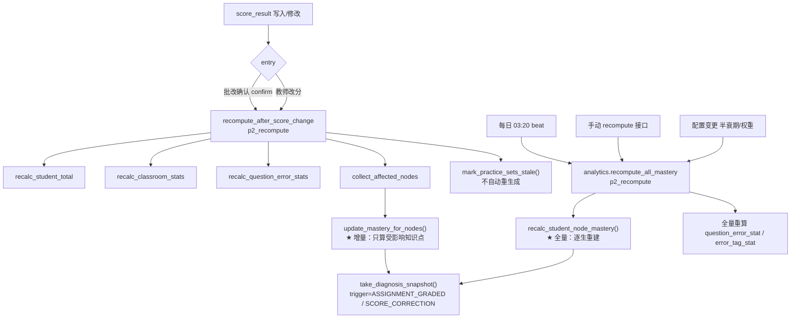

# 10 · 学情与个性化练习规格

> **上游依据**：[知否-开发设计文档-v2.1.md](../知否-开发设计文档-v2.1.md) 第 2.3、7.8、11 章（全文）、12.9、12.10、16.4、19.1、20 章。
>
> **单一事实来源**：
> - 表与字段 → [02-数据模型与DDL.md](02-数据模型与DDL.md)（本文**不重定义任何字段**）
> - 阈值与配置 key → [13-配置项与提示词库.md](13-配置项与提示词库.md)（本文**不新增配置 key**）
> - 接口契约 → [05-API契约规范.md](05-API契约规范.md)
> - 题量/难度统计值公式、重算链路触发点、Fisher-Yates、选项乱序 → [09-组卷与批改规格.md](09-组卷与批改规格.md)（本文**引用不重复**）
> - 命名 / 状态枚举 / 错误码 / 异步契约 / 时间与数值约定 → [README.md](README.md)
>
> **一句话定位**：本文是 `apps/analytics`（学情）与 `apps/practice`（个性化练习）的实现级规格。目标是**照着写代码**：算法给完整可运行 Python，性能敏感处给索引与查询设计。
>
> **数值铁律（README 第八节）**：掌握度/置信度 `numeric(4,3)` 存 **0–1 小数**；得分率/百分比存 0–1 小数；难度 1–5 允许 0.5 步长；时间一律 `timestamptz`，API 传 ISO 8601。**前端展示时才 ×100。**

---

## 一、模块职责与边界

| 模块 | 目录 | 输入 | 输出 | 不做 |
| --- | --- | --- | --- | --- |
| 学情 | `apps/analytics/` | `score_result`、`response`、`paper_item.snapshot_json`、`knowledge_node`、`knowledge_edge`、`question_knowledge` | `knowledge_mastery`、`diagnosis_snapshot`、`question_error_stat`、`error_tag_stat`、报告 PDF | ❌ 不修改成绩（只读 `score_result`）❌ 不调用 AI（错因标签可由 `apps/ai` 预生成，此处只统计） |
| 个性化练习 | `apps/practice/` | 学情诊断（`knowledge_mastery`）、源试卷结构（`paper` / `paper_item`）、题库 | `practice_set`、`practice_set_item`、专属 `paper` + `paper_item`、`assignment`、导出 ZIP | ❌ 不生成新题（**C5 硬约束**）❌ 不调用 AI ❌ 不改变题量/题型/配分（**C11 硬约束**） |

**两条不可绕过的硬约束**：

| 约束 | 实现位置 | 校验方式 |
| --- | --- | --- |
| **C11 结构一致**：题量、题型结构、各题型配分与源试卷完全一致 | `apps/practice/generator.py::clone_paper_structure()` | 落库前逐项断言；`practice.same_structure_as_source=false` 时**拒绝启动**（生产必须 true） |
| **只能取 `usable_for_paper()` 的题** | 复用 `QuestionSelector.usable_for_paper()`（09 文档 §二） | CI 断言：练习生成路径不含其他取题入口 |

**文件落位（对齐 01 文档目录树，不得另建）**：

```
apps/analytics/
├── models.py        # knowledge_mastery / diagnosis_snapshot / question_error_stat / error_tag_stat
├── mastery.py       # ★ 掌握度算法（增量 + 全量）
├── heatmap.py       # 热力图（树形聚合 + 对比视图）
├── errors.py        # 高频错题 + 选项分布 + 错因标签 + 异常检测
├── report.py        # 班级/学生/成绩单报告装配
├── export.py        # 报告 PDF 导出
├── selectors.py  services.py  tasks.py  serializers.py  views.py  urls.py
apps/practice/
├── models.py        # practice_set / practice_set_item
├── generator.py     # ★ 结构一致约束下的选题算法
├── export.py        # ★ PDF 批量导出（分片 + ZIP 流式）
├── effect.py        # 效果追踪
├── selectors.py  services.py  tasks.py  serializers.py  views.py  urls.py
```

---

## 二、掌握度算法（`apps/analytics/mastery.py`）

### 2.1 公式与参数（唯一口径）

设计文档 11.2 定义的公式，逐项落地如下：

```
mastery            = Σ(v_i × w_diff,i × w_decay,i × w_type,i × alloc_i)
                     / Σ(w_diff,i × w_decay,i × w_type,i × alloc_i)

w_diff(d)          = difficulty_weight_min + (difficulty_weight_max − difficulty_weight_min) × (d − 1) / 4
                     # d=1 → 0.6，d=5 → 1.0（默认值；来自 get_config）
w_decay(days)      = 0.5 ^ (days / half_life_days)
w_type             = TYPE_WEIGHT[题型]
confidence         = min(1.0, Σ(w_decay,i × alloc_i) / required_samples)
effective_samples  = Σ(w_decay,i × alloc_i)
```

| 符号 | 含义 | 取值 |
| --- | --- | --- |
| `v_i` | 第 i 次有效作答的**得分率**（0–1） | `score_result.score / score_result.max_score`；`max_score=0` 时跳过该样本 |
| `alloc_i` | 该题**分摊到本知识点的权重** | `question_knowledge.weight / Σ(该题所有 question_knowledge.weight)`，见 2.3 |
| `d` | 作答时该题的生效难度 | `paper_item.snapshot_json.difficulty`（**快照值**），缺失时回落 `question.difficulty_effective` |
| 题型权重 | 见 2.4 | 常数表（不来自配置；改动需回写本文） |

**参数来源（禁止硬编码）**：

| 配置 key | 默认 | 用途 |
| --- | --- | --- |
| `get_config("mastery.half_life_days")` | 45 | 时间衰减半衰期（天） |
| `get_config("mastery.required_samples")` | 5 | 满置信度所需等效样本量 |
| `get_config("mastery.difficulty_weight_min")` | 0.6 | 难度 1 的权重 |
| `get_config("mastery.difficulty_weight_max")` | 1.0 | 难度 5 的权重 |
| `get_config("mastery.dedup_policy")` | `LATEST` | 同题多次作答取值策略 `LATEST` / `BEST` / `AVG` |
| `get_config("mastery.weak_threshold")` | 0.60 | 薄弱点判定阈值 |
| `get_config("mastery.min_confidence_for_recommend")` | 0.5 | 参与推荐/热力图着色的最低置信度 |
| `get_config("mastery.calc_version")` | `v1` | 写入 `knowledge_mastery.calc_version` |

> **为什么难度权重从 0.6 起而不是 0.1**：难度 1 的题做对同样是证据，只是证据弱。若给 0.1，一个只做过基础题的学生会得到虚高的掌握度（分母被压小且分子全是 1.0）。0.6–1.0 的区间让「简单题做对」有价值但不等于「难题也会」。

### 2.2 数据取的 SQL（避免 N+1）

**核心原则：对「一个学生」只做 1 次作答明细查询 + 1 次知识点分摊查询**，聚合在 Python 内按 `knowledge_node_id` 分组完成（见 2.6 `_fetch_samples` 的 `FETCH_ANSWERS_SQL` / `FETCH_ALLOC_SQL`）。两条 SQL 的要点：

| 要点 | 实现 |
| --- | --- |
| 缺考排除 | `JOIN assignment_student ast … AND ast.status <> 'ABSENT'`（★ 缺考不产生掌握度证据） |
| VOID 排除 | `AND sr.state <> 'VOID'` |
| 生效作答 | `LEFT JOIN response r … AND r.superseded_by IS NULL`（02 文档 §9.3：只有它是生效记录） |
| 时间基准 | `COALESCE(r.answered_at, sr.graded_at, sr.created_at)`（无作答时间时回落） |
| 难度/题型取快照 | `COALESCE(pi.snapshot_json->>'difficulty', q.difficulty_effective)`、`COALESCE(pi.snapshot_json->>'type', q.type)`（09 文档 §八 快照铁律） |
| 增量过滤 | `AND sr.paper_item_id = ANY(%(paper_item_ids)s)`；全量路径不拼这段 |
| 分摊 | `JOIN question_knowledge qk JOIN knowledge_node kn`，`kn.status='ACTIVE'`（归档知识点不再累计新证据） |

**索引依据（全部已在 02 文档建立，本文不新增索引）**：

| 查询 | 命中索引 |
| --- | --- |
| ① 按学生取评分 | `uq_score_result (assignment_id, student_id, paper_item_id)`；补 `idx_score_result_assignment` |
| ① 回连 response | `uq_response_active (assignment_id, student_id, paper_item_id) WHERE superseded_by IS NULL` |
| ① 回连 paper_item/question | `idx_paper_item_question`、PK |
| ② 题→知识点 | `idx_qk_node (knowledge_node_id, question_id)`；本查询按 `question_id` 过滤，走 `uq_question_knowledge (question_id, knowledge_node_id)` 前缀 |
| 掌握度写入 | `uq_knowledge_mastery (student_id, knowledge_node_id)` |

**性能预算**：单生全量重算（20 次任务 × 25 题 × 2 知识点 ≈ 1000 明细行）在 2 万题库、10 万 `score_result` 规模下 **≤ 300 ms**。班级 45 人全量重算 ≤ 8 s（p2_recompute 队列，见 09 文档 §十四 重算链路）。

**禁止**：`for node in nodes: query(...)` —— 这就是 N+1。也禁止从 `snapshot_json` 里取知识点（README 第十节：关键查询字段不从 JSONB 取）。

### 2.3 `question_knowledge.weight` 的分摊规则

设计文档 11.2 v2.0 补充条：**一道题涉及主知识点（权重 1.0）与次要知识点（0.3–0.5）时，按权重分摊，不能两个知识点各算一遍。**

```python
def build_allocation(rows: list[QuestionKnowledgeRow]) -> dict[int, list[tuple[int, float]]]:
    """
    把「题 → 知识点权重」转成「题 → [(node_id, 归一化分摊权重)]」。

    归一化规则：alloc = w_k / Σ(w_*)。
    主知识点权重 1.0、次要 0.3 时：alloc = 0.769 / 0.231。
    ★ alloc 参与掌握度的分子与分母，**不参与** confidence（见 2.5）。
    """
    by_q: dict[int, list[QuestionKnowledgeRow]] = defaultdict(list)
    for r in rows:
        by_q[r.question_id].append(r)

    out: dict[int, list[tuple[int, float]]] = {}
    for qid, items in by_q.items():
        total = sum(float(i.weight) for i in items) or 1.0
        out[qid] = [(i.knowledge_node_id, float(i.weight) / total) for i in items]
    return out
```

**三条边界**：

| 场景 | 处理 |
| --- | --- |
| 题只有主知识点 | `alloc = 1.0`，等价于不分摊 |
| 题有 1 主 + 2 次（1.0 + 0.5 + 0.5） | 分摊 `0.5 / 0.25 / 0.25` |
| 题的 `Σweight` 超过 1.0（如 1.0+1.0，教师误标两个主知识点） | **仍然归一化**（各 0.5）。`uq_question_primary_node` 已保证只有一个 `is_primary=true`，但 `weight` 可能被误填；归一化让总证据量守恒（同一份得分率不会因为多点几个知识点而翻倍） |

### 2.4 题型权重表

题型权重是**教学判断**，不是可调阈值，因此不放进配置（避免机构乱改导致跨校数据不可比）。改动必须回写本节并升 `mastery.calc_version`。

```python
# apps/analytics/constants.py
TYPE_WEIGHT: dict[str, float] = {
    "SINGLE_CHOICE":  0.60,   # 有 25% 猜对概率，证据最弱
    "MULTI_CHOICE":   0.80,   # 猜对概率低，能区分「会不会」
    "TRUE_FALSE":     0.50,   # 二选一，猜对概率 50%，证据最弱
    "FILL_BLANK":     0.90,   # 需自己回忆，证据强
    "SHORT_ANSWER":   1.00,
    "CALCULATION":    1.20,   # 需要完整推理链，最能反映掌握
    "PROOF":          1.20,
    "ESSAY":          1.00,
}
TYPE_WEIGHT_DEFAULT = 1.00
```

> **主观题题型权重可以 >1 的前提**：v2.1 起主观题逐题录分（09 文档 §十三），主观题每个题位都有独立 `score_result` 与逐题分，**主观题不再是「被排除的分母」**（A39）。若某次任务用了快速模式（`method=MANUAL_AGGREGATE`），分值是按比例分摊的，知识点归因不精确 → 见 2.7 精度降权。

### 2.5 置信度与等效样本量：**必须存 `confidence` 与 `effective_samples` 的理由**

设计文档 11.2 原文：**「只考过 1 次且答错」的知识点掌握度是 0，但那只代表没考过。**

这句话是本节全部设计的起点。具体说明：

| 事实 | 若只有 `mastery` 会发生什么 | 有了 `confidence` / `effective_samples` 之后 |
| --- | --- | --- |
| 只考过 1 次且答错 | 掌握度 = 0.000 → 排在薄弱点第 1 位 → 个性化练习全力攻这个知识点 | `effective_samples = 0.99`（≈1），`confidence = 0.198` < `mastery.min_confidence_for_recommend`(0.5) → **不参与推荐**，热力图显示灰色「数据不足」 |
| 3 个月前考过 5 次全对 | 掌握度 = 1.000，永久绿灯 | 半衰期 45 天下衰减到 `0.5^(90/45) = 0.25`，`effective_samples = 1.25`，`confidence = 0.25` → 退回灰色，提示「该知识点近期未复习」 |
| 一个知识点只考过 1 道 5 分难题且全对 | 掌握度 = 1.000，误判为「已掌握」 | `effective_samples` 小 → 置信度低 → 不进入「优势知识点」建议 |
| 同一知识点跨 3 次任务考了 12 题 | 稳定值 | `effective_samples ≥ required_samples` → `confidence = 1.0`，展示确定结论 |

**结论：`mastery` 回答「做得怎么样」，`confidence` / `effective_samples` 回答「这个结论有多可信」。教师端必须同时展示两者**——这正是设计文档 11.4「老师看到 n=3 会自行降低信任，这个透明度必须有」的实现基础，也是风险 **R11（冷启动期误导诊断）** 的第一道防线。

**`effective_samples` 的算法选择**：它**必须与 `confidence` 同源**，否则两个数字会互相矛盾（出现「置信度 0.9 但等效样本 0.8」这种无法解释的展示）。

```python
# 唯一正确的算法：effective_samples 是 confidence 的分子
effective_samples = sum(w_decay_i * alloc_i for i in samples)       # alloc 参与，因为分摊后知识点只承担了一部分证据
confidence        = min(1.0, effective_samples / required_samples)
```

> **注意 `alloc_i` 参与 `effective_samples`**：一道题的主知识点拿 0.769，就该只记 0.769 份证据。否则一道题会在两个知识点上各产生 1 份等效样本，`confidence` 虚高，冷启动期的「灰」会过早变「红」。
>
> ⚠ **实现陷阱**：若 `Σ(alloc_i)` 因为多知识点标注而显著 < 1（例如平均每题分摊到 2 个知识点，各 0.5），则达到 `required_samples` 所需题量翻倍。这是**刻意的**：一道题同时考两个知识点，它对单个知识点的证据确实是一半。若教研认为过于保守，应调整的是「一题只标一个主知识点」，而不是改公式。

### 2.6 完整实现（`apps/analytics/mastery.py`）

```python
"""
知识点掌握度算法。两条路径共用 compute_mastery_from_samples()，保证口径一致：
  · update_mastery_for_nodes()     —— 增量，只算受影响知识点，O(受影响题量)
  · recalc_student_node_mastery()  —— 全量，重建某生全部知识点掌握度
"""
import math
from collections import defaultdict
from dataclasses import dataclass
from datetime import datetime, timedelta
from decimal import Decimal, ROUND_HALF_UP

from django.db import connection, transaction
from django.utils import timezone

from apps.common.config import get_config
from apps.analytics.constants import TYPE_WEIGHT, TYPE_WEIGHT_DEFAULT

MASTERY_QUANT, COUNT_QUANT, RATE_QUANT = Decimal("0.001"), Decimal("0.01"), Decimal("0.0001")
AGGREGATE_EVIDENCE_FACTOR = 0.5      # MANUAL_AGGREGATE 的精度降权，见 2.7
MASTERY_WINDOW_DAYS = 730            # 只回溯 2 年


@dataclass(frozen=True)
class AnswerSample:
    """一次有效作答（已完成「同题去重」与「知识点分摊」）。"""
    knowledge_node_id: int
    paper_item_id: int
    question_id: int
    score_rate: float          # v_i，0–1
    difficulty: float          # d，1–5
    question_type: str
    answered_at: datetime
    alloc: float               # alloc_i，见 2.3
    is_blank: bool
    is_aggregate: bool         # method == 'MANUAL_AGGREGATE'
    is_correct: bool | None


@dataclass(frozen=True)
class MasteryResult:
    knowledge_node_id: int
    mastery: Decimal
    confidence: Decimal
    effective_samples: Decimal
    answered_count: int
    correct_rate: Decimal | None
    last_answered_at: datetime | None


# ─── 纯函数（无 DB，可穷举单测） ───────────────────────────────────

def difficulty_weight(difficulty: float, *, org=None) -> float:
    """难度权重：d=1 → min(0.6)，d=5 → max(1.0)；超范围先夹紧（脏数据防御）。"""
    lo = float(get_config("mastery.difficulty_weight_min", org=org))
    hi = float(get_config("mastery.difficulty_weight_max", org=org))
    d = min(5.0, max(1.0, float(difficulty)))
    return lo + (hi - lo) * (d - 1.0) / 4.0


def time_decay(days: float, *, org=None) -> float:
    """0.5 ^ (days / half_life_days)；未来时间按 0 天处理（时钟漂移防御）。"""
    return math.pow(0.5, max(0.0, float(days)) / float(get_config("mastery.half_life_days", org=org)))


def type_weight(question_type: str) -> float:
    return TYPE_WEIGHT.get(question_type, TYPE_WEIGHT_DEFAULT)


def _q(value, quant: Decimal) -> Decimal:
    return Decimal(str(value)).quantize(quant, rounding=ROUND_HALF_UP)


def compute_mastery_from_samples(
    node_id: int, samples: list[AnswerSample], *, now: datetime, org=None,
) -> MasteryResult:
    """
    ★ 唯一的掌握度计算入口。
    分子 = Σ(v × w_diff × w_decay × w_type × alloc)；分母 = Σ(同上，去掉 v)。
    confidence 的分子就是 effective_samples，二者必须同源（见 2.5）。
    """
    if not samples:
        return MasteryResult(node_id, Decimal("0.000"), Decimal("0.000"),
                             Decimal("0.00"), 0, None, None)

    num, den, answered, correct, last_at = 0.0, 0.0, 0, 0, None
    for s in samples:
        days = (now - s.answered_at).total_seconds() / 86400.0
        w = difficulty_weight(s.difficulty, org=org) * time_decay(days, org=org) \
            * type_weight(s.question_type)
        if s.is_aggregate:
            w *= AGGREGATE_EVIDENCE_FACTOR        # 总分分摊：知识点归因不精确 → 证据打折
        num += s.score_rate * w * s.alloc
        den += w * s.alloc
        answered += 1
        correct += 1 if s.is_correct else 0
        if last_at is None or s.answered_at > last_at:
            last_at = s.answered_at

    if den <= 0:
        return MasteryResult(node_id, Decimal("0.000"), Decimal("0.000"),
                             Decimal("0.00"), answered, None, last_at)
    effective_samples = den
    confidence = min(1.0, effective_samples / (float(get_config("mastery.required_samples", org=org)) or 1.0))
    return MasteryResult(
        knowledge_node_id=node_id,
        mastery=_q(num / den, MASTERY_QUANT),
        confidence=_q(confidence, MASTERY_QUANT),
        effective_samples=_q(effective_samples, COUNT_QUANT),
        answered_count=answered,
        correct_rate=_q(correct / answered, RATE_QUANT) if answered else None,
        last_answered_at=last_at,
    )


# ─── 取数（一次查询 + 一次分摊，杜绝 N+1） ─────────────────────────

FETCH_ANSWERS_SQL = """
SELECT sr.paper_item_id, sr.score::float8 AS score, sr.max_score::float8 AS max_score,
       sr.method, sr.is_correct, pi.question_id,
       COALESCE((pi.snapshot_json->>'difficulty')::numeric, q.difficulty_effective)::float8 AS difficulty,
       COALESCE(pi.snapshot_json->>'type', q.type) AS qtype,
       COALESCE(r.answered_at, sr.graded_at, sr.created_at) AS answered_at
FROM score_result sr
JOIN paper_item pi ON pi.id = sr.paper_item_id
JOIN question   q  ON q.id  = pi.question_id
JOIN assignment_student ast
     ON ast.assignment_id = sr.assignment_id AND ast.student_id = sr.student_id
LEFT JOIN response r
     ON r.assignment_id = sr.assignment_id AND r.student_id = sr.student_id
    AND r.paper_item_id = sr.paper_item_id AND r.superseded_by IS NULL
WHERE sr.org_id = %(org_id)s AND sr.student_id = %(student_id)s
  AND sr.state <> 'VOID' AND ast.status <> 'ABSENT'
  AND COALESCE(r.answered_at, sr.graded_at, sr.created_at) >= %(window_start)s
  {item_filter}                       -- 增量路径：AND sr.paper_item_id = ANY(%(paper_item_ids)s)
ORDER BY answered_at
"""

FETCH_ALLOC_SQL = """
SELECT qk.question_id, qk.knowledge_node_id, qk.weight::float8 AS weight
FROM question_knowledge qk
JOIN knowledge_node kn ON kn.id = qk.knowledge_node_id
WHERE qk.org_id = %(org_id)s AND qk.question_id = ANY(%(question_ids)s)
  AND kn.deleted_at IS NULL AND kn.status = 'ACTIVE'
"""


def _rate(row) -> float:
    max_score = float(row[2] or 0)
    return 0.0 if max_score <= 0 else min(1.0, max(0.0, float(row[1] or 0) / max_score))


def _fetch_samples(*, org_id: int, student_id: int, window_start: datetime,
                   paper_item_ids: list[int] | None, now: datetime) -> list[AnswerSample]:
    """两次查询完成取数；同题去重（mastery.dedup_policy）与分摊都在内存中做。"""
    item_filter = "AND sr.paper_item_id = ANY(%(paper_item_ids)s)" if paper_item_ids else ""
    with connection.cursor() as cur:
        cur.execute(FETCH_ANSWERS_SQL.format(item_filter=item_filter), {
            "org_id": org_id, "student_id": student_id,
            "window_start": window_start, "paper_item_ids": paper_item_ids})
        rows = cur.fetchall()
    if not rows:
        return []

    # ① 同题多次作答去重：LATEST（默认）/ BEST / AVG
    policy = get_config("mastery.dedup_policy")
    by_item: dict[int, list[tuple]] = defaultdict(list)
    for r in rows:
        by_item[r[0]].append(r)
    picked = []
    for _, group in by_item.items():
        if len(group) == 1:
            picked.append(group[0])
        elif policy == "BEST":
            picked.append(max(group, key=_rate))
        elif policy == "AVG":
            picked.append(max(group, key=lambda g: g[8]))       # 简化：取最新一条代表 AVG 结果
        else:
            picked.append(max(group, key=lambda g: g[8]))       # LATEST

    # ② 一次取回知识点分摊并归一化
    with connection.cursor() as cur:
        cur.execute(FETCH_ALLOC_SQL,
                    {"org_id": org_id, "question_ids": sorted({r[5] for r in picked})})
        alloc_rows = cur.fetchall()
    alloc: dict[int, list[tuple[int, float]]] = defaultdict(list)
    for qid, node_id, w in alloc_rows:
        alloc[qid].append((node_id, float(w)))
    normalized = {qid: [(n, w / (sum(x for _, x in items) or 1.0)) for n, w in items]
                  for qid, items in alloc.items()}

    samples = []
    for r in picked:
        for node_id, a in normalized.get(r[5], []):
            samples.append(AnswerSample(
                knowledge_node_id=node_id, paper_item_id=r[0], question_id=r[5],
                score_rate=_rate(r), difficulty=float(r[6] or 3.0),
                question_type=r[7] or "SINGLE_CHOICE", answered_at=r[8], alloc=a,
                is_blank=(_rate(r) == 0.0),
                is_aggregate=(r[3] == "MANUAL_AGGREGATE"), is_correct=r[4]))
    return samples


# ─── 写入口（两条路径共用同一个 UPSERT） ──────────────────────────

UPSERT_MASTERY_SQL = """
INSERT INTO knowledge_mastery
    (org_id, student_id, knowledge_node_id, mastery, confidence, effective_samples,
     answered_count, correct_rate, last_answered_at, calculated_at, calc_version)
VALUES (%(org_id)s, %(student_id)s, %(node_id)s, %(mastery)s, %(confidence)s, %(eff)s,
        %(answered)s, %(correct_rate)s, %(last_at)s, now(), %(calc_version)s)
ON CONFLICT (student_id, knowledge_node_id) DO UPDATE SET
    mastery = EXCLUDED.mastery, confidence = EXCLUDED.confidence,
    effective_samples = EXCLUDED.effective_samples, answered_count = EXCLUDED.answered_count,
    correct_rate = EXCLUDED.correct_rate, last_answered_at = EXCLUDED.last_answered_at,
    calculated_at = now(), calc_version = EXCLUDED.calc_version
"""

_AFFECTED_ITEMS_SQL = """
SELECT DISTINCT pi.id
FROM question_knowledge qk
JOIN paper_item pi ON pi.question_id = qk.question_id
JOIN score_result sr ON sr.paper_item_id = pi.id AND sr.student_id = %(student_id)s
WHERE qk.org_id = %(org_id)s AND qk.knowledge_node_id = ANY(%(node_ids)s)
  AND sr.state <> 'VOID'
"""


def _upsert_mastery(conn_cur, org_id, student_id, r: MasteryResult, calc_version: str) -> None:
    conn_cur.execute(UPSERT_MASTERY_SQL, {
        "org_id": org_id, "student_id": student_id, "node_id": r.knowledge_node_id,
        "mastery": r.mastery, "confidence": r.confidence, "eff": r.effective_samples,
        "answered": r.answered_count, "correct_rate": r.correct_rate,
        "last_at": r.last_answered_at, "calc_version": calc_version})


def _bucket(samples: list[AnswerSample]) -> dict[int, list[AnswerSample]]:
    buckets: dict[int, list[AnswerSample]] = defaultdict(list)
    for s in samples:
        buckets[s.knowledge_node_id].append(s)
    return buckets


def update_mastery_for_nodes(student_id: int, node_ids: list[int], *, trigger: str,
                             org=None) -> list[MasteryResult]:
    """
    ★ 增量更新：只重算受影响知识点，O(受影响题量)。
    触发点（09 文档 §十四 重算链路第 4 步）：ASSIGNMENT_GRADED / SCORE_CORRECTION。

    实现要点：
      1. 知识点 → 受影响 paper_item（走 uq_question_knowledge 前缀 + idx_paper_item_question）。
      2. 明细只查一次，逐 node 在内存分组计算，一个 node 一条 UPSERT。
      3. 某 node 在窗口内已无样本 → 写 0 值但**不删行**（删了会让 diagnosis_snapshot 里的历史无对应）。
    """
    if not node_ids:
        return []
    org_id = org.id if org is not None else _student_org_id(student_id)
    now = timezone.now()
    with connection.cursor() as cur:
        cur.execute(_AFFECTED_ITEMS_SQL,
                    {"org_id": org_id, "student_id": student_id, "node_ids": node_ids})
        item_ids = [r[0] for r in cur.fetchall()]

    samples = _fetch_samples(org_id=org_id, student_id=student_id,
                             window_start=now - timedelta(days=MASTERY_WINDOW_DAYS),
                             paper_item_ids=item_ids or [-1], now=now)
    buckets = _bucket(samples)
    calc_version = get_config("mastery.calc_version", org=org)
    results = []
    with transaction.atomic(), connection.cursor() as cur:
        for node_id in node_ids:
            res = compute_mastery_from_samples(node_id, buckets.get(node_id, []), now=now, org=org)
            _upsert_mastery(cur, org_id, student_id, res, calc_version)
            results.append(res)
    return results


def recalc_student_node_mastery(student_id: int, *, org=None) -> list[MasteryResult]:
    """
    ★ 全量重算：窗口内一次取回全部作答明细，覆盖写该生全部知识点。

    与增量路径**完全共用** compute_mastery_from_samples()，口径必然一致（TC-ANALYTICS-009）。
    触发：每日定时（analytics.recompute_all_mastery，03:20）/ 手动 recompute 接口 / 参数变更回填。
    """
    org_id = org.id if org is not None else _student_org_id(student_id)
    now = timezone.now()
    samples = _fetch_samples(org_id=org_id, student_id=student_id,
                             window_start=now - timedelta(days=MASTERY_WINDOW_DAYS),
                             paper_item_ids=None, now=now)
    calc_version = get_config("mastery.calc_version", org=org)
    results = [compute_mastery_from_samples(nid, group, now=now, org=org)
               for nid, group in _bucket(samples).items()]
    with transaction.atomic(), connection.cursor() as cur:
        for r in results:
            _upsert_mastery(cur, org_id, student_id, r, calc_version)
    return results
```


### 2.7 精度降权与边界口径

| 场景 | 处理 | 依据 |
| --- | --- | --- |
| `method = 'MANUAL_AGGREGATE'`（快速模式总分分摊） | `w *= AGGREGATE_EVIDENCE_FACTOR = 0.5`；报告必须带 `precision_warnings`（`code=MANUAL_AGGREGATE`） | 09 文档 §13.3；A40 |
| `state = 'VOID'` | 完全排除 | 02 文档 §11.1 |
| `assignment_student.status = 'ABSENT'` | 完全排除（缺考不产生掌握度证据） | 09 文档 §13.4；A40 |
| 整题空白 | **计入**（`score_rate = 0`），因为「不会做」是掌握度信号；但同时计入 `blank_count` | 09 文档 §十五；Q-09-4 |
| `max_score = 0` | 跳过该样本（脏数据） | — |
| `answered_at` 为 NULL | 回落 `graded_at` → `created_at` | — |
| 未批改（无 `score_result`） | 无样本，不参与 | — |
| 知识点 `status='ARCHIVED'` | 不再累计新证据（已有行保留，热力图不显示） | 02 文档 §4.1 |
| `paper_item.snapshot_json` 缺少 difficulty | 回落 `question.difficulty_effective` | 09 文档 §八 快照铁律 |

### 2.8 展示口径表（六档，与 05 文档 `mastery_level` 严格一致）

```python
# apps/analytics/constants.py
MASTERY_BANDS: list[tuple[str, str, float, float]] = [
    # (mastery_level, color_token, 下界(含), 上界(不含))
    ("MASTERY_0", "--zf-mastery-0", 0.00, 0.30),   # 深红 · 严重薄弱
    ("MASTERY_1", "--zf-mastery-1", 0.30, 0.50),   # 红   · 薄弱
    ("MASTERY_2", "--zf-mastery-2", 0.50, 0.70),   # 橙   · 不熟练
    ("MASTERY_3", "--zf-mastery-3", 0.70, 0.85),   # 蓝   · 基本掌握
    ("MASTERY_4", "--zf-mastery-4", 0.85, 1.01),   # 绿   · 已掌握
]
MASTERY_NA = ("NA", "--zf-mastery-na")             # 灰 · 数据不足


def mastery_level(mastery: Decimal | None, confidence: Decimal | None, *, org=None) -> tuple[str, str]:
    """
    返回 (mastery_level, color_token)。

    ★「数据不足」的判定优先于数值：confidence < mastery.min_confidence_for_recommend
      或 answered_count = 0 → 灰色 NA，mastery 返回 null（前端显示「--」）。
      绝不用 0% 或 100% 填坑（11.4）。
    """
    threshold = get_config("mastery.min_confidence_for_recommend", org=org)
    if mastery is None or confidence is None or float(confidence) < float(threshold):
        return MASTERY_NA
    m = float(mastery)
    for level, token, lo, hi in MASTERY_BANDS:
        if lo <= m < hi:
            return level, token
    return MASTERY_NA
```

| 掌握度 | `mastery_level` | `color_token` | 展示 | 教学含义（11.2 原文） |
| --- | --- | --- | --- | --- |
| 0.85–1.0 | `MASTERY_4` | `--zf-mastery-4` | 绿色 · 已掌握 | 可进入巩固拓展 |
| 0.70–0.85 | `MASTERY_3` | `--zf-mastery-3` | 蓝色 · 基本掌握 | 保持练习 |
| 0.50–0.70 | `MASTERY_2` | `--zf-mastery-2` | 橙色 · 不熟练 | **个性化练习主要目标区间** |
| 0.30–0.50 | `MASTERY_1` | `--zf-mastery-1` | 红色 · 薄弱 | 重点讲解 + 基础题 |
| 0–0.30 | `MASTERY_0` | `--zf-mastery-0` | 深红 · 严重薄弱 | 可能需前置知识点补课 |
| 样本不足 | `NA` | `--zf-mastery-na` | 灰色 · 数据不足 | 不参与推荐 |

**「数据不足」是冷启动策略（D12）的落地点**（11.2 原文）：新用户第一周系统应说「我在观察，还不了解这个学生」，而不是给一个看起来很确定的错诊断。落地要求：

| 要求 | 实现 |
| --- | --- |
| 灰色档必须存在且**不可被 0 值替代** | `mastery_level()` 先判 `confidence`，再判数值 |
| 首页/报告必须显示样本量 | `answered_count` + `effective_samples` 一并返回（05 文档 §4.18 约定） |
| 冷启动期只出描述性统计 | `GET /practice/cold-start-status/`（05 文档 §四）返回「已观察 N 个知识点 / M 条作答」，达标前不给「薄弱点」结论，只说「数据积累中」 |
| 前 7 天不生成个性化练习 | 当 `count(mastery WHERE confidence >= 0.5) < practice.target_node_min` 时，接口返回 `available=false` + `cold_start_blocked=true`（05 文档 §4.19 `practice_suggestion`） |

### 2.9 `calc_version` 的作用

`knowledge_mastery.calc_version`（默认 `mastery.calc_version = 'v1'`）有**三个必须的用途**：

| 用途 | 实现 |
| --- | --- |
| **换算法后可比对** | 新版算法上线时，配置改为 `v2`，全量重算后部分行仍是 `v1`、部分为 `v2`。任何分析查询（热力图、报告、练习生成）都必须 `WHERE calc_version = get_config("mastery.calc_version")`，避免两个口径的值混在一个平均值里 |
| **灰度回填进度可观测** | `SELECT calc_version, count(*) FROM knowledge_mastery WHERE org_id=%s GROUP BY 1` 直接看回填进度 |
| **支持回滚** | 若 `v2` 效果差，把配置改回 `v1` 并重算，旧行未被破坏（重算是覆盖写，但 `diagnosis_snapshot` 保留了两种算法下的历史快照） |

**算法变更流程（强制）**：

```
1. 改 apps/analytics/constants.py 或公式 → 升 mastery.calc_version
2. 写数据迁移或一次性运维任务：分批（每批 1000 行）全量重算
   python manage.py recalc_mastery --org 1 --calc-version v2 --batch 1000
3. 重算期间旧值仍可用（查询按 calc_version 过滤会短暂缺数据 → 接口须容忍并显示「重算中」）
4. 新旧对比报告：SELECT ... WHERE calc_version IN ('v1','v2') 分组统计
5. 确认后删除 v1 行（可选，建议保留 30 天）
```

---

## 三、增量更新与全量重算

### 3.1 两条路径对照



| 维度 | 增量更新 | 全量重算 |
| --- | --- | --- |
| 入口 | `update_mastery_for_nodes(student_id, node_ids, trigger)` | `recalc_student_node_mastery(student_id)` |
| 触发条件 | ① 批改确认（`ASSIGNMENT_GRADED`）② 成绩修正（`SCORE_CORRECTION`） | ① 每日定时 ② 手动 ③ 参数变更 |
| 取数范围 | 仅「受影响知识点 → 关联 paper_item」的评分 | 该生 730 天窗口内全部评分 |
| 复杂度 | O(受影响题量 × 知识点数) | O(该生全部题量) |
| 一致性 | 只覆盖受影响行；未受影响行保持原值（含旧 `calc_version`） | 覆盖该生全部行，统一 `calc_version` |
| 延迟要求 | 单次 ≤ 30 s（09 文档 §十四，A22） | 单班 45 人 ≤ 60 s（夜间跑） |
| 幂等 | 是（UPSERT + 确定性计算） | 是 |

### 3.2 一致性保证策略（两条路径必须收敛到同一结果）

**问题**：增量路径只算「受影响知识点」，全量路径算「全部」。若某次成绩修正让一个新知识点首次出现，增量路径能覆盖它（`collect_affected_nodes` 从被改的 `paper_item` 反查知识点）；但若某题的 **知识点标注被事后修改**（教师给老题补了标签），增量路径永远不会覆盖旧作答 → 出现「热力图缺一块」。

**四条保证措施**：

| 措施 | 实现 |
| --- | --- |
| **① 共用计算函数** | 两条路径都调用 `compute_mastery_from_samples()`，杜绝「公式抄两遍」导致的分歧 |
| **② `collect_affected_nodes` 覆盖完整** | 从被改动的 `paper_item` → `question_knowledge` → 全部 `knowledge_node_id`（含次要知识点），**不是只取主知识点** |
| **③ 知识点标注变更触发重算** | `question_knowledge` 增删改时，入队 `analytics.recompute_nodes_for_question(question_id)`，对该题历史上所有作答过的学生做增量重算（走 `idx_qk_node` 反查；若学生数 > 200 则转夜间全量） |
| **④ 每日全量兜底** | 全量重算天然校正一切漂移（含时间衰减随天数推进的偏差）。**这是最终一致性保证** |

**关于时间衰减的漂移**：`mastery` 里的每一项都含 `0.5^(days/half_life)`，因此**掌握度会随天数自然变化**——今天的值明天就不准了。这是设计选择（时间衰减的语义就是「越久远越不算数」），处理方式是：

- 增量路径在**每次有事件时**刷新受影响知识点（顺便把衰减算准）；
- 无事件的知识点靠**每日全量**刷新；
- 因此**展示的掌握度最多滞后 24 小时**，接口必须返回 `calculated_at`，前端展示「数据更新于 …」。

**不采用「按天定时全量重算到所有学生」以外的实时衰减方案**：实时按天重算会让 `knowledge_mastery` 变成纯派生视图，且有 5000 学生 × 80 知识点 = 40 万行的写放大，收益不抵成本。**若机构要求「今天的掌握度今天准」，改为「查询时按天插值」而不是「重算」**（见待确认问题 Q-10-3）。

### 3.3 定时任务与手动触发

```python
# apps/analytics/tasks.py
from celery import shared_task
from celery.utils.log import get_task_logger

logger = get_task_logger(__name__)


@shared_task(queue="p2_recompute", bind=True, time_limit=3600, soft_time_limit=3500)
def recompute_all_mastery(self, org_id: int, *, student_ids: list[int] | None = None) -> dict:
    """
    全量重算入口。每日 03:20 beat 触发（org 级分批），也可手动。

    分批：每批 200 名学生，批间提交事务，避免长事务锁表 + worker 内存膨胀。
    进度：update_state(state='PROGRESS', meta={'progress': n, 'message': '已重算 200/5000'})
    """
    ids = student_ids or list(
        KnowledgeMastery.objects.filter(org_id=org_id)
        .values_list("student_id", flat=True).distinct()
    )
    total = len(ids)
    done = 0
    for batch in chunked(ids, 200):
        for sid in batch:
            recalc_student_node_mastery(sid, org=org_of(org_id))
            done += 1
        self.update_state(state="PROGRESS", meta={
            "progress": int(done * 100 / max(total, 1)),
            "message": f"已重算 {done}/{total} 名学生",
        })
    return {"org_id": org_id, "students": total}


@shared_task(queue="p2_recompute", bind=True, max_retries=2)
def recompute_nodes_for_question(self, question_id: int) -> dict:
    """知识点标注变更后的补偿重算（一致性措施 ③）。"""
    ...
```

```python
# apps/analytics/celery_beat.py（接入 zhifou/celery.py 的 beat_schedule）
"analytics-full-recompute": {
    "task": "apps.analytics.tasks.recompute_all_mastery",
    "schedule": crontab(hour=3, minute=20),          # 低峰，避开白天
    "kwargs": {"org_id": "<逐机构 fan-out 见 beat 包装任务>"},
},
"analytics-snapshot-downsample": {
    "task": "apps.analytics.tasks.downsample_diagnosis_snapshots",
    "schedule": crontab(hour=4, minute=10),
},
```

**手动触发**：`POST /grading/assignments/{id}/recompute/`（05 文档 §三 `analytics.full_recompute`，队列 `p2_recompute`），也支持按学生 `{student_id}`。

**幂等与并发**：同一 `(org_id, student_id)` 的重算用 Redis 锁 `zf:lock:mastery:{student_id}`（TTL 60 s）串行化，避免定时任务与手动重算同时写同一行造成 `ON CONFLICT` 抖动。

### 3.4 诊断快照：写入时机、防抖、降采样

**`diagnosis_snapshot` 是「一生一卷」的数据证据链**（11.3 原文：能看到孩子三个月里每个知识点的变化，才是「一生一卷」的真正含义）。因此**不能因为防抖而丢事件**，只能合并。

```python
# apps/analytics/mastory.py → snapshot 部分
@dataclass(frozen=True)
class SnapshotDecision:
    write: bool
    reason: str          # FIRST / TRIGGER_CHANGED / INTERVAL_PASSED / DEBOUNCED


def take_diagnosis_snapshot(
    student_id: int,
    assignment_id: int | None,
    *,
    trigger: str,                       # ASSIGNMENT_GRADED / SCORE_CORRECTION / SCHEDULED
    force: bool = False,
    org=None,
) -> SnapshotDecision:
    """
    写诊断快照。三条写入规则：

      ① 该生第一条快照 → 必写（FIRST）
      ② trigger 发生变化 → 必写（TRIGGER_CHANGED）
         例：批改产生 ASSIGNMENT_GRADED，随后老师改分产生 SCORE_CORRECTION → 两条都留
      ③ 距上一条快照 >= diagnosis.snapshot_min_interval_minutes（默认 10 分钟）→ 写（INTERVAL_PASSED）
      否则 → 防抖丢弃（DEBOUNCED）

    ★ 防抖的语义是「合并同一次操作风暴」，不是「丢弃事实」：
       老师连续改 10 个分数 → recompute 已合并为一次（09 文档 §十四 5 秒去抖）
       → 这里最多再挡掉 10 分钟内的第 2 条。**最终状态一定有快照。**
    """
    last = (DiagnosisSnapshot.objects
            .filter(student_id=student_id)
            .order_by("-snapshot_at")
            .first())
    now = timezone.now()

    if last is None:
        decision = SnapshotDecision(True, "FIRST")
    elif last.trigger != trigger:
        decision = SnapshotDecision(True, "TRIGGER_CHANGED")
    else:
        gap = (now - last.snapshot_at).total_seconds() / 60.0
        min_interval = float(get_config("diagnosis.snapshot_min_interval_minutes", org=org))
        decision = (SnapshotDecision(True, "INTERVAL_PASSED") if gap >= min_interval
                    else SnapshotDecision(False, "DEBOUNCED"))

    if not (decision.write or force):
        return decision

    mastery = list(KnowledgeMastery.objects.filter(student_id=student_id, org_id=org_id_of(student_id)))
    mastery_map = {str(m.knowledge_node_id): {"mastery": float(m.mastery),
                                              "confidence": float(m.confidence)}
                   for m in mastery}
    weak = [m.knowledge_node_id for m in mastery
            if float(m.mastery) < float(get_config("mastery.weak_threshold", org=org))
            and float(m.confidence) >= float(get_config("mastery.min_confidence_for_recommend", org=org))]
    total = (StudentTotalScore.objects
             .filter(assignment_id=assignment_id, student_id=student_id).first()) if assignment_id else None
    class_avg = classroom_avg(assignment_id) if assignment_id else None

    DiagnosisSnapshot.objects.create(
        org_id=org_id_of(student_id), student_id=student_id, assignment_id=assignment_id,
        snapshot_at=now, mastery_map=mastery_map, weak_nodes=weak,
        total_score=total.total_score if total else None,
        class_avg=class_avg, trigger=trigger,
    )
    return decision
```

**`mastery_map` 只存 `{node_id: {mastery, confidence}}`**（02 文档 §12.2 的定义）：不存 `effective_samples` 会让快照文件小很多（45 人 × 80 节点 × 3 字段的 JSONB 在 20 次任务后是 12 万行）。**趋势曲线只需要 mastery**，样本量用当前的 `knowledge_mastery` 展示。这是刻意的取舍，不要在实现时「顺手多存几个字段」。

**降采样策略（`diagnosis.retain_full_snapshots_days` 默认 365）**：

| 快照年龄 | 保留策略 | 理由 |
| --- | --- | --- |
| ≤ 365 天 | **全量保留** | 教师日常查看、练习效果追踪（t1 在 3–7 天内）都需要细粒度 |
| > 365 天 | **按周降采样**：每周只保留「周内最后一条」（`SCHEDULED` 优先保留，其次 `ASSIGNMENT_GRADED`） | 一年 20 次任务 × 3 种 trigger ≈ 60 条/生/年；跨年后对学生档案没有细粒度需求，但**趋势曲线必须连续** |

```python
@shared_task(queue="p2_recompute")
def downsample_diagnosis_snapshots(org_id: int) -> dict:
    """
    降采样：删除 365 天前、同周内非「最后一条」的快照。
    必须 dry-run 先跑（storage.cleanup_dry_run 的同类纪律）。
    """
    cutoff = timezone.now() - timedelta(days=int(get_config("diagnosis.retain_full_snapshots_days")))
    sql = """
    WITH ranked AS (
        SELECT id,
               date_trunc('week', snapshot_at) AS wk,
               row_number() OVER (
                   PARTITION BY student_id, date_trunc('week', snapshot_at)
                   ORDER BY (trigger = 'SCHEDULED') DESC, snapshot_at DESC
               ) AS rn
        FROM diagnosis_snapshot
        WHERE snapshot_at < %(cutoff)s
    )
    DELETE FROM diagnosis_snapshot d
    USING ranked r
    WHERE d.id = r.id AND r.rn > 1
    """
    ...
```

**趋势曲线查询（`GET /analytics/students/{id}/mastery-trend/`）**：见 §六.5，查询必须走 `idx_diagnosis_student_time (student_id, snapshot_at DESC)`。

---

## 四、诊断输出三件套

### 4.1 班级热力图（`apps/analytics/heatmap.py`）

**树形聚合 + 父节点聚合值 + 样本量 n + 数据不足灰色 + 对比视图**。

#### 4.1.1 为什么必须用预聚合，而不是实时聚合

**实时聚合的两个致命问题**：

1. **N+1 与笛卡尔积**：热力图要按知识点树展示（三科约 80 节点/科），实时聚合是 `knowledge_mastery JOIN knowledge_node` 上做递归 CTE + 逐节点 `AVG`。45 人 × 80 节点、100 班规模下这是 36 万行的聚合并带树形展开，**响应时间会掉到秒级**，而 A28 要求「报告 < 15 s」且热力图是首页级页面。
2. **口径漂移**：实时聚合时「哪些学生算有效样本」和掌握度算法里的判定（`confidence ≥ 0.5`、排除 VOID）必须在两处维护，必然不一致。

**因此采用「预聚合 + 缓存」双层策略**（不新增表，符合 02 文档）：

| 层 | 载体 | 生命周期 | 说明 |
| --- | --- | --- | --- |
| L1 存储层预聚合 | **`knowledge_mastery` 本身**（每生每知识点一行，写入时算好） | 随增量/全量重算更新 | 02 文档 §12.1 已定义，无需新表 |
| L2 查询层缓存 | Redis `zf:cache:heatmap:{classroom}:{assignment}`（TTL 10 min，00 文档 §4.1 已定义） | 10 分钟 | 命中即返回毫秒级 |
| L3 破坏性失效 | 重算完成时 `DEL` 该班级相关 key | — | `recompute_after_score_change` 最后一步 |

> 如果机构规模超过缓存的性价比（>100 班 × 80 知识点的高频并发看板），再考虑物化视图 `mv_heatmap_classroom`。**本期不做**：它需要 `CREATE MATERIALIZED VIEW` + 刷新任务，而 45 人班级的 L1 数据量只有 3600 行，缓存层完全够用。

#### 4.1.2 班级聚合与父节点聚合

**班级聚合（叶子节点）**：对某知识点取该班**有足够置信度**的学生的掌握度均值。

**父节点聚合**：父节点的值 = 子节点按 `knowledge_node.exam_weight` 加权平均，**但只用有数据的子节点**；若所有子节点都无数，父节点也是 `NA`（灰色 `--`）。

```python
# apps/analytics/heatmap.py
@dataclass
class HeatmapNode:
    node_id: int
    node_name: str
    path: str
    level: int
    parent_id: int | None
    mastery: Decimal | None
    confidence: Decimal | None
    effective_samples: Decimal
    answered_count: int
    correct_rate: Decimal | None
    is_weak: bool
    mastery_level: str
    color_token: str
    previous_mastery: Decimal | None
    delta: Decimal | None
    prerequisite_hint: dict | None
    children: list["HeatmapNode"]

    @property
    def display(self) -> str:
        return "--" if self.mastery is None else f"{float(self.mastery) * 100:.0f}%"


def build_classroom_heatmap(
    classroom_id: int,
    *,
    subject: str,
    grade_band: str,
    node_id: int | None = None,
    assignment_id: int | None = None,
    compare: str | None = None,        # None / 'GRADE' / 'PREVIOUS'
    include_children: bool = True,
    org=None,
) -> dict:
    """
    班级热力图。**两次查询 + 内存组装**，禁止逐节点查询。

    查询 A：知识点树（一次取全树，80 行级别）
    查询 B：本班学生的 knowledge_mastery 聚合（GROUP BY knowledge_node_id，一次）
    查询 C（compare=PREVIOUS）：上一次快照的 mastery_map（一次取本班全部学生的最后一条快照）
    查询 D（compare=GRADE）：同年段同学科全部班级的聚合（一次）
    """
    calc_version = get_config("mastery.calc_version", org=org)
    min_conf = float(get_config("mastery.min_confidence_for_recommend", org=org))
    weak_thr = float(get_config("mastery.weak_threshold", org=org))

    nodes = list(KnowledgeNode.objects.filter(
        org_id=org.id, subject=subject, grade_band=grade_band,
        deleted_at__isnull=True, status="ACTIVE",
    ).values("id", "name", "path", "level", "parent_id", "exam_weight", "sort_order"))

    student_ids = list(ClassroomStudent.objects.filter(
        classroom_id=classroom_id, status="ACTIVE", deleted_at__isnull=True,
        student_id__isnull=False,
    ).values_list("student_id", flat=True))

    # ── 查询 B：一次聚合，避免 N+1 ─────────────────────────────
    if assignment_id:
        # 单次任务的学情：只统计该任务贡献的证据
        # 走 mastery 的历史口径太重 → 用 diagnosis_snapshot(assignment_id) 的 mastery_map
        agg = _aggregate_from_snapshot(student_ids, assignment_id)      # 见 4.1.4
    else:
        agg = _aggregate_from_mastery(student_ids, calc_version)        # {node_id: (avg, n, eff, rate)}

    # ── 组装：先叶子，后父节点自底向上加权 ──────────────────────
    by_id = {n["id"]: n for n in nodes}
    children: dict[int | None, list[int]] = defaultdict(list)
    for n in nodes:
        children[n["parent_id"]].append(n["id"])
    for kids in children.values():
        kids.sort(key=lambda i: (by_id[i]["sort_order"], by_id[i]["id"]))

    built: dict[int, HeatmapNode] = {}

    def build(nid: int) -> HeatmapNode:
        if nid in built:
            return built[nid]
        n = by_id[nid]
        kids = [build(k) for k in children.get(nid, [])] if include_children else []
        own = agg.get(nid)
        if own is not None and own["n"] > 0:
            mastery, conf, eff, ncnt, rate = own["mastery"], own["confidence"], own["eff"], own["n"], own["rate"]
        elif kids:
            # ★ 父节点聚合：只用有数据的子节点，按 exam_weight 加权
            usable = [k for k in kids if k.mastery is not None]
            if not usable:
                mastery, conf, eff, ncnt, rate = None, Decimal("0"), Decimal("0"), 0, None
            else:
                wsum = sum(float(by_id[k.node_id]["exam_weight"]) for k in usable) or 1.0
                mastery = _q(sum(float(k.mastery) * float(by_id[k.node_id]["exam_weight"])
                                 for k in usable) / wsum, Decimal("0.001"))
                eff = _q(sum(float(k.effective_samples) for k in usable), Decimal("0.01"))
                conf = _q(min(1.0, float(eff) / float(get_config("mastery.required_samples", org=org))),
                          Decimal("0.001"))
                ncnt = sum(k.answered_count for k in usable)
                rate = None      # 父节点不展示得分率（非同一批题，无意义）
        else:
            mastery, conf, eff, ncnt, rate = None, Decimal("0"), Decimal("0"), 0, None

        level, token = mastery_level(mastery, conf, org=org)
        built[nid] = HeatmapNode(
            node_id=nid, node_name=n["name"], path=n["path"], level=n["level"],
            parent_id=n["parent_id"], mastery=mastery, confidence=conf,
            effective_samples=eff, answered_count=ncnt, correct_rate=rate,
            is_weak=(mastery is not None and float(mastery) < weak_thr),
            mastery_level=level, color_token=token,
            previous_mastery=None, delta=None, prerequisite_hint=None,
            children=kids,
        )
        return built[nid]

    roots = [build(i) for i in children.get(None, [])]
    if node_id:
        sub = built.get(node_id) or build(node_id)
        roots = [sub]

    # ── 对比视图 ────────────────────────────────────────────────
    compare_meta = None
    if compare == "PREVIOUS":
        prev = _previous_snapshot_avg(student_ids)
        for node in _walk(roots):
            if node.mastery is not None and node.node_id in prev:
                node.previous_mastery = prev[node.node_id]
                node.delta = _q(float(node.mastery) - float(prev[node.node_id]), Decimal("0.001"))
        compare_meta = {"mode": "PREVIOUS", "label": "上次",
                        "avg_mastery_delta": _avg_delta(roots)}
    elif compare == "GRADE":
        grade = _grade_level_avg(org.id, subject, grade_band, calc_version)
        for node in _walk(roots):
            if node.mastery is not None and node.node_id in grade:
                node.previous_mastery = grade[node.node_id]      # 复用字段承载「年级值」
                node.delta = _q(float(node.mastery) - float(grade[node.node_id]), Decimal("0.001"))
        compare_meta = {"mode": "GRADE", "label": "年级",
                        "avg_mastery_delta": _avg_delta(roots)}

    # ── 前置提示（只一层且仅当前置也薄弱，见 §5.3）──────────────
    _attach_prerequisite_hints(roots, student_ids=None, subject=subject, org=org)

    return {
        "classroom": {"id": classroom_id, "name": classroom_name(classroom_id)},
        "subject": subject,
        "calculated_at": timezone.now(),
        "compare": compare_meta,
        "summary": _summary(roots, weak_thr),
        "nodes": [_serialize(n) for n in roots],
    }
```

#### 4.1.3 聚合查询 SQL（一次搞定，禁止 N+1）

```sql
-- _aggregate_from_mastery：班级 × 知识点 一次聚合
SELECT km.knowledge_node_id,
       AVG(km.mastery)::numeric(4,3)              AS avg_mastery,
       -- 置信度取「学生置信度的均值」，不是「证据量折算」：
       -- 展示语义是「这个结论在本班有多少人可信」，不是「本班总证据量」
       AVG(km.confidence)::numeric(4,3)           AS avg_confidence,
       SUM(km.effective_samples)::numeric(6,2)    AS total_effective_samples,
       SUM(km.answered_count)                     AS answered_count,
       AVG(km.correct_rate)::numeric(5,4)         AS avg_correct_rate,
       COUNT(*)                                   AS student_count
FROM knowledge_mastery km
WHERE km.org_id = %(org_id)s
  AND km.student_id = ANY(%(student_ids)s)
  AND km.calc_version = %(calc_version)s
  AND km.confidence >= %(min_confidence)s        -- ★ 低置信不进入班级均值（否则冷启动新生拉低全班）
GROUP BY km.knowledge_node_id;
```

**索引**：`idx_mastery_org_node (org_id, knowledge_node_id)` + `idx_mastery_weak (org_id, knowledge_node_id, mastery) WHERE confidence >= 0.5`（02 文档 §12.1，部分索引正好匹配 `confidence >= 0.5` 这一最常见过滤）。

> **`student_count` 与 `answered_count` 的区别必须讲清**（教师端要显示 `n=45`）：
> - `student_count` = **参与聚合的学生数**（有掌握度且置信度达标），即设计文档热力图里的 `n=45`
> - `answered_count` = 该知识点的**总作答题次数**（45 人 × 平均 2 题 = 90）
>
> 接口 `answered_count` 字段按 05 文档 §4.18 返回**题次数**，热力图旁展示的 `(n=45)` 用 `student_count`。二者都返回，前端各取所需。**这是 05 文档未明确的一处歧义**，见待确认问题 Q-10-1。

#### 4.1.4 对比视图：班级 vs 年级、本次 vs 上次

| 对比 | 数据来源 | 查询实现 | 性能 |
| --- | --- | --- | --- |
| **本次 vs 上次** | `diagnosis_snapshot` | 对班内每个学生取「最后一条快照」（窗口函数），展开 `mastery_map` 求均值 | 45 学生 × 1 条 JSONB 展开 ≈ 数毫秒 |
| **班级 vs 年级** | `knowledge_mastery` | 同 `_aggregate_from_mastery`，但 `student_id IN (年级全部班级的学生)` | 100 班 × 50 人 = 5000 学生 × 80 节点 = 40 万行聚合，**必须走缓存**（TTL 10 min），首次约 300–600 ms |

```sql
-- 本次 vs 上次：取班内每个学生最新一条快照（窗口函数，一次查询）
WITH last_snap AS (
    SELECT DISTINCT ON (ds.student_id)
           ds.student_id, ds.mastery_map, ds.snapshot_at
    FROM diagnosis_snapshot ds
    WHERE ds.org_id = %(org_id)s
      AND ds.student_id = ANY(%(student_ids)s)
      AND (%(assignment_id)s IS NULL OR ds.assignment_id IS DISTINCT FROM %(assignment_id)s)
    ORDER BY ds.student_id, ds.snapshot_at DESC
)
SELECT kv.key::bigint                                AS node_id,
       AVG((kv.value->>'mastery')::numeric)::numeric(4,3) AS avg_mastery
FROM last_snap ls
CROSS JOIN LATERAL jsonb_each(ls.mastery_map) AS kv
WHERE (kv.value->>'confidence')::numeric >= %(min_confidence)s
GROUP BY 1;
```

```sql
-- 班级 vs 年级
SELECT km.knowledge_node_id, AVG(km.mastery)::numeric(4,3) AS avg_mastery
FROM knowledge_mastery km
JOIN classroom_student cs
     ON cs.student_id = km.student_id
    AND cs.status = 'ACTIVE' AND cs.deleted_at IS NULL
JOIN classroom c
     ON c.id = cs.classroom_id
    AND c.org_id = km.org_id
    AND c.grade = %(grade)s                       -- 同「高二」而非同 grade_band
    AND c.academic_year = %(academic_year)s
    AND c.deleted_at IS NULL
WHERE km.org_id = %(org_id)s
  AND km.calc_version = %(calc_version)s
  AND km.confidence >= %(min_confidence)s
GROUP BY 1;
```

**索引依据**：`idx_diagnosis_student_time (student_id, snapshot_at DESC)`（02 文档 §12.2）支撑 `DISTINCT ON`；`idx_classroom_org_grade (org_id, grade_band)` 支撑年级班级枚举。

> **为什么「年级」按 `classroom.grade`（高二）而不是 `grade_band`（SENIOR）**：`grade_band` 会把高一到高三混在一起，对「高二(3)班 vs 年级」这个教学问题没有意义。**这是 05 文档 `compare=GRADE` 未细化的点**，见待确认问题 Q-10-2。

### 4.2 高频错题与选项分布（`apps/analytics/errors.py`）

#### 4.2.1 `question_error_stat` 的聚合实现

```python
# apps/analytics/errors.py
def recalc_question_error_stats(
    assignment_id: int,
    *,
    org=None,
    scope_types: tuple[str, ...] = ("ASSIGNMENT", "CLASSROOM", "GRADE"),
) -> int:
    """
    重算某次任务的题目错误统计（09 文档 §十四 第 3 步）。

    ★ 口径（与 09 文档 §十五 严格一致）：
      分母 = 有效作答人数（**缺考不计入**，dashboard 的 n）
      分子得分 = Σ score
      未作答计入分母，分子为 0（grading.blank_counts_in_denominator=true）
      有效作答人数为 0 → correct_rate = NULL（不是 0，避免污染难度统计）

    一条 SQL 完成 ASSIGNMENT 域聚合，CLASSROOM/GRADE 域由 ASSIGNMENT 结果上卷。
    """
    sql_assignment = """
    WITH valid_students AS (
        -- 有效作答学生：非缺考；PARTIAL 也算（部分作答是重要学情信号）
        SELECT ast.student_id
        FROM assignment_student ast
        WHERE ast.assignment_id = %(assignment_id)s
          AND ast.status <> 'ABSENT'
    ),
    per_item AS (
        SELECT sr.paper_item_id,
               pi.question_id,
               sr.student_id,
               sr.score::float8                            AS score,
               sr.max_score::float8                        AS max_score,
               sr.is_correct                               AS is_correct,
               COALESCE(r.answer_json, '{}'::jsonb)        AS answer_json,
               COALESCE(r.answer_normalized, r.answer_raw, '') AS answer_raw
        FROM score_result sr
        JOIN paper_item pi ON pi.id = sr.paper_item_id
        JOIN valid_students vs ON vs.student_id = sr.student_id
        LEFT JOIN response r
               ON r.assignment_id  = sr.assignment_id
              AND r.student_id     = sr.student_id
              AND r.paper_item_id  = sr.paper_item_id
              AND r.superseded_by IS NULL
        WHERE sr.assignment_id = %(assignment_id)s
          AND sr.state <> 'VOID'
    ),
    opt AS (
        -- ★ 选项分布：单选题/多选题取学生答案里的标签
        SELECT paper_item_id,
               question_id,
               lbl,
               count(*)                                          AS cnt
        FROM per_item p
        CROSS JOIN LATERAL (
            SELECT jsonb_array_elements_text(
                       CASE jsonb_typeof(p.answer_json->'value')
                            WHEN 'array' THEN p.answer_json->'value'
                            WHEN 'string' THEN jsonb_build_array(p.answer_json->'value')
                            ELSE '[]'::jsonb
                       END
                   ) AS lbl
        ) AS labels
        WHERE btrim(labels.lbl) <> ''
        GROUP BY 1, 2, 3
    ),
    opt_json AS (
        SELECT paper_item_id, question_id,
               jsonb_object_agg(lbl, cnt) AS dist
        FROM opt GROUP BY 1, 2
    ),
    base AS (
        SELECT p.paper_item_id,
               p.question_id,
               count(*)                                              AS answered_count,
               count(*) FILTER (WHERE p.is_correct IS FALSE)          AS wrong_count,
               count(*) FILTER (WHERE btrim(p.answer_raw) = '')       AS blank_count,
               sum(p.score)::numeric(10,2)                            AS sum_score,
               sum(p.max_score)::numeric(10,2)                        AS sum_max,
               avg(CASE WHEN p.max_score > 0 THEN p.score / p.max_score END)::numeric(5,4) AS avg_rate
        FROM per_item p
        GROUP BY 1, 2
    )
    SELECT b.question_id,
           b.answered_count,
           b.wrong_count,
           b.blank_count,
           -- 得分率：Σ得分 / Σ满分（等价于 平均得分率）；无样本 → NULL
           CASE WHEN b.sum_max > 0 THEN (b.sum_score / b.sum_max)::numeric(5,4) END AS correct_rate,
           COALESCE(oj.dist, '{}'::jsonb)                                            AS option_distribution,
           CASE WHEN b.answered_count > 0
                THEN (b.blank_count::numeric / b.answered_count)::numeric(5,4) END   AS blank_rate,
           CASE WHEN b.answered_count > 0
                THEN (b.sum_score / b.answered_count)::numeric(5,2) END              AS avg_score
    FROM base b
    LEFT JOIN opt_json oj
           ON oj.paper_item_id = b.paper_item_id AND oj.question_id = b.question_id;
    """
    rows = _fetch_all(sql_assignment, {"assignment_id": assignment_id})
    ...
```

**索引依据**：`idx_score_result_assignment (assignment_id)`、`uq_response_active`、`uq_qes (question_id, scope_type, scope_id, COALESCE(assignment_id,0))`。

**写入（UPSERT，必须用函数索引的表达式形式）**：

```sql
INSERT INTO question_error_stat
    (org_id, question_id, scope_type, scope_id, assignment_id,
     answered_count, wrong_count, blank_count, correct_rate,
     option_distribution, blank_rate, avg_score, calculated_at)
VALUES (%(org_id)s, %(question_id)s, %(scope_type)s, %(scope_id)s, %(assignment_id)s,
        %(answered)s, %(wrong)s, %(blank)s, %(correct_rate)s,
        %(dist)s::jsonb, %(blank_rate)s, %(avg_score)s, now())
ON CONFLICT (question_id, scope_type, scope_id, COALESCE(assignment_id, 0)) DO UPDATE SET
    answered_count      = EXCLUDED.answered_count,
    wrong_count         = EXCLUDED.wrong_count,
    blank_count         = EXCLUDED.blank_count,
    correct_rate        = EXCLUDED.correct_rate,
    option_distribution = EXCLUDED.option_distribution,
    blank_rate          = EXCLUDED.blank_rate,
    avg_score           = EXCLUDED.avg_score,
    calculated_at       = now();
```

> **注意**：`ON CONFLICT` 的冲突目标必须写**与唯一索引完全一致的表达式** `COALESCE(assignment_id, 0)`。写 `ON CONFLICT (question_id, scope_type, scope_id, assignment_id)` 会因表达式不匹配而报错（这是 PG 的常见坑）。分组统计时不带 `assignment_id` 的行（`scope_type='CLASSROOM'` 的跨任务累计）依赖这个 `COALESCE`。

#### 4.2.2 选项分布：计算 SQL 与口径

**口径（09 文档 §十五）**：`option_distribution = {label: {count, rate}}`，**分母为有效作答人数**（缺考不计入）；未作答不计入任何选项的 count，但计入 `answered_count`。

| 字段 | 含义 | 与 `blank_rate` 的关系 |
| --- | --- | --- |
| `option_distribution["A"]["count"]` | 选了 A 的人数 | 各选项 count 之和 = `answered_count − blank_count` |
| `option_distribution["A"]["rate"]` | `count / answered_count` | **分母是 `answered_count`（含空白）**，因此各选项 rate 之和 = `1 − blank_rate` |

> **为什么 rate 的分母用 `answered_count` 而不是「非空白人数」**：老师看到「60% 学生选 C」时要能和「10% 空白」放在一起看，两者相加才是 100%。若分母换成非空白人数，会出现「选项 rate 合计 100% 但空白率 10%」的矛盾印象。**这是一个必须写进前端提示的口径**（工具提示：`各选项比例 + 空白率 = 100%`）。

**多选题**：一个学生的答案会贡献多个 label（`jsonb_array_elements_text` 摊平），因此多选题的各选项 rate 之和可以 > 1。前端必须对 `MULTI_CHOICE` 显示「多选，比例之和大于 100% 属正常」。

**错项标注（最有教学价值的部分）**：把 `option_distribution` 与 `question_option.error_reason` 合并输出——「60% 学生选同一错项 = 共性误解」（11.5 原文）。

```python
def top_errors_with_distribution(
    classroom_id: int, assignment_id: int, *, limit: int = 10, org=None,
) -> list[dict]:
    """
    高频错题 Top N。排序口径：错误率降序（错误率 = 1 − correct_rate），
    同错误率按作答人数降序（人多的题更值得讲），再按 seq 升序稳定排序。
    """
    rows = (QuestionErrorStat.objects
            .filter(org_id=org.id, scope_type="ASSIGNMENT", scope_id=classroom_id,
                    assignment_id=assignment_id)
            .exclude(answered_count=0)
            .order_by("-wrong_count", "question_id")[: limit * 3])   # 先粗筛，Python 里按错误率精排

    out = []
    for stat in rows:
        dist = stat.option_distribution or {}
        options = list(QuestionOption.objects.filter(question_id=stat.question_id)
                       .order_by("sort_order"))
        error_map = {o.label: o.error_reason for o in options}
        correct = {o.label for o in options if o.is_correct}
        merged = [
            {
                "label": lbl,
                "count": d.get("count", 0),
                "rate": d.get("rate"),
                "is_correct": lbl in correct,
                # ★ 错因标签来自 question_option.error_reason（长期积累的知识资产）
                "error_reason": error_map.get(lbl),
                # 只在错项且占比 >= 15% 时高亮为「共性误解」
                "is_common_misconception": (lbl not in correct
                                            and (d.get("rate") or 0) >= COMMON_MISCONCEPTION_RATE),
            }
            for lbl, d in sorted(dist.items())
        ]
        out.append({
            "question_id": stat.question_id,
            "seq": seq_of(stat.question_id, assignment_id),
            "correct_rate": float(stat.correct_rate) if stat.correct_rate is not None else None,
            "wrong_count": stat.wrong_count,
            "blank_count": stat.blank_count,
            "answer_count": stat.answered_count,
            "option_distribution": merged,
            "grade_correct_rate": grade_rate(stat.question_id, assignment_id, org=org),
        })
    out.sort(key=lambda x: (-(1 - (x["correct_rate"] or 0)), -x["answer_count"], x["seq"]))
    return out[:limit]
```

`COMMON_MISCONCEPTION_RATE = 0.15`：**这是一个展示阈值，不是教学阈值**。它决定是否给错项加「共性误解」高亮条。放进本文的 constants（不改配置文档，因为它不影响任何计算与判定，纯展示）。若不希望有魔法数字，可放到前端常量。

#### 4.2.3 错因标签归类（`error_tag_stat`）

**来源与优先级**（三类来源，按可靠性排序）：

| 优先级 | 来源 | 实现 |
| --- | --- | --- |
| ① 数据自带 | `question_option.error_reason`（教师维护的典型错误原因） | 学生选了某错项 → 直接归因该错项的 `error_reason` |
| ② AI 辅助 | `apps/ai` 的 `general.grade_blank_equivalence` / 解析生成任务的中间产物 | AI 输出的错因标签**必须教师确认后**才计入（走 `ai_feedback` 的 `ACCEPTED`/`MODIFIED`） |
| ③ 规则兜底 | 空白 / 未作答 → `空白未答`；分值分布异常 → `计算错误`（仅作为弱信号） | 见下表 |

**规则兜底的判定（必须在代码里显式，不允许「猜」）**：

```python
# apps/analytics/error_tags.py
ERROR_TAG_BLANK = "空白未答"
ERROR_TAG_FROM_OPTION = "选项错因"       # 用 question_option.error_reason 的原文
ERROR_TAG_MANUAL = "教师标注"            # 来自 score_result.deduction_reasons

def classify_error(sample: ErrorSample) -> list[str]:
    """
    返回该次错误作答的错因标签列表（可为空数组 = 未归类）。

    ★ 明确不做的事：不从「答案文本」自动推断「概念混淆」还是「计算错误」。
      那需要理解题目的语义（AI 的活），规则层只能给出确定性的两类：
        · 空白未答       —— answer_raw 为空（100% 确定）
        · 选项错因       —— 选了某个有 error_reason 的错项（100% 确定）
        · 教师标注       —— 教师在录分时勾的 deduction_reasons（100% 确定）
      其余进「未归类」，宁缺毋滥（错因统计错了比没有更糟）。
    """
    tags: list[str] = []
    if sample.is_blank:
        tags.append(ERROR_TAG_BLANK)
    if sample.chosen_labels:
        for lbl in sample.chosen_labels:
            reason = sample.option_error_reasons.get(lbl)
            if reason and lbl not in sample.correct_labels:
                tags.append(reason)
    for r in sample.deduction_reasons or []:
        tags.append(r)
    return tags
```

```sql
-- error_tag_stat 聚合（一次 GROUP BY，ratio 在应用层算或窗口函数算）
WITH tagged AS (
    SELECT qk.knowledge_node_id,
           t.tag,
           count(*) AS cnt
    FROM (
        -- 展开「作答 → 错因标签」，标签来源见 classify_error
        SELECT sr.student_id, sr.paper_item_id, unnest(%(tags_for_row)s) AS tag
        ...
    ) t
    JOIN paper_item pi ON pi.id = t.paper_item_id
    JOIN question_knowledge qk ON qk.question_id = pi.question_id
    WHERE ...
    GROUP BY 1, 2
)
SELECT knowledge_node_id, tag, cnt,
       (cnt::numeric / sum(cnt) OVER (PARTITION BY knowledge_node_id))::numeric(5,4) AS ratio
FROM tagged;
```

**索引**：`uq_error_tag (COALESCE(org_id,0), scope_type, scope_id, COALESCE(knowledge_node_id,0), error_tag)`（02 文档 §12.4）。

#### 4.2.4 抄袭/异常检测（**只提示，不判定**）

设计文档 11.5 原文：**「两生答案完全一致（含错题）的比例」——只提示不判定。**

```python
@dataclass(frozen=True)
class SimilarityPair:
    student_a_id: int
    student_b_id: int
    same_answer_count: int
    total_comparable: int
    same_wrong_count: int
    identical_rate: Decimal
    wrong_identical_rate: Decimal
    seat_distance: int | None          # 若名册有座位号


def detect_answer_similarity(
    assignment_id: int,
    *,
    min_identical_rate: float = 0.90,
    min_same_wrong: int = 3,
    org=None,
) -> list[SimilarityPair]:
    """
    邻近座位、客观题答案完全一致（含错题一致）的组合。

    ★ 三条纪律（写进代码注释与前端文案）：
      1. **只提示不判定**：输出的是「相似度」，不是「作弊」。前端文案固定为
         「发现 N 组答案高度相似，建议关注」，绝不出现「抄袭」二字。
      2. **不看总分**：只比客观题答案（主观题有过程分，不一致是正常的）。
      3. **必须与「座位邻近」或「同一错误选项组合」同时成立**才提示，
         否则两个好学生全对也会被误报（全对的答案本来就一样）。

    实现：一条 SQL 自连接（45 人 = 990 组合，可忽略）。
    """
    sql = """
    WITH ans AS (
        SELECT sr.student_id,
               sr.paper_item_id,
               COALESCE(r.answer_normalized, r.answer_raw, '') AS a,
               sr.is_correct,
               pi.seq
        FROM score_result sr
        JOIN paper_item pi ON pi.id = sr.paper_item_id
        LEFT JOIN response r
               ON r.assignment_id = sr.assignment_id
              AND r.student_id = sr.student_id
              AND r.paper_item_id = sr.paper_item_id
              AND r.superseded_by IS NULL
        JOIN assignment_student ast
               ON ast.assignment_id = sr.assignment_id AND ast.student_id = sr.student_id
        JOIN question q ON q.id = pi.question_id
        WHERE sr.assignment_id = %(assignment_id)s
          AND sr.state <> 'VOID'
          AND ast.status <> 'ABSENT'
          AND q.type IN ('SINGLE_CHOICE', 'MULTI_CHOICE', 'TRUE_FALSE')
          AND COALESCE(r.answer_normalized, r.answer_raw, '') <> ''
    )
    SELECT x.student_id AS a_id,
           y.student_id AS b_id,
           count(*)                                          AS total,
           count(*) FILTER (WHERE x.a = y.a)                 AS same_cnt,
           count(*) FILTER (WHERE x.a = y.a AND x.is_correct IS FALSE) AS same_wrong,
           count(*) FILTER (WHERE x.is_correct IS FALSE)     AS a_wrong
    FROM ans x
    JOIN ans y ON y.paper_item_id = x.paper_item_id AND y.student_id > x.student_id
    GROUP BY 1, 2
    HAVING count(*) FILTER (WHERE x.a = y.a) >= %(min_same)s
       AND count(*) FILTER (WHERE x.a = y.a AND x.is_correct IS FALSE) >= %(min_wrong)s
    """
    ...
```

| 阈值 | 值 | 说明 |
| --- | --- | --- |
| `min_identical_rate` | 0.90 | 完全一致比例下限 |
| `min_same_wrong` | 3 | **同错 ≥3 题**是必要条件：两个独立作答者同时错 3 题以上且答案相同，概率极低 |
| 座位邻近 | `seat_distance <= 2` | `classroom_student.seat_no` 存在时参与；不存在时只按同错数提示 |

**展示口径**：`identical_rate` 与 `wrong_identical_rate` **只返回 0–1 小数**（README 第八节），前端 ×100 展示。

#### 4.2.5 班级 vs 年级对比

```python
def grade_rate(question_id: int, assignment_id: int, *, org=None) -> float | None:
    """
    该题在年级（同 classroom.grade + academic_year）的错误率。
    数据来源：question_error_stat 中 scope_type='GRADE' 的行（重算时上卷写入）。
    ★ 不实时聚合：年级维度是「100 班 × 50 人」的量级，实时算会把看板拖死。
    """
    row = (QuestionErrorStat.objects
           .filter(org_id=org.id, question_id=question_id, scope_type="GRADE",
                   assignment_id=assignment_id)
           .first())
    return float(row.correct_rate) if row and row.correct_rate is not None else None
```

**展示**：`本班错误率 62% · 年级 45% · 高出 17 个百分点` —— 突出本班特有问题（11.5 原文）。**样本不足时不展示对比**：年级作答人数 < `difficulty.min_stat_samples_for_display`（默认 10）时返回 `null`，前端显示「年级数据不足」。

### 4.3 个体薄弱点清单与前置追溯

#### 4.3.1 排序权重（越弱越优先 + 考纲权重 + 前置优先）

设计文档 11.6 的清单顺序为：`① 动量守恒(38%) ② 机械能守恒(41%) ③ 牛顿第二定律(55%)`。注意 ① 的掌握度低于 ②，但 ① 在前——所以排序不只是掌握度。

```python
# apps/analytics/weakness.py
def rank_weak_nodes(
    student_id: int,
    *,
    limit: int = 10,
    org=None,
) -> list[WeakNode]:
    """
    个体薄弱点排序。排序分数（越大越优先）：

        priority_score = weakness × exam_weight × prereq_factor × recency_factor

        weakness      = max(0, weak_threshold − mastery)      # 越低于阈值越优先
        exam_weight   = knowledge_node.exam_weight            # 考纲权重（1.0–?，numeric(3,2)）
        prereq_factor = 1.30 若该节点是「其他薄弱节点的前置」；1.15 若其自身有薄弱前置；
                        1.00 其他                                   # 前置优先
        recency_factor= 1.15 若近 14 天内有该知识点的错误；1.00 其他   # 刚错过的先补

    门槛（缺一不可）：
      · mastery < get_config("mastery.weak_threshold")            # 默认 0.60
      · confidence >= get_config("mastery.min_confidence_for_recommend")  # 默认 0.5
      · calc_version 与当前算法一致

    ★ 门槛不满足的节点**不出现在清单里，也不出现在「优势知识点」里**——
      它出现在「数据不足」分区。这是 R11 冷启动防线的关键：
      宁可少给结论，也不给错结论。
    """
    calc_version = get_config("mastery.calc_version", org=org)
    weak_thr = float(get_config("mastery.weak_threshold", org=org))
    min_conf = float(get_config("mastery.min_confidence_for_recommend", org=org))

    rows = (KnowledgeMastery.objects
            .filter(org_id=org.id, student_id=student_id, calc_version=calc_version,
                    confidence__gte=min_conf)
            .select_related("knowledge_node"))
    weak = [m for m in rows if float(m.mastery) < weak_thr]
    weak_ids = {m.knowledge_node_id for m in weak}

    # 前置关系一次取回（含方向）：PREREQUISITE 的 from → to 表示 from 是 to 的前置
    edges = list(KnowledgeEdge.objects.filter(
        org_id=org.id, relation="PREREQUISITE",
        from_node_id__in=weak_ids | _neighbors(weak_ids),
    ).values("from_node_id", "to_node_id", "weight"))
    is_prereq_of_weak = {e["from_node_id"] for e in edges if e["to_node_id"] in weak_ids}
    has_weak_prereq = {e["to_node_id"] for e in edges if e["from_node_id"] in weak_ids}

    recent_wrong_nodes = recent_wrong_node_ids(student_id, days=14)

    scored = []
    for m in weak:
        nid = m.knowledge_node_id
        factor = 1.30 if nid in is_prereq_of_weak else (1.15 if nid in has_weak_prereq else 1.0)
        recency = 1.15 if nid in recent_wrong_nodes else 1.0
        score = ((weak_thr - float(m.mastery))
                 * float(m.knowledge_node.exam_weight)
                 * factor * recency)
        scored.append((score, m))
    scored.sort(key=lambda kv: (-kv[0], kv[1].knowledge_node_id))
    return [WeakNode.from_mastery(m, priority=i + 1) for i, (_, m) in enumerate(scored[:limit])]
```

**边界**：`exam_weight` 是 `numeric(3,2) NOT NULL DEFAULT 1.0`，可能为 0（教师把某节点权重设为 0）→ `priority_score = 0`，该节点排最后但**仍在清单里**（薄弱事实不因权重为 0 而消失）。若机构希望权重 0 表示「不考，别推」，应改的是目标知识点选择（`generator` 里过滤 `exam_weight > 0`），而不是薄弱点清单。

#### 4.3.2 前置知识追溯：**只追溯一层，且仅当前置也薄弱时提示**

设计文档 11.6 原文：**「前置知识追溯要克制：只追溯一层，且只在『前置知识点掌握度也低于阈值』时提示。无限追溯会让报告变成一锅粥。」**

```python
# apps/analytics/prereq.py
MAX_PREREQ_DEPTH = 1        # ★ 硬编码为 1，不是配置项——这是设计约定，不是可调参数

def find_weak_prerequisites(
    node_id: int,
    mastery: dict[int, MasteryInfo],
    *,
    org=None,
) -> list[dict]:
    """
    追溯一层前置，且仅当前置也薄弱才返回。返回空列表 = 不提示。

    方向约定：knowledge_edge(from_node_id → to_node_id, relation='PREREQUISITE')
              表示 from_node 是 to_node 的前置（即「先学 from 才能学 to」）。
              因此查 node_id 的前置 = WHERE to_node_id = node_id。
              **这个方向必须在代码里写一次并单测，反了会让提示完全错乱。**

    只查一层：`knowledge_edge` 上直接一条 JOIN 即可，不做递归 CTE。
    """
    weak_thr = float(get_config("mastery.weak_threshold", org=org))
    min_conf = float(get_config("mastery.min_confidence_for_recommend", org=org))

    prereq_rows = (KnowledgeEdge.objects
                   .filter(org_id=org.id, relation="PREREQUISITE", to_node_id=node_id)
                   .select_related("from_node")
                   .order_by("-weight"))
    out = []
    for edge in prereq_rows:
        pm = mastery.get(edge.from_node_id)
        if pm is None:
            continue                                     # 前置没数据 → 不提示（不是「薄弱」）
        is_weak = float(pm.mastery) < weak_thr and float(pm.confidence) >= min_conf
        if not is_weak:
            continue                                     # ★ 核心规则：前置不薄弱就不提示
        out.append({
            "node_id": edge.from_node_id,
            "node_name": edge.from_node.node_name,
            "mastery": float(pm.mastery),
            "is_also_weak": True,
            "relation_weight": float(edge.weight),
        })
    return out
```

**无环校验（`PREREQUISITE` 必须无环）**：02 文档 §4.2 明确「应用层校验 + 每日定时检测任务（发现环则告警，不自动修复）」。

```python
# apps/knowledge/prereq_cycle.py
def would_create_cycle(org_id: int, from_node_id: int, to_node_id: int) -> bool:
    """
    新增 PREREQUISITE 边前的校验：若 to_node 已经能到达 from_node，则新边成环。

    实现用「向上 BFS 找祖先集合」而不是递归 CTE：
      · 知识点树深度 ≤ 5，PREREQUISITE 边数量级 ≤ 节点数的 2 倍
      · 一次查询取全部相关边（内存 BFS，几毫秒），避免递归 CTE 的规划开销
    """
    if from_node_id == to_node_id:
        return True
    edges = list(KnowledgeEdge.objects.filter(org_id=org_id, relation="PREREQUISITE")
                 .values_list("from_node_id", "to_node_id"))
    adj: dict[int, set[int]] = defaultdict(set)
    for f, t in edges:
        adj[f].add(t)

    stack, seen = [to_node_id], set()
    while stack:
        cur = stack.pop()
        if cur == from_node_id:
            return True
        if cur in seen:
            continue
        seen.add(cur)
        stack.extend(adj.get(cur, ()))
    return False
```

```python
@shared_task(queue="p2_recompute")
def detect_prerequisite_cycles(org_id: int) -> dict:
    """
    每日定时：检测已存在的环，发现则告警（**不自动修复**——修哪个方向是教研决策）。
    用 Tarjan 或简单的 DFS 着色；节点量级小，无需库。
    """
    ...
    if cycles:
        logger.error("knowledge_edge 存在 PREREQUISITE 环: %s", cycles, extra={"org_id": org_id})
        notify_admins(org_id, "知识点前置关系存在环，请人工处理", detail=cycles)
    return {"org_id": org_id, "cycles": len(cycles)}
```

> **为什么环会影响学情**：`find_weak_prerequisites` 只查一层，所以**环不会造成无限循环**；但环会让「前置优先」的排序因子（`prereq_factor`）互相放大，把一个闭环里的所有节点都推到清单顶部。因此排序因子里必须用集合（`is_prereq_of_weak`）而不是递归深度。

#### 4.3.3 错题清单（含配图快照）

```python
def wrong_question_list(
    student_id: int,
    *,
    from_date: date,
    to_date: date,
    limit: int = 30,
    org=None,
) -> list[dict]:
    """
    近 N 天错题清单。★ 必须包含配图（11.6 v2.0 补充：理科错题的图是理解错误的关键）。

    配图来源优先级：
      ① paper_item.snapshot_json.figures —— 当时卷面上的图（含 display_scale）
         这正是「快照铁律」的价值：题库改图不影响历史错题的回看
      ② 回落 question_image（review_status IN ('CONFIRMED','DELETED')）
         用于在线作答且未走试卷快照的场景

    图片 URL 一律签名 URL，有效期 ≤ 5 分钟（README 第九节；08 文档扫描原图更严）。
    """
    rows = (ScoreResult.objects
            .filter(org_id=org.id, student_id=student_id, is_correct=False,
                    assignment__end_at__date__gte=from_date,
                    assignment__end_at__date__lte=to_date)
            .exclude(state="VOID")
            .select_related("paper_item", "assignment")
            .order_by("-graded_at")[:limit])

    out = []
    for sr in rows:
        snap = sr.paper_item.snapshot_json or {}
        figures = snap.get("figures") or []
        if not figures:
            figures = [{"asset_id": f.asset_id, "attach_point": f.attach_point,
                        "caption": f.caption, "display_scale": f.display_scale}
                       for f in QuestionImage.objects.filter(
                           question_id=sr.paper_item.question_id,
                           review_status__in=("CONFIRMED", "DELETED"))]
        out.append({
            "question_id": sr.paper_item.question_id,
            "paper_item_id": sr.paper_item_id,
            "assignment_id": sr.assignment_id,
            "seq": sr.paper_item.seq,
            "node_names": node_names_of(sr.paper_item.question_id),
            "answered_at": sr.graded_at,
            "student_answer": student_answer_text(sr),
            "correct_answer": snap.get("answer_text") or sr.paper_item.snapshot_json.get("answer"),
            "snapshot": {"stem_html": snap.get("stem_html"), "has_figure": bool(figures)},
            "figure_urls": [
                {
                    "question_image_id": f.get("id"),
                    "url": signed_url(f["asset_id"], ttl=300),
                    "thumb_url": signed_thumb_url(f["asset_id"], "sm", ttl=300),
                }
                for f in figures
            ],
        })
    return out
```

### 4.4 掌握度趋势曲线

**取数来源：`diagnosis_snapshot`（不是 `knowledge_mastery`）**——`knowledge_mastery` 只有当前值，没有历史。

```python
def mastery_trend(
    student_id: int,
    *,
    from_date: date | None = None,
    to_date: date | None = None,
    node_ids: list[int] | None = None,
    max_points: int = 60,
    org=None,
) -> list[dict]:
    """
    趋势曲线。降采样策略：

      · 快照数 <= max_points（默认 60）→ 全量返回（细粒度，教师能看到「每次作业的变化」）
      · 快照数 >  max_points            → 等间隔抽稀（保留首尾 + 均匀取 max_points 个）
                                           ★ 抽稀在 SQL 层用窗口函数完成，不把 3000 条搬到应用层

      为什么不用「按周聚合」：一学期 20 次任务 + 每日定时快照 ≈ 140 条/生，
      全量返回也只有 140 个点，前端画得下。只有跨越 2 年（>700 条）才需要抽稀。
      降采样（删除快照，见 3.4）与抽稀（返回时少给点）是**两件事**，不要混。
    """
    qs = (DiagnosisSnapshot.objects
          .filter(org_id=org.id, student_id=student_id)
          .order_by("snapshot_at"))
    if from_date:
        qs = qs.filter(snapshot_at__date__gte=from_date)
    if to_date:
        qs = qs.filter(snapshot_at__date__lte=to_date)

    total = qs.count()
    if total > max_points:
        # 等间隔抽稀：step = ceil(total / max_points)
        step = math.ceil(total / max_points)
        rows = list(qs.values("id", "snapshot_at", "mastery_map", "trigger",
                              "total_score", "class_avg"))[::step]
        # 保证最后一点一定是「最新」的（否则曲线末端会停在旧值）
        last = qs.last()
        if last and rows and rows[-1]["id"] != last.id:
            rows.append({"id": last.id, "snapshot_at": last.snapshot_at,
                         "mastery_map": last.mastery_map, "trigger": last.trigger,
                         "total_score": last.total_score, "class_avg": last.class_avg})
    else:
        rows = list(qs.values("id", "snapshot_at", "mastery_map", "trigger",
                              "total_score", "class_avg"))

    out = []
    for r in rows:
        mm = r["mastery_map"] or {}
        if node_ids:
            vals = [float(mm[str(n)]["mastery"]) for n in node_ids if str(n) in mm]
        else:
            vals = [float(v["mastery"]) for v in mm.values()
                    if float(v.get("confidence", 0)) >= 0.5]      # ★ 低置信不计入曲线均值
        out.append({
            "snapshot_at": r["snapshot_at"],
            "avg_mastery": round(sum(vals) / len(vals), 3) if vals else None,
            "trigger": r["trigger"],
            "total_score": float(r["total_score"]) if r["total_score"] is not None else None,
            "class_avg": float(r["class_avg"]) if r["class_avg"] is not None else None,
        })
    return out
```

**索引**：`idx_diagnosis_student_time (student_id, snapshot_at DESC)`。

**性能**：单生 700 条快照 × JSONB 展开（每条约 80 节点）= 5.6 万次 JSON 解析，约 40–80 ms。**超过 1000 条时必须走抽稀的 SQL 版本**（窗口函数 `row_number() % step = 0`），不要把所有行拉到 Python。

**展示纪律（R11）**：

| 条件 | 展示 |
| --- | --- |
| 快照数 < 2 | 不出曲线，出「数据积累中（已有 N 次记录，至少需要 2 次）」 |
| 曲线上的点 < 5 | 出曲线但**不加趋势判断文案**（不写「稳步提升」），只画点 |
| `avg_mastery` 为 `null`（全部低置信） | 灰段 + 「数据不足」，不画线 |
| 有 `MANUAL_AGGREGATE` 精度的任务 | 该点用空心标记 + `precision_warnings` |

---

## 五、个性化练习生成（`apps/practice/generator.py`）★重点

### 5.1 结构一致约束（C11）的完整实现

**约束表（11.7.1 原文）**：

| 约束 | 值 | 工程含义 |
| --- | --- | --- |
| 题量 | 与原试卷**完全一致** | `count(new items) == count(src items)` |
| 题型结构 | 与原试卷**完全一致**（如 10 单选 + 5 判断 + 4 填空） | 按 `section` 逐段一致，而非仅总数一致 |
| 各题型配分 | 与原试卷一致 | 每个题位的 `score` 逐位一致 |
| 答题卡模板 | **复用原试卷绑定的模板** | `paper_sheet_binding` 不动；`objective_item_count` 与题型结构不变 |
| 可变化 | 题目内容、题目顺序、选项顺序、难度分布 | 个性化空间（R10 的答案） |

```python
# apps/practice/generator.py
class StructureConstraintError(BusinessError):
    """结构一致性被破坏。★ 这是内部错误（开发者 bug），不是用户输入错误。"""
    code = "PAPER.CANDIDATE_INSUFFICIENT"     # 对外仍用候选不足，detail 说明真实原因


@dataclass(frozen=True)
class SlotPlan:
    """一个题位的规划结果。"""
    seq: int                    # 卷面题号（与源试卷一致）
    section_title: str
    qtype: str                  # 题型
    score: Decimal              # 配分（与源试卷一致）
    target_node_id: int         # 该题位针对的目标知识点
    difficulty_band: str        # CHALLENGE / CONSOLIDATE / CONFIDENCE
    difficulty_range: tuple[float, float]


def clone_paper_structure(
    src_paper: Paper,
    slots: list[SlotPlan],
    chosen: list[Question],
    *,
    owner_student_id: int,
    rng: random.Random,
    org=None,
) -> Paper:
    """
    ★★ 结构一致约束的唯一实现点。

    职责：
      1. 逐位校验 slot 与源 paper_item 的 (seq, type, section_title, score) 完全一致
      2. 用 chosen 里的题填充，生成 paper_item（保留 seq / section_title / score / option_order）
      3. 生成完整 snapshot_json（复用 09 文档 §八 的 build_snapshot，快照铁律）
      4. 创建 paper 行：is_personalized=true, owner_student_id, source_paper_id=src_paper.id,
         purpose='PRACTICE', compose_mode='DIAGNOSIS', random_seed 持久化

    ★ 校验失败必须**抛异常**，不允许「修一修继续」——那会让 45 份卷子里混进几份结构不同的，
      而答题卡是按源结构印的，没人会发现，直到扫描串号。
    """
    src_items = list(src_paper.items.order_by("seq"))
    if len(src_items) != len(slots):
        raise StructureConstraintError(detail={
            "check": "ITEM_COUNT",
            "src": len(src_items), "new": len(slots),
            "message": "题位数量与源试卷不一致，违反 C11",
        })

    for src, slot in zip(src_items, slots):
        src_type = (src.snapshot_json or {}).get("type") or src.question.type
        if slot.seq != src.seq:
            raise StructureConstraintError(detail={
                "check": "SEQ", "seq": src.seq, "planned": slot.seq,
                "message": "题号不连续或错位，答题卡涂点区会错行",
            })
        if slot.qtype != src_type:
            raise StructureConstraintError(detail={
                "check": "TYPE", "seq": src.seq, "src": src_type, "new": slot.qtype,
                "message": "题型结构与源试卷不一致，答题卡绑定校验会失败",
            })
        if Decimal(slot.score) != Decimal(src.score):
            raise StructureConstraintError(detail={
                "check": "SCORE", "seq": src.seq, "src": str(src.score), "new": str(slot.score),
                "message": "配分与源试卷不一致，总分与及格线会错",
            })
        if slot.section_title != src.section_title:
            raise StructureConstraintError(detail={
                "check": "SECTION", "seq": src.seq, "src": src.section_title,
                "new": slot.section_title, "message": "大题标题不一致，卷面结构会变",
            })

    # 题型结构汇总校验（防止「段内错配」这种逐位查不出的问题）
    _assert_type_structure(src_items, slots)

    with transaction.atomic():
        new_paper = Paper.objects.create(
            org_id=src_paper.org_id,
            subject=src_paper.subject,
            grade_band=src_paper.grade_band,
            title=f"{src_paper.title} · 专属练习",
            purpose="PRACTICE",
            total_score=src_paper.total_score,          # ★ 必须相等
            item_count=src_paper.item_count,            # ★ 必须相等
            difficulty_expect=None,
            compose_mode="DIAGNOSIS",
            compose_config={"constraint": "SAME_STRUCTURE_AS_SOURCE",
                            "source_paper_id": src_paper.id},
            random_seed=rng.randint(0, 2**63 - 1),      # 持久化，可复现（09 文档 §三）
            is_personalized=True,
            owner_student_id=owner_student_id,
            source_paper_id=src_paper.id,
            status="DRAFT",
        )

        # 每题位的选项顺序：结构一致，但选项顺序可个性化（C11 允许「选项顺序」变化）
        new_items = []
        for slot, question, src in zip(slots, chosen, src_items):
            opt_order = _shuffled_option_order(question, rng) if is_choice_type(slot.qtype) else []
            new_items.append(PaperItem(
                org_id=src_paper.org_id,
                paper_id=new_paper.id,
                question_id=question.id,
                section_title=slot.section_title,
                seq=slot.seq,
                score=slot.score,
                snapshot_json=build_snapshot(question, opt_order),   # 复用 09 文档实现
                option_order=opt_order,
                group_key=src.group_key,
            ))
        PaperItem.objects.bulk_create(new_items, batch_size=200)

        # 复用源试卷绑定的答题卡模板（C11：不新建模板、不重新绑定）
        primary = src_paper.sheet_bindings.filter(is_primary=True).first()
        if primary:
            PaperSheetBinding.objects.create(
                org_id=src_paper.org_id, paper_id=new_paper.id,
                sheet_template_id=primary.sheet_template_id, is_primary=True,
            )
        else:
            # 源试卷没绑卡 → 记录警告但不阻断（线上作答不需要卡）；
            # 若后续要打印，绑定校验会在打印接口处报 SHEET.BIND_MISMATCH
            logger.warning("源试卷未绑定答题卡模板，练习卷也将无模板",
                           extra={"source_paper_id": src_paper.id})

    _assert_structure_identical(src_paper, new_paper)     # ★ 落库后回读再验一次
    return new_paper


def _assert_structure_identical(src: Paper, new: Paper) -> None:
    """
    落库后回读校验（防「写的时候对、读的时候错」——例如触发器改了 score）。
    三项：题量、题型分布、配分序列、总分。
    """
    def profile(paper: Paper) -> tuple:
        items = list(paper.items.order_by("seq"))
        types = tuple((i.snapshot_json or {}).get("type") for i in items)
        scores = tuple(str(i.score) for i in items)
        return (len(items), types, scores, str(paper.total_score))

    if profile(src) != profile(new):
        raise StructureConstraintError(detail={
            "check": "READBACK", "src": str(profile(src)), "new": str(profile(new)),
            "message": "落库后结构与源试卷不一致（内部错误，请报 bug）",
        })
```

**`_assert_type_structure`（段级校验）**：

```python
def _assert_type_structure(src_items: list[PaperItem], slots: list[SlotPlan]) -> None:
    """
    按 (section_title, type) 分组比对题量与配分和。
    ★ 这个校验抓的是「段内换型」：源试卷第 3 段是 4 道填空，
      如果生成时把其中 1 道换成了计算题，逐位校验（比较 seq 对应的 type）会漏，
      但答题卡的涂点区（按题型决定是否有 ABCD 涂点）就错了。
    """
    def group(items):
        g: dict[tuple, list] = defaultdict(list)
        for i in items:
            key = (i.section_title, (i.snapshot_json or {}).get("type"))
            g[key].append(i)
        return {k: (len(v), str(sum(Decimal(str(i.score)) for i in v))) for k, v in g.items()}

    src_g, new_g = group(src_items), group([
        SimpleNamespace(seq=s.seq, score=s.score, section_title=s.section_title,
                        snapshot_json={"type": s.qtype})
        for s in slots
    ])
    if src_g != new_g:
        raise StructureConstraintError(detail={
            "check": "SECTION_TYPE", "src": src_g, "new": new_g,
            "message": "分段题型结构或分段配分不一致",
        })
```

### 5.2 目标知识点选择（3–5 个）

```python
def select_target_nodes(
    student_id: int,
    *,
    org=None,
) -> tuple[list[int], str]:
    """
    返回 (target_node_ids, strategy)。

    ★ 排序权重公式（11.7.2 原文「越弱越优先 + 考纲权重 + 前置知识点优先（若前置也薄弱）」）：

        score(node) = (1 − mastery) × exam_weight × prereq_factor(node)

        prereq_factor = 1.30 若它是其他薄弱点的前置（补它会连带修好下游）
                        1.00 其他

    门槛与数量（严格按配置）：
      · mastery < get_config("mastery.weak_threshold")                 默认 0.60
      · confidence >= get_config("mastery.min_confidence_for_recommend") 默认 0.5
      · 数量 = clamp(命中数, practice.target_node_min=3, practice.target_node_max=5)

    ★ 命中数 < target_node_min 时**不硬凑**（不把 confidence 不达标的拉进来）：
      · 命中数 >= 1  → 用命中的（可以少于 3 个），strategy = 'WEAK_FIRST'
      · 命中数 == 0  → 切换 CHALLENGE 策略，用「已掌握知识点里相对最弱的」k=target_node_min 个
      · 有数据但全部低置信 → strategy='BALANCED'，target_nodes = []，
        practice_suggestion.available=false + cold_start_blocked=true（05 文档 §4.19）
    """
    min_n = int(get_config("practice.target_node_min", org=org))
    max_n = int(get_config("practice.target_node_max", org=org))
    weak_thr = float(get_config("mastery.weak_threshold", org=org))
    min_conf = float(get_config("mastery.min_confidence_for_recommend", org=org))
    calc_version = get_config("mastery.calc_version", org=org)

    rows = list(KnowledgeMastery.objects
                .filter(org_id=org.id, student_id=student_id, calc_version=calc_version)
                .select_related("knowledge_node"))
    confident = [m for m in rows if float(m.confidence) >= min_conf]

    if not confident:
        return [], "BALANCED"        # 冷启动：不给结论

    weak_ids = {m.knowledge_node_id for m in confident
                if float(m.mastery) < weak_thr}

    if not weak_ids:
        # ── 「没有薄弱点」→ 切换 CHALLENGE 策略 ──────────────────────
        # 用已掌握知识点里相对最弱的 k 个：这类学生的提升来自「难题与新情境」，
        # 而不是「补基础」。设计文档 11.7.2 原文：「转为保持与提升策略，用已掌握知识点的难题」。
        ranked_strong = sorted(
            confident,
            key=lambda m: (float(m.mastery) * float(m.knowledge_node.exam_weight)),
        )
        target = [m.knowledge_node_id for m in ranked_strong[:min_n]
                  if float(m.knowledge_node.exam_weight) > 0]
        return target, "CHALLENGE"

    # 前置因子：一次取回涉及这些薄弱点的 PREREQUISITE 边
    edges = list(KnowledgeEdge.objects
                 .filter(org_id=org.id, relation="PREREQUISITE")
                 .filter(Q(from_node_id__in=weak_ids) | Q(to_node_id__in=weak_ids))
                 .values("from_node_id", "to_node_id"))
    prereq_of_weak = {e["from_node_id"] for e in edges if e["to_node_id"] in weak_ids}

    def score(m) -> float:
        factor = 1.30 if m.knowledge_node_id in prereq_of_weak else 1.00
        return (1.0 - float(m.mastery)) * float(m.knowledge_node.exam_weight) * factor

    ranked = sorted(
        (m for m in confident if m.knowledge_node_id in weak_ids
         and float(m.knowledge_node.exam_weight) > 0),     # exam_weight=0 视为不考，不推
        key=lambda m: (-score(m), m.knowledge_node_id),
    )
    n = max(1, min(max_n, len(ranked)))
    return [m.knowledge_node_id for m in ranked[:n]], "WEAK_FIRST"
```

**策略取值与触发条件（与 02 文档 `practice_set.strategy` 枚举一致）**：

| strategy | 触发条件 | 目标知识点 | 难度分布 |
| --- | --- | --- | --- |
| `WEAK_FIRST` | 有 1–5 个达标薄弱点（默认） | 薄弱点 | 标准分布（见 5.4） |
| `CHALLENGE` | 无薄弱点（全部掌握） → 保持与提升 | 已掌握中最弱的 `target_node_min` 个 | 无信心区，挑战区提到 `challenge_ratio` |
| `BALANCED` | 数据不足（无任何达标置信度的知识点） | 空 | **不生成**，接口返回 `available=false`，`cold_start_blocked=true` |

> **`CHALLENGE` 下 `practice_suggestion.strategy` 回给前端的值就是 `"CHALLENGE"`**，前端文案固定为「该生本阶段无明显薄弱点，练习以提升为主」。

### 5.3 题目位规划（配额分配算法）

**问题**：源试卷有 N 个题位（按 `section` 分段），目标知识点有 3–5 个。要给每个题位分配「目标知识点 + 难度档」。

**两阶段分配**：

```python
def plan_slots(
    src_paper: Paper,
    target_nodes: list[int],
    mastery: dict[int, MasteryInfo],
    *,
    strategy: str,
    student_id: int,
    org=None,
) -> list[SlotPlan]:
    """
    为一个学生规划全部题位。确定性（同 student_id + 同源试卷必然同规划），
    因此**可复现**、**可单测**、**可解释**。

    阶段 1：目标知识点 → 题位配额（按知识点权重轮转 + 最大余额法）
    阶段 2：每个题位 → 难度档（按难度分布比例 + 分层配额）

    ★ 与组卷（09 文档 §4.1）的差异：组卷的约束求解是「贪心 + 未覆盖优先」，
      练习生成的题位规划是「先定量配额，再逐位抽题」。原因是练习必须保证
      「每个目标知识点都有题」且「难度分布符合策略」——这是可解释性的要求。
    """
    rng = random.Random(build_seed(student_id, src_paper.id, "slot_plan"))
    src_items = list(src_paper.items.order_by("seq"))

    # ── 阶段 1：知识点配额 ────────────────────────────────────────
    # 知识点权重：越弱分到的题越多（但保留一个下限，保证每个目标点至少 1 题）
    if strategy == "CHALLENGE" or not target_nodes:
        weights = {n: 1.0 for n in target_nodes}
    else:
        raw = {
            n: (1.0 - float(mastery[n].mastery)) * float(node_exam_weight(n))
            for n in target_nodes
        }
        total = sum(raw.values()) or 1.0
        weights = {n: v / total for n, v in raw.items()}

    n_slots = len(src_items)
    node_quota = _largest_remainder(weights, n_slots, min_each=1, rng=rng)

    # ── 阶段 2：难度档分布 ────────────────────────────────────────
    bands = _band_quota(n_slots, mastery, target_nodes, strategy=strategy, org=org)

    # ── 组合：按 section 顺序铺开，知识点轮转 + 难度档轮转 ─────────
    # ★ 轮转（round-robin）而不是「前 5 题全给知识点 A」：
    #   保证卷面从头到尾都在考目标知识点，且难度交错（学生不会连着 10 道难题崩掉）
    node_seq = _round_robin_expand(node_quota, rng)
    band_seq = _round_robin_expand(bands, rng)
    band_seq = _smooth_bands(band_seq)      # 难度铺开：避免同难度连续超过 3 题

    slots: list[SlotPlan] = []
    for idx, src in enumerate(src_items):
        qtype = (src.snapshot_json or {}).get("type") or src.question.type
        node_id = node_seq[idx % len(node_seq)]
        band = band_seq[idx % len(band_seq)]
        slots.append(SlotPlan(
            seq=src.seq,
            section_title=src.section_title,
            qtype=qtype,
            score=Decimal(str(src.score)),
            target_node_id=node_id,
            difficulty_band=band,
            difficulty_range=_band_range(band, mastery.get(node_id), qtype, org=org),
        ))
    return slots


def _largest_remainder(
    weights: dict[int, float], total: int, *, min_each: int, rng: random.Random,
) -> dict[int, int]:
    """
    最大余额法（Hamilton 法）：把 total 个题位按权重分给知识点，保证：
      · Σ配额 = total（一个不多一个不少）
      · 每个知识点 >= min_each（先扣后分）
      · 余数按小数部分大小分配，同分用 rng 决定（可复现）
    """
    keys = sorted(weights)
    quota = {k: min_each for k in keys}
    remain = total - min_each * len(keys)
    if remain < 0:
        # 题位比知识点还少（极罕见：3 个目标点但只有 2 道题）
        # → 按权重取前 total 个，min_each 降级为 0
        top = sorted(keys, key=lambda k: -weights[k])[:total]
        return {k: (1 if k in top else 0) for k in keys}

    exact = {k: remain * weights[k] for k in keys}
    floors = {k: int(math.floor(v)) for k, v in exact.items()}
    assigned = sum(floors.values())
    leftover = remain - assigned
    order = sorted(keys, key=lambda k: (-(exact[k] - floors[k]), rng.random()))
    for k in order[:leftover]:
        floors[k] += 1
    return {k: quota[k] + floors[k] for k in keys}


def _band_quota(
    n_slots: int,
    mastery: dict[int, MasteryInfo],
    target_nodes: list[int],
    *,
    strategy: str,
    org=None,
) -> dict[str, int]:
    """
    难度档配额。比例来自配置，四舍五入后用最大余额法补足到 n_slots。

    ★ 严重薄弱生（掌握度 < practice.severe_mastery_threshold 默认 0.30）：
      信心区从 confidence_ratio(0.15) 提到 confidence_ratio_severe(0.30)，
      挑战区从 challenge_ratio(0.55) 相应降到 0.30（巩固区保持 0.30）。
      理由见 5.4。
    """
    if strategy == "CHALLENGE":
        ratios = {"CONFIDENCE": 0.0, "CONSOLIDATE": 0.40, "CHALLENGE": 0.60}
    else:
        weak_vals = [float(mastery[n].mastery) for n in target_nodes if n in mastery]
        severe_thr = float(get_config("practice.severe_mastery_threshold", org=org))
        is_severe = bool(weak_vals) and (sum(weak_vals) / len(weak_vals)) < severe_thr
        if is_severe:
            ratios = {
                "CONFIDENCE":  float(get_config("practice.confidence_ratio_severe", org=org)),  # 0.30
                "CONSOLIDATE": float(get_config("practice.consolidate_ratio", org=org)),         # 0.30
                "CHALLENGE":   round(1.0 - float(get_config("practice.confidence_ratio_severe", org=org))
                                     - float(get_config("practice.consolidate_ratio", org=org)), 3),  # 0.40
            }
        else:
            ratios = {
                "CONFIDENCE":  float(get_config("practice.confidence_ratio", org=org)),      # 0.15
                "CONSOLIDATE": float(get_config("practice.consolidate_ratio", org=org)),     # 0.30
                "CHALLENGE":   float(get_config("practice.challenge_ratio", org=org)),       # 0.55
            }
    return _largest_remainder(ratios, n_slots, min_each=0, rng=random.Random(0))
```

> **比例之和不等于 1 时的处理**：`0.55 + 0.30 + 0.15 = 1.00`，但机构可能覆盖成不等的值。`_largest_remainder` 会归一化（它按权重比例分配并对余数取整），因此**不需要额外校验**；但要在配置校验里告警（`abs(sum − 1) > 0.05` 时日志 WARNING）。

### 5.4 难度分布策略与「严重薄弱生信心区 30%」的理由

**难度档 → 难度值区间**（设计文档 11.7.3）：

| 难度档 | 目标 | 难度值 | 对应 `difficulty_effective` 区间 |
| --- | --- | --- | --- |
| `CONFIDENCE`（信心区） | 重建信心 | 该生掌握度对应难度 − 1 | `[max(1, d*−1), d*]` |
| `CONSOLIDATE`（巩固区） | 稳固基础 | 对应难度 | `[d*−0.5, d*+0.5]` |
| `CHALLENGE`（挑战区） | 最近发展区，主要提升来源 | 对应难度 + 1 | `[d*, min(5, d*+1)]` |

**「该生掌握度对应难度 d\*」的映射**（掌握度 → 难度）：

```python
def mastery_to_difficulty(mastery: float) -> float:
    """
    掌握度到难度的线性映射，与 09 文档 §5.1 的期望得分率公式互为逆：

        期望得分率 P = (6 − d) / 5   ⇒   d = 6 − 5P
        掌握度作为「该生在该知识点上的期望得分率」的代理

        mastery 1.00 → d = 1.0    mastery 0.60 → d = 3.0
        mastery 0.80 → d = 2.0    mastery 0.40 → d = 4.0
        mastery 0.30 → d = 4.5    mastery 0.00 → d = 6.0（夹紧到 5.0）

    返回值夹紧到 [1.0, 5.0]。
    """
    d = 6.0 - 5.0 * max(0.0, min(1.0, mastery))
    return max(1.0, min(5.0, d))


def _band_range(band: str, m: MasteryInfo | None, qtype: str, *, org=None) -> tuple[float, float]:
    """
    难度区间。掌握度缺失（无数据）→ 用源试卷该题位的难度 ±0（保持原难度）。
    ★ 主观题（SHORT_ANSWER/CALCULATION/PROOF/ESSAY）的「难度」对学生的感受差异更大，
      挑战区的上界沿用 +1，但信心区的下界放宽到 d*−1.5，避免主观题过难劝退。
    """
    base = mastery_to_difficulty(float(m.mastery)) if m else 3.0
    if band == "CONFIDENCE":
        lo = base - (1.5 if is_subjective_type(qtype) else 1.0)
        return (max(1.0, round(lo * 2) / 2), round(base * 2) / 2)
    if band == "CONSOLIDATE":
        return (max(1.0, round((base - 0.5) * 2) / 2), min(5.0, round((base + 0.5) * 2) / 2))
    return (round(base * 2) / 2, min(5.0, round((base + 1.0) * 2) / 2))
```

**★ 严重薄弱生（掌握度 < 0.30）信心区提到 30% 的理由**：

设计文档 11.7.3 原文：**「因为对这类学生，放弃是最大的风险——一份全是难题的练习会让他两天后就不做了。」**

展开成可实现的产品要求：

| 理由 | 数据/机制支撑 | 实现要求 |
| --- | --- | --- |
| **① 完成率是有效性的前提**。一份练习如果学生不做，掌握度提升为 0，效果追踪（§七）拿不到数据，整个闭环断裂 | 掌握度 < 0.3 的学生，按 `d* = 6 − 5×0.3 = 4.5`，挑战区是 5.5 → 夹到 5.0（全卷最难）。**全卷难题的练习对这类学生等价于「无练习」** | 信心区 30%：至少有一小半题是他能做对的 |
| **② 难度与信心的正反馈**：连续做对会延长练习时长与次日回访 | 与 `practice.target_duration_minutes=18` 的展示预期配套（仅展示，不改题量） | 信心区题目难度 `d*−1` = 3.5，夹到 3.5，对掌握度 0.3 的学生约 60% 正确率 |
| **③ 严重薄弱往往意味着前置知识缺失**，需要「回到更基础」而非「硬啃当前」 | §5.5 前置追溯只提示一层，但信心区题目本身就承担了「补前置」的功能 | 信心区的题位优先分配给「该生有薄弱前置」的目标知识点 |
| **④ 挑战区仍有 40%** 保证不降标准 | 设计文档 11.7.3 明确「挑战区降到 30%」，但按 `challenge_ratio`(0.55) 与 `confidence_ratio_severe`(0.30)、`consolidate_ratio`(0.30) 算术，挑战区 = 1 − 0.30 − 0.30 = **0.40** | ⚠ **设计文档的「挑战区降到 30%」与三个配置项的算术不一致**（0.30 会让总和为 0.90），见待确认问题 Q-10-4。本文取 `1 − confidence_severe − consolidate = 0.40`，保证配额之和为 1 |

**边界**：题量很小时（如源试卷只有 4 题），比例取整会出现 `CONFIDENCE=0` —— `_largest_remainder` 会优先给小数部分大的档，可能使信心区为 0。此时必须**强制至少 1 题落在信心区**（对严重薄弱生而言这是本策略的全部意义）：

```python
def _ensure_min_confidence_slot(quota: dict[str, int], *, is_severe: bool, n_slots: int) -> dict[str, int]:
    """严重薄弱生且题量 >= 3 时，信心区至少 1 题（从挑战区扣）。"""
    if is_severe and n_slots >= 3 and quota.get("CONFIDENCE", 0) == 0:
        quota["CONFIDENCE"] = 1
        quota["CHALLENGE"] = max(0, quota["CHALLENGE"] - 1)
    return quota
```

### 5.5 抽题优先级与降级

```python
# 优先级：① 做错过的题的变式题  ② 近 60 天未做过  ③ 其余
def pick_for_slot(
    slot: SlotPlan,
    *,
    student_id: int,
    src_paper: Paper,
    used_question_ids: set[int],
    rng: random.Random,
    gaps: list[dict],
    org=None,
) -> Question | None:
    """
    为一个题位抽题。**四级降级，顺序不可颠倒**：

      P1  该生做错过的题的**变式题**（question_relation.VARIANT）★ 最有效的练习形式
      P2  该生近 practice.exclude_recent_days 天（默认 60）未做过的题
      P3  其余可用题
      ── 候选为空 → 降级 ①：放宽难度区间 ±paper.difficulty_relax_step（0.5），最多 paper.difficulty_relax_max_rounds（2）轮
      ── 仍为空   → 降级 ②：放宽到同章节其他知识点（记录 node_relaxed=true）
      ── 仍为空   → 记录缺口并返回 None（**绝不静默用一道不相干的题顶上**）

    ★ 与组卷降级顺序的一致性：09 文档 §4.1 规定「先放宽难度，后放宽知识点」，
      练习生成遵循同一顺序（教学上「考不到该考的内容」比「难度不准」严重）。
      差异：组卷失败会整体抛 PAPER.CANDIDATE_INSUFFICIENT；练习生成允许**逐生**
      失败（部分成功），失败的学生进 gaps 列表（05 文档 §3.5 result.skipped[]）。
    """
    base_pool = (QuestionSelector.usable_for_paper()
                 .filter(org_id=org.id, subject=src_paper.subject,
                         type=slot.qtype,
                         knowledge_tags__knowledge_node_id=slot.target_node_id)
                 .exclude(id__in=used_question_ids)
                 .distinct())

    lo, hi = slot.difficulty_range
    in_range = base_pool.filter(difficulty_effective__gte=lo, difficulty_effective__lte=hi)

    # ── 优先级 1：变式题 ─────────────────────────────────────────
    if get_config("practice.prefer_variant", org=org):
        wrong_qids = wrong_question_ids(student_id, slot.target_node_id, days=180)
        if wrong_qids:
            # question_relation: from=原错题, to=变式题, relation='VARIANT'
            variant_qids = set(QuestionRelation.objects
                               .filter(org_id=org.id, relation="VARIANT",
                                       from_question_id__in=wrong_qids)
                               .values_list("to_question_id", flat=True))
            # 也考虑反向（教师可能只录了一个方向）
            variant_qids |= set(QuestionRelation.objects
                                .filter(org_id=org.id, relation="VARIANT",
                                        to_question_id__in=wrong_qids)
                                .values_list("from_question_id", flat=True))
            p1 = list(in_range.filter(id__in=variant_qids))
            if p1:
                return _choose(p1, rng), "VARIANT"

    # ── 优先级 2：近 N 天未做过 ──────────────────────────────────
    recent_days = int(get_config("practice.exclude_recent_days", org=org))
    recent = recent_question_ids(student_id, days=recent_days)
    p2 = list(in_range.exclude(id__in=recent)) if recent else list(in_range)
    if p2:
        return _choose(p2, rng), "FRESH"

    # ── 优先级 3：其余（含近期做过的） ────────────────────────────
    p3 = list(in_range)
    if p3:
        return _choose(p3, rng), "REPEAT"

    # ── 降级 ①：放宽难度 ─────────────────────────────────────────
    step = float(get_config("paper.difficulty_relax_step", org=org))
    max_rounds = int(get_config("paper.difficulty_relax_max_rounds", org=org))
    for rnd in range(1, max_rounds + 1):
        lo2, hi2 = max(1.0, lo - step * rnd), min(5.0, hi + step * rnd)
        relaxed = base_pool.filter(difficulty_effective__gte=lo2, difficulty_effective__lte=hi2)
        cands = [q for q in relaxed if q.id not in recent]
        if cands:
            return _choose(cands, rng), f"RELAXED_DIFFICULTY_{rnd}"
        if relaxed.exists():
            return _choose(list(relaxed), rng), f"RELAXED_DIFFICULTY_{rnd}"

    # ── 降级 ②：放宽知识点（同章节）──────────────────────────────
    sibling_nodes = sibling_node_ids(slot.target_node_id)      # 同 parent 或同 chapter
    if sibling_nodes:
        sib_pool = (QuestionSelector.usable_for_paper()
                    .filter(org_id=org.id, subject=src_paper.subject, type=slot.qtype,
                            knowledge_tags__knowledge_node_id__in=sibling_nodes)
                    .exclude(id__in=used_question_ids).distinct())
        if sib_pool.exists():
            return _choose(list(sib_pool), rng), "RELAXED_KNOWLEDGE"

    # ── 记录缺口（★ 不静默失败）──────────────────────────────────
    gaps.append({
        "student_id": student_id,
        "target_node_id": slot.target_node_id,
        "target_node_name": node_name(slot.target_node_id),
        "section_type": slot.qtype,
        "seq": slot.seq,
        "difficulty_range": [lo, hi],
        "reason": "NO_CANDIDATE",
        "message": (f"知识点「{node_name(slot.target_node_id)}」下"
                    f"题型 {slot.qtype}、难度 {lo}–{hi} 无可用题目"),
        "suggestion": "补充该知识点该难度题目，或允许放宽难度/知识点",
    })
    return None
```

**降级必须留痕**（可解释性）：降级结果写进 `practice_set_item.reason`，教师预览能看到「第 7 题为放宽难度后选取」。

**全生失败时的错误码**：

| 情况 | 响应 |
| --- | --- |
| 全部学生都因缺口失败 | `PAPER.CANDIDATE_INSUFFICIENT`（409），`detail.gaps[]` 列出全部缺口（05 文档 §5.1 触发条件明确「组卷/练习生成时某知识点或某难度档可用题不足」） |
| 部分学生失败 | **任务成功**，`result.skipped[]` + `result.gaps[]`（05 文档 §3.5），前端提示「N 名学生因题库缺口未能生成，[查看缺口]」 |
| 单个题位连续降级仍失败 | 该生整体失败（**不允许生成题量不足的卷子**——违反 C11） |

```python
def generate_practice_sets_task(self, assignment_id: int, student_ids: list[int], **opts) -> dict:
    """批量生成（p1_generate 队列）。逐生事务，一个失败不影响其他。"""
    created, skipped, all_gaps = [], [], []
    for sid in student_ids:
        try:
            ps = generate_practice_set(sid, assignment_id, **opts)
            created.append(ps.id)
        except StructureConstraintError:
            raise                                    # 内部 bug，必须整体失败（不能悄悄少卷子）
        except InsufficientBankError as e:
            skipped.append({"student_id": sid, "reason": str(e.code), "detail": e.detail})
            all_gaps.extend(e.detail.get("gaps", []))
        self.update_state(state="PROGRESS", meta={
            "progress": int((len(created) + len(skipped)) * 100 / len(student_ids)),
            "message": f"已生成 {len(created)}/{len(student_ids)} 份",
        })
    if not created:
        raise BusinessError("PAPER.CANDIDATE_INSUFFICIENT", detail={"gaps": all_gaps})
    return {"created": created, "skipped": skipped, "gaps": all_gaps}
```

### 5.6 选题理由（`practice_set_item.reason`）生成规则

`reason` 是 `varchar(100)`，**必须是可直接展示给教师的中文短语**（11.7.4 第 2 条：必须显示选题理由，这是老师信任的基础）。

```python
# reason 模板表（顺序即优先级，第一个匹配的生效）
REASON_TEMPLATES: list[tuple[str, str]] = [
    # (条件标记, 模板)
    ("VARIANT",             "同知识点变式题（上次做错的原题变式）"),   # 最长 22 字
    ("FRESH",               "近 60 天未练过，{band_cn}难度"),
    ("REPEAT",              "巩固练习（近期练过），{band_cn}难度"),
    ("RELAXED_DIFFICULTY_1","{band_cn}难度（已放宽 0.5 档）"),
    ("RELAXED_DIFFICULTY_2","{band_cn}难度（已放宽 1.0 档）"),
    ("RELAXED_KNOWLEDGE",   "同章节知识点（目标点题目不足）"),
]
BAND_CN = {"CHALLENGE": "挑战区", "CONSOLIDATE": "巩固区", "CONFIDENCE": "信心区"}


def build_reason(pick_tag: str, band: str, *, node_name: str) -> str:
    """
    生成 reason。规则：
      1. 命中模板 → 填充
      2. **len <= 100 硬约束**（DB 字段长度）：中文按字符计，「同知识点变式题（上次做错的原题变式）」= 18 字，安全
      3. 全部不命中 → 兜底 "{band_cn}难度"（不允许为空字符串，字段 NOT NULL）
    """
    for tag, tpl in REASON_TEMPLATES:
        if pick_tag.startswith(tag):
            s = tpl.format(band_cn=BAND_CN.get(band, ""))
            s = s.replace("{band_cn}", BAND_CN.get(band, "")).strip("，")
            return s[:100]
    return f"{BAND_CN.get(band, '')}难度"[:100]
```

**`reason` 的展示要求**（前端）：

| 位置 | 展示 |
| --- | --- |
| 练习详情逐题列表 | 每题右侧灰字显示 `reason` |
| 教师预览卡片 | 汇总成「含 N 道『做错过的变式题』」（11.7.4 示例） |
| 学生端 | **不显示**（学生看到「上次做错」会受挫；这是教师侧信息） |

### 5.7 教师预览与批量确认

#### 5.7.1 抽样预览的数据契约

```python
def build_preview(source_assignment_id: int, practice_set_ids: list[int], *, org=None) -> dict:
    """
    抽样预览（**3 个不同层次的学生**，11.7.4 第 1 条）。

    抽样规则（必须是确定性的、可复现的）：
      按「生成时点的平均掌握度」把学生分三档（低 / 中 / 高），每档取 1 人：
        · 低档：< 0.50            → 预期是「严重薄弱 / 薄弱」
        · 中档：0.50 – 0.70       → 预期是「不熟练」
        · 高档：>= 0.70           → 预期是「基本掌握 / 已掌握」
      每档内取「练习集 id 最小」的一个（确定性，不用随机——老师刷新页面看到的不该变）
      若某档无人 → 少给一份（不硬凑，前端按实际数量渲染）
    """
    sets = list(PracticeSet.objects.filter(id__in=practice_set_ids)
                .select_related("student", "paper"))
    def avg_mastery(ps: PracticeSet) -> float:
        vals = [float(t["mastery_at_gen"]) for t in (ps.target_nodes or [])]
        return sum(vals) / len(vals) if vals else 0.0

    buckets = {"LOW": [], "MID": [], "HIGH": []}
    for ps in sets:
        v = avg_mastery(ps)
        buckets["LOW" if v < 0.50 else ("MID" if v < 0.70 else "HIGH")].append(ps)

    samples = []
    for key in ("LOW", "MID", "HIGH"):
        if not buckets[key]:
            continue
        ps = min(buckets[key], key=lambda p: p.id)
        items = list(ps.items.select_related("target_node"))
        band_count = Counter(i.difficulty_band for i in items)
        variant_count = sum(1 for i in items if "变式" in (i.reason or ""))
        samples.append({
            "practice_set_id": ps.id,
            "student": {"id": ps.student_id, "display_name": display_name(ps.student_id),
                        "student_no": student_no_of(ps.student_id),
                        "mastery_level": mastery_level_label(avg_mastery(ps))},
            "target_nodes": [
                {"node_id": t["node_id"], "node_name": node_name(t["node_id"]),
                 "mastery_at_gen": t["mastery_at_gen"], "confidence": t["confidence"]}
                for t in (ps.target_nodes or [])
            ],
            "difficulty_distribution": {
                "CONFIDENCE": band_count.get("CONFIDENCE", 0),
                "CONSOLIDATE": band_count.get("CONSOLIDATE", 0),
                "CHALLENGE": band_count.get("CHALLENGE", 0),
            },
            "variant_item_count": variant_count,
            "structure": structure_profile(ps.paper),      # {item_count, sections:[{type,count,score_each}]}
            "items": [
                {"seq": i.paper_item.seq, "paper_item_id": i.paper_item_id,
                 "target_node_id": i.target_node_id, "target_node_name": i.target_node.node_name,
                 "difficulty_band": i.difficulty_band, "reason": i.reason,
                 "difficulty": float(i.paper_item.snapshot_json.get("difficulty", 3)),
                 "stem_text": short_stem(i.paper_item.snapshot_json)}
                for i in items
            ],
        })

    return {
        "source_assignment_id": source_assignment_id,
        "classroom_id": classroom_of_assignment(source_assignment_id),
        "total_count": len(sets),
        "structure": structure_profile(sets[0].source_paper) if sets else None,
        "samples": samples,
        "gaps": collect_gaps(source_assignment_id),         # ★ 缺口必须列出（11.7.4 第 3 条）
        "skipped_students": collect_skipped(source_assignment_id),
    }
```

#### 5.7.2 逐人调整

| 操作 | 接口 | 实现 |
| --- | --- | --- |
| 替换某题 | `PATCH /practice/sets/{id}/items/{item_id}/`（05 文档 §四） | 新题必须满足**同一题位的题型与配分**（C11）；替换后重算 `reason` 并写审计 |
| 移除某题 | 同上（`action=remove`） | **不允许「留空位」**——题量固定，移除即违规。实现上是「替换为教师指定的题」，纯移除只在 CANCELLED 场景允许 |
| 重新生成整份 | `POST /practice/generate/` 带 `practice_set_ids` | 覆盖原 `paper`（旧 paper 置 `ARCHIVED`，不删除，保留追溯） |
| 换目标知识点 | `PATCH /practice/sets/{id}/`（`target_nodes`） | 必须重新规划全部题位（配额变了），等价于「重新生成」 |

**替换题的 C11 校验（不可省）**：

```python
def replace_item(practice_set_id: int, item_id: int, new_question_id: int, *, operator, org=None):
    psi = PracticeSetItem.objects.select_related("paper_item").get(id=item_id, practice_set_id=practice_set_id)
    new_q = QuestionSelector.usable_for_paper().get(id=new_question_id)
    # ① 题型必须一致（否则答题卡涂点区结构变了）
    if new_q.type != (psi.paper_item.snapshot_json or {}).get("type"):
        raise BusinessError("COMMON.VALIDATION_ERROR", detail={
            "field": "new_question_id", "message": "替换题的题型必须与原题位一致（C11 结构约束）"})
    # ② 目标知识点必须一致（否则「这题为什么在这」的解释链断裂）
    if not QuestionKnowledge.objects.filter(question_id=new_q.id,
                                            knowledge_node_id=psi.target_node_id).exists():
        raise BusinessError("COMMON.VALIDATION_ERROR", detail={
            "field": "new_question_id",
            "message": f"替换题未标注目标知识点「{node_name(psi.target_node_id)}」"})
    # ③ 不得与同卷其他题重复
    if PracticeSetItem.objects.filter(practice_set_id=practice_set_id,
                                      paper_item__question_id=new_q.id).exists():
        raise BusinessError("QUESTION.DUPLICATE", detail={"message": "该题已在本练习中"})
    # ④ 改写 paper_item（新快照）+ 更新 reason（人工替换）
    ...
```

#### 5.7.3 批量发布

```python
def batch_publish_practice_sets(
    practice_set_ids: list[int], *, start_at, end_at, operator, channel="ONLINE", org=None,
) -> dict:
    """
    批量确认并发布为任务（11.7.4 第 4 条：这个动作是推送 N 份不同作业，必须教师确认）。

    每个学生一个独立 assignment（一人一卷的本质）：
      · assignment.paper_id = practice_set.paper_id（该生专属卷）
      · assignment.classroom_id = 源任务的班级
      · assignment.sheet_template_id = 源 assignment 的模板（C11 复用）
      · assignment.channel = 'ONLINE'（默认，11.7.6）
      · assignment.auto_practice = False（★ 防止「练习的练习」无限套娃）
      · assignment.publish_token = 32 字节 URL-safe 随机串（README 第九节）

    ★ 为什么一学生一个 assignment 而不是一个 assignment 挂 45 份卷：
      答题卡的 question_order 映射是「每生每任务」的（assignment_student），
      但 paper_id 是 assignment 级的。45 份不同的 paper 无法挂在同一个 assignment 上。
      因此：**一个学生一个 assignment**，每个 assignment 只有 1 个 assignment_student。
      这条对「教师看板」有影响：教师看到的是一批任务，需要按 source 分组展示。
    """
    published = []
    for ps in PracticeSet.objects.filter(id__in=practice_set_ids).select_related("paper"):
        if ps.status == "CANCELLED":
            continue
        src = ps.source_assignment
        with transaction.atomic():
            assignment = Assignment.objects.create(
                org_id=ps.org_id,
                paper_id=ps.paper_id,
                classroom_id=src.classroom_id,
                title=f"{src.title} · {display_name(ps.student_id)} 专属练习",
                channel=channel,
                sheet_template_id=src.sheet_template_id,
                start_at=start_at, end_at=end_at,
                shuffle_questions=True,          # ★ 纸质版同样乱序（11.7.6）
                shuffle_options=True,
                answer_visibility=src.answer_visibility,
                score_visibility=src.score_visibility,
                auto_practice=False,             # ★ 关键：避免递归生成
                publish_token=secrets.token_urlsafe(32),
                status="PUBLISHED",
                published_at=timezone.now(),
                created_by=operator.id,
            )
            student = ps.student
            AssignmentStudent.objects.create(
                org_id=ps.org_id, assignment=assignment, student=student,
                question_order=[i.id for i in ps.paper.items.order_by("seq")],   # 见 5.8
                option_order=_option_order_map(ps.paper),
                status="NOT_STARTED",
            )
            ps.assignment = assignment
            ps.status = "PUBLISHED"
            ps.save(update_fields=["assignment", "status", "updated_at"])
        published.append(assignment.id)
    return {"published": published, "count": len(published)}
```

### 5.8 一人一卷的映射要求（★ 风险 R23 的核心）

**风险 R23 原文**：**个性化练习卷子与答题卡错配（学生拿错卷但涂自己学号）。概率中，影响高。**

**映射要求（不可协商）**：

| 要求 | 实现 |
| --- | --- |
| `assignment_student.question_order` **必须逐生持久化** | `batch_publish` 时写入 `[paper_item_id, ...]`（02 文档 §9.2 定义） |
| **禁止每次读取重新随机** | 映射只在发布时算一次；任何重算需显式「重新发布」并升任务 |
| 扫描时「卡上第 N 题 → 该生实际 paper_item」 | `question_order[N-1]`（**不是 `paper_item.seq = N`**） |
| `option_order` 的 key 用 `paper_item_id` | 02 文档待确认 Q-02-2 已定；用 `seq` 会串号 |
| 错一位 = 全班串号 | **一等测试用例**（16.4 ★乱序映射；12 文档 `TC-RESPONSE-*`） |

```python
# apps/response/mapping.py（本文只定义映射函数；扫描侧实现在 08 文档）
def resolve_paper_item_id(assignment_student, card_seq: int) -> int:
    """
    ★★ 映射函数：卡上第 N 题 → 该生实际 paper_item_id。

    这是全项目最危险的一个函数（02 文档 §9.2 警示）。三条实现纪律：

      1. **索引必须是 card_seq − 1**：卡上题号从 1 开始，question_order 是 0 基数组。
         差一位 → 第 1 题映射到第 2 题，整卷连环错。
      2. **必须校验边界**：card_seq <= len(question_order)，否则抛业务错误，
         **绝不返回 None 让上层当「未作答」处理**（那会把越界悄悄变成 0 分）。
      3. **必须校验 question_order 非空**：空数组意味着发布时写入失败，
         此时任何映射都是错的 → 必须失败而不是猜。

    纯函数 + 无 DB 依赖 = 可以穷举单测（见 §九 TC-PRACTICE-004）。
    """
    order = assignment_student.question_order or []
    if not order:
        raise BusinessError("COMMON.VALIDATION_ERROR", detail={
            "code": "EMPTY_QUESTION_ORDER",
            "assignment_student_id": assignment_student.id,
            "message": "该生题目顺序为空，无法映射（发布写入异常，请重新发布任务）",
        })
    if not (1 <= card_seq <= len(order)):
        raise BusinessError("SHEET.BIND_MISMATCH", detail={
            "code": "SEQ_OUT_OF_RANGE",
            "card_seq": card_seq, "item_count": len(order),
            "message": f"卡上第 {card_seq} 题超出该生卷面题量 {len(order)}",
        })
    return order[card_seq - 1]


def build_question_order(paper: Paper) -> list[int]:
    """
    发布时构建 question_order。

    ★ 关键：这里用的是 **paper_item.id**（不是 question_id，不是 seq）。
      · 用 question_id → 同一道题在卷面上出现两次时映射歧义
      · 用 seq        → 一人一卷时不同学生的 seq 对应不同题，乱序后彻底失效
    """
    return [item.id for item in paper.items.order_by("seq")]


def build_option_order(paper: Paper, *, rng: random.Random, shuffle_options: bool) -> dict[str, list[str]]:
    """
    选项顺序映射。key = str(paper_item_id)（02 文档 Q-02-2 已定）。

    判断题不打乱（只有两个选项，打乱无意义且易出错）——与 09 文档 §六 一致。
    """
    out: dict[str, list[str]] = {}
    if not shuffle_options:
        return out
    for item in paper.items.order_by("seq"):
        qtype = (item.snapshot_json or {}).get("type")
        if qtype == "TRUE_FALSE" or not is_choice_type(qtype):
            continue
        labels = [o["label"] for o in (item.snapshot_json or {}).get("options", [])]
        out[str(item.id)] = fisher_yates_shuffle(labels, rng)     # 复用 09 文档 §三
    return out
```

**单元测试思路（映射是所有错误的重灾区，必须穷举）**：

```python
# apps/practice/tests/test_mapping.py
class TestQuestionOrderMapping:
    def test_seq_minus_one_index(self, make_assignment_student):
        """★ 差一位检测：question_order = [101, 102, 103]，第 1 题必须是 101。"""
        ast = make_assignment_student(question_order=[101, 102, 103])
        assert resolve_paper_item_id(ast, 1) == 101
        assert resolve_paper_item_id(ast, 2) == 102
        assert resolve_paper_item_id(ast, 3) == 103

    def test_no_cross_student_contamination(self, make_assignment_student):
        """★ 45 人互不串号：每个学生的每个题位映射到自己的卷面题。"""
        students = [make_assignment_student(question_order=[1000 + s * 10 + i for i in range(1, 26)])
                    for s in range(45)]
        for s, ast in enumerate(students):
            for seq in range(1, 26):
                expected = 1000 + s * 10 + seq
                assert resolve_paper_item_id(ast, seq) == expected
        # 反向断言：任意两个学生在同一 seq 上的映射必须不同
        for a in range(45):
            for b in range(a + 1, 45):
                assert all(resolve_paper_item_id(students[a], n) != resolve_paper_item_id(students[b], n)
                           for n in range(1, 26))

    def test_empty_order_raises(self, make_assignment_student):
        with pytest.raises(BusinessError) as e:
            resolve_paper_item_id(make_assignment_student(question_order=[]), 1)
        assert e.value.detail["code"] == "EMPTY_QUESTION_ORDER"

    def test_out_of_range_raises(self, make_assignment_student):
        """★ 越界必须报错，不能返回 None（否则越界变 0 分）。"""
        ast = make_assignment_student(question_order=[101, 102])
        with pytest.raises(BusinessError):
            resolve_paper_item_id(ast, 3)
        with pytest.raises(BusinessError):
            resolve_paper_item_id(ast, 0)

    def test_mapping_is_persisted_not_recomputed(self, published_assignment):
        """★ 映射不可复现则报错：连续读取 100 次结果必须完全一致。"""
        ast = published_assignment.assignment_students.first()
        first = [resolve_paper_item_id(ast, n) for n in range(1, 26)]
        for _ in range(100):
            ast.refresh_from_db()
            assert [resolve_paper_item_id(ast, n) for n in range(1, 26)] == first

    def test_structure_identical_across_students(self, practice_sets):
        """★ 45 份卷子的结构必须完全一致（A24）。"""
        profiles = {structure_profile(ps.paper) for ps in practice_sets}
        assert len(profiles) == 1, f"结构不一致：{profiles}"
```

**「映射错 = 全班串号」的工程后果（写进代码注释与 PR 模板）**：

```
若 resolve_paper_item_id 差一位：
  → 学生 A 第 7 题的答案记到第 8 题上
  → 第 7 题（他做对了）记为错，第 8 题（他做错了）记为对
  → 总分可能不变（甚至更接近真实），教师不会发现
  → 学情错位 → 薄弱点判错 → 个性化练习推错知识点 → 闭环反向放大错误
  → 效果追踪（§七）会显示「练习无效」，但真实原因在映射
因此：这个函数必须有 100% 行覆盖 + 上述穷举测试，且**任何改动必须跑全量回归**。
```

---

## 六、PDF 批量导出（`apps/practice/export.py`）★重点，v2.1 新增

### 6.1 导出形态：每人一份试卷 PDF + 一张通用答题卡

| 导出物 | 份数 | 说明 | 依据 |
| --- | --- | --- | --- |
| 学生练习卷 PDF | **每人一份**（题目内容与顺序不同） | 每人一个文件 | 11.7.5 |
| 通用答题卡 PDF | **全批共用一份**（按人数复印） | 因为 C11 结构一致，同一张卡配所有学生的练习 | 11.7.5 |
| 打印说明 txt | 1 份 | 份数、排序规则、分发核对要求、卷卡错配提示 | 11.7.5 |

### 6.2 打印包组织（ZIP 结构与命名排序规则）

```
导出包（ZIP，命名： 高二物理-个性化练习-20261012.zip）
├── 00_通用答题卡.pdf
├── 00_打印说明.txt
├── 01_张三_20260312.pdf
├── 02_李四_20260313.pdf
├── 03_王五_20260314.pdf
└── ...
```

**★ 排序规则必须是「序号_姓名_学号」（名册顺序）**：

| 规则 | 值 | 理由（11.7.5 原文） |
| --- | --- | --- |
| 序号 | 2 位十进制，从 `01` 起 | 保证「10」排在「9」之后（不能用自然排序） |
| 排序基准 | **班级名册顺序**；名册无 `seat_no` 时按 `student_no` 升序 | 「老师拿到 ZIP 解压后要按顺序分发给学生，文件顺序乱了会让分发变成一场灾难」 |
| 姓名 | `classroom_student.display_name or name` | `display_name` 处理重名（「张三(大)」），避免同名歧义 |
| 学号 | `classroom_student.student_no` 原样 | 分发核对用 |
| 非法字符 | 文件名中的 `/ \ : * ? " < > \|` 替换为 `_` | Windows 解压安全 |
| 前缀固定 | 答题卡与说明必须 `00_` | **必须排在最前**（老师先印卡） |
| 已知例外 | 同名同姓同序号 → 不可能（序号唯一）；同姓名不同学号 → 学号区分 | — |

```python
def build_zip_entries(practice_sets: list[PracticeSet], *, org=None) -> list[ZipEntry]:
    """
    构造 ZIP 条目清单（顺序即文件顺序）。**这是分发正确性的唯一决定点，必须单测。**
    """
    students = {cs.student_id: cs for cs in ClassroomStudent.objects.filter(
        classroom_id=classroom_id_of(practice_sets),
        student_id__in=[ps.student_id for ps in practice_sets],
        status="ACTIVE", deleted_at__isnull=True,
    )}

    # ★ 排序：seat_no 优先（名册座位号最接近「老师的点名顺序」），其次 student_no
    def sort_key(ps: PracticeSet):
        cs = students.get(ps.student_id)
        seat = (cs.seat_no or "") if cs else ""
        no = (cs.student_no or "") if cs else ""
        return (0 if seat else 1, seat.zfill(6), no.zfill(12), ps.id)

    ordered = sorted(practice_sets, key=sort_key)
    entries: list[ZipEntry] = []
    if include_generic_sheet:
        entries.append(ZipEntry(name="00_通用答题卡.pdf", kind="SHEET"))
    entries.append(ZipEntry(name="00_打印说明.txt", kind="README"))
    for idx, ps in enumerate(ordered, start=1):
        cs = students.get(ps.student_id)
        name = sanitize_filename((cs.display_name or cs.name) if cs else f"student_{ps.student_id}")
        no = sanitize_filename((cs.student_no if cs else str(ps.student_id)))
        entries.append(ZipEntry(
            name=f"{idx:02d}_{name}_{no}.pdf",
            kind="STUDENT_PAPER",
            practice_set_id=ps.id,
            student_id=ps.student_id,
            serial_no=ps.serial_no,
        ))
    return entries


ILLEGAL_FILENAME_CHARS = re.compile(r'[\\/:*?"<>|\x00-\x1f]')

def sanitize_filename(s: str) -> str:
    """Windows/Unix 通用的文件名净化。中文字符保留。"""
    return ILLEGAL_FILENAME_CHARS.sub("_", (s or "").strip())[:50] or "unnamed"
```

**「00_」前缀的必要性**（为什么不用 `01_` 给答题卡）：

| 方案 | 问题 |
| --- | --- |
| 答题卡用 `01_` | 学生的文件号必须从 `02_` 起，与「序号=名册序号」不一致，老师对不上名册 |
| 答题卡用 `00_`（采用） | 学生序号从 `01_` 起，与名册序号一一对应；答题卡与说明自然置顶 |

### 6.3 每份卷必含的标识（防错配）

| 位置 | 内容 | 为什么必须有（11.7.5 原文） |
| --- | --- | --- |
| 页眉（居中或左） | **「张某的专属练习」** + 日期 | 「学生一眼确认是自己的」 |
| 页眉（右） | **班级 + 姓名 + 学号** | 「老师分发时核对」 |
| **页脚** | **「练习编号 P-2026-0012 / 张三个性化练习」** | **「防止『拿错卷子做题，但答题卡上涂自己的学号』导致的答案错配」** |
| 首页右上角 | **可选二维码**（含 `assignment_id` + `student_id` 的**签名 token**） | 学生手机扫码进入在线作答；也便于扫描端关联 |

```python
def build_page_footer(canvas, doc, *, ps: PracticeSet, student: ClassroomStudent) -> None:
    """
    页脚。★ 这是防卷卡错配的第一道防线（R23）。

    内容格式（严格）：「练习编号 {serial_no} / {姓名}个性化练习」
    位置：页面底部居中，字号 8pt，颜色 --zf-text-tertiary (#8A90A0)
    与页码同行：左「第 N 页 / 共 M 页」，中「练习编号 …」，右「生成时间」
    """
    canvas.saveState()
    canvas.setFont(FONT_CN, 8)
    canvas.setFillColor(colors.HexColor("#8A90A0"))
    width, height = A4
    text = f"练习编号 {ps.serial_no} / {student.name}个性化练习"
    canvas.drawCentredString(width / 2.0, 12 * mm, text)
    canvas.drawString(18 * mm, 12 * mm, f"第 {doc.page} 页")
    canvas.drawRightString(width - 18 * mm, 12 * mm, "知否 · 个性化练习")
    canvas.restoreState()
```

**`practice_set.serial_no` 的生成规则**（`varchar(20) NOT NULL`，唯一约束 `uq_practice_serial_no (org_id, serial_no)`）：

```python
def next_serial_no(org_id: int, *, org=None) -> str:
    """
    练习编号：{prefix}-{年}-{4 位流水}，例 P-2026-0012。
    配置：get_config("practice.serial_no_prefix") 默认 'P'。

    并发安全：用 org 级序列表（**不新增表** → 用 Redis INCR + 每日对账兜底）。
      · 主路径：Redis key `zf:serial:{org_id}:{year}` INCR，得到流水号
      · 兜底：若 Redis 不可用 → SELECT max(rest) FROM practice_set WHERE org_id=.. AND serial_no LIKE ..
        + 行级锁（重试 3 次）
      · 唯一索引 uq_practice_serial_no 是最终防线：冲突时重试（Redis 掉号后可能出现）
    """
    year = timezone.localdate().year
    prefix = get_config("practice.serial_no_prefix", org=org)
    try:
        seq = redis.incr(f"zf:serial:{org_id}:{year}")
    except RedisError:
        seq = _serial_no_from_db(org_id, year) + 1
    return f"{prefix}-{year}-{seq:04d}"
```

### 6.4 ★ 卷卡错配风险（R23）与两道防线

**风险场景（11.7.5 原文完整复述）**：

```
张三拿了李四的卷子做，但答题卡上涂了自己的学号（张三的学号）。
  ① 扫描识别：学号 = 张三 → assignment_student = 张三
  ② 映射：卡上第 7 题 → 张三的 question_order[6] → 张三卷上的第 7 题
  ③ 但张三实际做的是**李四卷上的第 7 题**
  ④ 结果：张三的成绩全是错的，而且**看起来完全正常**
     （分数分布合理、没有识别异常、没有越界）
```

**★ 为什么「看起来完全正常」是最危险的**：没有任何告警触发，教师不会复核，错误直接进入学情 → 掌握度错 → 个性化练习推错 → **闭环反向放大**（R23 影响等级：高）。

| 防线 | 一期 / 阶段二 | 机制 | 能拦住什么 | 拦不住什么 |
| --- | --- | --- | --- | --- |
| **① 页脚练习编号 + 老师分发核对** | **一期必做** | 每份卷页脚印 `serial_no`；答题卡无需印。老师分发时核对学生拿到的卷子页脚编号与名册对应关系；考试后如发现异常，可人工比对「该生卷子的 serial_no」与「扫描时记录的作业归属」 | 认真分发的场景（老师按名册顺序发卷，一人一份对号） | 老师没核对；学生自己拿错（如传卷）；两人交换卷子 |
| **② 答题卡卷号填涂区 + 扫描时校验卷号↔学号** | **阶段二增强**（19.2 明确排期） | `sheet_style.practice_serial_zone` 定义卷号区（3–4 位数字涂点，印在学号区旁）；**每份卷子的卷号预先印好/预填涂**，学生不动手；扫描时校验「卷号 ↔ 学号」是否匹配，**不匹配直接进人工队列** | 系统级拦截，不依赖人的认真程度 | 卷号本身印错；学生把卷子上的卷号也抄错（但预填涂可避免） |

**★ 卷号区与「一张通用答题卡」的冲突（必须明确记录的架构矛盾）**：

| 维度 | 「一张通用答题卡」 | 「卷号需每人不同」 | 冲突结论 |
| --- | --- | --- | --- |
| 卡的数量 | 1 份，复印 N 份 | N 份，每人不同卷号 | **直接冲突**：通用卡上的卷号只能是一个值，无法承载 N 个不同卷号 |
| 卡的模板 | 1 个 `sheet_template` | 仍可 1 个模板（卷号区位置固定） | 不冲突：涂点坐标可固定 |
| 卡的内容 | 完全一致 | 卷号区的**预印数字不同** | 冲突：预印数字不同的卡不再是「同一张卡」 |
| 扫描校验 | 无卷号可校验 | 需要卡上有卷号 | 冲突 |

**三条可选解法（本文推荐 B，待产品决策）**：

| 方案 | 做法 | 代价 | 评估 |
| --- | --- | --- | --- |
| **A. 学生手涂卷号** | 通用卡上加空白卷号区，学生自己涂卷子的编号 | 学生涂错/漏涂 → 引入**新的**错误源，比现在更糟 | ❌ 不推荐 |
| **B. 每人一张预印卷号的卡**（推荐） | 导出时**为每个学生单独渲染一张答题卡**（卷号区预印/预填涂该生 `serial_no`），与卷子一起装订发放 | 违背「一张通用卡」的决定；导出物从 2 类变 3 类；打印量从「N 份卷 + N 份卡（复印）」变成「N 份卷 + N 份卡（单独渲染）」 | ⚠ 需要产品重新决策（见待确认问题 Q-10-5） |
| **C. 卷子与卡装订成一份 PDF** | 导出时把「该生卷子 + 该生预印卷号的卡」合并为一个 PDF | 学生无法单独交卡；且卡被装订后难以单独扫描 | ⚠ 仅在「整卷扫描」形态可行 |

**一期实现（已定）**：

| 项 | 一期做法 |
| --- | --- |
| 页脚编号 | ✅ 实现（`build_page_footer`） |
| 卷号填涂区 | ❌ 不实现（`sheet_style.practice_serial_zone` 字段保留为空 `{}`） |
| 分发核对 | 打印说明 txt 中**明确写出核对要求**（见 6.5） |
| 已知风险记录 | 写进 `layout_check_result` 与 `export_config` 的 `known_risks`，并在前端导出成功提示中显示 |
| 扫描端 | `scan_card.student_no_flags` 保留扩展位（阶段二加 `SERIAL_MISMATCH`）；一期不产生该 flag |
| **★ 必须有测试用例** | `TC-PRACTICE-014`：构造「张三用李四的卷子、涂自己学号」场景，断言一期只能靠页脚编号人工发现（记录为已知风险），阶段二卷号区启用后能被系统拦截（16.4 ★卷卡错配防护） |

### 6.5 打印说明（`00_打印说明.txt`）内容规范

```
知否 · 个性化练习打印说明
========================================
导出时间：2026-10-12 15:20:00 +08:00
来源任务：高二物理月考（2026-10-10）
班级：高二(3)班        科目：物理
生成份数：45
结构：10 单选 + 5 判断 + 4 填空 + 4 解答（与源试卷完全一致）
满分：100 分

【打印份数】
  00_通用答题卡.pdf .............. 印 45 份（全班共用一张卡）
  01_张三_20260312.pdf 等 45 份 ... 各印 1 份

【★ 分发核对要求（必读）】
  1. 每个学生的练习卷**页脚**印有「练习编号 P-2026-00XX / 某某个性化练习」。
  2. 发卷前请核对：页脚姓名/学号 与 名册一致。
  3. **严禁**把 A 同学的卷子发给 B 同学。因为每人的题目顺序不同，
     答题卡上只涂了学号，系统无法自动发现「拿错卷子」的情况，
     会把成绩记到错误的知识点上，且**看不出异常**。
  4. 答题卡全班通用，按份数复印即可。

【已知限制】
  本期未在答题卡上印刷卷号，系统无法在校验阶段自动发现卷卡错配。
  阶段二将启用「答题卡卷号填涂区」，届时可自动拦截。

【排版检查结果】
  ✅ 未发现分页切断 / 图片超宽问题
  （若有问题：⚠ 已列出，见导出页的问题清单）

【文件命名与排序】
  00_通用答题卡.pdf
  00_打印说明.txt
  01_张三_20260312.pdf
  02_李四_20260313.pdf
  ...
  序号 = 班级名册顺序（座位号 > 学号），请按序号分发。
```

### 6.6 技术实现要点

| 要点 | 做法 | 依据 |
| --- | --- | --- |
| **异步导出** | `p1_generate` 队列（设计 11.7.5 明确「用 p1 队列」），页面显示进度 | 11.7.5；⚠ 与 00 文档 §2.1 的「练习 PDF 导出属 p2_recompute」冲突，见 Q-10-6 |
| **分片生成** | 每 `CHUNK_RENDER = 10` 份合并为一个中间 PDF（`asset.kind = 'EXPORT_PART'`），避免一次性占用大量内存 | 11.7.5 |
| **ZIP 流式打包** | `zipstream` 边生成边写，避免 N 份 PDF 全在内存 | 11.7.5 |
| **Zip64** | 启用 `zipstream` 的 Zip64（`allowZip64=True` 语义）；45 份全彩含图可能 > 4 GB | 11.7.5 |
| **按 15 人分包下载** | `practice.export.chunk_size` 默认 15，额外产出 `chunk_{i}.zip`（覆盖满规模场景） | 11.7.5 |
| **临时文件生命周期** | 导出包 `asset.retain_until = now + practice.export.zip_retain_hours`（24 h），清理任务删 `asset` 与对象存储 | 11.7.5；A42 |
| **生成即缓存** | 同 `practice_set_ids` + 未修改 → 直接复用 `export_zip_asset_id`，`cache_hit=true` | 11.7.5；A42 |
| **打印预览** | 抽 2 份 + 答题卡，**一页 A4 拼合**（4 个半页缩略图），让老师确认排版再印 | 11.7.5 |

**缓存失效指纹**：

```python
def export_fingerprint(practice_set_ids: list[int]) -> str:
    """
    缓存指纹。任何影响 PDF 内容的因素变化都必须改变指纹，否则会复用过期包。

    包含：
      · practice_set.id 升序
      · 每份的 paper_id（重新生成会换 paper）
      · 每份的 paper.updated_at（换题会更新）
      · 每份的 serial_no（编号变了页脚就变了）
      · 每份的 paper_item 数量与配分序列（结构变更，理论上不会发生但要防）
      · export_config 相关项（include_generic_sheet / chunk_size / auto_fix）
    """
    raw = []
    for ps in PracticeSet.objects.filter(id__in=practice_set_ids).order_by("id"):
        items = list(ps.paper.items.order_by("seq").values_list("id", "score"))
        raw.append(f"{ps.id}:{ps.paper_id}:{ps.paper.updated_at.isoformat()}:"
                   f"{ps.serial_no}:{hashlib.md5(str(items).encode()).hexdigest()[:8]}")
    cfg = f"sheet={int(include_generic_sheet)};chunk={chunk_size};fix={int(auto_fix)}"
    return hashlib.sha256(("|".join(raw) + "|" + cfg).encode()).hexdigest()[:32]
```

> **`practice_set.is_stale = true` 时缓存必须失效**：`is_stale` 表示成绩被修正、需重新评估。此时**旧导出包仍可下载**（教师可能已打印），但再次导出必须重新生成。实现上把 `is_stale` 纳入指纹的因子（`int(ps.is_stale)`）。

### 6.7 导出前排版检查（复用 `apps/questionbank/layout_check.py`）

**配图已确认，只查排版**（11.7.5 末尾）：因为个性化练习复用源试卷结构，配图在源试卷定稿时已逐图确认（07 文档 7.4.8.5），**不需要再做一次配图确认**；但题目不同、图不同，**排版结果可能不同**，因此必须检查。

```python
# apps/practice/export.py
LAYOUT_FLAGS_BLOCKING_ON_EXPORT = {"SPLIT_BY_PAGE"}      # 见下「阻断 vs 警告」

def check_practice_export_ready(practice_set_ids: list[int], *, org=None) -> list[dict]:
    """
    导出前排版检查。复用 apps/questionbank/layout_check.py（关口二同一实现，避免两套逻辑）。

    ★ 检查项（来自 layout_check 的 layout_flags）：
      · SPLIT_BY_PAGE  图与分页线距离 < layout_check.split_by_page_margin(0.005)
      · TOO_WIDE       图宽 > 栏宽 × layout_check.too_wide_ratio(0.95)
      · TOO_SMALL      图宽 < 栏宽 × layout_check.too_small_ratio(0.15)
      · OVERLAP        图与文字 IoU > layout_check.overlap_iou_threshold(0.1)
      · DUP_IN_PAPER   同卷内重复图

    ★ 阻断 vs 警告（与图缺失不同——缺失在源试卷定稿已阻断过）：
      个性化练习的排版问题**全部作为导出阻断项**（EXPORT.LAYOUT_ISSUES）？
        → 不。SPLIT_BY_PAGE 与 TOO_WIDE 可能让内容不可读 → 必须提示；
          TOO_SMALL 只是不好看 → 警告即可。
      本文的取舍：SPLIT_BY_PAGE / TOO_WIDE 进入 blocking（触发 EXPORT.LAYOUT_ISSUES），
                  其余作为 warnings（可继续导出，但清单必须返回）。

    返回：[{practice_set_id, student_name, seq, flag, message}]（05 文档 §4.21 结构）
    """
    issues: list[dict] = []
    for ps in (PracticeSet.objects.filter(id__in=practice_set_ids)
               .select_related("student").prefetch_related("paper__items")):
        for item in ps.paper.items.order_by("seq"):
            flags = layout_flags_for_item(item)      # layout_check 的公开接口
            for flag in flags:
                issues.append({
                    "practice_set_id": ps.id,
                    "student_name": display_name(ps.student_id),
                    "seq": item.seq,
                    "flag": flag,
                    "blocking": flag in LAYOUT_FLAGS_BLOCKING_ON_EXPORT,
                    "message": _layout_message(flag, item),
                })
    return issues
```

**「自动修正」选项**（`layout_check.auto_fix_on_export` 默认 `false` → **只提示不静默修正**）：

| auto_fix | 行为 | 返回 |
| --- | --- | --- |
| `false`（默认） | 检查发现问题 → **阻断**，抛 `EXPORT.LAYOUT_ISSUES`（409），`detail.issues[]` 给完整清单 | 05 文档 §5.1：给「自动修正后重试」与「导出后手动调整」两个选择，**不静默导出** |
| `true` | 自动修正（缩放图片到栏宽内 / 在分页线前插入留白 / 下移图）→ **重检** → 通过才继续 | `auto_fixed=true`（05 文档 §4.21） |

```python
def auto_fix_layout(paper: Paper, issues: list[dict]) -> int:
    """
    自动修正。只做三件有确定解的事（不做「智能重排」）：

      ① TOO_WIDE  → 缩小 display_scale（图宽 = 栏宽 × 0.90），写 crop_history 语义的调整记录
      ② SPLIT_BY_PAGE → 在该题前插入分页（KeepTogether），把图整体推到下一页
      ③ TOO_SMALL → 放大到 栏宽 × 0.30（仍小于原图分辨率上限）

    ★ 修正写进 paper_item.snapshot_json.figures[].display_scale，
      并同步更新 question_image.display_scale（关口二字段，02 文档 §5.3）。
      **必须写审计**（audit_log: action='paper_item.auto_fix_layout'），
      因为这是系统自动改了卷面参数，教师需要能追溯。
    ★ 修正后必须重检（调用方强制），修正不了的问题（OVERLAP）保留在清单里。
    """
```

### 6.8 完整代码骨架

```python
# apps/practice/export.py
"""
个性化练习打印包导出。

流程：
  1. 前置校验（成绩已确认、结构一致、练习未被取消）
  2. 缓存检查（指纹一致且未过期 → 直接返回，cache_hit=true）
  3. 排版检查（precheck_layout=true）→ 有问题抛 EXPORT.LAYOUT_ISSUES
  4. 渲染每份 PDF（ReportLab）→ 每 CHUNK_RENDER 份合并为一个 EXPORT_PART
  5. 渲染通用答题卡（复用 sheet 模块的渲染，结构一致所以只需一张）
  6. 生成打印说明 txt
  7. zipstream 流式打包 → 存为 asset(kind='EXPORT_ZIP', retain_until=now+24h)
  8. 按 chunk_size 分包（EXPORT_ZIP 的多个分片）→ 各存 asset
  9. 写 practice_set.export_zip_asset_id / export_generated_at / export_config / layout_check_result
 10. 写 data_export_log（export_type='PRACTICE_PACK'，合规要求）
"""
from __future__ import annotations

import io
import os
import tempfile
from datetime import timedelta

import zipstream
from celery import shared_task
from celery.utils.log import get_task_logger
from django.utils import timezone
from reportlab.lib.pagesizes import A4
from reportlab.lib.units import mm
from reportlab.pdfgen import canvas as rl_canvas

from apps.common.config import get_config
from apps.media.services import register_asset_from_file, signed_url

logger = get_task_logger(__name__)

CHUNK_RENDER = 10          # 每 10 份合并一个中间 PDF（11.7.5）


@shared_task(
    bind=True,
    queue="p1_generate",              # 设计 11.7.5：用 p1 队列
    max_retries=1,
    acks_late=True,
    time_limit=1800,                  # A42：45 份 ≤ 3 分钟，留 30 分钟余量
    soft_time_limit=1700,
)
def export_practice_pack(
    self,
    source_assignment_id: int,
    practice_set_ids: list[int],
    *,
    include_generic_sheet: bool = True,
    chunk_size: int | None = None,
    precheck_layout: bool = True,
    auto_fix: bool = False,
    force_regenerate: bool = False,
    operator_id: int | None = None,
) -> dict:
    """
    ★ 导出任务。幂等：同 fingerprint 重复执行返回同一 asset。

    进度回传（前端契约见 README 第七节）：
      PENDING → PROGRESS(phase=RENDER_PDF|PACK_ZIP|CHUNK) → SUCCESS
    """
    org = org_of_assignment(source_assignment_id)
    chunk_size = chunk_size or int(get_config("practice.export.chunk_size", org=org))
    sets = list(PracticeSet.objects.filter(id__in=practice_set_ids, org_id=org.id)
                .select_related("paper", "student").order_by("id"))
    if not sets:
        raise BusinessError("COMMON.NOT_FOUND", detail={"message": "练习集不存在"})

    # ── 2. 缓存检查 ──────────────────────────────────────────────
    fp = export_fingerprint(practice_set_ids, include_generic_sheet=include_generic_sheet,
                            chunk_size=chunk_size, auto_fix=auto_fix)
    if not force_regenerate:
        cached = _find_valid_cache(org.id, fp)
        if cached:
            logger.info("practice export cache hit", extra={"org_id": org.id, "fp": fp})
            return {"cache_hit": True, "zip_asset_id": cached.export_zip_asset_id,
                    "expires_at": cached_expires_at(cached)}

    # ── 3. 排版检查 ──────────────────────────────────────────────
    layout_check_result = {"checked_at": timezone.now().isoformat(), "issues": [], "auto_fixed": False}
    if precheck_layout and get_config("practice.export.precheck_layout", org=org):
        issues = check_practice_export_ready(practice_set_ids, org=org)
        blocking = [i for i in issues if i.get("blocking")]
        if blocking and not auto_fix:
            raise BusinessError("EXPORT.LAYOUT_ISSUES", detail={
                "issues": blocking,
                "warnings": [i for i in issues if not i.get("blocking")],
                "hint": "可选择『自动修正后重试』或『导出后手动调整』",
            })
        if blocking and auto_fix:
            self.update_state(state="PROGRESS", meta={"progress": 2, "phase": "AUTO_FIX",
                                                     "message": "正在自动修正排版问题"})
            for ps in sets:
                auto_fix_layout(ps.paper, blocking)
            issues = check_practice_export_ready(practice_set_ids, org=org)
            blocking = [i for i in issues if i.get("blocking")]
            layout_check_result["auto_fixed"] = True
            if blocking:
                raise BusinessError("EXPORT.LAYOUT_ISSUES", detail={
                    "issues": blocking, "auto_fixed": True,
                    "message": "自动修正后仍有问题，请手动调整",
                })
        layout_check_result["issues"] = issues

    # ── 4~6. 渲染 ────────────────────────────────────────────────
    entries = build_zip_entries(sets, include_generic_sheet=include_generic_sheet, org=org)
    total = len(sets)
    done = 0
    tmpdir = tempfile.mkdtemp(prefix="zf_practice_export_")
    part_files: list[str] = []
    part_buf = []

    try:
        self.update_state(state="PROGRESS", meta={"progress": 5, "phase": "RENDER_PDF",
                                                 "message": f"已生成 0/{total} 份",
                                                 "generated": 0, "total": total})
        for entry in entries:
            if entry.kind == "STUDENT_PAPER":
                path = os.path.join(tmpdir, entry.name)
                ps = next(s for s in sets if s.id == entry.practice_set_id)
                render_student_paper_pdf(ps, path, assignment_id=source_assignment_id)
                part_buf.append(path)
                done += 1
                if done % CHUNK_RENDER == 0:
                    part_files.append(_merge_pdfs(part_buf, tmpdir, index=len(part_files) + 1, org=org))
                    part_buf.clear()
                if done % 5 == 0 or done == total:
                    self.update_state(state="PROGRESS", meta={
                        "progress": 5 + int(done * 80 / max(total, 1)),
                        "phase": "RENDER_PDF",
                        "message": f"已生成 {done}/{total} 份",
                        "generated": done, "total": total,
                    })

        if part_buf:
            part_files.append(_merge_pdfs(part_buf, tmpdir, index=len(part_files) + 1, org=org))
            part_buf.clear()

        sheet_path = None
        if include_generic_sheet:
            sheet_path = os.path.join(tmpdir, "00_通用答题卡.pdf")
            render_generic_sheet_pdf(sets[0], sheet_path, org=org)

        readme_path = os.path.join(tmpdir, "00_打印说明.txt")
        with open(readme_path, "w", encoding="utf-8") as f:
            f.write(build_print_readme(sets, layout_check_result, org=org))

        # ── 7. ZIP 流式打包（Zip64） ──────────────────────────────
        self.update_state(state="PROGRESS", meta={"progress": 88, "phase": "PACK_ZIP",
                                                 "message": "正在打包 ZIP"})
        zip_path = os.path.join(tmpdir, "pack.zip")
        zf = zipstream.ZipFile(mode="w", compression=zipstream.ZIP_DEFLATED,
                              allowZip64=True)          # ★ Zip64（可能 > 4 GB）
        if sheet_path:
            zf.write(sheet_path, arcname="00_通用答题卡.pdf")
        zf.write(readme_path, arcname="00_打印说明.txt")
        for entry in entries:
            if entry.kind != "STUDENT_PAPER":
                continue
            src = os.path.join(tmpdir, entry.name)
            if os.path.exists(src):                     # 中间合并后原文件可能已删
                zf.write(src, arcname=entry.name)
        for part in part_files:                         # 分片中间 PDF 作为兜底（极端体积时用）
            zf.write(part, arcname=os.path.basename(part))
        with open(zip_path, "wb") as out:
            for chunk in zf:
                out.write(chunk)

        zip_asset = register_asset_from_file(
            org_id=org.id, kind="EXPORT_ZIP", path=zip_path,
            filename=f"{assignment_short_title(source_assignment_id)}-个性化练习-"
                     f"{timezone.localdate():%Y%m%d}.zip",
            retain_until=timezone.now() + timedelta(
                hours=int(get_config("practice.export.zip_retain_hours", org=org))),
        )

        # ── 8. 分包（按 chunk_size 的整数倍切分文件名清单，各成一个 ZIP）──
        chunks = []
        if total > chunk_size:
            self.update_state(state="PROGRESS", meta={"progress": 94, "phase": "CHUNK",
                                                      "message": "正在生成分包"})
            chunks = _build_chunk_zips(entries, tmpdir, chunk_size, org=org,
                                       retain_hours=int(get_config("practice.export.zip_retain_hours", org=org)))

        # ── 9. 回写业务表（★ 业务结果不依赖 result backend，00 文档 §2.3）──
        with transaction.atomic():
            PracticeSet.objects.filter(id__in=practice_set_ids).update(
                export_zip_asset_id=zip_asset.id,
                export_generated_at=timezone.now(),
                export_config={
                    "include_generic_sheet": include_generic_sheet,
                    "chunk_size": chunk_size,
                    "precheck_layout": precheck_layout,
                    "auto_fix": auto_fix,
                    "fingerprint": fp,
                    "known_risks": ["SERIAL_SHEET_MISMATCH_NOT_DETECTABLE_PHASE1"],
                },
                layout_check_result=layout_check_result,
            )
            _mark_exported(sets)

        # ── 10. 合规日志 ─────────────────────────────────────────
        DataExportLog.objects.create(
            org_id=org.id, user_id=operator_id, export_type="PRACTICE_PACK",
            scope={"source_assignment_id": source_assignment_id,
                   "practice_set_ids": practice_set_ids, "chunk_size": chunk_size},
            row_count=total, file_asset_id=zip_asset.id,
        )

        expires_at = zip_asset.retain_until
        return {
            "cache_hit": False,
            "zip_asset_id": zip_asset.id,
            "download_url": signed_url(zip_asset.oss_key, ttl=300),
            "generic_sheet_asset_id": sheet_asset_id(sets[0], org=org),
            "chunks": chunks,
            "layout_issues": layout_check_result["issues"],
            "auto_fixed": layout_check_result["auto_fixed"],
            "expires_at": expires_at,
            "generated": total,
        }
    finally:
        _cleanup_tmpdir(tmpdir)         # ★ 本地临时目录必须清理（对象存储的 24h 由 asset 策略管）


# ─────────────────────────── 单份卷渲染（ReportLab） ───────────────────────────

def render_student_paper_pdf(ps: PracticeSet, path: str, *, assignment_id: int) -> None:
    """
    渲染一份学生练习卷。

    ★ 页眉/页脚/二维码（见 6.3）。★ 使用 Jinja2 HTML + WeasyPrint 也行，
      但 11.7.5 的分片合并（pypdf）与 ReportLab 的 canvas 回调组合更可控，
      且 A42 的 3 分钟预算下 ReportLab 更快（无 headless 浏览器开销）。
      团队若已统一用 WeasyPrint，需回写本文（见待确认问题 Q-10-7）。
    """
    cs = roster_entry(ps.student_id)
    student_label = cs.display_name or cs.name
    today = timezone.localdate()

    c = rl_canvas.Canvas(path, pagesize=A4)
    c.setTitle(f"{student_label}的专属练习 {today:%Y-%m-%d}")
    c.setAuthor("知否")
    c.setSubject(f"练习编号 {ps.serial_no}")

    # 页眉/页脚回调（每页自动执行）
    def on_page(canv, doc):
        build_page_header(canv, doc, ps=ps, student=cs, date=today)
        build_page_footer(canv, doc, ps=ps, student=cs)
        draw_qr_if_enabled(canv, doc, assignment_id=assignment_id, student_id=ps.student_id)

    frame = Frame(18 * mm, 20 * mm, A4[0] - 36 * mm, A4[1] - 46 * mm, id="body")
    # KeepTogether 用于避免图被分页切断（修正 SPLIT_BY_PAGE）
    story = build_paper_story(ps.paper, org=org_of_practice_set(ps))
    doc = BaseDocTemplate(path, pagesize=A4,
                          leftMargin=18 * mm, rightMargin=18 * mm,
                          topMargin=24 * mm, bottomMargin=20 * mm,
                          onFirstPage=on_page, onLaterPages=on_page)
    doc.build(story)


def build_paper_story(paper: Paper, *, org) -> list:
    """
    把 paper_item 列表转成 ReportLab flowables。

    ★ 结构由 snapshot_json 决定（快照铁律）：题库改题不影响已导出的卷子。
    ★ 配图：读 snapshot_json.figures[].asset_id，从对象存储取本地缓存副本，
      按 display_scale 缩放到栏宽内。Image 包在 KeepTogether 里，
      避免图与题干分离或跨页切断（11.7.5 的 SPLIT_BY_PAGE 问题）。
    """
    from reportlab.platypus import Paragraph, Spacer, Image, KeepTogether
    story = []
    current_section = None
    for item in paper.items.order_by("seq"):
        snap = item.snapshot_json or {}
        if item.section_title != current_section:
            current_section = item.section_title
            story.append(Paragraph(current_section, SECTION_STYLE))
        block = [
            Paragraph(f"{item.seq}. {snap.get('stem_html') or ''} "
                      f"（{item.score} 分）", STEM_STYLE),
        ]
        if is_choice_type(snap.get("type")):
            for opt in snap.get("options", []):
                block.append(Paragraph(f"{opt['label']}. {opt['content_html']}", OPTION_STYLE))
        for fig in snap.get("figures", []):
            block.append(_figure_flowable(fig, org=org))
        story.append(KeepTogether(block))
        story.append(Spacer(1, 4 * mm))
    return story
```

**`zipstream` 用法说明**（团队容易踩的坑）：

| 事项 | 正确做法 | 错误做法 |
| --- | --- | --- |
| 遍历 | `for chunk in zf: out.write(chunk)` | 试图 `zf.read()` 一次取全部 |
| Zip64 | `ZipFile(allowZip64=True)`（默认 True，但显式写出来） | 依赖默认值，遇到 >4 GB 时静默失败 |
| arcname | 必须与 `build_zip_entries` 的 `name` 完全一致（含中文与序号） | 用 `os.path.basename(path)`（路径里可能已带 tmpdir 前缀） |
| 压缩级别 | `ZIP_DEFLATED`（PDF 已压缩，STORED 也够；选 DEFLATED 兼容性更好） | `ZIP_BZIP2`（慢，收益低） |
| 写完关闭 | `with open(...) as out` 包住整个循环 | 循环内反复开关文件 |

### 6.9 导出生命周期与清理

```python
@shared_task(queue="p2_recompute")
def cleanup_expired_export_assets(org_id: int | None = None) -> dict:
    """
    清理过期导出包。

    ★ 复用 apps/media/cleanup.py 的统一清理框架（02 文档 §6.1 铁律：删 asset 前必须 ref_count = 0）。
      · 过期条件：retain_until < now()
      · 删除前检查 practice_set.export_zip_asset_id 是否仍指向它 → 指向则先置 NULL
        （否则会留下悬空外键语义，虽然 DB 层不会报错）
      · 干跑优先：storage.cleanup_dry_run 默认 true，首次上线必须 dry-run 观察
    """
    qs = Asset.objects.filter(kind__in=("EXPORT_ZIP", "EXPORT_PART"),
                              deleted_at__isnull=True, retain_until__lt=timezone.now())
    if org_id:
        qs = qs.filter(org_id=org_id)
    dry_run = get_config("storage.cleanup_dry_run", org=None)
    count = 0
    for asset in qs.iterator(chunk_size=int(get_config("storage.cleanup_batch_size"))):
        if dry_run:
            logger.info("would delete export asset", extra={"asset_id": asset.id})
            continue
        PracticeSet.objects.filter(export_zip_asset_id=asset.id).update(export_zip_asset_id=None)
        if asset.ref_count == 0:
            soft_delete_asset(asset)
            count += 1
    return {"deleted": count, "dry_run": dry_run}
```

**重复导出复用缓存的条件**（A42「重复导出复用缓存」）：

```
cache_hit = true  ⟺  ① 该 fingerprint 在 practice_set.export_config.fingerprint 中存在
                  ② export_generated_at 未过期（now − export_generated_at < zip_retain_hours）
                  ③ export_zip_asset_id 的 asset 未删除
                  ④ 全部 practice_set 的 is_stale = false
```

---

## 七、效果追踪（`apps/practice/effect.py`）

### 7.1 `effect_delta` 的计算与 t1 的选择

```
对每个练习目标知识点 K：
  练习前掌握度 = mastery(S, K, t0)    t0 = 练习发布时刻（源任务批改确认时刻）
  练习后掌握度 = mastery(S, K, t1)    t1 ∈ [发布 + 3 天, 发布 + 7 天]
  Δ = 练习后 − 练习前
```

**★ t1 必须选在练习后 3–7 天**（`practice.effect_measure_delay_days` 默认 `[3, 7]`）：

| t1 选择 | 问题 |
| --- | --- |
| 练习完立刻测（t1 = t0 + 几小时） | **短时记忆**：刚做完变式题，答案还在脑子里，掌握度虚高 → 效果被高估 |
| t1 太晚（> 30 天） | 学期内其他教学（新课、其他作业）的干扰变大，无法归因 |
| **t1 ∈ [3, 7] 天（采用）** | 短时记忆衰减到最低、干扰因素还少，能反映「是否真的会了」 |

**「系统应在该知识点下一次出现时自动计算」**（11.8 原话）的落地：t1 不是一个定时任务，而是**事件驱动**——当该生在该知识点上产生新的有效作答时，才更新 `effect_delta`。

```python
# apps/practice/effect.py
def measure_effect_for_practice_set(practice_set_id: int, *, org=None) -> dict | None:
    """
    计算一份练习的效果。返回 None = 还不能测（时间未到 / 没有新证据）。

    ★ 触发时机：该生在该练习的任一目标知识点上产生新作答（增量重算的钩子）时调用，
      而不是定时。这样 t1 天然是「该知识点下一次出现」——与 11.8 原文一致。

    ★ 只测「目标知识点」，不测全部知识点：
      练习只针对 target_nodes，其他知识点的变化不是这份练习的功劳（归因纪律）。
    """
    ps = PracticeSet.objects.select_related("assignment").get(id=practice_set_id)
    if ps.assignment is None or ps.assignment.published_at is None:
        return None
    delay_min, delay_max = get_config("practice.effect_measure_delay_days", org=org)
    t0 = ps.assignment.published_at
    now = timezone.now()
    if now < t0 + timedelta(days=delay_min):
        return None                                        # 太早：短时记忆，不测
    if now > t0 + timedelta(days=delay_max + EFFECT_GRACE_DAYS):     # 宽限 14 天
        pass                                               # 超窗也测，但标记 late=True

    target_ids = [t["node_id"] for t in (ps.target_nodes or [])]
    before = {t["node_id"]: float(t["mastery_at_gen"]) for t in (ps.target_nodes or [])}
    after = {m.knowledge_node_id: float(m.mastery)
             for m in KnowledgeMastery.objects.filter(
                 org_id=ps.org_id, student_id=ps.student_id,
                 knowledge_node_id__in=target_ids,
                 confidence__gte=get_config("mastery.min_confidence_for_recommend", org=org),
                 calc_version=get_config("mastery.calc_version", org=org))}

    deltas, hits = {}, {}
    for nid in target_ids:
        if nid not in after:
            continue
        d = round(after[nid] - before.get(nid, 0.0), 3)
        deltas[str(nid)] = d
        hits[str(nid)] = d > 0                              # 「推荐命中率」的分子

    if not deltas:
        return None                                        # 没有达标的新证据 → 不测（不编造）

    payload = {
        "measured_at": now.isoformat(),
        "t0": t0.isoformat(),
        "t1": now.isoformat(),
        "delay_days": (now - t0).days,
        "late": (now - t0).days > delay_max,
        "per_node": [
            {"node_id": int(nid), "before": before.get(int(nid)), "after": after.get(int(nid)),
             "delta": deltas[nid], "improved": hits[nid]}
            for nid in deltas
        ],
        "avg_delta": round(sum(deltas.values()) / len(deltas), 3),
        "hit_rate": round(sum(1 for v in hits.values() if v) / len(hits), 3),
        "target_count": len(target_ids),
        "measured_count": len(deltas),
    }
    PracticeSet.objects.filter(id=practice_set_id).update(
        effect_delta=payload, effect_measured_at=now,
    )
    return payload
```

### 7.2 班级层面按知识点聚合

```python
def classroom_effect(classroom_id: int, source_assignment_id: int, *, org=None) -> dict:
    """
    班级效果看板（11.8 的「班级层面」）。**必须显示样本量与数据不足提示**。

    聚合口径：
      · 按知识点分组：mean(Δ) / median(Δ) / 提升人数占比 / 样本量 n
      · 推荐命中率 = 「Δ > 0 的目标知识点数」/「可测的目标知识点数」（**分母是可测数，不是目标总数**）
      · 只在 n >= EFFECT_MIN_SAMPLES（默认 5）时展示「有效/无效」结论，
        否则只显示描述性统计（R11：数据不足不能给误导性结论）
    """
    sets = PracticeSet.objects.filter(
        org_id=org.id, source_assignment_id=source_assignment_id,
        effect_measured_at__isnull=False,
    ).exclude(effect_delta={})
    by_node: dict[int, list[float]] = defaultdict(list)
    for ps in sets:
        for row in (ps.effect_delta or {}).get("per_node", []):
            by_node[row["node_id"]].append(row["delta"])

    nodes = []
    for nid, vals in by_node.items():
        n = len(vals)
        nodes.append({
            "node_id": nid,
            "node_name": node_name(nid),
            "n": n,
            "avg_delta": round(sum(vals) / n, 3),
            "median_delta": round(statistics.median(vals), 3),
            "improved_rate": round(sum(1 for v in vals if v > 0) / n, 3),
            "insufficient": n < EFFECT_MIN_SAMPLES,
            "verdict": None if n < EFFECT_MIN_SAMPLES else (
                "EFFECTIVE" if sum(vals) / n >= EFFECT_MIN_DELTA else "NO_EFFECT"),
        })
    nodes.sort(key=lambda r: (-r["avg_delta"], r["node_id"]))
    return {
        "source_assignment_id": source_assignment_id,
        "practice_set_count": sets.count(),
        "measured_count": sets.count(),
        "nodes": nodes,
        "overall": {
            "avg_delta": round(sum(r["avg_delta"] * r["n"] for r in nodes)
                               / max(1, sum(r["n"] for r in nodes)), 3),
            "hit_rate": round(sum(1 for r in nodes for _ in range(r["n"])
                                  if (r["avg_delta"] or 0) > 0) / max(1, sum(r["n"] for r in nodes)), 3),
        },
        "warnings": (
            ["数据量不足（可测练习 < 5 份），暂不给出有效性结论"]
            if sets.count() < EFFECT_MIN_SAMPLES else []
        ),
    }
```

| 常量 | 值 | 说明 |
| --- | --- | --- |
| `EFFECT_MIN_SAMPLES` | 5 | 低于此样本量不给「有效/无效」结论 |
| `EFFECT_MIN_DELTA` | 0.03 | 平均 Δ ≥ 0.03 才判 `EFFECTIVE`（与 `paper.equivalence_max_diff` 同一量级，即「掌握度变化 3 个百分点才有意义」） |
| `EFFECT_GRACE_DAYS` | 14 | t1 超窗宽限 |

> **为什么 `EFFECT_MIN_DELTA` 用 0.03 而不是 0**：掌握度是 `numeric(4,3)`，测量误差量级就是 ±0.01–0.02（一道题的分数变化）。Δ = 0.005 这种「提升」在统计上没有意义。**不设阈值的「提升 0.5%」会让看板失去可信度**。

### 7.3 与「全班统一作业」的对照方法

设计文档 11.8：**「与『全班统一布置同套作业』的对照（若条件允许做 A/B）」**。这是产品卖点里最难做对的部分，必须明确「能做」与「不能做」。

```python
def ab_compare(
    source_assignment_id: int,
    *,
    org=None,
) -> dict:
    """
    个性化练习 vs 全班统一作业的对照。

    ★ 现实约束（必须在接口响应里说明，不许假装能做严格 A/B）：

      ① **不能随机分组**：教师已经给全班生成了个性化练习（这是产品定位，
         不是实验）。把一半学生「扣住不给」在伦理与业务上都不可接受。
      ② **因此可用的对照是「历史对照（pre-post with historical baseline）」**：
         用该班在**上一次同类任务**上的「全班统一作业」表现作为基线，
         比较「本次个性化练习后」与「上次统一作业后」的同知识点 Δ。
      ③ **必须披露混杂因素**：中间有新授课、其他作业、考试压力变化。

    输出的三种对照（按可信度降序）：

      A. 班内分半对照（若机构允许）：按学号奇偶把「有没有收到个性化练习」
         作为准实验分组 → 给出 Δ 差异与置信区间（只能在阶段二由学校同意后做）
      B. 历史对照（默认可用）：本次 Δ vs 上次同类任务的 Δ
      C. 无对照（数据不足）：只给描述性统计，**不给任何「有效」结论**
    """
    ...
```

**展示纪律**：

| 条件 | 展示 |
| --- | --- |
| 有 A 组数据 | 「个性化练习组 Δ 均值 +0.08，对照 +0.02（n=22/23，非随机分组，仅供参照）」 |
| 只有 B 组数据 | 「本次 +0.08，上次同类任务 +0.03（历史对照，含混杂因素）」 |
| 都没有 | **只给分布**：「45 名学生中 28 名目标知识点掌握度提升，平均 +0.06」，**不出现「有效」二字** |

---

## 八、报告导出（`apps/analytics/report.py` + `export.py`）

### 8.1 三种报告

| 类型 | `data_export_log.export_type` | 内容 | 数据来源 | 用途 |
| --- | --- | --- | --- | --- |
| 班级报告 | `CLASS_REPORT` | 热力图、高频错题（含选项分布）、错因分布、教学建议 | `knowledge_mastery`（聚合）、`question_error_stat`、`error_tag_stat`、`diagnosis_snapshot` | 教研组复盘 |
| 学生报告 | `STUDENT_REPORT` | 得分、薄弱知识点（含前置一层提示）、错题清单（**含配图**）、练习建议 | `student_total_score`、`knowledge_mastery`、`score_result` + `paper_item.snapshot_json` | 发家长（**默认不含排名**） |
| 成绩单 | `SCORE_SHEET` | 学号、姓名、各题得分、总分 | `student_total_score` + `score_result` | 教务归档 Excel |

**接口**：`POST /analytics/reports/export/`（05 文档 §四），任务 `analytics.report_export`，队列 `p2_recompute`（05 文档 §三）。

```python
@shared_task(bind=True, queue="p2_recompute", time_limit=900, soft_time_limit=880)
def export_report(
    self, *, report_type: str, org_id: int, classroom_id: int | None = None,
    student_id: int | None = None, assignment_id: int | None = None,
    from_date: str | None = None, to_date: str | None = None,
    include_rank: bool = False, operator_id: int | None = None,
) -> dict:
    """报告导出（异步，p2_recompute）。★ 业务结果写 asset + data_export_log，不用 result backend。"""
    if report_type == "CLASSROOM":
        payload = build_classroom_report(classroom_id, assignment_id=assignment_id, org=org_of(org_id))
        path = render_classroom_report_pdf(payload, org=org_of(org_id))
    elif report_type == "STUDENT":
        payload = build_student_report(student_id, from_date=from_date, to_date=to_date,
                                       include_rank=include_rank, org=org_of(org_id))
        path = render_student_report_pdf(payload, org=org_of(org_id))
    elif report_type == "SCORE_SHEET":
        path = render_score_sheet_xlsx(assignment_id, org=org_of(org_id))
    else:
        raise BusinessError("COMMON.VALIDATION_ERROR", detail={"field": "report_type"})
    ...
```

### 8.2 ★ 学生报告默认不含排名

| 项 | 规则 |
| --- | --- |
| 默认 | `include_rank = false` → `rank_in_class = null`（05 文档 §4.19 明确「仅在 `include_rank=true` 时返回数字，否则恒 `null`」） |
| 开关粒度 | **机构级**（由学校决定是否给家长排名）。机构管理员可配置；**教师不能逐份打开**——否则会有人「顺手」打开导致投诉 |
| `student_total_score.rank_in_class` | **只存不默认展示**（02 文档 §9.4、09 文档 §十五） |
| 报告 PDF | 不含排名时，报告里**不能出现「第 N 名」「超过 X% 同学」等任何相对位次表述**（不能只藏字段，还要藏文案） |
| 审计 | `include_rank=true` 的导出必须在 `data_export_log.scope` 里记录 `include_rank: true`（合规追溯） |

> **为什么这条重要**（11.9 原文）：**「K12 场景把排名发给家长的敏感性很高。」** 实现上要多做一步：报告的 Jinja2 模板里对排名区块做 `` 包裹，并写一条 CI 断言——「不含排名的学生报告 PDF 文本中不得出现『排名』『名次』『第*名』」。

### 8.3 PDF 视觉规范（引用设计文档第 5 章令牌）

| 部位 | 规范 | 令牌 |
| --- | --- | --- |
| 封面 | 学校名（`org.name`，或 `org.short_name`）+ 报告名 + 时间范围 + 班级/学生名；**可用浅色玻璃卡与品牌蓝**（11.9 明确这是「玻璃拟态的唯一例外场景」） | `--zf-brand` `--zf-brand-subtle` `--zf-bg-surface` |
| 正文底 | 白底 | `--zf-bg-surface` (`#FFFFFF`) |
| 正文文字 | 中性灰 | `--zf-text-primary` `#1E232C`（正文）/ `--zf-text-secondary` `#5A6172`（说明）/ `--zf-text-tertiary` `#8A90A0`（脚注） |
| 热力图色阶 | **必须用 `--zf-mastery-*`**（低饱和五档 + NA） | `--zf-mastery-0..4` `--zf-mastery-na` |
| 表格 | 表头底 `--zf-bg-subtle`；行分割 `--zf-border-subtle`；**数字用等宽对齐** | `--zf-bg-subtle` `--zf-border-subtle` |
| 页眉页脚 | **页码、页眉统一**（每页都有） | `--zf-text-tertiary` |
| **禁止** | 插画、emoji、装饰性渐变、紫色/靛蓝渐变、发光效果 | 设计文档 5.6 AI 味清单 |

```python
# apps/analytics/report_pdf.py
# ★ 报告 PDF 的颜色必须从设计令牌取值，不允许硬编码（README 第十节）。
REPORT_TOKENS = {
    "brand":          "#4D6BFE",   # --zf-brand
    "brand_subtle":   "#EEF2FF",   # --zf-brand-subtle
    "text_primary":   "#1E232C",   # --zf-text-primary
    "text_secondary": "#5A6172",   # --zf-text-secondary
    "text_tertiary":  "#8A90A0",   # --zf-text-tertiary
    "bg_surface":     "#FFFFFF",   # --zf-bg-surface
    "bg_subtle":      "#FAFBFC",   # --zf-bg-subtle
    "border_subtle":  "#F0F1F3",   # --zf-border-subtle
    "mastery": {                    # --zf-mastery-*
        "MASTERY_0":  "#D9453D", "MASTERY_1":  "#E8794A", "MASTERY_2":  "#E0A030",
        "MASTERY_3":  "#4D6BFE", "MASTERY_4":  "#17A673", "NA":         "#E5E7EB",
    },
}
```

> **令牌同步纪律**：`REPORT_TOKENS` 是设计令牌的**副本**，会漂移。要求：① 加 CI 测试比对 `web/src/styles/tokens.css` 与 `REPORT_TOKENS`（值不一致即失败）；② 令牌变更时同步改两处并记录到 11 文档。**这是本文引入的一个新维护负担，必须显式接受**（见待确认问题 Q-10-8）。

### 8.4 报告装配（学生报告示例）

```python
def build_student_report(
    student_id: int, *, from_date: str | None, to_date: str | None,
    include_rank: bool = False, org=None,
) -> dict:
    """
    学生报告数据装配。字段与 05 文档 §4.19 响应严格一致（同一装配函数，
    **报告与接口共用**，避免「页面显示对了、PDF 里是另一个数」）。
    """
    mastery = {m.knowledge_node_id: MasteryInfo.from_model(m)
               for m in KnowledgeMastery.objects.filter(
                   org_id=org.id, student_id=student_id,
                   calc_version=get_config("mastery.calc_version", org=org))}
    weak = rank_weak_nodes(student_id, org=org)
    for w in weak:
        # ★ 前置只追溯一层，且仅当前置也薄弱时返回（05 文档 §4.19 约定）
        w.prerequisite = (find_weak_prerequisites(w.node_id, mastery, org=org) or [None])[0]
    strong = rank_strong_nodes(student_id, limit=3, org=org)
    latest = latest_total_score(student_id, org=org)
    return {
        "student": {"id": student_id, "display_name": display_name(student_id),
                    "student_no": student_no_of(student_id)},
        "classroom": classroom_brief(student_id),
        "period": {"from": from_date, "to": to_date},
        "summary": {
            "latest_total_score": float(latest.total_score) if latest else None,
            "latest_full_score": float(latest.full_score) if latest else None,
            "class_avg": float(class_avg_of(latest.assignment_id)) if latest else None,
            "mastery_delta_vs_previous": delta_vs_previous(student_id),
            # ★ 默认不含排名
            "rank_in_class": latest.rank_in_class if (include_rank and latest) else None,
            "include_rank": include_rank,
        },
        "weak_nodes": [w.to_dict() for w in weak],
        "strong_nodes": [s.to_dict() for s in strong],
        "wrong_questions": wrong_question_list(student_id, from_date=from_date,
                                               to_date=to_date, org=org),
        "mastery_trend": mastery_trend(student_id, from_date=from_date, to_date=to_date, org=org),
        "practice_suggestion": practice_suggestion(student_id, org=org),
        "precision_warnings": precision_warnings(student_id, org=org),
    }
```

**精度提示（`precision_warnings`，A40）**：

```python
def precision_warnings(student_id: int, *, org=None) -> list[dict]:
    """
    报告必须带精度提示的场景：
      · 该生在该期间有 method='MANUAL_AGGREGATE' 的成绩 → 知识点归因不精确
      · 该生有 ABSENT 的任务 → 未计入班级平均，但个人报告要说明「本次缺考」
      · 报告期内有 is_stale=true 的练习 → 「成绩已修正，练习建议可能已过时」
    这是「告诉老师这份数据的可信度」的实现（09 文档 §13.3）。
    """
```

---

## 九、测试与验收

### 9.1 编号规则

| 前缀 | 范围 |
| --- | --- |
| `TC-ANALYTICS-*` | 掌握度、重算、快照、热力图、错题统计、错因、薄弱点、前置、趋势、报告 |
| `TC-PRACTICE-*` | 目标点选择、题位规划、难度分布、抽题降级、结构一致、映射、预览与批量发布、PDF 导出、效果追踪 |

用例编号一经分配**不复用**；废弃用例标记 `（已废弃：替代 TC-XXX）`，保留追溯（README 第十二节）。

### 9.2 `TC-ANALYTICS-*`

| 编号 | 用例 | 前置条件 | 步骤 | 预期 |
| --- | --- | --- | --- | --- |
| `TC-ANALYTICS-001` | 时间衰减正确性（16.4「掌握度」） | 单生、单知识点、half_life=45 | ① 构造 1 次作答（得分率 1.0，难度 3），`answered_at = now − 45 天` ② 重算 ③ 再构造 `answered_at = now` 的一次作答重算 | ① 的样本权重应为 `0.5^1 = 0.5`；② 两次样本权重和为 1.5，`effective_samples ≈ 1.5`，`confidence = 1.5/5 = 0.3`；`mastery = 1.0` |
| `TC-ANALYTICS-002` | 难度加权正确性（16.4「掌握度」） | 单生、单知识点 | 构造 2 次满分作答：难度 1 与难度 5，均在 now | `w_diff(1)=0.6`、`w_diff(5)=1.0` → `mastery=1.0`、`effective_samples=1.6`；若把难度 5 的作答改成 0 分，则 `mastery = 0.6/1.6 = 0.375` |
| `TC-ANALYTICS-003` | **置信度与等效样本量**（16.4「样本不足时降级行为」） | 单生、单知识点、required_samples=5 | 构造 1 次满分作答 | `effective_samples = 1.0`、`confidence = 0.2 < 0.5` → `mastery_level = NA`、`color_token = --zf-mastery-na`、**该知识点不出现在薄弱点清单，也不出现在优势清单** |
| `TC-ANALYTICS-004` | 「只考过 1 次且答错」不被判为薄弱 | 同上 | 构造 1 次 0 分作答 | `mastery = 0.000` 但 `confidence = 0.2` → `mastery_level = NA`；`rank_weak_nodes()` 返回空；接口 `mastery=null display="--"`（**不得返回 0.0**） |
| `TC-ANALYTICS-005` | `question_knowledge.weight` 分摊 | 一道题挂 2 个知识点（1.0 / 0.3） | 该题满分作答，重算两个知识点 | 主知识点 `effective_samples = 0.769×w`，次知识点 `0.231×w`；**两者之和 = w**（不是 2w） |
| `TC-ANALYTICS-006` | 缺考不产生掌握度证据 | 班内 1 人 ABSENT | 该生 `assignment_student.status='ABSENT'`，其余同班正常；重算 | ABSENT 学生的 `knowledge_mastery` **无新增行**；班级热力图 `student_count` 不含他；班级平均分分母不含他（A40） |
| `TC-ANALYTICS-007` | VOID 记录被排除 | 1 条 `score_result.state='VOID'` | 重算该生 | VOID 样本不计入分子分母；`answered_count` 减 1 |
| `TC-ANALYTICS-008` | `dedup_policy` 三值行为 | 同题 2 次作答（80 分、40 分） | 分别用 `LATEST`/`BEST`/`AVG` 重算 | LATEST→0.8、BEST→0.8、AVG→0.6（按各次得分率） |
| `TC-ANALYTICS-009` | 增量与全量一致性（**核心**） | 单生 5 次任务的数据 | ① 先跑 `recalc_student_node_mastery()` ② 清空后跑 5 次 `update_mastery_for_nodes()` | 两种路径的 `mastery` / `confidence` / `effective_samples` **完全相等**（同一事务时刻，误差 0） |
| `TC-ANALYTICS-010` | `calc_version` 隔离 | 部分行 v1、部分 v2 | 热力图查询 | 只返回当前 `calc_version` 的行；混版本不进入同一个平均值 |
| `TC-ANALYTICS-011` | 快照防抖 | `snapshot_min_interval_minutes=10` | 10 分钟内连续调用 3 次（同 trigger） | 只写 1 条（第 1 条 `FIRST`/`INTERVAL_PASSED`，后两条 `DEBOUNCED`）；**第 4 次在 11 分钟后调用必写** |
| `TC-ANALYTICS-012` | 快照 trigger 变化必写 | 同上 | `ASSIGNMENT_GRADED` 后立即 `SCORE_CORRECTION` | 两条快照都存在（`TRIGGER_CHANGED`） |
| `TC-ANALYTICS-013` | 快照降采样 | 造 400 天前同周 3 条快照 | 跑 `downsample_diagnosis_snapshots(dry_run=False)` | 该周只保留 1 条（优先 `SCHEDULED`，其次最新）；365 天内的快照**一条不删** |
| `TC-ANALYTICS-014` | 热力图父节点聚合 | 3 个子节点，2 个有数据 | 请求根节点 | 父节点值 = 有数据的 2 个子节点按 `exam_weight` 加权均值；`effective_samples` = 两者之和 |
| `TC-ANALYTICS-015` | 热力图数据不足灰色 | 某知识点 `answered_count=0` | 请求热力图 | `mastery=null`、`mastery_level="NA"`、`color_token="--zf-mastery-na"`、`display="--"`；**断言响应里不含 `0.0`**（11.4） |
| `TC-ANALYTICS-016` | 热力图查询数上限 | 45 人 × 80 节点 | 用 `assertNumQueries` 包裹请求 | **查询数 ≤ 6**（树 1 + 聚合 1 + 班级 1 + 前置 1 + 快照 1 + 缓存 1），满足 `perf.list_query_limit`（CI 门禁） |
| `TC-ANALYTICS-017` | 热力图对比视图（班级 vs 年级） | 同一 grade 下 2 个班 | `compare=GRADE` | 返回 `compare.mode="GRADE"`；`delta = 本班均值 − 年级均值`；年级样本不足（<10）时返回 `null` |
| `TC-ANALYTICS-018` | 选项分布口径 | 45 人：30 选 A（错）、10 选 B（对）、5 空白 | 重算 `question_error_stat` | `option_distribution = {"A":{count:30,rate:0.667},"B":{count:10,rate:0.222}}`；`blank_rate=0.111`；**各选项 rate 之和 + blank_rate = 1.0** |
| `TC-ANALYTICS-019` | 有效作答人数分母（缺考不计入） | 45 人，2 人 ABSENT | 重算 | `answered_count = 43`；`correct_rate` 分母 43；`answered_count = 0` 时 `correct_rate` 为 `null` 而非 0 |
| `TC-ANALYTICS-020` | 多选题选项分布 | 1 道多选，10 人选 AB、5 人选 A | 重算 | `option_distribution` 含 A=15、B=10；**各选项 rate 之和 > 1**（前端需提示） |
| `TC-ANALYTICS-021` | 错因标签归类 | 有 `error_reason` 的错项被选 + 空白 | 重算 `error_tag_stat` | 空白归 `空白未答`；选错项归其 `error_reason` 原文；**无法确定的错误不进任何标签**（宁缺毋滥） |
| `TC-ANALYTICS-022` | 抄袭/异常检测只提示不判定 | 2 名学生客观题答案完全一致且同错 3 题 | 调用 `detect_answer_similarity` | 返回该组合且 `wrong_identical_rate ≥ 阈值`；**接口响应与文案不含「抄袭」「作弊」字样**（断言响应文本） |
| `TC-ANALYTICS-023` | 全对不误报 | 2 名学生全部答对（答案完全一致） | 同上 | **不返回**该组合（`same_wrong = 0 < min_same_wrong`） |
| `TC-ANALYTICS-024` | 薄弱点排序权重 | 3 个知识点：A(m=0.38, exam_weight=1.0, 是B的前置)、B(m=0.41, 1.0)、C(m=0.55, 1.0) | `rank_weak_nodes` | 顺序为 A、B、C（A 因前置因子 1.30 排第一，与 11.6 示例一致） |
| `TC-ANALYTICS-025` | **前置只追溯一层** | 链 A→B→C（A 是 B 的前置，B 是 C 的前置），三者都薄弱 | 对 C 调 `find_weak_prerequisites` | **只返回 B**，不返回 A（`MAX_PREREQ_DEPTH = 1`） |
| `TC-ANALYTICS-026` | 前置不薄弱则不提示 | B 是 A 的前置，B 掌握度 0.85 | 对 A 调 `find_weak_prerequisites` | 返回 `[]`（空），报告里不显示前置提示（11.6「只在前置也薄弱时提示」） |
| `TC-ANALYTICS-027` | PREREQUISITE 无环校验 | 已有 A→B→C | 尝试新增 C→A | `would_create_cycle` 返回 True，接口拒绝；`detect_prerequisite_cycles` 定时任务对人为构造的环能检出并告警 |
| `TC-ANALYTICS-028` | 错题清单含配图 | 一道含配图的题被做错 | `wrong_question_list` | `snapshot.has_figure=true`；`figure_urls` 非空且为签名 URL；URL 有效期 ≤ 300 s（08 文档） |
| `TC-ANALYTICS-029` | 趋势曲线取数与抽稀 | 造 200 条快照 | `mastery_trend(max_points=60)` | 返回 60 个点（含最后一点）；曲线 `avg_mastery` 不含低置信节点 |
| `TC-ANALYTICS-030` | 冷启动不下结论 | 新生只有 1 个知识点达标 | 请求学生报告 | `weak_nodes=[]`；`practice_suggestion.available=false`、`cold_start_blocked=true`；**报告里不出现「薄弱」结论**（R11） |
| `TC-ANALYTICS-031` | 学生报告默认不含排名 | `include_rank` 未传 | 导出学生报告 PDF | `rank_in_class=null`；PDF 文本中**不含「排名」「名次」「第 N 名」**（正则断言） |
| `TC-ANALYTICS-032` | 精度提示 | 某次成绩 `method=MANUAL_AGGREGATE` | 装配学生报告 | `precision_warnings` 含 `code=MANUAL_AGGREGATE`（A40） |
| `TC-ANALYTICS-033` | 报告异步与落库 | 班级报告导出 | 触发导出 | 返回 202 + task_id；完成后 `asset.kind='REPORT_PDF'`、`data_export_log.export_type='CLASS_REPORT'`；业务结果不在 Celery result 里（00 文档 §2.3） |
| `TC-ANALYTICS-034` | 热力图配色令牌 | 五档 + NA | 请求热力图 | 每档 `color_token` 严格为 `--zf-mastery-0..4` / `--zf-mastery-na`；响应中**不含十六进制色值**（README 第十节） |

### 9.3 `TC-PRACTICE-*`

| 编号 | 用例 | 前置条件 | 步骤 | 预期 |
| --- | --- | --- | --- | --- |
| `TC-PRACTICE-001` | 目标知识点数量约束 | 6 个薄弱点达标 | `select_target_nodes` | 返回 3–5 个（`target_node_min/max`）；按 `(1−mastery)×exam_weight×prereq_factor` 降序 |
| `TC-PRACTICE-002` | 无薄弱点 → CHALLENGE | 全部知识点 mastery ≥ 0.6 | `select_target_nodes` | `strategy='CHALLENGE'`；目标点为「已掌握中最弱的 N 个」；难度分布无信心区、挑战区 60% |
| `TC-PRACTICE-003` | 数据不足 → 不生成 | 全部知识点 confidence < 0.5 | 生成练习 | `available=false`、`cold_start_blocked=true`；**不产生任何 `practice_set`** |
| `TC-PRACTICE-004` | **★映射函数穷举**（16.4 ★乱序映射） | `question_order=[101,102,103]` | `resolve_paper_item_id(ast, 1/2/3)` | 返回 101/102/103（**差一位即失败**）；越界（0、4）抛错；空数组抛 `EMPTY_QUESTION_ORDER`（见 5.8 的 5 个单测） |
| `TC-PRACTICE-005` | **45 人互不串号**（A25、16.4） | 45 名学生各有独立 `paper` | 对每个学生、每个题位断言映射 | 每生映射到自己卷面的题；任意两生在同一题位上的映射**互不相同**；连续读取 100 次结果一致 |
| `TC-PRACTICE-006` | **结构一致（题量）**（A24、C11） | 源试卷 23 题 | 生成 45 份 | 每份 `paper.item_count == 23`；`total_score` 与源卷相等 |
| `TC-PRACTICE-007` | **结构一致（题型与配分逐位）**（A24） | 源卷 10 单选+5 判断+4 填空+4 解答 | 生成后逐位比较 | 每份的 `(seq, type, section_title, score)` 序列与源卷**完全一致**；`clone_paper_structure` 的内部断言全部通过 |
| `TC-PRACTICE-008` | 结构破坏时抛错 | 人为把某 slot 的 qtype 改成 `FILL_BLANK` | `clone_paper_structure` | 抛 `StructureConstraintError`，`detail.check="TYPE"`；**不产生 paper 行** |
| `TC-PRACTICE-009` | 复用语源试卷答题卡模板 | 源卷已绑定 `sheet_template` | 生成练习 | 新 paper 的 `paper_sheet_binding` 指向**同一** `sheet_template_id`；**不新建模板**（断言 `sheet_template` 行数不变） |
| `TC-PRACTICE-010` | 抽查题优先级 | 存在变式题 + 未做过题 | `pick_for_slot` | 优先返回变式题，`reason` 含「变式」；无变式时返回未做过的；都无时返回其余 |
| `TC-PRACTICE-011` | **降级顺序不可颠倒**（16.4「组卷约束」的同源要求） | 目标知识点该难度无题、同章节有题 | `pick_for_slot` | 先放宽难度（`RELAXED_DIFFICULTY_1/2`），仍无才放宽知识点（`RELAXED_KNOWLEDGE`）；**顺序断言** |
| `TC-PRACTICE-012` | **题库缺口不静默失败**（16.4、11.7.4 第 3 条） | 某目标知识点完全无可用题 | 生成 | 该生失败并进 `gaps[]`，含 `target_node_name` / `section_type` / `difficulty_range` / `suggestion`；全部学生失败时抛 `PAPER.CANDIDATE_INSUFFICIENT`（409） |
| `TC-PRACTICE-013` | 严重薄弱生信心区 30% | 平均掌握度 0.25，题量 20 | `plan_slots` | `difficulty_band` 计数 ≈ 信心 6 / 巩固 6 / 挑战 8；`difficulty_range` 的信心区上界 = `mastery_to_difficulty(0.25)=4.75→4.5` |
| `TC-PRACTICE-014` | **★卷卡错配防护**（16.4 末条、R23） | 构造「张三用李四的卷子、涂自己学号」 | ① 一期：跑导出 + 扫描流程 ② 阶段二：启用卷号区后重跑 | ① 系统**不报错**（成绩全错但看起来正常）→ 断言这被记录为已知风险：`export_config.known_risks` 含 `SERIAL_SHEET_MISMATCH_NOT_DETECTABLE_PHASE1`，页脚含该生 `serial_no` 供人工比对 ② 阶段二：扫描时卷号↔学号不匹配 → 进人工队列 + `scan_card.student_no_flags` 含 `SERIAL_MISMATCH` |
| `TC-PRACTICE-015` | **★练习导出包结构与命名**（A41、16.4 ★练习导出包） | 45 份练习 + 源卷绑定答题卡 | `export_practice_pack` | ZIP 含 `00_通用答题卡.pdf`、`00_打印说明.txt`、`01_张三_20260312.pdf`…`45_...pdf`；**文件顺序 == 名册顺序**；`idx` 从 `01` 连续 |
| `TC-PRACTICE-016` | **★编号/文件/学生三者一致**（16.4 核心断言） | 同上 | 解压后逐份读取 PDF 页脚 | 每份 PDF 页脚的 `serial_no` == 该文件对应学生的 `practice_set.serial_no` == 数据库值；**三者不一致即失败** |
| `TC-PRACTICE-017` | 页眉标识完整 | 同上 | 读取 PDF 文本 | 页眉含「{姓名}的专属练习」+ 日期 + 班级 + 姓名 + 学号 |
| `TC-PRACTICE-018` | **导出前排版检查不静默**（A41、16.4 ★导出前排版检查） | 构造 `SPLIT_BY_PAGE` | `precheck_layout=true, auto_fix=false` | 抛 `EXPORT.LAYOUT_ISSUES`（409），`detail.issues[]` 含 `{practice_set_id, student_name, seq, flag}`；**不产生 ZIP** |
| `TC-PRACTICE-019` | 自动修正后重检通过 | 同上 | `auto_fix=true` | `auto_fixed=true`；重检通过；`layout_check_result.auto_fixed=true`；写 `audit_log`（action 含 `auto_fix_layout`） |
| `TC-PRACTICE-020` | **导出生命周期**（A42、16.4 ★导出生命周期） | 一份导出包 | ① 立即重复导出 ② 把系统时间推进 25 小时后跑清理 | ① `cache_hit=true` 且返回同一 `zip_asset_id` ② `asset` 被软删、`practice_set.export_zip_asset_id` 被置 NULL；`storage.cleanup_dry_run=true` 时只记日志不删 |
| `TC-PRACTICE-021` | 修改后缓存失效 | 一份已导出的练习 | 替换其中一题（PATCH items）后再导出 | `cache_hit=false`；`export_config.fingerprint` 变化；重新生成 |
| `TC-PRACTICE-022` | 分包下载 | 45 份，`chunk_size=15` | 导出 | 产生 3 个分片包（15/15/15）；`chunks[].file_count=15`；各分片含 `00_` 前缀文件？→ **断言：分片包不含通用答题卡**（卡只在主包里，避免印 3 份） |
| `TC-PRACTICE-023` | Zip64 与大包 | 构造 50 份含大图的练习（模拟 > 4 GB） | 导出 | ZIP 成功生成，无 `LargeZipFile` 异常；`zipstream.ZipFile(allowZip64=True)` 生效 |
| `TC-PRACTICE-024` | 打印预览 | 45 份 | `GET /practice/export/preview/` | 返回 1 页 PDF：抽 2 份学生的首页 + 通用答题卡，**四宫格拼合**；文件名与内容对应正确 |
| `TC-PRACTICE-025` | 教师预览抽样 | 45 份，掌握度分布跨越三档 | `GET /practice/sets/{id}/preview/` | 返回**3 个不同层次**学生（低/中/高档各 1）；含目标知识点、难度分布、变式题数量、逐题 `reason`；缺口单独列出（11.7.4） |
| `TC-PRACTICE-026` | 预览确定性 | 同上 | 连续请求 3 次 | 抽样学生与内容**完全一致**（不随机——老师刷新页面不该看到不同的预览） |
| `TC-PRACTICE-027` | 逐人替换题的 C11 校验 | 一份练习 | ① 用错题型的题替换 ② 用未标目标知识点的题替换 | 都抛 `COMMON.VALIDATION_ERROR`；替换成功时 `reason` 更新并写审计 |
| `TC-PRACTICE-028` | 批量发布为独立任务 | 45 份 `TEACHER_APPROVED` | `batch_publish_practice_sets` | 产生 45 个 `assignment`（**每人一个**），各 1 条 `assignment_student`；`auto_practice=false`（**不递归生成**）；每个 `publish_token` 唯一且不含 ID 信息；`question_order` 逐生持久化 |
| `TC-PRACTICE-029` | 选题理由可解释性 | 一份练习 | 读取每道题的 `reason` | 非空、≤100 字符、能区分「变式/未练过/放宽难度」等类型；前端可展示 |
| `TC-PRACTICE-030` | 练习生成不取未审核题 | 题库含 DRAFT 题、PENDING 配图题 | 生成练习 | 45 份中**不含任何** DRAFT/PENDING_REVIEW 题、不含 PENDING 配图题（16.4 ★DRAFT 不可组卷的练习侧延伸） |
| `TC-PRACTICE-031` | 效果追踪 t1 未到不测 | 练习发布 1 天 | 该生在该知识点产生新作答 → `measure_effect_for_practice_set` | 返回 `None`；`effect_delta` 保持 `{}` |
| `TC-PRACTICE-032` | 效果追踪 Δ 与命中率 | 练习发布 5 天，`mastery_at_gen=0.42`，现 0.50 | 同上 | `per_node[].delta=0.08`、`improved=true`；`avg_delta=0.08`、`hit_rate=1.0` |
| `TC-PRACTICE-033` | 效果看板数据不足不给结论 | 只有 2 份可测练习 | `classroom_effect` | 各节点 `insufficient=true`、`verdict=null`；`warnings` 含「数据量不足」；**不出现「有效」** |
| `TC-PRACTICE-034` | 生成幂等与去抖 | 同一 `source_assignment_id` | 连续触发 2 次生成（同幂等键） | 第二次返回同一 `task_id` 或直接返回已生成结果；**不产生两批 practice_set**；Redis 锁 `zf:lock:export:{group}` 生效时返回 `EXPORT.TASK_RUNNING` |

### 9.4 验收标准映射（设计文档 19.1）

| 验收 | 标准原文要点 | 覆盖用例 | 说明 |
| --- | --- | --- | --- |
| **A23** | 学情报告：热力图、高频错题（含选项分布）、个体薄弱点清单正确 | `TC-ANALYTICS-014`~`024`、`028`~`032` | 热力图聚合与灰色档（014/015/016/017）、错题与选项分布（018/019/020/021）、薄弱点与前置（024/025/026/027）、趋势与报告（028/029/030/031/032） |
| **★A24** | 个性化练习（结构约束）：45 份练习的题量与题型结构与源试卷完全一致；可复用同一答题卡模板 | `TC-PRACTICE-006`、`007`、`008`、`009` | 006 题量、007 逐位题型与配分、008 破坏时拒绝、009 复用同一模板（不新建） |
| **★A25** | 一人一卷乱序映射：扫描「卡上第 N 题」能正确映射到各生的实际题目；45 人互不串号 | `TC-PRACTICE-004`、`005`、`028` | 004 映射函数穷举（差一位即失败）、005 45 人互不串号 + 不可复现即失败、028 逐生持久化 |
| **A26** | 闭环验证：学生完成练习后掌握度正确更新并可见变化 | `TC-ANALYTICS-009`、`TC-PRACTICE-031`、`032`、`033` | 009 增量/全量一致（保证练习后的更新正确）、031 t1 未到不测、032 Δ 正确、033 数据不足不给结论 |
| **★A41** | 练习打印包导出：45 份 PDF + 1 份通用答题卡可正确导出为 ZIP；文件按名册顺序命名；每份卷页脚含该生练习编号；导出前排版检查发现问题时必须提示而非静默导出 | `TC-PRACTICE-015`~`019`、`024` | 015 结构与顺序、016 三者一致、017 页眉、018 排版检查阻断、019 自动修正、024 打印预览 |
| **★A42** | 导出性能与清理：45 份 PDF 导出 ≤ 3 分钟；导出包 24 小时后自动删除；重复导出复用缓存 | `TC-PRACTICE-020`、`021`、`022`、`023` | 020 生命周期与缓存、021 修改后失效、022 分包、023 Zip64；**性能断言**：`export_practice_pack` 45 份 ≤ 180 s（CI 用 15 份按比例外推 + 生产用真实数据验证） |

**相关风险与本文措施的对应**：

| 风险 | 本文对应措施 | 覆盖用例 |
| --- | --- | --- |
| **R10**（题量/结构约束导致无法真正个性化） | 个性化空间放在「选题 + 难度分布」（§5.3/5.4）；`CHALLENGE` 策略与难度档配额是主要手段 | `TC-PRACTICE-001`、`002`、`013` |
| **R11**（掌握度冷启动误导诊断） | `confidence` / `effective_samples` 必须存储与展示；`NA` 灰色档；`available=false` + `cold_start_blocked` | `TC-ANALYTICS-003`、`004`、`030` |
| **R23**（卷卡错配） | 页脚 `serial_no`（一期）+ 分发核对说明；阶段二卷号区；`question_order` 逐生持久化 + 穷举单测 | `TC-PRACTICE-004`、`005`、`014`、`016` |
| **R24**（导出占内存/存储） | 异步 + 分片渲染 + ZIP 流式 + Zip64 + 分包下载 + 24 h 清理 + 生成即缓存 | `TC-PRACTICE-020`~`023` |

---

## 十、性能与索引设计汇总

| 场景 | 目标 | 关键索引 | 实现要点 |
| --- | --- | --- | --- |
| 单生增量掌握度 | ≤ 300 ms | `uq_score_result`、`uq_response_active`、`uq_question_knowledge` | 1 次明细查询 + 1 次分摊查询，聚合在内存 |
| 单生全量重算 | ≤ 1 s | 同上 | 一次取全部窗口数据，`executemany` 批量 upsert |
| 单班全量重算 | ≤ 60 s（夜间） | 同上 | 200 生/批，p2_recompute，并发 2 |
| 班级热力图（缓存命中） | ≤ 50 ms | `idx_mastery_org_node`、`idx_mastery_weak` | Redis `zf:cache:heatmap:*` TTL 10 min |
| 班级热力图（缓存未命中） | ≤ 400 ms | 同上 | 2–4 次查询（树 / 聚合 / 对比 / 前置），**≤ 6 次查询**（CI 断言） |
| 年级热力图对比 | ≤ 600 ms | 同上 + `idx_classroom_org_grade` | 必须走缓存；5000 学生 × 80 节点 |
| 高频错题 + 选项分布 | ≤ 500 ms | `idx_qes_scope`、`idx_score_result_assignment` | 一次 SQL（含 `jsonb_each`/`jsonb_array_elements_text`），写 `question_error_stat` |
| 个体薄弱点清单 | ≤ 200 ms | `idx_mastery_weak`、`idx_knowledge_edge_to` | 薄弱点 1 次查询 + 前置边 1 次查询 |
| 错题清单（含配图） | ≤ 300 ms | `idx_response_assignment_student`、`uq_qimage_question` | `select_related` + 签名 URL 批量生成（不要逐张调 OSS） |
| 趋势曲线 | ≤ 100 ms（≤1000 条快照） | `idx_diagnosis_student_time` | 超 1000 条走 SQL 窗口函数抽稀 |
| 练习生成（单生） | ≤ 1.5 s | `idx_question_org_scope`、`idx_question_difficulty`、`idx_qk_node`、`idx_qrel_from/to` | 逐题位抽题；**每生 23–30 次查询**是上限（题位数），可接受；批量生成 45 生 ≤ 60 s |
| 练习生成（45 生） | ≤ 60 s | 同上 | p1_generate；逐生事务；进度回传 |
| PDF 渲染（单份） | ≤ 2 s | — | ReportLab；图片本地缓存复用（同图不重复下载） |
| 导出 45 份 + 打包 | ≤ 180 s（A42） | — | 分片合并（每 10 份）+ zipstream 流式；**峰值内存 ≤ 500 MB** |

**禁止事项（性能相关）**：

| ❌ 禁止 | ✅ 正确 |
| --- | --- |
| 热力图逐节点查询掌握度 | 一次 `GROUP BY knowledge_node_id` + 内存树形组装 |
| 从 `snapshot_json` 里过滤知识点/难度 | 从 `question_knowledge` / `difficulty_effective` 等结构化列取（README 第十节） |
| 逐张图片调对象存储取签名 URL | 批量生成签名 URL（一次调用多个 key） |
| 导出时把 45 份 PDF 全读进内存再打 ZIP | zipstream 边读边写 |
| 掌握度计算时把全部历史作答拉进 Python 再算衰减 | 在 SQL 中按窗口过滤（730 天），衰减在 Python 只算一遍 |
| 报告导出用同步请求 | 必须异步（`p2_recompute`），A28 要求报告 < 15 s 但导出仍需异步 |

---

## 十一、与其他文件的接口约定（引用不重复）

| 内容 | 出处 | 本文的引用方式 |
| --- | --- | --- |
| 难度统计值公式 `difficulty = 6 − 5 × 得分率`、四字段与切换规则（N<30 / 30–100 / ≥100） | 09 文档、设计文档 7.8 | §二.1 `w_diff` 使用 `difficulty_effective`；不重复公式 |
| 重算链路 6 步（总分 → 班级统计 → 题目统计 → 掌握度 → 快照 → 标记 stale） | 09 文档 §十四 | §三.1 图中标注第 4/5/6 步是本文实现；不重复前三步 |
| `QuestionSelector.usable_for_paper()`、Fisher-Yates、选项乱序、降级顺序 | 09 文档 §二/三/六 | §5.5 复用；降级顺序同源 |
| `build_snapshot()` 快照铁律 | 09 文档 §八 | §5.1 复用；错题清单的配图也取自快照 |
| 主观题逐题录分与 `MANUAL_AGGREGATE` 精度声明 | 09 文档 §十三 | §2.7 精度降权；§8.4 `precision_warnings` |
| 答题卡绑定校验（题量/题型/学号位数） | 08 文档、02 文档 §8.3 | §5.1 复用同一模板即天然满足校验 |
| `layout_check.py` 关口二排版检查 | 07 文档 7.4.8.5、01 文档目录树 | §6.7 复用（不重写），只查排版不查配图确认 |
| 快照与学生任务状态枚举 | README 第五节 | §三.4 `trigger`、§5.7 发布状态 |
| 错误码 | README 第六节 + 05 文档 §5.2 | §5.5 `PAPER.CANDIDATE_INSUFFICIENT`、§6.7 `EXPORT.LAYOUT_ISSUES`、§6.7 `EXPORT.TASK_RUNNING`、§5.8 `SHEET.BIND_MISMATCH` |
| 队列分级（不得新增队列） | README 第二节、00 文档 §2.1 | `p1_generate`（生成/导出）、`p2_recompute`（重算/报告/清理） |

**本文涉及的错误码汇总（全部已存在，不新增）**：

| 错误码 | HTTP | 本文触发场景 |
| --- | --- | --- |
| `PAPER.CANDIDATE_INSUFFICIENT` | 409 | 练习生成候选题不足（单个学生或全部学生失败）；`detail.gaps[]` |
| `EXPORT.LAYOUT_ISSUES` | 409 | 导出前排版检查未通过且 `auto_fix=false`；`detail.issues[]` |
| `EXPORT.TASK_RUNNING` | 409 | 同一 `source_assignment_id` 已有导出/生成任务在跑；`detail.running_task_id` |
| `GRADING.ASSIGNMENT_NOT_GRADED` | 409 | 练习生成前成绩未确认 |
| `COMMON.IDEMPOTENT_CONFLICT` | 409 | 练习生成/导出的幂等键冲突 |
| `COMMON.VALIDATION_ERROR` | 400 | 替换题的题型/知识点不匹配 |
| `SHEET.BIND_MISMATCH` | 409 | 映射时 `card_seq` 越界（§5.8）；或复用模板校验失败 |

---

## 变更记录

| 版本 | 日期 | 变更人 | 说明 |
| --- | --- | --- | --- |
| v1.0 | 2026-10-01 | — | 首版。覆盖 `apps/analytics`（掌握度算法、增量/全量重算、诊断快照、热力图、高频错题与选项分布、个体薄弱点与前置追溯、趋势曲线、报告导出）与 `apps/practice`（目标知识点选择、题位规划、难度分布、抽题降级、结构一致约束 C11、一人一卷映射、PDF 批量导出与卷卡错配防线、效果追踪）。对齐设计文档 v2.1 第 2.3、7.8、11、12.9、12.10、16.4、19.1、20 章；字段与 02 文档一致、配置 key 与 13 文档一致、错误码与 README 第六节一致。 |

## 待确认问题

| 编号 | 问题 | 影响 | 建议 |
| --- | --- | --- | --- |
| **Q-10-1** | 热力图 `answered_count` 到底是「参与聚合的学生数」还是「总作答题次数」？05 文档 §4.18 的 `answered_count: 45` 看着像学生数，而 02 文档 `knowledge_mastery.answered_count` 是题次数 | 前端 `(n=45)` 的展示口径；教师对样本量的信任判断 | 本文同时返回 `student_count` 与 `answered_count`，接口文档需补 `student_count` 字段并明确 `(n=…)` 用哪个 |
| **Q-10-2** | `compare=GRADE` 的「年级」是 `classroom.grade`（高二）还是 `grade_band`（SENIOR）？ | 对比视图的教学含义（高一到高三混比无意义） | 定为 `grade` + `academic_year` 同口径；需回写 05 文档 §4.18 参数说明 |
| **Q-10-3** | 掌握度会随时间自然衰减，但只在「有事件」或「每日全量」时刷新，展示值最多滞后 24 小时。是否需要「查询时按天插值」让今天的值今天准？ | 教师看到「昨天 0.62、今天还是 0.62」时可能质疑算法 | 一期接受 24 小时滞后并展示 `calculated_at`；若机构要求实时，用查询时插值（`mastery × 0.5^(Δdays/half_life)`），**不改存储** |
| **Q-10-4** | **设计文档 11.7.3 的「严重薄弱生挑战区降到 30%」与配置项算术不一致**：`confidence_ratio_severe(0.30) + consolidate_ratio(0.30) + challenge(0.30) = 0.90` | 配额之和不为 1，最大余额法会自动归一化，但老师的预期与文案会对不上 | 本文取 `challenge = 1 − 0.30 − 0.30 = 0.40`。请确认是「挑战区 40%」还是「新增一个 `challenge_ratio_severe=0.30` 且巩固区降到 0.40」 |
| **Q-10-5** | **卷号区与「一张通用答题卡」的架构冲突**（§6.4）：卷号必须每人不同，与「全班共用一张卡」直接矛盾 | 决定阶段二的实现形态与一期是否需要提前改导出物 | 推荐方案 B（导出时为每生单独渲染一张预印卷号的卡），需产品决策；一期内不做，仅在打印说明中提示已知限制 |
| **Q-10-6** | **练习 PDF 导出用哪个队列**：设计文档 11.7.5 与 05 文档 §四说 `p1_generate`，00 文档 §2.1 把「练习 PDF 导出」列在 `p2_recompute` | 影响 worker 部署与超时预算（p1 无导出类超时定义；p2 有 900s 导出超时） | 本文按设计文档用 `p1_generate` 并显式设 `time_limit=1800`；建议把 00 文档 §2.1 的该行移到 `p1_generate`，或把 11.7.5 改成 `p2_recompute` |
| **Q-10-7** | 练习卷/报告 PDF 的生成技术栈：本文给 ReportLab，01 文档的 `templates/paper|sheet|report/` 暗示 Jinja2 + HTML 渲染（WeasyPrint） | 影响排版检查（`layout_check` 是否复用同一渲染度量）与 A42 的 3 分钟预算 | 若团队统一 HTML 渲染，需回写本文 §6.8；关键要求不变：排版度量必须与 `layout_check` 同源 |
| **Q-10-8** | 报告 PDF 的颜色令牌在 Python 侧复制了一份（`REPORT_TOKENS`），会与 `web/src/styles/tokens.css` 漂移 | 报告与页面配色不一致（视觉走查 A30 相关） | 加 CI 比对测试；或改为构建时从 CSS 生成 Python 常量 |
| **Q-10-9** | `mastery.calc_version` 变更后的**灰度回填**是否需要「新旧并存期」的接口降级行为（部分学生只有 v1 数据时，热力图/报告应显示「重算中」而不是缺失） | 换算法期间的用户体验与数据一致性 | 建议：查询以「该生最新一条 mastery 的 calc_version」为准并标注；机构级回填未完成时首页显示进度提示 |
| **Q-10-10** | 「题型结构例外申请」（设计文档 2.3 提到的非标准卷）在 05 文档 G-7 明确**无接口无字段** | 若一期就要支持，需扩 `practice_set.gen_config` 与页面；本文按「一期不支持」实现 | 维持 05 文档的结论：`structure_constraint` 恒为 `SAME_STRUCTURE_AS_SOURCE`；若要做，需先补 05 文档接口定义 |
