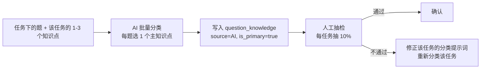

# 15 · 职教适配与存量数据迁移规格

> **本文件的依据是两份真实数据文件**（不是假设设计）：
> - `docs/题目资料.xlsx` —— 3 个工作表，1,950 题
> - `docs/知识点清单.xlsx` —— 3 篇 / 5 章 / 21 任务 / 106 行核心内容
>
> 分析产物（可复现，脚本在 `scripts/`）：
> - [题目资料-分析报告.txt](../题目资料-分析报告.txt)
> - [题目资料-选项格式普查.txt](../题目资料-选项格式普查.txt)
> - [题目资料-解析验证.txt](../题目资料-解析验证.txt)
> - [知识点清单-结构报告.txt](../知识点清单-结构报告.txt)
> - [题库与知识点-对齐分析.txt](../题库与知识点-对齐分析.txt)
> - [题库-删4.3后健康度.txt](../题库-删4.3后健康度.txt)

| 项 | 内容 |
| --- | --- |
| 文件版本 | v1.0 |
| 学校类型 | **中等职业学校（职业高中）** |
| 首批范围 | 1 个专业（机械制造技术）× 1 门课程（机械基础） |
| 存量数据 | 1,881 题（删除 69 题后）+ 42 个知识点 + 106 条核心内容 |

---

## 一、职教适配：与 K12 假设的差异清单

**设计文档 v2.1 是按普通高中（K12）写的。以下是必须适配的 12 处差异。**

| # | 维度 | K12 原假设 | 职教实际 | 适配动作 |
| --- | --- | --- | --- | --- |
| 1 | 学段 | PRIMARY / JUNIOR / SENIOR | **中等职业学校** | 枚举加 `SECONDARY_VOCATIONAL`、`HIGHER_VOCATIONAL` |
| 2 | 顶层组织 | 机构 → 学科 | 机构 → **专业** → 课程 | 新增 `major` 表 |
| 3 | 学科 | `subject` 字符串枚举（physics/math…） | **课程**（机械基础/机械识图/零件测量） | 升级为 `course` 独立实体，`subject` 降为兼容字段 |
| 4 | 章节层级 | 章 → 节 | **章 → 任务** | 新增 `task` 表；`chapter.parent_id` 废弃 |
| 5 | 篇 | 无 | **3 篇**（机械工程材料/常用机构/机械传动与支承零件） | 作为 `chapter.part_seq`/`part_name` 属性，**不独立成层** |
| 6 | 知识点粒度 | 学科概念（如「动量守恒定律」） | 任务下的教学要点（如「1. 整体热处理」） | 支持 `seq_in_task` 保留教材原序号 |
| 7 | 考纲 | 高考考纲（Ⅰ/Ⅱ 级） | **教学大纲/课程标准** + 职业技能等级标准 | 提示词与术语表改用大纲口径；`exam_weight` 由教研填 |
| 8 | 命题风格 | 去情境化（「某物体」「小明」） | **真实岗位情境**（宝武/比亚迪/减速器维护/数控机床） | 新增 `course.style_config.context_required`，**AI 生成必须保留情境** |
| 9 | 题型 | 选择/判断/填空/解答 | **选择 56% / 判断 32% / 填空 12%**，无解答题 | OMR 答题卡可覆盖约 88% 分值；主观题逐题录分 |
| 10 | 配图 | 几何图/电路图/函数图 | **0 题含图**（工程图样单独立项，本期不做） | 配图识别能力**降为二期**，风险从「最高」降为「低」 |
| 11 | 难度 | 高考难度分布 | 未标注难度 | 全部按`difficulty_manual` 待教研标定；`difficulty_effective` 暂用默认 |
| 12 | 实训环节 | 无 | 有（`task.is_practical`） | 预留字段；实训评价不在本期范围 |

### 1.1 一条新增的硬规则：情境保留

**依据**：机械基础题库中**每一题都嵌真实工业情境**：

> - 「宝武集团在生产大型机床床身时，该零件需承受较大压力，应选用________性能优良的材料。」
> - 「比亚迪新能源汽车生产电池外壳时，需通过冲压工艺成形，要求材料具有良好的________性能。」
> - 「在对一级齿轮减速器进行维护时，发现连接箱体的螺栓锈蚀，连接从动轴和大齿轮的________也损坏，需要确定规格并进行更换。」

**规则**（写入 `course.style_config` 并由提示词强制）：

| 规则 | 说明 |
| --- | --- |
| `context_required: true` | AI 生题与改写**必须**嵌入真实岗位/企业/设备情境 |
| 禁止表述 | 「某物体」「小明」「一个零件」这类去情境化写法 |
| 情境来源 | 优先从题库已有情境池复用（宝武、比亚迪、减速器、数控机床、冲压、铸造、焊接…） |
| 校验方式 | AI 输出后检查是否含情境关键词；无则重生成一次，仍无则标记 `NO_CONTEXT_WARNING` |

> **为什么这条重要**：去情境化的题干会让教师一眼识别出「这是机器生成的」。教师对 AI 产出的信任是逐题建立的，风格不一致会直接摧毁信任。

---

## 二、数据的实际结构（已实测）

### 2.1 题目资料.xlsx

| 工作表 | 实际表头 | 数据行 | 目标题型 | 状态 |
| --- | --- | --- | --- | --- |
| `选择题` | 一、选择题 / 所属章节 / 选择题答案 | **1,102** | `SINGLE_CHOICE` | 全部单选，答案 A/B/C/D |
| `判断题` | 二、判断题 / 所属章节 / 判断题答案 | **618** | `TRUE_FALSE` | 答案 **A=正确、B=错误** |
| `Sheet2` | 三、填空题 / 所属章节 / 判断题答案 | **230** | `FILL_BLANK` | 表头第 3 列写错（应为「填空题答案」） |

**结构特征**：

| 特征 | 实测值 | 影响 |
| --- | --- | --- |
| 列数 | 统一 3 列，无多余列 | ✅ 导入简单 |
| 第 1 行 | 表头（`一、选择题` 等） | 跳过 |
| 嵌入图片 | **0 个** | ✅ 配图识别不需要 |
| 题目 ID | **无 ID 列** | 需用「题干哈希」生成稳定 ID |
| 知识点标签 | **无** | 只到任务级；需补标（见第四节） |
| 难度 | **无** | 全部待标定 |
| 答案解析 | **无** | 需 AI 生成 + 教师审核（正好是 AI 能力项） |
| 章节号格式 | 全部为 `\d+\.\d+`（如 `1.1`） | 格式统一，映射可靠 |

### 2.2 选项格式（选择题目解析的关键）

**第一版解析只认出 318/1102，原因是正则过严。修正后 1101/1102 成功。**

| 解析策略 | 命中数 |
| --- | --- |
| `A.` 出现在任意位置（宽松） | 905 |
| `A.` 在行首或换行后（严格） | 196 |
| **失败** | **1** |

**唯一失败样本（必须单独处理）**：

```
碳素钢是指碳含量小于＿＿＿＿的铁碳合金。
    A.0.0211%    B.0.211%    C2.11%    D.21%
```

**缺陷**：选项 `C` 后面的 `.` 被漏打（`C2.11%`），导致无法按「字母+分隔符」识别。

**处理**：这类「字母后直接跟内容、无分隔符」的情形必须**进异常清单人工确认**，不得自动切分——因为自动切分可能把题干里的 `A`（如化学式、型号）误判为选项标记。

**选项文本的格式差异（实测 3 类）**：

| 类型 | 样式 | 处理 |
| --- | --- | --- |
| 常规 | `A. 抗压强度 B. 抗剪强度 C. 疲劳强度 D. 导热性`（同行，单空格分隔） | 直接切分 |
| 多空格对齐 | `A.断后伸长率        B.弹性模量        C.拉伸强度        D.疲劳强度` | 先归一化连续空白 |
| 分列换行 | `A.不能获得很大的传动比\nB.不可做较远距离的传动\n…` | 按行切分 |

**统一解析规则（拟用于迁移脚本）**：

```python
OPT_MARK = re.compile(r"([A-D])\s*(?:[.．、,，:：)）]|\s)\s*")

def parse_options(stem: str) -> tuple[list[str], str, list[str]]:
    """
    返回 (4 个选项, 题干部分, 警告)。
    1) 找出所有候选标记，只保留构成 A→B→C→D 递增序列的那一组
    2) 切分时以「下一个标记的起始」为界
    3) 校验每个选项去掉标记后非空，否则记警告（不静默丢弃）
    """
```

> **必须按「A→B→C→D 递增序列」筛选**，而不是简单 `findall`。原因：机械题干里常出现型号与代号（`GCr15`、`40Cr`、`T8`、`Q235`、`M`、`Tr`），其中含 `A`–`D` 字母，简单匹配会误切成 5 个以上选项。实测：采用递增筛选后，全部 1,101 题的选项数都恰好为 4。

### 2.3 填空题答案的分隔符（多空切分）

| 分隔符 | 出现次数 | 说明 |
| --- | --- | --- |
| `；`（全角分号） | **149** | **主分隔符** |
| `，`（全角逗号） | 43 | 次分隔符 |
| `/`（斜杠） | 3 | **不是分隔符**（如 `GB/T 119.1`、`1/100`） |

**切分规则（关键：`/` 不能当分隔符）**：

```python
# ✅ 正确：只用全角分号与全角逗号
BLANK_SEP = re.compile(r"[；，]")

# ❌ 错误：把 / 当分隔符会把「GB/T 1096」切成两段
```

**每空数量分布**：1 空 111 题 / 2 空 56 题 / 3 空 51 题 / 4 空 11 题 / 5 空 1 题。

**12 题（5%）题干空位数与答案段数不一致**，必须人工校对，分三类：

| 类型 | 数量 | 例子 | 处理 |
| --- | --- | --- | --- |
| **答案含"或"** | 4 | 答案 `N（或不标），省略（或不标注）` | 保留原文作为**一空多解**（`accepted` 数组） |
| **题干空位丢失** | 4 | 题干 `碳素结构钢的标准是GB/T 。`，答案 `700-2006` | **需补题干空位**：`GB/T________。` |
| **答案段多于空位** | 4 | 答案 `轴肩；d；1.4`，题干 3 个空但只识别出 1 个 | **人工核对**，不得自动猜 |

> **处理原则**：这 12 题**不得自动入库**，必须进异常清单由教研逐条确认。**自动猜测是错的**——填空批改本来就靠"精确匹配 + 模糊匹配"，标准答案错了会连锁导致全班错判。

---

## 三、题库与知识点清单的对齐结果

### 3.1 映射关系（已确认）

```
题库「所属章节」X.Y  ⇔  第X章 · 任务Y
```

| 题库章节 | 题量（删 4.3 后） | 对应任务 |
| --- | --- | --- |
| 1.1 | 151 | 第1章·任务一：分析轴的力学性能 |
| 1.2 | 177 | 第1章·任务二：识别非合金钢 |
| 1.3 | 163 | 第1章·任务三：选择合金钢 |
| 1.4 | 95 | 第1章·任务四：判别铸铁 |
| 1.5 | 99 | 第1章·任务五：识别非铁金属 |
| 1.6 | 183 | 第1章·任务六：轴的热处理 |
| 1.7 | 37 | 第1章·任务七：选择非金属材料 |
| 2.1 | 101 | 第2章·任务一：平面连杆机构 |
| 2.2 | 52 | 第2章·任务二：凸轮机构 |
| 2.3 | 47 | 第2章·任务三：间歇机构 |
| 3.1 | 189 | 第3章·任务一：销、螺纹、键连接 |
| 3.2 | 54 | 第3章·任务二：联轴器与离合器 |
| 4.1 | 105 | 第4章·任务一：轴承 |
| 4.2 | 119 | 第4章·任务二：轴及轴上零件 |
| 5.1 | 54 | 第5章·任务一：带传动 |
| 5.2 | 41 | 第5章·任务二：链传动 |
| 5.3 | 40 | 第5章·任务三：螺旋传动 |
| 5.4 | 128 | 第5章·任务四：齿轮传动 |
| 5.5 | 32 | 第5章·任务五：蜗杆传动 |
| 5.6 | 14 | 第5章·任务六：齿轮系 |

**匹配结果：20/21 精确匹配。** 两处不一致：

| 问题 | 数据 | 决定 |
| --- | --- | --- |
| **题库有 `4.3`（69 题），清单第4章无任务三** | 题库 4.3 + 清单缺口 | **删除这 69 题**（已确认） |
| **清单有第3章任务三「胀紧连接」，题库无 `3.3`** | 清单 106 行中的 2 行 | 保留知识点与知识库条目，**该任务下暂无题目**（题库缺口，组卷时自然为空） |

### 3.2 删除 4.3 后的题库健康度

| 维度 | 结果 |
| --- | --- |
| 总题量 | **1,881 题**（选择 1,032 / 判断 619 / 填空 230） |
| 章分布 | 第1章 905 / 第2章 200 / 第3章 243 / 第4章 224 / 第5章 309 |
| 任务数 | 20 个（4.3 删除后与清单一致） |
| **填空题覆盖** | **仅 6 个任务有填空题**（1.1 / 1.2 / 3.1 / 4.1 / 4.2 / 5.4），其余 14 个为 0 |
| 最薄任务 | `5.6 齿轮系` 仅 14 题 |
| 知识点密度 | 42 个知识点，平均约 45 题（区间 13–163） |

**★ 由此产生的一条组卷规则（已确认）**：

> **组卷时按实际数据适配题型结构，允许题型缺失，但必须提示而不报错。**
>
> 例：若考试范围是第2章（机构），该范围**没有任何填空题**。系统应：
> 1. 自动生成可行结构（如 10 选择 + 5 判断）
> 2. 明确提示：「本次范围内无填空题，已按 选择+判断 组卷，请确认」
> 3. **不报 `PAPER.CANDIDATE_INSUFFICIENT`**（这不是错误，是数据现状）
>
> 这与 09 文档的「候选不足必须报错」不冲突——**区分**：某题型在该范围内**一道都没有** → 降级并提示；该题型**有题但不够** → 报错并给缺口清单。

---

## 四、知识点清单的导入规格

### 4.1 结构（已实测）

| 项 | 实测 |
| --- | --- |
| 工作表 | `Sheet1`，120 行 × 5 列 |
| 表头 | **在 C1:E1**（`章节` / `知识点` / `核心内容`），A、B 列无表头 |
| 列语义 | A=章（`第一章`）· B=章名 · C=篇/章/任务（三级混排）· D=知识点 · E=核心内容 |
| 篇 | 3 个（作为 C 列的行：`第一篇：机械工程材料`） |
| 章 | 5 个（A+B 列） |
| 任务 | **21 个**（C 列 `任务N：xxx`） |
| 知识点行 | 106 行 → **按名称去重后 42 个** |
| 核心内容 | 111 条 |

**C 列的三级混排**（解析时必须按前缀判断）：

```
[A41] 第一章 | [B41] 金属材料与热处理 | [C41] 第二篇：常用机构      ← 篇（只有 C 列有值）
[A42] 第二章 | [B42] 机构             | [C42] 第二章：机构          ← 章标题行（C 列 = 章名）
[A43] 第二章 | [B43] 机构             | [C43] 任务一：平面连杆机构  ← 任务行
[A44] 第二章 | [B44] 机构             | [C44] 任务一：平面连杆机构 | [D44] 1. 铰链四杆机构 | [E44] 曲柄摇杆机构：一个曲柄… ← 知识点行
```

> **注意第 41 行的陷阱**：`A41=第一章`、`B41=金属材料与热处理`，但 `C41=第二篇：常用机构`。**A/B 列在这一行是上一章的值（未清空），C 列才是真正的篇标题。** 解析时必须**只认 C 列判断是否为新篇**，不能看 A 列——否则会把「第二篇」错挂到第一章下。

### 4.2 导入映射

| Excel | → 系统实体 | 规则 |
| --- | --- | --- |
| 无（常量） | `course` | 创建 1 条：`code=MJJC`、`name=机械基础`、`grade_band=SECONDARY_VOCATIONAL`、`style_config.context_required=true` |
| A 列（`第N章`）+ B 列（章名） | `chapter` | `seq=N`；`part_seq`/`part_name` 由 C 列的「篇」行推导 |
| C 列（`任务N：xxx`） | `task` | `seq=N`；`chapter_id` 由当前章决定；`code=MJJC-C{N}-T{N}` |
| D 列（`N. xxx`） | `knowledge_node` | **按名称去重**；`seq_in_task` 保留教材序号；`code=MJJC-C{N}-T{N}-K{N}`；`task_id` 指向首次出现的任务 |
| E 列（核心内容） | `knowledge_entry` | `entry_type=CONCEPT`；`source_type=TEACHER_INPUT`；挂到对应的 `knowledge_node` |

### 4.3 知识点去重的处理（106 → 42）

**实测：106 行里有 64 行是重复的知识点名称**（如 `1. 整体热处理` 出现在多个任务下）。

**规则（已确认：按名称去重，一个名称只建一个知识点）**：

| 情况 | 处理 |
| --- | --- |
| 同名知识点出现在**同一任务**的连续多行 | 合并为 1 个知识点，**多条核心内容全部保留**（挂成多条 `knowledge_entry`） |
| 同名知识点出现在**不同任务** | 合并为 1 个知识点，`task_id` 指向**首次出现**的任务；**同时为其他任务建立 `task_knowledge` 关联**（见下方待补表） |
| 知识点名称带序号（`1. 整体热处理`） | `name` 去掉序号存为 `整体热处理`；`seq_in_task` 保留 `1` 用于与纸质教材对照 |

> **★ 一个必须补的表**：去重后一个知识点可能被多个任务关联，但 `knowledge_node.task_id` 是单值外键，表达不了多任务关系。**需要新增 `task_knowledge` 表**（多对多）：
>
> ```sql
> CREATE TABLE task_knowledge (
>     id          bigserial PRIMARY KEY,
>     org_id      bigint NOT NULL,
>     task_id     bigint NOT NULL REFERENCES task(id) ON DELETE CASCADE,
>     knowledge_node_id bigint NOT NULL REFERENCES knowledge_node(id),
>     seq_in_task smallint,          -- 该知识点在此任务下的教材序号
>     created_at  timestamptz NOT NULL DEFAULT now()
> );
> CREATE UNIQUE INDEX uq_task_knowledge ON task_knowledge (task_id, knowledge_node_id);
> ```
>
> `knowledge_node.task_id` 保留为「主任务」（首次出现的位置，用于展示与默认查询）；`task_knowledge` 表达完整的多任务关系。**组卷按知识点抽题时用 `task_knowledge`，不用 `task_id`。**

### 4.4 核心内容 → 知识库初稿

**实测 111 条核心内容，质量足以直接用作知识库初稿**（已确认）。

**示例**：

| 知识点 | 核心内容 |
| --- | --- |
| 重要力学性能指标 | 强度：抗拉强度(Rm)、屈服强度(ReL/ReH)，抵抗变形和断裂。 |
| 重要力学性能指标 | 塑性：断后伸长率(A)、断面收缩率(Z)，材料产生永久变形而不破坏的能力。 |
| 重要力学性能指标 | 硬度：布氏(HBW)、洛氏(HRA/HRC)、维氏(HV)，抵抗局部变形。 |
| 整体热处理 | 退火：缓冷，降低硬度，改善切削加工性。 |
| 整体热处理 | 正火：空冷，细化晶粒，作预备热处理。 |
| 整体热处理 | 淬火：急冷，提高硬度和耐磨性。 |
| 整体热处理 | 回火：淬火后加热，消除脆性。分为低温（高硬度）、中温（高弹性）、高温（综合力学性能，即调质）。 |

**导入规则**：

| 项 | 值 |
| --- | --- |
| `entry_type` | `CONCEPT` |
| `source_type` | `TEACHER_INPUT` |
| `source_ref` | `{textbook: "机械基础", chapter: "第1章 金属材料与热处理", task: "任务六 轴的热处理", note: "由知识点清单导入"}` |
| `title` | 取核心内容的**前 20 字或第一个冒号前的短语**（如「强度」「塑性」「退火」） |
| `content_text` | 核心内容全文 |
| `status` | **`ACTIVE`**（教研已确认可用；如需审核可先 `DRAFT`） |
| `verified_by` | 留空 → **检索权重按未审核处理（×0.5）**；教研审核后填，权重升为 1.0 |
| `embed_vector` | 导入后异步向量化 |

> **这一步的实际价值**：**它直接解开了 AI 生题的「无依据不生成」门禁**。按 06 文档的防幻觉 L1 层，`KB_MIN_ENTRIES=2` 是硬门槛——这 111 条内容让 42 个知识点中的大部分立即满足条件，**AI 生题能力从第一天就可用**，不必等教研从零录入。

**教研后续应补充的类型**（提升 AI 产出质量）：

| 类型 | 用途 | 优先级 |
| --- | --- | --- |
| `COMMON_ERROR`（常见错误） | **干扰项设计的最佳依据** | 高 |
| `SYLLABUS`（考纲/技能等级要求） | 控制生成题的难度与范围 | 高 |
| `METHOD`（解题方法） | 解析生成的方法论依据 | 中 |
| `EXAMPLE`（典型例题） | 变式题生成的模板 | 中 |

---

## 五、迁移脚本规格

### 5.1 脚本清单

| 脚本 | 输入 | 输出 | 说明 |
| --- | --- | --- | --- |
| `scripts/migrate_p1_pack.py` | `题目资料.xlsx` | 标准化 JSON（题目包） | 解析 + 校验 + 异常清单，**不直接写库** |
| `scripts/migrate_p2_knowledge.py` | `知识点清单.xlsx` | 标准化 JSON（知识体系包） | 解析篇/章/任务/知识点 + 核心内容 |
| `scripts/migrate_p3_load.py` | 上述两个 JSON | 数据库 | 按依赖顺序入库；支持 `--dry-run` |
| `scripts/migrate_validate.py` | 数据库 | 校验报告 | 题量、映射、抽样比对 |

**分两个阶段（先出 JSON 再入库）的理由**：JSON 可人工审核、可版本管理、可重复入库；直接写库的脚本一旦出错，回滚成本高。

### 5.2 题目包格式（中间产物）

```json
{
  "meta": {
    "source_file": "题目资料.xlsx",
    "source_sha256": "...",
    "exported_at": "2026-10-01T16:00:00+08:00",
    "course_code": "MJJC",
    "counts": {"total": 1881, "single_choice": 1032, "true_false": 619, "fill_blank": 230},
    "excluded": [{"sheet": "选择题", "row": 4, "chapter": "4.3", "reason": "CHAPTER_NOT_IN_SYLLABUS"}]
  },
  "questions": [
    {
      "src": {"sheet": "选择题", "row": 2},
      "course_code": "MJJC",
      "task_seq": {"chapter": 1, "task": 1},
      "type": "SINGLE_CHOICE",
      "stem_text": "宝武集团在生产大型机床床身时，该零件需承受较大压力，应选用________性能优良的材料。",
      "stem_hash": "sha256(normalized_stem)",
      "options": [
        {"label": "A", "content_text": "抗压强度"},
        {"label": "B", "content_text": "抗剪强度"},
        {"label": "C", "content_text": "疲劳强度"},
        {"label": "D", "content_text": "导热性"}
      ],
      "answer": {"value": "A"},
      "source_type": "EXTRACTED",
      "status": "APPROVED",
      "warnings": []
    },
    {
      "src": {"sheet": "判断题", "row": 2},
      "type": "TRUE_FALSE",
      "stem_text": "HRC是指布氏硬度。",
      "answer": {"value": false},
      "answer_source_value": "B",
      "warnings": []
    },
    {
      "src": {"sheet": "Sheet2", "row": 3},
      "type": "FILL_BLANK",
      "stem_text": "销是标准件，主要用作________零件以固定零件间相互位置，也可作为连接销传递不大的载荷，或作为________中的过载剪断零件。",
      "answer": {
        "blanks": [
          {"index": 1, "accepted": ["定位"]},
          {"index": 2, "accepted": ["安全装置"]}
        ]
      },
      "warnings": []
    }
  ]
}
```

### 5.3 题型映射规则

| 来源 | 目标 `question.type` | 答案转换 |
| --- | --- | --- |
| `选择题` | `SINGLE_CHOICE` | `"A"` → `{"value": "A"}` |
| `判断题` | `TRUE_FALSE` | **`"A"` → `{"value": true}`；`"B"` → `{"value": false}`**（已确认） |
| `Sheet2` | `FILL_BLANK` | 按 `[；，]` 切分 → `{"blanks": [{"index": n, "accepted": [...]}]}` |

> **判断题的 AB 映射是最危险的一处**：若映射反了，**全班判断题得分全错，而且看起来完全正常**。必须：
> 1. 在迁移脚本中写死常量并加注释（`TRUE_FALSE_MAP = {"A": True, "B": False}`）
> 2. 导入后**抽样 20 题人工核对**（抽题干含明确错处与明确对处的各 10 题）
> 3. 加单元测试：断言 `"A"→True`、`"B"→False`

### 5.4 校验规则（入库前必须全过）

| 编号 | 校验 | 不通过处理 |
| --- | --- | --- |
| V-01 | 题干非空且长度 ≥ 5 | 进异常清单 |
| V-02 | 选择题恰好 4 个选项，标签为 A/B/C/D | 进异常清单 |
| V-03 | 选择题答案 ∈ {A,B,C,D} | 进异常清单 |
| V-04 | 判断题答案 ∈ {A,B} | 进异常清单 |
| V-05 | 填空题空位数 == 答案段数 | **进异常清单（实测 12 题）** |
| V-06 | `(chapter.seq, task.seq)` 在知识体系包中存在 | **拒绝入库，进异常清单**（实测 69 题，已决定删除） |
| V-07 | 题干哈希在同课程内唯一 | 重复的进「疑似重复」清单 |
| V-08 | 无嵌入图片 | 若发现则进异常清单（实测 0 题） |
| V-09 | 情境词检查（`context_required=true` 时） | 无情境词仅警告（存量数据可能有个别例外），不阻断 |

### 5.5 入库后的抽样验证清单

| 抽样项 | 数量 | 核对方式 |
| --- | --- | --- |
| 选择题 | 20 题 | 对照 Excel 原表逐题比对题干、选项、答案 |
| 判断题 | **20 题**（10 题答案 A、10 题答案 B） | **重点核对 AB 映射方向** |
| 填空题 | 10 题（含 2 题多空） | 核对空位数、答案切分 |
| 知识点 | 10 个 | 核对 `code`、`name`、`task_knowledge` 关联 |
| 知识库条目 | 10 条 | 核对是否挂到正确知识点 |
| 统计 | 全部 | 题量分布与 [题库-删4.3后健康度.txt](../题库-删4.3后健康度.txt) 完全一致 |

---

## 六、知识点标签的补标方案（任务级 → 知识点级）

**问题**：存量题库只标到「任务」，一个任务下有 1–3 个知识点、几十到上百道题。若标签停在任务级，学情分析只能说「轴的热处理薄弱」，说不出是**退火/正火/淬火/回火**哪个概念不会。

**方案（已确认：AI 预打标 + 人工抽检，1–2 天）**：



**AI 打标的输入构造**：

```
你是一位机械基础教研员，请判断下面每道题主要考查哪个知识点。

【可选知识点】（只能从下列选择，返回编号）
1. 金属材料性能分类
2. 重要力学性能指标

【题目】
1. 宝武集团在生产大型机床床身时，该零件需承受较大压力，应选用________性能优良的材料。
   A. 抗压强度 B. 抗剪强度 C. 疲劳强度 D. 导热性
2. 不能通过拉伸试验来确定的性能指标是＿＿＿＿
   A.断后伸长率 B.弹性模量 C.拉伸强度 D.疲劳强度
...

【输出】严格 JSON 数组：[{"index":1,"kp":"2","confidence":0.95}, ...]
```

**质量控制**：

| 项 | 做法 |
| --- | --- |
| 阈值 | AI `confidence < 0.8` 的题**自动进人工队列**，不由 AI 定 |
| 抽检 | 每个任务抽 10%（约 190 题），人工核对，**准确率 < 90% 则该任务全部重标** |
| 可回溯 | `question_knowledge.source='AI'`，人工确认后改 `source='TEACHER'` |
| 成本 | 1,881 题，按 06 文档成本模型约 **¥5–10**（纯文本分类，输出短） |
| 工作量 | 抽检约 1 人日；异常处理约 0.5 人日 |

> **为什么值得做**：这是「一生一卷精准作业」精度的**地基**。标签只到任务级，个性化练习就只能「整任务推题」；到知识点级，才能「只推退火与回火，跳过已掌握的正火」。**1–2 天的投入换来整条链路的精度提升，性价比极高。**

---

## 七、对既有技术文件的影响（变更登记）

| 文件 | 变更 | 是否已完成 |
| --- | --- | --- |
| [02-数据模型与DDL.md](02-数据模型与DDL.md) | 新增 `major` / `course` / `task` / `task_knowledge` 4 张表；`chapter` 加 `part_seq`/`part_name`/`seq`、废弃 `parent_id`；`knowledge_node` 加 `course_id`/`task_id`/`seq_in_task`；`question` 加 `course_id`/`task_id`；`classroom` 加 `major_id`；表数 45 → **49** | ✅ 已完成 |
| [README.md](README.md) | 学段枚举加 `SECONDARY_VOCATIONAL`/`HIGHER_VOCATIONAL`；知识点编码规则放宽；枚举总表补 course/major/task | ⏳ 待办 |
| [13-配置项与提示词库.md](13-配置项与提示词库.md) | 学科模板改为课程模板；新增 `course.style_config.context_required` 相关配置；术语表加机械专业术语 | ⏳ 待办 |
| [06-AI编排层实现规格.md](06-AI编排层实现规格.md) | 提示词加「情境保留」约束与后置校验；知识点树注入改为「任务下的知识点列表」 | ⏳ 待办 |
| [09-组卷与批改规格.md](09-组卷与批改规格.md) | 组卷的「某题型在该范围内一道都没有 → 降级并提示」规则；判断题 `A→true`/`B→false` 归一 | ⏳ 待办 |
| [14-缺陷登记册与统一指标口径.md](14-缺陷登记册与统一指标口径.md) | 风险重估（配图风险降级、教研风险升为第一）；新增本次发现的 2 条数据缺陷 | ⏳ 待办 |
| [03-开发计划与任务分解.md](03-开发计划与任务分解.md) | 阶段零压缩（配图验证降为可选）；新增迁移任务；教研内容准备改为「导入 + 扩充」 | ⏳ 待办 |

---

## 变更记录

| 版本 | 日期 | 变更人 | 说明 |
| --- | --- | --- | --- |
| v1.0 | 2026-10-01 | — | 首版：基于两份真实 Excel 的实测分析；职教适配 12 处；迁移规格（1,881 题 / 42 知识点 / 111 条知识库初稿） |

## 待确认问题

| 编号 | 问题 | 影响 | 建议 |
| --- | --- | --- | --- |
| **A-01** | `course.code` 用什么？（我暂用 `MJJC`） | 影响知识点编码前缀与导入映射 | 建议教研确认一个稳定的课程缩写 |
| **A-02** | 42 个知识点中，有 64 处是同名跨任务复用。按名称去重后，**跨任务关联是否需要 `task_knowledge` 表**？ | 影响 DDL 与组卷抽题 | **已于 02 文档补齐 `task_knowledge` 表**（v1.1）；请确认该方案，特别是「组卷按知识点抽题时必须用它、不能只看 `task_id`」这条约定 |
| **A-03** | 删除的 69 题（`4.3`）是否要**留档**而非物理删除？ | 若将来发现它们属于某任务，可恢复 | 建议留档到 `docs/题库-已排除-4.3.xlsx`，不物理删除源数据 |
| **A-04** | 判断题的 618 题中，是否存在**题干本身有误**（与原题表不符）的？ | 全部依赖人工核对，成本高 | 建议按 V-08 抽样 20 题核对即可，全量核对性价比低 |
| **A-05** | 42 个知识点的 `exam_weight`（考纲权重）由谁填？ | 影响学情组卷的加权 | 建议教研按课时数比例填（课时多的任务权重高） |
| **A-06** | 5.6「齿轮系」仅 14 题，是否要补题？ | 组卷时会抽不满 | 建议列入题库缺口清单，由教研后续补充 |
