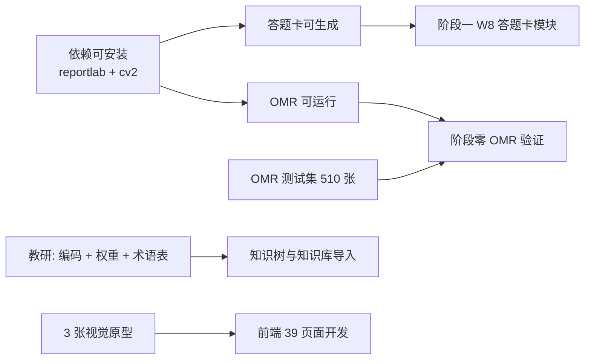

# 16 · 开发前准备清单与开工判定

> **本文件是「开工前必须就位」的唯一清单。** 每一项都标注：谁负责、卡住什么、当前状态。
>
> 上游依据：[03-开发计划与任务分解.md](03-开发计划与任务分解.md)（排期）、[15-职教适配与存量数据迁移规格.md](15-职教适配与存量数据迁移规格.md)（数据实测）、[14-缺陷登记册与统一指标口径.md](14-缺陷登记册与统一指标口径.md)（待裁决）。

| 项 | 内容 |
| --- | --- |
| 文件版本 | v1.0 |
| 建立日期 | 2026-10-01 |
| 状态 | 数据与需求已确认；环境基线部分待验证（见第四节） |

---

## 一、准备事项总览（按「卡住什么」排序）

| 类别 | 事项 | 负责任 | 卡住什么 | 状态 |
| --- | --- | --- | --- | --- |
| **依赖** | 确认后端依赖可安装（reportlab / OpenCV） | 技术 | **PDF 生成 + OMR 全部** | ⏳ 验证中 |
| **决策** | P-01 多行学号区方案 | 产品 | 已消除（8 位单行） | ✅ 不需决策 |
| **决策** | P-06 卷号区取舍 | 产品 | 已降级（练习走线上） | ✅ 不需决策 |
| **决策** | 11 项待裁决（14 文档第三节） | 产品 | 阶段一后期 / 阶段二 | ⏳ 待评审 |
| **数据** | 题目资料.xlsx | 已提供 | 题库导入 | ✅ 已到位 |
| **数据** | 知识点清单.xlsx | 已提供 | 知识树 + 知识库 | ✅ 已到位 |
| **数据** | OMR 测试集（约 510 张真实答题卡） | 学校 | **OMR 阈值无法标定** | ⏳ 待采集 |
| **数据** | 答题卡样张（学校现有） | 学校 | 已确认无固定卡型，自行设计 | ✅ 不需 |
| **内容** | 课程编码（`course.code`，暂用 `MJJC`） | 教研 | 知识点编码前缀 | ⏳ 待确认（A-01） |
| **内容** | 42 个知识点的 `exam_weight` | 教研 | 学情组卷加权 | ⏳ 待填（A-05） |
| **内容** | 机械专业术语表 | 教研 | AI 输出的术语准确性 | ⏳ 待产出 |
| **内容** | 知识点级标签补标（AI + 抽检） | 教研+AI | **个性化练习精度** | ⏳ 待执行（约 1–2 天） |
| **人员** | 专业课教师参与 | 已确认有 | 教研产出 | ✅ 已确认 |
| **环境** | 云服务器 / 数据库 / Redis / 域名 / 备案 | 技术 | 部署 | ⏳ 待采购（备案 1–3 周） |
| **环境** | 模型 API 企业账号 | 技术 | AI 能力 | ⏳ 待开通 |
| **合规** | 隐私政策 / 未成年人信息 / 模型厂商协议 | 产品+法务 | 上线 | ⏳ 待起草 |
| **工程** | 仓库 + CI + 一致性脚本 | 技术 | 开发 | ✅ 脚本已就位，仓库待建 |
| **工程** | 3 张视觉原型 | 前端 | **避免 39 个页面返工** | ⏳ 待做 |

---

## 二、已确认的事实（不再需要确认）

| 项 | 结论 |
| --- | --- |
| 学校类型 | 中等职业学校（职业高中） |
| 专业 / 课程 | 机械制造技术 / **机械基础**（一期 1 门） |
| 知识树层级 | 课程 → 章 → 任务 → 知识点（四层；篇作属性） |
| 章 / 任务 / 知识点 | 5 章 / 21 任务（清单）/ **42 知识点** |
| 题库 | **1,881 题**（选择 1,032 / 判断 619 / 填空 230），删除 `4.3` 的 69 题后 |
| 判断题答案 | **A = 正确，B = 错误** |
| 题型缺失 | 组卷按实际适配，**提示不报错** |
| 知识库初稿 | 清单「核心内容」**111 条**直接导入，类型 `CONCEPT` |
| 工业情境 | **保留**，并作为 AI 生成/改写的硬约束 |
| 配图 | 0 题含图 → **一期不做配图识别** |
| 学号 | 8 位以内，单行排布 |
| 试点规模 | 3–5 班 / 约 200 学生 |
| 纸质/线上 | 考试走纸质扫描；作业与个性化练习走线上 |
| 学生端 | 在家用家长手机扫码 |
| 交付时间 | 下学期开学前（约 4 个月） |
| 验收人 | 试点班任课老师 |

---

## 三、对文档的改动（已完成）

| 文件 | 改动 | 状态 |
| --- | --- | --- |
| [02-数据模型与DDL.md](02-数据模型与DDL.md) | 新增 `major`/`course`/`task`/`task_knowledge` 4 张表；`chapter` 加 `part_seq`/`part_name`/`seq`、废弃 `parent_id`；`knowledge_node` 加 `course_id`/`task_id`/`seq_in_task`；`question` 加 `course_id`/`task_id`；`classroom` 加 `major_id`；表数 **45 → 49** | ✅ |
| [README.md](README.md) | 学段加 `SECONDARY_VOCATIONAL`/`HIGHER_VOCATIONAL`；**编码规则放宽**（新增「五之二」节，替换原来会拒绝 `MJJC-C1-T1-K1` 的限制）；新增 5.16 职教枚举 | ✅ |
| [15-职教适配与存量数据迁移规格.md](15-职教适配与存量数据迁移规格.md) | 新增（职教适配 12 处差异 + 迁移规格） | ✅ |
| [14-缺陷登记册与统一指标口径.md](14-缺陷登记册与统一指标口径.md) | 基于实测数据重估 7 条风险；新增 D-40～D-43 四条数据缺陷 | ✅ |
| **待办** | [13-配置项与提示词库.md](13-配置项与提示词库.md)：K12 学科模板 → 职教课程模板；加 `context_required` 情境规则；加机械术语表 | ⏳ |
| **待办** | [06-AI编排层实现规格.md](06-AI编排层实现规格.md)：提示词加情境保留约束与后置校验 | ⏳ |
| **待办** | [09-组卷与批改规格.md](09-组卷与批改规格.md)：题型缺失降级规则；判断题 `A→true`/`B→false` 归一 | ⏳ |
| **待办** | [03-开发计划与任务分解.md](03-开发计划与任务分解.md)：阶段零压缩（配图验证改可选）；新增迁移任务 | ⏳ |
| **待办** | [05-API契约规范.md](05-API契约规范.md)：接口路径补 `course`/`task` 维度 | ⏳ |

---

## 四、环境基线验证（本文件新增，实测结论）

### 4.1 PDF 生产链路 ✅ 已验证可行

**实测结论：`python-docx` 生成 → LibreOffice 转 PDF → 中文完全正常。**

验证过程与产物（`docs/poc/`）：

| 产物 | 说明 |
| --- | --- |
| `poc-试卷.docx` / `.pdf` | 试卷排版样例，已验证：工业情境题干、全角标点、下划线占位、公式 `d = mz`、判断符号 `√`/`×`、页眉页脚 |
| `poc-答题卡.docx` / `.pdf` | 答题卡样例（**部分元素不可用，见 4.2**） |
| `render-试卷/page-0001.png` | 渲染图，**人工确认中文无方框** |
| `poc-report.txt` | 字体与渲染报告 |

**系统可用中文字体（实测）**：`msyh.ttc`（微软雅黑）、`simsun.ttc`、`simhei.ttf`、`msjh.ttc`、`NotoSansSC-VF.ttf`、`NotoSerifSC-VF.ttf`、`STSONG.TTF`、`STKAITI.TTF` 等 18 个。

**结论与要求**：

| 项 | 结论 |
| --- | --- |
| 试卷 / 作业单 / 报告 | **走 `python-docx` → LibreOffice 转 PDF**，中文无问题 |
| 容器镜像 | 必须装 `fonts-noto-cjk`（本地用 Windows 字体，生产用 Noto） |
| TTC 字体集合 | 可被 ReportLab 直接加载，**无需转换** |
| 转换器缺 Courier 的告警 | 无害（文档实际使用中文字体）；但建议镜像内装 `fonts-liberation` 消除 |

### 4.2 ★ 答题卡不能用 Word 生成（PoC 暴露的真实设计问题）

**实测发现两个问题**：

| 问题 | 表现 | 根因 |
| --- | --- | --- |
| **定位点画成了黑条** | 题目下方出现一条贯穿整页的黑条，而不是四个 5mm 方块 | `python-docx` 的表格单元格只能占满列宽，无法在页面上精确定位一个 5mm 方块 |
| **涂点区画成了文字** | `[A] [B] [C] [D]` 是文本，不是圆形涂点 | Word 表格不能画圆；且 `[A]` 这种方括号文字**无法被 OMR 识别** |

**结论（重要设计修正）**：

> **OMR 答题卡不能走 Word 生成，必须用坐标级 PDF 库。**
>
> 原因：答题卡的命门是**精确坐标**——四角定位点必须在固定位置（距页边 8mm、边长 5mm），涂点圆心必须在相对比例坐标上（`layout_json` 的 `cx`/`cy`）。Word 是**流式排版**模型，无法表达绝对坐标。

| 文档类型 | 生产链路 | 理由 |
| --- | --- | --- |
| **试卷、作业单、报告** | `python-docx` → LibreOffice → PDF | 内容流式排版，无需绝对坐标 |
| **答题卡（OMR）** | **坐标级 PDF 库直接生成**（ReportLab 或等价） | 需要绝对坐标：锚点、涂点、学号区 |

**这修正了我 04 与 08 文档的一个隐含假设**（原文档默认 ReportLab 生成一切，但未区分两类文档的排版模型差异）。

### 4.3 ✅ 关键依赖可安装（已验证）

**实测：两个核心依赖都能安装成功。环境不构成阻塞。**

| 依赖 | 用途 | 状态 | 验证方式 |
| --- | --- | --- | --- |
| **`reportlab`** | 答题卡 PDF（坐标级）、试卷 PDF 备选 | ✅ **可安装**（5.0.1） | `pip install --target` 成功；已用中文字体生成 PDF 并渲染核对 |
| **`opencv-python-headless`** | **OMR 全部图像处理** | ✅ **可安装**（5.0.0.93 + numpy 2.5.3） | 已在真实 PoC 答题卡上跑通锚点检测（见 4.7） |
| `pillow` / `numpy` / `pandas` / `python-docx` / `openpyxl` / `lxml` | 图像、数据处理、文档 | ✅ 运行时已带 | `import` 探测成功 |
| `charset-normalizer` | reportlab 依赖 | ✅ 随装 | |

**结论：环境不阻塞开工——** 两个原本缺失的核心依赖**均已验证可安装并可用**，阶段零的 OMR 验证可以如期启动。

**但需注意以下要求**：

| 项 | 要求 |
| --- | --- |
| `server/requirements.txt` | 必须写入 `reportlab`、`opencv-python-headless`、`pypdf`（或 `PyMuPDF`） |
| **容器镜像** | `Dockerfile.worker` 必须装 OpenCV 的系统库（`libgl1`、`libglib2.0-0`、`libsm6`、`libxext6`、`libxrender1`）+ `fonts-noto-cjk` |
| 安装稳定性 | 本会话实测 **OpenCV 下载被中断一次**（43.8MB）→ 建议 **CI 与镜像构建加 `--retries 5` 与本地 wheel 缓存**，避免构建因网络抖动失败 |
| 不用降级方案 | **不要**因为 OpenCV 装不上就用 PIL/numpy 手写 OMR——定位点检测与透视校正依赖形态学与轮廓分析，重写会显著降低准确率并拉长工期 |

### 4.4 ★ 坐标原点约定（PoC 发现，必须写死）

**这是本次 PoC 最有价值的产出**：实现答题卡时出现了**内容上下颠倒**的错误。

| 项 | 说明 |
| --- | --- |
| 现象 | 主观题作答区跑到页面顶部、学号区跑到最底部 |
| 根因 | `layout_json` 用 **TOP_LEFT** 原点，而 ReportLab 原生是 **BOTTOM_LEFT**。我在构造坐标时转了一次（`1-y`），绘制时又转了一次（`1-y`）→ **双重翻转** |
| 教训 | 坐标转换**必须在且仅在渲染边界发生一次** |

**固化约定（写入 08 文档）**：

| 层 | 原点 | 说明 |
| --- | --- | --- |
| **`layout_json`（存储与交换）** | **TOP_LEFT**（x 向右、y 向下） | 与前端 CSS、教师读图直觉一致 |
| 前端渲染 | TOP_LEFT | 直接使用，无需转换 |
| **后端 PDF 生成（ReportLab）** | BOTTOM_LEFT（原生） | **必须转换一次**：`pdf_y = page_h - ry * page_h` |
| 识别端读取 | TOP_LEFT | 与 `layout_json` 一致 |

**并且已加入断言防回归**：

```python
# 绘制前自检：TL 必须在左上（x 小、y 小）
assert layout.anchors["TL"]["x"] < 0.2 and layout.anchors["TL"]["y"] < 0.2
assert layout.anchors["BR"]["x"] > 0.8 and layout.anchors["BR"]["y"] > 0.8
```

### 4.5 ★ 锚点坐标语义歧义（需产品/技术裁决）

**PoC 发现设计文档存在一处会直接导致扫码错位的歧义**：

| 出处 | 数值（A4，锚点距页边 8mm、边长 5mm） | 语义 |
| --- | --- | --- |
| 设计文档 9.2.3 示例 | `TL: {x: 0.0635, y: 0.0423}` | 按 A4 换算 ≈ 距边 **12mm**（8mm 边距 + 5mm 边长的一半）→ **锚点中心** |
| 本 PoC 实现 | `TL: {x: 0.038095, y: 0.026936}` | 按 A4 换算 ≈ 距边 **8mm** → **锚点左上角** |

**两者相差 2.5mm（半个锚点边长）。** 后果：

- 识别端若按「中心」去点而模板按「左上角」存 → **透视校正整体偏移 2.5mm**；
- A4 宽 210mm 时，2.5mm ≈ 页面宽度的 **1.19%**，**超过 `omr.anchor_max_deviation = 0.01` 的容差** → 会被回投影校验判为失败，**全部卡片进人工队列**。

**建议（待确认）**：

| 方案 | 说明 |
| --- | --- |
| **① 推荐：统一用「锚点中心」** | 与设计文档示例一致；且识别端做 `getPerspectiveTransform` 时天然用中心点。文档需明确写「坐标为锚点几何中心」 |
| ② 统一用「左上角」 | 与矩形绘制接口一致；但识别端必须自己加 `size/2`，容易漏 |

**无论选哪个，必须在 `layout_json` 里加一个显式字段** `"anchor_coord": "CENTER" | "TOP_LEFT"`，**不允许靠约定**——这是「沉默错误」的高发点。

### 4.6 ★ 单页 A4 放不下（PoC 发现，影响答题卡规格）

**实测**：一张 A4 答题卡要容纳「标题 + 学号区 8 位 + 客观题 20 题 + 主观题 3 题」时，**主观题作答框被截断到页外**。

**空间实测（A4 可用高度约 277mm，扣上下页边距各 10mm）**：

| 区块 | 高度 |
| --- | --- |
| 标题 + 考生信息 | 约 26mm |
| 学号区（8 位，10 个涂点 × 4.5mm 行距） | 约 49mm |
| 客观题区（20 题，单栏 9mm 行距） | 约 180mm |
| 主观题区（3 题：8/10/12 分 × 8mm） | 约 240mm |
| **合计** | **约 495mm ≈ 1.8 页** |

**结论与对策**：

| 对策 | 效果 |
| --- | --- |
| **客观题双栏排布** | 20 题从 180mm 降到约 95mm（**推荐，必须做**） |
| **主观题跨页** | 主观题区从新页开始，允许跨页（**推荐**） |
| 主观题作答框按分值压缩 | 8mm/分 → 6mm/分（需教研确认是否够写） |
| 减小客观题行距 | 9mm → 7.5mm（需验证手机拍照下是否粘连） |

**因此 08 文档必须补多页排版规格**：`layout_json` 从单页结构改为 `pages: [{page_no, ...}]`（这正好对应 14 文档 D-05 已登记的问题）。

### 4.7 实测产出的可验证工件

| 工件 | 路径 | 验证结果 |
| --- | --- | --- |
| 试卷排版（docx + PDF + PNG） | `docs/poc/poc-试卷.*`、`render-试卷/` | ✅ 中文、公式、全角标点、判断符号全部正常 |
| 答题卡（Word 版） | `docs/poc/poc-答题卡.*` | ❌ **不可行**（定位点成黑条、涂点是文本） |
| 答题卡（坐标级 PDF 版） | `docs/poc/poc-答题卡-v2.pdf` | ✅ 生成成功，坐标主干正确；⚠ 单页放不下待修 |
| **答题卡 layout JSON** | `docs/poc/poc-答题卡-v2-layout.json` | ✅ 真实结构，可直接作为 `sheet_template.layout_json` 的参考实现 |
| reportlab 中文渲染 | `docs/poc/render-reportlab/` | ✅ 中文、圆点、方块按坐标精确绘制 |

---

## 五、开工判定（Go / No-Go）

### 5.1 关键路径（决定能否开工）



### 5.2 开工判定表

| 判定项 | 判据 | 当前 | 结论 |
| --- | --- | --- | --- |
| **① 依赖可安装** | `reportlab` + `opencv` 能装上并 `import` 成功 | ⏳ 验证中 | **决定 OMR 与答题卡是否可做** |
| **② 数据已到位** | 题目资料.xlsx + 知识点清单.xlsx 可解析 | ✅ 已实测 | **通过**（1,881 题全部可解析） |
| **③ 需求已关闭** | 阻塞性问题（P-01/P-06/A-01）有答案 | ✅ P-01/P-06 已消除；A-01 待确认 | **基本通过** |
| **④ 教研已就位** | 有专业课教师可参与 | ✅ 已确认 | **通过** |
| **⑤ OMR 测试集** | 约 510 张真实答题卡 | ⏳ 待采集 | **阶段零 OMR 验证的前置** |
| **⑥ 视觉原型** | 3 张原型经产品确认 | ⏳ 待做 | **前端开工的前置** |

### 5.3 建议的开工顺序

**第一批（不依赖任何缺失条件，可立即开始）**：

| 任务 | 前置 | 人日 |
| --- | --- | --- |
| 题目迁移脚本（1,881 题 → JSON → 入库） | 无（数据已解析验证） | 3 |
| 知识体系导入（5 章 / 21 任务 / 42 知识点） | A-01 课程编码确认 | 2 |
| 知识库初稿导入（111 条核心内容） | 同上 | 1 |
| 前端设计令牌落地 + 3 张原型 | 无 | 4 |
| 项目骨架 + CI + 一致性脚本接入 | 无 | 3 |
| 教研：术语表 + `exam_weight` | 教研时间 | 2 |

**第二批（依赖 cv2 与 reportlab）**：

| 任务 | 前置 | 人日 |
| --- | --- | --- |
| 答题卡 PDF 生成（坐标级） | reportlab 可安装 | 4 |
| OMR 引擎（定位点 → 校正 → 涂点 → 学号） | cv2 可安装 | 8 |
| OMR 阈值标定 | **真实答题卡 510 张** | 2 |

**第三批（依赖 AI 与内容）**：

| 任务 | 前置 | 人日 |
| --- | --- | --- |
| 知识点级标签补标（AI + 抽检） | 知识树导入完成 | 2 |
| AI 编排层 + 八项能力 | 模型 API Key | 10 |
| 提示词模板（课程版，含情境规则） | 术语表产出 | 3 |

---

## 六、还需你确认的事项

### 6.1 阻塞项（影响开工范围）

| 编号 | 问题 | 影响 | 建议 |
| --- | --- | --- | --- |
| **A-01** | `course.code` 用什么？（暂用 `MJJC`） | 决定全部知识点编码前缀，**改动成本随数据量增长** | 请教研确认一个稳定缩写 |
| **A-05** | 42 个知识点的 `exam_weight`（考纲权重）由谁填？ | 学情组卷加权 | 建议教研**按课时数比例**填 |

### 6.2 OMR 测试集（最长外部依赖）

**这是阶段零的关键输入，也是最容易延误的一项。**

| 需要什么 | 数量 | 采集要求 |
| --- | --- | --- |
| **学生真实填涂的答题卡** | 约 510 张 | **必须按通道分开**：扫描仪 100 / 手机清晰 100 / 手机阴影反光 50 / 手机透视 50 / 模糊 30 / 折皱 30 / 涂改 30 / 轻涂 30 / 学号异常 40 / 锚点缺失 20 / 材料题乱序映射 30 |
| 每张的 ground truth | 同上 | 学号、每题答案、质量标签 |
| 采集与标注工时 | 约 3 人日 | |

> **★ 为什么必须用真实学生填涂的卡**：铅笔轻涂、涂出框、涂改擦不净、涂成对勾——这些**不规范的填涂**才是标定阈值（`fill_threshold_filled` / `empty`）的全部价值所在。**自己打印的干净样本标不出可用阈值。**

**这件事需要提前联系学校**，因为：
1. 要等学生实际考试并填涂；
2. 要老师配合扫描与拍照；
3. 要人工逐张标注答案作为标准。

**若在阶段零前拿不到**：可先用我生成的答题卡 + 5–10 人模拟填涂做出**临时阈值**（精度低），但**正式验收必须用真实样本**。

### 6.3 环境与合规（有申请周期，建议现在就启动）

| 项 | 周期 | 建议启动时间 |
| --- | --- | --- |
| **域名 ICP 备案** | **1–3 周**（最长关键路径） | **立即** |
| 云服务器 / 云数据库（PostgreSQL 16 + pgvector）/ Redis | 1–2 天 | 立项后 |
| 模型 API 企业账号（通义/深度求索/智谱） | 1–3 天 | 立项后 |
| 隐私政策 / 未成年人信息处理 / 模型厂商数据处理协议 | 1–2 周 | 立项后 |

---

## 变更记录

| 版本 | 日期 | 变更人 | 说明 |
| --- | --- | --- | --- |
| v1.0 | 2026-10-01 | — | 首版：准备事项总览、已确认事实、环境基线实测（PDF 链路已验证、答题卡不能用 Word 生成、两个关键依赖缺失）、开工判定表、三批开工顺序 |

## 验证记录

| 时间 | 验证项 | 方法 | 结果 |
| --- | --- | --- | --- |
| 2026-10-01 | 系统中文字体 | 枚举 `C:\Windows\Fonts` | ✅ 18 个可用，含 msyh/simsun/simhei/Noto CJK |
| 2026-10-01 | docx → PDF 中文渲染 | python-docx 生成 + LibreOffice 转换 + PNG 渲染人工核对 | ✅ 中文无方框，公式/符号/全角标点正常 |
| 2026-10-01 | 答题卡 Word 生成可行性 | 生成 + 渲染核对 | ❌ **不可行**：定位点变黑条、涂点是文本非圆点 → 必须用坐标级 PDF 库 |
| 2026-10-01 | `reportlab` 可安装性 | `pip install --target` 临时目录 | ✅ **成功**（5.0.1 + pillow 12.3 + charset-normalizer） |
| 2026-10-01 | reportlab 中文 + 图形 | 注册 `msyh.ttc`，绘制中文/圆/方块，渲染核对 | ✅ 中文正常，`○` 与 `■` 按坐标精确绘制 |
| 2026-10-01 | 坐标级答题卡生成 | `gen_answer_sheet.py` 生成 PDF + layout JSON | ✅ 生成成功；**发现双重翻转 bug 并修复** |
| 2026-10-01 | 坐标原点约定 | 渲染核对 | ⚠ **发现双重翻转**（TOP_LEFT vs BOTTOM_LEFT）→ 已固化约定 + 加断言 |
| 2026-10-01 | 锚点坐标语义 | 对比设计文档示例与本 PoC 输出 | ⚠ **歧义**：中心 vs 左上角差 2.5mm，**超过识别容差 0.01** → 需裁决（4.5） |
| 2026-10-01 | 单页 A4 容量 | 实测各区块高度求和 | ⚠ **放不下**（约 495mm vs 可用 277mm）→ 必须双栏 + 跨页（4.6） |
| 2026-10-01 | `opencv-python-headless` 可安装性 | `pip install`（43.8MB） | ✅ **成功**（5.0.0.93 + numpy 2.5.3）；首次下载曾被中断，第二次成功 |
| 2026-10-01 | **OMR 链路真实冒烟** | 在 PoC 答题卡 PDF 渲染图上跑「灰度 → 自适应二值化 → 形态学开运算 → 轮廓筛选」 | ✅ **检出恰好 4 个锚点候选，分别位于图像四角，实心度 0.911–0.913** —— 定位点检测规格验证通过 |
| 2026-10-01 | **OpenCV 中文路径陷阱** | `cv2.imread(中文路径)` vs `np.fromfile + cv2.imdecode` | ❌ `imread` **失败**（OpenCV 原生不支持非 ASCII 路径）；✅ `fromfile+imdecode` 成功 |

### 4.8 ★ OpenCV 中文路径陷阱（必须写死，否则生产环境批量失败）

**实测**：

```python
cv2.imread(r"D:\...\答题卡v3\page-0001.png")     # ❌ 返回 None，并打印 can't open/read file
buf = np.fromfile(path, dtype=np.uint8)          # ✅
img = cv2.imdecode(buf, cv2.IMREAD_COLOR)        # ✅ 成功，shape (1287, 910, 3)
```

**为什么这条特别重要**：本项目的**文件名和路径大量含中文**——

| 场景 | 中文来源 |
| --- | --- |
| 教师上传的试卷 | `机械基础期中试卷.pdf`、`第1章 金属材料与热处理.docx` |
| 班级/学生 | 目录或临时文件路径可能含班级名 |
| 试卷标题 | 生成的 PDF 文件名 |
| **扫描批次** | 手机端上传的文件名常含中文或中文字符转义 |

若不统一处理，**症状是「本地开发正常、生产环境批量失败」**，且报错信息（`can't open/read file`）不提示是编码问题，排查成本很高。

**固化为项目工具函数（写入 01 与 08 文档）**：

```python
# apps/common/imageio.py
def imread_unicode(path: str | Path, flags: int = cv2.IMREAD_COLOR) -> np.ndarray:
    """读取图像，支持中文/Unicode 路径。

    ★ 必须用它代替 cv2.imread —— OpenCV 原生 imread 不支持非 ASCII 路径。
    """
    buf = np.fromfile(str(path), dtype=np.uint8)
    img = cv2.imdecode(buf, flags)
    if img is None:
        raise ImageReadError(f"无法解码图像: {path}")
    return img


def imwrite_unicode(path: str | Path, img: np.ndarray) -> None:
    """写图像，支持中文/Unicode 路径（cv2.imwrite 同样有此限制）。"""
    ext = Path(path).suffix or ".png"
    ok, buf = cv2.imencode(ext, img)
    if not ok:
        raise ImageWriteError(f"无法编码图像: {path}")
    buf.tofile(str(path))
```

> **CI 门禁建议**：加一条 lint 规则或测试，**禁止代码中出现 `cv2.imread(` / `cv2.imwrite(`**，必须走 `imread_unicode` / `imwrite_unicode`。
