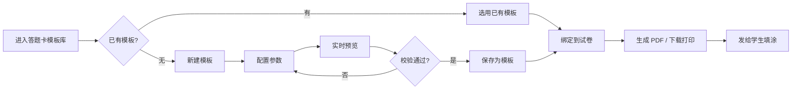

# 17 · 答题卡编辑器设计（教师端）

> **本文档是「答题卡创建页面」的完整设计规格**，含产品流程、页面规格、排版引擎算法、数据结构、校验规则。
>
> 上游依据：[08-答题卡与OMR规格.md](08-答题卡与OMR规格.md)（识别侧）、[02-数据模型与DDL.md](02-数据模型与DDL.md) 8.1–8.3（`sheet_style`/`sheet_template`/`paper_sheet_binding`）、设计文档 9.2 节。
> 实测依据：`scripts/sheet_layout_calc.py`（排版验算）、`scripts/gen_answer_sheet.py`（坐标级生成 PoC）、`docs/poc/poc-答题卡-v2.pdf`。

| 项 | 内容 |
| --- | --- |
| 文件版本 | v1.0 |
| 定位 | 教师端「答题卡模板库」的创建与编辑页面 |
| 关键确认 | ① 卷卡分离（卡上无题干）② **选项数量可配置** ③ 只给参数、全自动生成 ④ 完全自由配置 |

---

## ★ v2 改造说明（2026-10-18，当前实现以此为准）

- **编辑器 = 参数表单 + 实时预览**：左侧「页面设置 / 题目区域 / 定位与打印」，右侧由后端 `preview/` 返回的 `layout_json` 渲染；前端不自己算坐标。
- **几何改为毫米直算**：`sheet_style` 不再存比例字段；页边距 12–30mm（默认 12）、正文 8–14pt、标题 12–28pt；四角主块统一 6×6mm，外沿距纸边 = `margin_mm`，正文 = `margin + 6 + 4mm`；**取消整页外框与 padding**。详见 [4.0.1 页边距与分栏](#401-页边距与分栏2026-10-19-修正)。
- **题目区域是四类大题的列表**：
  - 选择/判断：**固定 5 题一列、列横向排列**（题号 1–5 第 1 列，6–10 第 2 列），不再有「每行题数」；选项 4–6（判断固定 2），列间距 6mm；每列左上角 3×3mm **列首块**，写入 `page.column_markers`。
  - 填空：逐题空格数 1–8、每空字符 2–12、**默认 1 空 / 每行 1 空**；每行空格 ≤ 空格数；每空分值数量严格等于空格数，界面显示只读合计。
  - 解答：逐题行数 2–30、样式 SOLID/DASHED/BLANK/BOX、**行距 1.0–3.0（默认 1.8）**、小题 1–4、按题计分。
  - 作文：总字数 100–1200、每行 10–30、**格间距 0.4–1.2mm（默认 0.6）**、最少字数；最少字数格下方印「（N字）」。
- **卷头顺序分带**：标题带高 = 标题字号×1.5+2mm；标题带底 + **4mm** 才开始信息区；考号区顶部为 6mm 锚点带、8mm 手写框行、10 个长方形涂点；辅助定位块在锚点带左上角内侧 1mm，下沿与手写框留 1mm。
- **预览的考号区/注意事项边框、分栏线、列首块、解答样式、作文间距全部只读 `layout_json`**，与 PDF 同源；预览失败保留上一版。

### v2.2 版式增强（2026-10-18 晚，layout_version=4）

| 参数 | 取值 / 默认 | 作用域 |
| --- | --- | --- |
| `orientation` | PORTRAIT / LANDSCAPE，默认 PORTRAIT | 页面设置；页宽高互换，锚点/卷头/分页全部重算 |
| `columns` | 1 / 2，默认 1 | 页面设置；仅选择题/判断题/填空题按栏流动，解答/作文跨栏 |
| `margin_mm` | 12–30，默认 **12** | 页面设置；**纸边 → 四角定位块外沿** |
| `box_scale` | 0.7–1.5，默认 1.0 | 题目区；选项框/判断题框/考号涂点同时乘比例 |
| `row_gap_mm` | 0–6，默认 1.2 | 题目区；同组小题行高 = 框高 + 该值 |
| `col_gap_mm` | 0–20，默认 **6** | 题目区；左右相邻两个小组之间的间距 |
| `band_gap_mm` | 0–30，默认 **10** | 题目区；上下两个 band 之间的间距 |
| `section_title_gap_mm` | 0–10，默认 **2.5** | 页面设置；标题基线+字高 → 框顶 |
| `items[].new_line` | bool，默认 false | 填空题；该小题是否另起一行 |

归一化：`orientation` / `columns` 枚举非法 → 400；`margin_mm / box_scale / row_gap_mm / col_gap_mm / band_gap_mm` 数值越界 → 夹到区间并保存，不报 400。旧样式里的 `frame / padding_mm / show_page_border / group_gap_mm` 一律忽略、不迁移、不报错。

- **卷头三段**：标题带 → 手写区一行（字段多时折两行）→ 左右块（左考号、右注意事项）；带间均 4mm。考号区与注意事项各加 0.4mm 细边框，且**同顶同底**。考号区宽度按位数/每行位数计算；栏宽不足时自动减少每行位数、增加行数，涂点不小于 2.5mm。
- **大题边框**：标题在框外；框顶 = 标题最后一行基线 + 字高 + `section_title_gap_mm`（默认 2.5）；框内边距固定 3mm；`page.section_titles[]` 与 `page.section_boxes[]` 是预览/PDF 唯一坐标来源；续段标题加「（续）」。
- **全双栏**：`columns=2` 作用于卷头、选择、判断、填空、解答、作文全部内容；左栏到底再右栏，右栏到底再换页。`page.column_x_mm[]`、`page.divider_x_mm`；栏间距固定 6mm，分界线 0.3mm。解答/作文按栏宽排，不再整页宽。
- **旧模板兼容**：旧 `layout_json` 没有 `section_boxes / column_x_mm / layout_version`；识别端只读 `objectives / fill_blanks / student_no / markers`，旧卡继续可识别。旧已保存的样式参数不迁移，按原值继续使用。
- **题号全卷连续**：创建时从 1 自动续号；发布时校验 1..N 连续。
- **保存草稿只存 `sections`**；发布才生成 `layout_json` + PDF + 签名 + 版本号。已发布版本**只增不改**，改卡走「另存为新版本」。
- **删除「由试卷生成答题卡」**：旧 `templates/from-paper/`、`sections_from_paper()` 与前端「样式生成 / 由试卷生成」交互已下线。
- **样式与模板合并为「答题卡」**：列表一个概念，页面设置收进设计器；`sheet_style` 仍作为可复用页面设置存在。

验收：`scripts/verify_sheet_acceptance.py` / `verify_sheet_layout.py` / `verify_sheet_render.py` / `verify_sheet_scan_e2e.py` / `verify_sheet_binding.py` / `verify_sheet_assignment_flow.py` / `verify_sheet_list_filter.py` / `gen_sheet_samples.py`。

### v2.1 细节契约（2026-10-18 晚修正）

- **标题/信息区不得叠加**：`layout.header.title.y_mm` 是标题带顶边，另有 `baseline_mm`；`title_bottom_mm + HEADER_GAP_MM(4) == info_top_mm == student_no.top_mm`。不满足写 `HEADER_GAP_TOO_SMALL` 阻断项。
- **考号区结构**（自上而下）：锚点带 6mm → 手写考号框行 8mm（框高 6mm）→ 涂点矩阵。`layout.student_no.handwrite_box` 为 `{x_mm,y_mm,w_mm,h_mm,boxes:[{x_mm,y_mm,w_mm,h_mm,digit_index}]}`；每框宽 = 该列列宽，x 与涂点列中心对齐。
- **涂点形状**：宽高比固定 `OPTION_BOX_H_RATIO=0.78`（与选项框一致），数字 0–9 画在框中心；不再画位号。
- **考号标签**：`student_no.label = {text:"考号（学号）：", x_mm, y_mm, font_pt}`，基线在锚点带中线。
- **辅助定位块**：`aux_anchor` 中心 = `(sn_left + size/2 + 1, sn_top + size/2 + 1)`；硬约束 `aux.y - size/2 >= title_bottom + 2`。
- **选择题分列**：`page.column_markers = [{x_mm,y_mm,size_mm,section_order,col}]`，每题另有 `column_marker`；旧模板没有时识别端回退 `row_markers`。
- **绑定唯一入口**：`POST /api/v1/assignments/{id}/bind-sheet/` → `AssignmentService.bind_sheet()`：校验 ACTIVE/机构 → `BindingService.validate` 逐题差异 → 校验名册学号位数 = `student_no.digits` → upsert `PaperSheetBinding(is_primary=True)` → 写 `assignment.sheet_template` → 审计。新建/修改作业选中答题卡也走同一服务，不再要求试卷事先有绑定。
- **扫描兜底**：`assignment.sheet_template` 为空时读取该试卷主绑定并回写；仍为空报「请到作业详情页绑定」。

---

## 一、需求确认与设计定位

### 1.1 已确认的四条需求

| # | 需求 | 设计含义 |
| --- | --- | --- |
| 1 | **卷卡分离**，卡上无题干；教师给试卷**绑定**答题卡；答题卡**可复用** | 模板与具体题目解耦 → 模板只依赖「**题型数量签名**」；同一模板可绑多份试卷 |
| 2 | **选项数量可配置** | 每小题独立设选项数（A–D / A–F / 判断题 2 选项…）→ **排版引擎必须按选项数动态计算每行题数** |
| 3 | **只给参数、全自动生成** | 教师不拖拽；系统保证排版不散、不越界、不重叠 |
| 4 | **完全自由配置** | 全部参数开放（纸张、栏数、字号、学号位数、密封线、每题选项数…） |

### 1.2 「自由配置」与「全自动」如何调和（关键设计决策）

需求 3 与需求 4 看似冲突，实际可调和：

> **教师自由配置「语义参数」，系统负责「几何解算」。**
>
> - 教师改的是**意图**：这题 4 个选项、那题 6 个选项；纸张 A4；要双栏；学号 8 位；要密封线。
> - 系统算的是**几何**：每行放几题、分几栏、占多高、是否超页、要不要翻页。
>
> **因此编辑器是「参数表单 + 实时预览」，不是「拖拽画布」。** 教师改参数 → 右侧预览实时重排 → 越界/溢出即时提示。

**为什么不做拖拽式自由布局**：拖拽会让教师能造出**识别不了的卡**（涂点被拖到重叠、锚点被移动、涂点尺寸被改小）。而答题卡的命门是**能被机器读准**——这必须由引擎保证，不能交给手工摆放。

### 1.3 ★ 参考样例的实际做法（教师提供的样例，`docs/poc/答题卡样例.pdf`）

> 样例已渲染核对（`docs/poc/render-样例/page-0001.png`）。**以下为必须复刻的版式特征。**

#### 1.3.1 整页结构

```
┌════════════════════════════════════════════════════════════════════════┐  ← 整页细黑外框
║ ◰                                       答题卡（______）        ◰     ║  ← ①② 定位点（双层方框）
║ ┌──────────────┐ ┌────────────┬──────┐ ┌────────────────────────┐    ║
║ │ 姓名 ______  │ │  准 考 证 号 │ ■    │ │      注 意 事 项        │    ║
║ │              │ ├────────────┼──────┤ ├────────────────────────┤    ║
║ │              │ │ 0  0  0    │ ■    │ │ 1.严禁在答题卡图像定位点 │    ║
║ │ 班级 ______  │ │ 1  1  1    │ ■    │ │   周围区域做任何涂写…   │    ║
║ │              │ │ …  …  …    │ …    │ │ 2.应保持答题卡的清洁…   │    ║
║ │              │ │ 9  9  9    │ ■    │ │ 3.填涂时要做准、深、满… │    ║
║ └──────────────┘ └────────────┴──────┘ └────────────────────────┘    ║
║                                                                        ║
║ 一、选择题                                                              ║
║ ┌────────────────────────────────────────────────────────────────────┐║  ← 浅灰底 panel
║ │ ▬▬▬▬▬▬▬▬▬▬▬▬▬▬▬▬  ← panel 内顶部灰色装饰条                        │║
║ │ ■ 1  [A][B][C][D]   6  [A][B][C][D]  11 [A][B][C][D]  16 [A][B][C][D]│║
║ │ ■ 2  [A][B][C][D]   7  [A][B][C][D]  12 [A][B][C][D]  17 [A][B][C][D]│║
║ │ ■ 3  [A][B][C][D]   8  [A][B][C][D]  13 [A][B][C][D]  18 [A][B][C][D]│║
║ │ ■ 4  [A][B][C][D]   9  [A][B][C][D]  14 [A][B][C][D]  19 [A][B][C][D]│║
║ │ ■ 5  [A][B][C][D]  10  [A][B][C][D]  15 [A][B][C][D]  20 [A][B][C][D]│║
║ │              ← 组间额外空白（约半行高）→                            │║
║ │ ■ 21 [A][B][C][D]  26  [A][B][C][D]                                │║
║ │ ■ 22 …             27  …                                           │║
║ │ ■ 23 …             28  …                                           │║
║ │ ■ 24 …             29  …                                           │║
║ │ ■ 25 …             30  …                                           │║
║ └────────────────────────────────────────────────────────────────────┘║
║ 判断题                                                                  ║
║ ┌────────────────────────────────────────────────────────────────────┐║
║ │ ■ 1  [T][F]  6  [T][F]  11 [T][F]  16 [T][F]                       │║
║ │ ■ 2  …      7  …       12 …        17 …                            │║
║ │ ■ 3  …      8  …       13 …        18 …                            │║
║ │ ■ 4  …      9  …       14 …        19 …                            ║
║ │ ■ 5  …      10 …       15 …        20 …                            ║
║ └────────────────────────────────────────────────────────────────────┘║
║ ◰                                                          ◰          ║  ← ③④ 定位点
└════════════════════════════════════════════════════════════════════════┘
```

#### 1.3.2 七个必须复刻的版式特征

| # | 特征 | 样例做法 | 工程要求 |
| --- | --- | --- | --- |
| **F-1** | **字母印在涂点框内** | `[ A ]`——字母在方框**内部**（不是上方、不是旁边） | 渲染时字母居中于框内；**框是方形**（不是圆形） |
| **F-2** | **每 5 题为一组** | 组内纵向堆叠 5 行，**组间有额外空白**（约半行高） | 新增参数 `group_size`（默认 5）与 `group_gap_mm`；组是**排版基本单元** |
| **F-3** | **行首黑色方块标记** | 每一行（每题）左侧有一个实心黑方块 | 新增元素类型「**行标记**」；用途见 1.3.3；**绘制时必须计入水平占宽** |
| **F-4** | **每行 4 组**（选项数 4 时） | 一行并排 4 组，每组「题号 + 4 个框」 | 与本文 4.2 的公式算出 3 组**不同**——样例排版更紧凑。见 1.3.4 的差异说明 |
| **F-5** | **整页细黑外框** | 内容四周有一圈细黑矩形边框 | 新增参数 `page_border` |
| **F-6** | **定位点是双层方框** | 外层黑框 + 内层实心黑块（不是纯实心方块） | 影响锚点检测算法（见 1.3.5） |
| **F-7** | **大题区有浅灰底 panel** | 每个大题包在浅灰底矩形内，题行白底 | 渲染层次：page → panel → row → bubble |

另有两处细节：**panel 内顶部有一条灰色装饰横条**；**准考证号区右侧有一列黑色方块**（与 F-3 同行标记，起行标记作用）。

#### 1.3.3 ★ 行首黑色方块的用途（必须澄清）

样例中每一行题目左侧都有实心黑方块。可能的作用有三种，**实现方式完全不同**：

| 可能用途 | 说明 | 对识别的影响 |
| --- | --- | --- |
| **A. 行标记 / 定时标记**（最常见） | 供识别端**定位每一行的基准位置**，逐行校准，容忍纸张拉伸与扫描变形 | 识别端必须按行标记校正，不能只靠四角 |
| **B. 视觉分隔** | 纯粹帮助学生看清"这一行是一题" | 识别端忽略 |
| **C. 附加定位点** | 与四角锚点一起做更精确的透视/仿射校正 | 识别端需与四角联合求解 |

**我的判断：最可能是 A（行标记）**，理由：
1. 每行都有、等间距，与行一一对应——这正是定时标记（timing marks）的形态；
2. **准考证号区右侧那一列方块**同样是"逐行标记"，而准考证号区需要逐行精确定位，这印证了 A；
3. 纯视觉分隔不需要做成实心黑块（成本更高）。

**但这必须你确认**——它决定识别端算法（是否需要行级校正）。见待确认 **S-Q7**。

#### 1.3.4 ★ 实测尺寸（`scripts/measure_sample_sheet.py` 量测结果）

**样例纸张是 A3（297×420mm），不是 A4。** 这是重要发现——**同一学校可能同时用 A3 与 A4**，编辑器必须两种都支持。

**页幅与边距**：

| 项 | 像素 | 换算 |
| --- | --- | --- |
| 图像 | 2292 × 3240 px | 宽高比 0.7074 |
| **纸张** | — | **A3 297×420mm**（交叉验证：各项尺寸换算后自洽，A4/B4 不自洽） |
| 墨迹边界 | x[239, 2048] y[314, 2791] | — |
| 外边距 | 左 239px / 右 243px | **左 31.0mm / 右 31.5mm** |
| | 上 314px / 下 448px | **上 40.7mm / 下 58.1mm** |

**核心尺寸（实测，全部经几何自洽校验）**：

| 元素 | 像素 | **换算（mm）** | 说明 |
| --- | --- | --- | --- |
| **行标记黑色方块** | 30 × 30 | **3.89 × 3.89** | 实心度 0.96；25 个同尺寸**完全一致**（精度很高，说明是矢量生成） |
| **行距**（组内相邻行） | 54 | **7.00** | ★ 这是行式排布的标准行距 |
| **组间距**（组与组之间） | 108 | **13.99** | ★ **= 行距 × 2，即组间多留一整行空白** |
| **同行选项框中心距** | 79 | **10.24** | 选项框约 9mm + 间隙 1.2mm |
| **组间横向间距** | 158 | **20.47** | 相邻两组「题号+框」的水平间距 |
| 选项框（含字母） | 63 × 38 | 8.2 × 4.9 | ⚠ 该尺寸来自连通域外接框，**含框线与字母粘连**，需按渲染图目视校准（见下） |

**每行 4 组的宽度校验**：

```
A3 可用宽 = 297 − 31.0 − 31.5 = 234.5mm
每行 4 组 → 每组 58.6mm
组间横向间距实测 20.5mm → 单组净宽 ≈ 38.1mm
单组净宽 = 行标记 3.9 + 间距 + 题号（约 6） + 4 个选项框
→ 4 个选项框可用 ≈ 38.1 − 3.9 − 6 − 2×间隙 3 ≈ 22.2mm
→ **单个选项框约 5.5mm 宽**
```

> ⚠ **选项框尺寸需按渲染图目视校准**：连通域量测把「框线 + 框内字母」算作一个连通域（63×38px），其外接框高度含字母上下的粘连，不能直接当框高。**实现时请以 `docs/poc/render-样例/page-0001.png` 放大核对为准**（建议框约 5.5×5.5mm、字母在其中居中）。

#### 1.3.5 ★ 与本文原设计的差异（全部以样例为准）

| 项 | 本文原设计（4.1–4.3 验算） | **样例实测（以样例为准）** | 处理 |
| --- | --- | --- | --- |
| **纸张** | A4 | **A3 297×420** | **页码要与 A4 并存**；`paper_size` 支持 A3 |
| **每行组数**（4 选项） | 3 组/行（按圆心距 8mm 算） | **4 组/行** | 改为按**方框**排版，非圆形涂点 |
| **涂点形状** | 圆形 ⌀4.5mm | **方形框，字母在框内** | **改为方形** |
| **行距** | 8.0mm（4.5 直径 + 3.5 间隙） | **7.00mm** | 改用实测 7mm |
| **分组** | 无 | **每 5 题一组，组间多留一整行（14mm）** | 新增 `group_size=5`、`group_gap_rows=1` |
| **行标记** | 无 | **每题行首一个 3.89mm 实心方块** | 新增「行标记」元素，**计入水平占宽** |
| 大题区背景 | 无 | **浅灰 panel + 顶部装饰条** | 新增 |
| 整页外框 | 无 | **有** | 新增 |
| 定位点形态 | 纯实心方块 | **双层方框（外框+内块）** | **修正锚点检测判据**（见 1.3.6） |

#### 1.3.6 ★ 双层方框定位点对识别算法的影响（**必须修正 08 文档**）

样例的定位点是**双层方框**（外框 + 内实心块），不是纯实心方块。这会**直接推翻** 08 文档的锚点检测判据：

| 项 | 原设计（纯实心方块） | 样例（双层方框） |
| --- | --- | --- |
| 二值化后形态 | 一个实心连通域 | 外环 + 内块（两个连通域），或带孔连通域 |
| 检测判据 | 面积 + 方形度 + **实心度 ≥ 0.75** | **实心度会偏低（约 0.3–0.5）→ 原判据直接漏检** |
| 后果 | — | **锚点一个都检测不到 → 全部卡片进人工队列** |

**修正实现（兼容两种形态）**：

```python
# 用带层级信息的轮廓检测，兼容「纯实心方块」与「双层方框」
contours, hierarchy = cv2.findContours(
    opened, cv2.RETR_CCOMP, cv2.CHAIN_APPROX_SIMPLE
)

def is_anchor(idx: int, contours, hierarchy) -> bool:
    c = contours[idx]
    area = cv2.contourArea(c)
    x, y, w, h = cv2.boundingRect(c)
    if h == 0 or not (0.7 < w / h < 1.4):
        return False
    fill = area / (w * h)

    # 情形一：纯实心方块
    if fill >= 0.75:
        return True

    # 情形二：双层方框的外框 —— fill 低，但存在内层子轮廓（内实心块）
    child = hierarchy[0][idx][2]          # 第一个子轮廓
    if fill < 0.75 and child != -1:
        inner = cv2.contourArea(contours[child])
        # 内块应占外框的合理比例（约 20%–60%）
        if 0.10 <= inner / (w * h) <= 0.65:
            return True
    return False
```

**配置项相应调整**：

| 配置项 | 原值 | 新值 | 说明 |
| --- | --- | --- | --- |
| `omr.anchor_solidity_min` | 0.75 | **改为「≥0.75（实心）或 有内子轮廓（双层）」** | 单一阈值不再适用 |
| `omr.anchor_style` | — | **新增：`SOLID` / `DOUBLE_FRAME` / `AUTO`** | 默认 `AUTO` 兼容两种 |
| `omr.anchor_size_mm` | 5.0 | **3.89（样例实测）** 或按模板实际 | 从模板量测，不写死 |

#### 1.3.7 样例元素清单（实现核对表）

| 元素 | 数量（样例） | 说明 |
| --- | --- | --- |
| 整页细黑外框 | 1 | |
| 定位点（双层方框） | **4** | 卷头左右 + 页脚左右 |
| 姓名/班级手写框 | 1 | 左侧 |
| 准考证号区 | 1 | 3 列 × 10 行数字框（框内印数字）+ 右侧行标记列 |
| 注意事项区 | 1 | 3 条说明 |
| 大题 panel | 2 | 选择题、判断题（浅灰底 + 顶部装饰条） |
| **辅助定位方块** | 30 + 20 = **50** | 3.89mm 实心；**Q7 已确认为辅助定位** |
| 题号 | 50 | |
| 选项框（含字母） | 30×4 + 20×2 = **160** | 选择 `[A][B][C][D]`、判断 `[T][F]` |
| 大题标题 | 2 | 「一、选择题」「判断题」 |

---

### 1.4 ★ 信息区设计规格（本轮新增，约束最多的一块）

信息区 = **卷头三栏**：① 个人信息区 ② 准考证号区 ③ 注意事项区。三者的宽度**互相制约**。

#### 1.4.1 卷头三栏的宽度联动（关键约束）

```
┌──────────────────┬─────────────────────┬────────────────────────────┐
│  ① 个人信息区      │  ② 准考证号区        │  ③ 注意事项区               │
│  宽度 W1           │  宽度 W2             │  宽度 W3                    │
│  （可自定义字段）   │  = 列数 × 列宽        │  = 可用总宽 − W1 − W2 − 间距 │
│                    │  （3–8 列）          │  ★ 受 W2 挤压               │
└──────────────────┴─────────────────────┴────────────────────────────┘
        └──────────────── 可用总宽 = 纸张宽 − 左右页边距 ────────────────┘
```

**★ 核心约束（用户明确要求）**：**注意事项区的宽度受准考证号列数影响**。

```python
def header_layout(page_w_mm: float, margin_mm: float,
                  personal_w_mm: float = 70.0,
                  sn_digits: int = 3,
                  sn_col_w_mm: float = 12.0,
                  col_gap_mm: float = 4.0) -> HeaderLayout:
    """
    卷头三栏宽度分配。
    ★ 准考证号列数增加 → 注意事项区变窄，必须校验最小可读宽度。
    """
    usable = page_w_mm - 2 * margin_mm
    sn_w = sn_digits * sn_col_w_mm + SN_MARKER_COL_W_MM     # 含右侧辅助定位列
    notice_w = usable - personal_w_mm - sn_w - 2 * col_gap_mm

    issues = []
    if notice_w < NOTICE_MIN_W_MM:                          # 建议 45mm
        issues.append({
            "code": "NOTICE_TOO_NARROW",
            "message": (
                f"准考证号 {sn_digits} 列占 {sn_w:.0f}mm，"
                f"注意事项区仅剩 {notice_w:.0f}mm（建议 ≥ {NOTICE_MIN_W_MM}mm），"
                f"文字将过度折行。建议：① 减少准考证号位数 ② 缩小个人信息区 "
                f"③ 注意事项改为卷末单独区域"
            ),
        })
    if notice_w < NOTICE_HARD_MIN_W_MM:                     # 建议 30mm，硬下限
        issues.append({
            "code": "NOTICE_UNUSABLE",
            "message": f"注意事项区仅 {notice_w:.0f}mm，无法容纳文字。请调整上方参数。",
            "blocking": True,
        })
    if personal_w_mm > usable * 0.45:
        issues.append({
            "code": "PERSONAL_TOO_WIDE",
            "message": "个人信息区超过可用宽的 45%，建议 ≤ 40%。",
        })

    return HeaderLayout(personal_w_mm=personal_w_mm, sn_w=sn_w,
                        notice_w=notice_w, issues=issues)
```

**实测（A3，可用宽 234.5mm，个人信息区 70mm，准考证号列宽 12mm）**：

| 准考证号位数 | 准考证号区宽 | **注意事项区宽** | 判定 |
| --- | --- | --- | --- |
| 3 位（样例） | 3×12 + 4 = 40mm | **116.5mm** | ✓ 宽裕 |
| 5 位 | 64mm | 92.5mm | ✓ 可用 |
| 6 位 | 76mm | 80.5mm | ✓ 尚可 |
| 8 位 | 100mm | **56.5mm** | ⚠ 偏窄，文字折行明显 |
| 8 位 + 个人信息区 100mm | 100mm | 26.5mm | ✕ **不可用**（低于硬下限） |

> **这正是用户所说「宽度受准考证号列数影响」的量化表现。** 编辑器必须**实时显示注意事项区宽度**并在过窄时给建议，而不是默默把文字挤成一列。

#### 1.4.2 ① 个人信息区（**支持自定义字段**）

| 参数 | 取值 | 默认 | 说明 |
| --- | --- | --- | --- |
| 字段列表 | 可增删/排序 | **姓名、班级、座位号** | 用户指定 |
| 每字段形式 | 手写下划线 / 涂点区 | 手写下划线 | 一期只做手写（不识别手写，见 D9） |
| 字段标签文案 | 文本 | 姓名 / 班级 / 座位号 | 可改（如「学号」「考号」） |
| 下划线长度 | 按字段长度自动 / 手工 | 自动 | |
| 区宽 | 数值 | 70mm | 影响注意事项区宽度 |
| 边框 | 有 / 无 | 有（细黑框） | 样例是带框的 |

**渲染结构**：

```
┌─────────────────────────┐
│                         │   ← 上留白
│  姓名  ______________   │
│                         │
│  班级  ______________   │
│                         │
│  座位号 ______________   │
│                         │
└─────────────────────────┘
```

**可扩展性**：`personal_fields: jsonb` 数组，每项 `{key, label, type, width_mm}`，`type ∈ HANDWRITE | BUBBLE`。**一期只实现 `HANDWRITE`**，`BUBBLE` 留扩展位（如未来要采集学号涂点）。

#### 1.4.3 ② 准考证号区（**支持 3–8 位**）

| 参数 | 取值 | 默认 | 说明 |
| --- | --- | --- | --- |
| **列数（位数）** | **3–8** | 3（样例） | 用户指定；**直接决定该区宽度** |
| 每列涂点 | 固定 0–9（10 个） | — | 框内印数字 |
| 列宽 | 数值 | 12mm | 可调；影响该区总宽 |
| 是否含右侧辅助定位列 | 勾选 | 是（样例有） | 该列本身占约 4mm |
| 是否印手写行 | 勾选 | 是（样例有顶部空白行） | 供考生先手写号码再涂 |

**渲染结构（3 列为例，样例形态）**：

```
┌───────────────┬──────┐
│   准 考 证 号   │      │   ← 标题行（浅灰底）
├───────┬───────┼──────┤
│       │       │      │   ← 手写行（空白格）
├───────┼───────┼──────┤
│ [0]   │ [0]   │ [0]  │ ■  ← 数字框在框内 + 右侧辅助定位
│ [1]   │ [1]   │ [1]  │ ■
│  …    │  …    │  …   │ …
│ [9]   │ [9]   │ [9]  │ ■
└───────┴───────┴──────┘
```

> **注意**：样例这里是**数字框（印数字、供涂黑）**，与选择题的字母框同构——**不是「手写格 + 涂点」双区**。这符合 D9「不识别手写」。

#### 1.4.4 ③ 注意事项区（**内容自定义 + 宽度联动**）

| 参数 | 取值 | 默认 | 说明 |
| --- | --- | --- | --- |
| 内容 | 多行文本 | 样例三条 | **完全自定义** |
| 标题 | 文本 | 「注意事项」 | 可改 |
| 宽度 | **自动计算**（受准考证号列数挤压） | — | 见 1.4.1 |
| 最小宽度 | 告警阈值 45mm / 硬下限 30mm | — | 低于则告警/阻断 |
| 自动折行 | 是 | — | |
| 文字方向 | 横排 | — | 竖排留扩展位 |

**样例默认文案**（可直接作为默认值）：

```
1.严禁在答题卡图像定位点周围区域做任何涂写或标记，否则答题卡作废，不计成绩。
2.应保持答题卡的清洁，不得折叠、污染、破损等，不得在答题卡上写与题目无关的内容。
3.填涂时要做准、深、满、匀，即涂准位置、涂深、以盖住原印刷符号为准、涂满选项的方框、涂错时用橡皮擦干净。修改答案时，要确保橡皮擦干净且不造成答题卡破损。
```

**过窄时的三种降级方案**（编辑器应提供一键切换）：

| 方案 | 做法 | 适用 |
| --- | --- | --- |
| **A. 缩小字号** | 8pt → 6pt | 略窄时（40–45mm） |
| **B. 移到卷末** | 注意事项区独立成块放到答题卡底部或次页 | 很窄时（< 40mm） |
| **C. 精简文案** | 只保留第 1、3 条 | 兜底 |


---

## 二、教师视角的完整流程



**两条关键路径**：

| 路径 | 场景 | 说明 |
| --- | --- | --- |
| **复用路径（推荐）** | 常规考试 | 模板库选一个已有模板 → 校验与本次试卷的题型签名是否匹配 → 绑定 → 打印 |
| **新建路径** | 新题型结构 | 配置参数 → 预览 → 保存 → 绑定 |

> **复用是核心价值**：一个学校通常只有 3–5 种题型结构（如「20 选择 + 10 判断 + 4 解答」）。首次配好后**反复使用**，老师不用每次重做。因此 `sheet_template` 必须有 `name` 与 `question_types`（题型签名），供模板库检索与绑定校验。

---

## 三、页面设计

### 3.1 入口与列表页（T16 答题卡管理）

```
┌──────────────────────────────────────────────────────────────────────────────┐
│ 答题卡模板库                                       [+ 新建答题卡]  [导入]     │
├──────────────────────────────────────────────────────────────────────────────┤
│ 搜索 [          ]   纸张 [全部▾]  栏数 [全部▾]  学号 [全部▾]                 │
├──────────────────────────────────────────────────────────────────────────────┤
│ ┌──────────────┐ ┌──────────────┐ ┌──────────────┐ ┌──────────────┐        │
│ │ [缩略图]     │ │ [缩略图]     │ │ [缩略图]     │ │ [缩略图]     │        │
│ │ 标准A4·20选择 │ │ A4双栏·30题  │ │ 判断题专用    │ │ A3·40题大考  │        │
│ │ 20选+10判+4答 │ │ 30选+5多选   │ │ 20判断       │ │ 40选+6解答   │        │
│ │ 8位学号 · 1页 │ │ 8位学号 · 1页│ │ 无学号 · 1页 │ │ 8位 · 2页    │        │
│ │ [绑定] [编辑] │ │ [绑定] [编辑]│ │ [绑定] [编辑]│ │ [绑定] [编辑]│        │
│ │ [复制] [删除] │ │ [复制] [删除]│ │ [复制] [删除]│ │ [复制] [删除]│        │
│ └──────────────┘ └──────────────┘ └──────────────┘ └──────────────┘        │
│                                                                              │
│ ⚠ 2 个模板存在问题：                                                          │
│   · 「A3·40题大考」超出 2 页（当前 3 页），建议缩小主观题作答区               │
│   · 「旧版样式」学号位数 8 位与当前名册（10 位）不一致                        │
└──────────────────────────────────────────────────────────────────────────────┘
```

**列表页要点**：

| 要点 | 说明 |
| --- | --- |
| **缩略图** | 用系统生成的**首页缩略 PNG**（不是图标），老师一眼能认出来 |
| **签名摘要** | 「20选+10判+4答」比「标准A4」有用得多——老师靠这个找模板 |
| **页数徽标** | 显示「1页 / 2页」，老师关心印刷量 |
| **健康告警** | 模板与**当前名册**不符（学号位数）、或页数异常，直接在列表顶部提示 |
| 复制 | 以现有模板为基础改参数，比从零配快得多 |

### 3.2 创建/编辑页（核心页面）

**布局：左右分栏，左侧参数、右侧预览**（宽屏）。窄屏时上下堆叠（预览可折叠）。

```
┌───────────────────────────────────────────────────────────────────────────────────┐
│ ← 返回模板库    新建答题卡                                  [取消]  [保存模板]     │
├──────────────────────────────────┬────────────────────────────────────────────────┤
│ 参数区（可滚动，宽 380px）        │ 实时预览（A4 等比缩放，可缩放/翻页）           │
│                                  │ ┌──────────────────────────────────────────┐  │
│ ▼ ① 基本信息                     │ │  ◼                                    ◼ │  │
│   名称  [机械基础标准卡      ]   │ │       《机械基础》答题卡                  │  │
│   备注  [20选+10判+4答       ]   │ │   姓名____ 班级____ 考号____              │  │
│                                  │ │  ┌────────────────────────────────────┐ │  │
│ ▼ ② 纸张与版式                   │ │  │ 学号填涂区（8 位）                  │ │  │
│   纸张  [A4 ▾]                   │ │  │ 0 ○○○○○○○○                          │ │  │
│   方向  [纵向 ▾]                 │ │  │ 1 ○○○○○○○○                          │ │  │
│   栏数  (•) 单栏  ( ) 双栏       │ │  │ …                                   │ │  │
│   页边距 [10] mm                 │ │  └────────────────────────────────────┘ │  │
│   字号  [10] pt                  │ │  一、选择题（20 题）                     │  │
│                                  │ │   1 ○A ○B ○C ○D    2 ○A ○B ○C ○D  …  │  │
│ ▼ ③ 考生信息与卷头               │ │   3 ○A ○B ○C ○D    4 ○A ○B ○C ○D  …  │  │
│   标题  [《机械基础》答题卡   ]  │ │  …                                     │  │
│   ☑ 姓名 ☑ 班级 ☑ 考号（手写）  │ │  二、判断题（10 题）                     │  │
│   ☐ 密封线                       │ │   1 ○对 ○错   2 ○对 ○错   …            │  │
│   注意事项 [用2B铅笔填涂…    ]   │ │  三、解答题作答区                        │  │
│                                  │ │  ┌────────────────────────────────────┐ │  │
│ ▼ ④ 学号区                       │ │  │ 21题（8分）              [得分]     │ │  │
│   ☑ 启用学号区                   │ │  └────────────────────────────────────┘ │  │
│   位数  [8 ▾]（1–12）            │ │                                        │  │
│   排布  (•) 单行  ( ) 多行       │ │                                        │  │
│   ☐ 含校验位                     │ │                                        │  │
│                                  │ │                                        │  │
│ ▼ ⑤ 题型与题量（★核心）         │ │                                        │  │
│   ┌────────────────────────────┐ │ │                                        │  │
│   │ # 大题名称  题量 选项 上卡 │ │ │                                        │  │
│   │ 1 [选择题 ] [20] [4▾] ☑   │ │ │                                        │  │
│   │ 2 [判断题 ] [10] [2▾] ☑   │ │ │                                        │  │
│   │ 3 [解答题1] [ 1] [—]  ☐ 8分│ │ │                                        │  │
│   │ 4 [解答题2] [ 1] [—]  ☐10分│ │ │                                        │  │
│   │ [+ 添加大题]  [↑↓ 排序]    │ │ │                                        │  │
│   └────────────────────────────┘ │ └──────────────────────────────────────────┘  │
│                                  │  第 1/2 页  [<] [>]   缩放 [—○+]   ☑ 显示网格 │
│ ▼ ⑥ 主观题作答区                 │                                                │
│   高度 [8] mm/分（最小 25mm）    │ ┌─ 排版检查 ─────────────────────────────────┐ │
│   ☑ 印得分框                     │ │ ✓ 总页数 2 页                               │ │
│                                  │ │ ✓ 涂点间距 8.0mm（≥ 7.5mm 下限）            │ │
│ ▼ ⑦ 印刷                        │ │ ✓ 锚点在打印安全区内                        │ │
│   打印安全区 [10] mm             │ │ ⚠ 第 2 页仅用 97mm，建议压缩主观题作答区     │ │
│   涂点直径 [4.5] mm（锁定）      │ │ ✕ 学号区 8 位与「高一(1)班」名册（10 位）不符│ │
│   ☑ 显示锚点（调试用）           │ └────────────────────────────────────────────┘ │
└──────────────────────────────────┴────────────────────────────────────────────────┘
```

### 3.3 参数清单（全部可配 = 「完全自由配置」）

| 分组 | 参数 | 取值 | 默认 | 是否影响识别 |
| --- | --- | --- | --- | --- |
| **① 基本信息** | 名称 / 备注 | 文本 | — | 否 |
| **② 纸张与版式** | 纸张 | **A3 / A4 / A5**（已确认三种） | A3 | **是**（决定框尺寸与卷头布局） |
| | 方向 | 纵向 / 横向 | 纵向 | 否 |
| | 栏数 | 1 / 2 | 1 | 否（但影响识别时的版面切分） |
| | 页边距（纸边→定位块外沿） | 12–30mm | 12 | **是**（低于 10mm 夹到 10mm 并告警） |
| | 大题标题间距 | 0–10mm | 2.5 | 否 |
| | 正文字号 | 8–14pt | 10 | 否 |
| **③ 卷头** | 标题 / 副标题 | 文本 | 自动填课程名 | 否 |
| | 姓名/班级/考号手写栏 | 勾选 | 全选 | 否 |
| | 密封线 | 勾选 + 位置 | 否 | 否 |
| | 注意事项文案 | 多行文本 | 默认文案 | 否 |
| **④ 学号区** | 启用 | 勾选 | 是 | **是** |
| | 位数 | 1–12 | 8（机构默认） | **是** |
| | 排布 | 单行 / 多行 | 单行 | **是** |
| | 每行位数 | 2–12 | 6 | **是**（仅多行时） |
| | 含校验位 | 勾选 | 否 | **是** |
| | 印数字标签 | 勾选 | 是 | 否（但显著降低学生涂错率） |
| **⑤ 题型与题量** | 大题名称 | 文本 | 一、选择题 | 否 |
| | 题量 | 1–100 | — | **是** |
| | **选项数** | 2–10 | 4 | **是** |
| | 是否上卡 | 勾选 | 客观题默认勾选 | **是** |
| | 主观题分值 | 1–50 | — | **否**（只影响作答框高度） |
| **⑥ 主观题区** | 高度/分 | 5–12mm | 8 | 否 |
| | 最小高度 | 15–40mm | 25 | 否 |
| | 印得分框 | 勾选 | 是 | 否 |
| **⑥b 分组与标记**（★ 样例驱动新增） | **每题分组大小** | 1–10 | **5** | **是**（决定组间留空位置） |
| | 组横向间距 | 0–20mm（`col_gap_mm`） | **6** | **是** |
| | 组纵向间距 | 0–30mm（`band_gap_mm`） | **10** | **是** |
| | **行首标记方块** | 勾选 | **是** | **是**（识别端可能按行校正，见 S-Q7） |
| | 行标记尺寸 | **锁定 3.89mm** | — | **是** |
| | 大题区浅灰底 | 勾选 | 是 | 否 |
| **⑦ 印刷** | 打印安全区 | 5–15mm | 10 | **是** |
| | **选项框尺寸** | **自动计算**（由纸张+列数反推，见 4.2.3） | — | **是** |
| | **锚点尺寸 / 边距** | **锁定 3.89mm / 按样例** | — | **是** |
| | 显示锚点 | 勾选（仅调试） | 否 | 否 |

> **★ 必须锁死的参数**：选项框尺寸、锚点尺寸与边距、行标记尺寸。原因：识别端的阈值与几何校验都基于这些值标定（`omr.*` 阈值、`anchor_max_deviation`）。
>
> **让教师改这些值等于让他造出读不了的卡。** UI 上显示为只读并附说明：「该值由系统锁定以保证识别准确率」。
>
> ⚠ **注意尺寸口径已按样例更新**：原设计是「圆形涂点 ⌀4.5mm + 锚点 5mm」，**样例实测为「方形选项框约 5.5mm + 锚点双层方框 3.89mm」**。以样例为准。

---

## 四、排版引擎（自动生成的「几何解算」）

### 4.0 ★ v4 实现口径（当前代码，2026-10-18 晚）

- **页面几何**：`geometry_for` 先按纸张取宽高，`orientation=LANDSCAPE` 时交换；主块固定 6×6mm，外沿距纸边 = `margin_mm`（12–30，默认12，旧值 10/11 可读）；正文 = `margin + 6 + 4mm`；**无整页外框、无 padding**。详见 4.0.1。
- **卷头**：`_header_v4` 三段——标题（超宽先缩到12pt再折行）、手写区（均分栏宽、单项<25mm 折两行、下划线=标签宽+2mm）、左右块（左考号、右注意事项；同顶同底，0.4mm 边框）；带间 4mm。
- **大题段**：`_SectionWriter` 统一负责标题/边框/续段。框顶 = 标题基线 + 字高 + `section_title_gap_mm`（默认2.5），框内边距3mm；`page.section_titles[]`、`page.section_boxes[]` 是预览/PDF 唯一坐标。
- **分栏**：`_Flow` 管双栏——左栏→右栏→新页；卷头只占第 1 页左栏；解答/作文也按栏宽排；栏间 6mm、0.3mm 分界线。
- **题型**：
  - 选择/判断：固定5题一列；`box_scale` 缩放、`row_gap_mm` 行高、`col_gap_mm` 横向组距、`band_gap_mm` 纵向 band 距；列首块与第一行同高。
  - 填空：`new_line` 控制小题起点；同题内部按 `per_line` 分空；同一行总宽超栏宽自动换行。
  - 解答：`line_spacing` 行高；四种样式。
  - 作文：`cell_gap_mm` 方格间距；标记随格重算。
- **版本**：`layout_version=4`；旧 v3 模板未重排，识别端仍按 `objectives / fill_blanks / student_no / markers` 读。

### 4.0.1 页边距与分栏（2026-10-19 修正）

> 本节是 v2.4 起**唯一**的页面几何口径。预览、PDF、识别模板共用同一份 `layout_json`，任何一方都不得再自行推导。

#### ① 从纸边向内

```
纸边
 │  margin_mm（12–30，默认 12）
 ▼
┌────────┐  ← 6×6mm 四角主定位块（外沿贴 margin）
│        │
│        │  4mm 固定间隔
│        ▼
│      ┌──────────────────────────────┐
│      │ 正文：卷头 / 大题 / 页脚       │
│      └──────────────────────────────┘
└─────────────────────────────────────┘
```

| 参数 | 范围 / 默认 | 精确定义 |
| --- | --- | --- |
| `margin_mm` | 12–30，默认 12 | 纸边 → **定位块外沿**；旧值 10/11 可读 |
| 主定位块 | 固定 6×6mm | 外沿贴在 `margin_mm`；中心 = `margin + 3` |
| `CONTENT_GAP_MM` | 固定 4mm | 定位块内沿 → 正文 |
| 整页外框 | **已删除** | 不再绘制、不再有开关、不再有 `frame` 字段 |
| `padding_mm` | **已删除** | 旧样式里的值一律忽略 |
| 页脚预留带 | 6mm | 正文不进入；页脚基线在正文底界上方 1mm |

公式（全部毫米）：

```
anchor_center = margin + 3
content.l/t   = margin + 6 + 4
content.r/b   = page_w/h - (margin + 6 + 4)
```

- **打印安全**：定位块外沿距纸边不得 <10mm。`margin_mm < 10` 时夹到 10，并写 `MARGIN_CLAMPED`；10/11 的旧值可读，但提示低于新下限 12（`MARGIN_BELOW_RECOMMENDED`）。
- **不做整体缩放**：页边距变化只触发重排；字号、框尺寸、6×6mm 定位块不随边距变化。
- **旧样式兼容**：`frame / padding_mm / show_page_border / group_gap_mm` 不迁移、不报错、不参与排版；已发布老卡不重排。

#### ② 标题与手写区

- 新建答题卡 `title_text` 默认「答题卡」；旧卡数据库里为空时卷面回退显示「答题卡」，不写回数据库。
- 标题在**当前栏宽**内：先缩字号到下限 12pt，仍超宽再折行。`layout.header.title.lines[]` 给出每行文本、顶边与基线。
- 手写区一行：`field_w = (栏宽 - (n-1) × 6mm) / n`；单项 <25mm 折两行，每行重新均分。
- 下划线起点 = 标签宽 + 2mm，终点 = 本字段右边界；`y = 标签基线 + 1.2mm`；下划线到下一标签 ≥4mm。
- 空 label 预览按占位渲染（标签留空、下划线照画），保存/发布才阻断并定位到字段。

#### ③ 考号区与注意事项

- 考号区、注意事项各加 **0.4mm 细边框**；两者**同顶同底**，注意事项框高固定等于考号区高度。
- 考号区结构自上而下：6mm 锚点带（4×4mm 辅助块，左上内侧 1mm）→ 8mm 手写考号框行 → 10 个涂点。
- 栏宽不足时自动减少每行位数、增加行数，保证涂点宽 ≥2.5mm；不靠挤压涂点。
- 注意事项自动缩小字号，最低 6pt；仍放不下则截断并加省略号，写 `NOTICE_TRUNCATED`，绝不越出边框。

#### ④ 全双栏

- `columns = 1 / 2`，作用于**整页所有内容**：卷头、选择、判断、填空、解答、作文。
- 双栏时所有内容从左边一栏顶部开始；左栏排到底再排右栏；右栏排到底才换页。
- 栏间距固定 **6mm**；`column_w = (content_w - 6) / 2`；分界线 0.3mm，位于栏间距中线，从正文顶到底。
- 卷头只占第 1 页左栏；续页不重复卷头，只重复大题标题（加「（续）」）与边框。
- 所有几何按栏宽计算：标题居中于栏宽、手写字段按栏宽均分、考号/注意事项在栏内左右分块、大题边框宽 = 栏宽、作文格按栏宽重算。
- 作文格最小边 4mm；低于 4mm 时减少每行格数直到格宽 ≥4mm，并写 `ESSAY_CELL_TOO_SMALL` / `ESSAY_COLS_CLAMPED`，提示改用 1 栏或更大纸张；不得越出栏宽。

#### ⑤ 填涂区间距

| 参数 | 范围 / 默认 | 作用 |
| --- | --- | --- |
| `box_scale` | 0.7–1.5，默认 1.0 | 选项框、判断题框、考号涂点尺寸 |
| `row_gap_mm` | 0–6，默认 1.2 | 同一小组内小题上下间距：`row_h = box_h + row_gap` |
| `col_gap_mm` | 0–20，默认 6 | 左右相邻两个小组之间的间距 |
| `band_gap_mm` | 0–30，默认 10 | 上下两个 band 之间的间距 |

```
group_w = 题号块宽(3+3+6) + 选项数 × (box_w + 1.2)
columns = max(1, floor((栏宽 + col_gap) / (group_w + col_gap)))
band_h  = (5 - 1) × row_h + box_h
next_band.top - prev_band.bottom = band_gap_mm
```

- 排列不变：5 题一列、列内自上而下、列间横向。
- `band_gap_mm` 只加在两个 band 之间，最后一组之后不加；换栏/换页时不把间距留在上一栏底部。
- 每列列首辅助块与第一行同高：`y = band.top + box_h / 2`，随行高重算。

#### ⑥ `layout_json`

```jsonc
{
  "layout_version": 4,
  "margin_mm": 12,
  "content_start_mm": 22,
  "content_width_mm": 166,
  "columns": 2,
  "row_gap_mm": 1.2,
  "col_gap_mm": 6,
  "band_gap_mm": 10,
  "column_gap_mm": 6,
  "pages": [
    {
      "columns": 2,
      "column_x_mm": [22, 108],
      "column_widths_mm": [80, 80],
      "divider_x_mm": 105,
      "divider_y1_mm": 22,
      "divider_y2_mm": 269,
      "student_no": {"box": {"x_mm": 22, "y_mm": 60, "w_mm": 44, "h_mm": 54}},
      "header": {"notice": {"box": {"x_mm": 72, "y_mm": 60, "w_mm": 30, "h_mm": 54}}},
      "section_boxes": [{"x_mm": 22, "y_mm": 128.4, "w_mm": 80, "h_mm": 65.4}]
    }
  ]
}
```

不再输出 `frame / padding_mm / show_page_border`。

#### ⑦ 验收

```bash
python scripts/verify_sheet_acceptance.py
python scripts/verify_sheet_layout.py
python scripts/verify_sheet_render.py
python scripts/verify_sheet_scan_e2e.py
python scripts/gen_sheet_samples.py
cd web && pnpm typecheck && pnpm build
```

样张：`artifacts/sheet-samples/A4-portrait-1col.png`、`A4-portrait-2col.png`、`A4-landscape-2col.png`、`A5-portrait-1col.png`（300dpi）。

### 4.0.2 分栏与间距接线（2026-10-19 修复）

#### ① 全双栏流动

- `page.columns` 为 1 或 2；双栏栏宽 `column_w = (content_w - 6) / 2`。
- `_Flow` 维护**独立的栏纵向游标**：
  - 第 1 页左栏从卷头之后开始；
  - 第 1 页右栏、第 2 页起从 `content_t` 开始；
  - 左栏到底 → 右栏顶部；右栏到底 → 新页左栏。
- 卷头只出现在第 1 页左栏；续页不重复卷头。
- 选择题、判断题、填空题、解答题、作文题全部按当前栏宽排；解答/作文不再整页宽。
- 大题跨栏/跨页时，每段重新画边框，标题重复并加「（续）」。
- 作文格按栏宽重算；最小边低于 4mm 时减少每行格数直到格宽 ≥4mm，并写 `ESSAY_CELL_TOO_SMALL` / `ESSAY_COLS_CLAMPED`，提示改用 1 栏或更大纸张。

#### ② 分界线字段

双栏页必须写出：

```jsonc
{
  "columns": 2,
  "column_x_mm": [22, 108],
  "column_widths_mm": [80, 80],
  "divider_x_mm": 105,
  "divider_y1_mm": 22,
  "divider_y2_mm": 269
}
```

- `divider_x_mm = content_l + column_w + 6 / 2`；
- `divider_y1_mm = content_t`，`divider_y2_mm = body_bottom`；
- 1 栏时 `divider_x_mm` 为空，不画线；
- `render.py` 和 `SheetPreview.vue` 都直接读这些字段，不自行推导。

#### ③ 间距接线

| 参数 | 接线点 | 公式 / 验收 |
| --- | --- | --- |
| `box_scale` | 选项框、判断题框、考号涂点 | `box_w = clamp(5.1 × scale, BOX_MIN, BOX_MAX)`；`box_h = box_w × 0.78` |
| `row_gap_mm` | 同一小组内小题 | `row_h = box_h + row_gap`；行中心差 = `row_h` |
| `col_gap_mm` | 左右小组 | `cols = floor((栏宽 + col_gap) / (group_w + col_gap))`，至少 1 |
| `band_gap_mm` | 上下 band | `band_h = (5-1) × row_h + box_h`；下一 band top - 上一 band bottom = `band_gap` |
| `section_title_gap_mm` | 大题标题到框顶 | `box_y = 标题最后一行基线 + 字高 + gap` |

- `band_gap` 只在两组之间加，最后一组之后不加；换栏/换页时不把间距留在上一栏底部。
- 验收 q5→下一 band q1 的纵向差：
  - `band_gap=0` 时 = `row_h`；
  - `band_gap=30` 时 = `row_h + 30`；
  - 两者差值 = **30mm**（允许 0.2mm 误差）。
- 这些参数在几何、PDF、预览三处同时生效；只改 UI 不算完成。

#### ④ 间距验收样例

```text
box_scale=0.7 / 1.5      → 框宽 3.57 / 7.65mm
row_gap=0 / 6            → 行中心差 3.98 / 9.98mm
col_gap=0 / 20           → 首行可放 4 / 3 个小组
band_gap=0 / 30          → q5→下一 band q1 纵向差 3.98 / 33.98mm
section_title_gap=0 / 2.5 / 8 → 框顶 121.19 / 123.69 / 129.19mm
```

### 4.1 实测验算结果（`scripts/sheet_layout_calc.py`）

**A4 = 210×297mm，页边距 10mm → 可用 190×277mm，涂点 ⌀4.5mm、圆心距 8.0mm。**

| 选项数 | 单组涂点宽度 | **一行可放题数** |
| --- | --- | --- |
| 2（判断题） | 12.5mm | **5** |
| 3 | 20.5mm | 4 |
| 4（单选） | 28.5mm | **3** |
| 5 | 36.5mm | 3 |
| 6（多选） | 44.5mm | **2** |
| 8 | 60.5mm | 2 |
| 10 | 76.5mm | 1 |

**四个真实场景的页数**：

| 场景 | 结构 | 页数 | 单页占用 |
| --- | --- | --- | --- |
| A | 20 选择(4) + 10 判断(2) | **1 页** | 181mm |
| B | 20 选择 + 10 判断 + 4 解答(8/10/12/10 分) | **3 页** | 252 / 200 / 97mm |
| C | 30 选择(4) | **1 页** | 182mm |
| D | 40 单选(4) + 5 多选(6) | **1 页** | **245mm（接近上限）** |

### 4.2 核心公式（★ 纯比例体系：不写死任何毫米数）

> **★ 架构决策（用户确认）**：**不固定尺寸，只确定比例**。
>
> 全部几何参数都定义为**比例**（相对可用宽），**唯一基准是 A3 样例的一次量测**。之后**任何纸张尺寸都能自动缩放，布局不会出错**。
>
> 这解决了「固定毫米值在小纸上溢出、甚至算出负宽度」的隐患——那是我先前验算时实际踩到的错误。

#### 4.2.1 比例常量表（**全部来自 A3 样例的逐像素量测**）

| 常量 | 定义 | 值 | A3 上的绝对量 |
| --- | --- | --- | --- |
| `MARGIN_RATIO` | 页边距 / 纸张宽 | **0.104377** | 31.0mm |
| `BOX_W_RATIO` | 选项框宽 / 可用宽（4列×4选项） | **0.033064** | 7.77mm |
| `BOX_ASPECT` | 选项框 高 / 宽 | **0.5843** | 4.54 / 7.77 |
| `ROW_PITCH_RATIO` | 行距 / 可用宽 | **0.030340** | 7.13mm |
| `MARKER_RATIO` | 辅助定位块 / 可用宽 | **0.016553** | 3.89mm |
| `ANCHOR_RATIO` | 主定位点 / 可用宽 | **0.023149** | 5.44mm |
| `GAP_X_RATIO` | 组间横向间距 / 可用宽 | **0.087106** | 20.47mm |
| `OVERHEAD_RATIO` | 单组固定开销 / 可用宽 | **0.052415** | 12.32mm |
| `GROUP_GAP_ROWS` | 组间留空行数 | **1** | 组间距 = 行距 × (5+1) |
| `GROUP_SIZE` | 每组题数 | **5** | |

> `OVERHEAD_RATIO` 是**反推量**：它是「辅助定位块 + 题号列 + 左右留白」的合计比例，由「基准纸 A3 + 4 列 + 4 选项 → 框宽 7.77mm」反解得出，并已自校验通过。

#### 4.2.2 通用公式（与纸张尺寸完全解耦）

> **✅ 2026-10-16 裁决：权威口径是 4.2.1 的实测常量表，本节公式不作为排版依据。**
>
> 原因：本节公式与 4.2.1 的实测值在同一组输入上差 **1.37～2.45 倍**
> （4 列 × 4 选项 A3：公式 10.65mm vs 实测 7.77mm；6 列 × 2 选项：公式 12.00mm vs 实测 4.90mm），
> 且 `OVERHEAD_RATIO` 的口径无法从本文自洽推出（偏移量随选项数变化，说明扣减口径与反推口径不一致）。
> 一个「算得出但与实测不符」的公式不能当权威。
>
> 实现上：`apps/sheet/layout.py` 用 4.2.1 的**按选项数查表**（`BOX_W_RATIO_BY_OPTIONS`），
> 已精确复现 4.2.3 的 A3 / A4 / A5 全部表值；
> 本节公式保留为 `geometric_box_size()`，**只在自检里报差异**（提示，不是失败）。
> 这段保留作背景，不必再按待裁决处理。

```python
import math

# ═══ 比例常量：唯一基准 = A3 样例的一次量测 ═══
MARGIN_RATIO     = 0.104377    # 页边距 / 纸张宽
BOX_ASPECT       = 0.5843      # 选项框 高/宽（样例 4.54/7.77）
ROW_PITCH_RATIO  = 0.030340    # 行距 / 可用宽
MARKER_RATIO     = 0.016553    # 辅助定位块 / 可用宽
ANCHOR_RATIO     = 0.023149    # 主定位点 / 可用宽
GAP_X_RATIO      = 0.087106    # 组间横向间距 / 可用宽
OVERHEAD_RATIO   = 0.052415    # 单组固定开销 / 可用宽（反推）
GROUP_GAP_ROWS   = 1
GROUP_SIZE       = 5

# 列数由题型决定，与纸张无关（Q8）
FIXED_COLUMNS = {"SINGLE_CHOICE": 4, "TRUE_FALSE": 6}


def margin(page_w: float) -> float:
    return page_w * MARGIN_RATIO


def usable_w(page_w: float) -> float:
    return page_w - 2 * margin(page_w)


def box_size(page_w: float, columns: int, n_options: int) -> tuple[float, float]:
    """
    选项框尺寸（宽, 高）。★ 纯比例计算，任何纸张都自动适配。

        每列宽比例 = 1 / 列数
        每组宽比例 = 每列宽比例 − 组间间距比例 × (列数−1)/列数
        框宽比例   = (每组宽比例 − 固定开销比例) / 选项数
    """
    uw = usable_w(page_w)
    per_group = (1.0 - (columns - 1) / columns * GAP_X_RATIO) / columns
    box_w_ratio = (per_group - OVERHEAD_RATIO) / n_options
    w = box_w_ratio * uw
    return round(w, 2), round(w * BOX_ASPECT, 2)


def row_pitch(page_w: float) -> float:
    return ROW_PITCH_RATIO * usable_w(page_w)


def section_rows(count: int, columns: int) -> int:
    """某大题所需行数（含组间留空）。"""
    per_row = columns * GROUP_SIZE
    rows = math.ceil(count / per_row) * GROUP_SIZE
    gaps = max(0, (count // GROUP_SIZE - 1) // columns)
    return rows + gaps * GROUP_GAP_ROWS


def section_height(page_w: float, count: int, columns: int) -> float:
    return section_rows(count, columns) * row_pitch(page_w)


def validate_box(box_w: float, box_h: float) -> list[dict]:
    """框尺寸校验。下限来自可填涂性（涂黑一笔的最小面积）。"""
    if box_w < 3.0 or box_h < 1.8:
        return [{"code": "BOX_TOO_SMALL", "blocking": True,
                 "message": f"选项框 {box_w:.2f}×{box_h:.2f}mm 低于可填涂下限"
                            f"（3.0×1.8mm）。建议：① 减少该题型列数 "
                            f"② 减少选项数 ③ 换更大纸张"}]
    if box_w < 4.0:
        return [{"code": "BOX_SMALL", "blocking": False,
                 "message": f"选项框 {box_w:.2f}mm 偏小，学生不易涂满，"
                            f"识别漏检率可能上升"}]
    return []
```

#### 4.2.3 三种纸张的自动缩放结果（列数固定，题量相同）

| 纸张 | 页边距 | 可用宽 | **选择题 4列×4选项** | **判断题 6列×2选项** | 行距 | 判定 |
| --- | --- | --- | --- | --- | --- | --- |
| **A3** | 31.0mm | 235.0mm | **7.77 × 4.54mm** | 4.90 × 2.86mm | 7.13mm | ✓ 全可用（与样例一致） |
| **A4** | 21.9mm | 166.2mm | **5.49 × 3.21mm** | 3.46 × 2.02mm | 5.04mm | ✓ 全可用 |
| **A5** | 15.4mm | 117.1mm | **3.87 × 2.26mm** | ⚠ **2.44 × 1.43mm** | 3.55mm | ⚠ 判断框低于下限 |

> **★ 自验证（关键）**：把比例常量代回基准纸 A3，算出的框宽 **7.77 × 4.54mm 与样例的逐像素量测值完全一致**。
>
> 这就是「只定比例」的价值：**只需在一张纸上量测一次，其他所有纸张自动正确**——不需要为每种纸张分别调参，也不会出现「换了纸就布局错乱」。

#### 4.2.4 版面容量验证（50 道客观题：30 选择 + 20 判断）

| 纸张 | 可用高 | 题目占（15 行） | 余给卷头 | 结论 |
| --- | --- | --- | --- | --- |
| A3 | 358.0mm | 107.0mm | 251.1mm | ✓ 宽裕 |
| A4 | 253.2mm | 75.6mm | 177.5mm | ✓ 充足 |
| A5 | 179.1mm | 53.3mm | 125.8mm | ✓ 够用 |

> 题目区高度随纸张**等比缩放**，因此**版面结构在任何纸上都一致**，不会出现"某张纸上放不下"。

#### 4.2.5 真正的约束不是纸张，而是「列数 × 选项数」

因为尺寸全部按比例，**纸张大小本身不构成约束**——约束来自「列数 × 选项数」与框下限的关系：

| 组合 | A3 | A4 | A5 |
| --- | --- | --- | --- |
| 4 列 × 4 选项（选择） | 7.77 ✓ | 5.49 ✓ | 3.87 ✓ |
| 6 列 × 2 选项（判断） | 4.90 ✓ | 3.46 ✓ | **2.44 ✕** |
| 6 列 × 4 选项（若判断用 4 选项） | 2.45 ✕ | 1.73 ✕ | 1.22 ✕ |
| 8 列 × 2 选项 | 3.28 ✓ | 2.32 ⚠ | 1.64 ✕ |

> **两条实用结论**：
> 1. **判断题必须是 2 选项**（对/错）才放得下 6 列；若判断题也用 4 选项，任何纸张都放不下 6 列。
> 2. **A5 上判断题需把列数降到 5**（框约 3.0mm），或改用 A3/A4。
>
> 编辑器应按此给建议，而不是笼统地说"纸太小"。

#### 4.2.6 A5 的额外约束：卷头三栏放不下

| 约束 | 事实 | 编辑器行为 |
| --- | --- | --- |
| **卷头三栏** | A5 可用宽 117.1mm，而三栏需约 155mm（个人信息 70 + 准考证号 40 + 注意事项 ≥45） | **自动切换为上下堆叠卷头**（个人信息一行、准考证号与注意事项另起），或把注意事项移到卷末；并提示教师 |


### 4.3 分组与填充算法（★ 已按样例修正）

**样例的填充顺序是「组块行优先」**：

```
一组  = 纵向 5 题（题号连续）
一行  = G 组并排（G 由 groups_per_row 算出）
填充 = 从左到右放 G 组 → 换行；每 G 组之后多留 GROUP_GAP_ROWS 行空白
```

**样例实际填充（选择题 30 题，G=4）**：

```
行 1   ■1  [A][B][C][D]   ■6  [...]   ■11 [...]   ■16 [...]
行 2   ■2  [...]          ■7  [...]   ■12 [...]   ■17 [...]
行 3   ■3  [...]          ■8  [...]   ■13 [...]   ■18 [...]
行 4   ■4  [...]          ■9  [...]   ■14 [...]   ■19 [...]
行 5   ■5  [...]          ■10 [...]   ■15 [...]   ■20 [...]
        ← 组间留空 1 行（GROUP_GAP_ROWS = 1）→
行 6   ■21 [...]          ■26 [...]   （余下 2 组，右侧留白）
行 7   ■22 ...            ■27 ...
行 8   ■23 ...            ■28 ...
行 9   ■24 ...            ■29 ...
行 10  ■25 ...            ■30 ...
```

> **与 4.3 旧版「列优先」的区别**：旧版是「填满一栏再填下一栏」，样例是**组块行优先**。**以样例为准。**
>
> **为什么样例这样更好**：学生纵向做完 5 题（一组）后横向移动，视线移动距离短，涂错行概率低；且「每 5 题一组」在视觉上有明确分隔，符合「5 题一个小单元」的答题习惯。


### 4.4 分页算法

```
已用高度 = 页边距 + 卷头高 + 学号区高

遍历每个大题：
    1. 若「已用高度 + 大题标题高 > 可用高度」→ 换页，已用高度 = 页边距 + 续页标记高
    2. 放置大题标题
    3. 逐行放置题目：
         若「已用高度 + 行高 > 可用高度」→ 换页（大题继续，标题加"(续)"）
         已用高度 += 行高

遍历主观题：
    框高 = max(分值 × 每分高度, 最小高度)
    若放不下 → 换页（作答框不允许跨页截断）
```

**跨页规则**：

| 元素 | 是否允许跨页 | 说明 |
| --- | --- | --- |
| 大题标题 | 不允许 | 标题必须与至少一行题目同页 |
| 题目行 | 不允许拆行 | 一行的涂点必须同页 |
| 学号区 | 不允许 | 只在第 1 页 |
| 卷头 | 不允许 | 只在第 1 页 |
| 主观题作答框 | **不允许截断** | 放不下则整体移到下一页；**框被截断会导致学生写不下，是最容易被忽略的排版事故** |

### 4.5 ★ PoC 实测发现的排版缺陷（必读，避免重复踩坑）

用 `scripts/gen_answer_sheet.py` 生成 20 题与 40 题两版答题卡后，渲染核对发现**三个真实缺陷**：

| # | 缺陷 | 现象 | 根因 | 修法 |
| --- | --- | --- | --- | --- |
| **L-1** | **选项字母标签与下一行涂点粘连** | 字母印在涂点**下方**，与下一行涂点视觉上分不清属于哪一行 | 标签位置算错：应印在涂点**上方**或**左侧**，且要计入行高 | 标签统一印在**涂点上方**，并把标签高度计入行高（行高 = 标签 3mm + 涂点 4.5mm + 间隙 1.5mm ≈ 9mm）；或改为**只有每行首题印一次字母**（更省空间，见 L-2） |
| **L-2** | **行距过大导致内容溢出** | 40 题占满整页，**主观题被挤出页外**；行距用 9mm，而几何上只需 8mm | 行高包含标签但未做优化；且 40 题 × 9mm = 360mm 远超单栏可用高 | ① 行高按几何最小值（4.5 + 3.5 = **8mm**）；② **字母标签只在每行首题印**（同一行内选项位置固定，学生一看就懂）；③ **必须走分页算法**，40 题应自动分 2 栏 × 20 行，而不是单栏 40 行 |
| **L-3** | **单栏装不下 40 题却未触发分栏** | 40 题在一栏内串到底 | PoC 脚本为验证坐标而写，未实现分栏算法 | 正式实现必须走 4.3 的分栏算法：`questions_per_row` 算出每行题数 → 按栏高切分 → 需要时启用双栏 |

**修正后的行高口径（写入实现）**：

```python
# ✅ 正确：行高 = 涂点直径 + 行间隙（字母标签只在行首印一次，不额外占高）
ROW_HEIGHT_MM = BUBBLE_DIAMETER + ROW_GAP        # 4.5 + 3.5 = 8.0mm

# ❌ 错误：行高含标签，且标签印在每个涂点下方（与下一行粘连）
ROW_HEIGHT_MM = 9.0
```

**修正后的 40 题排版（按 4.2/4.3 算法）**：

| 项 | 正确结果 |
| --- | --- |
| 每行题数（4 选项，单栏） | 3 |
| 单栏可放行数 | `277 - 55(学号区+卷头) - 7(标题)` ≈ 215mm ÷ 8mm ≈ **26 行** |
| 40 题单栏所需行数 | `ceil(40 / 3)` = **14 行** → 实际**单栏就够**（112mm） |
| 结论 | 40 题单栏完全放得下；PoC 脚本之所以溢出，是因为它**一行只放 1 题且行距 9mm**（`40 × 9 = 360mm`） |

> **这三条缺陷的价值**：它们都是「纸面设计看起来没问题、真排版才暴露」的类型。**再次印证 4.3 节的分栏/分页算法不是可选项，而是必须实现**——否则教师配上「40 题」就会得到一张不可用的卡。

### 4.6 校验规则（三条硬校验 + 五条告警）

**保存前必须全过三条硬校验；告警可忽略但会记录。**

| 级别 | 校验 | 触发条件 | 处理 |
| --- | --- | --- | --- |
| ✕ **阻断** | 涂点越界 | 一行题数 × 单组宽度 > 栏宽 | 自动降一行题数（不应发生，因为题数由公式算出） |
| ✕ **阻断** | 学号区溢出 | 位数 × 圆心距 > 可用宽度 | 阻止保存，提示：改多行 / 减位数 / 换横向 |
| ✕ **阻断** | 锚点不在安全区 | 页边距 < 锚点边距 + 锚点尺寸 | 阻止保存 |
| ⚠ 告警 | 页数过多 | 页数 > 2 | 提示压缩主观题作答区 |
| ⚠ 告警 | 末页太空 | 末页占用 < 30% 可用高 | 提示压缩（省纸） |
| ⚠ 告警 | 学号位数与名册不符 | 模板学号位数 ≠ 名册实际位数 | 提示（**这是 D-25/R25 那个坑**） |
| ⚠ 告警 | 选项数与题型惯例不符 | 单选 ≠ 4 / 多选 < 4 | 提示确认 |
| ⚠ 告警 | 单页题量接近上限 | 占用 > 90% 可用高 | 提示「接近上限，建议留余量」 |

---


## 五、数据结构（接到 02 文档 `sheet_style` / `sheet_template`）

### 5.1 参数 → `sheet_style`

**本文档新增/明确以下字段**（02 文档 8.1 已有大部分，此处补齐差异）：

| 字段 | 类型 | 说明 | 新增 |
| --- | --- | --- | --- |
| `page_size` | varchar | A4 / A3 / B4 / 16K | 已有 |
| `orientation` | varchar | PORTRAIT / LANDSCAPE | **新增** |
| `columns` | smallint | 1 / 2 | 已有 |
| `margin_mm` | numeric(4,1) | 页边距 | 已有（`margin_config`）→ **建议提升为独立列** |
| `base_font_pt` | numeric(3,1) | 正文字号 | **新增** |
| `title_text` / `subtitle_text` | varchar | 卷头标题 | 已有（`header_config`） |
| `show_name/class/no` | boolean | 手写栏 | 已有 |
| `sealing_line` | jsonb | 密封线 | 已有 |
| `notice_text` | text | 注意事项 | 已有 |
| `student_no_digits` | smallint | 1–12 | 已有 |
| `student_no_layout` | varchar | SINGLE_ROW / MULTI_ROW | 已有 |
| `student_no_per_row` | smallint | 每行位数 | 已有 |
| `student_no_checksum` | boolean | 校验位 | 已有 |
| `student_no_show_label` | boolean | 印数字标签 | 已有（`student_no_label_side`） |
| `subjective_height_per_score_mm` | numeric(3,1) | 每分高度 | 已有 |
| `subjective_min_height_mm` | numeric(4,1) | 最小高度 | **新增** |
| `subjective_show_score_box` | boolean | 印得分框 | **新增** |
| `print_safe_margin_mm` | numeric(4,1) | 打印安全区 | 已有 |
| `debug_show_anchors` | boolean | 调试显示锚点 | **新增** |

### 5.2 题型签名 → `sheet_template.question_types`

**这是「卷卡分离 + 可复用 + 可绑定校验」的核心数据结构。**

```json
{
  "signature": "SINGLE_CHOICE:20:4|TRUE_FALSE:10:2|CALCULATION:4",
  "sections": [
    {
      "order": 1,
      "type": "SINGLE_CHOICE",
      "title": "一、选择题",
      "count": 20,
      "options": 4,
      "option_labels": ["A", "B", "C", "D"],
      "on_sheet": true,
      "questions_per_row": 3,
      "rows": 7
    },
    {
      "order": 2,
      "type": "TRUE_FALSE",
      "title": "二、判断题",
      "count": 10,
      "options": 2,
      "option_labels": ["对", "错"],
      "on_sheet": true,
      "questions_per_row": 5,
      "rows": 2
    },
    {
      "order": 3,
      "type": "CALCULATION",
      "title": "三、解答题",
      "count": 4,
      "options": 0,
      "on_sheet": false,
      "scores": [8, 10, 12, 10],
      "zone_height_mm": [64, 80, 96, 80]
    }
  ]
}
```

**签名（`signature`）的用途**：绑定时**快速比对**。规则：

| 匹配情况 | 处理 |
| --- | --- |
| 题型、题量、选项数**全一致** | ✅ 直接绑定 |
| 题量不同但题型与选项数一致 | ⚠ 提示「题量不一致（模板 20 题 / 试卷 25 题）」，允许绑定但告警 |
| **题型不同** 或 **选项数不同** | ✕ **拒绝绑定**（`SHEET.BIND_MISMATCH`），说明差异 |
| 模板含试卷没有的题型 | ⚠ 提示「模板有 N 道多余的涂点区，学生不会用到」 |

> **为什么选项数不同必须拒绝**：选项数变了，涂点组的宽度就变了，**每行题数也随之变化**（4 选项 3 题/行，6 选项 2 题/行）。涂点位置与识别端读到的 `layout_json` 完全对不上 → **全班答案错位**。这是不可容忍的错误，必须硬拒。

### 5.3 `layout_json` 的生成（连接识别端）

编辑器保存时，由排版引擎产出完整的 `layout_json`（已在 PoC 中验证结构，见 `docs/poc/poc-答题卡-v2-layout.json`）：

```json
{
  "version": 1,
  "page_size": "A4",
  "orientation": "PORTRAIT",
  "dpi_reference": 300,
  "coordinate_origin": "TOP_LEFT",
  "anchor_coord": "CENTER",
  "anchors": {"TL": {"x": "...", "y": "..."}, "...": {}},
  "pages": [
    {
      "page_no": 1,
      "student_no": {...},
      "sections": [
        {"type": "SINGLE_CHOICE", "items": [{"seq": 1, "bubbles": [...]}]}
      ],
      "subjective_zones": [...]
    }
  ]
}
```

> **两处必须显式声明，不允许靠约定**（PoC 教训）：
> - `coordinate_origin: "TOP_LEFT"` —— 否则前端（CSS）与后端（ReportLab）各按自己的原点理解，**上下颠倒**（见 14 文档 D-44）
> - `anchor_coord: "CENTER" | "TOP_LEFT"` —— 否则锚点语义歧义差 2.5mm，**超过识别容差 1.19%**（见 14 文档 D-45，**待裁决**）
>
> **`layout_json` 必须支持多页**（`pages[]`）——单页放不下是常态（实测场景 B 需 3 页），见 14 文档 D-46。

---

## 六、交互细节

| 交互 | 设计 |
| --- | --- |
| **实时预览** | 参数变更后 **300ms 防抖**重排；重排是纯前端计算（公式见 4.2），**不调后端**，保证流畅 |
| **分页浏览** | 预览区可翻页（第 1/2 页），并显示每页占用高度 |
| **缩放** | 预览可 50%–150% 缩放；缩放只影响显示，不影响输出 |
| **网格开关** | 调试用，显示 5mm 网格辅助判断间距 |
| **越界即时反馈** | 参数一旦导致越界，**预览区对应元素标红**，并给出具体建议文案（不是只报错） |
| **保存前必须通过三条硬校验** | 校验不通过时「保存」按钮置灰并显示原因 |
| **复制模板** | 「以此为模板新建」——比从零配快得多，是教师最常用的入口 |
| **绑定入口** | **v2.1 仅保留作业详情页**：作业页「绑定并校验」一次写试卷绑定 + 作业字段；试卷页不再新增绑定入口 |
| **实时预览的技术实现** | 前端用 **SVG 绘制**（不是 Canvas）：便于元素级命中测试、便于标注越界、可无损缩放、可直接导出缩略图 |
| **缩略图生成** | 保存时由后端渲染首页 PNG（`sheet_template.preview_asset_id`），供列表页使用 |

### 6.1 五条「友好提示」文案规范（**不能只报错**）

| 场景 | ✕ 差文案 | ✅ 好文案 |
| --- | --- | --- |
| 学号区溢出 | 「参数非法」 | 「学号 12 位在 A4 单行放不下（需 106mm，可用 190mm 但含题号列后超出）。建议：① 改多行排布（每行 6 位）② 减少位数 ③ 改横向纸张」 |
| 锚点越界 | 「边距过小」 | 「页边距 6mm 小于打印安全区 10mm，锚点会被家用打印机裁掉。建议页边距 ≥ 10mm」 |
| 页数过多 | 「超出页数限制」 | 「当前需 3 页。主要占用：主观题作答区 320mm。建议：① 作答区高度 8→6 mm/分 ② 主观题在试卷上作答，卡上只留得分框」 |
| 选项数异常 | 「选项数非法」 | 「单选题通常 4 个选项。设为 6 个会导致每行只能放 2 题（原 3 题），答题卡将由 1 页变 2 页。确认要这样设置吗？」 |
| 绑定不匹配 | 「绑定失败」 | 「选项数不一致：模板为 4 选项，试卷第 1 大题『选择题』为 6 选项。涂点位置会与识别模板错位，**会导致全班答案错乱**，因此不能绑定。请新建一个 6 选项的模板」 |

---

## 七、接口设计（补入 05 文档）

| 方法 | 路径 | 说明 |
| --- | --- | --- |
| GET | `/sheet/styles/` | 样式列表（含预设与机构自定义） |
| POST | `/sheet/styles/` | 新建样式（编辑器保存） |
| GET/PATCH/DELETE | `/sheet/styles/{id}/` | 详情 / 修改 / 删除 |
| **POST** | **`/sheet/styles/{id}/duplicate/`** | **复制为模板（教师最常用入口）** |
| **POST** | **`/sheet/styles/preview/`** | **实时预览：传参数，返回 layout_json + 校验结果（不落库）** |
| **POST** | **`/sheet/styles/validate/`** | **仅校验参数（返回三条硬校验结果 + 告警）** |
| GET | `/sheet/templates/` | 模板库列表（含签名摘要、页数、缩略图、健康告警） |
| POST | `/sheet/templates/` | 由样式生成模板（异步：产出 PDF + layout_json + 缩略图） |
| GET | `/sheet/templates/{id}/` | 详情（含 layout_json 与 PDF 链接） |
| GET | `/sheet/templates/{id}/preview/` | 预览图（PNG，分页） |
| POST | `/sheet/templates/{id}/calibration/` | 生成校准页（整齐填涂全部选项，用于测试识别链路） |
| GET | `/sheet/templates/match/` | **按试卷题型签名推荐可用模板**（供绑定时选） |
| POST | `/papers/{id}/sheet-binding/` | 绑定（含签名校验） |

**`POST /sheet/styles/preview/` 的请求/响应**（编辑器实时预览用）：

```json
// 请求
{
  "style": {"page_size": "A4", "columns": 1, "margin_mm": 10, "student_no_digits": 8},
  "sections": [
    {"type": "SINGLE_CHOICE", "title": "一、选择题", "count": 20, "options": 4, "on_sheet": true},
    {"type": "TRUE_FALSE", "title": "二、判断题", "count": 10, "options": 2, "on_sheet": true},
    {"type": "CALCULATION", "title": "三、解答题", "count": 4, "options": 0, "on_sheet": false,
     "scores": [8, 10, 12, 10]}
  ]
}

// 响应
{
  "data": {
    "layout_json": { "...": "完整 layout，见 5.3" },
    "page_count": 3,
    "page_usage_mm": [252.0, 200.0, 97.0],
    "usable_mm": {"w": 190, "h": 277},
    "checks": {
      "blocking": [],
      "warnings": [
        {"code": "LAST_PAGE_SPARSE", "message": "第 3 页仅用 97mm（35%），建议压缩主观题作答区"},
        {"code": "STUDENT_NO_MISMATCH", "message": "模板学号 8 位与「高一(1)班」名册（10 位）不符"}
      ]
    },
    "sections_layout": [
      {"type": "SINGLE_CHOICE", "questions_per_row": 3, "rows": 7},
      {"type": "TRUE_FALSE", "questions_per_row": 5, "rows": 2},
      {"type": "CALCULATION", "zone_height_mm": [64, 80, 96, 80]}
    ]
  }
}
```

---

## 八、开发任务分解（可并入 03 文档）

| 编号 | 任务 | 人日 | 依赖 |
| --- | --- | --- | --- |
| S-01 | 排版引擎（分栏 + 分页 + 校验，`apps/sheet/layout_calc.py`） | **3** | 无（公式已验证） |
| S-02 | 参数模型与 `sheet_style` 字段补齐 + 迁移 | 1 | 02 文档 8.1 |
| S-03 | `layout_json` 生成（多页结构 + 显式坐标约定字段） | 1.5 | S-01、D-45 裁决 |
| S-04 | 坐标级 PDF 生成（ReportLab，多页） | 3 | S-03、reportlab（已验证可用） |
| S-05 | 缩略图与校准页生成 | 1 | S-04 |
| S-06 | 题型签名与绑定校验 | 1.5 | S-02 |
| S-07 | 后端接口（7 个）+ 预览接口 | 2 | S-01 |
| S-08 | **前端：模板库列表页**（缩略图、签名摘要、健康告警） | 2.5 | S-05、S-07 |
| S-09 | **前端：编辑器页**（参数表单 + SVG 实时预览 + 校验提示） | **5** | S-07 |
| S-10 | **前端：SVG 排版渲染器**（与后端算法同源，避免预览与输出不一致） | 3 | S-01 |
| S-11 | 预览与输出一致性测试（同参数下 SVG 与 PDF 元素坐标比对） | 2 | S-10、S-04 |
| | **合计** | **25.5 人日** | |

> **★ S-11「预览与输出一致性测试」必须有**：教师看到的是 SVG 预览，打印的是 PDF。若两者算法不一致（例如前端按 8.0mm 圆心距、后端按 7.5mm），会出现「预览正常、打印后涂点错位」——**这类 bug 极难发现且后果严重**。
>
> **建议做法**：排版算法只实现一次（`layout_calc.py`），通过接口把 `layout_json` 给前端；**前端只做渲染不做计算**。这样从根上消除不一致。

---

## 九、设计决策记录

| 决策 | 选择 | 理由 |
| --- | --- | --- |
| 编辑器形态 | **参数表单 + 实时预览**，不做拖拽 | 拖拽会让教师造出识别不了的卡 |
| 每行题数 | **系统按选项数自动算，教师不可改** | 手工指定会与几何约束冲突 |
| 涂点直径 / 锚点尺寸 | **锁定** | 识别阈值基于此标定，改动即失效 |
| 分栏填充顺序 | **列优先** | 与纸质阅读习惯一致，避免题号左右跳跃导致涂错行 |
| 题型签名比对 | **选项数不同则硬拒绑定** | 选项数变化会改变涂点位置，导致全班错位 |
| 预览渲染 | **SVG**（非 Canvas） | 命中测试、标注越界、无损缩放、便于导缩略图 |
| 排版算法位置 | **仅后端实现，前端只渲染** | 从根上消除「预览与打印不一致」 |
| 主观题作答框 | **不允许跨页截断** | 截断会导致学生写不下 |
| 多页支持 | **必须**（`layout_json.pages[]`） | 实测 20 选择 + 10 判断 + 4 解答需 3 页 |

---

## 变更记录

| 版本 | 日期 | 变更人 | 说明 |
| --- | --- | --- | --- |
| v1.0 | 2026-10-01 | — | 首版：教师端答题卡编辑器完整设计；含排版引擎验算（4 场景页数实测）、参数清单（7 组）、数据结构（题型签名 + 多页 layout_json）、校验规则（3 硬校验 + 5 告警）、接口（7+2）、开发任务（25.5 人日） |
| v2.3 | 2026-10-18 | — | 外框/页边距几何修正：margin 改为纸边→6×6mm 定位块外沿；新增 padding_mm；外框 = 块内角连线；标题/手写区/空 label/间距修正。详见 4.0.1。 |
| v2.4 | 2026-10-19 | — | 取消整页外框、padding 与 show_page_border；margin 12–30 默认 12（打印安全 ≥10）；正文 = margin+6+4；考号区/注意事项 0.4mm 边框且同顶同底；注意事项 6pt 截断加省略号；全双栏（卷头/所有题型/分界线）；group_gap 拆成 col_gap + band_gap；四组 300dpi 样张。详见 4.0.1。 |
| v2.5 | 2026-10-19 | — | 修复「改了没变化」：PostgreSQL 15433 应用 0006/0007；停止 `--noreload` 旧进程并以 StatReloader 重启 8001；`_choice_metrics` 接 box_scale/row_gap/col_gap；全双栏独立栏游标与分界线字段；band_gap/q5 验收；API 1/2 栏与四组样张复核。详见 4.0.2。 |

## 待确认问题

| 编号 | 问题 | 影响 | 建议 |
| --- | --- | --- | --- |
| **S-Q1** | **`anchor_coord` 用「中心」还是「左上角」？**（14 文档 D-45，P0 待裁决） | 直接决定 `layout_json` 与识别端是否对得上；差 2.5mm 超过容差 | **建议「中心」**，与设计文档示例一致 |
| **S-Q2** | 判断题的选项标签印「对/错」还是「T/F」还是「√/×」？ | 影响学生填涂习惯与识别归一化 | **✅ 2026-10-16 定：印 `T` / `F`**（与本文样例一致，宽度最省）。库里的选项标签**始终**是 `A`=正确 / `B`=错误，印上去的只是标签；识别端认**框位**不认字母，所以判分链路不受影响。实现走 `apps/common/constants.py` 的 `printed_option_labels()`，卡面与 H5 共用一份口径 |
| **S-Q3** | 多选题是否需要「部分选对也给分」的标记位？ | 若需要，卡上可能要印提示（如「多选、少选、错选均不得分」） | 一期按试卷属性配置，卡上印统一提示文案 |
| **S-Q4** | 主观题作答区高度默认 8mm/分是否够写？ | 实测 8 分题给 64mm，10 分题给 80mm；若不够需调高（会增加页数） | 请任课老师确认：一个 10 分解答题需要多高的书写空间 |
| **S-Q5** | 是否需要「模板复制 + 批量微调」能力（如把 20 个模板的学号位数统一改 10 位）？ | 学校换名册位数时会用到 | 建议二期做，一期先支持单个复制 |
| **S-Q7** | ★ **行首黑色方块的用途？**（样例每题行首有 3.89mm 实心方块，准考证号区右侧也有一列） | **决定识别端算法**：若是「行标记 → 需逐行校正」；若是「视觉分隔 → 识别端可忽略」。这一条不澄清，OMR 的核心算法无法定型 | 我判断最可能是**行标记**（等间距、与行一一对应、准考证号区也用），但**必须你或识别工程师确认** |
| **S-Q8** | ★ **样例纸张是 A3，是否常规即用 A3？** A4 是否也要支持？ | 影响默认纸张与两个尺寸的排版参数（两组实测值） | 建议：**两种都支持**，默认按学校实际；A4 需重新量测一组参数（A3 参数不能直接套用） |
| **S-Q9** | 选项框字母用**正方形框**还是**圆形涂点**？样例是方形框 | 影响识别算法（方形框的填涂度判据与圆形不同）与印刷 | 以样例为准用**方形框**；但圆形涂点在 OMR 中更常见、抗旋转更好，需确认 |
| **S-Q10** | 选项框尺寸 5.5mm 是我由间距推算的，**需渲染图校准**。能否提供该样例的**原始矢量 PDF 尺寸信息**或直接确认框尺寸？ | 影响框尺寸与每行组数的准确复刻 | 现有实测：框中心距 10.24mm、行距 7.00mm；框本身 5.5mm 待确认 |
| **S-Q6** | 校准页（整齐填涂全部选项供测试识别）是否一期就要？ | 阶段零 OMR 验证需要它；也是排障利器 | **建议一期做**（成本仅 1 人日） |
