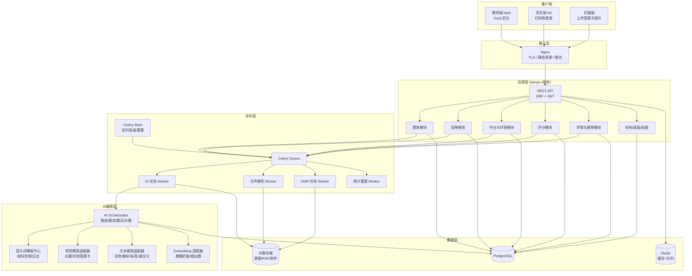
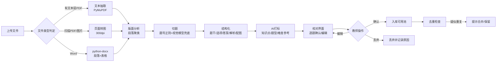
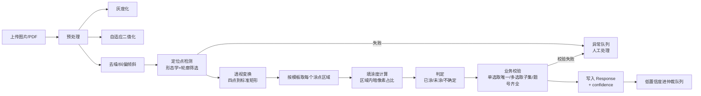
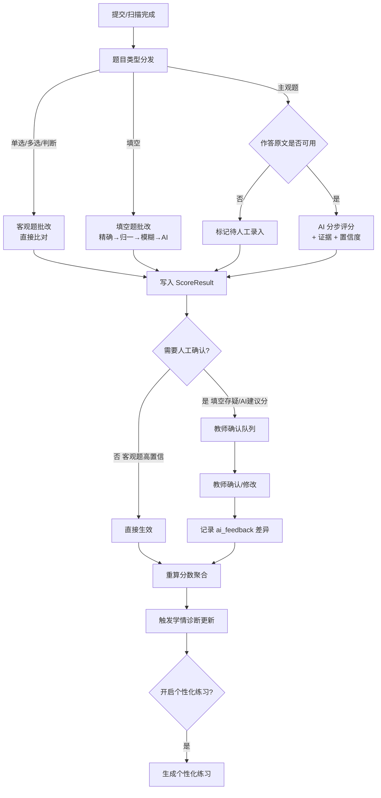
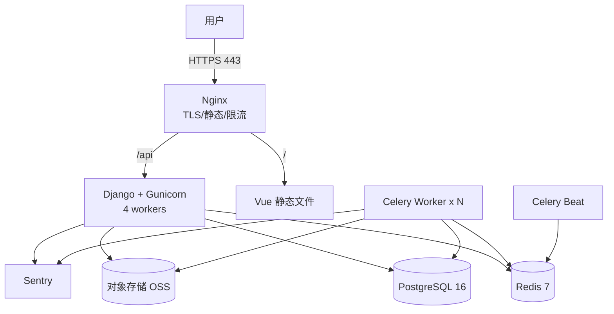

# 「知否」题库管理与 AI 精准作业平台 · 开发设计文档

> ⚠ **本文档为 v1.0 归档版本，不要用于开发。** 请使用 [知否-开发设计文档-v2.1.md](知否-开发设计文档-v2.1.md)。
> 本文件保留目的仅为对比需求演进与设计变更留痕。v1.0 中已废弃的设计包括：主观题 AI 建议分、「AI 学情组卷」（改为纯算法加权抽题）、固定档位学号位数（改为 1–12 位自由配置）。


| 项目 | 内容 |
| --- | --- |
| 文档版本 | v1.0（设计基线） |
| 文档状态 | 待评审 |
| 技术栈 | Python（后端 + AI 服务）+ Vue 3（教师端 / 学生端 / 扫描端） |
| 部署形态 | 公有云 SaaS（单实例多学校隔离），预留私有化交付路径 |
| 目标读者 | 产品负责人、后端、前端、算法、测试、运维 |

---

## 0. 阅读指引与本文档的边界

这份文档不是把需求复述一遍，而是把「知否」从一句话理念落到能开工的工程方案上。全文分四类内容，请按需跳读：

- **第 1–3 章：诊断与决策。** 对你给的方案做开发者视角的评析，指出三处必须现在处理的风险、两处定义不清、一处我认为可以砍掉的范围。这一章如果结论你不认同，后面所有章节都要跟着改，**请优先在这一章上给反馈**。
- **第 4–13 章：设计。** 架构、数据模型、六大环节的详细设计、接口、页面。
- **第 14–18 章：落地。** 测试、部署、成本、排期、风险与合规。
- **附录：** 提示词模板规范、OMR 答题卡规范、知识点模板、配置项清单。

文中所有涉及**成本、阈值、准确率**的数字都是**估算与目标值**，不是实测值，落地时必须用你自己的真实数据校准。凡是标注 `【需确认】` 的地方，是我在现有信息下做出的假设，请你核对。

---

## 1. 需求确认结论

以下是三轮澄清中你给出的选择，我按工程含义重新表述了一遍。**如果某条与你的真实意图不符，请直接指出来，它会改变架构。**

| 编号 | 你的选择 | 工程含义 |
| --- | --- | --- |
| D1 | K12 学校 / 教培机构，教师为主，学生用答题端 | 权限模型必须有「机构 → 年级/学科组 → 班级 → 教师/学生」四层；数据隔离以机构为边界 |
| D2 | 个人 / 小团队 MVP，先跑通闭环 | 单体应用 + 模块化，不拆微服务；用模块边界和异步队列保住后续可拆性 |
| D3 | 调用公有云大模型 API，国产平台为主 | 需要模型适配层（防止被单一厂商锁死）+ 成本计量 + 限流降级 |
| D4 | 第一优先：文件识别导入题目 | 「导入 → 校对 → 入库」这条流水线的质量决定老师愿不愿意用这个系统 |
| D5 | 学生扫码免登录答题；同时导出答题卡供线下作答，教师扫描录入 | 需要两套答题通道：在线 H5 与线下 OMR 扫描，且两者数据要能合并进同一份成绩模型 |
| D6 | 客观题 + 填空题自动批改；主观题 AI 给建议分、教师确认 | 需要「AI 建议 + 人工确认」的二阶段评分状态机，不能一把梭自动出分 |
| D7 | 题目来源两者都要，但必须标清来源 | 题目表必须有 `source_type`（原创/改编/录入）+ 版权与审核元数据 |
| D8 | 交付：单份 Markdown 设计文档（含库表、接口、页面） | 即本文档 |
| D9 | 标准 OMR 光学标记识别（固定模板 + 定位点） | 需要答题卡生成器（PDF）+ 图像几何校正 + 涂点判定 + 模板版本管理 |
| D10 | 主观题作答内容不入系统，题库只留标准答案 | **本期不做手写识别**，主观题评分数据靠教师线下录入（可选）或完全不入库 |
| D11 | 学生姓名学号直接传云端大模型 | 我按你的选择设计，但第 3.3 节会说明这条选择的具体代价与最低成本的缓解措施 |
| D12 | 冷启动：先手工标定难度，数据够了再自动校准 | 难度字段必须有「人工标定值 / 统计估计值 / 生效值」三个概念，并记录来源 |
| D13 | 知识点树由老师自建，平台提供学科模板 | 需要「平台模板 → 机构副本 → 教师微调」的树复制与版本机制 |
| D14 | 公有云 SaaS，学校直接访问域名 | 单套部署、多机构逻辑隔离；需要域名、HTTPS、备份、审计日志 |

### 1.1 需求确认后浮现的三个缺口

你的原始描述里没有提到、但工程上必须补的三件事：

1. **「发布」环节的载体缺失。** 你描述的循环是「命题—组卷—发布—答题—批改—分析」，但发布的是什么？我的建议是把它明确成「**作业（Assignment）**」这个一等实体：作业绑定「一套题 + 一个班级 + 一种作答通道（线上/线下答题卡）+ 一个时间窗」。有了它，后面的答题、批改、分析才有挂载点。**这是整个数据闭环的枢纽表，没有它闭环串不起来。**
2. **线下扫描与线上作答的数据合并规则缺失。** 同一个班可能一半人扫码在线答、一半人交纸质卡。这两条通道的题目顺序、题号映射、缺考判定都不同，必须在设计期就定死归一化规则（见 9.6）。
3. **教师修正动作的数据价值被低估。** 教师每次修改 AI 的评分、难度、标签、解析，都是一条高质量标注数据。系统必须**显式记录「AI 原始输出 → 教师最终结果」的差异对**，这是后续做难度自动校准、评分阈值调优、提示词迭代的唯一燃料。这件事如果一开始不做，三个月后你会后悔。

---

## 2. 核心领域模型（先对齐概念，再谈表结构）

在写代码之前，全团队必须对下面九个概念达成一致。**概念命名混乱是这类系统返工的第一大来源。**

```
机构 Organization
  └── 班级 Classroom ──── 学生 Student（可免登录，靠 class_roster 认人）
        └── 作业 Assignment ←── 试卷 Paper ←── 题目 Question（来自题库）
                                  │
                                  ├── 答题卡模板 SheetTemplate（OMR，仅客观题）
                                  ├── 作答记录 Response（线上或扫描）
                                  ├── 评分结果 ScoreResult（AI建议 + 教师确认）
                                  └── 学情诊断 Diagnosis（班级/个体）
                                            └── 个性化练习 PracticeSet（一人一卷）
```

**概念口径表**（这张表建议直接贴进团队 wiki）：

| 概念 | 精确定义 | 容易搞混的地方 |
| --- | --- | --- |
| Question（题目） | 题库里的一道独立题目，含题干、选项、答案、解析、知识点、难度、来源 | 与「试卷上的第 3 题」不是一回事 |
| Paper（试卷） | 一次组卷的产物，是 Question 的有序引用集合 + 每题配分 + 组卷策略快照 | 试卷是**快照**，题库里的题改了，已发布试卷不受影响 |
| PaperItem（卷面题） | 试卷中的一格：题号、题目引用、配分、题目在本次卷面的乱序位置 | 补考卷/AB 卷之间是不同 Paper，但可共享 PaperItem 的来源题 |
| Assignment（作业/测验） | 把 Paper 发布给班级的动作与配置：时间窗、作答通道、是否打乱、是否立即出分 | 学生看到的是 Assignment 不是 Paper |
| SheetTemplate（答题卡模板） | 一份可印刷的 PDF 布局定义：定位点坐标、题号 → 涂点坐标映射、模板版本号 | **模板版本必须随每次排版变化递增**，否则扫描端会读错 |
| Response（作答） | 某个学生对某道题的作答内容 + 来源通道（ONLINE / SCAN / MANUAL） | 三种来源并存，必须能追溯来源 |
| ScoreResult（评分） | 某道题的得分，含评分方式（AUTO_EXACT / AUTO_FUZZY / AI_SUGGEST / MANUAL）与置信度 | 「分数」与「评分方式的记录」要一起存，否则无法审计 |
| Diagnosis（诊断） | 某个学生或班级在某时间点、某知识点上的掌握度估计 | 是**带时间戳的估计值**，不是永久属性，会随时间衰减 |
| OnePaperOneStudent | 「一生一卷」的实现：个性化练习中，每个学生一份独立 Paper | 本期仅用于个性化练习，不用于统一考试（见 3.2） |

---

## 3. 方案评析：我作为开发者最担心的几件事

这一章是你要求的「深度评析」。我不做礼貌性肯定，直接说问题。

### 3.1 风险最高的一环不是 AI，是 OMR 扫描（你选了它，我必须给出代价）

你的方案里最容易被低估、也最容易在真实教室环境里翻车的，是「教师扫描答题卡录入」。AI 命题错一道题，老师改一下就行；**扫描识别错一个学生的一整张卡，老师会立刻不信任整个系统。**

真实教室的扫描条件比实验室恶劣得多：

| 现场情况 | 后果 |
| --- | --- |
| 手机拍摄有透视畸变、页角上翘 | 定位点坐标矩阵解不出来，整卡废掉 |
| 教室灯光不均、有阴影、有反光 | 涂点灰度阈值失效，漏涂/多涂误判 |
| 双面卡透光、背面墨迹 | 误判为已涂 |
| 学生用铅笔轻涂、涂出框、涂成对勾 | 判定为「不确定」，需要人工仲裁 |
| 卡面被折、被胶带粘、被订书钉穿 | 定位失败 |
| 老师把一叠卡放进馈纸式扫描仪，斜进纸 | 每张歪斜角度不同，必须逐张校正 |
| 学生把题号涂错行 | 系统「正确」识别出一个错误答案——这类错误最难发现 |

**我的工程结论（请认真考虑）：**

1. **答题卡只放客观题（选择/判断）是对的**，你已确认，这个决定降低了至少一半的风险。
2. **不要承诺 100% 自动识别。** 系统的正确形态是「**自动识别 + 低置信度人工仲裁**」：识别完成后立刻展示一个「待确认清单」，只把有问题的卡和题推给老师，其余静默通过。老师的实际工作量是「点几下确认」，而不是「逐张录入」。
3. **必须建立「识别置信度」这个概念并落到数据模型上。** 每一道被识别的题都要带置信度（0–1），低于阈值进人工队列。没有置信度，就无法定义什么叫做「识别失败」。
4. **必须有「修正后重算」能力。** 老师改了一个学生的答案，系统必须能自动重算该生分数、班级统计和学情诊断，而不是让老师手动重跑。这个链路要在 MVP 就打通，否则修正等于白改。
5. **排期上我不建议把 OMR 放在一期第一批。** 见 3.5。

如果让我给一句话总结：**OMR 的业务价值是「省录入时间」，它的信任风险是「改错分数」。前者是可量化的收益，后者是不可逆的口碑损失，所以这一环必须用「人工兜底」而不是「更高的算法精度」来解决。**

### 3.2 「一生一卷」被过度承诺了，需要收缩到可交付的形态

你写的是「实现学生一生一卷的精准作业」。这句话作为愿景没问题，作为工程需求会立刻炸掉：

- 如果**每次作业都一人一卷**，那么每次作业的答题卡也都不同，意味着每份卡都要独立排版、独立印刷、独立生成模板、独立扫描识别。一个班 45 人，一次作业 45 种卡型，印刷成本和错识率都会失控。
- 如果**只有个性化练习才一人一卷**（你在 D 轮确认了这点），工程上是可行的，因为个性化练习通常是**线上作答**，不需要印刷答题卡。

**我按你的确认做了收缩，请确认这个口径：**

| 场景 | 卷型 | 作答通道 | 是否一人一卷 |
| --- | --- | --- | --- |
| 课堂小测 | 同卷 | 线上 H5 / 纸质 | 否 |
| 统一考试 | 同卷（可 A/B 卷，可乱序） | 纸质 + OMR | 否（同卷不同序） |
| 个性化练习 | 一人一卷（自选题集） | **线上 H5 为主** | 是 |
| 补考卷 | 同卷变体 | 纸质 + OMR | 否 |

同时我建议把「防作弊乱序」和「一人一卷」明确区分开：**同卷不同序（选项乱序 + 题目乱序）** 能以极低成本拿到大部分防抄袭收益，而它不需要改动答题卡模板（答题卡的涂点区按题号固定，选项字母顺序在卷面体现即可，前提是选项个数一致）。这个能力应该在一期就做，成本很低。

### 3.3 数据合规：你选了「直接传姓名学号」，我把代价说清楚

你选择把姓名、学号直接传给云端大模型。我尊重这个决定并按此设计，但作为开发者我必须把风险写在文档里，因为这属于**不可通过技术手段回滚的风险**：

- 学生（尤其未成年人）的姓名、学号属于个人信息，部分场景下属于敏感个人信息。把「姓名 + 学号 + 答题表现」组合起来传给第三方模型服务商，等于把可识别的学业评价数据交给第三方处理。
- 一旦模型服务商侧发生数据留存、日志泄露或二次训练使用（取决于其服务条款与企业版协议），泄露的是**可追溯到具体孩子的学业数据**，这在舆情上是高危事件。
- 机构（你的客户学校）在合规审查时，很可能第一个问的就是「学生数据出不出去」。

**我给你的不是道德劝告，而是成本对比：**

| 方案 | 实现成本 | 效果 |
| --- | --- | --- |
| 直接传姓名学号 | 0 | 需要你在服务协议、隐私政策、机构合同中承担全部责任 |
| **传匿名 ID + 题目/答案（推荐）** | 约 0.5 人日：请求前做字段映射，返回后回填 | 等价于「假名化」，风险量级下降，AI 效果**完全不受影响**（模型不需要知道学生叫什么） |

具体做法只有三行代码的量级：

```python
# 调用 AI 前的脱敏代理（伪代码）
def sanitize_for_llm(payload: dict) -> tuple[dict, dict]:
    """返回 (脱敏后的 payload, 还原映射表)。映射表只存在于内存/本地库，永不外发。"""
    mapping = {}
    for field in ("student_name", "student_no", "phone", "id_card", "school", "class_name"):
        if payload.get(field):
            token = f"S{hashlib.sha256(f'{field}:{payload[field]}'.encode()).hexdigest()[:10]}"
            mapping[token] = payload[field]
            payload[field] = token
    return payload, mapping
```

**我的建议**：这一层脱敏代理一定要写，它只需要 1 个模块、约 0.5 人日，但它给你的是一条随时可以对学校说「学生身份信息不出域」的能力。**这是我在这份文档里唯一强烈建议你改掉的决定。**

### 3.4 AI 生成题目的真实定位：助理，不是出题人

你确认「原创和录入都要，但标注来源」。我要补一条工程约束：

**AI 从零生成的题目，在 K12 场景下错误率不低**（知识点错位、答案自相矛盾、超出学段范围、有歧义、配图错误）。如果这些题未经审核直接进入学生作业，后果是学生学会错的解法，而老师要为此负责。

因此我建议**三条硬规则**，写进代码而不是写进规范文档：

1. **AI 生成题默认状态为 `DRAFT`，不可能被组卷算法选中。** 只有经过教师明确审核（`APPROVED`）才能进入可用池。
2. **`source_type` 与 AI 参与度必须落库**：`ORIGINAL_HUMAN` / `AI_GENERATED` / `AI_REWRITTEN` / `EXTRACTED`。组卷时可按来源过滤，学情分析时也能识别「AI 题作答异常」。
3. **AI 生成必须附「依据」字段**：引用了哪个知识点、依据教材哪一段（如果老师上传了教材）。没有依据的生成题，教师审核时无法快速判断，审核成本会高到老师直接放弃。

**AI 在命题环节的性价比排序**（我按「投入产出比」排的，建议按这个顺序做）：

| 优先级 | 能力 | 为什么 |
| --- | --- | --- |
| P0 | 文件识别导入（图片/Word/PDF → 结构化题目） | 解决录入效率，这是你最优先的（D4），也是老师愿意用的唯一理由 |
| P0 | 题目标签（知识点、题型、难度初判） | 无标签的题库等于没有题库，组卷和分析都失效 |
| P1 | 解析生成 | 老师普遍缺解析，生成后人工改比从零写快 5 倍 |
| P1 | 题干润色 / 去歧义 | 边际价值中等，但风险低、见效快 |
| P2 | 干扰项设计 | 只对选择题有效，且需要教师强审核（很容易出现「明显错误」的凑数选项） |
| P2 | 难度校准 | 冷启动阶段只能给「参考值」，真正的难度必须来自作答统计（你的 D12 已经确认这个顺序，是对的） |

### 3.5 我认为可以砍掉或推迟的范围（明确说「不做」比说「要做」更重要）

| 功能 | 我的建议 | 理由 |
| --- | --- | --- |
| 手写主观题识别与自动评分 | **本期不做**（你已确认 D10） | 手写 OCR + 评分双难点，投入产出比极差 |
| 学生实名账号体系 | 推迟 | 免登录扫码 + 名单绑定已能满足数据回流（D5） |
| 家长端 | 不做 | 与核心闭环无关 |
| 拍照搜题 / 拍照答疑 | 不做 | 这是另一个产品 |
| 实时监考 / 防切屏 | 不做 | K12 课后作业场景不需要，且法律与体验风险高 |
| 多机构租户计费 | 推迟 | 一期先做「机构」这一个隔离维度，不做账单 |
| 复杂富文本公式编辑器 | **只做够用版** | 数学/物理/化学必须支持公式和图片，但不做 LaTeX 所见即所得的全功能编辑器，用「图片 + 简易符号面板 + LaTeX 片段」过渡 |
| 通用微服务拆分 | 不做 | 单体 + 模块化（D2） |

### 3.6 你这个方案里最值得肯定的两个设计判断

不是客套，这两点确实是懂行的人才会做的选择，我要把它们固化进设计：

1. **「批改后自动生成学情报告」→「为每个学生生成只针对其薄弱点的专属练习」这条路走对了。** 市面上大量题库产品停在「出一份报告」就结束了，报告给老师看，老师也没时间逐个学生布置不同作业，闭环断在最后一公里。你把它做成系统自动动作，这才是差异化。
2. **填空题「精确匹配优先、模糊匹配辅助」的策略是对的。** 我把这个策略具体化为一套可实现的算法（见 11.2），核心是：**宁可判「存疑」交给老师，也不要悄悄放过错误答案。** 错放比错判危害大得多。

---

## 4. 总体架构

### 4.1 架构原则

1. **单体优先，模块内高内聚。** 一个 Django 应用承载所有业务模块，通过 Python 包边界（而非网络边界）划分模块，未来任何模块都能低成本拆出。
2. **一切慢操作异步化。** AI 调用、文件解析、OMR 图像处理一律进队列，Web 进程只做编排和状态查询。**绝对不在 HTTP 请求里同步调大模型**，一个 30 秒的请求会拖垮整个服务。
3. **AI 能力是可替换的适配器。** 业务代码只依赖内部统一的 `AIProvider` 接口，不直接调用任何厂商 SDK。模型换厂商、换版本、换路由策略都不改业务代码。
4. **原始数据永不失真。** 上传的文件、AI 的原始返回、教师的修正动作，全部原样留存（对象存储 + JSONB）。后续所有算法迭代都依赖这些原始数据，**一旦丢弃就再也拿不回来**。
5. **状态机显式化。** 题目、试卷、作业、评分、扫描批次都有明确状态流转，非法流转在数据库层面拒绝。

### 4.2 技术选型

| 层 | 选型 | 理由与替代 |
| --- | --- | --- |
| 后端框架 | **Python 3.12 + Django 5 + Django REST Framework** | 自带用户/权限/迁移/后台管理，K12 这种「表多、CRUD 多、需要后台」的场景，Django 的 admin 能省下大量运营工具开发时间 |
| 异步任务 | **Celery + Redis** | Redis 同时做缓存和 Celery broker，减少运维组件 |
| 数据库 | **PostgreSQL 16** | 需要 JSONB（存 AI 原始输出、灵活题目结构）、数组、全文检索、窗口函数 |
| 图像处理 / OMR | **OpenCV + NumPy**（几何校正、涂点判定）；生成答题卡用 **ReportLab** | 纯 CPU、可离线、无额外服务依赖 |
| 文件解析 | Word：`python-docx`；PDF：`PyMuPDF`（文本层）+ 转图后走视觉模型（扫描件）；Excel：`openpyxl` | 有文本层就直接抽文本（便宜且准），没有才走视觉模型 |
| AI 接入 | **多模型适配层**（OpenAI 兼容协议为主，厂商差异用适配器吸收） | 见 6 章 |
| 前端 | **Vue 3 + TypeScript + Vite + Pinia + Vue Router** | 生态成熟；公式渲染用 KaTeX，图片裁剪用 Cropper.js |
| UI 组件 | **Element Plus**（教师端后台为主）+ 少量自研移动端页面 | 教师端是重表单、重表格场景，Element Plus 省时间 |
| 对象存储 | 阿里云 OSS / 腾讯云 COS / MinIO（私有化） | 上传的试卷图片、答题卡扫描件、生成的 PDF 都走这里 |
| 部署 | **Docker Compose**（web + worker + beat + postgres + redis + nginx） | MVP 阶段一台 4C8G 云服务器足够 |
| 可观测 | Sentry（异常）+ Prometheus/Grafana（指标）+ 结构化日志 | 见 15.4 |
| CI/CD | GitHub Actions / Gitee Go：lint → test → build → 部署 | 见 15.5 |

**为什么不选 FastAPI**：这个项目的复杂度在「表关系多、权限细、后台管理重」，不在「高并发接口」。Django 的 ORM、迁移、权限、admin 带来的开发效率优势，远大于 FastAPI 在极致性能上的优势。师生规模（一个机构几百到几千人）完全不构成性能压力，真正的瓶颈在大模型调用和图像处理，而那两块本来就要异步化。

**为什么前端不选 React**：无技术性理由，纯团队熟练度选择。**如果你团队更熟 React，直接换，本文档的页面与接口设计不受影响。**

### 4.3 系统分层图



### 4.4 五环节闭环在系统中的落地路径

你描述的链路是「智能组卷 → 在线测验 → 自动批改 → 学情画像 → 个性化练习推送」。我把每一环的**输入**和**输出**明确成数据实体，这样才谈得上「前一环的输出是后一环的输入」：

| 环节 | 输入 | 处理 | 输出实体 | 落到哪张表 |
| --- | --- | --- | --- | --- |
| ① 智能组卷 | 知识点覆盖率要求、难度目标、题型配比、班级薄弱点 | 规则抽题（Fisher-Yates）+ AI 学情加权 | `Paper` + `PaperItem[]` | `paper` / `paper_item` |
| ② 发布与测验 | `Paper` + 班级 + 时间窗 + 作答通道 | 生成答题卡 PDF / 生成学生作答链接 | `Assignment` + `SheetTemplate` + `Response[]` | `assignment` / `sheet_template` / `response` |
| ③ 自动批改 | `Response[]` + 标准答案 + 评分规则 | 精确匹配 → 模糊匹配 → AI 建议 → 教师确认 | `ScoreResult[]` | `score_result` |
| ④ 学情画像 | `ScoreResult[]` + 知识点映射 + 历史数据 | 掌握度估计 + 时间衰减 + 聚合 | `Diagnosis`（个体/班级） | `knowledge_mastery` / `diagnosis_snapshot` |
| ⑤ 个性化推送 | `Diagnosis` + 题库可用池 | 薄弱点选题 + 难度匹配 + 一人一卷 | `PracticeSet` → 新 `Assignment` | `practice_set` / `practice_set_item` |

闭环的**关键工程细节**：环节 ⑤ 产出的 `PracticeSet` 完成后，会产生新的 `Response` 和 `ScoreResult`，再次进入环节 ④。因此 `knowledge_mastery` 必须是**可增量的**（新数据到来时更新而非全量重算），并且保留**历史快照**，否则无法画出「这个学生两周内掌握度变化曲线」。这一点直接影响表设计（见 10.2）。

---

## 5. 模块划分与代码组织

### 5.1 后端模块

```
zhifou/
├── config/                     # 项目配置（settings 分环境、urls、celery、asgi）
├── apps/
│   ├── accounts/               # 用户、机构、角色、JWT、权限
│   ├── org/                    # 机构、年级、学科、班级、学生名单
│   ├── knowledge/              # 知识点树、知识点模板、题目-知识点关联
│   ├── questionbank/           # 题目、选项、答案、解析、标签、来源、审核状态
│   ├── ingest/                 # 文件识别导入流水线（上传/解析/切题/校对/入库）
│   ├── ai/                     # AI 编排层：Provider 抽象、路由、计量、提示词中心
│   ├── paper/                  # 组卷：手动、规则、AI学情；A/B卷、补考卷、难度等值
│   ├── sheet/                  # 答题卡模板生成（PDF）、模板版本管理
│   ├── assignment/             # 作业发布、时间窗、作答链接、扫码入口
│   ├── response/               # 作答记录、在线提交、OMR 扫描批次与识别
│   ├── grading/                # 批改引擎：客观/填空/主观建议分、教师确认、申诉
│   ├── analytics/              # 学情：掌握度、热力图、高频错题、薄弱点清单
│   ├── practice/               # 个性化练习生成与推送（一人一卷）
│   ├── media/                  # 文件上传、对象存储、图片预处理
│   └── audit/                  # 操作日志、AI 调用日志、数据导出
├── common/                     # 通用工具：分页、异常、响应包装、ID 生成
├── tests/
└── deploy/                     # Dockerfile、compose、nginx、初始化脚本
```

**模块依赖规则（用 import-linter 强制）**：

- `common` 不依赖任何 `apps.*`
- `analytics` / `practice` 只读其他模块的数据，通过服务层接口，不反向写业务表
- `ai` 不依赖任何业务模块（它只接收 prompt 和 payload，返回结构化结果），业务模块依赖 `ai`
- 禁止跨模块直接操作对方的 Model，必须走 `services.py`

### 5.2 前端模块

```
web/
├── src/
│   ├── api/                    # 按后端模块划分的请求封装（自动生成 TS 类型）
│   ├── stores/                 # Pinia
│   ├── layouts/                # 教师端布局 / 学生端移动布局
│   ├── views/
│   │   ├── teacher/
│   │   │   ├── bank/           # 题库列表、题目编辑器、知识点树管理
│   │   │   ├── ingest/         # 导入向导（上传→切题→校对→入库）
│   │   │   ├── paper/          # 组卷工作台、试卷预览、AB卷/补考卷
│   │   │   ├── assignment/     # 发布、答题卡下载、作答链接/二维码
│   │   │   ├── scan/           # 扫描上传、识别结果仲裁、异常卡处理
│   │   │   ├── grading/        # 批改工作台、待确认清单、主观题打分
│   │   │   ├── analytics/      # 学情报告、热力图、错题分析
│   │   │   └── practice/       # 个性化练习生成与推送
│   │   └── student/
│   │       ├── entry/          # 扫码进入、身份绑定（选班级+姓名）
│   │       ├── answer/         # 作答页（题目/公式/图片）
│   │       └── result/         # 交卷结果与错题反馈（按教师配置开放）
│   └── components/             # 通用组件：题型渲染、公式、图片裁剪、知识树选择器
```

---

## 6. AI 编排层设计（全项目的技术核心）

这一章是「以 AI 全链路赋能为核心」这句话的技术落点。如果这一层设计得好，AI 就是一个可插拔、可计量、可降级的服务；设计得不好，AI 调用会散落在几十个业务函数里，三个月后没人敢改。

### 6.1 统一 Provider 接口

```python
# apps/ai/base.py
from abc import ABC, abstractmethod
from dataclasses import dataclass
from typing import Any, Literal

TaskType = Literal[
    "ocr_question",        # 试卷图片 → 结构化题目
    "ocr_answer_sheet",    # 答题卡图片 → 涂点/文本（与 OMR 结果互补校验）
    "polish_stem",         # 题干润色
    "gen_explanation",     # 解析生成
    "design_distractors",  # 干扰项设计
    "calibrate_difficulty",# 难度校准（参考值）
    "tag_question",        # 知识点/题型/认知层次打标
    "embed_text",          # 向量化（模糊匹配、相似题）
    "grade_subjective",    # 主观题建议分（预留）
]

@dataclass
class AIRequest:
    task: TaskType
    prompt_template_key: str          # 提示词模板 key，如 "math.junior.polish_stem"
    payload: dict[str, Any]           # 已脱敏的业务数据
    images: list[str] = None          # 对象存储 key 列表
    output_schema: dict | None = None # JSON Schema，强制结构化输出
    subject: str | None = None
    grade_band: str | None = None     # 学段：小学/初中/高中
    idempotency_key: str | None = None
    max_cost_yuan: float | None = None

@dataclass
class AIResult:
    ok: bool
    data: dict | None                 # 已按 output_schema 校验过的结果
    raw: dict                         # 厂商原始返回（原样入库，永不丢弃）
    provider: str                     # 实际使用的厂商
    model: str
    input_tokens: int
    output_tokens: int
    cost_yuan: float
    latency_ms: int
    confidence: float | None          # 模型自评置信度（如返回）
    error: str | None = None
    fallback_used: bool = False

class AIProvider(ABC):
    name: str
    supported_tasks: set[TaskType]

    @abstractmethod
    def invoke(self, req: AIRequest) -> AIResult: ...

    @abstractmethod
    def estimate_cost(self, req: AIRequest) -> float: ...
```

**关键约束：**

- `AIProvider` 只出现在 `apps/ai/providers/` 目录里。业务代码搜索不到任何厂商名字。
- 所有结构化任务**必须传 `output_schema`**，返回结果必须通过 JSON Schema 校验；校验失败自动重试一次（带「请严格输出 JSON」的追加提示），二次失败则标记任务失败并推给人工。
- `raw` 字段必须原样入库到 `ai_call_log`。这是后续排查「AI 为什么给出这个结果」的唯一依据。

### 6.2 模型分级路由

不同任务对模型能力的要求差异极大。统一用一个贵模型是浪费，统一用便宜模型是灾难。**路由策略必须配置化，不能硬编码。**

| 任务 | 能力档 | 建议模型类型 | 单次成本量级 | 理由 |
| --- | --- | --- | --- | --- |
| `ocr_question` | **视觉强** | 视觉大模型（Qwen3-VL 类） | 中 | 版面理解、公式、表格、图文混排，便宜模型错误率高到不可用 |
| `ocr_answer_sheet` | 视觉中 | 视觉模型（可与上同型号） | 中 | 仅作 OMR 的交叉校验，可降级 |
| `tag_question` | 文本中 | 中档文本模型 | 低 | 分类任务，指令清晰即可 |
| `polish_stem` | 文本强 | 中高档文本模型 | 低 | 直接影响教师观感，别省 |
| `gen_explanation` | 文本强 | 中高档文本模型（开思考模式） | 中高 | 需要推理，是 AI 价值最高项 |
| `design_distractors` | 文本强 | 中高档文本模型 | 中 | 需要设计「看似合理」的错误 |
| `calibrate_difficulty` | 文本中 | 中档模型（**仅作参考值**） | 低 | 真正难度来自统计 |
| `embed_text` | — | Embedding 模型 | 极低 | 相似题检索、模糊匹配 |
| `grade_subjective` | 文本强 | 高档模型（本期预留） | 高 | 需长上下文与推理 |

**路由实现**：配置文件声明「任务 → 候选模型列表（按优先级）」，Orchestrator 按序尝试，失败或超预算自动降级，并把 `fallback_used=True` 记录下来。这样「DeepSeek 挂了自动切通义」是一行配置的事。

```yaml
# apps/ai/routing.yaml
ocr_question:
  candidates:
    - {provider: qwen,   model: qwen3-vl-plus, timeout: 120}
    - {provider: zhipu,  model: glm-4v,        timeout: 120}
  max_cost_yuan: 0.5
  retry: 1
polish_stem:
  candidates:
    - {provider: deepseek, model: deepseek-chat, timeout: 60}
    - {provider: qwen,     model: qwen-plus,     timeout: 60}
  max_cost_yuan: 0.05
  retry: 2
```

### 6.3 提示词模板中心

你要求「按科目和知识点配置提示模板，保证科技术语使用准确」。这是一个**数据驱动的模板系统**，不是把 prompt 写死在代码里。

**模板表结构要点**（完整字段见 10.9）：

| 字段 | 说明 |
| --- | --- |
| `key` | 唯一键，形如 `{subject}.{grade_band}.{task}`，例如 `physics.senior.gen_explanation` |
| `subject` / `grade_band` | 适用科目与学段，用于匹配 |
| `task` | 对应 `TaskType` |
| `system_prompt` | 系统角色设定（含术语规范、输出纪律） |
| `user_prompt` | 用户模板，支持 `{{变量}}` 占位符 |
| `output_schema` | 期望的 JSON Schema |
| `glossary` | 术语表（JSON）：禁止用词 → 规范用词，例如 `{"重力加速度": "重力加速度 g"，"电流强度": "电流 I"}` |
| `few_shot` | 少样本示例数组（这是提升科目术语准确率最有效的手段） |
| `version` / `status` | 版本与状态（draft/active/archived），支持灰度 |
| `org_id` | 为空表示平台默认模板；非空表示某机构自定义覆盖 |

**匹配优先级**：`机构自定义(科目+学段) > 平台(科目+学段) > 平台(科目) > 平台(通用兜底)`。

**术语准确性的三层保障**（这是你在需求里明确提出的，我给出可执行方案）：

1. **术语表注入**：把 `glossary` 作为「必须遵守的术语规范」拼进 system prompt。
2. **Few-shot 示例**：每个科目每个任务配 2–3 个该科目的真实示例（输入→输出）。实测中这一项对术语准确率的影响大于换更贵的模型。
3. **术语校验后置检查**：AI 返回后，用 `glossary` 做一遍正则校验，命中禁止用词则**自动触发一次修正调用**，或至少打上 `terminology_warning` 标记提示教师。

**提示词版本管理必须做，且必须与 `ai_call_log` 关联。** 否则你无法回答「上周改了 prompt 之后，解析生成质量变好还是变差了」。

### 6.4 幂等、限流、重试、降级

| 机制 | 设计 |
| --- | --- |
| 幂等 | 每个 AI 请求带 `idempotency_key`（如 `gen_explanation:question_id:prompt_version`）。同一 key 已有成功结果直接复用，避免教师重复点击导致重复计费 |
| 限流 | Redis 令牌桶，按「机构 / 用户 / 任务类型」三层限流。防止某个老师一次导入 500 张图片把额度打满 |
| 重试 | 网络类错误指数退避重试 2 次；内容类错误（JSON 校验失败）追加纠正提示重试 1 次；额度/鉴权错误不重试，直接降级到候选模型 |
| 降级 | 候选模型全部失败 → 任务标记 `FAILED` + 保留原始输入 → 前端展示「AI 暂不可用，可手动完成」，**绝不阻塞教师主流程** |
| 超时 | 视觉任务 120s，文本任务 60s，嵌入任务 15s。超时按失败处理 |
| 计量 | 每次调用写 `ai_call_log`（含 token 数、单价、金额、耗时、是否降级），支持按机构/教师/任务类型出成本报表 |
| 预算护栏 | 机构级日/月预算，超限后自动只允许 P0 任务（批改、识别），暂停生成类任务并通知管理员 |

### 6.5 AI 质量评估机制（这是长期竞争力的来源）

**没有评估集的 AI 功能，等于没有质量控制。** 从第一天就要建两样东西：

1. **回归评估集**：为每个任务类型积累 50–200 个「输入 + 期望输出」样本，每次改 prompt 或换模型后跑一遍，输出准确率报告。视觉识题任务的评估集直接复用教师校对后的结果（教师改了哪里 = 标准答案）。
2. **人工采纳率看板**：统计每个 AI 功能的**教师采纳率**（AI 输出被原样接受 / 小改后接受 / 丢弃）。这个数字比任何主观评价都可靠，也是决定「某个 AI 功能要不要继续投入」的唯一依据。

**教师的每一次修改都是一条标注数据。** 表 `ai_feedback` 记录 `ai_call_log_id` + `final_value` + `diff`，这是你未来做难度校准、评分阈值调优的训练/验证数据来源。

---

## 7. 环节一：命题（文件识别导入 + 题目编辑器）

### 7.1 导入流水线总览

老师最痛的是「把一份现成的试卷变成题库里的结构化题目」。这条路必须又快又准，且**允许人工校对**——不要试图做到一步到位全自动。



**分阶段策略（这条很重要）**：

| 文件类型 | 策略 | 理由 |
| --- | --- | --- |
| 有文本层的 PDF / Word | **纯程序解析优先**，不用视觉模型 | 便宜（几乎零成本）、快（秒级）、准（无幻觉）。教师教案多数是 Word/PDF，这条路覆盖大部分场景 |
| 扫描 PDF / 拍照图片 | **视觉大模型**识别 | 没有文本层，只能靠视觉 |
| 混合（图文混排、公式多） | 文本层拿文字 + 视觉模型补公式和图形位置 | 公式是特殊的：文本层常把公式抽成乱码，必须让视觉模型单独处理公式区域 |

**成本提示**：一份 20 题的扫描试卷走视觉模型，输入约 2–4 张图片 + 提示词，按当前视觉模型价格（如 Qwen3-VL-Plus 约 ¥1/M 输入 token、¥10/M 输出 token，见 [平台定价页](https://www.qianwenai.com/models/qwen3-vl-plus)）估算，单份**约 ¥0.1–0.5**。1000 份试卷约 ¥100–500。这个成本完全可接受，**不要为了省钱在这里降级模型**。

### 7.2 切题算法（`apps/ingest/segmenter.py`）

切题是最容易出错的一步，必须有**三级策略 + 人工修正入口**：

**第一级：正则切分（覆盖 80%）**

```python
# 常见题号模式，按命中率排序
PATTERNS = [
    r'^\s*(\d{1,3})\s*[.．、,]\s*',           # 1. / 12、
    r'^\s*[(（]\s*(\d{1,3})\s*[)）]\s*',      # (1) （12）
    r'^\s*第\s*(\d{1,3})\s*题\s*',            # 第12题
    r'^\s*[一二三四五六七八九十]+\s*[、.]\s*',  # 一、二、（大题号，作为分组）
    r'^\s*([A-D])\s*[.．、]\s*',               # A. （选项，不是题目）
]
```

同时识别**大题分组**（一、选择题 / 二、填空题 / 三、解答题），因为题型信息常常只在大题标题里出现，而不是每道题都写。

**第二级：版面位置聚类**。用文本块的纵向间距分布找切分点：同一题的内部行距小，题与题之间的间距显著大。方法是对行间距做一维聚类（k-means，k=2），取大间距作为候选切分点。这对没有规范题号的试卷（例如从教辅扫描的）特别有效。

**第三级：视觉模型兜底**。把整页（或跨页的范围）交给视觉模型，要求返回 JSON 数组，每题含题号、题干、选项、答案、解析、是否含图。缺点是不稳定、贵，所以只在 1、2 级产出「可疑结果」（题目数量异常、单题长度超过 2000 字、题干为空）时触发。

**切题质量自检规则**（触发则标记该导入批次需人工重点检查）：

- 题目数量与「试卷标题声明的题数」不一致
- 存在题干长度 < 5 字或 > 3000 字的题
- 选择题选项数不等于 4（可配置，兼容多选和 5 选项）
- 存在选项但没有任何答案
- 单页切出 0 道题（大概率是封面或答题卡页）

### 7.3 结构化输出规范

视觉模型必须按固定 Schema 返回。**这是硬约束，不接受自由文本。**

```json
{
  "questions": [
    {
      "seq": 1,
      "group_title": "一、选择题",
      "type": "SINGLE_CHOICE",
      "stem": "下列关于加速度的说法，正确的是（  ）",
      "stem_html": "<p>下列关于加速度的说法，正确的是（  ）</p>",
      "options": [
        {"label": "A", "content": "加速度为零时，速度一定为零"},
        {"label": "B", "content": "速度变化越快，加速度越大"},
        {"label": "C", "content": "加速度方向一定与速度方向相同"},
        {"label": "D", "content": "加速度减小时，速度一定减小"}
      ],
      "answer": {"value": "B"},
      "explanation": null,
      "images": [],
      "has_formula": false,
      "source_ref": {"page": 1, "block_ids": [12, 13, 14]},
      "recognition_confidence": 0.94,
      "warnings": []
    }
  ],
  "meta": {
    "detected_total": 20,
    "page_range": [1, 2],
    "uncertain_regions": [{"page": 2, "bbox": [100, 400, 500, 520], "reason": "手写标注覆盖"}]
  }
}
```

**三个必须存在的字段，不要为了省事砍掉：**

- `source_ref`：记录题目来自原文件的哪一页哪个块。教师校对时能一键跳回原文对照，这是**提升校对效率最关键的设计**（没有它，老师要来回翻文件）。
- `recognition_confidence`：低置信度题（< 0.8）在校对界面高亮排序在前。
- `warnings`：模型自己发现的问题（手写覆盖、图片模糊、公式识别不确定）。

### 7.4 校对界面设计（决定这个功能成败的地方）

老师的耐心只有几分钟。校对界面必须遵守三条：

1. **左右分栏**：左边原文件页面（可滚动、可缩放、高亮当前题区域），右边结构化结果（可编辑）。**点击右侧题目 → 左侧自动定位到该题原文。**
2. **键盘优先**：`J/K` 上下题、`Enter` 确认并跳下一题、`E` 聚焦题干编辑、`Ctrl+Enter` 批量确认剩余低风险题。**一份 20 题的卷子，熟练老师应该在 3 分钟内校对完。**
3. **批量操作**：`一键确认所有高置信度题`、`批量设置大题题型`、`批量应用知识点`。

**UI 草图（文字描述）**：

```
┌──────────────────────────────────────────────────────────────────────┐
│ 导入校对  试卷名：高二物理第一次月考        [进度 12/20]  [全部确认]  │
├───────────────────────────────┬──────────────────────────────────────┤
│  原文件预览                    │  第 12 题  ●置信度 0.71 ⚠公式不确定  │
│  ┌─────────────────────────┐  │  题型 [单选题 ▾]  知识点 [+ 添加]    │
│  │  12. 如图所示，质量为m的 │  │  ┌────────────────────────────────┐  │
│  │  ▓▓▓▓▓▓▓▓▓（高亮区域）   │  │  │ 如图所示，质量为m的物体...     │  │
│  │  A. ...                 │  │  └────────────────────────────────┘  │
│  └─────────────────────────┘  │  A [                    ]            │
│                               │  B [                    ]            │
│  第 1 页 / 共 2 页             │  C [                    ]            │
│  [上一页] [下一页]             │  D [                    ]            │
│                               │  答案 [B]   解析 [生成解析 ✨]        │
│                               │  [丢弃]  [保存]  [确认并下一题 →]     │
├───────────────────────────────┴──────────────────────────────────────┤
│  1✓  2✓  3✓  4✓  5⚠  6✓  7✓  8✓  9✓  10✓  11✓  ▶12⚠  13  14 ...     │
└──────────────────────────────────────────────────────────────────────┘
```

底部题号条让老师一眼看到哪几题需要关注，避免「确认到最后一题才发现前面漏了」。

### 7.5 题目数据模型要点

题干与选项**同时存 HTML 和纯文本**：

- `stem_html` / `options[].content_html`：保留排版、公式（KaTeX）、图片引用，用于前端渲染和生成答题卡。
- `stem_text` / `content_text`：纯文本，用于全文检索、embedding、去重、AI 调用（省 token）。

**不这样做的话，你要么牺牲渲染效果，要么牺牲检索能力。**

图片处理：题干里的图片在导入时**自动裁切出来单独存对象存储**，HTML 里用 `{{img:uuid}}` 占位。这样做的三个好处：图片可独立复用、可按需生成缩略图、答题卡排版时能精确控制图片尺寸。

### 7.6 去重与相似题

入库前做一次相似度检查，避免老师反复导入同一份卷子导致题库污染：

| 方法 | 触发 | 用途 |
| --- | --- | --- |
| 题干文本哈希（去空白/标点后 MD5） | 精确重复 | 直接阻止入库，提示「已存在」 |
| SimHash / MinHash | 近似重复 | 提示疑似重复，教师选择「合并」或「仍要新建」 |
| Embedding 余弦相似度（> 0.92） | 语义相似（换了数字的同类题） | 提示「存在相似题」，并提供「作为变式题关联」的选项 |

**「作为变式题关联」这个设计很有价值**：换数字的同类题不是重复，而是难得的变式题资源，正好用于个性化练习时给学生「同知识点不同数值」的练习。表 `question_relation`（`question_id`, `related_id`, `relation_type`: VARIANT / SAME_SOURCE / PREREQUISITE）承载这个关系。

### 7.7 题目编辑器的五项 AI 能力

编辑器里每个 AI 按钮的交互必须一致：**点击 → 流式返回 → 展示 diff（可逐句采纳/拒绝）→ 教师确认后才写库**。绝不能 AI 直接覆盖教师已写的内容。

| 能力 | 输入 | 输出 | 关键约束 |
| --- | --- | --- | --- |
| **题干润色** | 题干 + 学段 + 科目 + 术语表 | 润色后题干 + 修改理由 | 只改表述不改语义；**禁止改动数字、单位、条件和问法**。用 diff 展示，教师逐句采纳 |
| **解析生成** | 题干 + 选项 + 正确答案 + 知识点 | 分步解析 + 涉及的知识点 + 易错提示 | 必须包含「为什么其他选项错」；公式用 LaTeX；解析结论必须与标准答案一致（不一致则拒绝返回并提示） |
| **干扰项设计** | 题干 + 正确答案 + 知识点 | 3 个新干扰项 + 每个干扰项对应的错误原因 | 必须说明「这个选项对应学生的哪种典型错误」；禁止无意义的荒谬选项；难度不高于正确项 |
| **难度校准** | 题干 + 题型 + 知识点 + 学段 | 建议难度值（1–5）+ 依据 | **只作为参考值**写入 `difficulty_ai`，不覆盖教师标定值（D12） |
| **题目标签** | 题干 + 选项 + 学段 | 知识点（可多个，带权重）+ 题型 + 认知层次（识记/理解/应用/分析）+ 建议分值 | 知识点必须从该机构现有知识点树中选择，**不允许 AI 自创知识点**；匹配不到则建议新增并让教师确认 |

**「不允许 AI 自创知识点」这条是硬性的。** 一旦允许自创，知识点树会迅速被同义词污染（「牛顿第二定律」「牛顿第二运动定律」「F=ma」变成三个节点），学情热力图立刻失去意义。实现方式：把当前知识点树（限该科目该学段）以紧凑列表形式放进 prompt，要求只能从列表中选择 ID。

### 7.8 难度体系设计（配合 D12 冷启动策略）

难度必须在数据模型上区分三个值，这个设计是冷启动策略的落地基础：

| 字段 | 含义 | 来源 | 用途 |
| --- | --- | --- | --- |
| `difficulty_manual` | 教师手工标定值 1–5 | 教师 | 冷启动期**唯一生效**的难度 |
| `difficulty_ai` | AI 建议值 1–5 | AI 校准 | 辅助参考，展示给教师 |
| `difficulty_stat` | 统计估计值 1–5 | 作答数据（见下） | 数据足够后生效 |
| `difficulty_effective` | 当前生效值 | 计算得出 | 组卷算法实际使用 |
| `difficulty_source` | 生效值的来源 | `MANUAL` / `STAT` / `MANUAL_STAT_BLEND` | 前端展示「该难度来自实测」提升可信度 |

**统计难度算法（经典 CTT 难度）**：

```
P = 该题平均得分率 = 全体作答者的平均分 / 该题满分
difficulty_stat = 6 - 5 * P     # P=1（全对）→ 1（最易）；P=0（全错）→ 6（最难）
```

**生效值切换规则（必须显式实现，不能含糊）**：

```
有效样本数 N = 该题被作答且已批改的独立学生数
若 N < 30：difficulty_effective = difficulty_manual，source = MANUAL
若 30 <= N < 100：effective = 0.3 * difficulty_stat + 0.7 * difficulty_manual，source = BLEND
若 N >= 100：effective = difficulty_stat，source = STAT（但仍允许教师手动覆盖，覆盖后记 MANUAL_OVERRIDE）
```

**为什么要设 30 和 100 这两个阈值**：样本少于 30 时统计难度方差极大（一次考试整体偏难，所有题都会被算成「难题」），直接用会让组卷彻底跑偏。这两个值可以在配置里调，但**必须有一个明确的切换规则**，否则「难度校准」就是一句空话。

**必须在题目详情页展示「该题已作答 N 次，实测得分率 X%」**。这既是给老师的信心来源，也是让老师主动复核难度标签的动力。

---

## 8. 环节二：组卷

### 8.1 三种组卷方式

| 方式 | 适用 | 实现 |
| --- | --- | --- |
| **手动组卷** | 老师有明确想法，或题目来源固定 | 题库检索 + 购物车式选题 + 拖拽排序 + 实时显示「总分/题量/难度分布/知识点覆盖」 |
| **规则组卷** | 常规考试、作业（**主力功能**） | 模板化抽题（见 8.2），Fisher-Yates 随机 |
| **AI 学情组卷** | 针对班级薄弱点的针对性练习 | 以班级 `knowledge_mastery` 为权重，向薄弱知识点倾斜抽题（见 8.4） |

**三者共用同一个「组卷工作台」**，只是抽题策略不同。工作台必须实时展示四个指标，让老师在抽题过程中就能判断卷子质量：

```
┌─────────────────────────────────────────────────────────────┐
│  组卷工作台  高二物理 · 月考试卷                             │
├──────────────────────────────┬──────────────────────────────┤
│ 抽题规则                      │  实时指标                     │
│ 单选 10 题 × 4分  难度 2-3    │  题量 23/25                  │
│ 多选 5 题 × 5分   难度 3-4    │  总分 92/100                 │
│ 填空 5 题 × 4分   难度 2-4    │  难度均值 3.1 (目标 3.0) ✓   │
│ 解答 5 题 × 8分   难度 3-5    │  知识点覆盖 8/12 (67%) ⚠     │
│ 知识点范围：[力学 ▾]          │  ─────────────────────       │
│ [智能抽题]  [重抽未锁定]       │  未覆盖：动量守恒、机械能...  │
│                              │  [查看覆盖详情]               │
├──────────────────────────────┴──────────────────────────────┤
│  1. 单选 关于加速度... [🔒锁定] [换一题] [移除]       难度 2  │
│  2. 单选 一物体做匀...  [🔒锁定] [换一题] [移除]       难度 3  │
└─────────────────────────────────────────────────────────────┘
```

**「锁定」功能必须有。** 老师抽完题后通常要手工换掉一两道不合适的题，如果锁不住，每次换题都会把其他题也重抽一遍，体验会崩。

### 8.2 Fisher-Yates 抽题算法

你明确要求「规则组卷采用 Fisher-Yates 随机算法」。这里要说清楚 Fisher-Yates 在系统里的**准确定位**，因为很容易用错地方：

**Fisher-Yates 是「等概率洗牌」算法，它解决的是「从候选池中无偏地随机取题」，但组卷的真正难点是「取出的题要满足难度分布和知识点覆盖约束」。** 所以正确的架构是：

```
第一步：候选池筛选（SQL，带索引，快）
    按 科目 + 知识点范围 + 题型 + 难度区间 + 状态=APPROVED + 机构可见性
    → 得到候选题目 ID 列表（可能几百到几万条）

第二步：Fisher-Yates 洗牌（保证同难度同知识点的题目等概率被选中）
    对候选池做 O(n) 无偏洗牌，避免「总是抽到题库里最早录入的题」

第三步：带约束的贪心抽取（满足覆盖率与难度等值）
    按题型配额依次抽取，每次抽取时优先满足「未覆盖的知识点」
    抽不满时放宽难度区间，而不是放宽知识点覆盖

第四步：题目与选项乱序（可选，防作弊）
第五步：生成序号、配分，落库为 Paper + PaperItem
```

**为什么不能只用 Fisher-Yates**：如果直接洗牌后取前 N 题，知识点的分布完全靠运气。一份卷子可能抽到 8 道力学题、0 道电磁学题。**随机是为了公平，约束是为了质量，两者都要。**

**Fisher-Yates 正确实现（注意方向）**：

```python
import random
from typing import TypeVar, Sequence

T = TypeVar("T")

def fisher_yates_shuffle(items: Sequence[T], rng: random.Random | None = None) -> list[T]:
    """标准 Fisher-Yates（Knuth shuffle），O(n)，等概率。

    必须从后往前遍历，且 j 的取值范围是 [0, i]（含 i）。
    常见的错误写法是 j 取 [0, i-1]，那会让排列不是等概率的。
    """
    arr = list(items)
    rnd = rng or random.SystemRandom()
    for i in range(len(arr) - 1, 0, -1):
        j = rnd.randint(0, i)
        arr[i], arr[j] = arr[j], arr[i]
    return arr
```

**可复现性要求（重要）**：组卷必须支持「用同一个种子重放」。`Paper` 表存 `random_seed`，这样老师对结果不满意时可以「用同参数重新抽一次」得到新结果，也可以拿同一份卷子复现（用于 A/B 卷等值校验）。**没有 seed 的随机组卷是无法审计的。**

### 8.3 难度等值（A/B 卷、补考卷）

你要求「确保难度等值和知识点互补」。这是组卷里最容易被含糊带过的地方，我给出可操作的量化定义。

**难度等值的定义**：两份试卷的**期望得分率**接近，误差在容忍范围内。

```
单题期望得分率 P_i = (6 - difficulty_i) / 5          # 难度1→1.0, 难度5→0.2
卷面期望得分率 P_paper = Σ(score_i * P_i) / Σ(score_i)
```

**判定规则（建议配置化）**：

| 指标 | 等值判定阈值 |
| --- | --- |
| 卷面期望得分率差值 | `|P_A - P_B| <= 0.03` |
| 满分 | 必须完全相同 |
| 题型结构 | 题型与题量必须完全相同 |
| 知识点覆盖 | 两卷知识点集合的 Jaccard 相似度 >= 0.8 |
| 难度分布 | 各难度档位题量与分值分布差异 <= 1 题 / 4 分 |

**生成算法（A/B 卷）**：

```
1. 用规则/学情组卷生成 A 卷（Paper_A）
2. 对 A 卷的每一题，按 (题型, 难度, 知识点) 三元组找出一组「等值替身」
   替身来源：同三元组的其他可用题目，优先选未被使用的
3. 用 Fisher-Yates 从替身中随机选一个，替换进 B 卷
4. 计算两卷的 P_paper，若差值超阈值：
   对差值贡献最大的题重新选替身（局部搜索，最多迭代 K 次）
5. 若迭代后仍不达标，提示教师：「A/B 卷难度差 X，建议人工调整」并高亮差异题
```

**补考卷**：与 A/B 卷不同，补考卷要求「**知识点互补**」——A 卷考过的知识点，补考卷要换角度考，而不是换一道同知识点的题。实现方式：补考卷的抽题约束改为「与 A 卷知识点重叠率 <= 30%，难度等值」。

**「等值替身」找不到怎么办**：这是题库容量问题，系统必须**明确告诉老师**：「动量守恒知识点下只有 2 道难度 4 的题，不足以生成等值 B 卷，建议：① 降低难度等值要求 ② 补充该知识点题目」。**不要偷偷降低标准生成一份不等值的 B 卷**，那会让老师对「等值」这个词失去信任。

### 8.4 AI 学情组卷

不以「难度目标」为唯一目标，而是以「这个班最需要练什么」为目标：

```
步骤 1：读取班级诊断
  薄弱知识点列表 = [k for k in knowledge_mastery if mastery < 0.6]
  按 (1 - mastery) * 知识点权重 排序，取 Top N

步骤 2：配额分配
  薄弱知识点合计占卷面 60%~70%（可配置）
  其余 30%~40% 用于「巩固已掌握知识点」（避免只练弱项导致遗忘）
  【教学原理】不要 100% 全押弱项，保留少量已掌握题用于建立信心

步骤 3：难度分配
  以该班平均掌握度为中心，60% 题目落在「略高于当前水平」区间
  （教育心理学的最近发展区：太难会挫败，太易无效果）

步骤 4：调用规则抽题引擎（复用 8.2），附加「知识点权重」参数

步骤 5：生成后展示「本卷针对的薄弱点」说明，让老师理解为什么这样抽
```

**第 5 步不能省。** AI 组卷如果只给结果不给理由，老师不敢用——他不知道这卷子是不是合理。展示「本卷重点覆盖：动量守恒（班级掌握度 38%）、机械能守恒（41%）」，老师一眼就能判断。

### 8.5 试卷快照与版本

**已经发布过的试卷绝不能被后续的题库修改影响到。** 实现方式：`PaperItem` 在组卷完成时**快照存储题干、选项、答案、解析的渲染结果**（存 `snapshot_json`），而不是只存 `question_id` 引用。

理由：老师三个月后翻出旧试卷复盘，发现解析变了，会怀疑系统数据错乱。而快照的存储成本极低（一份卷子几十 KB）。

同时 `Paper` 要记 `paper_items_snapshot_version`，为将来的结构升级留余地。

### 8.6 组卷工作台的关键交互补充

| 交互 | 设计 |
| --- | --- |
| 换题 | 弹出「同类候选」抽屉，展示同题型同难度同知识点的 5 个候选（随机），点选替换。**不做「直接随机换一道」**，因为老师换题通常有具体原因（这题太旧/刚做过） |
| 已用过的题警示 | 抽题时检测该班近 90 天内是否做过该题，命中则标黄提示「该班 45 天前做过类似题」。**同一道题重复出现在作业里是最容易被老师和学生发现的问题** |
| 试卷预览 | 一键生成 A4 排版预览（可导出 PDF/Word），所见即所得的排版引擎（见 9.1） |
| 素材页 | 支持附加「答题卡」「答案页」「解答页」，分别可选是否包含 |

---

## 9. 环节三：发布与答题

### 9.1 试卷与答题卡排版引擎

教师需要 PDF/Word 输出。TeX 方案效果最好但依赖重、模板难让老师改。**建议采用 ReportLab 生成 PDF + HTML 模板（Jinja2）预览** 的折中方案：

- 前端用 HTML 模板实时预览（WYSIWYG 体验）
- 后端用 ReportLab 按同一套参数生成 PDF（字体、页边距、行距、图片尺寸）
- 两套渲染的参数必须来自同一份 `PaperLayoutConfig`，避免「预览和导出不一样」

**排版必须支持的参数**（老师的实际诉求都在这几个上）：

| 参数 | 说明 |
| --- | --- |
| 纸张 | A4 / A3（A3 双栏用于正式考试）/ B4 / 16K |
| 分栏 | 单栏 / 双栏（双栏对选择题多、题干短的卷子能省一半纸） |
| 字号 | 五号/小四/四号（对应初高中不同学段） |
| 行距 | 固定值 / 倍数 |
| 装订线 | 左侧留白宽度（学校印刷常需） |
| 页眉页脚 | 学校名、卷名、页码、密封线内姓名/班级/考号栏 |
| 答案解析 | 附后 / 不附 / 单独成页 |
| 图片 | 最大宽度、是否居中 |

**导出格式**：一期做 PDF（印刷必需）与 Word（老师要二次编辑）。Word 导出用 `python-docx` 按段落生成，**不要试图做到和 PDF 完全一致的排版**，Word 版本定位是「可编辑草稿」，在页面上明确标注这一点，避免老师期待落空。

### 9.2 答题卡模板生成（OMR 专用）

这是你选择的技术路线（D9）。设计要点：

**卡面结构**：

```
┌───────────────────────────────────────────────────────────┐
│  ◼(定位点)                                     ◼(定位点)   │
│      高二物理 月考答题卡                                    │
│      班级________ 姓名________ 考号________                 │
│                                                            │
│  ┌── 客观题填涂区 ──────────────────────────────┐           │
│  │  1 [A][B][C][D]      6 [A][B][C][D]          │           │
│  │  2 [A][B][C][D]      7 [A][B][C][D]          │           │
│  │  3 [A][B][C][D]      8 [A][B][C][D]          │           │
│  │  4 [A][B][C][D]      9 [A][B][C][D]          │           │
│  │  5 [A][B][C][D]     10 [A][B][C][D]          │           │
│  └──────────────────────────────────────────────┘           │
│                                                            │
│  ◼(定位点)                                     ◼(定位点)   │
│                                                            │
│  注意事项：用2B铅笔填涂，修改用橡皮擦净，禁止折叠         │
└───────────────────────────────────────────────────────────┘
```

**为什么答案是「每行一题、横向排列选项」而不是「矩阵式涂点」**：矩阵式（选项横向、题号纵向，全卡一张表）印刷密度高、省纸，但一旦定位点识别有轻微偏差，整片区域全部错位；行式布局中每题的涂点区小、容错好，且更接近学生熟悉的答题卡样式。**MVP 阶段选行式，牺牲一点纸张换识别稳定性，这是划算的。**

**模板数据结构**（`SheetTemplate.layout_json`）：

```json
{
  "version": 3,
  "page_size": "A4",
  "dpi_reference": 300,
  "anchors": [
    {"id": "TL", "x": 0.06, "y": 0.04},
    {"id": "TR", "x": 0.94, "y": 0.04},
    {"id": "BL", "x": 0.06, "y": 0.96},
    {"id": "BR", "x": 0.94, "y": 0.96}
  ],
  "bubbles": [
    {"q": 1, "label": "A", "cx": 0.180, "cy": 0.220, "r": 0.009},
    {"q": 1, "label": "B", "cx": 0.215, "cy": 0.220, "r": 0.009}
  ],
  "layout_mode": "ROW_WISE",
  "questions_per_row": 1
}
```

**坐标必须用相对比例（0–1）而不是像素**，这样任何 DPI 的扫描件都能复用同一份模板。

**模板版本管理（关键的坑）**：试卷改了（换了一道题、题量变了），答题卡必须重新生成、版本 +1。**已发放给学生的旧版卡必须继续能用**，所以 `SheetTemplate` 不能覆盖，只能新增版本，`Assignment` 记录使用的是哪个版本。

### 9.3 OMR 识别流水线（**本项目技术风险最高的一环，请重点评审**）



**各步骤的具体算法**：

**① 定位点检测**。定位点是四个（或更多）实心黑方块，位于页面四角。检测方法：二值化后做形态学开运算去除细线，再用 `cv2.findContours` 找轮廓，筛选条件为「面积在预期范围 + 近似正方形 + 填充率 > 0.8」。取四个「最靠近页面四角」的候选作为锚点。

```python
def detect_anchors(gray: np.ndarray) -> list[tuple[float, float]]:
    """返回四个锚点坐标（左上/右上/左下/右下顺序）。检测不到足够锚点则抛错。"""
    _, binary = cv2.threshold(gray, 0, 255, cv2.THRESH_BINARY_INV + cv2.THRESH_OTSU)
    kernel = cv2.getStructuringElement(cv2.MORPH_RECT, (5, 5))
    opened = cv2.morphologyEx(binary, cv2.MORPH_OPEN, kernel, iterations=2)
    contours, _ = cv2.findContours(opened, cv2.RETR_EXTERNAL, cv2.CHAIN_APPROX_SIMPLE)
    h, w = gray.shape
    page_area = h * w
    candidates = []
    for c in contours:
        area = cv2.contourArea(c)
        if not (page_area * 2e-5 < area < page_area * 2e-3):
            continue
        x, y, bw, bh = cv2.boundingRect(c)
        if bh == 0 or not (0.7 < bw / bh < 1.4):      # 近似正方形
            continue
        if area / (bw * bh) < 0.8:                     # 填充率高（实心方块）
            continue
        candidates.append((x + bw / 2, y + bh / 2))
    if len(candidates) < 4:
        raise AnchorNotFound(f"仅检测到 {len(candidates)} 个锚点")
    return pick_four_corners(candidates, w, h)        # 取最靠近四角的四个
```

**② 透视校正**。用四锚点做 `cv2.getPerspectiveTransform` + `cv2.warpPerspective`，把卡面拉成标准矩形。**校正后必须校验**：把四个锚点投影后的位置与模板中的锚点位置比对，偏差超过 1% 页面宽度则判定校正失败（说明锚点识别错了），直接进人工队列。这个校验能拦住绝大部分「识别出全错答案」的严重事故。

**③ 涂点判定**。对每个涂点区域取一个略小于印刷圆圈的内接圆（例如印刷半径的 0.8 倍，避免误采到印刷边框），计算区域内暗像素占比 `fill_ratio`：

```
fill_ratio >= 0.45           → FILLED（已涂）
0.15 <= fill_ratio < 0.45    → UNCERTAIN（不确定，进仲裁）
fill_ratio < 0.15            → EMPTY（未涂）
```

**阈值必须在真实数据上校准，不能拍脑袋。** 采集 200 张真实答题卡，统计「人工确认已涂」和「人工确认未涂」的 `fill_ratio` 分布，取两个分布的交界区间作为 `UNCERTAIN` 带。**这是唯一科学的定阈值方式。** 建议做成配置项并记录「阈值版本」，以便换阈值后能追溯历史批次的判定依据。

**④ 业务校验规则**（识别之后必须做的逻辑校验，能拦住大量错误）：

| 校验 | 处理 |
| --- | --- |
| 单选题出现 0 个涂点 | 标记为缺答，置信度置 0，进仲裁 |
| 单选题出现 2 个及以上涂点 | 标记多涂，取 `fill_ratio` 最高者，但**必须进人工仲裁**（因为学生可能改过答案） |
| 多选题涂点数超出该题选项数 | 异常，进仲裁 |
| 全卡已涂题数 < 30% | 高度可疑（可能整卡识别失败或学生交白卷），整卡进人工队列 |
| 全卡已涂题数 = 100% 且答案呈现明显规律（如 ABCD 循环） | 可能是误识，整卡进仲裁 |
| 同一学生的卡出现两张 | 提示教师选择，不自动覆盖 |

**⑤ 置信度计算**。整卡置信度取所有题置信度的最小值与均值的加权（`0.6 * min + 0.4 * mean`），**用最小值主导是刻意的**：一张卡只要有一题不可靠，整卡就不能静默通过。阈值建议：整卡置信度 < 0.95 或存在任一 `UNCERTAIN` 题 → 进仲裁队列。

### 9.4 识别准确率目标与验收口径（**必须写进合同/验收标准**）

含糊的「识别准确率高」会导致验收时扯皮。**建议采用下面的量化口径**：

| 指标 | 定义 | MVP 目标 | 优化后目标 |
| --- | --- | --- | --- |
| 单题判定准确率 | 正确判定的涂点数 / 总涂点数（在标准条件下） | ≥ 99.0% | ≥ 99.7% |
| 整卡静默通过率 | 无需人工仲裁即可采信的卡数 / 总卡数 | ≥ 80% | ≥ 92% |
| 漏检率 | 已涂被判为未涂 / 已涂总数（**最危险的错误类型**） | ≤ 0.5% | ≤ 0.1% |
| 误涂率 | 未涂被判为已涂 / 未涂总数 | ≤ 0.5% | ≤ 0.1% |
| 定位失败率 | 无法检测到锚点的卡数 / 总卡数 | ≤ 3% | ≤ 1% |
| 单卡处理耗时 | 300dpi A4 单面，端到端 | ≤ 5s | ≤ 2s |

**指标必须在明确的条件集下测量**（写清楚，否则数字没意义）：600 万像素以上手机拍摄或 300dpi 扫描、光照均匀无强反光、卡片无折叠、使用系统生成的答题卡印刷件。**不满足条件的情况不计入分母**，单独统计为「质检不合格卡」。

**「整卡静默通过率」是我建议设为第一优先级指标的。** 因为它直接对应老师的实际工作量，而单题准确率 99.5% 听起来很好，落到一张 40 题的卡上仍然有 18% 的概率至少错一题。**这个数学关系必须让产品负责人明白：要提升「整卡正确」的概率，靠的是仲裁机制，不是抠单题准确率。**

**漏检率必须比误涂率管得严**，因为：漏检是「学生涂了但系统说没涂」，直接少给分，学生和家长会投诉；误涂是「没涂但系统说涂了」，通常学生自己会发现并申诉（如果开放了申诉），危害相对小。

### 9.5 异常卡仲裁界面

老师的操作目标是「3 秒处理一张异常卡」。界面必须做到：

```
┌──────────────────────────────────────────────────────────────────┐
│  扫描批次 #20260512-003   已处理 42/45   异常 3 张               │
├───────────────────────────┬──────────────────────────────────────┤
│  卡片原图（可缩放）        │  识别结果（可直接修改）              │
│   ┌─────────────────────┐ │  姓名 [张三 ▾]  考号 [20260312]     │
│   │  ⚠ 第7题 不确定     │ │  ──────────────────────────────      │
│   │  ⚠ 第12题 多涂      │ │  1  B ✓      6  A ✓                  │
│   │                     │ │  2  C ✓      7  ⚠ B?  [A][B][C][D]  │
│   │  点击题号高亮原图    │ │  3  A ✓      8  D ✓                  │
│   │                     │ │  ...                                 │
│   └─────────────────────┘ │  ──────────────────────────────      │
│                           │  [整卡作废] [存疑待定] [确认并下一张]│
└───────────────────────────┴──────────────────────────────────────┘
```

**关键设计三点：**

1. **只展示有问题的题，正常的题折叠。** 老师不应该在一张 40 题的卡里找那 2 道有问题的。
2. **点击题号 → 原图对应区域放大高亮。** 让老师不用凭记忆找位置。
3. **「存疑待定」这个状态必须有。** 有些卡是真的看不清（涂改严重），强行让老师二选一是逼他猜。允许挂起，课后找学生核对。

### 9.6 线上作答与线下扫描的数据合并规则（**必须在设计期定死**）

同一个班，一半学生扫码在线答，一半学生交纸质卡。这两条通道的合并必须遵守以下规则：

| 规则 | 说明 |
| --- | --- |
| **统一题号映射** | 无论线上线下，`Response` 一律以 `PaperItem.id` 为准，不是「卷面第几题」。乱序卷的不同学生，题号映射不同，必须靠 `PaperItem.id` 对齐 |
| **通道优先级** | 同一学生对同一 `PaperItem` 有多条记录时：`MANUAL`（教师手工录入）> `SCAN`（扫描）> `ONLINE`（在线）。教师手工录入永远最高，因为那是教师的明确意志 |
| **冲突记录不删除** | 被覆盖的记录标记 `superseded_by` 而非物理删除，保留审计线索 |
| **缺考判定** | 作业时间窗结束 + 该生无任何 `Response` → 记为 `ABSENT`；有部分作答 → 记为 `PARTIAL`（部分作答也要出报告，这本身是重要学情信号） |
| **乱序卷的答案归一** | 如果启用了选项乱序，「学生涂的 B」要按该生卷面的选项映射还原成原题的选项标识，再比对标准答案。**这一步错了会导致全班成绩错乱，必须有单元测试覆盖** |

**关于乱序的实现建议**：选项乱序时，`AssignmentStudent` 记录该生的 `option_order`（如 `["C","A","D","B"]`），扫描时先按卷面位置读出「学生涂了第 2 个位置」，再映射回原始选项标识，然后比对答案。**顺序一定要在存储时确定，不能每次重新随机，否则无法复现。**

### 9.7 学生端作答设计

**扫码免登录流程**（你确认的方案 D5 + D9）：

```
学生扫二维码
  → 打开 H5，URL 带 assignment_token（一次性、有效期 = 作业时间窗）
  → 首次进入：选择班级（若 token 已绑定班级则跳过）→ 从班级名单中选自己姓名
    或输入姓名 + 学号后 4 位校验
  → 服务端校验证件、检查时间窗、检查是否已提交
  → 生成/复用该生的 session token（绑定 assignment + student，存 Redis，TTL = 剩余时间 + 1h）
  → 进入作答页
```

**为什么用「从班级名单中选姓名」而不是「输入姓名」**：输入姓名会产生「张三」「张 三」「张三三」多个变体，直接污染数据。名单点选可以杜绝这个问题。

**名单点选的冒名问题**：学生 A 可以点选学生 B 的名字代答。应对措施（按成本排序，建议至少做前两条）：

1. **token 一次性绑定**：第一个用某学生姓名进入的设备即绑定该学生，后续设备进入需教师发放的验证码。
2. **教师端实时看板**：教师能看到「谁已进入、谁已提交」，异常（同一设备多个学生、同一学生多设备）标红。
3. **`student_no` 后 4 位校验**：增加冒名成本，但对低年级不友好。

**作答页的关键体验**（这些细节决定学生会不会用错）：

| 细节 | 设计 |
| --- | --- |
| 移动端优先 | 选项按钮足够大（≥ 44px 触控区），单题单屏或可滚动 |
| 答题卡导航 | 底部/侧边题号网格，已答/未答/标记待定三色区分 |
| 自动保存 | 每答一题立刻保存到服务端（防丢答案），断网时存 localStorage 并提示 |
| 提交确认 | 提交前列出「未答题号」，学生确认后提交 |
| 断线恢复 | 用同一设备重进可恢复进度；换设备需教师发验证码 |
| 时间到自动提交 | 服务端定时任务在时间窗结束时强制提交已存答案 |
| 公式与图片 | 题干中的公式用 KaTeX 渲染，图片懒加载 + 点击放大 |
| 禁止的操作 | **不做防切屏、不做摄像头监控**（见 3.5） |

### 9.8 作业发布配置项清单

发布时必须让老师能配置这些（这些是实际教学中一定会被问到的）：

| 配置 | 默认 | 说明 |
| --- | --- | --- |
| 作答通道 | 纸质答题卡 | 纸质答题卡 / 在线作答 / 两者皆可 |
| 时间窗 | 24 小时 | 开始与截止时间 |
| 是否打乱题目顺序 | 否 | 防作弊，需生成一人一份卷面 |
| 是否打乱选项顺序 | 否 | 防作弊效果更好，但需处理答案映射（见 9.6） |
| 答案与解析可见性 | 交卷后不可见 | 交卷后可见 / 教师批改后可见 / 永不可见（教师可随时手动开放） |
| 是否显示分数 | 否 | 显示总分 / 显示对错 / 都不显示 |
| 是否允许补交 | 否 | 允许则记录补交时间与标记 |
| 及格线 | 60% | 用于报告和薄弱点判定 |
| 是否自动生成个性化练习 | 是 | **这是闭环的关键开关，建议默认开启** |
| 个性化练习推送时机 | 批改完成后 | 批改完成后 / 学情报告确认后 / 手动 |

---

## 10. 环节四：批改与评价

### 10.1 批改引擎总览

你确认的策略是「客观题 + 填空题自动批改；主观题 AI 给建议分 + 教师确认」。**注意这与 D10（主观题作答内容不入系统）存在一个需要澄清的点**：既然主观题的作答原文不进系统，那么「主观题 AI 建议分」就失去了输入。

**我的处理方式（请确认）**：

- 本期主观题的**作答原文不采集**，因此主观题评分走「教师线下批改后录入分数」路径（`ScoreResult.method = MANUAL`，教师可在批改工作台批量录入）。
- 但**「AI 建议分」的能力要保留完整的数据结构、接口和提示词模板**（`TaskType.grade_subjective` 已定义），并实现为「可选开启」的功能：一旦未来接入主观题作答采集（在线打字作答或拍照），这个能力立刻可用，不需要重构。
- 如果你希望在**在线作答**通道下支持主观题（学生打字作答），那么 AI 建议分可以立刻启用——这是一个低成本高价值的子场景（在线作业的主答题）。

**这条要请你明确一下**，处理方法不同会影响批改工作台的界面设计。

**批改引擎的整体流程**：



### 10.2 客观题批改

最简单也最不能出错的一环。要点：

| 题型 | 判定 | 边界情况 |
| --- | --- | --- |
| 单选 | 学生答案 == 标准答案（字母标识归一后比对） | 多涂 → 不给分（或按配置给 0），进仲裁 |
| 多选 | 完全匹配给满分；漏选按配置给部分分（如选对一半给 50%，且无错选）；有错选给 0 | **部分给分规则必须可配置**，且必须由老师在试卷属性里确认，不能私自决定 |
| 判断 | 归一化比对（T/F、对/错、√/× 都要归一） | 判断题的表示形式五花八门，归一表要覆盖 |
| 排序/匹配 | 完全匹配 | 本期可不做 |

**答案归一化表格必须显式维护**（这是实践中最容易出 bug 的地方）：

```python
# apps/grading/normalize.py
CHOICE_ALIASES = {"A": {"A", "a", "1", "①"}, "B": {"B", "b", "2", "②"}, ...}
BOOL_ALIASES = {
    True:  {"T", "t", "对", "正确", "√", "true", "1", "Y", "y", "是"},
    False: {"F", "f", "错", "错误", "×", "x", "false", "0", "N", "n", "否"},
}
```

**多选部分分建议默认关闭**。不同学校、不同考试规则下差异很大（有的漏选给分有的不给），系统不应该替老师做决定。默认「完全匹配才给分」，并提供开关。

### 10.3 填空题批改：精确匹配优先、模糊匹配辅助

这是你明确提出的策略，我把它展开成一套可实现的算法。**核心原则：宁可判「存疑」交给老师，也不要放过错误答案。**

```python
# apps/grading/fill_blank.py

@dataclass
class BlankGradeResult:
    score_ratio: float          # 0.0 ~ 1.0
    method: str                 # EXACT / NORMALIZED / SYNONYM / FUZZY / AI / MANUAL / UNSURE
    confidence: float
    matched_answer: str | None
    needs_review: bool
    detail: str

def grade_blank(student_raw: str, std_answers: list[BlankAnswer], cfg: BlankConfig) -> BlankGradeResult:
    """
    标准答案可能多个（一空多解）。
    cfg 提供：归一化开关、同义词表、编辑距离阈值、是否启用 AI 判定、最低置信度门槛。
    """
    # 第 0 步：空值
    s = (student_raw or "").strip()
    if not s:
        return BlankGradeResult(0.0, "EXACT", 1.0, None, False, "未作答")

    # 第 1 步：精确匹配（最快最准，命中即返回）
    for std in std_answers:
        if s == std.text:
            return BlankGradeResult(1.0, "EXACT", 1.0, std.text, False, "精确匹配")

    # 第 2 步：归一化后匹配
    # 处理：全角/半角、大小写、首尾空白、中文标点、单位空格、
    #       化学式下标、希腊字母变体、上下标、括号种类
    s_norm = normalize_text(s, cfg.normalize_rules)
    for std in std_answers:
        if s_norm == normalize_text(std.text, cfg.normalize_rules):
            return BlankGradeResult(1.0, "NORMALIZED", 0.98, std.text, False, "归一化后一致")

    # 第 3 步：同义词 / 等价表述匹配（按科目配置）
    # 例：{"重力加速度": ["g", "重力加速度g"], "二氧化碳": ["CO2", "CO₂"]}
    for std in std_answers:
        cands = cfg.synonyms.get(std.text, []) + [std.text]
        if s_norm in {normalize_text(c, cfg.normalize_rules) for c in cands}:
            return BlankGradeResult(1.0, "SYNONYM", 0.95, std.text, False, "同义表述")

    # 第 4 步：模糊匹配（编辑距离 / 字符集重合）
    # 注意：只对「短答案」启用，长答案的编辑距离相似度没有判别力
    if len(s_norm) <= cfg.fuzzy_max_len:
        best, best_std = 0.0, None
        for std in std_answers:
            t = normalize_text(std.text, cfg.normalize_rules)
            ratio = 1 - levenshtein(s_norm, t) / max(len(s_norm), len(t))
            if ratio > best:
                best, best_std = ratio, std.text
        if best >= cfg.fuzzy_accept:                 # 建议 0.92
            return BlankGradeResult(1.0, "FUZZY", best, best_std, False, f"模糊匹配 {best:.2f}")
        if best >= cfg.fuzzy_review:                 # 建议 0.75
            # 关键区间：不自己判，交老师。这是「宁可存疑」原则的体现
            return BlankGradeResult(0.0, "UNSURE", best, best_std, True,
                                    f"与「{best_std}」相似度 {best:.2f}，需人工确认")

    # 第 5 步：AI 判定（可选，按机构开关）
    # 用于：数值等价（0.5 与 1/2）、单位等价（5N 与 5牛）、表述等价（增大 与 变大）
    if cfg.enable_ai:
        ai = ai_grade_blank_equivalence(s, [a.text for a in std_answers], cfg.subject)
        if ai.ok and ai.data["equivalent"] and ai.data["confidence"] >= cfg.ai_min_confidence:
            return BlankGradeResult(1.0, "AI", ai.data["confidence"], ai.data["matched"],
                                    ai.data["confidence"] < 0.95, ai.data["reason"])

    # 第 6 步：判错，但保留 AI 二次意见（若开启）用于「错因归类」
    return BlankGradeResult(0.0, "EXACT", 0.9, None, False, "不匹配")
```

**阈值建议（可在机构级配置覆盖）**：

| 配置项 | 建议值 | 说明 |
| --- | --- | --- |
| `fuzzy_max_len` | 12 | 超过 12 字的答案不做编辑距离判定（相似度无意义） |
| `fuzzy_accept` | 0.92 | 高于此值直接判对 |
| `fuzzy_review` | 0.75 | 此值到 0.92 之间判「存疑」，交老师 |
| `ai_min_confidence` | 0.85 | AI 判等价的最低置信度 |
| `enable_ai` | true | 是否启用 AI 等价判定 |

**「存疑」不是失败，而是产品设计。** 一个空判「存疑」的老师成本是 2 秒（看一眼点个对/错），而错判一个学生答案的成本是信任损失。**这个交换永远划算。**

**归一化必须处理的清单（这些都是真实会遇到的情况）**：

| 类别 | 例子 |
| --- | --- |
| 全角/半角 | `Ａ` vs `A`，`１` vs `1` |
| 大小写 | `naoh` vs `NaOH` |
| 中文/英文标点 | `，` vs `,`，`（` vs `(` |
| 上下标 | `CO2` vs `CO₂`，`x2` vs `x²` |
| 单位空格与中英文 | `5 N` vs `5N`，`5牛` vs `5 N` |
| 分数与小数 | `0.5` vs `1/2`（这类不建议直接归一，交给 AI 判定） |
| 化学式写法 | `Ca(OH)2` vs `Ca(OH)₂` |
| 希腊字母 | `α` vs `a`（**危险，不要盲目归一**） |
| 数量级写法 | `1×10^3` vs `1000`（**交给 AI 判定**） |
| 溢出的书写噪音 | 首尾多余空格、换行 |

**特别注意『α vs a』这类**：盲目归一会造成误判（物理里 α 和 a 是两个不同的量）。所以归一化规则要**按科目细分**，不能做一套通用规则。

### 10.4 主观题评分（本期保留能力，见 10.1 的说明）

我按「未来会启用」来设计接口和提示词，实现上作为开关。

**AI 分步评分的设计要求（这是能让老师信任它的关键）**：

1. **分步骤评分，不是给一个总分。** 输出必须是「得分点列表」：每个得分点含「得分点描述 / 是否达成 / 分值 / 证据引用（学生原文中的哪一句）」。老师看的是**证据**，不是一个数字。
2. **必须给置信度，且低置信度必须提示。** 置信度 < 0.8 时前端显式标注「AI 把握不大，建议重点复核」。
3. **必须给出「可能被扣分的原因」**，让老师知道如果你不同意 AI，分歧点在哪。
4. **必须做「总分校验」**：AI 给的分步得分之和必须等于总分，超出配分范围则拒绝返回。
5. **必须与标准答案严格对照**：如果学生答案中出现标准答案之外的创新解法，AI 要明确说「该解法超出标准答案范围，建议人工评阅」，而不是硬给分。
6. **教师确认动作要记录差异**（见 10.7）。

**提示词输出 Schema**：

```json
{
  "score_points": [
    {
      "point": "写出牛顿第二定律表达式",
      "max_score": 3,
      "achieved": 3,
      "evidence": "学生原文：F=ma",
      "comment": "表达式正确"
    },
    {
      "point": "代入数据求解",
      "max_score": 4,
      "achieved": 2,
      "evidence": "学生原文：a=5×10/2",
      "comment": "代入正确但计算有误，正确结果应为 25"
    }
  ],
  "total_score": 5,
  "max_total": 7,
  "confidence": 0.78,
  "uncertainty_note": "学生的单位换算步骤缺失，无法确认是否为笔误",
  "deduction_reasons": ["计算错误", "缺单位"],
  "out_of_scope_solution": false
}
```

**「证据引用」这一项是老师信任 AI 评分的唯一途径。** 如果 AI 只说「给 5 分」，老师必须自己重新读一遍学生的答案来判断 AI 对不对，那 AI 就没有节省任何时间。

### 10.5 批改工作台设计

老师在批改环节的核心诉求是「快」。工作台的设计目标：**一个班 45 人的客观题卷子，从进入工作台到确认完毕不超过 5 分钟。**

```
┌──────────────────────────────────────────────────────────────────────┐
│  批改工作台  高二物理 月考   [自动批改完成]                           │
│  客观题 45/45 已批  填空 12 处存疑  主观题 0/45 待录入               │
├──────────────────────────────────────────────────────────────────────┤
│  ┌─ 待确认队列（12）─────────────────────────────────────────────┐   │
│  │ □ 张三  第 18 题  「0.5」 vs 标准答案「1/2」  相似 0.86       │   │
│  │        [判对] [判错] [查看原图]                               │   │
│  │ □ 李四  第 18 题  「0.6」 vs 标准答案「1/2」  相似 0.78       │   │
│  │        [判对] [判错] [查看原图]                               │   │
│  │ ...                                                          │   │
│  │ [全选] [批量判对] [批量判错]   ← 只对教师明确选中的项生效     │   │
│  └──────────────────────────────────────────────────────────────┘   │
│                                                                      │
│  ┌─ 主观题录入 ─────────────────────────────────────────────────┐   │
│  │ 题号 [19 ▾]  满分 [8]                                        │   │
│  │ 张三 [  ] 李四 [  ] 王五 [  ] ...   （表格快速录入，Tab 跳转）│   │
│  └──────────────────────────────────────────────────────────────┘   │
│                                                                      │
│  [成绩总览]  [导出成绩单]  [确认成绩并生成学情报告]                   │
└──────────────────────────────────────────────────────────────────────┘
```

**关键设计**：

1. **存疑项集中展示，不分散到每个学生。** 老师处理「12 处存疑」的效率远高于「打开 45 个学生的卷子找存疑点」。
2. **批量操作必须限定在教师明确勾选的范围内**，不做「一键全部判对」这种危险操作。
3. **主观题用表格快速录入**：纵向是学生，横向是题号，Tab 键横向移动、Enter 向下。这是老师们熟悉的方式（他们习惯用 Excel 录分）。
4. **成绩一旦确认，触发下游**：学情诊断重算 + 个性化练习生成 + 报告生成。

### 10.6 评分状态机

**评分状态必须显式建模，否则无法回答「这个分是谁定的」。**

```
PENDING          未批改（主观题待录入 / 客观题待批）
AUTO_GRADED      自动批改完成，置信度高，直接生效
NEEDS_REVIEW     自动批改存疑，等待教师确认
AI_SUGGESTED     AI 给出建议分，等待教师确认
TEACHER_CONFIRMED 教师已确认（最终态之一）
TEACHER_MODIFIED  教师修改后确认（最终态之一）
DISPUTED         学生/家长申诉中（可选）
RESOLVED         申诉处理完毕
VOID             作废（重考、作废该题等）
```

**状态流转规则（用代码强制，数据库加 CHECK 约束或状态机库）**：

```
PENDING         → AUTO_GRADED | NEEDS_REVIEW | AI_SUGGESTED | VOID
AUTO_GRADED     → TEACHER_CONFIRMED | TEACHER_MODIFIED | VOID
NEEDS_REVIEW    → TEACHER_CONFIRMED | TEACHER_MODIFIED | VOID
AI_SUGGESTED    → TEACHER_CONFIRMED | TEACHER_MODIFIED | VOID
TEACHER_CONFIRMED → DISPUTED | VOID        # 允许申诉
TEACHER_MODIFIED  → DISPUTED | VOID
DISPUTED        → RESOLVED | TEACHER_MODIFIED
```

**`AUTO_GRADED` 是否可以直接生效，是一个产品决策**：

| 方案 | 优点 | 缺点 |
| --- | --- | --- |
| 客观题自动生效，无需教师确认 | 效率最高 | 老师没有「我批过卷了」的仪式感，且扫描错误无法拦截 |
| **客观题自动生效，但提供「批改结果预览 + 一键复核」入口**（推荐） | 兼顾效率与可控 | 需要设计好预览界面 |
| 全部需教师确认 | 最可控 | 老师的工作量变成纯机械劳动，违背 AI 赋能初衷 |

我建议默认「自动生效 + 一键复核入口 + 异常项强制确认」，并在发布配置里提供「全部需确认」开关。

### 10.7 AI 反馈数据采集（长期竞争力）

**每次教师修改 AI 输出，都必须记录为一条训练/评估数据。** 表 `ai_feedback`（见 11.9）：

```json
{
  "ai_call_log_id": 88123,
  "task": "grade_subjective",
  "business_type": "score_result",
  "business_id": 5521,
  "ai_output": {"total_score": 5, "score_points": [...]},
  "final_output": {"total_score": 3},
  "diff": [{"path": "score_points[1].achieved", "from": 2, "to": 0}],
  "action": "MODIFIED",
  "teacher_id": 33,
  "created_at": "2026-05-12T10:23:11+08:00"
}
```

这些数据有三种用法：

1. **提示词迭代**：把 `action=MODIFIED` 且 `diff` 较大的样本收集起来，作为提示词的改进依据。
2. **阈值校准**：填空题的 `fuzzy_accept` / `fuzzy_review` 阈值，可以用教师的实际判定结果做 ROC 分析来优化，而不是拍脑袋。
3. **难度校准的交叉验证**：AI 给的难度 vs 实测难度，长期可以训练一个小模型做更好的难度预测。

**这件事的价值随时间增长，越早做收益越大。而且它的实现成本极低（一个表 + 一个记录函数）。**

---

## 11. 环节五：学情分析与个性化练习（差异化核心）

### 11.1 学情分析的三层输出

你要求的输出是「知识点热力图、高频错题、个体薄弱点清单」。我把它们对应到数据实体：

| 输出 | 层级 | 数据实体 | 计算方式 |
| --- | --- | --- | --- |
| 知识点热力图 | 班级/年级 | `knowledge_mastery` 聚合 | 按知识点聚合掌握度，用于热力图着色 |
| 高频错题 | 班级 | `question_error_stat` | 按知识点+题型统计错误率 Top N |
| 个体薄弱点清单 | 学生 | `knowledge_mastery` | 掌握度 < 阈值的知识点，按优先级排序 |
| 错题本 | 学生 | `question_error_stat` + 快照 | 该生做错的题（含题干快照，因为题库题目可能变化） |

### 11.2 知识点掌握度算法

这是整个学情系统的核心，**算法选错了，后面的个性化练习全是无效推荐**。

**第一版建议：加权得分率 + 时间衰减。** 理由：可解释、可调试、老师能理解。**不要一上来就上 BKT/DKT**——这类模型的参数需要大量数据训练，冷启动期效果比简单方法还差，而且老师无法理解「为什么系统说我孩子这个知识点只有 0.42」。

```
对某个学生 S 在知识点 K 上的掌握度：

基数据：该生在知识点 K 下的所有已批改作答记录（去重：同题多次取最近/最高，可配）
        每条记录 = (题目难度 d, 得分率 r, 作答时间 t, 题型 w)

步骤 1：单次作答表现
  adjusted = r                          # 得分率
  # 难度修正：答对难题比答对易题更能说明掌握
  # 用难度加权：难度 5 的题答对，贡献大于难度 1 的题
  weight_by_difficulty = 0.6 + 0.4 * (d - 1) / 4        # d=1→0.6, d=5→1.0

步骤 2：时间衰减（越近的作答越能代表当前水平）
  days = (now - t).days
  decay = 0.5 ** (days / half_life_days)   # half_life_days 建议 45 天

步骤 3：加权平均
  mastery = Σ(adjusted_i * weight_by_difficulty_i * decay_i * w_type_i)
            / Σ(weight_by_difficulty_i * decay_i * w_type_i)

步骤 4：置信度（这条必须存，用于决定是否「敢推荐」）
  n_effective = Σ(decay_i)                # 有效样本量（衰减后的等效样本数）
  confidence = min(1.0, n_effective / required_samples)   # required_samples 建议 5
```

**必须存 `confidence` 和 `n_effective`**，因为：

- 只有 1 次作答（且答错了）的知识点，掌握度是 0，但**这不代表学生不会，只代表没考过**。系统不能用这个去推题。
- 前端展示时，置信度低的掌握度应该用浅色/虚线表示，并标注「样本不足」。

**掌握度的展示口径要与老师沟通清楚（建议直接写进界面说明）**：

| 掌握度区间 | 展示 | 教学含义 |
| --- | --- | --- |
| 0.85 – 1.0 | 绿色 · 已掌握 | 可进入巩固和拓展 |
| 0.70 – 0.85 | 蓝色 · 基本掌握 | 保持练习 |
| 0.50 – 0.70 | 橙色 · 不熟练 | **个性化练习的主要目标区间** |
| 0.30 – 0.50 | 红色 · 薄弱 | 需要重点讲解 + 基础题练习 |
| 0 – 0.30 | 深红 · 严重薄弱 | 可能需要前置知识点补课（见 11.6） |
| 样本不足 | 灰色 · 数据不足 | 不参与推荐 |

**「数据不足」这一档的设计非常关键，它是你 D12（冷启动）策略的落地点。** 新用户第一周，系统应该表现出「我在观察，还不了解这个学生」，而不是给出一个看起来很确定的错误诊断。

### 11.3 掌握度的增量更新与重算

**两种计算路径都要有**：

| 路径 | 触发 | 特点 |
| --- | --- | --- |
| **增量更新** | 每次批改结果变化 | 只更新受影响的知识点（该题关联的知识点），O(1) 级，实时 |
| **全量重算** | 每日定时 / 教师手动触发 / 算法参数变更 | 重算某机构某班某学生的所有知识点，保证一致性 |

**为什么必须有两个**：增量更新保证实时性（学生刚交完卷就能看到诊断），全量重算保证正确性（增量更新会因时间衰减逐渐偏离，定时重算校正）。

**每次重算/更新都要写 `diagnosis_snapshot`**，这样能画「掌握度变化曲线」，也是你「一生一卷」这个理念的数据证据链——**能看到孩子三个月里每个知识点的变化，才是「一生一卷」的真正含义。**

### 11.4 班级热力图设计

```
                  知识点热力图  高二(3)班 物理
        ┌──────────────────────────────────────────────────┐
        │ 力学基础  ████████░░ 82%  (n=45)                 │
        │ 牛顿运动定律 ██████░░░░ 68%  (n=45)              │
        │    └ 牛顿第二定律 █████░░░░░ 61%  (n=45)         │
        │    └ 牛顿第三定律 ███████░░░ 74%  (n=45)         │
        │ 动量守恒  ████░░░░░░ 43%  (n=45)  ⚠ 薄弱         │
        │ 机械能守恒 ████░░░░░░ 41%  (n=45)  ⚠ 薄弱        │
        │ 圆周运动  ██████░░░░ 66%  (n=45)                 │
        │ 电磁感应  ░░░░░░░░░░  --   (n=0) 数据不足        │
        └──────────────────────────────────────────────────┘
         [按章节展开] [导出报告] [生成针对性练习 →]
```

**设计要点**：

1. **树形展开**：父知识点显示聚合值，子知识点可展开。老师需要从「力学整体 72%」下钻到「动量守恒 43%」。
2. **显示样本量 `n`**：老师看到「n=3」时会自动降低对该结论的信任，这个透明度必须有。
3. **数据不足用灰色 + `--`**，而不是用 0% 或 100% 填坑。
4. **薄弱项直接挂行动按钮**：「生成针对性练习 →」，让诊断直接连到动作（这是闭环的最后一公里，见 11.7）。
5. **支持对比视图**：班级 vs 年级平均、本次 vs 上次。

### 11.5 高频错题分析

不只统计「错得最多的题」，还要给老师**可教学的洞察**：

| 分析维度 | 输出 | 教学价值 |
| --- | --- | --- |
| 题目错误率排名 | 错误率 Top 10 题 + 选项分布 | 老师知道哪几题要重点讲 |
| **选项分布分析** | 各选项被选比例 | **这是最有价值的**：如果 60% 的学生选了同一个错误选项，说明存在共性误解，比「这题错误率 60%」有用得多 |
| 错误类型归类 | 概念混淆 / 计算错误 / 审题失误 / 单位缺失 | 需要错因标签（可 AI 辅助，也可教师打标） |
| 抄袭/异常检测 | 两个学生答案完全一致（含错题）的比例 | 提示可能的抄袭，供教师判断（**只提示不判定**） |
| 班级 vs 年级对比 | 某题班级错误率 vs 年级 | 突出本班特有问题 |

**「选项分布分析」强烈建议在一期就做。** 实现成本很低（就是 group by 统计），但它是老师最认的分析：老师说「学生总是混淆加速度和速度的方向」，系统给出「选 C 的学生占 58%，C 是『加速度方向与速度方向相同』」，这个证据直接支撑了下一步教学。

### 11.6 个体薄弱点清单与前置知识追溯

单个学生的报告要回答三件事：**哪里弱、为什么弱、接下来练什么。**

```
学生：张三   班级：高二(3)班   报告期：2026-04-01 ~ 2026-05-12
─────────────────────────────────────────────────────────────
总体：本次得分 68/100（班级平均 72），掌握度较上次 ↑ 3.2

薄弱知识点（按优先级）：
  ① 动量守恒          掌握度 38%  置信度 0.85  错 3/4 题   ★前置：动量定理
  ② 机械能守恒        掌握度 41%  置信度 0.78  错 2/3 题   ★前置：功与功率
  ③ 牛顿第二定律      掌握度 55%  置信度 0.92  错 3/6 题

优势知识点：
  · 匀变速直线运动    掌握度 92%  （建议：可尝试提高难度的变式题）

错题清单（近 30 天，5 题）：
  [题目缩略] 动量守恒  2026-05-10  [查看解析]
  ...

〔生成专属练习〕 ← 一键为这个学生生成只针对①②的练习
```

**「前置知识追溯」是一个很有价值的加分设计**：学生「动量守恒」薄弱，根因可能是「动量定理」没掌握。系统通过知识点的 `prerequisite` 关系（见 `knowledge_edge` 表）追溯，如果前置知识点掌握度也低，报告应提示「建议先复习动量定理」。

**这个追溯必须克制**：只追溯一层，并且只在「前置知识点掌握度也低于阈值」时才提示。无限追溯会让报告变成一锅粥。

### 11.7 个性化练习生成（闭环的最后一公里）

这是整个产品最有价值、也最容易做砸的一环。做砸的方式是「生成一堆题推给学生，学生做不完也不做」。

**生成算法**：

```
输入：学生 S 的 knowledge_mastery（含 confidence）+ 可用题目池 + 配置

步骤 1：确定目标知识点（3–5 个，不要多）
  候选 = [k for k in S.knowledge_mastery
          if k.mastery < target_threshold and k.confidence >= min_confidence]
  排序权重 = (1 - mastery) * (1 + 考试权重) * 前置优先因子
  取 Top 3~5

步骤 2：题目数量按「可完成性」倒推（重要！）
  目标时长 = 配置（建议 15–20 分钟）
  预估单题时长：选择题 60s / 填空 90s / 解答 300s
  题量 = 目标时长 / 平均单题时长  →  通常 8–15 题
  【硬规则】绝不超过配置的题量上限。做不完的练习等于没布置。

步骤 3：难度分布（最近发展区）
  60% 题目难度 = 该生掌握度对应难度的「略高」一档（挑战区）
  30% 题目难度 = 当前档（巩固区）
  10% 题目难度 = 低一档（信心区，尤其对严重薄弱生）
  【理由】全难题会让学生直接放弃，全是简单题没有提升。信心的建立对薄弱生很重要。

步骤 4：题目去重与新鲜度
  排除：该生近 60 天做过的题（除非是变式题且之前做错）
  优先：该生做错过的题的「变式题」（question_relation: VARIANT）
  【做错题的变式】是最有效的练习形式，这是系统的独特价值。

步骤 5：一人一卷生成
  为该生单独创建 PracticeSet + Paper（is_personalized=true）
  题干与选项乱序（每个学生不同）
  生成在线作答链接（不生成答题卡，见 3.2）

步骤 6：教师预览与批量确认（**这一步不能省**）
  教师看到：全班 45 人的练习已生成，[查看抽样] [逐人调整] [一键发布]
  抽样预览展示 3 个不同层次学生的练习，让老师确认合理性
  【理由】老师必须保留最终决定权，尤其是「一键推送给全班学生」这种动作
```

**「可完成性倒推题量」这一条请务必坚持。** 个性化练习最大的失败模式不是题不对，而是题太多，学生做了两天就不做了，数据链断裂，闭环失效。

### 11.8 个性化练习的效果追踪

**闭环必须有反馈验证，否则你不知道自己有没有做对。**

```
对一个学生的个性化练习效果评估：

对每个练习目标知识点 K：
  练习前掌握度 = mastery(S, K, t0)
  练习后掌握度 = mastery(S, K, t1)   （t1 = 练习完成后 3~7 天，避免短期记忆影响）
  提升值 Δ = 练习后 - 练习前

班级层面：
  平均提升值（按知识点分组）
  「推荐命中率」= 练习后掌握度确实提升的目标知识点占比
  与「全班统一布置同套作业」做对照（如果有条件做 AB 测试）
```

**这张「个性化练习效果看板」应该是一期就要有的（哪怕数据很少）**，因为：

1. 它是你向学校/机构证明「AI 精准作业真的有效」的唯一硬证据。
2. 它指导你的算法调优（哪种推荐策略的命中率高）。
3. 它是这个产品最有力的销售材料。

**注意 t1 的选择**：练习完立刻测，测的是短时记忆；隔 3–7 天再测才能反映真实掌握。系统应该在下一次有该知识点的作业时自动计算，而不是练习完马上算。

### 11.9 学情报告导出

老师一定会要「发到家长群」的版本。设计两种导出：

| 类型 | 内容 | 用途 |
| --- | --- | --- |
| **班级报告** | 热力图、高频错题、选项分布、教学建议 | 教研组复盘、年级会 |
| **学生报告** | 得分、薄弱知识点、错题清单、练习建议 | 发给家长（**不含班级排名**，避免敏感） |
| **成绩单** | 学号、姓名、各题得分、总分 | 教务归档（Excel 导出） |

**学生报告默认不含排名**，这是一个产品细节但很重要：K12 场景下把排名发给家长的敏感性很高，容易引发投诉。建议提供开关，由学校决定。

---

## 12. 数据模型设计

### 12.1 设计原则

1. **软删除**：所有业务表用 `deleted_at` 而非物理删除。教育数据需要可追溯。
2. **机构隔离**：几乎所有业务表都有 `org_id`，且所有查询必须带 `org_id` 过滤（用 Django Manager 强制，不靠开发者自觉）。
3. **时间戳**：`created_at` / `updated_at` 全表统一。
4. **JSONB 用于灵活字段**：AI 原始返回、题目结构变体、布局配置用 JSONB，但**必须有 JSON Schema 约束**并在应用层校验。
5. **不存派生数据到主表**：掌握度、统计值放在专门的统计表，可重算，不污染业务表。
6. **ID 策略**：对外暴露用 UUID（避免遍历爬取），内部关联用 BIGINT 自增（索引效率）。或者统一用 `bigint` + 对外不暴露 ID 也可，本项目建议**主键用 BIGINT，对外接口用 UUID 字段**。

### 12.2 核心表清单

#### 机构与用户

**`org`** — 机构（学校/教培机构）

| 字段 | 类型 | 说明 |
| --- | --- | --- |
| id | bigserial PK | |
| name | varchar(200) | 机构名 |
| short_name | varchar(50) | 简称（用于卷面页眉） |
| logo_url | varchar(500) | |
| type | varchar(20) | SCHOOL / TRAINING |
| ai_config | jsonb | 该机构的 AI 配置覆盖（模型偏好、预算、开关） |
| grading_config | jsonb | 批改阈值配置覆盖 |
| status | varchar(20) | ACTIVE / SUSPENDED |
| created_at / updated_at / deleted_at | timestamptz | |

**`user`** — 用户（教师/管理员/学生，用 Django 自定义 User）

| 字段 | 类型 | 说明 |
| --- | --- | --- |
| id | bigserial PK | |
| org_id | bigint FK org | 学生账号可为空 |
| username | varchar(150) unique | 登录名 |
| password | varchar(128) | Django 加密 |
| real_name | varchar(100) | |
| phone | varchar(20) | 加密存储建议 |
| role | varchar(20) | ORG_ADMIN / TEACHER / ASSISTANT / STUDENT |
| status | varchar(20) | ACTIVE / DISABLED |
| last_login_at | timestamptz | |

**`classroom`** — 班级

| 字段 | 类型 | 说明 |
| --- | --- | --- |
| id | bigserial PK | |
| org_id | bigint FK | |
| name | varchar(100) | 高二(3)班 |
| grade | varchar(20) | 高二（用于匹配知识点学段） |
| grade_band | varchar(20) | PRIMARY / JUNIOR / SENIOR |
| head_teacher_id | bigint FK user | 班主任 |
| academic_year | varchar(20) | 2025-2026 |
| status | varchar(20) | |

**`classroom_student`** — 班级学生关系（**免登录认人的基础**）

| 字段 | 类型 | 说明 |
| --- | --- | --- |
| id | bigserial PK | |
| classroom_id | bigint FK | |
| student_id | bigint FK user | 可为空（无账号学生也可在名单里） |
| student_no | varchar(50) | 学号/考号 |
| name | varchar(100) | **名单里的姓名（免登录时学生点选这个）** |
| seat_no | varchar(20) | 座位号（用于按座位排答题卡） |
| join_at / leave_at | timestamptz | 转班处理，不删记录 |
| status | varchar(20) | ACTIVE / LEFT |
| unique | (classroom_id, name, status) | 防止同班重名带来的歧义（见下） |

> **同班重名问题**：真实班级会有重名学生。解决方案：`name` 相同时要求补充 `student_no` 后 4 位；或让教师预先在名单里给重名学生加标识（如「张三(大)」）。**这个细节必须在导入名单时就处理，否则学生端选择姓名时会出现两个「张三」无法区分。**

#### 知识点

**`knowledge_node`** — 知识点节点

| 字段 | 类型 | 说明 |
| --- | --- | --- |
| id | bigserial PK | |
| org_id | bigint FK | null = 平台模板 |
| subject | varchar(20) | 学科 code |
| grade_band | varchar(20) | |
| parent_id | bigint FK self | null = 根 |
| name | varchar(200) | |
| code | varchar(80) | 唯一编码（用于导入导出） |
| path | varchar(500) | 物化路径 `力学/牛顿运动定律/牛顿第二定律`（便于前缀查询） |
| level | smallint | 层级 |
| sort_order | int | |
| textbook_ref | jsonb | 教材章节引用 |
| is_template | bool | 是否来自平台模板 |
| template_source_id | bigint | 来自哪个模板节点 |
| status | varchar(20) | |

**`knowledge_edge`** — 知识点关系（前置/关联）

| 字段 | 类型 | 说明 |
| --- | --- | --- |
| id | bigserial PK | |
| from_node_id | bigint FK | |
| to_node_id | bigint FK | |
| relation | varchar(20) | PREREQUISITE（from 是 to 的前置）/ RELATED / CONTAINS |
| weight | numeric(3,2) | 关系强度（用于推荐权重） |

> **约束**：`PREREQUISITE` 关系必须无环。用应用层校验 + 定期检测。

#### 题目题库

**`question`** — 题目主表

| 字段 | 类型 | 说明 |
| --- | --- | --- |
| id | bigserial PK | |
| uuid | uuid unique | 对外标识 |
| org_id | bigint FK | |
| subject | varchar(20) | |
| grade_band | varchar(20) | |
| type | varchar(30) | SINGLE_CHOICE / MULTI_CHOICE / TRUE_FALSE / FILL_BLANK / SHORT_ANSWER / ESSAY / CALCULATION / PROOF |
| stem_html | text | 富文本题干 |
| stem_text | text | 纯文本题干（检索/embedding 用） |
| stem_hash | varchar(64) | 归一化后哈希（精确去重） |
| simhash | bigint | 近似去重 |
| answer | jsonb | 标准答案（结构随题型变） |
| answer_text | text | 答案纯文本（检索/批改用） |
| explanation_html | text | 解析 |
| explanation_text | text | |
| difficulty_manual | smallint | 1–5，教师标定 |
| difficulty_ai | smallint | AI 建议 |
| difficulty_stat | numeric(4,2) | 统计难度 |
| difficulty_effective | numeric(4,2) | **组卷实际使用** |
| difficulty_source | varchar(20) | MANUAL / STAT / MANUAL_STAT_BLEND / MANUAL_OVERRIDE |
| answer_count | int | 被作答次数（已批改） |
| correct_rate | numeric(5,4) | 实测得分率 |
| source_type | varchar(30) | **ORIGINAL_HUMAN / AI_GENERATED / AI_REWRITTEN / EXTRACTED** |
| source_ref | jsonb | 来源文件、页码、原始批次 |
| ai_meta | jsonb | AI 参与环节、模型、prompt 版本、原始输出引用 |
| status | varchar(20) | DRAFT / PENDING_REVIEW / APPROVED / ARCHIVED / REJECTED |
| review_by / review_at | bigint / timestamptz | 审核人 |
| copyright | varchar(50) | 版权归属标注 |
| tags | jsonb | 自定义标签 |
| embed_vector | vector(1024) | 向量（用 pgvector 扩展） |
| created_by / created_at / updated_at / deleted_at | | |

**索引**：`(org_id, subject, type, status)`、`(org_id, difficulty_effective)`、`stem_hash`、GIN on `stem_text`（全文检索）、ivfflat on `embed_vector`。

**`question_option`** — 选项（选择题）

| 字段 | 类型 | 说明 |
| --- | --- | --- |
| id | bigserial PK | |
| question_id | bigint FK | |
| label | varchar(5) | A/B/C/D |
| content_html / content_text | text | |
| sort_order | int | |
| is_correct | bool | 冗余存储便于查询 |
| error_reason | text | 该选项对应的典型错误原因（AI 干扰项设计产物 + 教师补充） |
| error_stat | jsonb | 被选统计（`{"count": 120, "rate": 0.58}`） |

> **`error_reason` 字段**：这是错因分析和「选项分布洞察」的数据基础。收集它能让系统长期积累「学生在哪些概念上会混淆」的知识，是很有价值的资产。

**`question_knowledge`** — 题目-知识点关联（多对多，带权重）

| 字段 | 类型 | 说明 |
| --- | --- | --- |
| question_id | bigint FK | |
| knowledge_node_id | bigint FK | |
| weight | numeric(3,2) | **主知识点 1.0，次要 0.3–0.5** |
| is_primary | bool | 主知识点（用于展示和主归因） |
| source | varchar(20) | AI / TEACHER / IMPORT |
| unique | (question_id, knowledge_node_id) | |

> **`weight` 字段很重要**：一道题可能涉及「动量守恒」和「动能定理」，但主考的是前者。掌握度计算时按权重分摊，比粗暴地两个知识点各算一遍要准。

**`question_relation`** — 题目关系

| 字段 | 类型 | 说明 |
| --- | --- | --- |
| from_question_id | bigint FK | |
| to_question_id | bigint FK | |
| relation | varchar(20) | VARIANT（变式）/ SAME_SOURCE / SIMILAR / PREREQUISITE_QUESTION |
| similarity | numeric(4,3) | |
| created_by | varchar(20) | AI / TEACHER |

#### 导入批次

**`ingest_batch`** — 导入批次

| 字段 | 类型 | 说明 |
| --- | --- | --- |
| id | bigserial PK | |
| org_id / created_by | | |
| source_type | varchar(20) | IMAGE / PDF / PDF_SCANNED / DOCX / XLSX / MANUAL |
| file_keys | jsonb | 对象存储 key 列表 |
| status | varchar(20) | UPLOADED / PARSING / SEGMENTED / REVIEWING / COMPLETED / FAILED |
| parse_strategy | varchar(20) | TEXT_LAYER / VISION / HYBRID |
| detected_count | int | |
| confirmed_count | int | |
| parse_log | jsonb | 各阶段日志（切题依据、异常） |
| warnings | jsonb | |
| created_at / completed_at | | |

**`ingest_item`** — 批次中的单题（校对对象）

| 字段 | 类型 | 说明 |
| --- | --- | --- |
| id | bigserial PK | |
| batch_id | bigint FK | |
| seq | int | |
| raw_segment | jsonb | 切题原始结果（未校对） |
| source_ref | jsonb | 页码/坐标 |
| confidence | numeric(4,3) | |
| status | varchar(20) | PENDING / CONFIRMED / EDITED / DISCARDED |
| question_id | bigint FK | 确认入库后的题目 ID |
| discard_reason | varchar(200) | **丢弃原因要记录**（用于分析哪些题型识别差） |
| reviewed_by / reviewed_at | | |

#### AI 编排

**`ai_prompt_template`** — 提示词模板

| 字段 | 类型 | 说明 |
| --- | --- | --- |
| id | bigserial PK | |
| org_id | bigint | null = 平台默认 |
| key | varchar(120) | `physics.senior.gen_explanation` |
| subject / grade_band / task | varchar | |
| system_prompt | text | |
| user_prompt | text | |
| output_schema | jsonb | |
| glossary | jsonb | 术语表 |
| few_shot | jsonb | |
| version | int | |
| status | varchar(20) | DRAFT / ACTIVE / ARCHIVED |
| metrics | jsonb | 该版本的采纳率、平均耗时、平均成本 |
| unique | (org_id, key, version) | |

**`ai_call_log`** — AI 调用日志（**数据资产的源头，不可省**）

| 字段 | 类型 | 说明 |
| --- | --- | --- |
| id | bigserial PK | |
| org_id / user_id | | |
| task | varchar(40) | |
| provider / model | varchar | |
| prompt_template_key / prompt_version | | |
| idempotency_key | varchar(200) | unique 索引（配合成功状态做幂等） |
| request_payload | jsonb | **已脱敏后的实际请求** |
| request_images | jsonb | 图片 key 列表 |
| response_raw | jsonb | 厂商原始返回 |
| response_parsed | jsonb | 校验后的结构化结果 |
| schema_valid | bool | |
| input_tokens / output_tokens / cost_yuan | | |
| latency_ms | int | |
| status | varchar(20) | SUCCESS / FAILED / TIMEOUT / SCHEMA_INVALID / RATE_LIMITED |
| fallback_used | bool | |
| error_message | text | |
| created_at | timestamptz | |

**`ai_feedback`** — 教师对 AI 输出的修正（见 10.7）

| 字段 | 类型 | 说明 |
| --- | --- | --- |
| id | bigserial PK | |
| ai_call_log_id | bigint FK | |
| task | varchar(40) | |
| business_type / business_id | | |
| ai_output / final_output / diff | jsonb | |
| action | varchar(20) | ACCEPTED / MODIFIED / REJECTED |
| teacher_id | bigint | |
| created_at | | |

#### 试卷与组卷

**`paper`** — 试卷

| 字段 | 类型 | 说明 |
| --- | --- | --- |
| id | bigserial PK | |
| uuid | uuid unique | |
| org_id / subject / grade_band | | |
| title | varchar(300) | |
| purpose | varchar(20) | QUIZ / EXAM / HOMEWORK / PRACTICE / MAKEUP |
| total_score | numeric(6,2) | |
| item_count | int | |
| difficulty_expect | numeric(4,3) | 期望得分率 |
| compose_mode | varchar(20) | MANUAL / RULE / AI_DIAGNOSIS |
| compose_config | jsonb | 抽题规则快照 |
| random_seed | bigint | **可复现** |
| knowledge_coverage | jsonb | 覆盖率统计 |
| layout_config | jsonb | 排版参数 |
| is_personalized | bool | 是否一人一卷（个性化练习） |
| owner_student_id | bigint FK | is_personalized 时指向学生 |
| paper_group_id | bigint | A/B/补考卷同组（用于等值校验） |
| variant_label | varchar(10) | A / B / MAKEUP |
| status | varchar(20) | DRAFT / FINALIZED / ARCHIVED |
| created_by / created_at / updated_at / deleted_at | | |

**`paper_item`** — 卷面题

| 字段 | 类型 | 说明 |
| --- | --- | --- |
| id | bigserial PK | |
| paper_id | bigint FK | |
| question_id | bigint FK | |
| section_title | varchar(200) | 大题标题（一、选择题） |
| seq | int | 卷面题号 |
| score | numeric(5,2) | 配分 |
| snapshot_json | jsonb | **题干/选项/答案/解析的快照**（见 8.5） |
| option_order | jsonb | 该卷面选项顺序（乱序时） |
| group_key | varchar(50) | 材料题分组标识（共享材料的多小问） |
| unique | (paper_id, seq) | |

**`paper_equivalence`** — AB 卷等值校验记录

| 字段 | 类型 | 说明 |
| --- | --- | --- |
| id | bigserial PK | |
| paper_group_id | bigint | |
| paper_a_id / paper_b_id | bigint | |
| expect_rate_a / expect_rate_b | numeric(4,3) | |
| diff | numeric(4,3) | |
| knowledge_jaccard | numeric(4,3) | |
| passed | bool | |
| detail | jsonb | 逐题难度对比 |
| created_at | | |

#### 答题卡

**`sheet_template`** — 答题卡模板

| 字段 | 类型 | 说明 |
| --- | --- | --- |
| id | bigserial PK | |
| paper_id | bigint FK | |
| version | int | **只增不改** |
| page_count | int | |
| layout_json | jsonb | 锚点与涂点坐标（相对比例） |
| threshold_config | jsonb | 该版本的判定阈值快照 |
| pdf_key | varchar(500) | 生成的 PDF（对象存储 key） |
| bubble_count | int | |
| question_type_scope | varchar(20) | OBJECTIVE_ONLY（本期固定） |
| status | varchar(20) | ACTIVE / DEPRECATED |
| created_at | | |
| unique | (paper_id, version) | |

#### 作业与作答

**`assignment`** — 作业/测验发布

| 字段 | 类型 | 说明 |
| --- | --- | --- |
| id | bigserial PK | |
| uuid | uuid unique | |
| org_id / paper_id / classroom_id | | |
| title | varchar(300) | |
| channel | varchar(20) | PAPER_OMR / ONLINE / BOTH |
| sheet_template_id | bigint FK | 使用的答题卡版本 |
| start_at / end_at | timestamptz | |
| shuffle_questions / shuffle_options | bool | |
| answer_visibility | varchar(20) | AFTER_SUBMIT / AFTER_GRADE / NEVER |
| score_visibility | varchar(20) | TOTAL / DETAIL / NONE |
| allow_late | bool | |
| pass_ratio | numeric(4,3) | 及格线 |
| auto_practice | bool | **是否自动生成个性化练习** |
| publish_token | varchar(64) | 学生扫码入口 token |
| status | varchar(20) | DRAFT / PUBLISHED / CLOSED / ARCHIVED |
| created_by / published_at | | |

**`assignment_student`** — 作业-学生（含乱序映射与状态）

| 字段 | 类型 | 说明 |
| --- | --- | --- |
| id | bigserial PK | |
| assignment_id / student_id | | |
| question_order | jsonb | 该生题目顺序（`[paper_item_id, ...]`） |
| option_order | jsonb | 该生每题选项顺序（`{paper_item_id: ["C","A","D","B"]}`） |
| status | varchar(20) | NOT_STARTED / IN_PROGRESS / SUBMITTED / ABSENT / PARTIAL |
| entered_at | timestamptz | 扫码进入时间（**教师看板用**） |
| submitted_at | timestamptz | |
| device_fingerprint | varchar(100) | 冒名检测用 |
| session_token | varchar(64) | 作答会话（Redis 主存，此处留痕） |
| unique | (assignment_id, student_id) | |

**`response`** — 作答记录

| 字段 | 类型 | 说明 |
| --- | --- | --- |
| id | bigserial PK | |
| assignment_id / student_id / paper_item_id | | |
| source | varchar(20) | ONLINE / SCAN / MANUAL |
| answer_raw | text | 原始作答（学生输入的文本 / 识别的选项字母） |
| answer_normalized | text | 归一化后（比对用） |
| answer_json | jsonb | 结构化（多选、多空、排序） |
| scan_confidence | numeric(4,3) | 扫描识别置信度 |
| scan_batch_id | bigint | |
| image_key | varchar(500) | 该题原图裁切（仲裁时用） |
| superseded_by | bigint FK self | 被哪条记录覆盖（不物理删除） |
| answered_at | timestamptz | |
| index | (assignment_id, student_id) | |

**`scan_batch`** — 扫描批次

| 字段 | 类型 | 说明 |
| --- | --- | --- |
| id | bigserial PK | |
| org_id / assignment_id / sheet_template_id | | |
| operator_id | bigint | 操作教师 |
| total_cards / recognized_cards / failed_cards / review_cards | int | |
| status | varchar(20) | UPLOADING / PROCESSING / WAITING_REVIEW / COMPLETED / FAILED |
| threshold_version | varchar(20) | 使用的判定阈值版本 |
| created_at / completed_at | | |

**`scan_card`** — 单张答题卡

| 字段 | 类型 | 说明 |
| --- | --- | --- |
| id | bigserial PK | |
| scan_batch_id | bigint | |
| image_key | varchar(500) | 原图 |
| rectified_key | varchar(500) | 校正后图 |
| student_id | bigint | 识别/指定 |
| status | varchar(20) | PENDING / AUTO_OK / NEEDS_REVIEW / REVIEWED / VOID / FAILED |
| overall_confidence | numeric(4,3) | |
| anchor_quality | numeric(4,3) | 锚点质量（定位精度指标） |
| uncertain_items | jsonb | 不确定的题号列表 |
| fail_reason | varchar(200) | |
| reviewed_by / reviewed_at | | |

#### 评分

**`score_result`** — 评分结果

| 字段 | 类型 | 说明 |
| --- | --- | --- |
| id | bigserial PK | |
| assignment_id / student_id / paper_item_id | | |
| response_id | bigint FK | |
| score | numeric(5,2) | |
| max_score | numeric(5,2) | |
| is_correct | bool | null = 部分对 |
| method | varchar(20) | AUTO_EXACT / AUTO_NORMALIZED / AUTO_FUZZY / AUTO_SYNONYM / AI_SUGGEST / MANUAL |
| confidence | numeric(4,3) | |
| state | varchar(30) | 见 10.6 状态机 |
| ai_call_log_id | bigint | AI 评分时关联 |
| score_points | jsonb | 主观题分步得分 |
| deduction_reasons | jsonb | 扣分原因标签 |
| graded_by / graded_at | | |
| confirmed_by / confirmed_at | | |
| unique | (assignment_id, student_id, paper_item_id) | |

**`student_total_score`** — 学生成绩汇总（物化，便于查询）

| 字段 | 类型 | 说明 |
| --- | --- | --- |
| assignment_id / student_id | | |
| total_score | numeric(6,2) | |
| objective_score / subjective_score | | |
| rank_in_class | int | 班级排名（报告默认不显示，仅存） |
| correct_count / wrong_count / blank_count | | |
| graded_at | timestamptz | |
| unique | (assignment_id, student_id) | |

> **`student_total_score` 是物化表**，每次 `score_result` 变化时重算该学生该次作业的总分。**不要每次查询都实时聚合**，一个班的成绩单查询会变成 N 次聚合，性能会崩。

#### 学情

**`knowledge_mastery`** — 掌握度（当前值）

| 字段 | 类型 | 说明 |
| --- | --- | --- |
| id | bigserial PK | |
| org_id | bigint | |
| student_id | bigint FK | |
| knowledge_node_id | bigint FK | |
| mastery | numeric(4,3) | 0–1 |
| confidence | numeric(4,3) | 0–1（见 11.2） |
| effective_samples | numeric(6,2) | 衰减后的等效样本量 |
| answered_count | int | 原始作答次数 |
| correct_rate | numeric(5,4) | |
| last_answered_at | timestamptz | |
| calculated_at | timestamptz | |
| calc_version | varchar(20) | **算法版本**（换算法后可比对） |
| unique | (student_id, knowledge_node_id) | |

**`diagnosis_snapshot`** — 诊断快照（历史）

| 字段 | 类型 | 说明 |
| --- | --- | --- |
| id | bigserial PK | |
| student_id | bigint | |
| assignment_id | bigint | 触发该快照的作业（可空=定时快照） |
| snapshot_at | timestamptz | |
| mastery_map | jsonb | `{node_id: {mastery, confidence}}` |
| weak_nodes | jsonb | 薄弱点列表（当时的口径快照） |
| total_score / class_avg | | |
| index | (student_id, snapshot_at desc) | |

**`question_error_stat`** — 题目错误统计（班级/年级维度）

| 字段 | 类型 | 说明 |
| --- | --- | --- |
| id | bigserial PK | |
| org_id / question_id | | |
| scope_type | varchar(20) | CLASSROOM / GRADE / ORG / ASSIGNMENT |
| scope_id | bigint | |
| assignment_id | bigint | |
| answered_count / wrong_count / blank_count | int | |
| correct_rate | numeric(5,4) | |
| option_distribution | jsonb | **选项分布（关键分析数据）** |
| blank_rate | numeric(5,4) | |
| avg_score | numeric(5,2) | |
| calculated_at | | |
| unique | (question_id, scope_type, scope_id, assignment_id) | |

**`error_tag_stat`** — 错因标签统计

| 字段 | 类型 | 说明 |
| --- | --- | --- |
| id | bigserial PK | |
| scope_type / scope_id | | |
| knowledge_node_id | bigint | |
| error_tag | varchar(50) | 概念混淆 / 计算错误 / 审题失误 / 单位缺失 / 公式记错 / 空白未答 |
| count | int | |
| ratio | numeric(5,4) | |

#### 个性化练习

**`practice_set`** — 个性化练习集

| 字段 | 类型 | 说明 |
| --- | --- | --- |
| id | bigserial PK | |
| org_id | bigint | |
| source_assignment_id | bigint | **来自哪次作业的诊断**（溯源） |
| student_id | bigint | |
| paper_id | bigint FK | 生成的专属试卷 |
| assignment_id | bigint FK | 发布后的作业 |
| target_nodes | jsonb | 目标知识点（含生成时的掌握度快照） |
| strategy | varchar(20) | WEAK_FIRST / BALANCED / REVIEW |
| gen_config | jsonb | 生成参数快照（时长、题量、难度分布） |
| gen_model_meta | jsonb | 若用 AI 生成，记录模型与 prompt 版本 |
| status | varchar(20) | GENERATED / TEACHER_APPROVED / PUBLISHED / COMPLETED / CANCELLED |
| effect_delta | jsonb | **效果追踪结果（见 11.8）** |
| effect_measured_at | timestamptz | |
| created_at | | |

**`practice_set_item`**

| 字段 | 类型 | 说明 |
| --- | --- | --- |
| id | bigserial PK | |
| practice_set_id | bigint | |
| paper_item_id | bigint | |
| target_node_id | bigint | 该题针对哪个目标知识点 |
| reason | varchar(100) | **选题理由**（如「同知识点变式题，此前做错」「巩固区难度」） |
| difficulty_band | varchar(20) | CHALLENGE / CONSOLIDATE / CONFIDENCE |

> **`reason` 字段**：让老师能看懂「为什么给这个学生推这道题」。这是获取老师信任的关键，也是 AI 推荐可解释性的最低要求。

#### 审计与运营

**`audit_log`** — 操作审计

| 字段 | 类型 | 说明 |
| --- | --- | --- |
| id | bigserial PK | |
| org_id / user_id | | |
| action | varchar(80) | 如 `score_result.modify`、`question.delete`、`assignment.publish` |
| target_type / target_id | | |
| before / after | jsonb | 变更前后（**成绩修改必须记录**） |
| ip / user_agent | | |
| created_at | | |

**`data_export_log`** — 数据导出日志（合规需要）

| 字段 | 类型 | 说明 |
| --- | --- | --- |
| id / org_id / user_id | | |
| export_type | varchar(50) | 成绩单 / 学生报告 / 题库 |
| scope | jsonb | |
| row_count | int | |
| file_key | varchar(500) | |
| created_at | | |

### 12.3 关键索引与性能考虑

| 表 | 索引 | 理由 |
| --- | --- | --- |
| `question` | `(org_id, subject, status, type)` | 题库列表与组卷筛选主路径 |
| `question` | `(org_id, difficulty_effective)` | 规则组卷的难度筛选 |
| `question` | GIN(`stem_text` gin_trgm_ops) | 模糊搜索题干 |
| `question` | ivfflat(`embed_vector`) | 相似题检索 |
| `question_knowledge` | `(knowledge_node_id, question_id)` | 按知识点抽题（组卷高频） |
| `response` | `(assignment_id, student_id)` | 作答查询 |
| `score_result` | `(assignment_id, student_id)` unique | 评分查询 |
| `knowledge_mastery` | `(student_id, knowledge_node_id)` unique + `(org_id, knowledge_node_id)` | 个体查询 + 班级聚合 |
| `question_error_stat` | `(assignment_id, question_id)` | 报告查询 |
| `ai_call_log` | `(org_id, created_at)`、`(idempotency_key)` | 成本报表 + 幂等 |

**必须提前想清楚的性能问题**：

| 场景 | 风险 | 对策 |
| --- | --- | --- |
| 一次扫描 500 张答题卡 | 图像处理 CPU 打满，Web 服务无响应 | 独立 worker + 队列 + 并发上限（按 CPU 核数）；前端显示进度；分批处理 |
| 班级热力图（45 学生 × 100 知识点） | 实时聚合慢 | 预聚合到 `knowledge_mastery`，热力图直接读；班级层再物化一层 |
| 一份卷子 25 题，45 个学生 = 1125 条评分 | 批量写入慢 | `bulk_create` 批写入；评分结果异步生成 |
| 学情报告导出（含大量图片） | 内存爆 | 流式生成 PDF，图片按需拉取，异步任务 + 下载链接 |
| 大模型调用高峰期限流 | 任务堆积 | 队列分级（P0 批改/识别、P1 生成），P1 可延后；限流器主动退避 |

### 12.4 数据保留与清理策略

| 数据 | 保留期 | 说明 |
| --- | --- | --- |
| 原始上传文件（试卷/答题卡原图） | 2 年（可配） | 占存储最多；超期可只保留校正后缩略图 |
| `ai_call_log.request_payload` / `response_raw` | 1 年 | 体量大；聚合统计结果长期保留 |
| `ai_feedback` | 永久 | 高质量标注数据，不要清 |
| 成绩与作答 | 永久（或按机构要求） | 教育数据需长期可查 |
| `audit_log` | 3 年 | 合规要求 |
| 掌握度快照 | 永久（可降采样） | 超过 1 年的快照可降为按周采样 |

**必须提供「机构级数据删除」能力**（学校终止合作时）。这是合同层面常见要求，实现上要有级联删除脚本 + 对象存储清理 + 删除确认报告。

---

## 13. 接口设计

### 13.1 通用约定

| 项 | 约定 |
| --- | --- |
| 基础路径 | `/api/v1/` |
| 认证 | JWT（Access 2h + Refresh 7d）；学生作答用独立的一次性 `assignment_token` |
| 分页 | `?page=1&page_size=20`，响应含 `count/next/previous/results` |
| 响应格式 | 成功 `{"data": ...}`，失败 `{"error": {"code": "...", "message": "...", "detail": {}}}` |
| 错误码 | 业务错误用字符串码（如 `QUESTION_DUPLICATE`），便于前端处理 |
| 幂等 | 写操作支持 `Idempotency-Key` 请求头（重点用于 AI 触发类接口） |
| 异步任务 | 返回 `202 Accepted` + `{"task_id": "..."}`，前端轮询 `/tasks/{task_id}/` |
| 时间格式 | ISO 8601 带时区 |
| 权限 | 所有接口校验「机构归属 + 角色 + 资源归属」三层 |

### 13.2 接口清单

**认证与机构**

| 方法 | 路径 | 说明 |
| --- | --- | --- |
| POST | `/auth/login/` | 教师登录 |
| POST | `/auth/refresh/` | 刷新 token |
| GET | `/org/current/` | 当前机构信息与配置 |
| GET/PATCH | `/org/settings/` | 机构配置（AI 配置、批改阈值） |
| GET | `/audit/logs/` | 审计日志查询（管理员） |

**班级与学生**

| 方法 | 路径 | 说明 |
| --- | --- | --- |
| GET/POST | `/classrooms/` | 班级列表/新建 |
| GET | `/classrooms/{id}/students/` | 学生名单 |
| POST | `/classrooms/{id}/students/import/` | 名单导入（Excel） |
| POST | `/classrooms/{id}/students/` | 添加学生（含无账号学生） |
| PATCH | `/classroom-students/{id}/` | 修改（转班、改学号） |

**知识点**

| 方法 | 路径 | 说明 |
| --- | --- | --- |
| GET | `/knowledge/templates/` | 平台模板列表（按学科/学段） |
| POST | `/knowledge/templates/{id}/apply/` | 应用模板到本机构（生成副本） |
| GET | `/knowledge/nodes/` | 知识点树（`?subject=&grade_band=&tree=1`） |
| POST | `/knowledge/nodes/` | 新建节点 |
| PATCH | `/knowledge/nodes/{id}/` | 改名、移动 |
| POST | `/knowledge/nodes/{id}/move/` | 移动节点（含子树） |
| POST | `/knowledge/edges/` | 建立前置/关联关系 |
| GET | `/knowledge/coverage/` | 题库对各知识点的覆盖统计 |

**题目与题库**

| 方法 | 路径 | 说明 |
| --- | --- | --- |
| GET | `/questions/` | 列表（多条件筛选：科目/题型/难度/知识点/来源/状态） |
| POST | `/questions/` | 新建题目 |
| GET/PATCH/DELETE | `/questions/{id}/` | 详情/修改/软删除 |
| POST | `/questions/batch-delete/` | 批量操作 |
| POST | `/questions/{id}/review/` | 审核（APPROVED/REJECTED） |
| GET | `/questions/{id}/stat/` | 该题作答统计（得分率、选项分布） |
| POST | `/questions/{id}/similar/` | 查相似题 |
| POST | `/questions/export/` | 导出（Excel/Word） |
| POST | `/questions/import/` | 从 Excel 批量导入（结构化格式） |

**AI 能力（题目编辑器内）**

| 方法 | 路径 | 说明 |
| --- | --- | --- |
| POST | `/ai/questions/{id}/polish/` | 题干润色（返回 diff 结构） |
| POST | `/ai/questions/{id}/explanation/` | 生成解析 |
| POST | `/ai/questions/{id}/distractors/` | 干扰项设计 |
| POST | `/ai/questions/{id}/difficulty/` | 难度校准（返回参考值） |
| POST | `/ai/questions/{id}/tag/` | 打标签（知识点/题型/认知层次） |
| POST | `/ai/questions/{id}/apply/` | 采纳 AI 结果（写库 + 记录 feedback） |
| GET | `/ai/templates/` | 提示词模板管理 |
| PATCH | `/ai/templates/{id}/` | 修改模板（新建版本） |
| GET | `/ai/usage/` | 成本与用量报表 |
| GET | `/ai/feedback/stats/` | 采纳率看板 |

**导入**

| 方法 | 路径 | 说明 |
| --- | --- | --- |
| POST | `/ingest/batches/` | 上传文件创建批次（返回 task_id） |
| GET | `/ingest/batches/{id}/` | 批次详情与进度 |
| GET | `/ingest/batches/{id}/items/` | 待校对题目列表 |
| PATCH | `/ingest/items/{id}/` | 校对修改单题 |
| POST | `/ingest/items/{id}/confirm/` | 确认入库 |
| POST | `/ingest/items/{id}/discard/` | 丢弃（需原因） |
| POST | `/ingest/batches/{id}/confirm-all/` | 批量确认高置信度题 |

**组卷**

| 方法 | 路径 | 说明 |
| --- | --- | --- |
| GET | `/papers/` | 试卷列表 |
| POST | `/papers/` | 新建试卷（手动/规则/AI） |
| GET | `/papers/{id}/` | 试卷详情（含题目与统计） |
| POST | `/papers/{id}/auto-compose/` | 规则抽题（可复现 seed） |
| POST | `/papers/{id}/re-roll/` | 重抽未锁定题目 |
| POST | `/papers/{id}/items/{item_id}/replace/` | 换题（返回候选列表或指定替换） |
| GET | `/papers/{id}/candidates/` | 某题的同类候选（用于换题） |
| POST | `/papers/{id}/lock/` | 锁定/解锁题目 |
| POST | `/papers/{id}/generate-variant/` | 生成 A/B 卷或补考卷 |
| GET | `/papers/{id}/equivalence/` | 等值校验结果 |
| POST | `/papers/{id}/preview/` | 生成预览 HTML/PDF |
| GET | `/papers/{id}/export/` | 导出 PDF/Word |
| POST | `/papers/{id}/generate-sheet/` | 生成答题卡 PDF（返回模板版本） |

**发布与作答**

| 方法 | 路径 | 说明 |
| --- | --- | --- |
| POST | `/assignments/` | 创建作业（草稿） |
| PATCH | `/assignments/{id}/` | 修改配置 |
| POST | `/assignments/{id}/publish/` | 发布（生成学生记录、乱序映射、二维码） |
| GET | `/assignments/{id}/dashboard/` | 教师看板（进入/提交情况） |
| GET | `/assignments/{id}/qrcode/` | 作答二维码（含 token） |
| POST | `/assignments/{id}/close/` | 提前结束 |
| GET | `/s/{token}/` | **学生入口（免登录）** |
| GET | `/s/{token}/roster/` | 该班学生名单（点选认人） |
| POST | `/s/{token}/bind/` | 绑定学生身份，返回 session |
| GET | `/s/session/paper/` | 获取该生卷面（含乱序） |
| POST | `/s/session/answer/` | 保存单题答案（**每题一次，防丢**） |
| POST | `/s/session/submit/` | 提交 |
| GET | `/s/session/result/` | 查看结果（按可见性配置） |

**扫描与识别**

| 方法 | 路径 | 说明 |
| --- | --- | --- |
| POST | `/scan/batches/` | 创建扫描批次并上传图片（返回 task_id） |
| GET | `/scan/batches/{id}/` | 批次进度（已处理/失败/待复核） |
| GET | `/scan/batches/{id}/cards/` | 卡片列表（可筛 `status=NEEDS_REVIEW`） |
| GET | `/scan/cards/{id}/` | 卡片详情（原图、校正图、逐题识别结果与置信度） |
| PATCH | `/scan/cards/{id}/` | 修改识别结果（逐题） |
| POST | `/scan/cards/{id}/confirm/` | 确认（写 Response + 触发重算） |
| POST | `/scan/cards/{id}/void/` | 作废 |
| POST | `/scan/cards/{id}/hold/` | 存疑待定 |
| GET | `/scan/batches/{id}/report/` | 批次质量报告（识别率、失败原因分布） |

**批改**

| 方法 | 路径 | 说明 |
| --- | --- | --- |
| POST | `/grading/assignments/{id}/auto-grade/` | 触发自动批改（异步） |
| GET | `/grading/assignments/{id}/summary/` | 批改进度与待确认数 |
| GET | `/grading/assignments/{id}/review-queue/` | 待确认队列（填空题存疑、AI 建议分） |
| POST | `/grading/review/batch/` | 批量确认/修改 |
| GET | `/grading/assignments/{id}/scores/` | 成绩列表 |
| PATCH | `/grading/scores/{id}/` | 修改单个分数（**写审计日志**） |
| POST | `/grading/assignments/{id}/subjective/` | 主观题批量录入 |
| POST | `/grading/assignments/{id}/confirm/` | 确认成绩（触发学情与练习生成） |

**学情分析**

| 方法 | 路径 | 说明 |
| --- | --- | --- |
| GET | `/analytics/classrooms/{id}/heatmap/` | 班级热力图（`?assignment_id=`） |
| GET | `/analytics/classrooms/{id}/top-errors/` | 高频错题（含选项分布） |
| GET | `/analytics/students/{id}/report/` | 学生学情报告 |
| GET | `/analytics/students/{id}/mastery-trend/` | 掌握度变化曲线 |
| GET | `/analytics/assignments/{id}/overview/` | 单次作业分析总览 |
| GET | `/analytics/classes/{id}/compare/` | 班级对比（自己/年级/上次） |
| POST | `/analytics/reports/export/` | 导出报告（异步，返回下载链接） |

**个性化练习**

| 方法 | 路径 | 说明 |
| --- | --- | --- |
| POST | `/practice/generate/` | 生成个性化练习（按班级/学生，异步） |
| GET | `/practice/sets/` | 练习集列表 |
| GET | `/practice/sets/{id}/` | 详情（含选题理由） |
| PATCH | `/practice/sets/{id}/items/{item_id}/` | 替换/移除某题 |
| POST | `/practice/sets/{id}/approve/` | 教师确认 |
| POST | `/practice/sets/batch-publish/` | 批量发布为一个作业 |
| GET | `/practice/effect/` | 效果追踪看板 |

**任务与系统**

| 方法 | 路径 | 说明 |
| --- | --- | --- |
| GET | `/tasks/{task_id}/` | 异步任务状态与结果 |
| GET | `/health/` | 健康检查 |
| GET | `/metrics/` | Prometheus 指标（内网） |

---

## 14. 页面清单与交互设计

### 14.1 教师端页面清单

| 序号 | 页面 | 路径 | 核心功能 | 优先级 |
| --- | --- | --- | --- | --- |
| T01 | 登录 | `/login` | 账号密码登录、找回密码 | P0 |
| T02 | 工作台首页 | `/dashboard` | 待批改、待确认、今日作业、快捷入口 | P0 |
| T03 | 题库列表 | `/bank` | 多条件筛选、批量操作、导出、去重提示 | P0 |
| T04 | 题目编辑器 | `/bank/question/:id` | 编辑 + 五项 AI 能力 + 预览 | P0 |
| T05 | 新建题目 | `/bank/question/new` | 手动录入 | P0 |
| T06 | 导入向导 | `/ingest` | 上传 → 解析进度 → 校对 → 入库 | **P0（第一优先）** |
| T07 | 导入校对 | `/ingest/:batchId/review` | 左右分栏、键盘操作、批量确认 | **P0** |
| T08 | 知识点树管理 | `/knowledge` | 树管理、模板应用、覆盖统计 | P0 |
| T09 | 组卷工作台 | `/paper/:id/compose` | 三种组卷、实时指标、锁定换题 | P0 |
| T10 | 试卷预览与导出 | `/paper/:id/preview` | 排版预览、PDF/Word 导出 | P0 |
| T11 | A/B 卷与补考卷 | `/paper/:id/variants` | 生成变体、等值校验展示 | P1 |
| T12 | 答题卡管理 | `/paper/:id/sheet` | 生成、下载、版本记录 | P0 |
| T13 | 作业列表 | `/assignments` | 列表、状态、进度 | P0 |
| T14 | 发布作业 | `/assignments/new` | 配置项（见 9.8）、二维码 | P0 |
| T15 | 作业看板 | `/assignments/:id` | 进入/提交/缺考情况实时 | P1 |
| T16 | 扫描上传 | `/scan/new` | 批量上传答题卡 | P0 |
| T17 | 扫描进度 | `/scan/:batchId` | 进度、质量报告 | P0 |
| T18 | 卡片仲裁 | `/scan/:batchId/review` | 异常卡处理（见 9.5） | P0 |
| T19 | 批改工作台 | `/grading/:assignmentId` | 待确认队列、主观题录入 | P0 |
| T20 | 成绩单 | `/grading/:assignmentId/scores` | 成绩列表、导出、修改（留痕） | P0 |
| T21 | 班级学情 | `/analytics/classroom/:id` | 热力图、高频错题、选项分布 | P0 |
| T22 | 学生学情 | `/analytics/student/:id` | 薄弱点、错题、趋势 | P0 |
| T23 | 报告导出 | `/analytics/export` | 班级/学生/成绩单导出 | P1 |
| T24 | 个性化练习 | `/practice` | 生成、预览、抽样、调整、发布 | **P0（差异化核心）** |
| T25 | 练习效果看板 | `/practice/effect` | 掌握度提升对比 | P1 |
| T26 | 名单管理 | `/classrooms/:id/students` | 学生名单维护、Excel 导入 | P0 |
| T27 | 提示词模板 | `/settings/ai/templates` | 模板管理、版本、术语表 | P1 |
| T28 | AI 用量与采纳率 | `/settings/ai/usage` | 成本报表、采纳率看板 | P1 |
| T29 | 机构设置 | `/settings/org` | 机构信息、批改阈值、预算 | P1 |
| T30 | 审计日志 | `/settings/audit` | 操作与成绩修改追溯 | P2 |

### 14.2 学生端页面清单

| 序号 | 页面 | 路径 | 核心功能 |
| --- | --- | --- | --- |
| S01 | 扫码入口 | `/s/:token` | 校验时间窗、显示作业信息 |
| S02 | 身份绑定 | `/s/:token/bind` | 从名单点选姓名（+ 学号后 4 位校验） |
| S03 | 作答页 | `/s/session/answer` | 题目渲染、答题卡导航、自动保存 |
| S04 | 提交确认 | `/s/session/submit` | 未答题提示、确认提交 |
| S05 | 结果页 | `/s/session/result` | 按配置显示分数/对错/解析 |
| S06 | 错题回顾 | `/s/session/wrong` | 错题与解析（若开放） |

### 14.3 关键交互规范

| 规范 | 要求 |
| --- | --- |
| 长任务反馈 | 任何超过 1 秒的操作必须有 loading；超过 5 秒必须有进度百分比；AI 生成必须**流式输出**（逐字显示），否则老师会以为系统卡死 |
| AI 结果确认 | 所有 AI 操作结果**必须经教师显式确认才写库**；提供 diff 视图；支持逐句采纳 |
| 危险操作 | 删除题目、修改已确认成绩、作废卡片 → 二次确认 + 输入原因 + 写审计 |
| 快捷键 | 校对页与批改页必须支持键盘操作（见 7.4、10.5） |
| 响应式 | 教师端最低支持 1366×768；学生端必须适配 375px 宽手机 |
| 空状态 | 每个列表页的空状态必须给出下一步动作（「还没有题目，去导入 →」），不要只写「暂无数据」 |
| 错误提示 | 必须说明「怎么办」，而不是只报错误码 |

### 14.4 教师端首页信息架构

首页决定老师愿不愿意每天打开这个系统。**只放「需要他现在动手的事」**：

```
┌──────────────────────────────────────────────────────────────────┐
│  知否   高二(3)班 ▾                         张老师  ▾            │
├──────────────────────────────────────────────────────────────────┤
│  待你处理（4）                                                    │
│  ┌────────────────┐ ┌────────────────┐ ┌────────────────┐        │
│  │ 待批改 2 份作业 │ │ 待确认 12 处    │ │ 异常卡 3 张     │        │
│  │ 高二物理月考    │ │ 填空题存疑      │ │ 扫描批次 #003   │        │
│  │ [去批改 →]      │ │ [去确认 →]      │ │ [去处理 →]      │        │
│  └────────────────┘ └────────────────┘ └────────────────┘        │
├──────────────────────────────────────────────────────────────────┤
│  快捷入口                                                         │
│  [ 导入试卷 ]  [ 组卷 ]  [ 扫描答题卡 ]  [ 生成个性化练习 ]        │
├──────────────────────────────────────────────────────────────────┤
│  进行中的作业                                                     │
│  高二物理月考   45/45 已交   已批改   [查看学情]                  │
│  高二物理作业2  38/45 已交   待批改   [去批改]                    │
├──────────────────────────────────────────────────────────────────┤
│  本周班级学情速览                                                 │
│  平均掌握度 68% ↑3%   最薄弱：动量守恒 43%   [查看完整报告 →]     │
└──────────────────────────────────────────────────────────────────┘
```

**「待你处理」必须放在最上面，并且是可点击直达的。** 教育软件最容易被弃用的原因是「老师打开后不知道该干什么」。

---

## 15. 非功能设计

### 15.1 性能指标

| 场景 | 目标 | 说明 |
| --- | --- | --- |
| 常规 API 响应 | P95 < 300ms | 列表、详情 |
| 题目列表（1 万题） | P95 < 500ms | 需要索引优化 |
| 组卷（规则，5000 题池） | < 3s | 候选筛选 + 洗牌 + 约束抽取 |
| 班级热力图 | < 800ms | 读预聚合表 |
| 单张答题卡识别 | < 5s | 300dpi A4 |
| 扫描批次（100 张） | < 6 分钟 | 并发 4 worker |
| AI 识题（3 图） | < 90s | 异步 + 流式反馈 |
| 学情报告生成 | < 10s | 异步，前端轮询 |
| 并发用户 | 500 在线 / 100 QPS | MVP 阶段目标 |

**容量估算（一个机构 20 个班、1000 学生、一学期 20 次作业）**：

| 数据 | 量级 | 存储 |
| --- | --- | --- |
| 题目 | 20,000 题 | 含 HTML 与向量 ≈ 400 MB |
| 作答记录 | 1000 × 20 × 25 = 500,000 条 | ≈ 300 MB |
| 评分记录 | 500,000 条 | ≈ 300 MB |
| 答题卡扫描原图 | 1000 × 20 = 20,000 张 × 1.5 MB | **≈ 30 GB** ← 存储成本主项 |
| 试卷/答题卡 PDF | 数千份 | ≈ 10 GB |
| AI 调用日志 | 20 万条 | ≈ 2 GB |

**结论：数据库压力很小，存储成本主要由扫描原图主导。** 应对策略：原图上传后立即生成一份压缩版用于展示，原图按策略在 6–12 个月后转低频存储或删除（保留校正图缩略图与识别结果，业务不受影响）。

### 15.2 可用性与降级

| 依赖失效 | 降级策略 |
| --- | --- |
| 大模型 API 不可用 | 所有 AI 按钮置灰并提示「AI 暂不可用」；手动功能完全不受影响（**这是硬要求：AI 挂了系统必须还能用**） |
| 对象存储不可用 | 上传失败明确提示，已存在数据不受影响 |
| Redis 不可用 | 队列不可用 → 异步任务排队推迟；缓存失效 → 降级直查数据库（性能下降但可用） |
| 扫描识别服务失败 | 提供「完全手工录入」兜底通道（针对一个班的小规模考试） |

**核心设计原则：AI 与扫描都是「增强功能」，不是「必需功能」。** 任何一个挂了，老师都应该能用基础功能完成教学工作。

### 15.3 安全设计

| 项 | 措施 |
| --- | --- |
| 认证 | JWT + Refresh；学生端一次性 token（时间窗内有效，绑定学生） |
| 授权 | 所有查询强制 `org_id` 过滤（自定义 Manager 层实现，**不依赖开发者记得写**） |
| 越权防护 | 资源级校验：教师只能访问自己机构、自己班级的数据 |
| 密码 | Django PBKDF2；敏感字段（手机号）建议应用层加密 |
| 传输 | 全站 HTTPS（TLS 1.2+），HSTS |
| 上传文件 | 类型白名单 + 大小限制 + 魔数校验（防伪装扩展名）+ 病毒扫描（可选 ClamAV） |
| SQL 注入 | ORM 参数化（禁止字符串拼接 SQL） |
| XSS | 富文本题干渲染必须用白名单净化（`bleach`），**AI 生成的 HTML 不可直接渲染** |
| CSRF | Django CSRF + SameSite Cookie |
| 限流 | 登录接口、学生入口、AI 触发接口都要限流 |
| 敏感日志 | 日志中不得输出学生姓名、手机号；AI 请求体脱敏后记录 |
| 备份 | PostgreSQL 每日全量 + WAL 归档；对象存储跨区备份；**每季度演练一次恢复** |

**XSS 这一条要特别强调**：题干是富文本，且部分内容由 AI 生成或从 Word/PDF 导入。如果不做净化，一份恶意文档就可能注入脚本，窃取教师的登录态。**必须用白名单净化（只允许 `p/br/strong/em/u/sub/sup/img/table/span` 等），禁止 `script/iframe/on*` 属性。**

### 15.4 可观测性

| 维度 | 内容 |
| --- | --- |
| 日志 | 结构化 JSON；含 `request_id`（贯穿 Web → 队列 → AI 调用）；按 level 分级 |
| 指标（Prometheus） | API QPS/延迟/错误率；Celery 队列深度与任务耗时；AI 调用次数/延迟/token/成本；扫描批次成功率；DB 连接池 |
| 告警 | 错误率 > 1%；队列积压 > 100；AI 失败率 > 10%；扫描失败率 > 5%；磁盘 > 80% |
| 追踪 | 关键链路（扫描一张卡、生成一份卷子）记录各阶段耗时，便于定位瓶颈 |
| 异常 | Sentry 接入前后端 |
| 业务看板 | 日活教师数、导入题目数、组卷数、扫描卡数、AI 采纳率、个性化练习采纳率 |

### 15.5 CI/CD

```
提交 → lint(ruff/black/eslint/prettier) → 单元测试(pytest, 覆盖率 ≥ 70%)
     → 集成测试(关键链路) → 构建镜像 → 部署到预发 → 冒烟测试 → 手动确认 → 生产
```

**必须有的质量门禁**：

| 门禁 | 要求 |
| --- | --- |
| 单测覆盖率 | 核心模块（批改、组卷、掌握度、OMR 判定）≥ 80%；整体 ≥ 70% |
| 迁移检查 | CI 中断言不存在未生成的 migration |
| OMR 回归 | 用固定测试卡片集跑识别，**准确率不得低于基线**（否则阻断合并） |
| AI 回归 | 提示词变更时跑评估集，输出对比报告（不阻断，但必须留档） |

---

## 16. 测试策略

### 16.1 测试分层

| 层 | 范围 | 工具 | 重点 |
| --- | --- | --- | --- |
| 单元测试 | 纯函数：归一化、Fisher-Yates、掌握度计算、等值校验、分数聚合 | pytest | **这几个模块必须有高覆盖率，且用固定种子保证可复现** |
| 集成测试 | 组卷 → 发布 → 作答 → 批改 → 学情 → 练习全链路 | pytest + DRF test client | 闭环数据流正确性 |
| OMR 专项 | 图像流水线 | pytest + 固定卡片数据集 | 见 16.2 |
| AI 回归 | 各 AI 任务的质量 | 自建评估脚本 | 见 16.3 |
| 前端测试 | 关键组件与流程 | Vitest + Playwright | 校对页、批改页、作答页 |
| 性能测试 | 组卷、扫描批次、报告导出 | Locust | 见 15.1 |
| 兼容性 | 学生端在常见手机浏览器 | BrowserStack / 真机 | iOS Safari、微信内置浏览器（**扫码场景大部分在微信里，必须测**） |

### 16.2 OMR 测试数据集（**这是必须投入的一笔成本**）

**不要用「自己打印一张卡拍个照」来验证 OMR。** 必须构建一个真实的退化数据集：

| 样本类型 | 数量建议 | 采集方式 |
| --- | --- | --- |
| 标准扫描件（300dpi，馈纸） | 100 张 | 学校实际扫描仪 |
| 手机拍摄（清晰、光照好） | 100 张 | 多款手机（含低端机） |
| 手机拍摄（有阴影/反光） | 50 张 | 刻意制造光照问题 |
| 透视畸变（斜拍） | 50 张 | 刻意斜拍 |
| 轻折/起皱 | 30 张 | 手工折后拍 |
| 涂改严重（擦不干净、多涂后涂黑） | 30 张 | 人工制造 |
| 铅笔轻涂 | 30 张 | 不同力度 |
| 填空题行填涂（如果将来扩展） | — | 暂不需要 |
| 锚点缺失/被遮挡 | 20 张 | 手工遮挡 |

**每张样本必须有「人工确认的标准答案」作为 ground truth。** 这个数据集建立一次，之后每次改算法都跑一遍，是保证 OMR 质量不倒退的唯一手段。

**建议把这张数据集的构建写进项目计划（约 2 人日：找老师和学生要卷子、扫描、人工标注）。** 这笔投入会以「避免一次线上事故」的形式回本。

### 16.3 AI 评估集

| 任务 | 评估样本数 | 评估指标 |
| --- | --- | --- |
| 识题（ocr_question） | 50 份试卷（约 1000 题） | 题目数量正确率、题干字符准确率、选项准确率、答案抽取准确率 |
| 打标（tag_question） | 200 题 | 知识点 Top-1 命中率、Top-3 命中率 |
| 解析生成 | 100 题 | 教师评分（1–5）、结论与答案一致性 |
| 干扰项设计 | 100 题 | 教师采纳率、干扰项合理性评分 |
| 难度校准 | 200 题 | 与实测难度的相关性（Pearson r） |
| 填空题等价判定 | 300 对 | 准确率、召回率、存疑率 |

**评估集的建设方式**：直接把线上运行中教师校对/修改的结果沉淀下来（这正是 10.7 的 `ai_feedback` 的用途），**不要另外找一批数据单独标注**——那样既费钱，又与真实分布不符。

### 16.4 必须优先写的测试用例清单

这些是「不测就一定会出线上事故」的场景：

| 模块 | 用例 |
| --- | --- |
| 选项乱序 | 乱序后学生答案能正确映射回原题；不同学生不同乱序；乱序映射不可复现则报错 |
| 填空题归一化 | 全角/半角、大小写、单位空格、上下标、化学式；**反例：α 与 a 不得被归一化** |
| 填空题模糊匹配 | 编辑距离边界值（0.92 / 0.75）行为正确；长答案不启用模糊匹配 |
| 多选部分分 | 完全对/漏选/错选/多选的得分与预期一致 |
| Fisher-Yates | 分布均匀性统计检验（100 万次洗牌后位置分布均匀） |
| 组卷约束 | 抽不满时的降级顺序正确（先放宽难度，不放宽知识点）；题量、总分、题型准确 |
| 等值校验 | A/B 卷期望得分率计算正确；不达标时正确报错并给建议 |
| 掌握度 | 时间衰减、难度加权、置信度计算；样本不足时的降级行为 |
| 分数聚合 | 评分变更后总分正确重算；覆盖记录不丢失 |
| 权限 | 跨机构访问被拒；学生无法访问其他学生数据；学生 token 过期后拒绝 |
| 扫描判定 | 三类判定阈值边界；定位校验失败能被拦住（**这是防「整卡错答案」的关键测试**） |
| 幂等 | 同一 `idempotency_key` 重复请求不重复调用 AI、不重复计费 |
| 降级 | AI 全部失败时业务功能仍可用 |

---

## 17. 部署与运维

### 17.1 部署架构（MVP：单台云服务器）



**规格建议（MVP）**：

| 组件 | 规格 | 说明 |
| --- | --- | --- |
| 云服务器 | 4C8G，系统盘 100G SSD | 可支撑 500 在线 |
| 数据盘 | 200G SSD（挂载用于临时图片处理） | 图像处理需要临时空间 |
| PostgreSQL | 云数据库 2C4G（或同机部署） | **强烈建议用云数据库**，自带备份与高可用，省运维 |
| Redis | 云 Redis 1G | |
| 对象存储 | OSS/COS 按量 | 主要存储成本 |
| 带宽 | 5 Mbps | 图片上传是主要流量 |

**注意**：图像处理（OMR）是 CPU 密集型，会与 Web 进程抢资源。**建议 OMR worker 独立部署在一台机器上**（或至少限制并发数与 nice 值），否则一次批量扫描会让整个系统变卡。这是 MVP 阶段最容易踩的坑。

### 17.2 环境划分

| 环境 | 用途 | 数据 |
| --- | --- | --- |
| local | 开发 | 种子数据（含演示班级、题目、扫描样本） |
| staging | 预发验证 | 脱敏的近似生产数据 |
| production | 生产 | 真实数据 |

**必须提供 `seed` 命令**，一条命令生成完整的演示数据（机构、班级、45 个学生、200 道题、一份试卷、一次已批改的作业、扫描样本）。否则每个开发者都要手工造数据，前端联调会极其痛苦。

### 17.3 备份与恢复

| 项 | 策略 | 演练频率 |
| --- | --- | --- |
| PostgreSQL | 每日全量 + WAL 持续归档，保留 30 天 | 每季度恢复演练 |
| 对象存储 | 跨区域复制（或定时同步到另一 bucket） | 每半年 |
| 配置与密钥 | 加密存于密钥管理服务 | — |
| Redis | 仅缓存与队列，不做备份（丢失后重建） | — |

**恢复目标**：RPO ≤ 15 分钟，RTO ≤ 2 小时。

### 17.4 上线检查清单

```
□ HTTPS 证书与自动续期
□ 数据库连接池配置（避免 worker 数 × 连接数超过上限）
□ Celery 队列分级（P0/P1）与并发上限
□ 对象存储 CORS 与私有读 + 签名 URL
□ 日志脱敏校验（确认日志里没有学生姓名）
□ 限流规则生效（登录、AI、学生入口）
□ 备份任务与告警
□ Sentry 前后端接入
□ 初始化机构账号与管理员
□ 平台知识点模板导入（至少覆盖主要学科）
□ 提示词模板初始化（至少覆盖数学/物理/语文/英语/化学/生物/历史/地理/政治）
□ 演示数据 seed 可用
□ OMR 测试集回归通过（准确率达标）
□ 全链路冒烟：导入 → 组卷 → 发布 → 作答 → 扫描 → 批改 → 学情 → 练习
```

---

## 18. 成本估算

### 18.1 成本模型

**AI 成本公式（参数化，价格必须在使用前重新核实）**：

```
单次调用成本 = 输入 token / 1,000,000 × 输入单价 + 输出 token / 1,000,000 × 输出单价
```

**截至 2026-10 可查到的参考价格**（价格随时可能调整，**上线前必须重新核对**）：

| 模型 | 输入（元/百万 token） | 输出（元/百万 token） | 备注 |
| --- | --- | --- | --- |
| qwen3-vl-plus | 1（≤32K），缓存命中 0.2 | 10 | 视觉识题主力；Batch 可半价，见 [平台定价](https://www.qianwenai.com/models/qwen3-vl-plus) |
| deepseek 文本模型 | 见官方定价页（区分缓存命中、高峰/空闲时段） | 同左 | 文本任务主力，见 [DeepSeek 定价](https://api-docs.deepseek.com/zh-cn/quick_start/pricing) |

**估算的关键假设**（写清楚，否则数字无法验证）：

| 假设 | 值 |
| --- | --- |
| 一份试卷题量 | 25 题 |
| 一页扫描图 token | ≈ 1,100（1000×1400 图 ≈ 1.4M 像素，按 VL 模型图像 token 计费规则估算，**实际需按厂商文档核实**） |
| 识题 prompt + 输出 | 1,200 输入 + 3,000 输出 token / 份试卷 |
| 单题文本任务（润色/解析/打标） | 600 输入 + 800 输出 token |
| 一学期每班作业次数 | 20 次 |
| 题库规模 | 2,000 题 / 班 |

### 18.2 单位成本估算

| 场景 | 计算 | 估算成本 |
| --- | --- | --- |
| 导入 1 份试卷（3 页扫描，视觉识别） | 3×1100=3300 输入 + 3000 输出 | ≈ 0.033 + 0.030 = **¥0.06**（视觉模型按输出 ¥10/M 算为 0.03；实际输出多为短字段，成本更低） |
| 导入 1 份试卷（含 AI 打标 25 题） | 25 × (600 输入 + 800 输出) 文本模型 | ≈ **¥0.02–0.10**（取决于文本模型定价） |
| 生成 1 道题的解析 | 600 输入 + 800 输出 | ≈ **¥0.005–0.02** |
| 润色 1 道题的题干 | 400 输入 + 500 输出 | ≈ **¥0.003–0.01** |
| 答题卡交叉校验 1 张（可选） | 1×1100 输入 + 200 输出 | ≈ **¥0.003** |
| 主观题评分 1 份（40 题） | 40 × (800 输入 + 400 输出) | ≈ **¥0.05–0.2**（本期未启用） |

### 18.3 单班一学期成本

场景：一个班 45 人、一学期 20 次作业、题库 2,000 题。

| 项目 | 计算 | 估算 |
| --- | --- | --- |
| 题库建设（导入 80 份试卷 + 全部打标） | 80 × ¥0.1 | ¥8 |
| 题库增强（为 800 题生成解析） | 800 × ¥0.01 | ¥8 |
| 组卷（规则/AI 学情，20 次 × 3 份） | 0 成本（纯算法） | ¥0 |
| 学情分析 | 0 成本（统计计算，无 AI 调用） | ¥0 |
| 个性化练习生成（**若为纯选题则为 0**） | 20 次 × 45 人 × 0 | **¥0** ← 见下方说明 |
| 个性化练习生成（**若用 AI 生成新题**） | 20 × 45 × 10 题 × ¥0.01 | **¥90** |
| 主观题 AI 评分（若启用，20 次 × 45 人） | 20 × 45 × ¥0.1 | ¥90（本期未启用） |
| **合计（本期方案）** | | **≈ ¥16 / 班 / 学期** |
| **合计（含 AI 生成练习题）** | | **≈ ¥106 / 班 / 学期** |

**这里有一个重要的架构建议**：

**个性化练习的题目应该主要来自「题库选题 + 变式题关联」，而不是 AI 现场生成。** 原因：

1. **成本差 5 倍以上**：选题是纯算法（¥0），AI 生成是每份练习都花钱。
2. **质量差更多**：题库里的题经过教师审核，有实测难度和作答数据；AI 现场生成的题没有历史数据，无法参与难度等值，且需教师逐题审核（教师的工作量反而增加）。
3. **AI 的真正价值在「选什么题」而不是「造题」**：选对了「该生做错过的那道题的变式题」，效果远好于生成一道新题。

**因此，推荐的分工是**：

| 环节 | 用什么 | 成本 |
| --- | --- | --- |
| 个性化练习的**选题与排序** | 纯算法（掌握度 + 难度匹配 + 变式关联） | ¥0 |
| 题库覆盖不足时**补题** | AI 生成，**标记 AI_GENERATED 并强制教师审核后才能用** | 按题计费，量很小 |
| 练习题的**解析补充** | AI 生成解析（学生做错后需要看解析） | 约 ¥0.01/题 |

**这个分工能把个性化练习的边际成本压到接近零，这样才能支撑「一生一卷、天天练」的愿景。** 如果每份练习都靠 AI 生成，一个 1000 学生的机构一学期光这一项就是几千元，而且效果不会更好。

### 18.4 其他成本

| 项 | 月成本估算 | 说明 |
| --- | --- | --- |
| 云服务器 4C8G | ¥200–400 | 按厂商与地区 |
| 云数据库 PostgreSQL 2C4G | ¥300–600 | 含备份 |
| Redis 1G | ¥50–100 | |
| 对象存储 + 流量 | ¥50–200 | 随扫描量增长 |
| 域名 + 证书 | ¥10 | 证书可用免费 |
| 短信（如需验证码） | 按量 | 一期可能不需要 |
| Sentry / 监控 | ¥0–200 | 有免费额度 |
| **合计** | **≈ ¥700–1,500 / 月** | 不含 AI 用量与人工 |

### 18.5 成本控制措施

| 措施 | 效果 |
| --- | --- |
| 提示词前缀缓存（Context Cache） | 系统提示词与知识点树列表是固定长前缀，缓存命中可降输入成本 80%（qwen 缓存价 ¥0.2 vs ¥1） |
| Batch API | 批量任务（如为 800 题生成解析）走 Batch，可享 5 折 |
| 幂等键 | 防止重复点击导致的重复计费 |
| 模型分级路由 | 简单任务不用贵模型；实测可降本 50%+ |
| 结构化输出 + 短字段 | 要求 JSON 短字段名可显著减少输出 token（输出是成本大头） |
| 知识点树只在必要时注入 | 知识点树很大时，先让模型做粗分类（章节），再注入该章节的节点做细分类，避免每次注入全树 |
| 机构预算护栏 | 防止异常调用把额度打光 |
| **成本看板** | 按任务类型、按教师、按机构展示成本，让用量透明 |

**「按教师展示成本」这个设计有点冒犯但很有用**：能让老师知道「生成 100 道题的解析要花 X 元」，从而自然形成节约意识。建议做成管理员可见，不对普通教师展示，避免束手束脚。

---

## 19. 分阶段排期与里程碑

**本文档日期基准：2026-10-01。** 以下按「1–2 名全栈 + 1 名前端」的小团队估算。如果只有 1 人，所有工期乘以 1.8。

### 阶段零：技术验证（2 周）—— **不要跳过，这个阶段决定后面 3 个月的方向**

| 任务 | 产出 | 判据（Go/No-Go） |
| --- | --- | --- |
| OMR 最小验证 | 用 20 张真实卡片（含劣化样本）跑通「锚点检测 → 校正 → 涂点判定」 | **静默通过率 ≥ 70%**，否则重新评估 OMR 的技术路线（考虑降级为「纯手工录入 + 拍照留档」） |
| 视觉识题验证 | 用 5 份真实试卷（含扫描件）测识题 | 题干准确率 ≥ 90%，题目切分正确率 ≥ 85% |
| 文本 AI 验证 | 润色/解析/打标各测 20 题 | 教师主观评分 ≥ 3.5/5 |
| 成本实测 | 记录实际 token 消耗，校准本文档的估算 | 单份试卷导入成本 ≤ ¥0.5 |

**这个阶段的核心目标是「用真实数据证伪」。** 如果 OMR 静默通过率只有 40%，那么整个产品设计需要改（比如改成「教师对着卷子批量点选录分」+ AI 辅助），越早发现越好。

### 阶段一：MVP 闭环（10 周）

**目标：一条完整的闭环能跑通，哪怕每处都是简单版本。**

| 周 | 内容 | 交付物 |
| --- | --- | --- |
| 1 | 项目骨架、CI/CD、用户/机构/班级/学生名单、知识点树 | 可登录、可建班、可维护知识树 |
| 2–3 | 题库 CRUD、题目编辑器、知识点关联、题目列表与筛选 | 可手工录题、可检索 |
| 4–5 | **导入流水线**（上传 → 解析 → 切题 → 校对 → 入库）+ 去重 | **可按文件批量导入题目（第一优先功能）** |
| 6 | AI 编排层 + 提示词模板 + 打标/润色/解析三项能力 | 编辑器内 AI 可用、成本可统计 |
| 7 | 组卷（手动 + 规则 + Fisher-Yates）+ 试卷预览导出 | 可出卷、可导出 PDF |
| 8 | 发布 + 在线作答（H5）+ 客观题/填空题自动批改 | 学生可扫码答题、自动出分 |
| 9 | OMR 扫描（答题卡生成 + 识别 + 仲裁界面）+ 成绩汇总 | **可扫描录入、异常卡可仲裁** |
| 10 | 学情（掌握度 + 热力图 + 高频错题 + 个体报告）+ 个性化练习生成 | **闭环打通：从作业到专属练习** |

**阶段一验收标准（必须全部满足）**：

| 编号 | 验收项 | 标准 |
| --- | --- | --- |
| A1 | 导入一份 25 题的 Word 试卷 | 从上传到完成校对入库 ≤ 10 分钟，教师操作 ≤ 3 分钟 |
| A2 | 导入一份 25 题的扫描 PDF | 切题正确率 ≥ 85%，题干准确率 ≥ 90% |
| A3 | AI 打标 | 知识点 Top-3 命中率 ≥ 80% |
| A4 | 规则组卷 | 按题型/难度/知识点抽题，约束满足率 100%；同 seed 可复现 |
| A5 | A/B 卷 | 期望得分率差 ≤ 0.03 |
| A6 | 学生扫码作答 | 45 人在 10 分钟内完成提交，无数据丢失 |
| A7 | OMR 识别 | 静默通过率 ≥ 80%，漏检率 ≤ 0.5%（在 16.2 测试集上） |
| A8 | 填空题批改 | 精确匹配 100% 正确；模糊匹配不产生「错判为对」的错误（漏判允许进存疑） |
| A9 | 分数修正 | 教师修改一处识别结果后，成绩、统计、学情在 30 秒内自动更新 |
| A10 | 学情报告 | 热力图、高频错题（含选项分布）、个体薄弱点清单正确生成 |
| A11 | 个性化练习 | 为 45 名学生各生成一份练习，题量符合配置上限，选题理由可追溯 |
| A12 | 闭环验证 | **学生完成个性化练习后，该知识点的掌握度能正确更新，并能看到变化** |
| A13 | 降级验证 | 关闭 AI 服务后，除 AI 按钮外全部功能可用 |
| A14 | 性能 | 组卷 < 3s；100 张卡扫描 < 6 分钟；报告 < 10s |
| A15 | 安全 | 跨机构访问被拒；日志无学生姓名 |

### 阶段二：质量与体验（6 周）

| 内容 | 说明 |
| --- | --- |
| OMR 准确率优化 | 用阶段一收集的真实样本调优阈值与预处理参数；目标静默通过率 92% |
| 提示词与术语表打磨 | 按科目细化模板、补充 few-shot；目标 AI 采纳率 ≥ 70% |
| AI 学情组卷 | 基于班级诊断的针对性组卷 |
| 补考卷与知识点互补 | 8.3 的扩展 |
| 乱序卷与防作弊 | 题目/选项乱序 |
| 主观题（在线作答）AI 建议分 | 若在线通道采集主观题作答，则启用 |
| 学情报告导出与家长版 | 班级/学生/成绩单三种导出 |
| 练习效果看板 | 掌握度提升追踪（差异化卖点） |
| 教师效率优化 | 快捷键、批量操作、首页信息架构调优 |
| **性能与稳定性** | 压测、慢查询治理、队列分级 |

### 阶段三：规模化（8 周，按需）

| 内容 | 触发条件 |
| --- | --- |
| 多学科知识点体系完整覆盖 | 有多个学科的机构入驻 |
| 题库共建与跨机构共享（带版权控制） | 有机构愿意共享题 |
| 家长端 / 学生账号体系 | 有明确需求 |
| 多租户计费与账单 | 商业化 |
| 私有化交付包 | 有学校要求本地部署 |
| 私有化模型 / 数据脱敏增强 | 合规审查要求 |

### 排期风险提示

| 风险 | 影响 |
| --- | --- |
| **导入环节**如果追求「100% 全自动」，工期会失控 | 必须接受「自动 + 人工校对」，这是设计而不是妥协 |
| **OMR** 如果一开始就追求高准确率 | 阶段零必须先验证；不达标就调整产品形态 |
| 前端页面数量估算 | 教师端 30 个页面 + 学生端 6 个页面，前端工作量容易被低估。**建议教师端复用 Element Plus 的后台能力，把自研精力集中在导入校对、批改工作台、扫描仲裁这三个核心页面上** |
| 知识点树初始化 | 各学科知识点树的整理是内容工作，不是开发工作。**建议先做 2–3 个主力学科（数学/物理/英语）的模板，其余留空由教师自建** |

---

## 20. 风险登记册

| 编号 | 风险 | 概率 | 影响 | 应对 |
| --- | --- | --- | --- | --- |
| R1 | OMR 识别在真实教室环境下准确率不达标，导致教师不信任 | **高** | **高** | 阶段零先验证；采用「自动 + 人工仲裁」而非全自动；只做客观题；建立低置信度强制复核；提供纯手工录入兜底 |
| R2 | 学生数据传云端大模型引发合规问题 | 中 | **高** | 建议实施脱敏代理（3.3）；与模型厂商签数据处理协议；提供私有化选项；在隐私政策中明确告知 |
| R3 | AI 生成的题目有错误，进入学生作业 | 中 | **高** | AI 题默认 DRAFT，必须教师审核才可组卷；来源标注；提供「举报该题」入口 |
| R4 | 教师觉得导入校对比自己录入还慢，弃用 | 中 | **高** | 校对界面必须键盘优先 + 原文对照；阶段一 A1 验收标准（3 分钟内完成）；提供「跳过校对直接入库为草稿」的快捷路径 |
| R5 | 个性化练习题量过多，学生不做 | **高** | 中 | 按可完成时长倒推题量；设置硬上限；默认 15–20 分钟 |
| R6 | 掌握度算法在冷启动期给出误导性诊断 | **高** | 中 | 置信度门槛；数据不足显示灰色而非数值；新用户首周只出描述性统计 |
| R7 | AI 调用成本失控 | 中 | 中 | 幂等键、缓存、模型分级、Batch、机构预算护栏、成本看板 |
| R8 | 大模型厂商服务不稳定或涨价 | 中 | 中 | 多模型适配层；路由候选列表；单厂商故障自动切换 |
| R9 | 学校要求私有化部署 | 中 | 中 | 架构上保持无强依赖（不用厂商专有服务）；Docker Compose 交付包；文档预留 |
| R10 | 一次扫描 500 张卡导致服务不可用 | 中 | 中 | 独立 OMR worker + 并发上限 + 队列；前端进度反馈 |
| R11 | 考试期间的分数错误引发投诉 | 低 | **高** | 成绩修改全程审计；扫描仲裁机制；提供「重算」能力；保留原始扫描图作为证据 |
| R12 | 题库版权问题（导入教辅或他人试卷） | 中 | **高** | `source_type` + `copyright` 字段；机构协议中明确「上传内容的版权责任由机构承担」；提供批量下架能力 |
| R13 | 知识点树被同义词污染，学情分析失效 | 中 | 中 | 禁止 AI 自创知识点；知识点名去重校验；提供节点合并工具 |
| R14 | 团队对「一生一卷」理解不一致，做出无法交付的东西 | 中 | 中 | **本文档 3.2 节的口径必须团队评审确认** |
| R15 | 学生免登录机制被冒名，数据失真 | 中 | 中 | token 一次性绑定设备；教师看板实时监控；重名学生用学号区分 |

---

## 21. 待确认事项清单

**这些是我在现有信息下做的假设或未决问题，请逐条确认。前五条会直接影响架构，请优先看。**

| 编号 | 问题 | 我的假设 | 影响 |
| --- | --- | --- | --- |
| **Q1** | 主观题作答原文是否完全不入系统？（D10 与「主观题 AI 建议分」存在冲突） | 本期不入，AI 建议分能力保留但不启用（见 10.1） | 决定批改工作台的设计与主观题模块的工作量 |
| **Q2** | 「一生一卷」的口径是否确认为「仅个性化练习一人一卷，统一考试同卷（可乱序）」？（见 3.2） | 是 | 决定答题卡模板系统是否要支持动态模板（工作量差 3 倍） |
| **Q3** | 是否接受「脱敏代理」这一层（传匿名 ID 而非姓名学号）？（见 3.3） | 建议接受，成本约 0.5 人日 | 决定合规风险等级 |
| **Q4** | 「一生一卷」中的个性化练习，是以**题库选题**为主还是**AI 生成题目**为主？（见 18.3） | 以题库选题 + 变式题为主，AI 仅在题库不足时补题 | 决定成本（差 5 倍）与质量 |
| **Q5** | 一个机构预期的规模上限？（班级数、学生数） | 20 班 / 1000 学生 | 决定部署规格与是否要提前分库分表 |
| **Q6** | 覆盖哪些学科？是否需要公式与化学结构式？ | 数学/物理/化学/英语为主，需要公式（LaTeX），化学式用上下标 | 决定富文本编辑器与渲染方案的复杂度 |
| **Q7** | 答题卡是以**教师自行打印**为主，还是**学校统一印刷**？ | 教师自行打印（A4） | 决定答题卡模板的纸张与定位点设计；统一印刷可以做更多定位点 |
| **Q8** | 是否需要支持「一次扫描多页卡」或「双面卡」？ | 单面单页为主，多页支持（每页独立锚点） | 影响 OMR 流水线复杂度 |
| **Q9** | 平台是否需要预置知识点模板？先做哪些学科？ | 预置数学/物理/英语三科模板，其余由教师自建 | 决定内容准备工作量 |
| **Q10** | 是否需要学生端查看解析？默认策略？ | 默认交卷后不可见，由教师开放 | 影响学生端页面与作业配置项 |
| **Q11** | 是否有现成的题库数据（Excel/Word）需要迁移导入？ | 假设没有，如期有需要额外的迁移脚本 | 影响阶段一工期（可能 +1 周） |
| **Q12** | 是否需要与学校的教务系统/微信公众号集成？ | 一期不做，预留开放 API | 影响架构（是否需要 OAuth、数据同步） |
| **Q13** | 谁来写平台知识点模板与提示词模板？ | 需要一位学科教研人员参与，不是纯开发工作 | **这是容易被忽略的人力缺口** |
| **Q14** | 是否有预算购买现成的 OMR SDK 或题库资源？ | 假设纯自研 | 若可购买，OMR 风险可显著下降 |
| **Q15** | 学生端的入口是二维码还是短链接？是否需要在微信内直接可用？ | 二维码 + 短链接，需在微信内置浏览器可用 | 影响前端兼容性测试范围 |

---

## 22. 附录

### 附录 A：提示词模板规范

**每个模板必须包含的六段结构**（按此顺序，缺一不可）：

```
1. [角色]    你是谁：一位有 15 年教龄的初中物理教师
2. [任务]    你要做什么：为下面这道题生成详细解析
3. [约束]    硬性要求：
             - 输出必须是合法 JSON，不要有任何解释性文字
             - 公式使用 LaTeX，行内用 $...$，独立用 $$...$$
             - 只能使用给定的知识点，格式为 {"node_id": <int>, "weight": <float>}
             - 不得改变题目中的任何数字、单位、条件
4. [术语]    学科术语规范：必须使用以下规范表述：...
             （由 glossary 动态注入）
5. [示例]    Few-shot：2–3 个该科目的真实输入输出对
6. [输入]    待处理的题目数据（JSON）
```

**模板管理的三条纪律**：

1. **模板变更必须新建版本，不得原地修改。** 否则你无法区分「改前的结果」和「改后的结果」。
2. **模板必须与 `ai_call_log.prompt_version` 关联。** 这是唯一能追溯「这个结果是用哪版提示词生成的」的方式。
3. **每次模板变更必须跑评估集**（见 16.3），输出对比报告后再决定是否启用。

**示例：初中物理解析生成模板**

```yaml
key: physics.junior.gen_explanation
subject: physics
grade_band: JUNIOR
task: gen_explanation
system_prompt: |
  你是一位有 15 年教龄的初中物理教师，擅长用初中生能听懂的语言讲解物理题。
  你的解析必须：先说明考查什么知识点，再分步骤推导，最后指出易错点。
  你不能引入初中阶段未学的概念（如微积分、矢量运算）。
user_prompt: |
  请为下面这道题生成解析。
  【题目】{{stem_text}}
  【选项】{{options_text}}
  【正确答案】{{answer}}
  【可用知识点】{{knowledge_nodes}}
  【输出格式】严格按以下 JSON Schema：
  {{output_schema}}
glossary:
  "重力加速度": "重力加速度 g 取 10 N/kg"
  "速度": "速度 v"
  "匀速直线运动": "匀速直线运动"
few_shot:
  - input: {stem_text: "一辆汽车以 20 m/s 的速度匀速行驶...", answer: "B"}
    output:
      steps:
        - {step: 1, content: "考查速度公式 $v = s/t$", }
        - {step: 2, content: "代入 $s = 20 \\times 5 = 100$ m"}
      knowledge_nodes: [{node_id: 1024, weight: 1.0}]
      pitfall: "易错点：把速度单位 m/s 与 km/h 混用"
```

### 附录 B：OMR 答题卡设计规范

**印刷与版式要求**：

| 项 | 规范 | 理由 |
| --- | --- | --- |
| 纸张 | A4，70g 以上，**禁止使用反光铜版纸** | 反光会破坏二值化 |
| 定位点 | 四角实心黑方块，边长 5mm，距页面边缘 8mm | 足够大以便低分辨率下也能检出 |
| 定位点颜色 | 纯黑（K=100），不使用灰色 | 灰度定位点难以稳定检测 |
| 涂点形状 | 圆形，直径 4.5mm，选项间距 ≥ 8mm | 太小容易涂出框，太密容易误判相邻 |
| 涂点颜色 | 浅灰边框（K=30）+ 内部白色 | 边框太深会影响 fill_ratio 判定 |
| 每行题数 | 1 题/行（选中 4 选项） / 2 题/行（选中 2 选项） | 行式布局容错好 |
| 题号标注 | 每题左侧标注题号，字号不小于 10pt | 便于教师人工核对 |
| 分隔线 | 每 5 题一条浅色分隔线 | 便于人工定位 |
| 底部 | 印刷「请用 2B 铅笔填涂」提示 | 降低填涂不规范 |
| 禁止 | 禁止在涂点附近印刷其他深色图案、禁止使用彩色底纹 | 避免干扰 |

**答题卡生成必须记录的元数据**：试卷 ID、模板版本、生成时间、随机种子（若乱序）、选项数配置。**没有这些元数据，三个月后你无法解释一张旧卡为什么识别成这样。**

### 附录 C：知识点模板结构建议

```yaml
subject: physics
grade_band: JUNIOR
version: 1
nodes:
  - name: 力学
    code: PHY.MECH
    children:
      - name: 运动的描述
        code: PHY.MECH.KINE
        children:
          - {name: 参照物, code: PHY.MECH.KINE.REF}
          - {name: 速度, code: PHY.MECH.KINE.VEL}
          - {name: 匀速直线运动, code: PHY.MECH.KINE.UNIFORM}
      - name: 力
        code: PHY.MECH.FORCE
        children:
          - {name: 重力, code: PHY.MECH.FORCE.GRAV}
          - {name: 弹力, code: PHY.MECH.FORCE.ELAS}
          - {name: 摩擦力, code: PHY.MECH.FORCE.FRIC}
          - {name: 二力平衡, code: PHY.MECH.FORCE.BALANCE}
edges:
  - {from: PHY.MECH.KINE.VEL, to: PHY.MECH.KINE.UNIFORM, relation: PREREQUISITE}
  - {from: PHY.MECH.FORCE.GRAV, to: PHY.MECH.FORCE.BALANCE, relation: PREREQUISITE}
```

**模板使用方式**：教师选择「应用模板」→ 系统在机构下**深拷贝**一份（`is_template=false`, `template_source_id` 指向模板节点）→ 教师可自由增删改。**平台模板绝不直接参与业务查询**，避免教师改了自己的树影响别人。

### 附录 D：关键配置项清单

| 配置域 | 配置项 | 默认 | 说明 |
| --- | --- | --- | --- |
| 掌握度 | `half_life_days` | 45 | 时间衰减半衰期 |
| 掌握度 | `required_samples` | 5 | 达到满置信度所需等效样本 |
| 掌握度 | `min_confidence_for_recommend` | 0.5 | 参与推荐的最低置信度 |
| 掌握度 | `weak_threshold` | 0.60 | 薄弱点判定阈值 |
| 难度 | `stat_threshold_full` | 100 | 完全采用统计难度的样本数 |
| 难度 | `stat_threshold_partial` | 30 | 开始混合统计难度的样本数 |
| 填空批改 | `fuzzy_accept` | 0.92 | 直接判对的相似度 |
| 填空批改 | `fuzzy_review` | 0.75 | 进入存疑的相似度下限 |
| 填空批改 | `fuzzy_max_len` | 12 | 启用模糊匹配的最大答案长度 |
| 填空批改 | `enable_ai` | true | 是否启用 AI 等价判定 |
| OMR | `fill_threshold_filled` | 0.45 | 判定已涂 |
| OMR | `fill_threshold_empty` | 0.15 | 判定未涂 |
| OMR | `anchor_max_deviation` | 0.01 | 校正后锚点最大偏差（页面宽度比例） |
| OMR | `card_confidence_threshold` | 0.95 | 整卡静默通过阈值 |
| OMR | `threshold_version` | v1 | 阈值版本（变更需记录） |
| 组卷 | `equivalence_max_diff` | 0.03 | AB 卷期望得分率最大差 |
| 组卷 | `equivalence_min_jaccard` | 0.80 | 知识点最小相似度 |
| 组卷 | `recent_used_days` | 90 | 重复题警示窗口 |
| 个性化练习 | `target_duration_minutes` | 18 | 目标完成时长 |
| 个性化练习 | `max_question_count` | 15 | 题量硬上限 |
| 个性化练习 | `challenge_ratio` | 0.60 | 挑战区题目占比 |
| 个性化练习 | `confidence_ratio` | 0.10 | 信心区题目占比 |
| 个性化练习 | `exclude_recent_days` | 60 | 排除近期做过的题 |
| AI | `daily_budget_yuan` | 按机构 | 日预算护栏 |
| AI | `max_retry` | 2 | 最大重试次数 |
| AI | `timeout_vision` | 120 | 视觉任务超时（秒） |
| AI | `timeout_text` | 60 | 文本任务超时（秒） |

**所有阈值都必须可在机构级覆盖，并且变更要记录到审计日志。** 因为不同学校的教学实际差异很大（例如重点校和普通校的「薄弱」标准不可能一样）。

### 附录 E：术语表

| 术语 | 英文/缩写 | 含义 |
| --- | --- | --- |
| 一生一卷 | One Paper One Student | 每个学生一份专属试卷（本项目中特指个性化练习） |
| 学情画像 | Learning Profile | 基于作答数据对学生知识点掌握情况的估计 |
| 掌握度 | Mastery | 0–1 的数值，表示学生对某知识点的掌握程度 |
| OMR | Optical Mark Recognition | 光学标记识别，用于识别答题卡涂点 |
| 难度等值 | Test Equating | 两份试卷在期望得分意义上难度相当 |
| 变式题 | Variant | 与某题同知识点、同结构但数值或情境不同的题 |
| 静默通过 | Silent Pass | 扫描识别无需人工干预即可采信的卡片 |
| 仲裁 | Adjudication | 教师对低置信度识别结果的确认或修改 |
| 采纳率 | Acceptance Rate | AI 输出被教师原样接受的比例 |
| 最近发展区 | ZPD | 略高于学生当前水平、最适合学习的目标难度区间 |
