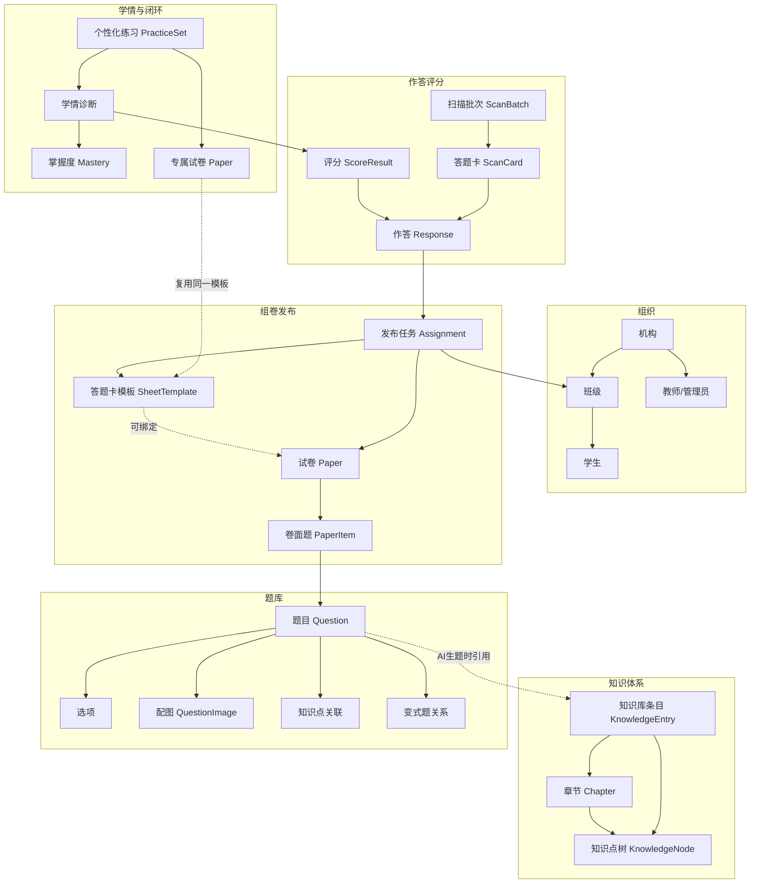
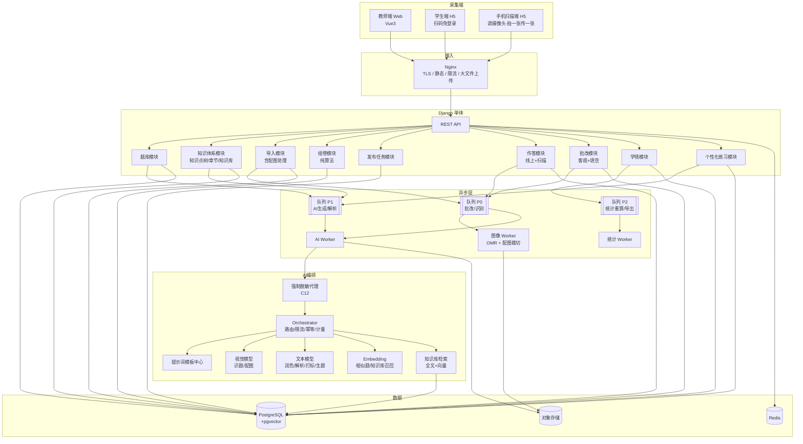
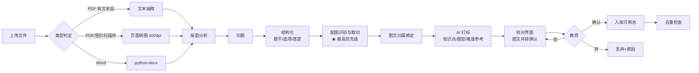
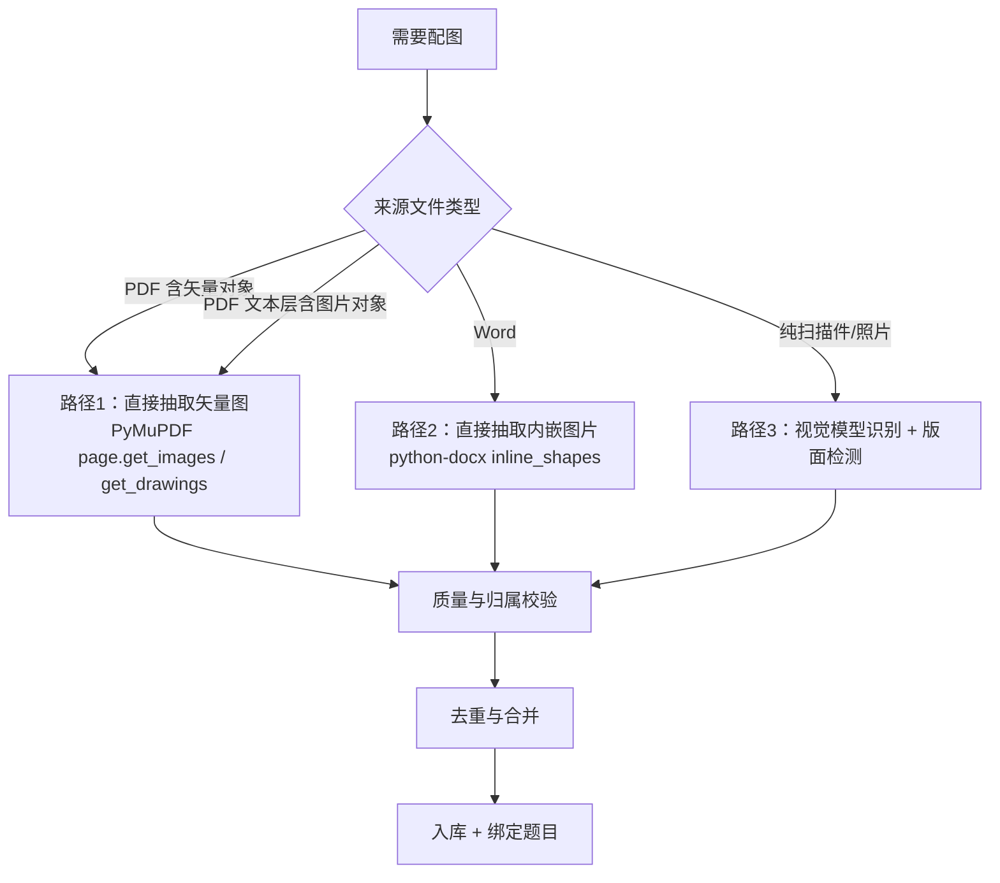
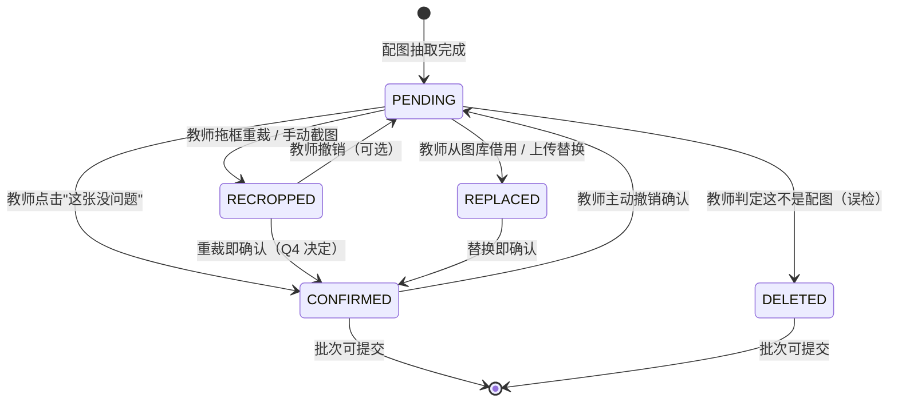
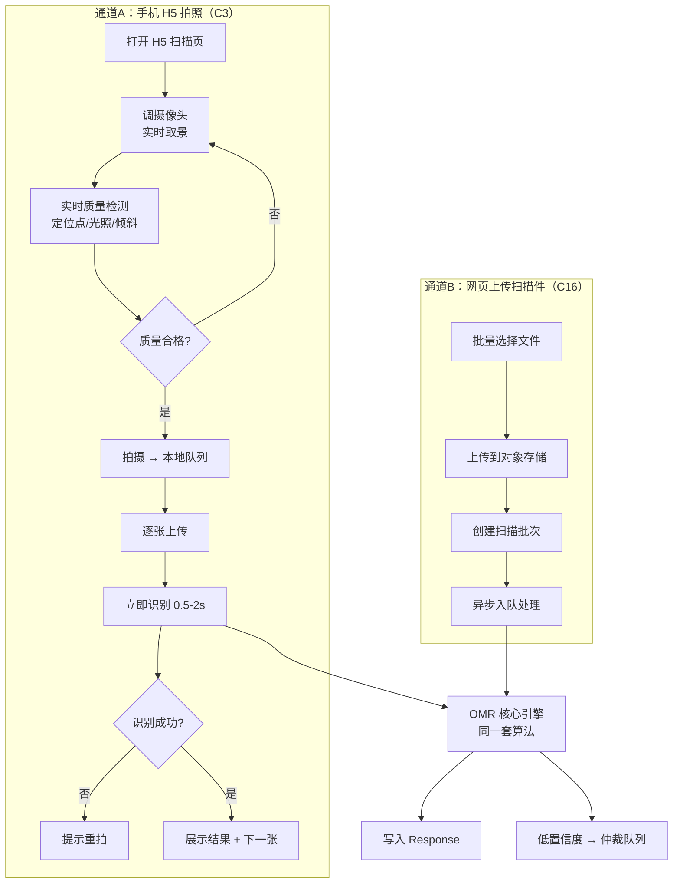
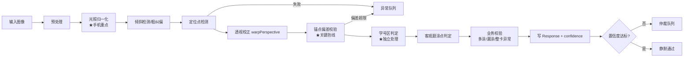
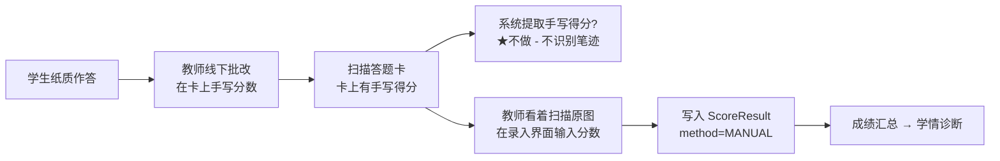
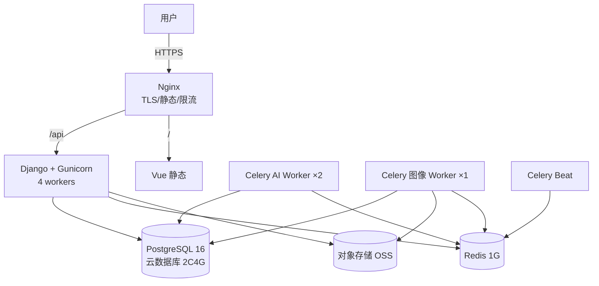

# 「知否」题库管理与 AI 精准作业平台 · 开发设计文档

| 项目 | 内容 |
| --- | --- |
| 文档版本 | **v2.1（追加 Q1–Q4 需求确认后的修订版）** |
| 历史版本 | v2.0、v1.0（本文件为 v2.1，已包含 v2.0 全部内容；v1.0 归档见 `知否-开发设计文档-v1.0-归档.md`） |
| 文档状态 | 待评审 |
| 技术栈 | Python（后端 + AI 服务）+ Vue 3（教师端 / 学生端 / 手机扫描端） |
| 部署形态 | 公有云 SaaS（单实例多机构隔离），预留私有化交付路径 |
| 视觉风格 | 参考 DeepSeek 官网设计语言（简约克制向），详见第 5 章 |
| 目标读者 | 产品负责人、后端、前端、算法、测试、运维 |

> **v2.1 相对 v2.0 的四处修订（对应上一轮的 Q1–Q4）：** 配图强制逐图确认与手动重裁（7.4.8）、学号位数自由配置（9.2.4.1）、主观题逐题录分（10.5）、个性化练习 PDF 批量导出（11.7.5）。完整变更索引见 **附录 I**。

---

## 0. 本次变更摘要

| 编号 | 你的确认 | 设计变更 | 位置 |
| --- | --- | --- | --- |
| **Q1** | 主观题**逐题录分** | 批改工作台重设计为「单题视图 / 单生视图 / 粘贴导入」三种录分模式；逐题分写入 `score_result`，参与统计难度与知识点掌握度计算；新增「快速模式（只录总分）」及其精度声明 | 10.5、12.8、19.1-A21、21-Q1 |
| **Q2** | 学号位数**可自由配置** | 从「6/8/10 三档」改为 **1–12 位任意值**；新增排布方式（单行/多行）、每行位数、分隔规则；新增生成时的排版约束校验；**识别端 `student_no_bubble()` 支持多行**；新增「从名册自动推断位数并提示不一致」 | 9.2.4.1、9.3.2、12.6、17.5 |
| **Q3** | 线上为主，**可批量导出 PDF 打印** | 新增练习 PDF 批量导出设计：每人一份试卷 + **一张通用答题卡**；打印包组织、文件命名与排序、页脚练习编号、异步分片生成、ZIP 流式打包、24 小时后自动清理、导出前排版检查；**提出「卷子与答题卡错配」风险与两道防线**（新增待确认项 Q16） | 11.7.5、13.2、14.1、19.1-A31 |
| **Q4** | 配图**强制逐图确认**，可在校验试卷时手动重裁 | 沉默错误率从「≤ 2% 可容忍」改为**零容忍（强制逐图确认）**；新增配图确认状态机、逐图确认界面与键盘流、**受限批量确认**（防无脑狂点，含可疑速度检测）；新增**手动截图/换图/重裁即确认**；新增**关口二：试卷校验阶段的配图全面复检**（含分页切断、尺寸异常、缺失阻断等排版检查）；新增批次与试卷定稿的硬门禁 | 7.4.8、12.4、13.2、16.3、19.1-A3~A7 |


---

### 0.2 v1.0 → v2.0 变更摘要

**这一章是给你看的，用来核对我的理解。请逐条确认。**

| 编号 | 你的新要求 | 我做的设计变更 | 影响的章节 |
| --- | --- | --- | --- |
| **C1** | 批改范围最终确认：**只批客观题 + 填空题；主观题一律不批** | 移除了 v1.0 中「主观题 AI 建议分 + 教师确认」的整套设计；改为「教师线下批改、线上录入分数」；评分状态机简化 | 10、12 |
| **C2** | 答题卡**支持设置样式**，试卷可**绑定指定答题卡** | 新增「答题卡样式模板」独立实体（可复用、可跨试卷套用）；试卷与答题卡的绑定关系从「生成即唯一」改为「多对一可选绑定」 | 9.2、12 |
| **C3** | 教师通过**手机端（H5 调摄像头）扫描答题卡**完成录入 | 新增 H5 相机扫描通道：拍一张传一张 + 实时识别 + 重拍提示；与网页上传扫描件**两条路并存**（同一识别引擎） | 9.3、9.4、14 |
| **C4** | 试卷同时支持**线上答题**和**线下扫描** | 保留并强化跨通道数据合并规则；两个通道共用同一套 `Response` / `ScoreResult` 模型 | 9.7、9.8 |
| **C5** | **AI 生题只在新建题目阶段；组卷全部调用题库现有题目** | 组卷不再有任何 AI 生成能力（含「AI 学情组卷」改为纯算法加权抽题，不生成新题，只选已有题）；AI 生成入口收敛到「新建题目」 | 7.7、8.4 |
| **C6** | 规模：**100 个班 / 每班 50 人（5000 学生）**，但为 2–3 年规划，一期先上几个班 | 容量与成本按 5000 学生重算；部署规格给出「一期最小」与「满规模」两档；架构预留水平扩展路径 | 15.1、17、18 |
| **C7** | 扫描采用**成熟填涂方式 + 考点位识别**，不识别笔迹 | 明确 OMR 光学标记识别路线：定位点几何校正 + 涂点灰度判定 + 高置信度直通 + 低置信度人工仲裁；**不做任何手写识别** | 9.3 |
| **C8** | **D4 强化**：导入时要专门处理**题干/选项中的配图** | 新增「题目配图识别与裁切」专项设计（版面配图检测、图片区域切分、题目归属判定、公式与图形区分、去重、质量校验），并把它列为**最高优先级难点** | 7.4 |
| **C9** | **D13 扩展**：除知识点树外，每学科配一个**知识库**，教师录入知识内容供 AI 出题参考，**防幻觉** | 新增「学科知识库」实体（知识条目 + 章节归属 + 知识点关联）；新增「AI 生题的知识库检索与引用溯源」机制（强制引用 + 无依据不生成） | 7.7、12、附录 |
| **C10** | **发布 = 发布试卷给班级，是一个任务** | 「作业（Assignment）」概念改名为「**发布任务**」，语义更贴切：试卷 × 班级 × 时间窗 × 作答通道 | 2、9.8 |
| **C11** | **一生一卷建立在「试卷格式、体量一致」的前提下，答题卡套用同一套模板** | 这是重要的简化：个性化练习的题量、题型结构与来源试卷完全一致 → **可以复用同一答题卡模板**，不需要动态模板系统 | 3.2、11.7 |
| **C12** | 接受**脱敏处理**（学生身份信息不出域） | 脱敏代理从「建议」升级为「架构强制项」：AI 调用前强制脱敏，未脱敏的请求在代码层无法发起 | 3.3、6.6 |
| **C13** | 答题卡要有**学号填涂区** | 新增数字涂点区设计规范（每位 0–9 竖向涂点，位数可配），与定位点共用同一坐标系 | 9.2 |
| **C14** | **前端样式要提前确定，避免「AI 味」** | 新增完整的**第 5 章视觉设计系统**：DeepSeek 风格设计令牌（色值/字号/间距/圆角/动效曲线）、负面清单（明确禁止的 AI 味特征）、页面骨架示例 | 5、14 |
| **C15** | 视觉风格采用 **DeepSeek 官网风格**；取舍为「取其简约克制内核，不抄流体背景」 | 玻璃拟态仅用于首页/登录/报告封面等少量页面；数据密集页面用实底白卡保证可读性 | 5 |

### 需要提请你注意的三处「变化带来的连锁影响」

**① C5（组卷不生成新题）让整个系统的成本和风险大幅下降，这是一个很正确的决定。** 我在 11.7 和 18.3 里据此重写了推荐算法的定位：**AI 的价值从「造题」转移到「选题 + 溯源答疑」**，个性化练习的边际成本降到接近零。但这也意味着「题库覆盖度」成为系统能力的硬瓶颈——我在 8.7 新增了「题库健康度检查」，当某知识点题目不足时，系统必须明确告诉老师，而不是硬凑一份卷子。

**② C11（试卷体量一致 → 答题卡套用同一模板）解掉了我上一版最担心的问题。** v1.0 里我担心「一人一卷」会导致一人一卡、模板爆炸；你明确了「格式与体量一致」，那么个性化练习可以复用同一张答题卡模板，工程复杂度从「动态模板系统」降为「模板复用」，**省掉至少 2 周工期**。

**③ C3（手机 H5 扫描）与 C7（OMR 考点位识别）组合起来，风险比 v1.0 更高，不是更低。** 原因：扫描仪是均匀光照 + 正交成像，手机是斜拍 + 环境光 + 手持抖动。**同一个 OMR 算法在手机拍摄下的准确率会明显低于扫描仪。** 我在 9.3 和 9.4 给了针对手机的专门补偿设计（取景引导、实时质量反馈、重拍提示、多张择优），并给出了两套分开的验收指标。**请特别注意 9.4 的指标口径，这是验收时最容易扯皮的地方。**

---

## 1. 需求确认结论（v2.0 全量）

### 1.1 基础决策

| 编号 | 决策 | 工程含义 |
| --- | --- | --- |
| D1 | K12 学校 / 教培机构，教师为主，学生用答题端 | 权限模型：机构 → 年级/学科组 → 班级 → 教师/学生 |
| D2 | 个人 / 小团队 MVP，先跑通闭环 | 单体应用 + 模块化，不拆微服务 |
| D3 | 调用公有云大模型 API，国产平台为主 | 模型适配层 + 成本计量 + 限流降级 |
| D4 | **第一优先：文件识别导入题目，尤其重视题干/选项配图** | 「导入 → 配图处理 → 校对 → 入库」流水线是产品成败的第一道关口 |
| D5 | 学生扫码免登录答题；同时导出答题卡线下作答，教师扫描录入 | 双通道答题，数据必须能合并进同一份成绩模型 |
| D6 | **客观题 + 填空题自动批改；主观题不批改** | 主观题仅支持「教师线下批改后线上录入分数」，不做 AI 评分 |
| D7 | 题目来源两者都要，必须标清来源 | `source_type` + 版权与审核元数据 |
| D8 | 交付：单份 Markdown 设计文档 | 即本文档 |
| D9 | **标准 OMR 光学标记识别（定位点 + 考点位涂点判定）**，不做笔迹识别 | 答题卡生成 PDF + 图像几何校正 + 涂点判定 + 模板与阈值版本管理 |
| D10 | 主观题作答原文不入系统；成绩由教师线下批改后线上录入 | 无手写识别，无 AI 评分；提供高效的批量录分界面 |
| D11 | **接受脱敏处理** | AI 调用前强制脱敏（架构强制，非可选） |
| D12 | 冷启动：先手工标定难度，数据够了再自动校准 | 难度分「人工标定 / 统计估计 / AI 参考 / 生效值」四个字段 |
| D13 | 知识点树由教师自建，平台提供学科模板；**每学科配套知识库** | 四层内容结构：知识点树 + 章节 + 知识库条目 + 题目 |
| D14 | 公有云 SaaS，学校直接访问域名 | 单套部署、多机构逻辑隔离 |
| D15 | **答题卡支持样式设置，试卷可绑定指定答题卡** | 答题卡模板独立成实体，可复用、可套用 |
| D16 | **手机 H5 扫码/拍照扫描 + 网页上传扫描件，双入口** | 同一识别引擎，两个采集端；手机端需实时质量反馈与重拍 |
| D17 | **组卷只用题库已有题目，AI 不参与组卷生成** | 组卷 = 纯算法（筛选 + 洗牌 + 约束求解） |
| D18 | **发布 = 把试卷发布给某个班级的任务** | 「发布任务」是一等实体，是数据闭环的挂载点 |
| D19 | **一生一卷的前提是试卷格式与体量一致，答题卡复用同一模板** | 个性化练习不需要动态模板系统 |
| D20 | 规模：100 班 / 5000 学生（2–3 年规划），一期先上几个班 | 容量按满规模设计，资源按一期小规模投入 |
| D21 | **前端视觉采用 DeepSeek 官网风格（简约克制向）** | 需要一套完整的设计令牌与组件规范，见第 5 章 |

### 1.2 概念口径表（全团队必须对齐）

```
机构 Organization
  ├── 班级 Classroom ──── 学生 Student（免登录，靠班级名册认人）
  └── 学科知识体系
        ├── 知识点树 KnowledgeNode（含前置/关联关系）
        ├── 章节 Chapter（教材目录，挂在知识点树之下）
        └── 知识库 KnowledgeEntry（教师录入的参考内容，挂章节与知识点）

发布任务 Assignment（= 试卷 × 班级 × 时间窗 × 作答通道）
  ├── 试卷 Paper ←── 题目 Question（全部来自题库，AI 不生成）
  │     └── 卷面题 PaperItem（含快照）
  ├── 答题卡模板 SheetTemplate（可被多份试卷绑定）
  ├── 作答记录 Response（来源：ONLINE / SCAN_PHONE / SCAN_UPLOAD / MANUAL）
  ├── 评分结果 ScoreResult（客观题自动 / 填空自动或存疑 / 主观题教师录入）
  └── 学情诊断 Diagnosis
        └── 个性化练习 PracticeSet（格式体量与原卷一致，复用同一答题卡模板）
```

| 概念 | 精确定义 | 易混点 |
| --- | --- | --- |
| Question | 题库中的一道题，含题干、选项、答案、解析、配图、知识点、难度、来源 | 不等于「卷面第 3 题」 |
| Paper | 一次组卷的产物：有序的 PaperItem 集合 + 配分 + 组卷策略快照 | **快照**，题库改题不影响已发布试卷 |
| PaperItem | 卷面的一格：题号、题目引用、配分、快照、选项顺序 | AB 卷/补考卷是不同 Paper |
| **Assignment（发布任务）** | 「把这份试卷发给这个班，用这种通道，在这个时间段做」 | 学生看到的是任务不是试卷 |
| **SheetTemplate（答题卡模板）** | 一套可复用的答题卡版面定义（含样式、学号区、涂点坐标） | **独立实体**，一份模板可被多份试卷绑定；版本只增不改 |
| SheetStyle（答题卡样式） | 模板的视觉与结构配置：纸张、栏数、题行布局、学号位数、是否留手写区 | 样式是模板的属性，不是独立实体 |
| Response | 某生对某卷面题的作答 + 来源通道 | 四种来源并存，必须可追溯 |
| ScoreResult | 某题得分 + 评分方式 + 置信度 + 状态 | 「分数」与「谁定的」必须一起存 |
| Diagnosis | 某生在某知识点上的掌握度估计（带时间戳） | 会随时间衰减，不是永久属性 |
| **KnowledgeEntry（知识条目）** | 教师录入的一段学科知识内容（定义/定理/例题/常见错误/考纲要求） | 是 AI 生题的**依据来源**，不是知识点本身 |
| **Chapter（章节）** | 教材目录结构，可挂在知识点节点下 | 章节是「教学进度」的组织方式，知识点是「能力诊断」的组织方式 |

---

## 2. 方案评析（v2.0 修订）

这一章是开发者视角的评析。v1.0 里的三处风险有三处发生了变化，我逐条更新。

### 2.1 风险排序发生了变化：从「AI 质量」变成「图像识别」

你在 v2.0 里做的一个重要取舍是 **C5：组卷不再让 AI 生成新题**。这个决定把最大的质量风险从系统里移出去了——AI 生成题进入试卷的路径被彻底切断。**这是这个方案里第二个很正确的决定**（第一个是「诊断 → 专属练习」的闭环设计）。

但与此同时，你新增/强化了两项都与「图像」有关的需求：

| 需求 | 风险 | 说明 |
| --- | --- | --- |
| C8：题干/选项**配图识别与裁切** | **高** | 几何图、电路图、实验装置图、函数图像、化学结构式、表格、图文混排——这些是 OCR 和视觉模型的共同弱项。切错一张图，题目就废了，而且**老师很难发现**（因为文字是对的） |
| C3/C7：**手机拍摄 OMR** | **高** | 手机斜拍的透视畸变、环境光影、手持抖动，都比扫描仪恶劣一个量级 |
| C9：知识库 + 防幻觉 | 中 | 检索质量决定 AI 生题的可用性；但 AI 生题只在新建阶段，且必须教师审核，风险可控 |

**我的判断**：v2.0 里**最高优先级的技术攻坚对象是「题目配图识别与裁切」**（你在提问中也选了它）。原因是它不像 OMR 那样有「人工仲裁」这条兜底路径——一张被裁错的图，如果老师没注意到，就静静地留在了题库里，然后出现在学生的作业和考试上。**这是一类「沉默的错误」，比 OMR 的「吵闹的错误」更危险。**

因此 7.4 我给配图识别配了最详细的设计、最多的校验规则和最严的验收标准。**请你重点评审那一节。**

### 2.2 手机扫描：我必须在文档开头就说清楚的一件事

手机拍摄 OMR 与扫描仪 OMR 的准确率差距，不是「优化一下就能补上」的，而是**物理条件差异**：

| 条件 | 馈纸扫描仪 | 手机拍摄 |
| --- | --- | --- |
| 成像几何 | 正交、无透视 | 手持斜拍，透视畸变大 |
| 光照 | 内置均匀光源 | 教室顶灯 + 阴影 + 窗光 + 反光 |
| 分辨率 | 300–600 dpi 稳定 | 依赖对焦与距离，波动大 |
| 抖动 | 无 | 有（可能运动模糊） |
| 卡片状态 | 单张进纸、平整 | 手持、可能弯曲、桌面不平 |
| 批量 | 一次 100 张 | 一张一张拍 |

**因此我给了两套验收指标（9.4），请务必分开考核**：

- **扫描仪通道**：静默通过率 ≥ 92%
- **手机通道**：静默通过率 ≥ 80%（一期），并且**必须**配合「拍完立刻反馈 + 不合格可重拍」的机制——这个机制能把手机通道的最终数据质量拉到与扫描仪接近，因为它把「识别失败」提前到了「拍照环节」而不是「老师批卷时」。

**「实时质量反馈 + 重拍提示」不是体验优化，它是手机通道能成立的前提条件。** 这一点请在产品需求里明确，不要在开发时被当作可选项砍掉。

### 2.3 一生一卷的重新定义（C11 解掉的那个问题）

你明确了：**一生一卷建立在「试卷格式、体量一致」的前提下，所以答题卡也套用同一套模板。**

这个定义比 v1.0 的假设更好，因为它把一个模糊的愿景变成了可实现的约束：

| 维度 | 约束 | 工程收益 |
| --- | --- | --- |
| 题量 | 与原试卷完全一致 | 答题卡涂点区行数固定 |
| 题型结构 | 与原试卷完全一致（如 10 单选 + 5 判断） | 涂点区结构固定 |
| 答题卡模板 | **复用原试卷绑定的模板** | 不需要动态模板生成 |
| 差异所在 | 只有「题目内容不同」和「题目顺序不同」 | 只需要处理题目映射与乱序 |

**所以「一人一卷」在工程上的实现是：**

```
同一张答题卡模板
   + 每个学生一份独立的 Paper（题目不同，但题量/题型/配分结构完全一致）
   + 每个学生一份独立的题目顺序映射（question_order）
   + 扫描时：卡上的题号 → 该生的 question_order → 实际 PaperItem
```

**唯一需要注意的坑**：扫描时读到的「第 7 题涂了 B」，必须用**该学生的** question_order 映射回实际题目。**如果映射错了，全班成绩全错。** 我在 16.4 把这条列为一等测试用例。

**另外要提醒一个约束**：因为答题卡模板必须复用，所以**个性化练习的难度分布可以变，但题量与题型结构不能变**。这限制了我的推荐算法（11.7）——我不能为了照顾某个学生只给 5 道题。我在 11.7 里的处理方式是：**题量与结构固定，但在「选哪些题」和「难度分布」上做个性化**，并新增一个「题型结构例外申请」机制（如果老师确实想给某个学生减少题量，允许单独生成一份不同结构的练习，但会标为「非标准卷」且不套用答题卡模板）。

### 2.4 关于「AI 味」这件事，我要先明确一个判断

你特别强调了「前端样式要提前确定，避免产出看起来 AI 味很浓」。作为开发者，我认为这件事的风险被大多数人低估了：**老师对「AI 味」的敏感度，直接等于他对这个系统是否「正经」的判断。** 一个看起来像周末 demo 的界面，会让老师怀疑「我的试卷数据放这儿安全吗」。

我把「AI 味」拆解成可执行的技术判断（第 5.6 节有完整负面清单），核心是五条：

1. **颜色上**：不用紫色/靛蓝渐变（那是 AI 生成 UI 的第一特征），不用多色渐变按钮，不用发光效果。DeepSeek 的做法是**单一品牌蓝 + 中性灰阶**，克制到几乎没有装饰色。
2. **形状上**：圆角不要超过 12px（卡片），不要「所有元素都圆滚滚」。DeepSeek 官网的卡片是 24px 圆角，但那是因为它是营销页、元素少、留白极大；**后台页面元素密度高，24px 圆角会显得轻浮**。所以我在 5.3 里明确区分了「营销页圆角」与「后台页圆角」两套令牌。
3. **阴影上**：不要每个卡片都带大阴影。用**边框 + 极弱阴影**建立一个安静的层级。
4. **图标与文案上**：不用 emoji 当图标；不用「✨ AI 智能生成」这类营销腔；不用「让我们一起…」这类 AI 助手腔。**按钮文案要像教务系统：`生成解析`，不是 `一键智能生成解析 ✨`。**
5. **动效上**：从 DeepSeek 抄「慢入场 + 快响应」的节奏纪律，不抄流体背景。**所有动效集中在 3 条曲线上（见 5.5）**，不允许开发者各自发明。

**这五条我会写成代码级的约束（设计令牌 + ESLint 规则 + 组件库），而不是写成「请保持简洁」这种无效建议。**

### 2.5 我认为仍然需要提醒的三件事

**① 规模从「几百人」变成「5000 人」，最大的变化不是数据库压力，是存储和批处理。**
5000 学生 × 一学期 20 次作业 × 每次一张答题卡 = 10 万张扫描件。按每张 1.5 MB 算就是 **150 GB/学期**。数据库本身依然很轻松（几百万行而已），但对象存储、图片处理队列、备份恢复策略需要重新设计。我在 15.1 和 17 里按 5000 人重算了容量，并给出了「一期小规模起步、满规模扩展」的两档方案。

**② 「题库覆盖度」成了系统能力的硬瓶颈（这是 C5 的代价）。**
既然组卷只能用已有题目，那么「题库够不够」直接决定系统能不能用。一所学校 100 个班、5 个学科、每学期 20 次作业，需要的题目量远超想象。我在 8.7 新增了「题库健康度检查」，并且建议**把「导入效率」当作产品的第一指标来对待**——因为导入效率决定了题库积累速度，而题库积累速度决定了这个产品多久之后才真正好用。

**③ 知识库是「防幻觉」的关键，但它的冷启动比题库更难。**
题库可以靠导入现有试卷快速积累；知识库只能靠教师手工录入或从教材导入。**一个没有内容的知识库，对 AI 生题的防幻觉作用是零。** 我在 7.7 设计了一个「知识库分级使用」策略：内容不足时，AI 生题会自动降级为「不得生成，只允许改写题干」（见 7.7.4），**而不是硬着头皮生成然后产生幻觉**。

---

## 3. 核心领域模型

（见 1.2 节完整口径表，此处为结构关系图）



---

## 4. 总体架构

### 4.1 架构原则（v2.0 修订）

1. **单体优先，模块内高内聚。** 一个 Django 应用，通过包边界划分模块，未来可低成本拆出。
2. **一切慢操作异步化。** AI 调用、文件解析、**图像处理（配图裁切与 OMR）** 一律进队列。**绝不在 HTTP 请求里同步做图像处理或调大模型。**
3. **AI 能力是可替换的适配器。** 业务代码只依赖 `AIProvider` 接口。
4. **AI 调用强制脱敏（C12）。** 脱敏不是建议，是**代码层的强制约束**：`AIProvider` 的入口函数签名只接受脱敏后的 payload，业务代码无法绕过（见 6.6）。
5. **原始数据永不失真。** 上传的文件、AI 原始返回、教师修正动作、**扫描原图与校正图**，全部留存。
6. **状态机显式化。** 题目、试卷、任务、评分、扫描批次、知识条目都有明确状态流转。
7. **图像处理资源隔离。** 配图裁切与 OMR 是 CPU 密集型，必须独立 worker、独立并发上限，不与 Web 争抢资源（v2.0 新增，因为图像处理量显著增加）。

### 4.2 技术选型

| 层 | 选型 | 理由与替代 |
| --- | --- | --- |
| 后端框架 | **Python 3.12 + Django 5 + DRF** | 表多、权限细、后台重，Django 的 ORM/迁移/admin 省大量时间 |
| 异步任务 | **Celery + Redis** | Redis 兼做缓存与 broker；**队列必须分级**（见 4.4） |
| 数据库 | **PostgreSQL 16** + `pgvector` | 需要 JSONB、数组、全文检索、窗口函数、向量检索（相似题 + 知识库检索） |
| 图像处理 | **OpenCV + NumPy + Pillow** | OMR 几何校正与涂点判定；配图检测与裁切；答题卡与试卷 PDF 生成 |
| PDF 生成 | **ReportLab**（答题卡、试卷）+ **PyMuPDF**（解析与转图） | |
| 文档解析 | Word：`python-docx`；PDF：`PyMuPDF`（文本层 + 图像对象抽取）；Excel：`openpyxl` | **PDF 内嵌图片可以直接抽取，不需要重新识别**，这是配图处理的第一条路径 |
| AI 接入 | 多模型适配层（OpenAI 兼容协议为主） | 见第 6 章 |
| 前端 | **Vue 3 + TypeScript + Vite + Pinia + Vue Router** | |
| UI 组件 | **Element Plus（按设计令牌深度定制主题）** + 自研核心页面 | 见第 5 章；**必须改主题变量，不能用默认蓝** |
| 图形渲染 | KaTeX（公式）+ Cropper.js（配图裁切校正） | |
| 对象存储 | 阿里云 OSS / 腾讯云 COS / MinIO | 图片量是主要存储成本 |
| 部署 | **Docker Compose**（web + worker-ai + worker-image + beat + postgres + redis + nginx） | 见 17 |
| 可观测 | Sentry + Prometheus/Grafana + 结构化日志 | |
| CI/CD | GitHub Actions / Gitee Go | 含 OMR 与配图识别的回归门禁 |

### 4.3 系统分层图（v2.0）



### 4.4 队列分级（v2.0 新增，因为图像处理量增大）

| 队列 | 任务 | 并发策略 | 优先级 |
| --- | --- | --- | --- |
| **P0** | OMR 识别、配图裁切、自动批改 | 图像 worker 并发 = CPU 核数 × 1（避免超线程反而变慢）；AI worker 并发 8 | 最高（阻塞教师流程） |
| **P1** | AI 生题、解析生成、润色、打标、知识库向量化 | 并发 4，受 AI 限流器控制 | 中（可延后） |
| **P2** | 统计重算、报告导出、成本报表、快照 | 并发 2 | 低（可夜间跑） |

**为什么要分级**：一次批量扫描 200 张答题卡（P0）和一次「为 500 道题生成解析」（P1）如果共用一个队列，老师点了生成解析后，扫描任务会排在后面，老师会以为系统挂了。**队列不分级是这类系统最常见的性能事故原因。**

---

## 5. 视觉设计系统（v2.0 新增，对应 C14 / C15）

这一章的目标是**让「知否」看起来像一个正经的教务产品，而不是一个 AI 生成的周末项目**。我会给到可直接落地的色值、字号、间距、圆角、动效曲线与组件规范，并附一份「AI 味负面清单」。

### 5.1 设计定位：从 DeepSeek 官网学什么、不学什么

DeepSeek 官网的质感来自三个技术层次（[拆解文章](https://guibai.dev/a/7676826408547958793/en/)）：玻璃拟态材质、WebGL 流体背景、弹簧物理动效。但那是一个**营销页**，元素少、留白大、没有信息密度要求。

| DeepSeek 官网的做法 | 知否是否采用 | 原因 |
| --- | --- | --- |
| 品牌蓝 `#4D6BFE` | **采用** | 这是识别度最强的单一元素 |
| 中性灰阶文字体系 | **采用** | 数据密集页面靠灰阶级差建立层级，而不是靠颜色 |
| 玻璃拟态（`backdrop-filter: blur(12px)`） | **仅在 3 个页面采用** | 首页 Hero、登录页、学情报告封面；数据页用玻璃卡会严重损害可读性 |
| WebGL 流体背景 | **不采用** | 与「严肃教务工具」的定位冲突；且 H5 端耗电、低端机卡顿 |
| 弹簧物理动效 | **部分采用** | 用于首页 Hero 与报告封面的入场；表格式交互用 CSS transition 即可 |
| 光标跟随环 | **不采用** | 触屏与低端设备上是负担，且教务用户不关心 |
| 设计令牌（tokens）纪律 | **重点采用** | 这是「看起来专业」的真正来源：全站数值统一，不各自发挥 |
| 动效节奏纪律（慢入场、快响应） | **重点采用** | 见 5.5 |

**一句话总结设计定位：取其「克制的纪律」，不取其「炫技的表层」。**

### 5.2 色彩令牌

```css
/* ============ 知否设计令牌 · 色彩 ============ */
:root {
  /* —— 品牌色 —— */
  --zf-brand:            #4D6BFE;  /* 主品牌蓝，来自 DeepSeek */
  --zf-brand-hover:      #3F5CE8;
  --zf-brand-active:     #3550D2;
  --zf-brand-deep:       #3A65C2;  /* 深蓝，用于标题强调 */
  --zf-brand-subtle:     #EEF2FF;  /* 极浅蓝底，用于选中行/标签底 */
  --zf-brand-border:     #C7D2FE;

  /* —— 中性灰阶（层级主要靠它建立）—— */
  --zf-text-primary:     #1E232C;  /* 正文与标题 */
  --zf-text-secondary:   #5A6172;  /* 次要说明 */
  --zf-text-tertiary:    #8A90A0;  /* 占位、辅助 */
  --zf-text-disabled:    #B9BEC9;
  --zf-text-inverse:     #FFFFFF;

  --zf-bg-page:          #F7F8FA;  /* 页面底 */
  --zf-bg-surface:       #FFFFFF;  /* 卡片/表格 */
  --zf-bg-subtle:        #FAFBFC;  /* 表头、斑马纹 */
  --zf-bg-hover:         #F2F4F7;
  --zf-bg-active:        #EEF2FF;

  --zf-border:           #E5E7EB;  /* 主边框 */
  --zf-border-strong:    #D1D5DB;  /* 输入框 */
  --zf-border-subtle:    #F0F1F3;  /* 表格行分割 */

  /* —— 语义色（克制度：只用在中低饱和，不用亮原色）—— */
  --zf-success:          #17A673;
  --zf-success-bg:       #E8F6F1;
  --zf-warning:          #E08700;
  --zf-warning-bg:       #FDF3E2;
  --zf-danger:           #D9453D;
  --zf-danger-bg:        #FCEDEC;
  --zf-info:             #4D6BFE;
  --zf-info-bg:          #EEF2FF;

  /* —— 学情热力图专用色阶（低饱和，避免"圣诞树"）—— */
  --zf-mastery-0:        #D9453D;  /* 严重薄弱 0–0.30 */
  --zf-mastery-1:        #E8794A;  /* 薄弱     0.30–0.50 */
  --zf-mastery-2:        #E0A030;  /* 不熟练   0.50–0.70 */
  --zf-mastery-3:        #4D6BFE;  /* 基本掌握 0.70–0.85 */
  --zf-mastery-4:        #17A673;  /* 已掌握   0.85–1.0 */
  --zf-mastery-na:       #E5E7EB;  /* 数据不足 */
}
```

**色彩纪律（必须遵守，写进 code review 清单）**：

| 规则 | 说明 |
| --- | --- |
| **禁止紫色/靛蓝渐变** | 这是「AI 生成 UI」最典型的视觉特征 |
| **禁止多色渐变按钮** | 主按钮就是 `--zf-brand` 实色 |
| **禁止发光/霓虹效果** | 不要 `box-shadow` 带彩色光晕 |
| **一屏内语义色不超过 2 种** | 热力图页面除外（那是数据可视化，色阶是信息） |
| **热力图用低饱和色阶** | 不要用纯红纯绿，那会让报告页看起来像仪表盘而不是教务材料 |
| **AI 相关标识统一用 `--zf-brand-subtle` 底 + `--zf-brand` 文字** | 不额外引入「AI 紫」 |

### 5.3 形状、间距与字体令牌

```css
:root {
  /* —— 圆角（关键：区分营销页与后台页）—— */
  --zf-radius-xs:   2px;   /* 标签、徽章 */
  --zf-radius-sm:   4px;   /* 按钮、输入框、下拉 —— 后台主力 */
  --zf-radius-md:   6px;   /* 卡片内小面板 */
  --zf-radius-lg:   8px;   /* 卡片 —— 后台页面上限 */
  --zf-radius-xl:   12px;  /* 弹窗、抽屉 */
  --zf-radius-hero: 24px;  /* 仅首页 Hero 与报告封面（营销向） */
  --zf-radius-pill: 100px; /* 仅胶囊标签与头像 */

  /* —— 间距（8px 基准，不允许 5px/13px 这类随手值）—— */
  --zf-space-1: 4px;
  --zf-space-2: 8px;
  --zf-space-3: 12px;
  --zf-space-4: 16px;
  --zf-space-5: 20px;
  --zf-space-6: 24px;
  --zf-space-8: 32px;
  --zf-space-10: 40px;
  --zf-space-12: 48px;

  /* —— 阴影（克制：后台页面几乎不用阴影，用边框）—— */
  --zf-shadow-none: none;
  --zf-shadow-xs: 0 1px 2px rgba(16, 24, 40, 0.04);
  --zf-shadow-sm: 0 1px 3px rgba(16, 24, 40, 0.06), 0 1px 2px rgba(16, 24, 40, 0.04);
  --zf-shadow-md: 0 4px 12px rgba(16, 24, 40, 0.08);   /* 弹窗、抽屉 */
  --zf-shadow-glass: 0 8px 32px rgba(16, 24, 40, 0.06); /* 仅玻璃卡 */

  /* —— 玻璃材质（仅登录页/首页/报告封面）—— */
  --zf-blur-glass: 12px;
  --zf-surface-glass: hsla(0, 0%, 100%, 0.30);
  --zf-surface-glass-raised: hsla(0, 0%, 100%, 0.45);
  --zf-border-glass: hsla(0, 0%, 100%, 0.20);

  /* —— 字体 —— */
  --zf-font-sans: "Inter", "PingFang SC", "Hiragino Sans GB", "Microsoft YaHei",
                  "Source Han Sans SC", "Noto Sans CJK SC", system-ui, sans-serif;
  --zf-font-mono: "JetBrains Mono", "SF Mono", Consolas, "Courier New", monospace;
  --zf-font-serif-cn: "Source Han Serif SC", "Songti SC", "SimSun", serif; /* 仅试卷排版 */

  /* —— 字号（后台页面 12–20px 为主，不用 40px+ 大字）—— */
  --zf-text-xs:   12px;  /* 辅助信息、表头 */
  --zf-text-sm:   13px;  /* 表格内容、次要按钮 */
  --zf-text-base: 14px;  /* 正文、表单、按钮 —— 后台默认 */
  --zf-text-md:   15px;  /* 强调正文 */
  --zf-text-lg:   16px;  /* 卡片标题 */
  --zf-text-xl:   18px;  /* 页面区块标题 */
  --zf-text-2xl:  20px;  /* 页面主标题 */
  --zf-text-3xl:  24px;  /* 仪表盘大数字 */
  --zf-text-hero: 46px;  /* 仅首页 Hero 标语（DeepSeek 同规格） */

  --zf-leading-tight:  1.25;
  --zf-leading-normal: 1.5;
  --zf-leading-loose:  1.75;

  --zf-weight-normal:   400;
  --zf-weight-medium:   500;
  --zf-weight-semibold: 600;
}
```

**字体选择说明**：

- 中文**不用 Inter**（Inter 没有中文字形，会 fallback 到系统字体，导致中英混排基线不齐）。字体栈的正确写法是 `Inter` 在前（用于数字与英文）+ 中文字体在后。
- **数字必须用等宽或表格数字**：成绩、得分率、题号这些数字在表格里对齐非常重要。加 `font-variant-numeric: tabular-nums;`：`--zf-font-sans` 中的 Inter 支持这个特性。
- 试卷排版用衬线体（`--zf-font-serif-cn`），这与界面字体区分，符合正式试卷的观感。

### 5.4 布局与栅格

| 项 | 规范 |
| --- | --- |
| 教师端最小宽度 | 1366px（低于此宽度侧边栏自动收起） |
| 内容区最大宽度 | 1440px（超出居中，两侧留白） |
| 侧边栏 | 展开 208px / 收起 56px |
| 顶部栏 | 高 56px，白底，底部 1px 边框，**无阴影** |
| 卡片 | 白底 + 1px `--zf-border` + `--zf-radius-lg`，**无阴影**（除非悬浮） |
| 表格 | 紧凑模式：行高 40px；表头 `--zf-bg-subtle`，字重 500，无竖线分隔 |
| 表单 | label 在上（不用左右布局），字段间距 `--zf-space-4` |
| 页面内边距 | `--zf-space-6`（24px） |
| 移动端断点 | 768px；学生端与扫描端按 375px 设计 |

**「无竖线表格」是一条重要的视觉纪律**：很多后台系统的表格用满格线，视觉上非常沉重，而且和「AI 生成」无关——它是「老式 ERP 味」。知否用**横向细分隔线 + 斑马纹可选**，看起来更轻盈现代。

### 5.5 动效规范

DeepSeek 的动效纪律是「慢入场、快响应」（[来源](https://guibai.dev/a/7676826408547958793/en/)）。我把它固化成三条曲线，**全站只允许用这三条**：

```css
:root {
  /* 快响应：hover、点击、开关、Tab 切换 —— 绝不能有迟滞感 */
  --zf-ease-fast:    cubic-bezier(0.4, 0, 0.2, 1);
  --zf-duration-fast: 120ms;

  /* 标准：展开收起、抽屉、弹窗、提示出现 */
  --zf-ease-base:    cubic-bezier(0.4, 0, 0.2, 1);
  --zf-duration-base: 200ms;

  /* 慢入场：页面首次加载、Hero、报告封面 —— 让页面"呼吸" */
  --zf-ease-slow:    cubic-bezier(0.16, 1, 0.3, 1);  /* easeOutExpo 近似 */
  --zf-duration-slow: 600ms;
}
```

**动效使用规则**：

| 场景 | 用什么 | 时长 |
| --- | --- | --- |
| 按钮 hover / 输入框 focus | `--zf-ease-fast` | 120ms |
| 下拉、Tooltip、Toast | `--zf-ease-base` | 200ms |
| 弹窗、抽屉 | `--zf-ease-base` | 200ms |
| 页面首次进入内容区 | `--zf-ease-slow` + 透明度 0→1 + 上移 8px | 600ms |
| 骨架屏 → 内容 | 交叉淡入 | 200ms |
| **数据表格的行进入** | **不做动画** | — |
| **数字变化（成绩、掌握度）** | 可做 400ms 递增动画，仅用于单个大数字，不用于表格 | 400ms |

**新增页面动效守则**：**要有节奏对比。** 如果所有动画都是 200ms，页面会像流水线一样机械（这是 DeepSeek 拆解文章里明确点出的一条）。而如果所有动画都是 600ms，系统会显得迟钝。

**明确禁止的动效**：

- ❌ 卡片 hover 上浮（`translateY(-4px)`）——DeepSeek 官网刻意不做这个
- ❌ 元素旋转、缩放弹跳（`scale(1.1)` 的按钮）
- ❌ 无限循环的装饰性动画（转动的光圈、飘动的粒子）
- ❌ 渐变色流动背景（「AI 味」的重灾区）

### 5.6 「AI 味」负面清单（**这一节请前端全员过一遍**）

我把「一个界面看起来像 AI 生成的」拆成 18 条可检查的特征。**每一条都是 code review 时可以直接判定「不行」的。**

| # | AI 味特征 | 为什么它显得假 | 知否的做法 |
| --- | --- | --- | --- |
| 1 | 紫–蓝–粉三色渐变背景 | 来自 AI 绘图工具的默认审美，不是设计决策 | 单一中性背景 `--zf-bg-page`，仅登录页用极淡的品牌蓝径向渐变 |
| 2 | 渐变文字标题（`background-clip: text`） | 同上 | 标题用实色 `--zf-text-primary` 或 `--zf-brand-deep` |
| 3 | 每个卡片都有大阴影 | 造成「漂在空中的塑料卡片」感，且层级混乱 | 卡片用 1px 边框，阴影仅用于弹窗层 |
| 4 | 所有圆角都 ≥ 16px | 显得轻浮，像消费级 App 而非教务工具 | 后台页面卡片 8px、按钮 4px |
| 5 | emoji 当图标用 | 跨平台渲染不一致，且不专业 | 统一用图标库（Element Plus Icons / Lucide），线性 1.5px 描边 |
| 6 | 图标风格混用（线性 + 面性 + emoji） | 视觉噪音 | 全站单一图标库，单一风格 |
| 7 | 文案带营销腔（「✨ 智能生成」「一键搞定」） | 教务用户排斥 | 用动词短语：`生成解析`、`批量确认`、`导出成绩单` |
| 8 | 文案带助手腔（「让我们一起…」「我来帮你…」） | 这是聊天机器人的语气，不是软件的 | 用陈述句与操作说明 |
| 9 | 满屏小卡片（dashboard 病） | 信息碎片化，看不清主次 | 首页只放「待你处理」+ 快捷入口 + 一张列表，见 14.4 |
| 10 | 大量 24px 以上的留白 | 营销页留白逻辑，后台会浪费屏幕 | 按 8px 栅格紧凑排布 |
| 11 | 无意义插画（空状态放一个大插画） | 占地方且不解决问题 | 空状态给「下一步动作」按钮，见 14.3 |
| 12 | 进度条/加载动画花哨（转圈彩色小圆点） | 干扰 | 线性进度条 + 百分比文字 |
| 13 | 每处数据都配一个彩色图标块 | 视觉噪音，且颜色语义被滥用 | 数据靠数字与灰阶层级，不靠图标装饰 |
| 14 | 悬浮气泡引导（「点击这里开始吧！」） | 教程式语气，老教师反感 | 用 placeholder 与空状态文案承担引导 |
| 15 | 深色模式做成纯黑 + 亮色霓虹 | 廉价感 | 深色用 `#15171C` 底 + 降低饱和度的品牌色；**一期可以不做深色模式** |
| 16 | 中英混排字体不统一、数字不对齐 | 细节粗糙，一眼看出没人管 | 字体栈规范 + `tabular-nums` |
| 17 | 所有按钮都是圆胶囊形 | 消费级审美 | 仅标签用胶囊，按钮用 4px 圆角 |
| 18 | 页面标题 32px+ 加粗大字 | 营销页规格用在后台会挤掉内容 | 页面主标题 20px / 600 |

**一条判断标准，给前端做自我检查用**：

> **把界面截图给一个不熟悉 AI 的人看，他如果说的是「这个系统的表格挺清爽」，就对了；如果他说的是「这个网站做得挺漂亮」，就要重新审视——教务工具不该让人注意到「漂亮」，而应该让人注意到「信息清楚」。**

### 5.7 关键页面样式示例（可直接作为前端实现依据）

**示例 A：题目编辑器（核心页面，对应 T04）**

```
┌──────────────────────────────────────────────────────────────────────────┐
│ 题库 / 高二物理 / 编辑题目                        [取消]  [保存]  ┌────┐ │ ← 顶栏 56px
├──────────────────────────────────┬───────────────────────────────┼────┤ │
│  题干                          * │  右侧属性栏 320px             │    │ │
│  ┌────────────────────────────┐  │  题型   [单选题 ▾]            │    │ │
│  │ 下列关于加速度的说法…      │  │  难度   ○○○●●  (人工标定)     │    │ │
│  │                            │  │  AI参考  ○○●○○  采纳 ↵       │    │ │
│  │  [图片占位: 图1]  ← 可拖拽 │  │  ────────────────────────     │    │ │
│  └────────────────────────────┘  │  知识点                       │    │ │
│   [插入图片] [插入公式] [插入表格]│   ┌──────────────────────┐    │    │ │
│                                  │   │ 力学/牛顿运动定律/…  │    │    │ │
│  选项                             │   │ 电磁学/电场/…        │    │    │ │
│  ┌──┬──────────────────────────┐ │   └──────────────────────┘    │    │ │
│  │A │ 加速度为零时，速度一定…  │✓│ │   [+ 添加知识点]              │    │ │
│  ├──┼──────────────────────────┤ │  ────────────────────────     │    │ │
│  │B │ 速度变化越快，加速度…    │ │ │  AI 能力                      │    │ │
│  ├──┼──────────────────────────┤ │  ┌──────────────────────┐     │    │ │
│  │C │ 加速度方向一定与速度…    │ │  │ 润色题干             │     │    │ │
│  ├──┼──────────────────────────┤ │  │ 生成解析         ✨  │     │    │ │
│  │D │ 加速度减小时，速度一定…  │ │  │ 生成干扰项           │     │    │ │
│  └──┴──────────────────────────┘ │  │ 校准难度             │     │    │ │
│  [+ 添加选项]                     │  │ 智能打标签           │     │    │ │
│                                  │  │ 从知识库引证         │     │    │ │
│  答案  [B ▾]      分值 [4]       │  └──────────────────────┘     │    │ │
│                                  │                               │    │ │
│  解析（可选，可 AI 生成）         │  来源                          │    │ │
│  ┌────────────────────────────┐  │  录入自《…试卷》p.3  [查看]   │    │ │
│  │ 本题考查加速度的物理意义…   │  │  状态  ● 已审核               │    │ │
│  └────────────────────────────┘  │                               │    │ │
└──────────────────────────────────┴───────────────────────────────┴────┘

样式要点：
- 左栏（编辑区）自适应，右栏固定 320px
- 卡片：白底 + 1px --zf-border + 8px 圆角，无阴影
- 输入框：1px --zf-border-strong，聚焦时 1px --zf-brand + 2px --zf-brand-subtle 外圈
- AI 能力按钮：次要按钮样式（白底 + 边框），不是主色实心，避免喧宾夺主
- "✨" 仅用于「生成解析」这一处，作为 AI 标识的最小化表达；不要每个按钮都加
```

**示例 B：首页骨架（对应 T02、14.4）**

```
┌──────────────────────────────────────────────────────────────────────────┐
│ 知否        高二(3)班 ▾              [搜索题目、试卷、学生]    张老师 ▾  │ 56px
├──────────┬───────────────────────────────────────────────────────────────┤
│          │  待你处理 4                                          ← 20px/600│
│  题库    │  ┌───────────────────┬───────────────────┬────────────────┐  │
│  导入    │  │ 待批改            │ 待确认            │ 异常答题卡      │  │
│  组卷    │  │ 2 份作业          │ 12 处填空         │ 3 张            │  │
│  发布    │  │ 高二物理月考      │ 相似度高，需确认  │ 批次 #003      │  │
│  扫描    │  │ [去批改 →]        │ [去确认 →]        │ [去处理 →]      │  │
│  批改    │  └───────────────────┴───────────────────┴────────────────┘  │
│  学情    │   卡片：白底+边框+8px 圆角，无阴影；数字 24px/600，说明 13px  │
│  练习    │                                                               │
│  设置    │  快捷操作                                                     │
│          │  [导入试卷] [组卷] [扫描答题卡] [生成个性化练习]              │
│ 208px    │   按钮：白底+边框4px圆角，hover 时边框变 --zf-brand            │
│ 收起56px │                                                               │
│          │  进行中的发布任务                                              │
│          │  ┌───────────────────────────────────────────────────────┐   │
│          │  │ 高二物理月考    45/45 已交   已批改    [查看学情]      │   │
│          │  │ 高二物理作业2   38/45 已交   待批改    [去批改]        │   │
│          │  └───────────────────────────────────────────────────────┘   │
│          │   表格：40px 行高，横向细分隔线，无竖线                        │
│          │                                                               │
│          │  本周班级学情                                                  │
│          │  平均掌握度 68%  ↑3%     最薄弱：动量守恒 43%  [完整报告 →]   │
└──────────┴───────────────────────────────────────────────────────────────┘
```

**示例 C：手机扫描页（对应 C3、9.4，学生/教师手机端）**

```
┌─────────────────────────────┐
│ ← 扫描答题卡      3/45      │  顶栏：白底，无阴影
├─────────────────────────────┤
│                             │
│  ┌───────────────────────┐  │
│  │ ╔═══════════════════╗ │  │  取景框：
│  │ ║                   ║ │  │  - 四角定位角标（--zf-brand）
│  │ ║   答题卡对准框内  ║ │  │  - 框外遮罩 rgba(0,0,0,0.45)
│  │ ║                   ║ │  │  - 卡对齐时四角变 --zf-success
│  │ ║  （相机实时画面）  ║ │  │  - 实时提示文字在框下方
│  │ ╚═══════════════════╝ │  │
│  └───────────────────────┘  │
│                             │
│   ✓ 定位点已识别             │  ← 实时质量反馈（三态）
│   ✓ 光线充足                 │     ✓ 绿色通过 / ⚠ 橙色警告 / ✕ 红色不通过
│   ⚠ 卡片略有倾斜，建议正对   │
│                             │
├─────────────────────────────┤
│         ( ● )               │  快门按钮：56px 圆形，--zf-brand
│      点击拍摄                │
└─────────────────────────────┘

识别结果反馈（拍完后立即出现，0.5–2 秒）：
┌─────────────────────────────┐
│                             │
│      ✓ 识别成功              │  大号对勾，--zf-success
│      张三  18/20 已识别      │
│      第 7 题不确定           │
│                             │
│  [ 查看详情 ]  [ 下一张 → ]  │
└─────────────────────────────┘

失败反馈：
┌─────────────────────────────┐
│      ⚠ 识别失败              │  --zf-warning
│      定位点被遮挡或卡片不平  │
│                             │
│  [ 重新拍摄 ]                │  主按钮
└─────────────────────────────┘
```

**这张页面的设计要点**：反馈必须**大、明确、只有一个动作**。老师一只手拿手机、一只手翻卷子，没空读小字。

### 5.8 前端实现落地方式

| 项 | 做法 |
| --- | --- |
| 令牌落地 | `src/styles/tokens.css` 定义全部 CSS 变量；**禁止在组件内写死颜色/字号** |
| Element Plus 主题 | 用 SCSS 变量覆盖 Element Plus 的主题（`$--color-primary: #4D6BFE` 等），不使用默认蓝 |
| 强制约束 | 加 ESLint 规则（`stylelint-declaration-strict-value`）禁止硬编码 hex/px 值，只允许引用 `var(--zf-*)` |
| 组件库 | 在 Element Plus 之上封装 `ZfButton` / `ZfCard` / `ZfTable` / `ZfTag` 等，统一令牌与语义 |
| 图标 | 统一 Lucide（线性，1.5px 描边）；与 Element Plus 图标混用时只取其一，**不混用两套风格** |
| 设计走查 | 每个页面开发完成后，对照 5.6 的 18 条清单自查，附在 PR 描述里 |
| 原型优先 | **正式开发前，先做 3 张静态 HTML 原型**（首页、题目编辑器、手机扫描页），确认视觉方向后再批量开发 |

**最后一条「先做 3 张静态原型」是这一章最重要的建议。** 因为「AI 味」这件事在文字描述里说不清，只能看图。花 2 天做 3 张原型确认方向，比开发 30 个页面后返工便宜得多。

---

## 6. AI 编排层设计（v2.0 修订）

### 6.1 统一 Provider 接口（含强制脱敏）

```python
# apps/ai/base.py

TaskType = Literal[
    # —— 视觉任务 ——
    "ocr_question",          # 试卷图片 → 结构化题目
    "extract_figures",       # 题目配图识别与裁切（C8，最高优先级）
    "verify_figure_binding",  # 校验配图归属哪道题
    # —— 文本任务（全部只在"新建题目"阶段使用，C5）——
    "polish_stem",           # 题干润色
    "gen_explanation",       # 解析生成
    "design_distractors",    # 干扰项设计
    "calibrate_difficulty",  # 难度校准（参考值）
    "tag_question",          # 知识点/题型/认知层次打标
    "generate_question",     # AI 生题（仅新建题目阶段，且必须有知识库依据）
    "kb_cite",               # 从知识库引证生题依据
    # —— 检索任务 ——
    "embed_text",            # 向量化（相似题、知识库召回）
]

@dataclass
class SanitizedPayload:
    """经过强制脱敏的 payload。业务代码无法构造未脱敏的请求。"""
    data: dict[str, Any]
    subject: str | None = None
    grade_band: str | None = None
    images: list[str] = None          # 对象存储 key

@dataclass
class AIRequest:
    task: TaskType
    prompt_template_key: str
    payload: SanitizedPayload          # ← 只接受脱敏后的类型
    output_schema: dict | None = None
    kb_entry_ids: list[int] = None     # 用到了哪些知识库条目（用于引用溯源）
    idempotency_key: str | None = None
    max_cost_yuan: float | None = None
```

**关键设计：`AIRequest.payload` 的类型是 `SanitizedPayload` 而不是 `dict`。** 这意味着业务代码**在类型层面就无法直接传一个包含姓名的 `dict`**，必须先过脱敏函数。这是把「规范」变成「编译期约束」的做法，比在文档里写「请注意脱敏」有效得多。

### 6.2 强制脱敏代理（C12，架构强制项）

```python
# apps/ai/masking.py
"""脱敏代理。这一层是强制的，AIProvider.invoke 只接受它的输出。"""

PROHIBITED_FIELDS = (
    "student_name", "student_no", "real_name", "phone", "id_card",
    "school_name", "class_name", "email", "address", "guardian_name",
)

# 题目内容里也可能出现人名地名（如"小明"、"某中学"），做二次扫描
PII_PATTERNS = [
    re.compile(r"[\u4e00-\u9fa5]{2,4}(?:同学|老师|校长)"),
    re.compile(r"[\u4e00-\u9fa5]{2,6}(?:中学|小学|附中|实验学校)"),
    re.compile(r"1[3-9]\d{9}"),
    re.compile(r"\d{17}[\dXx]"),
]

def sanitize(payload: dict) -> tuple[SanitizedPayload, dict[str, str]]:
    """
    返回（脱敏后 payload, 还原映射表）。
    映射表只存在于本地库与内存，永不外发、永不写入 ai_call_log。
    """
    mapping: dict[str, str] = {}
    clean = _strip_fields(payload, PROHIBITED_FIELDS, mapping)
    clean = _mask_patterns(clean, PII_PATTERNS, mapping)
    return SanitizedPayload(data=clean, ...), mapping

def restore(ai_output: dict, mapping: dict[str, str]) -> dict:
    """AI 返回结果中的占位符还原为真实值（仅用于本地展示，不回传 AI）。"""
    ...
```

**落地要点**：

| 项 | 做法 |
| --- | --- |
| 标识符形式 | `S{sha256(field:value)[:10]}`，同一学生在同一机构内映射稳定（便于 AI 做「同一学生的多题批改」这类任务） |
| 映射表存储 | 独立表 `pii_mapping`，**字段级加密**，与业务表分离；定期清理过期映射 |
| 日志红线 | `ai_call_log.request_payload` 记录的是**脱敏后**的内容；**CI 中加一条测试：断言日志序列化结果中不含任何 `PROHIBITED_FIELDS` 的原始值** |
| 题目内人名 | 如「小明以 5m/s 的速度…」，替换为「甲」或 `P1`，返回后还原 |
| 白名单例外 | 学科专有名词（如「牛顿」「法拉第」）需加入白名单，避免被误脱敏。**白名单必须按科目配置**（物理、历史学科的人名密度高） |

### 6.3 模型分级路由（v2.0 更新）

| 任务 | 能力档 | 建议 | 单次成本量级 |
| --- | --- | --- | --- |
| `extract_figures` | **视觉强** | 视觉大模型（Qwen3-VL 类），**建议单独用一档更强的模型**，因为配图是最难的任务 | 中 |
| `ocr_question` | 视觉强 | 视觉大模型 | 中 |
| `verify_figure_binding` | 视觉中 | 可与 `ocr_question` 同型号 | 低 |
| `generate_question` | 文本强 + 长上下文 | 高档文本模型（需注入知识库内容，上下文长） | 高 |
| `kb_cite` | 文本中 | 中档文本模型（判定依据是否充分） | 低 |
| `gen_explanation` | 文本强 | 中高档（开思考模式） | 中高 |
| `tag_question` | 文本中 | 中档 | 低 |
| `polish_stem` | 文本强 | 中高档 | 低 |
| `design_distractors` | 文本强 | 中高档 | 中 |
| `calibrate_difficulty` | 文本中 | 中档（仅参考值） | 低 |
| `embed_text` | — | Embedding | 极低 |

```yaml
# apps/ai/routing.yaml
extract_figures:
  candidates:
    - {provider: qwen,  model: qwen3-vl-plus, timeout: 180, max_tokens: 8192}
    - {provider: zhipu, model: glm-4v,        timeout: 180}
  max_cost_yuan: 1.0
  retry: 1
generate_question:
  candidates:
    - {provider: deepseek, model: deepseek-chat, timeout: 120}
    - {provider: qwen,     model: qwen-plus,     timeout: 120}
  max_cost_yuan: 0.3
  retry: 1
  require_kb_citation: true      # ← 硬约束：无知识库依据不允许生成
```

### 6.4 提示词模板中心（v2.0 支持知识库注入）

在 v1.0 六段结构基础上，新增第七段**[依据]**：

```
1. [角色]    学科与教龄设定
2. [任务]    要做什么
3. [约束]    硬性要求（JSON、公式格式、不得改动数字）
4. [术语]    学科术语规范（glossary 注入）
5. [示例]    Few-shot（2–3 个该科目真实样例）
6. [依据]    ← v2.0 新增：从知识库检索到的参考内容，带来源编号
7. [输入]    待处理数据
```

**[依据] 段的注入格式**（必须带可追溯的来源编号）：

```
【依据】以下是本学科知识库中与该知识点相关的权威内容，你的输出必须与之一致：
[K1] 动量守恒定律：系统不受外力或所受合外力为零时，系统的总动量保持不变。……
     来源：《人教版高中物理选择性必修一》第一章第 3 节（教师录入，2026-03-12）
[K2] 常见错误：学生常把动量守恒条件误记为"合外力做功为零"。
     来源：王老师·动量守恒易错点整理（教师录入，2026-04-02）

要求：
- 你的解析和生成内容必须与 [K1]、[K2] 一致
- 引用依据时在输出中标注来源编号（如 "依据 [K1]"）
- 如果依据不足以支撑你的结论，必须明确说明"依据不足"，不得自行补充
```

**「标注来源编号」这一条是防幻觉的核心机制**：它让教师能一眼验证 AI 说的是不是有据可依，也让我在 6.5 能做「引用覆盖率」的自动检查。

### 6.5 防幻觉机制（C9 的落地，分四层）

| 层 | 机制 | 实现 |
| --- | --- | --- |
| **L1 检索层** | 生成前必须先检索知识库，检索不到相关内容则**拒绝生成** | `kb_cite` 任务先跑；召回条目数 = 0 → 直接返回「该知识点暂无知识库依据，无法生成」，不调用生成模型（省钱且防幻觉） |
| **L2 提示层** | 强制引用 [依据] 段落，要求输出带来源编号 | 见 6.4 |
| **L3 校验层** | 输出后做三层校验（下表） | 见下方「生成后校验」 |
| **L4 人工层** | AI 生题状态强制为 `DRAFT`，教师审核后才 `APPROVED`；且**审核界面必须并排展示依据** | 见 7.7.5 |

**生成后校验（L3）的三项检查**：

| 检查 | 规则 | 不通过处理 |
| --- | --- | --- |
| **引用有效性** | 输出中的每个 `[K#]` 编号必须存在于本次注入的依据列表 | 标记 `INVALID_CITATION`，不写入，直接重试一次；再失败则拒绝 |
| **引用覆盖率** | 输出中至少有一处引用（除纯文本润色类任务外） | 标记 `NO_CITATION`，返回「依据不足」给教师 |
| **术语一致性** | 输出中不得出现 `glossary` 里的禁止用词 | 命中则触发一次修正调用，或标记 `TERMINOLOGY_WARNING` |

**引用覆盖率是一个可以做成看板的指标**：统计「AI 生成内容中带有效引用的比例」，低于 90% 就说明知识库检索或提示词有问题。这是防幻觉效果的唯一可量化度量。

### 6.6 幂等、限流、重试、降级（v2.0 补充）

在 v1.0 机制基础上补充三点：

| 机制 | v2.0 调整 |
| --- | --- |
| **知识库向量化限流** | 知识条目批量导入时，向量化任务限速（如 20 条/分钟），避免挤占生成任务 |
| **图像任务超时** | 配图抽取任务超时设为 180s（比普通视觉任务长，因为一张试卷可能有多张图） |
| **降级优先级（v2.0 明确）** | 预算超限时，**先停 AI 生题**（最贵且非必需），**再停解析生成**，**最后才停批改相关**。批改永远不能被降级，因为它是老师的主流程 |

### 6.7 AI 质量评估（v2.0 新增两项）

| 任务 | 评估指标 | 说明 |
| --- | --- | --- |
| `extract_figures` | **配图召回率、配图归属准确率、裁切完整率** | 见 7.4.6 的详细口径 |
| `generate_question` | **引用有效率、教师采纳率、知识点命中率、答案自洽率** | 答案自洽率 = AI 生成的题目中，能用 AI 自己算出与标注答案一致的比例 |
| 全部任务 | **教师采纳率**（原样接受/小改接受/丢弃） | 见 10.7 的 `ai_feedback` |

---

## 7. 环节一：命题

### 7.1 学科知识体系（v2.0 新增，对应 C9 / D13）

你的要求是「除知识点树外，每学科配一个知识库，教师录入知识内容供 AI 出题参考，防幻觉」。我把这个需求落成**四层内容结构**：

```
学科（物理）
 └── 知识点树 KnowledgeNode          ← 用于「诊断与推荐」的组织方式
      └── 章节 Chapter              ← 用于「教学进度」的组织方式（教材目录）
           └── 知识库条目 KnowledgeEntry  ← AI 生题的「依据」
    
题库题目 Question                    ← 通过 knowledge_node 与 chapter 双向关联
```

**为什么知识点与章节要分两层（回答 C10 的选择）**：

| | 知识点树 | 章节 |
| --- | --- | --- |
| 组织依据 | 能力/概念依赖关系 | 教材目录/教学进度 |
| 典型粒度 | 「动量守恒定律」 | 「第一章 动量守恒定律（第 1–3 节）」 |
| 主要用途 | 学情诊断、个性化推荐、掌握度聚合 | 知识库归档、按进度检索、教案式录入 |
| 是否稳定 | 稳定（学科概念体系） | 每学年/换教材可能变 |
| 关系 | 一个知识点可被多个章节覆盖 | 一个章节可覆盖多个知识点（多对多） |

**教师录入知识库时的实际体验**：老师打开「高中物理 / 选择性必修一 / 第一章 动量守恒定律」，往这一章里录内容（概念定义、定理、例题、常见错误、考纲要求）。系统自动通过章节-知识点映射，把这些内容关联到「动量守恒定律」这个知识点上。

**如果老师只想按知识点录入**（不想管章节），也允许：知识条目的 `chapter_id` 可为空，直接挂 `knowledge_node_id`。

**四层结构带来的一个工程收益**：AI 生题时可以**多路检索**——按知识点召回（概念准确性）+ 按章节召回（进度匹配）+ 按相似题召回（变式参考），三路融合后作为依据注入。这比单一检索的防幻觉效果好得多。

### 7.2 知识库条目设计

**知识条目的类型**（这个分类很关键，因为它影响检索策略和提示词）：

| 类型 | 说明 | 对 AI 生题的用途 |
| --- | --- | --- |
| `CONCEPT` 概念定义 | 「动量是…」 | 保证题干与解析的概念表述准确 |
| `THEOREM` 定理/公式 | 「动量守恒定律：…」「$p=mv$」 | 保证公式与适用条件正确 |
| `METHOD` 解题方法 | 「动量守恒类题目的标准解题步骤」 | 生成解析时的方法论依据 |
| `EXAMPLE` 典型例题 | 教师上传的经典例题 | 生成变式题的模板 |
| `COMMON_ERROR` 常见错误 | 「学生常混淆动量守恒与机械能守恒」 | **生成干扰项的最佳依据**（这是最有价值的类型） |
| `SYLLABUS` 考纲要求 | 「本节考纲要求：理解、应用层次」 | 控制生成题目的难度与范围 |
| `EXPERIMENT` 实验内容 | 实验原理与数据 | 生成实验题的依据 |
| `REFERENCE` 参考资料摘录 | 教材原文、教参内容 | 兜底依据 |

**知识条目表 `knowledge_entry` 字段**（完整定义见 12.3）：

| 字段 | 说明 |
| --- | --- |
| `subject` / `grade_band` | 学科与学段 |
| `chapter_id` | 所属章节（可空） |
| `knowledge_node_ids` | 关联知识点（多对多，带权重） |
| `entry_type` | 上表的 8 种类型 |
| `title` | 条目标题（如「动量守恒定律」） |
| `content_html` / `content_text` | 正文（富文本 + 纯文本） |
| `source_ref` | 来源（教材名称/章节/页码、教师录入、其他资料） |
| `source_type` | TEXTBOOK / TEACHER_INPUT / UPLOADED_DOC / EXTERNAL |
| `attachment_keys` | 附件（教师上传的 PDF/图片） |
| `embed_vector` | 向量（用于语义检索） |
| `status` | DRAFT / ACTIVE / ARCHIVED |
| `created_by` / `verified_by` | 录入人与审核人（**审核过的条目权重更高**） |
| `usage_count` | 被 AI 引用的次数（用于评估条目价值） |

#### 7.2.1 知识库录入方式

| 方式 | 说明 | 优先级 |
| --- | --- | --- |
| **手工录入** | 富文本编辑器，表单含类型、章节、知识点、来源 | P0 |
| **从文档导入** | 上传 Word/PDF 教材或教参 → 自动切分成条目 → 教师校对归类 | P1（价值很高，因为手工录入成本高） |
| **从题目反向生成** | 教师审核题目时，「把这道题的解析提炼为知识条目」 | P2 |
| **平台预置** | 平台为常见学科预置一批基础知识条目 | P1（但要注意版权，见 20 章 R12） |

**「从文档导入」的切分策略**：教材/教参的自动切分与试卷切题不同——它按「标题层级 + 段落」切分，而不是按题号。用 Word 的样式（Heading 1/2/3）做第一级切分最可靠；PDF 无样式时用字号 + 缩进推断。**切分结果必须教师逐条确认归类，不要自动入库。**

#### 7.2.2 知识库检索策略（防幻觉的 L1 层）

生成题目时，按问题上下文做**三路召回 + 融合排序**：

```python
def retrieve_kb_context(
    subject: str, grade_band: str,
    knowledge_node_ids: list[int], chapter_id: int | None,
    stem_hint: str,                     # 题干或知识点描述，用于语义召回
    top_k: int = 8,
) -> list[KnowledgeEntry]:
    """
    三路召回：
      A. 精确关联召回：直接挂在这些知识点/章节上的条目（权重最高）
      B. 语义召回：embedding 相似度 top-k（捕捉未直接关联但相关的内容）
      C. 类型补全召回：按 entry_type 补齐关键类型
         例如生成选择题时必须召回 COMMON_ERROR（用于干扰项）
    """
    route_a = fetch_by_nodes_and_chapter(knowledge_node_ids, chapter_id, limit=10)
    route_b = vector_search(stem_hint, subject, grade_band, limit=10)
    route_c = fetch_by_types(knowledge_node_ids, [
        EntryType.CONCEPT, EntryType.THEOREM,
        EntryType.COMMON_ERROR,        # 干扰项依据
        EntryType.SYLLABUS,            # 难度与范围依据
    ], limit=6)

    merged = fuse_and_rank(route_a, route_b, route_c)
    return merged[:top_k]
```

**融合排序的权重建议**（可配置）：

| 来源 | 权重 |
| --- | --- |
| 直接关联知识点 + 已审核 + `THEOREM`/`CONCEPT` | 1.0 |
| 直接关联知识点 | 0.8 |
| 同章节 | 0.6 |
| 语义相似（余弦 > 0.75） | 相似度 × 0.7 |
| 未审核（`status != ACTIVE` 或 `verified_by` 为空） | × 0.5（**未审核内容降权但不排除**） |

**一个重要的产品决策**：**当召回结果为空或全部低权重时，系统必须拒绝生成，而不是硬生成。** 这是防幻觉最重要的一条，也是最容易被产品需求砍掉的一条。我在 7.7.4 把它写成了硬规则。

#### 7.2.3 知识库的健康度与运营

知识库最怕「建了没人用」或「内容质量低导致 AI 输出更差」。因此需要三个运营指标：

| 指标 | 计算 | 用途 |
| --- | --- | --- |
| **知识点覆盖率** | 有至少 N 条知识条目的知识点数 / 总知识点数 | 低于 40% 时提示教师「知识库内容不足，AI 生题能力受限」 |
| **条目利用率** | 被 AI 引用过的条目数 / 总条目数 | 长期为 0 的条目可能是分类错误或内容无关 |
| **AI 采纳率（按条目）** | 引用了条目 X 的生成结果被教师接受的比例 | 识别「引用了反而更差」的条目（通常是错误内容） |

**「知识点覆盖率」应该在界面上直接显示**，例如在「新建题目 → AI 生题」入口处显示「当前知识点知识库覆盖率 62%，未覆盖的知识点无法使用 AI 生题」。**这比生成一堆幻觉题诚实得多，也管理了教师预期。**

### 7.3 导入流水线总览（v2.0 修订：图与文分开处理）



**关键变化（v2.0）**：配图识别与裁切从「结构化的一部分」提升为**独立的流水线阶段**，并且有独立的队列、独立的模型路由、独立的验收指标。因为它是最高风险点。

### 7.4 ★ 题目配图识别与裁切（C8 / D4，最高优先级难点）

这是 v2.0 里我给最多篇幅的技术专项。**请重点评审。**

#### 7.4.1 为什么这一环特别难

| 难点 | 具体表现 |
| --- | --- |
| **配图类型极多** | 几何图形、函数图像、电路图、受力分析图、实验装置图、化学结构式、生物细胞图、地理地图、统计图表、表格、示意图、实物照片 |
| **图文位置关系复杂** | 图在题干中（占位）、图在选项旁（A 选项配一张图）、图在题干下方且一图多题共用（材料题）、图跨页（左页题干右页图）、图带题注（「图 1」） |
| **矢量 vs 位图** | PDF 里的矢量图在转图后变成位图，边缘会糊；识别时要保留原始矢量对象（PyMuPDF 能直接抽取矢量图） |
| **公式与图难以区分** | 一个复杂的积分公式看起来像一张图；一张简单的电路图里也含公式符号 |
| **扫描件的图质量差** | 复印多次的试卷，图是灰的、有噪点、有装订线穿过 |
| **表格处理** | 表格应该是 HTML 表格还是图片？两种都需要（简单表格转 HTML，复杂表格转图片） |
| **一图多题共用** | 一道材料题下有 3 个小问共用一张图，图只能存一份，被多个 PaperItem 引用 |
| **题注关联** | 「如图所示」这句话必须能被系统识别，用于校验图文绑定是否正确 |

**这类错误的危险性**：裁错图后，题干文字是**正确**的，只是图错了（张冠李戴）或图丢了。**老师在校对时很容易只看文字、忽略图**，于是错误进入题库，最终出现在学生试卷上。这是一种**沉默错误**。

#### 7.4.2 三条获取路径（按优先级）

**不要把配图全都交给视觉模型。** 按成本与准确率排序，能用前一条就不走后一条：



| 路径 | 适用 | 做法 | 准确率 |
| --- | --- | --- | --- |
| **路径 1：PDF 矢量/位图对象直接抽取** | 电子版 PDF（Word 导出的 PDF 多为此类） | `PyMuPDF` 的 `page.get_images()`（位图）与 `page.get_drawings()`（矢量图形）按 bbox 抽取；矢量图渲染为高分辨率 PNG | **≥ 98%**（几乎无损） |
| **路径 2：Word 内嵌图片抽取** | .docx | `python-docx` 的 `document.inline_shapes` 与 `paragraph.runs` 中的 `drawing` 元素，按文档流顺序定位 | **≥ 98%** |
| **路径 3：视觉模型 + 版面检测** | 扫描件、拍照 | 先用 OpenCV 做版面区域检测（连通域 + 形态学），再用视觉模型判定「这是图还是公式/表格」并描述归属 | **70–85%**（需大量人工校对） |

**这条「先走对象抽取」的原则能省掉大量成本与错误。** 教师上传的试卷大部分是 Word 或 Word 导出的 PDF，这类文件的图片是**原始无损对象**，根本不需要识别——直接抽出来即可，而且是 100% 准确的。

**成本对比**：一份 20 题、含 6 张图的 Word 试卷，走路径 2 的成本是 **¥0**（纯程序解析）；如果走路径 3（视觉模型）成本约 ¥0.1–0.3，且准确率低 20 个百分点。

#### 7.4.3 路径 3（视觉识别）的详细算法

当只能走视觉路径时（扫描件/照片），用**版面检测 + 分类 + 归属**三步：

**第一步：版面区域检测（纯 OpenCV，不做语义理解）**

```python
def detect_figure_regions(page_img: np.ndarray) -> list[Region]:
    """
    在版面中找到"可能是图"的区域。目标：高召回、允许误检（后续由分类器过滤）。
    """
    gray = cv2.cvtColor(page_img, cv2.COLOR_BGR2GRAY)
    binary = cv2.adaptiveThreshold(gray, 255, cv2.ADAPTIVE_THRESH_MEAN_C,
                                   cv2.THRESH_BINARY_INV, 25, 10)

    # 1) 去掉文字行：文字行的形态学特征是"细长水平条"
    h_kernel = cv2.getStructuringElement(cv2.MORPH_RECT, (40, 1))
    text_lines = cv2.morphologyEx(binary, cv2.MORPH_OPEN, h_kernel)

    # 2) 剩下的非文字墨迹
    non_text = cv2.subtract(binary, text_lines)

    # 3) 膨胀连通用以合并同一张图的分散笔画（电路图的线段是分散的）
    d_kernel = cv2.getStructuringElement(cv2.MORPH_ELLIPSE, (15, 15))
    merged = cv2.dilate(non_text, d_kernel, iterations=2)

    contours, _ = cv2.findContours(merged, cv2.RETR_EXTERNAL, cv2.CHAIN_APPROX_SIMPLE)
    regions = []
    for c in contours:
        x, y, w, h = cv2.boundingRect(c)
        # 过滤规则（经验值，需在真实数据上校准）
        if w < page_img.shape[1] * 0.06:   continue   # 太窄，可能是符号
        if h < page_img.shape[0] * 0.03:   continue   # 太扁，可能是下划线
        density = cv2.countNonZero(non_text[y:y+h, x:x+w]) / (w * h)
        if density < 0.02:                 continue   # 太空，可能是噪点
        regions.append(Region(bbox=(x, y, w, h), density=density, strokes=len(c)))
    return regions
```

**第二步：区域分类（视觉模型）**

对每个候选区域裁切出来，**成批送给视觉模型**做分类（一个请求带 5–10 张小图，比一张一请求便宜得多）：

```json
{
  "regions": [
    {
      "region_id": "r1",
      "category": "FIGURE",        // FIGURE / FORMULA / TABLE / TEXT / HEADER / DECORATION / NOISE
      "sub_type": "CIRCUIT",       // 可选：GEOMETRY / FUNCTION_GRAPH / CIRCUIT / FORCE_DIAGRAM / APPARATUS / CHEM_STRUCTURE / MAP / CHART / PHOTO / OTHER
      "caption": "图1",
      "has_text_inside": true,
      "description": "一个直流电路图，含电源、两个电阻和一个电流表",
      "needs_redraw": false,       // 是否需要矢量化重绘（模糊时建议重绘）
      "confidence": 0.88
    }
  ]
}
```

**关键分类决策**：

| 分类 | 处理 |
| --- | --- |
| `FIGURE` | 裁切为独立图片存入对象存储 |
| `FORMULA` | **不裁切为图片**，转为 LaTeX 后以公式形式插入题干（这是关键：公式裁成图片会导致无法编辑、无法检索、放大失真） |
| `TABLE` | 简单表格（≤5 列 且 无合并单元格）转为 HTML 表格；复杂表格裁切为图片 |
| `TEXT` / `HEADER` | 丢弃（是版面检测的误检） |
| `DECORATION` | 丢弃（试卷上的装饰线、水印） |

**「公式不裁图，要转 LaTeX」这条非常重要。** 一张公式图片在试卷里意味着：学生端无法自适应缩放、无法复制、搜索不到、无法被 AI 处理。而 LaTeX 公式可以。转换成本由视觉模型承担，转换后**必须教师确认**（公式识别错误率不低）。

**第三步：图文归属绑定**

这是最容易出错的一步。绑定规则按优先级：

| 规则 | 说明 | 置信度 |
| --- | --- | --- |
| **顺序规则** | 图在题号 N 与题号 N+1 之间 → 归属题目 N（题号之间的所有图默认属于上一题） | 高（0.9） |
| **引用文本匹配** | 题干含「如图」「见图」「图中」且该题范围内只有一张图 → 确认归属 | 极高（0.98） |
| **题注匹配** | 图附近有「图1」，且题干含「图1」→ 确认归属 | 极高（0.97） |
| **选项位置规则** | 图紧邻选项 A/B/C/D 的标记 → 归属该选项 | 高（0.9） |
| **跨页规则** | 图在下一页的顶部，且上一页末尾题目含「如图」→ 归属该题 | 中（0.75，需人工确认） |
| **一图多题（材料题）** | 图在一组小问之前，且各小问都含「如图」→ 多题共用，建立 `paper_item.shared_figure` | 中（需人工确认） |
| **无法判定** | 以上都不满足 | 归属「待定」，**必须人工处理**，不允许猜测 |

**「无法判定时必须人工处理」是一条硬规则。** 猜错的图会让老师产生「系统乱放图」的强烈不信任感，比让老师手动拖一张图严重得多。

#### 7.4.4 图片处理与质量控制

裁切出来的图不能直接入库，必须过一遍质量检查与标准化：

| 步骤 | 处理 | 理由 |
| --- | --- | --- |
| **边距扩展** | bbox 外扩 3–5px | 避免切掉图形边缘的箭头、坐标轴刻度 |
| **白边裁剪** | 用投影法去掉四周纯白边框 | 图在试卷里会有大量空白，去掉后插入题干更紧凑 |
| **分辨率标准化** | 宽度统一到 1200px（等比），位图 PNG；超过 2400px 的降采样 | 控制存储与渲染性能 |
| **背景纯白化** | 扫描件的灰底 → 自适应阈值转纯白 | 灰底图插入白底试卷会显得脏 |
| **噪点去除** | 中值滤波（仅对扫描件，矢量抽取的图不需处理） | |
| **倾斜校正** | 图内主要直线方向检测，倾斜 > 2° 时校正 | 扫描件常见整页倾斜 |
| **去装订线/污点** | 检测贯穿图片的长直线，提示教师确认删除 | 复印卷常见 |
| **去重** | pHash + 尺寸比对；同图重复出现（如一份卷里同一电路图出现两次）则复用同一 `question_image` 记录 | 省存储，且便于「同图多题」关联 |

**必须记录的质量元数据**：

```json
{
  "src_path": "pdf_object|word_inline|vision_extract",
  "src_page": 2,
  "src_bbox": [120, 340, 500, 620],
  "original_format": "png",
  "original_size": [1420, 980],
  "processed_size": [1200, 828],
  "dpi_estimate": 300,
  "quality_flags": ["LOW_CONTRAST"],   // 见下表
  "quality_score": 0.72,
  "text_inside": ["R1", "R2", "6V"],
  "ocr_confidence": 0.81
}
```

**质量标记（`quality_flags`）与处理建议**：

| 标记 | 判定 | 建议 |
| --- | --- | --- |
| `LOW_RESOLUTION` | 有效宽度 < 400px | 「建议替换为清晰图片」 |
| `LOW_CONTRAST` | 前景/背景对比度 < 阈值 | 「图片偏灰，建议增强或替换」 |
| `BLURRY` | 拉普拉斯方差 < 阈值 | 「图片模糊」 |
| `TILTED` | 主要直线倾角 > 3° | 「图片倾斜，已自动校正 / 建议重拍」 |
| `HAS_BINDING_LINE` | 检测到贯穿直线 | 「疑似装订线穿过，请确认」 |
| `SUSPECT_CROP` | 图与题干文字区域重叠 或 图形触碰 bbox 边界 | **「疑似裁切不全，请检查」← 最重要** |
| `MULTI_FIGURE_MERGED` | 一个区域里检测到多个独立图形 | 「疑似多张图被裁在一起，建议拆分」 |
| `TEXT_OCR_FAILED` | 图内文字识别置信度低 | 「图内文字可能识别错误」 |

**`SUSPECT_CROP` 是最高优先级标记**：裁切不全的图（少了一个坐标轴、少了一个元件）是「看起来正常但实际错误」的典型。检测方法：判断图形墨迹是否紧贴 bbox 四边（若紧贴则说明可能被截断）。

#### 7.4.5 校对界面（配图专项，对应 T07）

图文校对界面必须在 v1.0 的左右分栏基础上，增加**图的可视化确认**：

```
┌────────────────────────────────────────────────────────────────────────────┐
│ 导入校对  高二物理月考    [进度 12/20]        [批量确认高置信度题]          │
├──────────────────────────────┬─────────────────────────────────────────────┤
│  原文件预览                   │  第 12 题  置信度 0.71  ⚠ 疑似裁切不全      │
│  ┌────────────────────────┐  │  ┌───────────────────────────────────────┐ │
│  │  12. 如图所示的电路中，  │  │  │ 12. 如图所示的电路中，电源电动势…    │ │
│  │  ╔══════════════════╗  │  │  │                                        │ │
│  │  ║  ▓▓ 电路图区域 ▓▓ ║  │  │  │  ┌─────────────────────────────┐      │ │
│  │  ║  （黄色高亮=已裁） ║  │  │  │  │   [裁切出的图，可直接拖拽    │      │ │
│  │  ╚══════════════════╝  │  │  │  │    调整边界 / 旋转 / 拆分]   │      │ │
│  │  A. 6V   B. 12V        │  │  │  └─────────────────────────────┘      │ │
│  │                        │  │  │  [重新裁切] [替换图片] [删除图片]     │ │
│  │  ← 黄色框 = 当前裁切范围│  │  │                                        │ │
│  │  ← 蓝色框 = 相邻题归属  │  │  │  A [6V            ]  B [12V         ] │ │
│  └────────────────────────┘  │  │  C [18V           ]  D [24V         ] │ │
│                              │  │  答案 [B]                              │ │
│  第 1 页 / 共 2 页            │  └───────────────────────────────────────┘ │
│  [上一页] [下一页]            │                                            │
│                              │  配图检查清单（系统自动核验）               │
│  图例：                      │   ✓ 图片已抽取（来源：PDF 矢量对象）        │
│  ▭ 已归属题目                │   ✓ 题干含"如图"，引用匹配                  │
│  ▭ 待定归属（2）  ← 需处理   │   ⚠ 右侧疑似被截断，建议扩大裁切范围        │
│  ▭ 已排除                    │   ✕ 图内文字"R1"识别置信度 0.62，请核对     │
│                              │                                            │
│                              │  [丢弃] [保存] [确认并下一题 →]             │
└──────────────────────────────┴─────────────────────────────────────────────┘
```

**这个界面的四个关键设计**：

1. **原图上用彩色框显示每张图的裁切范围**（黄色 = 当前题，蓝色 = 相邻题，灰色 = 待定）。老师一眼就能看出「裁切范围对不对」——这比看裁切结果更直观，因为能看到上下文。
2. **右侧的「配图检查清单」**把系统的不确定性显式列出来（引用匹配、裁切完整性、图内文字置信度）。老师扫一眼清单就知道该看什么。
3. **裁切框可直接拖拽调整**，不必重新上传。
4. **底部有「待定归属」计数并高亮**，不允许静默跳过。

**性能要求**：一页 6 张图的试卷，配图校对时间 ≤ 60 秒。这个数字要作为验收标准（见 19.1 A4）。

#### 7.4.6 配图识别的验收指标（**请重点确认**）

我把这套指标单列，因为它是 C8 能不能算达标的核心。

| 指标 | 定义 | 路径 1/2（对象抽取） | 路径 3（视觉识别） | 测试集要求 |
| --- | --- | --- | --- | --- |
| **配图召回率** | 正确抽出的图数 / 实际图总数 | ≥ 99% | ≥ 88% | 100 份试卷（含 300+ 张图） |
| **误报率** | 误把非图内容当图 / 抽取总数 | ≤ 1% | ≤ 12% | 同上 |
| **归属正确率** | 图文绑定正确的图数 / 总图数 | ≥ 98% | ≥ 82% | 同上 |
| **裁切完整率** | 未发生截断的图数 / 总图数 | ≥ 99% | ≥ 90% | 同上 |
| **公式转 LaTeX 可用率** | 转出的 LaTeX 编译通过且教师只需小改 | — | ≥ 80% | 50 份含公式试卷 |
| **配图校对耗时** | 教师处理一份含 6 张图的试卷的配图部分 | ≤ 45s | ≤ 120s | 真人计时 |
| **沉默错误率（最重要）** | **错误图（裁错/归属错/丢失）中，教师未发现而确认入库的比例** | **≤ 0.5%** | **≤ 2%** | 需设计专门的验证实验 |

**「沉默错误率」是这个项目里我最看重的一个指标，也是最难测的一个。** 测量方法：在阶段零的测试中，让教师正常校对 20 份试卷，然后由另一个人逐题核对图文是否正确，统计「教师漏掉的错误 / 总错误」。**这个数字直接决定题库的长期质量。**

如果沉默错误率 > 2%，我的建议是**强制加一道配图确认**：每张图必须教师显式点击确认（不能「批量确认」），虽然慢一点，但能兜住。

#### 7.4.7 配图在后续环节的使用

图片抽出来之后，在各个环节都有用途，必须在数据模型上支持：

| 环节 | 用途 | 数据要求 |
| --- | --- | --- |
| 组卷 | 图片必须随题目进入试卷快照 | `paper_item.snapshot_json` 含图片引用 |
| 试卷排版 | 图片需要按版面参数缩放、定位 | 需要原始尺寸与 DPI 元数据 |
| 答题卡 | 客观题的图通常**不需要**印在答题卡上（只印题号），但材料题的材料图需要印在试卷而非答题卡 | 需要「图是否随卷印刷」的标记 |
| 学生端作答 | 图片需要懒加载 + 点击放大 | 需要缩略图与多档尺寸 |
| 扫描识别 | 材料题的多图共用关系影响题号映射 | 需要 `shared_figure` 关联 |
| 考试印刷 | 图片需要印刷质量（300dpi） | 保留原始文件，不覆盖 |
| AI 解析生成 | 解析需要能引用题目图（「如图所示…」） | AI 调用时把图一并传入（视觉模型） |

**必须保留图片原图，不能只留处理后的版本。** 因为印刷需要 300dpi，而界面展示只需要 1200px 宽。

#### 7.4.8 ★ 配图强制逐图确认机制（v2.1 新增，Q4）

**你的决定：配图必须强制逐图确认，且重裁动作本身即视为确认。**

这一条把 v2.0 里「沉默错误率 ≤ 2%」这个**可容忍指标改成了零容忍**——因为每张图都必须经教师过目。这是正确的选择：配图错误是沉默错误，只能靠强制人工确认兜住。

**但「强制确认」会带来一个新风险：教师为了快，无脑狂点「确认」。** 那样的「确认」没有质量，指标上好看、实际无效。所以本节的真正设计难点不是「如何强制」，而是**「如何在强制的同时让确认真的有效」**。

##### 7.4.8.1 状态机



**状态字段**：`question_image.review_status` ∈ `PENDING / RECROPPED / REPLACED / CONFIRMED / DELETED`，外加 `confirmed_by` / `confirmed_at` / `confirm_method`（CLICK / RECROP / REPLACE / BATCH）。

**硬闸门（这是「强制」的落地）**：

| 闸门 | 规则 |
| --- | --- |
| **批次提交门禁** | 导入批次中存在任一 `review_status = PENDING` 的配图 → **不允许进入「完成」状态**，试卷不能定稿。前端给出明确提示：「还有 3 张配图未确认」并可直接跳转 |
| **试卷定稿门禁** | 试卷定稿（`FINALIZED`）前，所有引用到的配图必须 `CONFIRMED` 或 `DELETED` |
| **组卷门禁** | 题目若含 `PENDING` 配图 → 该题不可被组卷抽中（等价于 `DRAFT` 题目的处理方式） |
| **批量确认的限制** | 见 7.4.8.3：批量确认必须绑定「已被查看」的证据，不允许无脑全选 |

##### 7.4.8.2 确认界面（高效但不敷衍）

「高效」与「有效」的平衡靠三点：**一次一图、键盘流、必须看原图**。

```
┌──────────────────────────────────────────────────────────────────────────────┐
│  配图确认  高二物理月考 · 第 3 题                       3/12 已确认          │
│  ┌────────────────────────────────────────────────────────────────────────┐  │
│  │ 进度  ●●○○○○○○○○○○   已确认 3 / 12 / 待确认 9                          │  │
│  └────────────────────────────────────────────────────────────────────────┘  │
├─────────────────────────────────────┬────────────────────────────────────────┤
│  原图（自动定位到本题的图区）        │  当前配图（待确认）                    │
│  ┌───────────────────────────────┐  │  ┌──────────────────────────────────┐ │
│  │  3. 如图所示的电路中，电源电  │  │  │                                  │ │
│  │  ╔═══════════════════════╗    │  │  │      [ 裁切结果，可直接看 ]      │ │
│  │  ║  ▓▓ 黄色框 = 当前裁切 ║    │  │  │                                  │ │
│  │  ║  ▓▓ 可拖拽调整四边   ║    │  │  └──────────────────────────────────┘ │
│  │  ╚═══════════════════════╝    │  │                                        │
│  │  A. 6V   B. 12V               │  │  归属：第 3 题 · 题干（STEM）          │
│  │                               │  │  类别：CIRCUIT（AI 判定，可改）         │
│  │  ← 鼠标悬停可放大 2×          │  │  题注：图1                              │
│  └───────────────────────────────┘  │  图内文字：R1  R2  6V   （置信度 0.62）│
│                                     │  来源：PDF 矢量对象（路径1，几乎无损）  │
│  操作提示                            │  ──────────────────────────────────    │
│  · 拖四边 = 重裁（视为确认）         │  ⚠ 系统提示：右侧疑似被截断             │
│  · 双击图上文字 = 编辑图内文字       │  [ 全屏查看原图 ] [ 与原图并排对照 ]    │
│  · 滚轮 = 缩放                       │                                        │
├─────────────────────────────────────┴────────────────────────────────────────┤
│  [ ✕ 这不是配图 ] [ 换一张图 ] [ 卡有遗漏，手动截图 ]   [ ✓ 确认这张 ]        │
│                                                              ↑ Enter 快捷键   │
└──────────────────────────────────────────────────────────────────────────────┘
```

**键盘流（熟练教师的核心效率来源）**：

| 键 | 动作 |
| --- | --- |
| `Enter` / `Space` | 确认这张，跳下一张 |
| `X` | 这不是配图（DELETED） |
| `R` | 进入重裁模式（方向键微调边框，`Enter` 提交 = 重裁即确认） |
| `S` | 手动截图模式（框选） |
| `V` | 换一张图（从图库借用 / 上传） |
| `←` / `→` | 上一张 / 下一张未确认 |
| `Shift+Enter` | 确认并进入下一题 |

**性能目标**：一张图的确认时间 **≤ 5 秒**（看 + 按键）。一份含 6 张图的试卷，配图确认总耗时 **≤ 40 秒**。这比 v2.0 的「≤ 90 秒」要求更严，因为现在每张都要确认，必须靠键盘流把单张成本压下来。

##### 7.4.8.3 「批量确认」的受限设计（防止无脑狂点）

**允许批量确认，但必须满足三个条件**，否则这个功能会直接摧毁强制确认的意义：

| 条件 | 说明 |
| --- | --- |
| **必须先查看** | 批量确认面板**强制展示所有候选图的缩略图网格**（一屏可见），教师必须点击「我已逐张查看」才能启用批量确认按钮 |
| **只能按「同一类别」批量** | 例如「确认所有 `src_path = PDF_OBJECT` 且 `binding_method = REFERENCE_TEXT` 的图」——这类图归属与裁切几乎必然正确（置信度 ≥ 0.97 + 对象抽取 + 引用文本匹配三重证据） |
| **必须记录证据与耗时** | 写入 `confirm_method = BATCH`、候选条件、`viewed_seconds`、图的数量。**`viewed_seconds / 图数量 < 2 秒` 时在质量报告中标记为「可疑批量确认」** |

```python
def batch_confirm(batch_id: int, criteria: BatchCriteria, viewed_seconds: float, teacher_id: int):
    """
    受限批量确认。只允许对"三重高置信证据"的图批量操作。
    """
    # 1) 硬性证据要求（不满足则拒绝批量，必须逐张）
    qs = QuestionImage.objects.filter(
        ingest_batch_id=batch_id,
        review_status="PENDING",
    )
    if criteria.get("all"):
        raise PermissionError("不支持全选批量确认，必须给出筛选条件")
    if criteria.get("min_binding_confidence", 0) < 0.97:
        raise PermissionError("批量确认要求归属置信度 ≥ 0.97")
    if set(criteria.get("src_paths", [])) - {"PDF_OBJECT", "WORD_INLINE"}:
        raise PermissionError("批量确认仅限对象抽取路径的配图")
    if not criteria.get("viewed_confirmed"):
        raise PermissionError("必须在前端确认已逐张查看")
    # 2) 记录证据（用于后续审计与沉默错误率分析）
    affected = qs.filter(**build_filter(criteria)).update(
        review_status="CONFIRMED",
        confirmed_by=teacher_id,
        confirmed_at=now(),
        confirm_method="BATCH",
        confirm_evidence={
            "criteria": criteria,
            "viewed_seconds": viewed_seconds,
            "count": qs.count(),
            "suspicious_speed": viewed_seconds / max(qs.count(), 1) < 2.0,
        },
    )
    return affected
```

**「可疑批量确认」这个标记很有价值**：它在后续的质量报告里会显示「本次导入有 12 张图在 8 秒内被批量确认，平均 0.67 秒/张」。**这个数字会让教师自己意识到他点得太快了**，也会让你在做质量分析时知道哪些数据不可信。

##### 7.4.8.4 手动截图与换图（Q4 的「可手动截图配置」）

当系统的裁切结果不可用（图丢了、裁错了、把两图裁在一起了），教师需要能手动补。**提供三个动作，附各自动作即确认的规则**：

| 动作 | 场景 | 交互 | 确认状态 |
| --- | --- | --- | --- |
| **重裁（拖框）** | 裁切范围不对（少一截/多一截） | 在原图上拖拽调整四边，实时预览裁切结果 | **RECROPPED → 自动 CONFIRMED**（你确认的口径） |
| **手动截图（新增遗漏图）** | 系统漏检了一张图 | 进入框选模式，在原图上拖出矩形 → 生成新配图记录 | **自动 CONFIRMED** |
| **换一张图** | 归属错了（这张图属于别的题）、或裁错了对象 | ① 从「本批次其他图」中借用 ② 从图库检索 ③ 上传本地图片 | **REPLACED → 自动 CONFIRMED** |

**手动截图的实现要点**：

```
1. 原图必须是大图（页面级，≥ 2000px 宽），否则截出来的图分辨率不够印刷
2. 框选后立即显示弹层：预览 + 归属选择（属于哪道题、题干还是选项）
3. 默认归属「当前正在确认的这道题」，可改
4. 生成新记录时：
   - src_path = MANUAL
   - quality_flags 走与自动抽取相同的质检流程
   - phash 参与去重（避免与已有图重复）
   - 记录 created_by / created_at（审计算得清）
5. 原图必须是「去校正后的页面图」还是「原始上传页」？
   → 用原始上传页：因为校正可能引入插值模糊，原图裁切保留更多细节
```

**「从本批次其他图借用」这个动作解决了一个很常见的场景**：一图多题（材料题）时系统把图归给了第 5 题，但第 6 题也需要引用它。借用不复制文件，只新增一条 `question_image` 记录指向同一个 `asset_id`（`ref_count` +1）。

##### 7.4.8.5 ★ 试卷校验阶段（组卷后的配图全面复检）

你提到「校验试卷时可以手动截图配置」。这说明需要**第二道配图检查关口**，而且它发生在组卷之后——此时能看到图在**真实试卷版面**里的效果，这是导入阶段看不到的（导入阶段看的是原文件里的图，不是排版后的效果）。

**两个关口的定位区分**：

| 关口 | 时机 | 看的是什么 | 能发现什么问题 |
| --- | --- | --- | --- |
| **关口一：导入校对**（7.4.5 + 7.4.8） | 导入时 | 图 vs 原文件 | 抽取错、裁切错、归属错、漏图 |
| **关口二：试卷校验**（本节） | 组卷后、定稿前 | **图 vs 试卷排版效果** | 上述问题 + **排版问题**（图太大/太小、位置不对、被分页切断、图与题号错位） |

**关口二的界面（试卷配图校验）**：

```
┌──────────────────────────────────────────────────────────────────────────────┐
│  试卷校验 · 高二物理月考          配图 32 张  已确认 29  待确认 3  ⚠         │
├────────────────────────────────────────────┬─────────────────────────────────┤
│  试卷预览（真实排版，A4 缩放）              │  第 7 题 · 配图 1/1             │
│  ┌────────────────────────────────────┐    │  ┌───────────────────────────┐ │
│  │ 3. 如图所示的电路中...              │    │  │   [ 图中的裁切结果 ]       │ │
│  │    ┌──────────────────────┐        │    │  └───────────────────────────┘ │
│  │    │  ▓▓ 电路图 ▓▓        │ ← 点击 │    │  归属 第7题·题干                │
│  │    └──────────────────────┘        │    │  缩放 80% （试卷中的实际比例）  │
│  │    A. 6V   B. 12V  C. 18V          │    │  ⚠ 该图被分页线切断，建议缩小    │
│  │                                     │    │  ⚠ 图宽 12cm，接近栏宽上限      │
│  │ 4. 下列说法正确的是（  ）           │    │  ─────────────────────────────  │
│  │                                     │    │  [ 重裁 ] [ 手动截图 ] [ 换图 ]  │
│  │ ⚠ 第 9 题的配图未确认  → 点击跳转    │    │  [ 调整显示尺寸 ]               │
│  └────────────────────────────────────┘    │  [ ✓ 确认这张 ]                 │
├────────────────────────────────────────────┴─────────────────────────────────┤
│  排版检查：  ✓ 无图片跨页切断    ⚠ 1 张图超宽    ✓ 图片无缺失                  │
│  [ 上一张未确认 ] [ 下一张未确认 ]        [ 全部确认后定稿试卷 ]               │
└──────────────────────────────────────────────────────────────────────────────┘
```

**关口二比关口一多出的三类检查（自动化的）**：

| 检查 | 规则 | 处理 |
| --- | --- | --- |
| **分页切断** | 图片 bbox 与分页线相交 → 图会被切成两半 | ⚠ 提示，提供「下移图片 / 缩小图片 / 调整页面留白」三个快捷动作 |
| **尺寸异常** | 图宽 > 栏宽 × 0.95，或图宽 < 栏宽 × 0.15 | ⚠ 提示「过宽/过小」 |
| **位置异常** | 图与题干文字重叠；图出现在题号之前；图与所属题不在同一页 | ⚠ 提示 |
| **缺失检查** | 题干含「如图」但该题无配图；或配图数 = 0 但题目标记 `has_figure = true` | ✕ 阻断定稿 |
| **重复检查** | 同一张图在同一份试卷中出现多次（可能是误借用） | ⚠ 提示 |

**「图被分页线切断」是导入阶段绝对发现不了、但直接毁掉试卷的问题**，这也是为什么关口二必须存在。**这个检查必须做。**

**关口二的三个手动动作与关口一完全一致**（重裁、手动截图、换图），复用同一套组件与 API，只是入口不同。**这一点很重要：不要做两套交互，否则维护成本翻倍且行为不一致。**

##### 7.4.8.6 数据模型与接口补充（v2.1）

**`question_image` 新增字段**：

| 字段 | 类型 | 说明 |
| --- | --- | --- |
| `review_status` | varchar(20) | **PENDING / RECROPPED / REPLACED / CONFIRMED / DELETED** |
| `confirm_method` | varchar(20) | **CLICK / RECROP / REPLACE / MANUAL_CAPTURE / BATCH** |
| `confirm_evidence` | jsonb | **批量确认的证据（criteria / viewed_seconds / suspicious_speed）；重裁时记录新 bbox** |
| `confirmed_by` / `confirmed_at` | | |
| `crop_history` | jsonb | **裁切历史 `[{bbox, at, by, method}]`，支持撤销与审计** |
| `display_scale` | numeric(4,3) | **在试卷中的显示比例（关口二调整）** |
| `layout_flags` | jsonb | **排版问题标记（SPLIT_BY_PAGE / TOO_WIDE / TOO_SMALL / OVERLAP）** |
| `origin_image_id` | bigint FK self | **换图/借用时指向来源图** |

**新增接口**：

| 方法 | 路径 | 说明 |
| --- | --- | --- |
| GET | `/ingest/batches/{id}/figure-review/` | 逐图确认队列（按题目顺序，含进度） |
| POST | `/question-figures/{id}/confirm/` | 确认单张 |
| POST | `/question-figures/{id}/recrop/` | 重裁（提交 bbox，**自动置为已确认**） |
| POST | `/question-figures/{id}/capture/` | 手动截图（提交 bbox + 归属，自动确认） |
| POST | `/question-figures/{id}/replace/` | 换图（借用 / 图库 / 上传，自动确认） |
| DELETE | `/question-figures/{id}/` | 标为 DELETED（这不是配图） |
| POST | `/question-figures/{id}/unconfirm/` | 撤销确认 |
| POST | `/question-figures/batch-confirm/` | **受限批量确认**（见 7.4.8.3） |
| GET | `/papers/{id}/figure-verify/` | **试卷校验：配图全面复检（关口二）** |
| POST | `/papers/{id}/figure-verify/confirm-all/` | 全部确认后定稿 |
| POST | `/question-figures/{id}/display-scale/` | 调整显示比例（关口二） |

**批次完成的前置校验（必须实现）**：

```python
def can_finalize_ingest_batch(batch_id: int) -> tuple[bool, list[str]]:
    pending = QuestionImage.objects.filter(
        ingest_batch_id=batch_id, review_status="PENDING"
    ).count()
    if pending:
        return False, [f"还有 {pending} 张配图未确认"]
    return True, []

def can_finalize_paper(paper_id: int) -> tuple[bool, list[str]]:
    """
    试卷定稿门禁。

    ★ 必须用 question_id 反查，不能用 paper_item__paper_id：
      question_image.paper_item_id 只在"材料题多题共用"场景填写，
      普通题目的主关联是 question_id，用 paper_item 反查会导致
      **绝大多数题目的配图根本查不到，这道闸门形同虚设**。
    """
    errors = []
    # 1) 试卷用到的所有题目 → 反查其配图
    question_ids = list(
        PaperItem.objects.filter(paper_id=paper_id).values_list("question_id", flat=True)
    )
    qs = QuestionImage.objects.filter(question_id__in=question_ids)
    pending = qs.filter(review_status="PENDING").count()
    if pending:
        errors.append(f"还有 {pending} 张配图未确认")

    # 2) 题干提到图但无配图（阻断定稿）
    missing = check_figure_mentioned_but_absent(paper_id)
    if missing:
        errors.append(f"{len(missing)} 道题提到图片但缺少配图：第 {missing} 题")

    # 3) 排版问题：从试卷快照上的排版标记读取
    #    ⚠ layout_flags 不能挂在 question_image 上（同一张图可能被多份试卷复用，
    #      排版结果因卷而异，互相覆盖）。正确位置是 paper_item.snapshot_json.layout_flags
    #      或独立表 paper_item_figure_layout。此处按 paper_item 读取。
    split = PaperItem.objects.filter(
        paper_id=paper_id, snapshot_json__layout_flags__contains=["SPLIT_BY_PAGE"]
    ).count()
    if split:
        errors.append(f"{split} 处配图会被分页切断，需调整")
    return (not errors), errors
```

> ⚠ **修正记录（v2.1-补）**：原文用 `QuestionImage.objects.filter(paper_item__paper_id=paper_id)` 取试卷配图。语法上跨表 lookup 合法，**但 `question_image.paper_item_id` 在普通题目上为 null（只有材料题共用才填），`question_id` 才是主关联**，因此这道闸门对绝大多数题目**根本不生效**，未确认配图仍可进试卷。现改为先用 `paper_item` 取 `question_id` 再反查配图。

> ⚠ **另一处必须同步修正**：`layout_flags` 与 `display_scale`（见第 7.4.8.6 节的数据模型补充）**不能挂在 `question_image` 上**。原因：同一张配图可能被多份试卷复用（第 7.4.8.4 节的「借用共享同一 asset」），而排版结果**因卷而异**（同一张图在 A 卷超宽、在 B 卷正常），挂在 `question_image` 上会互相覆盖。正确位置：
>
> | 字段 | 正确归属 | 理由 |
> | --- | --- | --- |
> | `layout_flags` | `paper_item.snapshot_json.layout_flags`（或独立表 `paper_item_figure_layout`） | 因卷而异 |
> | `display_scale` | 同上 | 因卷而异 |
> | `crop_history` / `review_status` / `confirm_method` / `confirm_evidence` | `question_image` | 属于配图本身，与卷无关 |
>
> **判据**：「这张图是什么样」属于 `question_image`；「这张图在这份卷子里排成什么样」属于 `paper_item`。混淆这两者会导致多份试卷互相污染排版标记。

**注意 `check_figure_mentioned_but_absent` 的判定要避免误报**：有些题目里的「如图」是文字的一部分（如「如图所示的方法」实际没有图），所以规则应是「题干含图引用词 **且** 题目曾被识别出 `has_figure = true` **且** 当前配图数为 0」才报错。**纯文本匹配会产生大量误报，让老师对提示失去信任。**

### 7.5 切题算法（v2.0 保留 v1.0 设计 + 配图协同）

切题的三级策略（正则 → 版面聚类 → 视觉兜底）与 v1.0 相同，此处不重复。**但新增一条与配图协同的规则**：

**切题与配图必须联合决策。** 因为图的归属依赖于题目的边界，而题目的边界在某些情况下（图在题号之间、材料题）也需要借助图来判断。实现方式：

```
第一轮：仅用文本切题 → 得到初始题目边界
第二轮：版面检测找图 → 按初始边界做图文归属
第三轮：一致性检查
   - 若某题的图落在了「题目文本区域」内部（与文字重叠），可能切题边界错了 → 触发局部重新切分
   - 若某题范围内图数量 > 0 但题干不含任何引用词（「如图」「下表」），可能是图归属错了 → 标记待确认
   - 若图落在两题边界正中间 → 标记待确认
```

**这个「三轮迭代」设计比「先切题再找图」的串行流程准确率高。** 因为切题错误和配图错误会互相暴露。

### 7.6 去重与相似题（v2.0 保留）

与 v1.0 相同：题干哈希（精确）+ SimHash（近似）+ Embedding 余弦（语义），三种去重；相似题可建立 `VARIANT` 关系供个性化练习使用。

**v2.0 新增一条**：**配图也要参与去重判断**。因为「同一张电路图 + 换了数值」是典型的变式题，而文字相似度可能不高（数值不同）。规则：若两题的配图 pHash 相似度 > 0.95，则**优先提示为变式题候选**（而不是重复题）。

### 7.7 题目编辑器的 AI 能力（v2.0 修订：全部只在新建/编辑阶段）

**C5 明确：AI 生题只在新建题目阶段，组卷全部调用题库现有题目。** 因此 AI 能力的边界非常清晰：

| # | 能力 | 输入 | 输出 | 约束 |
| --- | --- | --- | --- | --- |
| 1 | **题干润色** | 题干 + 学段 + 术语表 | 润色后题干 + 修改理由 + diff | 只改表述不改语义；**禁止改动数字、单位、条件、问法** |
| 2 | **解析生成** | 题干 + 选项 + 答案 + 知识点 + **知识库依据** | 分步解析 + 引用编号 + 易错提示 | 结论必须与标准答案一致；不一致则拒绝返回 |
| 3 | **干扰项设计** | 题干 + 正确答案 + 知识点 + **COMMON_ERROR 类型知识条目** | 3 个干扰项 + 每个对应的错误原因 | 必须说明「对应哪种典型错误」；无 `COMMON_ERROR` 依据时降级为「不生成，仅提示」 |
| 4 | **难度校准** | 题干 + 题型 + 知识点 + 考纲要求 | 参考难度值 1–5 + 依据 | **只写入 `difficulty_ai`，不覆盖人工标定值** |
| 5 | **智能打标签** | 题干 + 选项 + 学段 + **本机构知识点树列表** | 知识点（含权重）+ 题型 + 认知层次 + 建议分值 | **只能从现有知识点树中选择，不允许自创** |
| 6 | **从知识库引证** | 题目 + 知识点 | 与本题相关的知识条目列表 + 差异提示 | **新能力**：把题目与知识库内容对照，提示「本题解法与知识库 [K3] 的表述不一致」 |
| 7 | **AI 生题** | 知识点 + 题型 + 难度 + **知识库依据（强制）** | 完整新题（题干/选项/答案/解析）+ 引用 | **见 7.7.4 的四条硬规则** |
| 8 | **变式题生成** | 一道已有题 + 知识库 | 换数值/换情境的变式题 | 作为 `question_relation.VARIANT`，不新建独立题目（或新建为 DRAFT） |

**注意第 6 项「从知识库引证」是一个新能力，而且是性价比最高的一个。** 它不需要 AI 生成任何新内容，只是做「题目 × 知识库」的一致性比对，能发现题库里的错误表述。**这个功能的风险极低、价值很高，建议优先做。**

#### 7.7.1 交互一致性规范（v2.0 强化）

所有 AI 能力的交互必须一致，且遵守三条：

| 规则 | 说明 |
| --- | --- |
| **流式输出** | 所有 AI 生成必须逐字流式返回，否则老师会以为卡死 |
| **diff 确认** | 结果必须以 diff 形式展示（原文 vs AI 结果），支持**逐句采纳/拒绝**；绝不直接覆盖教师已写内容 |
| **必须记录反馈** | 每次采纳/修改/拒绝都写 `ai_feedback`（见 10.7） |

#### 7.7.2 打标签的「不允许自创知识点」实现

```python
def tag_question(question_id: int) -> TagResult:
    """
    硬约束：AI 只能从本机构现有知识点树中选择。
    """
    q = Question.objects.get(id=question_id)
    # 1) 只注入该学科该学段的知识点树（紧凑格式，控制 token）
    nodes = KnowledgeNode.objects.filter(
        org_id=q.org_id, subject=q.subject, grade_band=q.grade_band
    ).values("id", "path")          # 用物化路径而非嵌套 JSON，省 token
    node_list = "\n".join(f"{n['id']}\t{n['path']}" for n in nodes)

    # 2) 树太大时（> 500 节点）先做两级粗筛，避免注入全树
    if len(nodes) > 500:
        coarse = coarse_classify(q.stem_text, q.subject)     # 先判定所属章节
        nodes = filter_by_chapter(nodes, coarse)

    result = ai.invoke(AIRequest(
        task="tag_question",
        prompt_template_key=f"{q.subject}.{q.grade_band}.tag_question",
        payload=sanitize({"stem": q.stem_text, "nodes": node_list, ...})[0],
        output_schema=TAG_SCHEMA,
    ))

    # 3) 校验：返回的 node_id 必须在注入列表中
    valid_ids = {n["id"] for n in nodes}
    for tag in result.data["knowledge_tags"]:
        if tag["node_id"] not in valid_ids:
            raise InvalidNodeError(f"AI 返回了不存在的知识点 {tag['node_id']}")
    return result
```

**如果 AI 返回的 `node_id` 不在列表中，直接判为失败并重试。** 这是硬校验，不是「提示一下」。

**当知识点树覆盖不足时**（例如题目涉及的知识点树上没有），正确做法是：AI 返回 `suggest_new_node: {"name": "...", "parent_id": ..., "reason": "..."}`，**由教师决定是否新增节点**，而不是 AI 直接创建。这个建议要展示为「建议新增知识点」的提示卡片。

#### 7.7.3 解析生成的「答案一致性自校验」

解析生成有一个很容易被忽略的问题：**AI 生成的解析可能推导出与标准答案不同的结论。** 这是一个严重的错误（学生会看到「解析说选 C，但答案标 B」）。

**校验方法**：

```python
def validate_explanation_consistency(explanation: str, answer: str, options: list) -> ConsistencyCheck:
    """
    三重校验，任一层不通过则拒绝该解析。
    """
    # L1: 结构化字段校验（要求 AI 输出中显式声明它认为的答案）
    #     Schema 中必须有 "concluded_answer" 字段
    if explanation_result["concluded_answer"] != answer:
        return ConsistencyCheck(ok=False, reason="AI 推导结论与标准答案不一致")

    # L2: 文本中是否出现其他选项作为"正确答案"的表述
    for opt in options:
        if opt.label == answer:
            continue
        if re.search(rf"(?:正确|答案为|应选|故选)\s*{opt.label}\b", explanation):
            return ConsistencyCheck(ok=False, reason=f"解析文本中把 {opt.label} 表述为正确答案")

    # L3: 低置信度或含不确定词时标记
    if any(w in explanation for w in ["可能", "似乎", "我认为", "大概"]):
        return ConsistencyCheck(ok=True, warn="解析含不确定表述")
    return ConsistencyCheck(ok=True)
```

**L1（要求 AI 显式输出 `concluded_answer`）是这套校验的关键**，它把一个语义判断问题变成了一个字符串比对问题，成本极低、可靠性很高。

#### 7.7.4 ★ AI 生题的四条硬规则（C9 防幻觉的落地）

**规则 1：无知识库依据，不生成。**

```python
def generate_question(node_id: int, qtype: str, difficulty: int) -> GenResult:
    # L1：先检索
    kb_entries = retrieve_kb_context(
        knowledge_node_ids=[node_id], stem_hint=..., top_k=8,
    )
    # 过滤低权重条目
    usable = [e for e in kb_entries if e.weight >= KB_MIN_WEIGHT]   # 建议 0.6

    if len(usable) < KB_MIN_ENTRIES:                                 # 建议 2
        return GenResult(
            ok=False,
            reason="KB_INSUFFICIENT",
            message=(
                f"该知识点（{node_name}）的知识库内容不足（当前 {len(usable)} 条，"
                f"至少需要 {KB_MIN_ENTRIES} 条），无法保证生成质量。"
                f"建议先补充知识库内容，或改用「改写现有题目」。"
            ),
            suggestion="kb_entry",     # 前端展示"去补充知识库"按钮
        )
    ...
```

**这是防幻觉的第一道闸门，也是最有效的一道。** 我在界面上会直接把「当前知识点知识库覆盖率」展示出来（见 7.2.3）。

**规则 2：生成结果强制状态为 `DRAFT`，且必须带引用。**

```python
    q = Question.objects.create(
        ...,
        source_type="AI_GENERATED",
        status="DRAFT",                    # ← 硬编码，不接受外部参数
        ai_meta={
            "model": result.model,
            "prompt_version": template.version,
            "kb_entry_ids": [e.id for e in usable],       # 引用溯源
            "citations": result.data["citations"],        # AI 标注的引用编号
            "generated_at": now(),
        },
    )
```

**规则 3：`DRAFT` 状态的题在组卷算法中被硬过滤。**

```python
class QuestionQuerySet(models.QuerySet):
    def usable_for_paper(self):
        """组卷可用的题目。这是唯一的入口，其他地方不得直接查 Question 组卷。"""
        return self.filter(
            status="APPROVED",          # ← DRAFT / PENDING_REVIEW 全部排除
            deleted_at__isnull=True,
        )
```

**这条用 QuerySet 封装而不靠开发者自觉写 `status='APPROVED'`，因为漏写一次就是一次教学事故。**

**规则 4：审核界面必须并排展示「生成结果」与「知识库依据」。**

```
┌──────────────────────────────────────────────────────────────────────┐
│  审核 AI 生成题                    ⚠ 待审核，不可用于组卷             │
├───────────────────────────────┬──────────────────────────────────────┤
│  AI 生成的题目                 │  知识库依据（用于核对）               │
│                               │                                       │
│  1. 关于动量守恒，下列说法…    │  [K1] 动量守恒定律                    │
│  A. …                         │  系统不受外力或所受合外力为零时…      │
│  B. …                         │  来源：人教版选择性必修一 1.3         │
│  C. …                         │                                       │
│  D. …                         │  [K2] 常见错误                        │
│  答案：B                      │  学生常把动量守恒条件误记为…          │
│                               │  来源：王老师·易错点整理              │
│  解析：依据 [K1]，动量守恒…    │                                       │
│                               │  AI 引用了以上 2 条依据               │
│  引用检查：                    │                                       │
│   ✓ 引用了 [K1]、[K2]         │  [查看完整知识条目 →]                 │
│   ✓ 无编造引用                │                                       │
│   ⚠ 建议核对 B、C 选项的区分度 │                                       │
│                               │                                       │
│  [编辑] [拒绝并说明原因] [审核通过，可用于组卷]                       │
└───────────────────────────────┴──────────────────────────────────────┘
```

**审核界面的核心设计：把依据放在旁边。** 如果老师要跳转到知识库页面去核对，他大概率不会去核对，直接点通过。**把依据摆在眼前，审核才真正发生。**

#### 7.7.5 AI 生题的适用边界（v2.0 明确，回应你的 D4 补充）

你提到「前期以录入为主，在题库数量和知识库文献积累起来后，AI 生题的质量才能得到保证。前期 AI 可用于优化题目。」

我完全同意，并且把它落成**一个显式的「能力可用性矩阵」**，由系统根据实际数据量自动切换：

| 知识库覆盖率 | 题库规模（该学科） | AI 生题 | AI 优化题目（润色/解析/打标/干扰项） | 界面提示 |
| --- | --- | --- | --- | --- |
| < 30% | 任意 | **禁止**，按钮置灰 | 可用 | 「知识库内容不足，AI 生题暂不可用」 |
| 30–60% | < 500 题 | **限制**：仅支持 `CONCEPT`/`THEOREM` 覆盖的知识点 | 可用 | 「仅部分知识点支持生题」 |
| 30–60% | ≥ 500 题 | 限制（同上） | 可用 | 同上 |
| > 60% | ≥ 500 题 | **开放** | 可用 | — |

**这个矩阵的意义**：它让「AI 生题能力」成为一个随数据积累而自然解锁的能力，而不是一个从第一天就吹出去的卖点然后翻车。**这也是对老师预期的诚实管理。**

阈值可在机构级配置，但默认值必须是保守的（宁可不生成，不要生成错）。

### 7.8 难度体系（v2.0 保留 v1.0 设计）

四个字段的设计与 v1.0 相同，此处不重复，要点是：

- `difficulty_manual`（教师标定，冷启动唯一生效值）
- `difficulty_ai`（AI 参考，**只在新建题目时产生**）
- `difficulty_stat`（统计估计：`6 - 5 × 得分率`）
- `difficulty_effective` + `difficulty_source`（生效值与来源）

切换规则：`N < 30` → 用人工值；`30 ≤ N < 100` → 0.3 统计 + 0.7 人工；`N ≥ 100` → 用统计值（教师可覆盖）。

---

## 8. 组卷（v2.0：完全纯算法，无 AI 生成）

### 8.1 三种组卷方式（v2.0 定义更新）

| 方式 | 适用 | 实现 | 与 v1.0 的差异 |
| --- | --- | --- | --- |
| **手动组卷** | 老师有明确想法 | 题库检索 + 选题车 + 拖拽排序 | 无变化 |
| **规则组卷** | 常规考试、作业（**主力**） | 模板化抽题 + Fisher-Yates 随机 + 约束求解 | 无变化 |
| **学情组卷** | 针对班级薄弱点 | **纯算法加权抽题**（按班级薄弱知识点加权），**不生成任何新题** | **AI 学情组卷 → 学情组卷**：去掉了 AI，改为可解释的加权算法 |

**为什么「学情组卷」去掉 AI 更好**：

1. **可解释性**：老师能看懂「为什么抽了这些题」（因为动量守恒掌握度 43%，所以该知识点占 30% 分值）。如果用 AI 打分，老师无法理解。
2. **可复现**：同样的诊断数据 + 同样的 seed → 同样的卷子。AI 做不到。
3. **零成本**：纯算法组卷的边际成本是 ¥0。这让「每次作业都精准组卷」在经济上成立。
4. **无质量风险**：抽出来的都是教师审核过的题。

**「学情组卷」的算法（加权抽题）**：

```python
def compose_by_diagnosis(
    classroom_id: int,
    template: PaperTemplate,      # 题型配额、题量、总分
    seed: int,
) -> Paper:
    """
    基于班级诊断的加权抽题。纯算法，无 AI 调用。
    """
    rng = random.Random(seed)
    mastery = load_classroom_mastery(classroom_id)     # {node_id: {mastery, confidence}}

    # 1) 计算每个知识点的抽题权重
    weights = {}
    for node_id, m in mastery.items():
        if m["confidence"] < MIN_CONFIDENCE:           # 数据不足，不参与加权
            weights[node_id] = 1.0                     # 中性权重
            continue
        weak_score = max(0.0, WEAK_THRESHOLD - m["mastery"])   # 越弱越高
        exam_weight = node_exam_importance(node_id)            # 考纲权重
        recency = recency_factor(m["last_answered_at"])        # 近期考过略降权
        weights[node_id] = (1 + weak_score * WEAK_BOOST) * exam_weight * recency

    # 2) 配额分配：薄弱知识点合计占 WEAK_QUOTA（默认 0.65），其余给优势知识点巩固
    quota = allocate_quota(weights, template.total_score, weak_quota=0.65)

    # 3) 逐题型抽题（复用 8.2 的 Fisher-Yates + 约束抽取）
    items = []
    for section in template.sections:
        pool = fetch_candidates(section, quota)        # SQL 筛选
        picked = constrained_pick(pool, section, rng)
        items.extend(picked)

    # 4) 生成「本卷针对的薄弱点」说明（让老师理解为什么这样抽）
    rationale = build_rationale(quota, mastery)
    return create_paper(items, compose_mode="DIAGNOSIS", seed=seed, rationale=rationale)
```

**第 4 步的 `rationale` 必须在界面上展示**：「本卷重点覆盖：动量守恒（班级掌握度 43%，占 22 分）、机械能守恒（41%，占 18 分）」。**老师看懂了这个，才会相信学情组卷。**

### 8.2 Fisher-Yates 抽题算法（v2.0 保留，补充说明）

Fisher-Yates 的定位与实现与 v1.0 相同，此处保留要点：

```
第一步：候选池筛选（SQL，带索引）
第二步：Fisher-Yates 洗牌（等概率，避免总是抽到最早录入的题）
第三步：带约束的贪心抽取（满足覆盖率与难度等值）
第四步：题目与选项乱序（可选）
第五步：落库为 Paper + PaperItem
```

**v2.0 补充：`usable_for_paper()` 是候选池筛选的唯一入口**（见 7.7.4 规则 3），确保 `DRAFT` 状态的 AI 生成题永远不可能被抽中。

```python
def fisher_yates_shuffle(items, rng=None):
    """标准 Fisher-Yates。必须从后往前，j 取 [0, i]。"""
    arr = list(items)
    rnd = rng or random.SystemRandom()
    for i in range(len(arr) - 1, 0, -1):
        j = rnd.randint(0, i)
        arr[i], arr[j] = arr[j], arr[i]
    return arr
```

### 8.3 难度等值（A/B 卷、补考卷）（v2.0 保留）

定义与算法与 v1.0 相同：

```
单题期望得分率 P_i = (6 - difficulty_i) / 5
卷面期望得分率 P_paper = Σ(score_i × P_i) / Σ(score_i)
```

| 指标 | 等值阈值 |
| --- | --- |
| 卷面期望得分率差 | ≤ 0.03 |
| 满分 | 必须相同 |
| 题型结构 | 必须相同 |
| 知识点覆盖 Jaccard | ≥ 0.8 |
| 难度分布差异 | ≤ 1 题 / 4 分 |

**找「等值替身」失败时必须明确告知老师，不要偷偷降低标准。**

### 8.4 试卷快照与版本（v2.0 保留）

`PaperItem.snapshot_json` 保存题干、选项、答案、解析、**配图引用**的渲染结果。题目在题库中修改不影响已发布试卷。

### 8.5 试卷排版与答题卡绑定（v2.0 修订，对应 C2 / C15）

**新流程（重要变化）**：

```
组卷完成 → 试卷（Paper）
             ├── 选择答题卡样式（SheetStyle）
             │     ├── 系统预设样式：标准A4 / 双栏紧凑 / 学号8位 / 学号6位 …
             │     ├── 机构自定义样式：可保存为本机构模板复用
             │     └── 从「答题卡模板库」中直接绑定已有模板
             ├── 生成答题卡（SheetTemplate 实例，绑定到该 Paper）
             │     └── 或：绑定一个已存在的 SheetTemplate（多份试卷共用一张卡）
             └── 预览 / 导出（试卷 PDF + 答题卡 PDF）
```

**「用样式还是用已有模板」的两种模式**：

| 模式 | 场景 | 说明 |
| --- | --- | --- |
| **新建（用样式生成）** | 常规考试 | 选一个样式 + 配置（题量自动读取试卷），生成新模板 |
| **绑定已有模板** | 同一套题型结构反复用 | 从模板库选择，直接绑定。**要求：题量、题型结构、学号位数必须与试卷匹配**，不匹配时给明确错误提示 |

**校验规则（必须实现）**：绑定已有模板时校验

```
试卷的客观题题量 == 模板的涂点区行数
试卷的客观题题型结构 ⊆ 模板支持的结构
试卷的学号位数需求 <= 模板的学号位数
```

不匹配时提示：「该模板是为 20 道客观题设计的，当前试卷有 15 道客观题，无法直接绑定。建议：① 新建模板 ② 选择其他模板 ③ 修改试卷题型配额」。

**这个校验虽然简单，但它是防止「扫错卡」的第一道防线。**

### 8.6 组卷工作台关键交互（v2.0 保留 + 新增）

保留 v1.0 的：实时指标（题量/总分/难度均值/知识点覆盖）、锁定功能、换题抽屉、重复题警示、试卷预览。

**v2.0 新增**：

| 交互 | 说明 |
| --- | --- |
| **绑定答题卡** | 工作台内直接选择/创建答题卡样式，并显示「已绑定：标准A4·学号8位·20题」 |
| **题库健康度提示** | 见 8.7 |
| **组卷说明（rationale）** | 学情组卷模式下显示「本卷针对的薄弱点」 |

### 8.7 题库健康度检查（v2.0 新增，因为 C5 让题库成为硬瓶颈）

**既然组卷只能用已有题目，那么「题库够不够」就是系统能不能用的决定因素。** 因此必须有一个显式的健康度检查：

```python
def check_bank_health(org_id: int, subject: str, grade_band: str) -> HealthReport:
    """
    题库健康度报告。在组卷前、以及首页提示中展示。
    """
    nodes = KnowledgeNode.objects.filter(org_id=org_id, subject=subject, grade_band=grade_band)
    report = []
    for node in nodes:
        # 各难度档位的可用题量（按 effective difficulty 分档）
        counts = {
            d: Question.objects.usable_for_paper()
                 .filter(org_id=org_id, knowledge_tags__node=node, difficulty_effective=d)
                 .count()
            for d in range(1, 6)
        }
        # 覆盖率：该知识点在近一年的组卷中被使用的频率
        report.append(NodeHealth(
            node=node.name,
            counts_by_difficulty=counts,
            total=sum(counts.values()),
            verdict=(
                "OK" if all(c >= 5 for c in counts.values()) else
                "THIN" if sum(counts.values()) >= 10 else
                "EMPTY"
            ),
        ))
    return HealthReport(nodes=report, weak_nodes=[r for r in report if r.verdict != "OK"])
```

**展示方式**：

```
┌──────────────────────────────────────────────────────────────────┐
│  题库健康度  高二物理                              更新时间 10 分钟前│
├──────────────────────────────────────────────────────────────────┤
│  总体：覆盖 42/50 个知识点（84%）  可用题目 1,240 道             │
│                                                                  │
│  ⚠ 以下知识点题量不足，组卷时会抽不满或降低覆盖率要求：           │
│                                                                  │
│  知识点              难度1  难度2  难度3  难度4  难度5   建议     │
│  动量守恒             8      6      2      0      0    ↑ 补充难题│
│  机械能守恒           5      3      1      0      0    ↑ 补充难题│
│  洛伦兹力             0      1      2      1      0    ↑ 补充基础│
│  电磁感应（自感）      0      0      0      0      0    ↑ 该知识点空白│
│                                                                  │
│  [导出缺口清单]  [去导入试卷]                                     │
└──────────────────────────────────────────────────────────────────┘
```

**「导出缺口清单」这个功能很有价值**：老师拿着这份清单去组卷时就知道该补哪些题。它把「题库不够」这个模糊问题变成了一个可执行的行动清单。

**首页应该展示一个健康度摘要**，让老师对「现在能不能出一份好卷子」有预期。这比组卷时才发现抽不满题要好得多。

---

## 9. 环节三：发布与答题

### 9.1 发布任务的领域概念（C10 确认）

**「发布」= 把一份试卷发布给一个班级，形成一个任务。** 这就是 `Assignment`（发布任务）实体，它是数据闭环的挂载点。

```
发布任务 Assignment
  ├── paper_id            发哪份试卷
  ├── classroom_id        发给哪个班
  ├── channel             PAPER_OMR（纸质答题卡）/ ONLINE（线上）/ BOTH
  ├── sheet_template_id   用哪张答题卡（PAPER_OMR 时必填）
  ├── start_at / end_at   时间窗
  ├── 打乱配置            题目乱序 / 选项乱序
  ├── 可见性配置          答案可见性 / 分数可见性
  ├── auto_practice       批改完成后是否自动生成个性化练习
  └── students[]          逐生记录（乱序映射、进入/提交状态）
```

**为什么它是枢纽**：后面所有的 `Response`（作答）、`ScoreResult`（评分）、`Diagnosis`（诊断）、`PracticeSet`（个性化练习）都必须挂在一次发布任务上。**没有它，闭环没有起点。**

### 9.2 ★ 答题卡设计与样式系统（C2 / C13，v2.0 新增）

#### 9.2.1 两张卡的分工（必须先说清楚）

**一张试卷可以生成两份 PDF，用途完全不同，不要混淆：**

| 文件 | 内容 | 谁用 | 版本管理 |
| --- | --- | --- | --- |
| **试卷 PDF** | 题干、选项、**配图**、主观题作答区（空白） | 学生答卷 | 随试卷内容变化 |
| **答题卡 PDF** | 题号 + 涂点、**学号填涂区**、主观题手写作答区（框） | 学生填涂 | 随模板样式变化 |

**关键规则：客观题的题干和图不印在答题卡上**（否则答题卡就变成了试卷，浪费纸且没必要）。答题卡只印题号和涂点。

**但有一个例外**：材料题/阅读题的材料文本与配图**必须印在试卷上**（学生要读），答题卡上只印对应的小问涂点。

#### 9.2.2 答题卡样式（SheetStyle）

「答题卡支持设置样式」的落地方式：**把样式定义为一组可保存、可复用的配置**，而不是每次手工调。

| 样式参数 | 可选值 | 默认 | 说明 |
| --- | --- | --- | --- |
| **纸张** | A4 / A3 / B4 / 16K | A4 | A3 用于题量大的正式考试 |
| **卡型** | 单面 / 双面 | 单面 | 双面时每面独立锚点 |
| **题行布局** | 1 题/行 / 2 题/行 | 1 题/行 | 4 选项用 1 题/行；判断题用 2 题/行 |
| **栏数** | 单栏 / 双栏 | 单栏 | 双栏省纸，但要求老师拍照时卡面平整 |
| **学号位数** | **1–12 任意值 / 无学号区**（v2.1 自由配置） | 8 | 见 9.2.4.1 |
| **学号排布** | 单行 / 多行（位数过多时） | 自动 | 见 9.2.4.1；超出页宽会被拒绝生成并给建议 |
| **学号每行位数** | 2–12 | 6 | 多行排布时生效 |
| **学号数字标签** | 左侧印 / 不印 | 左侧印 | 印标签能显著降低学生涂错位 |
| **学号校验位** | 是 / 否 | 否 | 增加一位校验码，防误识别 |
| **主观题手写区** | 无 / 按题号留框 / 自定义 | 按题号留框 | 见 9.2.5 |
| **密封线** | 有 / 无 + 位置 | 无 | 正式考试常有 |
| **考生信息栏** | 班级/姓名/考号（手写） | 有 | 手写区，教师录入成绩时对照 |
| **页眉** | 学校名 + 卷名 + 页码 | 有 | |
| **答题卡标题** | 自定义文本 | 「XX 答题卡」 | |
| **注意事项文案** | 自定义 | 默认文案 | 「用2B铅笔填涂…」 |

**样式的存储与复用**：

```
SheetStyle（样式定义）
  ├── 系统预设：5–8 种（标准A4·8位学号 / 双栏紧凑 / 判断题专用 …）
  ├── 机构自定义：教师可把当前配置「另存为样式」
  └── 绑定关系：Paper → SheetStyle（生成时）或 Paper → SheetTemplate（直接绑定）
```

**「另存为样式」这个功能很重要**：一个学校的老师通常有固定习惯（比如都用 8 位学号、都要密封线），第一次配好后存成「我们学校的标准答题卡」，后面一键套用。

#### 9.2.3 答题卡版式规范

```
┌───────────────────────────────────────────────────────────────────┐
│  ◼(TL锚点)                                          ◼(TR锚点)     │
│                                                                   │
│              某某中学  高二物理  月考答题卡                        │
│                                                                   │
│  ┌── 学号填涂区 ──────────────────────────────────────────────┐   │
│  │   0 1 2 3 4 5 6 7 8 9   0 1 2 3 4 5 6 7 8 9   ...          │   │
│  │   ○ ○ ○ ○ ○ ○ ○ ○ ○ ○   ○ ○ ○ ○ ○ ○ ○ ○ ○ ○                │   │
│  │   [第1位]                [第2位]              [第8位]       │   │
│  │   姓名 ________  班级 ________  考号 ________（手写区）     │   │
│  └────────────────────────────────────────────────────────────┘   │
│                                                                   │
│  ┌── 客观题填涂区 ──────────────────────────────────────────┐     │
│  │   1  [A] [B] [C] [D]       11  [A] [B] [C] [D]           │     │
│  │   2  [A] [B] [C] [D]       12  [A] [B] [C] [D]           │     │
│  │   3  [A] [B] [C] [D]       13  [A] [B] [C] [D]           │     │
│  │  ─────────────────────────────────────────────            │     │
│  │   4  [A] [B] [C] [D]       14  [A] [B] [C] [D]           │     │
│  │   ...                                                     │     │
│  │   10 [A] [B] [C] [D]       20  [A] [B] [C] [D]           │     │
│  └───────────────────────────────────────────────────────────┘     │
│                                                                   │
│  ┌── 主观题手写作答区（教师线下批改，成绩线上录入）──────────┐    │
│  │                                                            │    │
│  │  21题（8分）                                                │    │
│  │  ┌──────────────────────────────────────────────────────┐ │    │
│  │  │                                                      │ │    │
│  │  │                                                      │ │    │
│  │  └──────────────────────────────────────────────────────┘ │    │
│  │  ┌─ 得分 ─┐                                                │    │
│  │  │        │  ← 教师批改时填写；学生不涂                    │    │
│  │  └────────┘                                                │    │
│  └────────────────────────────────────────────────────────────┘    │
│                                                                   │
│  ◼(BL锚点)                                          ◼(BR锚点)     │
│                                                                   │
│  注意事项：1. 用2B铅笔填涂  2. 修改用橡皮擦净  3. 禁止折叠       │
└───────────────────────────────────────────────────────────────────┘
```

**版式参数（印刷级）**：

| 元素 | 规格 | 理由 |
| --- | --- | --- |
| 锚点（定位点） | 实心黑方块，边长 5mm，距页边 8mm，纯黑 K=100 | 大且黑，低分辨率也能检出 |
| 涂点 | 圆形，直径 4.5mm，行内间距 ≥ 8mm，行间 ≥ 10mm | 太小易涂出框，太密易误判相邻 |
| 涂点边框 | 浅灰 K=30，线宽 0.3mm | 太深会干扰灰度判定 |
| 涂点内部 | 纯白 | |
| 题号 | 左侧，≥ 10pt，加粗 | 便于人工核对 |
| 分隔线 | 每 5 题一条浅灰线（K=20） | 便于人工定位，且不影响判定 |
| 纸张 | 70g 以上，**禁止反光铜版纸** | 反光破坏二值化 |
| 禁止 | 涂点附近 10mm 内不得有其他深色图案、不得用彩色底纹 | 避免干扰 |

#### 9.2.4 ★ 学号填涂区（C13）

**这是 v2.0 新增的核心功能。设计必须兼顾「识别准确」与「学生填涂不出错」。**

**形式：每位数字一列，每列 0–9 十个涂点纵向排列。**

```
学号填涂区（8 位示例）

    第1位    第2位    第3位    第4位    第5位    第6位    第7位    第8位
  ┌───────┬───────┬───────┬───────┬───────┬───────┬───────┬───────┐
0 │  ○    │  ○    │  ○    │  ○    │  ○    │  ○    │  ○    │  ○    │
1 │  ○    │  ○    │  ○    │  ○    │  ○    │  ○    │  ○    │  ○    │
2 │  ○    │  ○    │  ○    │  ○    │  ○    │  ○    │  ○    │  ○    │
3 │  ○    │  ○    │  ○    │  ○    │  ○    │  ○    │  ○    │  ○    │
4 │  ○    │  ○    │  ○    │  ○    │  ○    │  ○    │  ○    │  ○    │
5 │  ○    │  ○    │  ○    │  ○    │  ○    │  ○    │  ○    │  ○    │
6 │  ○    │  ○    │  ○    │  ○    │  ○    │  ○    │  ○    │  ○    │
7 │  ○    │  ○    │  ○    │  ○    │  ○    │  ○    │  ○    │  ○    │
8 │  ○    │  ○    │  ○    │  ○    │  ○    │  ○    │  ○    │  ○    │
9 │  ○    │  ○    │  ○    │  ○    │  ○    │  ○    │  ○    │  ○    │
  └───────┴───────┴───────┴───────┴───────┴───────┴───────┴───────┘
     ↑ 数字标签印在每行左侧（0–9），学生涂对应行的圆点
```

**为什么用「每位一列、0–9 纵向」而不是「按数字标签横向填涂」**：

| 方案 | 学生出错率 | 识别难度 | 结论 |
| --- | --- | --- | --- |
| 每位一列，0–9 纵向（本方案） | 低（只需在一列里找一个数字涂） | 低（每列独立判定，互不干扰） | **采用** |
| 每位一行，10 个位置横向 | 高（容易数错列） | 中 | 不采用 |
| 表格交叉式（类似彩票） | 低 | 高（行列都要判） | 不采用 |

**设计细节（每一条都是为了降低出错率和误识率）**：

| 细节 | 做法 | 理由 |
| --- | --- | --- |
| 数字标签位置 | 每行左侧印 0–9 数字，字号 ≥ 9pt | 学生照着标签找行，减少数错 |
| 列间距 | ≥ 8mm | 手机拍摄下相邻列不粘连 |
| 行间距 | ≥ 4.5mm（涂点间距） | 10 行占约 60mm 高，A4 放得下 |
| 位分隔 | 每 4 位后加一条稍粗的分隔线 | 8 位数字分两组，便于校对 |
| 涂点样式 | 与客观题涂点完全一致（4.5mm 圆，浅灰边框） | 复用同一套判定算法与阈值 |
| **位数配置** | **v2.1：位数可自由配置（支持 1–12 位，不限固定档位）** | 不同学校学号位数不同，且可能混用（见 9.2.4.1） |
| 校验位（可选） | 最后一位为校验码（如 Luhn 或学校规则），识别后自动校验 | **强烈建议开启**：能拦住相当比例的误识 |
| 空白位处理 | 学号不足位数时，**留空不涂**（不是涂 0） | 明确规则，避免歧义 |

##### 9.2.4.1 学号位数自由配置（v2.1，Q2）

**你的要求：学号位数可自由配置。** 我把原来的「6/8/10 三档」改成 **1–12 位任意值**，但这带来一个必须解决的排版问题：

**问题**：每位数字占一列（宽 ≥ 8mm），10 行的涂点区高约 60mm。如果学号 12 位，横向需要 12 × 8mm = 96mm，A4 可用宽度约 190mm，够用。但如果 **16 位**（部分学校用完整学籍号），横向要 128mm，加上左右留白会挤压客观题区。而且涂点区**通常是横向占据整页宽度**的，如果位数过多就必须考虑换行。

**因此配置项要包含「排布方式」，而不是只配位数**：

| 配置项 | 可选值 | 默认 | 说明 |
| --- | --- | --- | --- |
| `student_no_digits` | **1–12 任意整数**（0 = 不印学号区） | 8 | 自由配置 |
| `student_no_layout` | **SINGLE_ROW / MULTI_ROW** | 自动 | 位数 ≤ 12 默认单行；超过时自动切多行并提示 |
| `student_no_per_row` | 整数（`MULTI_ROW` 时生效） | 每行 6 位 | 多行时每行放几位 |
| `student_no_group_size` | 2–4 | 4 | 每几位加一条分隔线（便于校对） |
| `student_no_checksum` | 是 / 否 | 否 | 校验位 |
| `student_no_label_side` | LEFT / NONE | LEFT | 是否印 0–9 数字标签 |

**排版的自动化约束检查（生成时执行，不满足则拒绝生成并给建议）**：

```python
def validate_student_no_layout(style: SheetStyle) -> list[str]:
    """
    校验学号区是否能放进页面。返回问题列表（空 = 通过）。
    """
    issues = []
    usable_w = style.page_usable_width_mm()          # 扣掉页边距与锚点安全区
    usable_h = style.page_usable_height_mm()

    digits = style.student_no_digits
    if digits == 0:
        return []
    if not (1 <= digits <= 12):
        issues.append(f"学号位数 {digits} 超出支持范围 1–12")
        return issues

    col_w = style.bubble_column_width_mm()            # 默认 8mm
    if style.student_no_layout == "SINGLE_ROW":
        need_w = digits * col_w + style.no_zone_label_width_mm()
        if need_w > usable_w:
            suggest_cols = int((usable_w - style.no_zone_label_width_mm()) // col_w)
            issues.append(
                f"学号区单行需要 {need_w:.0f}mm，超出可用宽度 {usable_w:.0f}mm。"
                f"建议：① 改为多行排布（每行 {suggest_cols} 位）② 减少位数 ③ 改横向纸张"
            )
    else:
        per_row = style.student_no_per_row
        rows = math.ceil(digits / per_row)
        need_h = rows * (10 * style.bubble_row_pitch_mm() + 4)   # 10 个数字 + 行间留白
        if need_h > usable_h * 0.25:
            issues.append(
                f"学号区多行排布需要 {need_h:.0f}mm 高度，超过页面可用高度的 25%。"
                f"建议减少每行位数或减少学号位数"
            )
    return issues
```

**多行排布的样式（12 位、每行 6 位示例）**：

```
┌── 学号填涂区 ───────────────────────────────────────────────┐
│    第1-6位                          第7-12位                 │
│    0 1 2 3 4 5 6    ← 列头数字标签   0 1 2 3 4 5 6           │
│  0 ○ ○ ○ ○ ○ ○                      ○ ○ ○ ○ ○ ○           │
│  1 ○ ○ ○ ○ ○ ○                      ○ ○ ○ ○ ○ ○           │
│  ...                                                        │
│  9 ○ ○ ○ ○ ○ ○                      ○ ○ ○ ○ ○ ○           │
│    姓名 ______  班级 ______  考号 ______（手写区）          │
└─────────────────────────────────────────────────────────────┘
```

**注意多行排布时的一个细节**：**列头要标明这一行是第几位到第几位**（如「第1-6位」「第7-12位」），否则学生容易把第 7 位涂到第二行的第 1 列去。这个标注是必需的，不是可选的美化。

**识别端的影响（必须同步改）**：识别代码里 `template.student_no_bubble(pos, d)` 要从「按 `pos` 直接算横坐标」改成「按 layout 算出该位属于第几行第几列」，即：

```python
def student_no_bubble(self, pos: int, digit: int) -> Bubble:
    """pos 从 0 开始。支持单行与多行排布。"""
    if self.student_no_layout == "SINGLE_ROW":
        row, col = 0, pos
    else:
        per_row = self.student_no_per_row
        row, col = divmod(pos, per_row)
    origin_x = self.no_zone_x + row * self.no_zone_block_width
    cx = origin_x + self.no_label_w + col * self.bubble_col_pitch
    cy = self.no_zone_y + digit * self.bubble_row_pitch
    return Bubble(cx=cx, cy=cy, r=self.bubble_radius)
```

**「位数自由配置」对识别端还有一个隐性要求**：`layout_json` 里不再只存一个 `digits` 数字，而要存**每位数字的完整涂点坐标**（或至少存 `layout` + `per_row` 让客户端能推导）。我选择**两者都存**：既存 `layout/per_row/digits` 便于前端校验与显示，也存展开后的 `positions` 数组便于识别端直接读取（避免识别端重复实现排布算法导致不一致）。

**另一条必须处理的兼容问题**：不同班级可能学号位数不同（例如初一 6 位、高一 8 位）。因为学号区是答题卡模板的一部分，**所以不同位数 = 不同模板**。系统要注意：

| 场景 | 处理 |
| --- | --- |
| 同一份试卷发给不同年级 | 需分别绑定不同模板（或统一用一个足够位数（取最大）的模板，短学号留空） |
| 机构内混用 | `org.grading_config` 提供「默认学号位数」，新建样式时预填 |
| 从名单自动推断 | 导入名册时统计学号位数分布，**若不一致必须提示教师**（因为不一致意味着答题卡无法统一） |

**「从名册自动推断并提示不一致」这个功能建议做**：它能在最早期（导入名册时）就发现「这个学校的学号位数不统一」这个会毁掉 OMR 的问题，而不是等到印了几百张卡之后。

**学号识别的特殊校验规则（与客观题不同）**：

| 校验 | 处理 |
| --- | --- |
| 某一位**没有任何涂点** | 允许（表示该位为空，短学号）。若中间位为空、后面有涂，标记可疑 |
| 某一位**涂了多个点** | 标记 `NEEDS_REVIEW`（学号是关键字段，不容出错） |
| **多位多涂** | 整卡进人工队列 |
| 识别出的学号**不在班级名册中** | **不进人工队列，而是提示教师「未匹配到学生，请指定」** —— 这可能是学生涂错，也可能是名单不对 |
| **识别出的学号位数与模板不符** | 例如模板 8 位、实际只识别出 5 位有效位且后 3 位全空 → 提示「可能是短学号或漏涂」 |
| 识别出的学号**对应学生与卡的姓名手写区不符** | 不可能自动判断（手写不识别），但要在界面上把两者并排展示供教师核对 |
| 两位学生识别出同一学号 | 提示冲突，两张卡都进人工队列 |
| **有校验位且校验不通过** | `NEEDS_REVIEW`，并在界面上标注「校验位不符，可能涂错或识别错误」 |

**学号识别的置信度必须单独记录**（`scan_card.student_no_confidence`），且**学号置信度的阈值比客观题更严**（建议 0.98 vs 0.95）。因为**学号错了 = 整张卡的成绩记到别人头上**，这比单个题目错更严重。

#### 9.2.5 主观题手写作答区（D10 的配套设计）

因为 D10 明确「主观题由教师线下批改、线上录入」，所以卡上必须有足够的作答空间，且要有**得分录入框**（教师批改后填写分数，用于录入时的对照）。

| 设计点 | 做法 |
| --- | --- |
| 每题作答框高度 | 按分值自动计算（分值 × 8mm，最小 25mm），也可手工指定 |
| 得分框 | 每题右侧固定位置印一个「得分」小方框，教师手写分数 |
| 教师录入时的对照 | **录入界面并排展示该卡的扫描原图**（见 10.5），教师看着卡上的分数录入 |
| 答题卡页数控制 | 主观题多时自动翻页；一页不超过 4 道大题（否则写不下） |
| 可选：不生成主观题区 | 如果该次考试的答题卡只用于机器阅卷，主观题在试卷上作答，则卡上不印作答区 |

**「录入时并排展示扫描原图」这个设计很重要**：它让老师不用在纸质卡和电脑之间来回看，直接看着屏幕录入。

### 9.3 ★ OMR 识别流水线（C3 / C7 / C9）

#### 9.3.1 两个采集通道，同一套引擎



**两个通道共用 `apps/omr/engine.py` 里的同一套识别逻辑**，区别只在：

| 维度 | 手机通道 | 网页通道 |
| --- | --- | --- |
| 触发 | 拍一张立即处理 | 批量上传后异步处理 |
| 质量把关 | **拍前实时检测 + 拍后立即反馈可重拍** | 无（上传时已定） |
| 典型畸变 | 透视 + 光照不均 | 倾斜 + 折痕 |
| 预处理参数 | **更激进**（透视校正、光照归一化、锐化） | 较温和 |
| 验收指标 | 静默通过率 ≥ 80% | 静默通过率 ≥ 92% |

#### 9.3.2 识别流水线（六步）



**每一步的算法（v2.0 修订，针对手机拍摄做了增强）**：

**① 预处理 + 光照归一化（手机通道的关键新增）**

手机拍摄最大的问题是光照不均（一半亮一半暗），这会让全局阈值失效。

```python
def normalize_illumination(gray: np.ndarray) -> np.ndarray:
    """
    光照归一化：用大核高斯模糊估计背景光照，再相除。
    这是手机拍摄场景下比全局阈值更可靠的做法。
    """
    bg = cv2.GaussianBlur(gray, (0, 0), sigmaX=31)      # 估计背景光照分布
    # 背景越亮的位置，除数越大 → 把不均匀光照拉平
    normalized = cv2.divide(gray, bg, scale=255)
    # 再做一次 CLAHE 提升局部对比度（对阴影区域尤其有效）
    clahe = cv2.createCLAHE(clipLimit=2.0, tileGridSize=(8, 8))
    return clahe.apply(normalized)
```

**② 定位点检测**（v1.0 的算法 + 手机场景的容错增强）

```python
def detect_anchors(gray: np.ndarray) -> list[tuple[float, float]]:
    """
    返回四个锚点（TL/TR/BL/BR 顺序）。检测不到足够锚点则抛错。
    """
    _, binary = cv2.threshold(gray, 0, 255, cv2.THRESH_BINARY_INV + cv2.THRESH_OTSU)
    kernel = cv2.getStructuringElement(cv2.MORPH_RECT, (5, 5))
    opened = cv2.morphologyEx(binary, cv2.MORPH_OPEN, kernel, iterations=2)
    contours, _ = cv2.findContours(opened, cv2.RETR_EXTERNAL, cv2.CHAIN_APPROX_SIMPLE)

    h, w = gray.shape
    page_area = h * w
    candidates = []
    for c in contours:
        area = cv2.contourArea(c)
        if not (page_area * 1e-5 < area < page_area * 4e-3):
            continue
        x, y, bw, bh = cv2.boundingRect(c)
        if bh == 0 or not (0.6 < bw / bh < 1.7):        # 手机透视下会略变形，放宽
            continue
        if area / (bw * bh) < 0.75:                      # 实心度（放宽到 0.75）
            continue
        candidates.append(AnchorCandidate(cx=x + bw / 2, cy=y + bh / 2, area=area))

    # 按"最靠近页角"筛选，而不是"最靠近图像四角"（因为手机拍摄时卡未必居中）
    anchors = pick_four_corners(candidates, w, h)
    if len(anchors) < 4:
        raise AnchorNotFound(f"仅检测到 {len(anchors)} 个锚点")
    return anchors
```

**③ 透视校正 + ★锚点偏差校验（这是防止「整卡识别出全错答案」的关键防线）**

```python
def rectify_and_validate(
    img: np.ndarray, anchors: list, template: SheetTemplate
) -> tuple[np.ndarray, float]:
    """
    透视校正，并校验校正结果的可信度。
    返回（校正后图像, 校正质量分）。质量分低于阈值 → 直接进人工队列。
    """
    dst_w, dst_h = template.pixel_size_at_dpi(300)
    dst_pts = np.float32([
        [template.anchors["TL"].x * dst_w, template.anchors["TL"].y * dst_h],
        [template.anchors["TR"].x * dst_w, template.anchors["TR"].y * dst_h],
        [template.anchors["BL"].x * dst_w, template.anchors["BL"].y * dst_h],
        [template.anchors["BR"].x * dst_w, template.anchors["BR"].y * dst_h],
    ])
    M = cv2.getPerspectiveTransform(np.float32(anchors), dst_pts)
    warped = cv2.warpPerspective(img, M, (dst_w, dst_h))

    # ── 回投影校验：把模板锚点用逆变换投回原图，与检测到的锚点比对 ──
    Minv = np.linalg.inv(M)
    back = cv2.perspectiveTransform(dst_pts.reshape(-1, 1, 2), Minv).reshape(-1, 2)
    detected = np.float32(anchors).reshape(-1, 2)
    # 归一化为"相对页面宽度的偏差"，与分辨率无关
    deviation = float(np.max(np.linalg.norm(back - detected, axis=1)) / src_page_width(img))

    # ── 质量分：由偏差 + 锚点形状 + 锚点数 + 实心度加权构成 ──
    shape_score = _anchor_shape_score(anchors, template)     # 边长比、实心度、相对位置
    count_score = min(len(anchors), 4) / 4.0
    quality = (
        0.55 * (1.0 - min(deviation / template.anchor_max_deviation, 1.0))
        + 0.25 * shape_score
        + 0.10 * count_score
        + 0.10 * _mean_solidity(anchors)
    )
    return warped, round(quality, 4)
```

> ⚠ **修正记录（v2.1-补）**：原文此处曾写 `quality = 1.0 - contourArea(anchors)/(dst_w*dst_h)`。**该公式量纲错误**：`anchors` 的坐标在原图像素坐标系，而 `dst_w × dst_h` 是校正后图像的像素面积，两者尺度不同；且四锚点构成的凸包面积通常远小于整页面积，算出来恒在 0.99 附近，**完全不具判别力**——这条「拦住整卡错答案」的防线实际上等于没有。现改为**以回投影偏差为主（权重 0.55）**、锚点形状与实心度为辅的加权质量分。

> **`src_page_width(img)` 必须存在**：偏差要用「相对页面宽度的比例」表达，才能与 `anchor_max_deviation`（默认 0.01，即页面宽度的 1%）直接比较。用绝对像素比较会在不同分辨率下失效。
>
> **`_anchor_shape_score` 的判定项**：四锚点构成的四边形是否为凸、对边长度比例是否接近 1、内角是否接近 90°、锚点是否分别靠近页面的四个角。任一项不满足即扣分。

**校正后必须做一次「回投影校验」**：把模板的四个锚点坐标用逆变换投影回原图，与检测到的锚点比对。**偏差超过页面宽度的 1% 就判定校正失败。**

**这一步是拦住「整卡错答案」的最后一道闸门**：如果锚点识别错了（例如把印刷的边框角当成了锚点），校正后的卡会整体偏移，所有涂点位置都错位——**最坏的情况是恰好每个位置都有一个涂点被判定为「已涂」，系统就会输出一整张看似正常但完全错误的答案。** 回投影校验能拦住这种情况。**这条必须写单元测试（见 16.4）。**

**④ 学号区判定（独立处理，独立阈值）**

学号区按 9.2.4 的坐标判定，每位数字独立取 10 个涂点，规则：

```python
def read_student_no(warped, template, threshold_cfg) -> StudentNoResult:
    digits, confidences, flags = [], [], []
    for pos in range(template.student_no_digits):
        fills = [
            fill_ratio(warped, template.student_no_bubble(pos, d))
            for d in range(10)
        ]
        filled = [d for d, f in enumerate(fills) if f >= threshold_cfg.filled]
        if len(filled) == 0:
            digits.append(None)                    # 该位未涂（短学号）
            confidences.append(1.0 if pos >= 1 else 0.5)
        elif len(filled) == 1:
            digits.append(filled[0])
            # 置信度 = 该位的判定裕度：最可能 - 次可能（越大越可靠）
            sorted_fills = sorted(fills, reverse=True)
            confidences.append(_margin_to_confidence(sorted_fills[0], sorted_fills[1]))
        else:
            digits.append(None)
            confidences.append(0.0)
            flags.append(f"MULTI_MARK_POS{pos}")
    return StudentNoResult(
        digits=digits,
        text="".join(str(d) if d is not None else "_" for d in digits),
        confidence=min(confidences) if confidences else 0.0,   # 用最小值主导
        flags=flags,
    )
```

**置信度用「判定裕度」（最可能涂点的 fill_ratio − 次可能涂点的 fill_ratio）而不是绝对 fill_ratio**，因为裕度更能反映「是不是涂错了位置」。

**⑤ 客观题涂点判定**（与 v1.0 相同，三档阈值）

```
fill_ratio >= 0.45           → FILLED
0.15 <= fill_ratio < 0.45    → UNCERTAIN（进仲裁）
fill_ratio < 0.15            → EMPTY
```

**阈值必须在真实数据上校准**：采集 ≥ 200 张真实答题卡（手机 + 扫描仪各半），统计「人工确认已涂」与「人工确认未涂」的 fill_ratio 分布，取两分布的交界区间作为 UNCERTAIN 带。**手机通道的阈值与扫描仪通道的阈值必须分开校准。**

**⑥ 业务校验（v2.0 增强）**

| 校验 | 处理 |
| --- | --- |
| 单选 0 个涂点 | 缺答，置信度 0，进仲裁 |
| 单选 ≥ 2 个涂点 | 取最高者，但**必须进仲裁** |
| 多选题涂点数 > 选项数 | 异常，进仲裁 |
| **已涂题数 < 30%** | 整卡可疑，进人工队列 |
| **已涂题数 = 100% 且答案呈规律（如 ABCD 循环、全 A）** | 整卡可疑（可能是识别错误或学生乱涂），进仲裁 |
| **学号区全部未涂** | 整卡进人工队列（学生忘涂学号） |
| **学号不在名册中** | 提示教师指定学生 |
| **同一学生出现两张卡** | 提示教师选择，不自动覆盖 |
| **同一学号出现两张卡** | 两张都进人工队列 |

#### 9.3.3 手机 H5 扫描端的实现（C3 详细设计）

**技术选型（因为你选了「先做 H5」）**：

| 方案 | 说明 | 结论 |
| --- | --- | --- |
| `getUserMedia` + `<video>` + `<canvas>` | 标准 H5 方案，可在微信内置浏览器与主流浏览器使用 | **采用** |
| `ImageCapture` API | 更精细的相机控制（对焦、分辨率），但兼容性不如 getUserMedia | 可用时增强，不可用时降级 |
| 小程序原生相机 | 体验最好，但需要小程序载体 | **二期**（你已确认往后放） |

**H5 相机页的关键实现点**：

| 实现点 | 做法 | 理由 |
| --- | --- | --- |
| 分辨率 | 请求 `1920×1080` 或更高（`video: {width: {ideal: 1920}}`） | OMR 需要足够分辨率读 4.5mm 的涂点 |
| 后置摄像头 | `facingMode: 'environment'` | 手机扫描必然用后置 |
| 对焦 | 尽量用 `focusMode: 'continuous'`；不支持时提示用户点屏幕对焦 | 失焦是手机扫描失败的主因之一 |
| 实时质量检测 | 每隔 300ms 从视频流抓一帧，跑一个**轻量版**的锚点检测 + 光照评估 | 关键：拍前拦住不合格的卡 |
| 帧处理性能 | 检测在 Web Worker 中跑，或降采样到 640px 宽再检测 | 避免主线程卡顿导致取景卡死 |
| 拍摄 | 抓到当前帧 → canvas 转 JPEG（quality 0.92）→ 存入本地队列 | JPEG 0.92 是质量与体积的平衡点 |
| **本地队列** | IndexedDB 存待上传图片（因为你选了「拍一张传一张」，队列用于断网兜底） | 教室网络不稳时不能丢数据 |
| 上传与识别 | 逐张上传 → 服务端立即识别 → 返回结果（目标 2 秒内） | 立即反馈才能重拍 |
| 重拍 | 保留原图 30 秒（便于对照），失败的卡直接重拍 | |
| 进度 | 顶部显示「3/45」 | 老师想知道还剩多少 |

**实时质量检测的三项（对应 5.7 的界面设计）**：

```typescript
// apps/web/src/views/scan/useQualityCheck.ts
interface QualityResult {
  anchorsFound: number;        // 0-4
  brightness: number;          // 0-1，过暗/过曝都不合格
  uniformity: number;          // 0-1，光照均匀度（防一半亮一半暗）
  tiltAngle: number;           // 度，超过 8° 提示
  blurScore: number;           // 拉普拉斯方差，低于阈值提示模糊
  ok: boolean;
  messages: string[];          // 给用户看的提示
}

function checkFrame(frameData: ImageData): QualityResult {
  const gray = toGray(frameData);
  const downscaled = downscale(gray, 640);          // 降采样加速
  const anchors = detectAnchorsFast(downscaled);    // 轻量版检测
  const brightness = meanIntensity(downscaled);
  const uniformity = 1 - normalizedStdOfBlocks(downscaled, 8);  // 8×8 分块统计
  const blurScore = laplacianVariance(downscaled);

  const messages: string[] = [];
  if (anchors.length < 4)   messages.push('请将答题卡四个角对齐框内');
  if (brightness < 0.25)    messages.push('光线过暗，请到明亮处');
  if (brightness > 0.92)    messages.push('画面过曝，请避开强光');
  if (uniformity < 0.6)     messages.push('光线不均，请避免阴影遮挡');
  if (blurScore < 40)       messages.push('画面模糊，请稳住手机');
  // tiltAngle 从四锚点计算，超过 8° 提示

  return { anchorsFound: anchors.length, brightness, uniformity, tiltAngle, blurScore,
           ok: messages.length === 0, messages };
}
```

**关键设计决策：只有 `ok === true` 时才允许拍摄，还是允许强制拍摄？**

**我的建议：给出提示但允许强制拍摄（快门按钮始终可用）。** 理由：教室现场情况复杂（例如反光无法避免），如果硬性禁止拍摄，老师会被卡住。但要在结果页明确告知「这张卡质量一般」，并在后续仲裁时标出。

**「提示但不阻断」是一个重要的交互原则**：系统的判断可能错，老师的判断是对的。

#### 9.3.4 识别准确率指标（v2.0 分通道，请重点确认）

**这是验收时最容易扯皮的地方。分通道、分条件给出量化口径。**

**测试条件集（必须写清楚，否则数字无意义）**：

| 条件 | 手机通道 | 扫描仪通道 |
| --- | --- | --- |
| 设备 | 主流手机（3000 元以上，含 1 款千元机） | 馈纸式扫描仪 |
| 分辨率 | ≥ 1200×1600（有效卡面区域） | 300 dpi |
| 光照 | 教室顶灯，无阳光直射、无强反光 | 设备自带光源 |
| 卡片状态 | 平整、无折叠 | 平整、无折叠 |
| 印刷 | 系统生成的答题卡，激光打印 | 同左 |
| 填涂 | 2B 铅笔正常填涂 | 同左 |

**指标（在满足上述条件的前提下）**：

| 指标 | 手机通道一期 | 手机通道优化后 | 扫描仪通道 |
| --- | --- | --- | --- |
| 单题判定准确率 | ≥ 98.5% | ≥ 99.5% | ≥ 99.5% |
| **整卡静默通过率** | **≥ 80%** | **≥ 92%** | **≥ 92%** |
| 漏检率（已涂判未涂，**最危险**） | ≤ 0.8% | ≤ 0.3% | ≤ 0.3% |
| 误涂率（未涂判已涂） | ≤ 0.8% | ≤ 0.3% | ≤ 0.3% |
| **学号识别准确率** | ≥ 97% | ≥ 99% | ≥ 99% |
| 定位失败率 | ≤ 5% | ≤ 2% | ≤ 1% |
| 单卡处理耗时 | ≤ 3s | ≤ 2s | ≤ 5s |

**不满足条件的卡片单独统计为「质检不合格卡」，不计入分母**，但必须记录并展示（这是评估拍摄环境问题的依据）。

**必须让产品负责人理解的一个数学关系**：

> 单题准确率 99% 落到一张 40 题的卡上，**至少错一题的概率是 33%**。
> 所以「整卡正确」不能靠提高单题准确率达成，**只能靠仲裁机制**——把不确定的题挑出来让老师确认。

**这也是为什么「整卡静默通过率」应该作为第一指标而不是「单题准确率」。** 前者直接对应老师的实际工作量。

### 9.4 异常卡仲裁界面（v2.0 增强）

在 v1.0 基础上，v2.0 的仲裁界面必须增加**学号确认区**和**原图对照的联动**：

```
┌────────────────────────────────────────────────────────────────────────────┐
│  扫描批次 #20261012-003      手机拍摄 42 张 / 网页上传 12 张                │
│  已处理 51/54    待仲裁 3 张                    [查看批次质量报告]          │
├──────────────────────────┬─────────────────────────────────────────────────┤
│  卡片原图（可缩放）       │  识别结果                                        │
│  ┌────────────────────┐  │  ┌── 学号确认 ────────────────────────────────┐ │
│  │  ⚠ 第7题 不确定     │  │  │ 识别学号：20260312  置信度 0.71  ⚠         │ │
│  │  ⚠ 第12题 多涂      │  │  │ 校验位不符，可能涂错或识别错误             │ │
│  │  ⚠ 学号 第8位 多涂  │  │  │                                            │ │
│  │                     │  │  │ 匹配到：张三（高二3班，学号20260312）      │ │
│  │  点击题号/学号位     │  │  │ [确认] [改为其他学生 ▾] [手写区对照 →]      │ │
│  │  → 原图对应区域高亮  │  │  └────────────────────────────────────────────┘ │
│  └────────────────────┘  │                                                  │
│                          │  ┌── 客观题（仅显示有问题的）─────────────────┐ │
│                          │  │  7  ⚠ [A][B][C][D]  判定不确定              │ │
│                          │  │  12 ⚠ 多涂：B(0.51) D(0.47)  已选 B         │ │
│                          │  └────────────────────────────────────────────┘ │
│                          │  ┌── 主观题得分（手写区，线下批改）───────────┐ │
│                          │  │  21题  [ 6 ] / 8   22题  [  ] / 10          │ │
│                          │  │  ↑ 对照右侧原图上的手写分数录入             │ │
│                          │  └────────────────────────────────────────────┘ │
│                          │  [整卡作废] [存疑待定] [确认并下一张]           │
└──────────────────────────┴─────────────────────────────────────────────────┘
```

**关键设计（四条）**：

1. **学号确认独立成块，放在最上面，且必须确认才能保存。** 因为学号错 = 成绩记错人，这是最严重的一类错误。
2. **点击题号或学号位 → 原图对应区域放大高亮。** 老师不用凭记忆找位置。
3. **主观题得分录入区与扫描原图并排**，老师看着卡上的手写分数录入（这是 D10 的落地）。
4. **「存疑待定」状态必须有**：有些卡确实看不清（涂改严重），允许挂起课后找学生核对。**不能让老师二选一硬猜。**

### 9.5 在线作答设计（C4：双通道之一）

扫码免登录流程与 v1.0 相同：

```
扫码 → H5（URL 带一次性 assignment_token）
     → 首次进入：选班级（或 token 已绑定）→ 从名册点选姓名
     → 服务端校验（时间窗、是否已提交）
     → 生成 session token（绑定 assignment + student）
     → 作答
```

**关键设计（v2.0 保留）**：

| 项 | 做法 |
| --- | --- |
| 认人方式 | **从班级名册点选**，不输入姓名（避免「张三」「张 三」变体污染数据） |
| 重名处理 | 名册中重名时要求补充学号后 4 位（见 12.2 的 `classroom_student` 约束） |
| 冒名防范 | token 一次性绑定设备；教师看板异常提示；可选学号校验 |
| 自动保存 | 每题作答后立即存服务端；断网存 localStorage 并提示 |
| 提交确认 | 提交前列出未答题号 |
| 时间到 | 服务端定时任务强制提交已存答案 |
| 图片展示 | 懒加载 + 点击放大（**配图题的必备能力**） |
| 公式 | KaTeX 渲染 |
| 禁做 | 不做防切屏、不做摄像头监控 |

### 9.6 双通道数据合并规则（v2.0 强化，因为 C4 明确两者并存）

同一个班，一半学生在线答、一半交纸质卡。合并规则必须写死：

| 规则 | 说明 |
| --- | --- |
| **统一题号基准** | 无论线上线下，`Response` 一律以 `paper_item_id` 为准，不是「卷面第几题」。乱序卷必须靠 `paper_item_id` 对齐 |
| **通道优先级** | 同一学生对同一题有多条记录时：`MANUAL`（教师录入）> `SCAN_PHONE`/`SCAN_UPLOAD`（扫描）> `ONLINE`。教师手工录入永远最高 |
| **不物理删除** | 被覆盖的记录标记 `superseded_by`，保留审计线索 |
| **缺考判定** | 时间窗结束 + 无任何 Response → `ABSENT`；部分作答 → `PARTIAL`（部分作答也是重要学情信号） |
| **★乱序答案归一（最容易错的地方）** | 选项乱序时：「学生涂的 B」必须按**该学生卷面的** `option_order` 还原成原题选项标识，再比对答案。**这一步错了会导致全班成绩错乱，必须有单元测试** |
| **★个性化练习的乱序映射** | 因为一人一卷（题目不同但结构相同），扫描时「卡上第 7 题」必须通过 `assignment_student.question_order[6]` 映射到该生的实际 `paper_item`。**这是 C11 带来的新风险点** |

**关于乱序的实现要求（必须遵守）**：

- 乱序结果**在发布时确定并持久化**（`assignment_student.question_order` / `option_order`），**不允许每次读取时重新随机**，否则无法复现扫描结果。
- 存储在 `assignment_student`，随该生该任务一起。

### 9.7 发布任务配置项（v2.0 完整清单）

| 配置 | 默认 | 说明 |
| --- | --- | --- |
| 作答通道 | PAPER_OMR | PAPER_OMR / ONLINE / **BOTH**（同一任务允许两种，学生按实际选择） |
| 答题卡 | 需选择 | PAPER_OMR/BOTH 时必填；可从样式新建或绑定已有模板 |
| 时间窗 | 24 小时 | 开始与截止 |
| 题目乱序 | 否 | 需生成逐生映射 |
| 选项乱序 | 否 | 防作弊效果更好，但需处理答案映射 |
| 答案可见性 | 交卷后不可见 | 交卷后可见 / 教师批改后可见 / 永不可见（教师可手动开放） |
| 分数可见性 | 不显示 | 显示总分 / 显示对错明细 / 都不显示 |
| 允许补交 | 否 | 允许则记录补交标记 |
| 及格线 | 60% | 用于报告与薄弱点判定 |
| **自动生成个性化练习** | **是** | 闭环关键开关，建议默认开启 |
| 练习推送时机 | 批改完成后 | 批改完成后 / 教师确认后 / 手动 |
| 是否允许学生查看个性化练习 | 是 | 由教师确认后发布 |

---

## 10. 环节四：批改与评价（v2.0：只批客观题 + 填空题）

### 10.1 批改范围（C1 / D6 / D10 最终确认）

**这一节是 v2.0 相对 v1.0 最重要的简化。**

| 题型 | 是否自动批改 | 处理方式 |
| --- | --- | --- |
| 单选 / 多选 / 判断 | **是** | 自动判定，高置信度直接生效 |
| 填空题 | **是** | 精确匹配 → 归一化 → 同义词 → 模糊匹配 → （可选）AI 等价判定；不确定的进存疑队列 |
| 简答 / 计算 / 证明 / 作文 | **否** | **教师线下批改，线上录入分数**（`method = MANUAL`） |

**因此系统里不再有「AI 评分」「评分建议分」「分步评分」「评分置信度」这些概念。** v1.0 的 10.4 节（主观题 AI 评分）整体删除，只保留其数据结构中的 `score_points` 字段（保留但不使用，为未来留余地）。

**主观题的处理链路（v2.0 定义）**：



**注意这里有一个设计取舍**：卡上印了「得分」框，教师批改时手写填写，但**系统不识别这个手写分数**（D9 明确不做笔迹识别）。**这个框的唯一用途是给教师录入时对照。**

**如果你希望提高主观题录分效率，我提供两个不需要笔迹识别的方案**：

| 方案 | 做法 | 效率 |
| --- | --- | --- |
| **A：表格批量录入（推荐）** | 界面左侧是学生列表（含扫描原图缩略图），右侧是分数输入框；Tab 键快速跳转 | 一个班 45 人 × 3 道大题约 3 分钟 |
| **B：语音录入** | 教师念「张三 6 分、李四 5 分」，系统语音识别填分 | 更快但识别错误率与隐私问题需要评估，**二期再考虑** |

**我建议一期用方案 A，并在界面上做到「看着卡就能录」**（见 10.5）。

### 10.2 客观题批改（v2.0 保留）

| 题型 | 判定 | 边界 |
| --- | --- | --- |
| 单选 | 归一后比对 | 多涂 → 不给分 + 进仲裁 |
| 多选 | 完全匹配给满分；漏选按配置给部分分；有错选给 0 | **部分给分默认关闭**（不同学校规则不同，不替老师决定） |
| 判断 | 归一化比对（T/F、对/错、√/×） | 归一表要覆盖全 |

答案归一化表（必须显式维护）：

```python
CHOICE_ALIASES = {"A": {"A", "a", "1", "①"}, "B": {"B", "b", "2", "②"}, ...}
BOOL_ALIASES = {
    True:  {"T", "t", "对", "正确", "√", "true", "1", "Y", "y", "是"},
    False: {"F", "f", "错", "错误", "×", "x", "false", "0", "N", "n", "否"},
}
```

### 10.3 填空题批改（v2.0 保留 v1.0 的六步算法）

核心原则不变：**精确匹配优先、模糊匹配辅助，宁可判「存疑」交给老师，也不放过错误答案。**

```
第 0 步：空值 → 未作答
第 1 步：精确匹配 → 满分（confidence 1.0）
第 2 步：归一化匹配 → 满分（0.98）
       处理：全角/半角、大小写、首尾空白、标点、上下标、化学式下标、希腊字母变体
第 3 步：同义词/等价表述匹配 → 满分（0.95）
第 4 步：模糊匹配（编辑距离）
       ≥ 0.92 → 判对
       0.75–0.92 → 判「存疑」交老师  ← 关键区间
       < 0.75 → 不匹配
第 5 步：AI 等价判定（可选，需开关）
       用于：数值等价（0.5 vs 1/2）、单位等价（5N vs 5牛）
       阈值：confidence ≥ 0.85
第 6 步：判错
```

**阈值配置**：

| 配置 | 建议值 |
| --- | --- |
| `fuzzy_max_len` | 12（超过不做编辑距离） |
| `fuzzy_accept` | 0.92 |
| `fuzzy_review` | 0.75 |
| `ai_min_confidence` | 0.85 |
| `enable_ai` | true |

**必须按科目细分归一化规则**：`α` 与 `a` 在物理里是两个不同的量，**不能盲目归一**。这类规则按 `subject` 配置，不做通用规则。

**归一化必须处理的清单**：全角/半角、大小写、中英标点、上下标（`CO2` vs `CO₂`）、单位空格与中英文（`5 N` vs `5N` vs `5牛`）、化学式写法、首尾空白与换行；**不自动归一**（交给 AI 或存疑）：分数与小数、数量级写法（`1×10³` vs `1000`）、希腊字母与拉丁字母。

### 10.4 评分状态机（v2.0 简化）

因为主观题不再有 AI 评分，状态机比 v1.0 简单：

```
PENDING            待批改（主观题待录入 / 客观题待批）
AUTO_GRADED        客观题自动批改，置信度高，直接生效
NEEDS_REVIEW       自动批改存疑（填空题模糊区间、扫描低置信度、多涂），等教师确认
MANUAL_ENTERED     主观题教师录入
TEACHER_CONFIRMED  教师已确认
TEACHER_MODIFIED   教师修改后确认
VOID               作废
```

**流转规则**：

```
PENDING          → AUTO_GRADED | NEEDS_REVIEW | MANUAL_ENTERED | VOID
AUTO_GRADED      → TEACHER_CONFIRMED | TEACHER_MODIFIED | VOID
NEEDS_REVIEW     → TEACHER_CONFIRMED | TEACHER_MODIFIED | VOID
MANUAL_ENTERED   → TEACHER_CONFIRMED | TEACHER_MODIFIED | VOID
TEACHER_CONFIRMED → TEACHER_MODIFIED | VOID
TEACHER_MODIFIED  → VOID
```

**「自动生效还是需教师确认」的产品决策**（v2.0 建议同 v1.0）：

| 方案 | 优缺点 |
| --- | --- |
| 客观题自动生效 + 一键复核入口（**推荐**） | 兼顾效率与可控；异常项强制确认 |
| 全部需教师确认 | 最可控，但老师工作量变成机械劳动 |
| 完全自动，无复核入口 | 不推荐：扫描错误无法拦截 |

**默认：自动生效 + 显眼的「批改结果复核」入口 + 异常项强制确认**，并在发布配置里提供「全部需确认」开关。

### 10.5 批改工作台（v2.1 重设计：主观题逐题录分）

因为主观题靠人工录入，工作台的设计重心从 v1.0 的「确认 AI 建议分」变成「高效录分」。

**v2.1 明确：主观题按题逐题录分（Q1 确认），每个学生的每一道主观题都有独立的分数记录，进入 `score_result`。**

这一点很重要，因为它决定了学情分析的精度：**只有逐题分，才能知道「这个学生在动量守恒的计算题上总是拿不到过程分，但在简答题上表现正常」**。如果只录一个主观题总分，这些信息全部丢失。

**两种录入视图，教师自选**（不同场景效率不同）：

| 视图 | 适用 | 效率 |
| --- | --- | --- |
| **单题视图（默认）** | 一次专注一道题，看着卡上的手写分数批量录 | 一题 45 人约 50 秒 |
| **单生视图** | 一次专注一个学生的所有主观题（适合边翻卡边录） | 一生 4 题约 20 秒 |
| 粘贴导入 | 教师已在 Excel 里录好分数 | 秒级 |

```
┌──────────────────────────────────────────────────────────────────────────────┐
│  批改工作台  高二物理·月考          [自动批改完成]                            │
│  客观题 45/45 已批   填空存疑 12 处   主观题 0/180 待录入（45人 × 4题）        │
├──────────────────────────────────────────────────────────────────────────────┤
│  ┌─ 待确认队列（12）──────────────────────────────────────────────────────┐   │
│  │ □ 张三 第18题 「0.5」 vs 标准答案「1/2」  相似 0.86  [判对][判错][看原图]│   │
│  │ □ 李四 第18题 「0.6」 vs 标准答案「1/2」  相似 0.78  [判对][判错][看原图]│   │
│  │ □ 王五 第7题  扫描判定不确定 A(0.31) B(0.29)        [选A][选B][看原图]  │   │
│  │ ...                                                                     │   │
│  │ [全选] [批量判对] [批量判错]   ← 只对教师显式勾选项生效                  │   │
│  └─────────────────────────────────────────────────────────────────────────┘   │
│                                                                              │
│  ┌─ 主观题逐题录分（核心区）────────────────────────────────────────────┐   │
│  │  视图：[单题 ●] [单生 ○] [粘贴导入 ○]                                  │   │
│  │                                                                        │   │
│  │  ┌─ 题号导航 ─────────────────────────────────────────────────────┐   │   │
│  │  │ 21题(8分)✓ 22题(10分)● 23题(12分)  24题(10分)                  │   │   │
│  │  │              ↑ 当前：22题，已录 8/45                            │   │   │
│  │  └────────────────────────────────────────────────────────────────┘   │   │
│  │                                                                        │   │
│  │  当前题：22 题 · 满分 10 分 · 考查知识点：动量守恒                     │   │
│  │  ┌────┬────────┬──────────┬────────┬──────────┬─────────────────┐   │   │
│  │  │ #  │ 学生   │ 扫描原图 │ 得分   │ 得分率   │ 备注            │   │   │
│  │  ├────┼────────┼──────────┼────────┼──────────┼─────────────────┤   │   │
│  │  │ 1  │ 张三   │ [缩略图] │ [ 6 ]  │ 60%      │                 │   │   │
│  │  │ 2  │ 李四   │ [缩略图] │ [ 8 ]  │ 80%      │                 │   │   │
│  │  │ 3  │ 王五   │ [缩略图] │ [    ] │ —        │ 缺考            │   │   │
│  │  │ 4  │ 赵六   │ [缩略图] │ [ 10 ] │ 100%     │                 │   │   │
│  │  │ 5  │ 孙七   │ [缩略图] │ [ 0 ]  │ 0%       │ 空白            │   │   │
│  │  │ ...│        │          │        │          │                 │   │   │
│  │  └────┴────────┴──────────┴────────┴──────────┴─────────────────┘   │   │
│  │                                                                        │   │
│  │  已录 8/45   平均得分率 62%   分布：满分2 良好3 及格2 低分1            │   │
│  │  Tab 横向 / Enter 向下 / 数字直填 / Del 清空 / Ctrl+D 标记缺考        │   │
│  │  [整列粘贴] [全部清空] [标记剩余为缺考] [上一题] [下一题 →]            │   │
│  └────────────────────────────────────────────────────────────────────────┘   │
│                                                                              │
│  ┌─ 分题进度 ────────────────────────────────────────────────────────────┐   │
│  │  21题 ████████████ 45/45    22题 ████░░░░░░░░ 8/45   23题 ░░░░ 0/45   │   │
│  │  24题 ░░░░░░░░░░░░ 0/45                                               │   │
│  └────────────────────────────────────────────────────────────────────────┘   │
│                                                                              │
│  [成绩总览] [导出成绩单] [确认成绩并生成学情报告]                              │
└──────────────────────────────────────────────────────────────────────────────┘
```

**「单生视图」的界面（切换后）**：

```
│  ┌─ 主观题逐题录分 · 单生视图 ─────────────────────────────────────────┐  │
│  │  学生：[张三 ▾]   ← 或 上一人/下一人                                  │  │
│  │  ┌─────────────────────────┬──────────────┐                        │  │
│  │  │ 张三的答题卡（扫描原图）  │  21题 [ 6]/8 │                        │  │
│  │  │ ┌─────────────────────┐ │  22题 [ 8]/10│                        │  │
│  │  │ │  第2页 · 主观题区    │ │  23题 [   ]/12│                       │  │
│  │  │ │  （可缩放、可翻页）  │ │  24题 [   ]/10│                       │  │
│  │  │ │                     │ │              │                        │  │
│  │  │ └─────────────────────┘ │  合计 14/40  │                        │  │
│  │  │                         │  [保存并下一人 →]                       │  │
│  │  └─────────────────────────┴──────────────┘                        │  │
│  └──────────────────────────────────────────────────────────────────────┘  │
```

**关键设计（八条）**：

1. **扫描原图缩略图嵌在录入表格里**（点击放大）。老师看着卡上的手写分数录，不来回切窗口。
2. **题号导航显示每题完成度**，让老师知道还剩多少，而不是录到最后一题才发现前面漏了。
3. **键盘流优先**：`Tab` 横向、`Enter` 向下、数字直填、`Del` 清空、`Ctrl+D` 标记缺考。**熟练老师录一道题 45 人应在 1 分钟内。**
4. **实时校验**：超过满分立即标红并阻止保存；同时显示得分率（老师能直观看出分数是否合理——如果一道 10 分题全班平均 2 分，可能是题目太难或者标准答案有问题，这是一个有价值的预警）。
5. **「整列粘贴」**：老师可以在 Excel 里录好一列分数直接粘贴。**这是实际工作中最常用的方式之一**（很多老师习惯先在 Excel 里统计）。
6. **「标记剩余为缺考」**：处理缺考学生的高效方式，避免老师逐个填 0 或反复确认。
7. **逐题保存，不要求一次录完**：老师可以录完 21 题就去开会，回来继续。每道题的分数独立提交。
8. **「确认成绩」是唯一的收口动作**，触发下游全部重算（学情 + 练习 + 报告）。**改动任何分数后必须能一键重算**，见 10.6。

**逐题录分对学情分析的价值（这是 Q1 选择的意义）**：

| 有了逐题分，系统能知道 | 只有总分时无法知道 |
| --- | --- |
| 该生在「动量守恒」的计算题上过程分总是丢（知识点：计算能力薄弱） | ✗ |
| 该生在简答题上得分稳定但计算题失分（题型维度差异） | ✗ |
| 某道主观题的班级平均得分率（题目难度实测） | ✗ |
| 主观题的平均得分率可用于该题的**统计难度**计算 | ✗ |
| 某知识点的掌握度（主观题也参与计算） | ✗ |

**因此逐题录分不只是「录得更细」，它让主观题从「分数黑洞」变成了可分析的数据源。** 这一点建议在验收标准里明确：见 19.1 的 A21。

**必须处理的两个边界情况**：

| 情况 | 处理 |
| --- | --- |
| 学生缺考 | 该生所有题目标记 `ABSENT`，不要求录入；成绩汇总时不计入平均分 |
| 学生部分作答（只做了前两题） | 未作答的题录 0 分并标记 `blank_count`，**这个标记本身就是重要的学情信号**（不会做 vs 时间不够） |
| 教师只想录总分不想逐题录 | 提供「快速模式」：只录总分，系统按题量平均分摊到各题并标记 `method = MANUAL_AGGREGATE`。**但要在学情报告中标注「该次成绩为主观题总分分摊，知识点归因不精确」**，避免误导 |

### 10.6 修正后的重算链路（v2.0 强化）

**老师改了任何一处识别结果，系统必须自动重算所有下游。** 这是 v1.0 就强调的，v2.0 把它写成明确的实现：

```python
@shared_task(queue="p2_recompute")
def recompute_after_score_change(assignment_id: int, student_id: int | None = None):
    """
    成绩变更后的级联重算。用一个 Celery 任务串起来，避免遗漏。
    """
    # 1) 该生该次任务的总分
    recalc_student_total(assignment_id, student_id)
    # 2) 班级统计（平均分、分布、排名）
    recalc_classroom_stats(assignment_id)
    # 3) 题目错误统计（得分率、选项分布）
    recalc_question_error_stats(assignment_id)
    # 4) 掌握度（受影响的题目 → 关联知识点）
    affected_nodes = collect_affected_nodes(assignment_id, student_id)
    update_mastery_for_nodes(affected_nodes, student_id)
    # 5) 诊断快照
    take_diagnosis_snapshot(student_id, trigger="score_correction")
    # 6) 若已生成个性化练习，标记为「需重新评估」（不自动重生成，交教师决定）
    mark_practice_sets_stale(student_id, reason="SCORE_CORRECTION")
```

**第 6 条的取舍值得说明**：成绩修正后**不自动重新生成**个性化练习，而是标记为「建议重新评估」，由教师决定。理由：自动重生成会把老师已经确认并发布过的练习换掉，这是不可接受的行为。

**性能要求**：单次修正的重算应在 **30 秒内**完成（异步）。批量修正（如改了 50 处）应合并为一次重算，而不是 50 次。

### 10.7 AI 反馈数据采集（v2.0 保留）

教师每次采纳/修改/拒绝 AI 输出，都记录到 `ai_feedback`。用途：

1. **提示词迭代**：收集 `MODIFIED` 且 diff 较大的样本
2. **阈值校准**：填空题的 `fuzzy_accept` / `fuzzy_review` 用教师实际判定做 ROC 分析优化
3. **难度校准交叉验证**
4. **（v2.0 新增）配图识别的沉默错误分析**：记录「教师改动了配图归属/裁切」的样本，用于定位识别弱点

**这是成本极低、价值随时间增长的数据资产，必须从第一天就做。**

---

## 11. 环节五：学情分析与个性化练习（差异化核心）

### 11.1 学情分析的三层输出（v2.0 保留）

| 输出 | 层级 | 数据实体 | 计算 |
| --- | --- | --- | --- |
| 知识点热力图 | 班级/年级 | `knowledge_mastery` 聚合 | 按知识点聚合掌握度 |
| 高频错题 | 班级 | `question_error_stat` | 按知识点+题型统计错误率 Top N，**含选项分布** |
| 个体薄弱点清单 | 学生 | `knowledge_mastery` | 掌握度 < 阈值，按优先级排序 |
| 错题本 | 学生 | `question_error_stat` + 快照 | 含题干与配图快照 |

### 11.2 知识点掌握度算法（v2.0 保留 v1.0 设计）

```
mastery = Σ(得分率_i × 难度权重_i × 时间衰减_i × 题型权重_i)
          / Σ(难度权重_i × 时间衰减_i × 题型权重_i)

难度权重 = 0.6 + 0.4 × (d - 1) / 4        # d=1→0.6, d=5→1.0
时间衰减 = 0.5 ^ (days / half_life)        # half_life 默认 45 天
confidence = min(1.0, Σ衰减_i / required_samples)   # required_samples 默认 5
```

**必须存 `confidence` 和 `effective_samples`**，因为「只考过 1 次且答错」的知识点掌握度是 0，但那只代表没考过。

**展示口径**（与教师沟通清楚，建议直接写进界面）：

| 掌握度 | 展示 | 教学含义 |
| --- | --- | --- |
| 0.85–1.0 | 绿色 · 已掌握 | 可进入巩固拓展 |
| 0.70–0.85 | 蓝色 · 基本掌握 | 保持练习 |
| 0.50–0.70 | 橙色 · 不熟练 | **个性化练习主要目标区间** |
| 0.30–0.50 | 红色 · 薄弱 | 重点讲解 + 基础题 |
| 0–0.30 | 深红 · 严重薄弱 | 可能需前置知识点补课 |
| 样本不足 | 灰色 · 数据不足 | 不参与推荐 |

**「数据不足」这一档是冷启动策略（D12）的落地点。** 新用户第一周，系统应该说「我在观察，还不了解这个学生」，而不是给一个看起来很确定的错诊断。

**v2.0 补充一条**：**掌握度的知识点关联必须考虑 `question_knowledge.weight`**。一道题涉及「动量守恒」（主，权重 1.0）和「动能定理」（次，0.3），掌握度计算时按权重分摊，而不是两个知识点各算一遍。

### 11.3 增量更新与全量重算（v2.0 保留）

| 路径 | 触发 | 特点 |
| --- | --- | --- |
| 增量更新 | 每次批改/修正 | 只更新受影响知识点，O(1) 级，实时 |
| 全量重算 | 每日定时 / 手动 / 参数变更 | 保证一致性，校正衰减偏差 |

**每次更新都写 `diagnosis_snapshot`**，用于画掌握度变化曲线——这是「一生一卷」的数据证据链：**能看到孩子三个月里每个知识点的变化，才是「一生一卷」的真正含义。**

### 11.4 班级热力图（v2.0 保留 + 配色对接设计令牌）

```
                  知识点热力图  高二(3)班 物理
        ┌──────────────────────────────────────────────────┐
        │ 力学基础     ████████░░ 82%  (n=45)              │
        │ 牛顿运动定律  ██████░░░░ 68%  (n=45)             │
        │    └ 牛顿第二定律 █████░░░░░ 61%  (n=45)         │
        │    └ 牛顿第三定律 ███████░░░ 74%  (n=45)         │
        │ 动量守恒     ████░░░░░░ 43%  (n=45)  ⚠ 薄弱      │
        │ 机械能守恒   ████░░░░░░ 41%  (n=45)  ⚠ 薄弱      │
        │ 圆周运动     ██████░░░░ 66%  (n=45)              │
        │ 电磁感应      ░░░░░░░░░░  --   (n=0) 数据不足     │
        └──────────────────────────────────────────────────┘
         [按章节展开] [导出报告] [生成针对性练习 →]
```

**设计要点**：

| 要点 | 说明 |
| --- | --- |
| 树形展开 | 父节点显示聚合，子节点可下钻 |
| 显示样本量 | 老师看到 n=3 会自行降低信任，这个透明度必须有 |
| 数据不足用灰色 `--` | 不用 0% 或 100% 填坑 |
| 薄弱项挂行动按钮 | 「生成针对性练习 →」让诊断直连动作 |
| 对比视图 | 班级 vs 年级、本次 vs 上次 |
| **配色用 `--zf-mastery-*` 令牌** | 低饱和五档色阶，**不用纯红纯绿**，避免报告页像仪表盘 |

### 11.5 高频错题分析（v2.0 保留，选项分布是重点）

| 维度 | 输出 | 教学价值 |
| --- | --- | --- |
| 错误率排名 | Top 10 题 + 选项分布 | 知道哪几题要讲 |
| **选项分布分析** | 各选项被选比例 | **最有价值**：60% 学生选同一错项 = 共性误解 |
| 错误类型归类 | 概念混淆 / 计算错误 / 审题失误 / 单位缺失 | 需错因标签（AI 辅助或教师打标） |
| 抄袭/异常检测 | 两生答案完全一致（含错题）的比例 | 只提示不判定 |
| 班级 vs 年级 | 某题班级错误率 vs 年级 | 突出本班特有问题 |

**「选项分布」建议一期就做**：实现成本极低（group by 统计），但它是老师最认的分析。而且 `question_option.error_reason` 字段能长期积累「学生在哪些概念上会混淆」的知识资产。

### 11.6 个体薄弱点清单与前置追溯（v2.0 保留）

```
学生：张三   班级：高二(3)班   报告期：2026-09-01 ~ 2026-10-12
─────────────────────────────────────────────────────────────
总体：本次得分 68/100（班级平均 72），掌握度较上次 ↑ 3.2

薄弱知识点（按优先级）：
  ① 动量守恒        掌握度 38%  置信度 0.85  错 3/4 题  ★前置：动量定理
  ② 机械能守恒      掌握度 41%  置信度 0.78  错 2/3 题  ★前置：功与功率
  ③ 牛顿第二定律    掌握度 55%  置信度 0.92  错 3/6 题

优势知识点：
  · 匀变速直线运动  掌握度 92%（建议：可尝试提高难度的变式题）

错题清单（近 30 天，5 题）：
  [题目缩略图] 动量守恒  2026-10-10  [查看解析]

〔生成专属练习〕← 一键为这个学生生成只针对①②的练习
```

**前置知识追溯要克制**：只追溯一层，且只在「前置知识点掌握度也低于阈值」时提示。无限追溯会让报告变成一锅粥。

**v2.0 补充**：报告中的错题缩略图**必须包含配图**，且图片要能点击放大。因为理科错题的图是理解错误的关键。

### 11.7 个性化练习生成（v2.0 重写：格式体量一致的约束）

#### 11.7.1 约束条件（C11）

**个性化练习必须满足以下结构约束，才能复用同一张答题卡模板：**

| 约束 | 值 |
| --- | --- |
| 题量 | **与原试卷完全一致** |
| 题型结构 | **与原试卷完全一致**（如 10 单选 + 5 判断 + 4 填空） |
| 各题型配分 | 与原试卷一致 |
| 答题卡模板 | **复用原试卷绑定的模板** |
| 可变化的部分 | 具体题目内容、题目顺序、选项顺序、难度分布 |

**这个约束在工程上是好事**（不需要动态模板），但也是对推荐算法的限制：不能为了照顾某学生只给 5 道题。**因此个性化的空间在「选哪 8 道题、按什么难度组合」，而不是「给几道题」。**

#### 11.7.2 生成算法（纯算法选题，无 AI 生成）

```python
def generate_practice_set(
    student_id: int,
    source_assignment_id: int,
    strategy: str = "WEAK_FIRST",
) -> PracticeSet:
    """
    基于学情诊断为学生生成个性化练习。
    关键约束：题量与题型结构必须与源试卷完全一致（C11）。
    """
    src_paper = Assignment.objects.get(id=source_assignment_id).paper
    mastery = load_student_mastery(student_id)
    rng = random.Random(build_seed(student_id, source_assignment_id))

    # ── 步骤 1：确定目标知识点（3–5 个，不要多）────────────────
    candidates = [
        (node_id, m) for node_id, m in mastery.items()
        if m.mastery < WEAK_THRESHOLD and m.confidence >= MIN_CONFIDENCE
    ]
    # 排序权重：越弱越优先 + 考纲权重 + 前置知识点优先（若前置也薄弱）
    ranked = sorted(
        candidates,
        key=lambda x: (1 - x[1].mastery) * exam_weight(x[0]) * prereq_factor(x[0], mastery),
        reverse=True,
    )
    target_nodes = [n for n, _ in ranked[:5]]
    if not target_nodes:
        # 没有薄弱点：转为「保持与提升」策略，用已掌握知识点的难题
        strategy = "CHALLENGE"
        target_nodes = top_mastered_nodes(mastery, k=3)

    # ── 步骤 2：按源试卷的题型结构分配题量与配额 ─────────────
    #     题量固定 = src_paper 的题量（C11 硬约束）
    sections = src_paper.section_structure()   # [{type, count, score_each}, ...]

    # ── 步骤 3：为每一道题位确定「目标知识点 + 难度档」──────────
    plan = []          # [{section_idx, target_node, difficulty_band}]
    for sec in sections:
        node_quota = allocate_nodes_to_items(target_nodes, sec.count, weights=...)
        diff_bands = allocate_difficulty_bands(mastery, target_nodes, sec.count)
        plan.extend(zip(node_quota, diff_bands))

    # ── 步骤 4：逐题位抽题（复用 8.2 的候选筛选 + Fisher-Yates）──
    items, reasons = [], []
    used_ids: set[int] = set()
    for slot, (node, band) in zip(plan, ...):
        pool = Question.objects.usable_for_paper().filter(
            org_id=..., subject=src_paper.subject,
            type=slot.section.type,
            knowledge_tags__node=node,
            difficulty_effective__range=band_range(band),
        ).exclude(id__in=used_ids)

        # 优先级 1：该生做错过的题的变式题（最有效的练习）
        variants = pool.filter(
            id__in=variant_ids_of(wrong_question_ids(student_id, node))
        )
        # 优先级 2：该生近 60 天未做过的题
        fresh = pool.exclude(id__in=recent_question_ids(student_id, days=60))
        # 优先级 3：其余
        candidates = list(variants) or list(fresh) or list(pool)
        if not candidates:
            # 题库不足：放宽难度区间再试，仍不足则记录缺口
            candidates = list(pool_relaxed_difficulty(...))
        if not candidates:
            raise InsufficientBankError(node=node, section=slot.section.type)

        picked = fisher_yates_shuffle(candidates, rng)[0]
        used_ids.add(picked.id)
        items.append((picked, node, band, reason_for(picked, band, variants, fresh)))

    # ── 步骤 5：创建专属试卷（结构一致，内容不同）──────────────
    paper = clone_paper_structure(
        src_paper, items, is_personalized=True, owner_student_id=student_id,
    )
    ps = PracticeSet.objects.create(
        student_id=student_id,
        source_assignment_id=source_assignment_id,
        paper=paper,
        target_nodes=[
            {"node_id": n, "mastery_at_gen": mastery[n].mastery, "confidence": mastery[n].confidence}
            for n in target_nodes
        ],
        strategy=strategy,
        gen_config={"constraint": "SAME_STRUCTURE_AS_SOURCE", "seed": ...},
    )
    # 记录每题的选择理由（可解释性）
    PracticeSetItem.objects.bulk_create([
        PracticeSetItem(practice_set=ps, paper_item=pi, target_node_id=n,
                        difficulty_band=b, reason=r)
        for pi, n, b, r in ... 
    ])
    return ps
```

#### 11.7.3 难度分布策略（在固定题量下做个性化）

因为题量固定，个性化只能体现在「选哪些题」。难度分布是关键手段：

| 难度档 | 常规占比 | 目标 | 对应难度值 |
| --- | --- | --- | --- |
| **信心区** | 15% | 重建信心（尤其对严重薄弱生） | 该生掌握度对应难度 − 1 |
| **巩固区** | 30% | 稳固基础 | 对应难度 |
| **挑战区** | 55% | 最近发展区，主要提升来源 | 对应难度 + 1 |

**严重薄弱生（掌握度 < 0.3）的特殊处理**：信心区提到 **30%**，巩固区保持 **30%**，挑战区降到 **40%**（30 + 30 + 40 = 100%）。**因为对这类学生，放弃是最大的风险**——一份全是难题的练习会让他两天后就不做了。

> ⚠ **修正记录（v2.1-补）**：原文曾写「信心区提到 30%，挑战区降到 30%」，与巩固区 30% 相加只有 90%，配额和不为 1。现修正为 `信心区 30% / 巩固区 30% / 挑战区 40%`。数量关系必须在实现时断言 `challenge + consolidate + confidence == 1.0`，否则题型配额分配会出现「差 10% 无题可填」的静默错误。

> **配额与题型取整的冲突（必须处理）**：当某题型题量很少时（例如只有 4 道解答题），`4 × 15% = 0.6` 取整后信心区为 **0 题**。实现规则：**若某难度档按比例取整后为 0 且该档占比 > 10%，则为该档强制分配 1 题**，并从占比最大的档位扣减。否则严重薄弱生在最需要的信心区上一道题都拿不到。

#### 11.7.4 教师预览与批量确认（**不能省**）

```
┌──────────────────────────────────────────────────────────────────┐
│  个性化练习 · 由「高二物理月考」的学情诊断生成                    │
│  共 45 份（结构一致：10单选+5判断+4填空）                         │
│                                                                  │
│  抽样预览（3 个不同层次的学生）                                   │
│  ┌─ 张三（掌握度 0.42 · 薄弱）─────────────────────────────────┐ │
│  │ 目标：动量守恒(38%) 机械能守恒(41%) 牛顿第二定律(55%)       │ │
│  │ 难度分布：信心 2题 / 巩固 5题 / 挑战 12题                   │ │
│  │ 含 4 道「做错过的变式题」                                    │ │
│  └─────────────────────────────────────────────────────────────┘ │
│  ┌─ 李四（掌握度 0.68 · 中等）────────────────────────────────┐ │
│  │ 目标：动量守恒(52%) 圆周运动(63%)                            │ │
│  │ 难度分布：信心 1题 / 巩固 6题 / 挑战 12题                   │ │
│  └─────────────────────────────────────────────────────────────┘ │
│  ┌─ 王五（掌握度 0.88 · 优势）────────────────────────────────┐ │
│  │ 目标：动量守恒(71%)（相对最弱）                              │ │
│  │ 难度分布：巩固 8题 / 挑战 11题（无信心区）                   │ │
│  └─────────────────────────────────────────────────────────────┘ │
│                                                                  │
│  ⚠ 2 名学生因题库缺口未能生成（知识点「自感现象」无可用题目）      │
│     [查看缺口] [为这 2 人生成近似练习]                            │
│                                                                  │
│  [逐人调整] [全部重新生成] [确认并发布为任务]                     │
└──────────────────────────────────────────────────────────────────┘
```

**关键设计**：

1. **必须抽样展示**（不用 45 份全看），但要展示不同层次的学生。
2. **必须显示选题理由**（目标知识点、难度分布、含几道变式题）——这是老师信任的基础。
3. **题库缺口必须明确列出**，不能让生成静默失败。
4. **教师保留最终决定权**（这个动作是推送 45 份不同作业，必须教师确认）。

#### 11.7.5 发布形态：线上为主 + PDF 批量导出打印（v2.1，Q3）

**你的确认：个性化练习以线上为主，同时可批量导出所有学生的个性化练习 PDF 打印。导出形态为「每人一份试卷 PDF + 一张通用答题卡」。**

这个组合在工程上很干净，原因是 **C11 的结构一致性约束**：所有学生的练习题量、题型、配分完全相同，所以：

| 导出物 | 份数 | 说明 |
| --- | --- | --- |
| 学生练习卷 PDF | **每人一份**（题目内容与顺序不同） | 每人一个文件 |
| 通用答题卡 PDF | **全批共用一份** | 因为结构一致，同一张卡能配所有学生的练习 |

**打印包的组织方式**：

```
导出包（ZIP，命名为「高二物理-个性化练习-20261012.zip」）
├── 00_通用答题卡.pdf                    ← 全班共用，只印一份（按人数复印）
├── 00_打印说明.txt                      ← 打印份数与注意事项
├── 01_张三_20260312.pdf                 ← 文件名按「序号_姓名_学号」排序
├── 02_李四_20260313.pdf
├── 03_王五_20260314.pdf
└── ...
```

**文件名排序规则必须是「班级名册顺序（或学号顺序）\_姓名\_学号」**，而不是学生 ID 或随机顺序。因为老师拿到 ZIP 解压后要按顺序分发给学生，**文件顺序乱了会让分发变成一场灾难**。

**每份练习卷 PDF 必须包含的标识（防止发错卷）**：

| 位置 | 内容 | 为什么必须有 |
| --- | --- | --- |
| 页眉 | 「张某的专属练习」+ 日期 | 学生一眼确认是自己的 |
| 页眉右侧 | 班级 + 姓名 + 学号 | 老师分发时核对 |
| **页脚** | **「练习编号 P-2026-0012 / 张三个性化练习」** | **防止「拿错卷子做题，但答题卡上涂自己的学号」导致的答案错配** |
| 首页右上角 | **可选二维码**（含 `assignment_id` + `student_id` 的签名 token） | 学生手机扫码进入在线作答；也便于扫描端关联 |

**关于「页脚练习编号」这一条，我要特别说明它的必要性**：纸质答题卡上只有学号涂点，**卡本身不知道自己配的是哪份卷子**。如果张三拿了李四的卷子做，但卡上涂了自己的学号，扫描后系统会按「张三的 question_order」去映射答案——由于张三和李四的题目顺序不同，**结果就是张三的成绩全是错的，而且看起来完全正常**。

两道防线可以拦住这个问题：

1. **页脚印刷该生的练习编号**（老师分发时能核对；扫描仲裁时能人工比对）。
2. **更彻底的方案：把练习编号加进答题卡**。由于结构一致、只有内容不同，可以在通用答题卡上加一个**「卷号填涂区」**（3–4 位数字涂点，印在学号区旁边，**每份卷子的卷号预先印好（预填涂或用浅色印好数字）**，学生不需要动手）。扫描时校验「卷号 ↔ 学号」是否匹配，不匹配直接进人工队列。

**我建议一期先做第 1 条（页脚编号），第 2 条（卷号区）作为阶段二的增强**。因为第 2 条需要答题卡上的卷号是「每人不同」的——这会让「一张通用答题卡」变成「每人不同卷号的卡」，与你的 Q3 决定（一张通用卡）有冲突。**所以这里有一个需要你决策的点，见 Q3-补 与 21 章。**

**导出的技术实现要点**：

| 要点 | 做法 |
| --- | --- |
| **异步导出** | 45 份 PDF 生成需要时间（每份含配图），必须异步；用 `p1` 队列，页面显示进度 |
| **分片生成** | 每生成 10 份合并成一个中间 PDF，避免一次性占用大量内存 |
| **ZIP 流式打包** | 用 `zipstream` 边生成边写，避免 45 份 PDF 全在内存里 |
| **Zip64** | 若 ZIP > 4 GB 需 Zip64（45 份全彩含图可能超过），提前启用 |
| **可分包下载** | 支持「按 15 人一组分包下载」，避免几百 MB 的单个文件（一个班可选，100 个班的满规模场景必须） |
| **临时文件生命周期** | 导出包放对象存储，**24 小时后自动删除**（避免存储堆积） |
| **生成即缓存** | 同一练习集重复导出直接复用（除非练习被修改） |
| **打印预览** | 导出前提供「打印预览」（抽 2 份 + 答题卡，一页 A4 拼合），让老师确认排版再印 |

**「打印预览」这个功能很有价值**：老师最怕的是印了 45 份之后发现图被切了或者页数不对。花 5 秒看一页预览，能避免几十张纸和一次课堂事故。

**与「试卷校验」的联动**：因为个性化练习复用了源试卷的结构，**它的配图在源试卷定稿时已经逐图确认过了**（7.4.8.5）。所以个性化练习的 PDF 导出**不需要再做一次配图逐图确认**，但需要做一次**排版检查**（图是否被分页切断、图是否超宽），因为题目不同、图不同，排版结果可能不同。

```python
def check_practice_export_ready(practice_set_ids: list[int]) -> list[str]:
    """个性化练习导出前的检查。配图已确认过，只查排版。"""
    issues = []
    for ps in PracticeSet.objects.filter(id__in=practice_set_ids):
        for item in ps.paper.items.all():
            flags = layout_flags_for_item(item)          # 复用关口二的排版检查
            if "SPLIT_BY_PAGE" in flags:
                issues.append(f"{ps.student.name} 的第 {item.seq} 题配图会被分页切断")
            if "TOO_WIDE" in flags:
                issues.append(f"{ps.student.name} 的第 {item.seq} 题配图超宽")
    return issues
```

**若检查发现问题，导出**要给出两个选择：「自动修正（缩放图片/调整留白）」或「导出后手动调整」。**不要静默导出有问题的 PDF。**

#### 11.7.6 发布后的注意事项

| 事项 | 处理 |
| --- | --- |
| **默认通道** | **ONLINE（线上作答）**，见 11.7.5 |
| 纸质打印 | 可批量导出 PDF（每人一份 + 通用答题卡）；导出前置排版检查 |
| 若走纸质扫描 | 因为结构一致，**复用同一答题卡模板**；扫描时靠 `assignment_student.question_order` 映射；**注意见 11.7.5 的「卷子与答题卡错配」风险** |
| 题目顺序 | 每个学生独立乱序（**纸质版同样乱序，映射关系必须持久化**） |
| 学生查看 | 由教师确认后开放 |
| 练习编号 | 每份练习生成唯一编号，印在页脚；用于分发核对与问题追溯 |

### 11.8 练习效果追踪（v2.0 保留，差异化卖点）

**闭环必须有反馈验证，否则你不知道自己有没有做对。**

```
对每个练习目标知识点 K：
  练习前掌握度 = mastery(S, K, t0)
  练习后掌握度 = mastery(S, K, t1)   （t1 = 练习后 3~7 天，避免短时记忆）
  Δ = 练习后 − 练习前

班级层面：
  按知识点分组的平均 Δ
  「推荐命中率」= 练习后确实提升的目标知识点占比
  与「全班统一布置同套作业」的对照（若条件允许做 A/B）
```

**注意 t1 的选择**：练习完立刻测是短时记忆；隔 3–7 天才能反映真实掌握。系统应在该知识点下一次出现时自动计算。

**这张看板一期就要有（哪怕数据很少）**，因为它是向学校证明「AI 精准作业真的有效」的唯一硬证据，也是算法调优的依据。

### 11.9 学情报告导出（v2.0 保留 + 视觉规范）

| 类型 | 内容 | 用途 |
| --- | --- | --- |
| 班级报告 | 热力图、高频错题、选项分布、教学建议 | 教研组复盘 |
| 学生报告 | 得分、薄弱知识点、错题清单（含配图）、练习建议 | 发家长（**默认不含排名**） |
| 成绩单 | 学号、姓名、各题得分、总分 | 教务归档 Excel |

**报告 PDF 的视觉要遵守第 5 章的设计令牌**（这正好是「报告封面可用玻璃拟态」的例外场景）：

- 封面：学校名 + 报告名 + 时间范围 + 班级/学生名；可用浅色玻璃卡与品牌蓝
- 正文：白底、中性灰文字、热力图用 `--zf-mastery-*` 低饱和色阶
- **页码、页眉统一**；表格数字用等宽对齐
- **不要**在报告里放插画、emoji、装饰性渐变

**「学生报告默认不含排名」这个细节很重要**：K12 场景把排名发给家长的敏感性很高。提供开关由学校决定。

---

## 12. 数据模型设计

### 12.1 设计原则（v2.0 补充）

1. **软删除**：业务表用 `deleted_at`，教育数据需可追溯。
2. **机构隔离**：业务表带 `org_id`，查询用自定义 Manager 强制过滤。
3. **时间戳**：`created_at` / `updated_at` 统一。
4. **JSONB 约束**：灵活字段用 JSONB，但应用层必须有 JSON Schema 校验。
5. **派生数据分离**：掌握度、统计值放专门表，可重算。
6. **ID 策略**：主键 BIGINT，对外标识 UUID。
7. **（v2.0 新增）图片资源统一走 `asset` 表**：配图、扫描原图、校正图、答题卡 PDF、试卷 PDF 都用统一的资源表管理，便于生命周期与清理策略统一。

### 12.2 组织与用户

**`org`** — 机构

| 字段 | 类型 | 说明 |
| --- | --- | --- |
| id | bigserial PK | |
| name / short_name | varchar | 全称与简称（卷面页眉用） |
| logo_url | varchar(500) | |
| type | varchar(20) | SCHOOL / TRAINING |
| ai_config | jsonb | AI 配置覆盖（模型偏好、预算、开关、**生题可用性阈值**） |
| grading_config | jsonb | 批改阈值覆盖（填空模糊阈值、OMR 阈值版本、学号位数默认） |
| sheet_default_style_id | bigint | 默认答题卡样式 |
| quota_config | jsonb | 容量与配额 |
| status | varchar(20) | ACTIVE / SUSPENDED |

**`user`** — 用户

| 字段 | 类型 | 说明 |
| --- | --- | --- |
| id | bigserial PK | |
| org_id | bigint FK | 学生账号可空 |
| username | varchar(150) unique | |
| password | varchar(128) | Django 加密 |
| real_name | varchar(100) | |
| phone | varchar(20) | 建议加密 |
| role | varchar(20) | ORG_ADMIN / TEACHER / ASSISTANT / STUDENT |
| status | varchar(20) | ACTIVE / DISABLED |
| last_login_at | timestamptz | |

**`classroom`** — 班级

| 字段 | 类型 | 说明 |
| --- | --- | --- |
| id | bigserial PK | |
| org_id | bigint FK | |
| name | varchar(100) | 高二(3)班 |
| grade | varchar(20) | 高二 |
| grade_band | varchar(20) | PRIMARY / JUNIOR / SENIOR |
| head_teacher_id | bigint FK | |
| academic_year | varchar(20) | 2026-2027 |

**`classroom_student`** — 班级学生关系（免登录认人的基础）

| 字段 | 类型 | 说明 |
| --- | --- | --- |
| id | bigserial PK | |
| classroom_id / student_id | bigint | student_id 可空（无账号学生也可在名册） |
| **student_no** | varchar(50) | **学号/考号（与答题卡学号区对应）** |
| name | varchar(100) | 名册姓名（学生点选这个） |
| **display_name** | varchar(100) | 展示名（处理重名，如「张三(大)」） |
| seat_no | varchar(20) | 座位号 |
| join_at / leave_at | timestamptz | 转班不删记录 |
| status | varchar(20) | ACTIVE / LEFT |
| **unique** | (classroom_id, student_no, status) | **学号在同一班内唯一** |

> **学号唯一性是 v2.0 的关键约束**：因为答题卡靠学号认人，同一班内学号重复会导致成绩记错人。**导入名册时必须校验并阻止重复学号。**
> **重名处理**：同名时学生端要求补充学号后 4 位；或用 `display_name` 区分。

### 12.3 知识体系（v2.0 新增知识库与章节）

**`knowledge_node`** — 知识点节点

| 字段 | 类型 | 说明 |
| --- | --- | --- |
| id | bigserial PK | |
| org_id | bigint | null = 平台模板 |
| subject / grade_band | varchar | |
| parent_id | bigint FK self | |
| name | varchar(200) | |
| code | varchar(80) | 唯一编码（导入导出用） |
| path | varchar(500) | 物化路径 `力学/牛顿运动定律/牛顿第二定律` |
| level | smallint | |
| sort_order | int | |
| exam_weight | numeric(3,2) | **考纲权重（用于学情组卷加权）** |
| is_template / template_source_id | | |
| status | varchar(20) | |

**`knowledge_edge`** — 知识点关系

| 字段 | 类型 | 说明 |
| --- | --- | --- |
| from_node_id / to_node_id | bigint | |
| relation | varchar(20) | PREREQUISITE / RELATED / CONTAINS |
| weight | numeric(3,2) | |

> **约束**：`PREREQUISITE` 必须无环（应用层校验 + 定期检测）。

**`chapter`** — 章节（v2.0 新增，对应「知识点树下面挂章节」）

| 字段 | 类型 | 说明 |
| --- | --- | --- |
| id | bigserial PK | |
| org_id | bigint | null = 平台模板 |
| subject / grade_band | varchar | |
| parent_id | bigint FK self | 支持「章 → 节」两级 |
| name | varchar(200) | 「第一章 动量守恒定律」 |
| code | varchar(80) | |
| path | varchar(500) | 物化路径 |
| sort_order | int | |
| textbook | varchar(100) | 人教版 |
| volume | varchar(50) | 选择性必修一 |
| status | varchar(20) | |

**`chapter_knowledge`** — 章节与知识点的多对多映射

| 字段 | 类型 | 说明 |
| --- | --- | --- |
| chapter_id / knowledge_node_id | bigint | |
| is_primary | bool | 该章节主覆盖的知识点 |
| unique | (chapter_id, knowledge_node_id) | |

**`knowledge_entry`** — 知识库条目（v2.0 新增，C9 的核心）

| 字段 | 类型 | 说明 |
| --- | --- | --- |
| id | bigserial PK | |
| org_id | bigint | |
| subject / grade_band | varchar | |
| chapter_id | bigint FK | **可空**（允许只挂知识点） |
| entry_type | varchar(20) | CONCEPT / THEOREM / METHOD / EXAMPLE / COMMON_ERROR / SYLLABUS / EXPERIMENT / REFERENCE |
| title | varchar(300) | |
| content_html / content_text | text | |
| source_type | varchar(20) | TEXTBOOK / TEACHER_INPUT / UPLOADED_DOC / EXTERNAL / PLATFORM |
| source_ref | jsonb | {textbook, volume, chapter, page, url, note} |
| attachment_keys | jsonb | 附件（PDF/图片） |
| embed_vector | vector(1024) | 语义检索 |
| usage_count | int | **被 AI 引用次数**（评估条目价值） |
| accept_rate | numeric(4,3) | **引用该条目的生成结果被采纳率**（识别劣质条目） |
| status | varchar(20) | DRAFT / ACTIVE / ARCHIVED |
| **verified_by / verified_at** | | **审核过的条目检索权重更高** |
| created_by / created_at / updated_at / deleted_at | | |

**`knowledge_entry_node`** — 知识条目与知识点的多对多

| 字段 | 类型 | 说明 |
| --- | --- | --- |
| entry_id / knowledge_node_id | bigint | |
| weight | numeric(3,2) | 相关性权重（用于检索排序） |
| source | varchar(20) | AI / TEACHER |

**索引**：`(org_id, subject, grade_band, entry_type, status)`、GIN on `content_text`、ivfflat on `embed_vector`。

### 12.4 题库（v2.0 新增配图与图片来源细化）

**`question`** — 题目主表

| 字段 | 类型 | 说明 |
| --- | --- | --- |
| id / uuid | | |
| org_id / subject / grade_band | | |
| type | varchar(30) | SINGLE_CHOICE / MULTI_CHOICE / TRUE_FALSE / FILL_BLANK / SHORT_ANSWER / CALCULATION / PROOF / ESSAY |
| stem_html / stem_text / stem_hash / simhash | | 富文本 / 纯文本 / 精确去重 / 近似去重 |
| **has_figure** | bool | **是否有配图（组卷与排版需要）** |
| **figure_count** | smallint | **配图数量** |
| answer | jsonb | 标准答案 |
| answer_text | text | |
| explanation_html / explanation_text | | |
| difficulty_manual / difficulty_ai / difficulty_stat / difficulty_effective / difficulty_source | | 见 7.8 |
| answer_count / correct_rate | | 实测数据 |
| source_type | varchar(30) | ORIGINAL_HUMAN / AI_GENERATED / AI_REWRITTEN / EXTRACTED |
| source_ref | jsonb | 来源文件、页码、导入批次 |
| **chapter_id** | bigint FK | **所属章节（便于按进度检索）** |
| ai_meta | jsonb | 模型、prompt 版本、**引用的知识库条目 ID**、原始输出引用 |
| **kb_citations** | jsonb | **AI 生成时引用的知识条目（引用溯源，C9）** |
| status | varchar(20) | DRAFT / PENDING_REVIEW / APPROVED / ARCHIVED / REJECTED |
| review_by / review_at | | |
| copyright | varchar(50) | 版权标注 |
| tags | jsonb | 自定义标签 |
| embed_vector | vector(1024) | |
| created_by / created_at / updated_at / deleted_at | | |

**`question_option`** — 选项

| 字段 | 类型 | 说明 |
| --- | --- | --- |
| question_id / label / content_html / content_text | | |
| sort_order | int | |
| is_correct | bool | |
| **image_id** | bigint FK asset | **选项也可有配图（C8）** |
| error_reason | text | 典型错误原因（干扰项设计产物 + 教师补充） |
| error_stat | jsonb | 被选统计 |

**`question_image`** — ★ 题目配图（v2.0 新增，C8 的核心表）

| 字段 | 类型 | 说明 |
| --- | --- | --- |
| id | bigserial PK | |
| org_id | bigint | |
| question_id | bigint FK | 所属题目 |
| **paper_item_id** | bigint FK | 关联的卷面题（材料题多题共用时用） |
| **attach_point** | varchar(20) | STEM（题干）/ OPTION_A~Z（选项）/ MATERIAL（材料共用） |
| asset_id | bigint FK asset | 图片资源 |
| seq_in_question | smallint | 同题内顺序 |
| **src_path** | varchar(20) | **PDF_OBJECT / WORD_INLINE / VISION_EXTRACT / MANUAL** |
| source_ref | jsonb | {page, bbox, anchor_id} |
| **caption** | varchar(100) | 题注（图1、图2） |
| **figure_category** | varchar(30) | GEOMETRY / FUNCTION_GRAPH / CIRCUIT / FORCE_DIAGRAM / APPARATUS / CHEM_STRUCTURE / MAP / CHART / PHOTO / TABLE / OTHER |
| **description** | text | AI 生成的图片描述（便于搜索、AI 理解、无障碍） |
| **text_inside** | jsonb | 图内文字（OCR 结果，如 "R1"、"6V"、坐标轴标注） |
| **quality_score / quality_flags** | | 见 7.4.4 |
| **binding_confidence** | numeric(4,3) | 图文归属置信度 |
| **binding_method** | varchar(20) | SEQUENCE / REFERENCE_TEXT / CAPTION / OPTION_POS / CROSS_PAGE / MANUAL |
| **review_status** | varchar(20) | **v2.1：PENDING / RECROPPED / REPLACED / CONFIRMED / DELETED**（原 AUTO/NEEDS_REVIEW 改为 PENDING，因为现在必须逐图确认） |
| **confirm_method** | varchar(20) | **v2.1：CLICK / RECROP / REPLACE / MANUAL_CAPTURE / BATCH** |
| **confirm_evidence** | jsonb | **v2.1：批量确认证据（criteria / viewed_seconds / suspicious_speed）；重裁时记录新 bbox** |
| **confirmed_by / confirmed_at** | | **v2.1：确认人与时间** |
| **crop_history** | jsonb | **v2.1：裁切历史 `[{bbox, at, by, method}]`，支持撤销与审计** |
| **display_scale** | numeric(4,3) | **v2.1：在试卷中的显示比例（关口二调整）** |
| **layout_flags** | jsonb | **v2.1：排版问题标记（SPLIT_BY_PAGE / TOO_WIDE / TOO_SMALL / OVERLAP / DUP_IN_PAPER）** |
| **origin_image_id** | bigint FK self | **v2.1：换图/借用时指向来源图（共享 asset，ref_count +1）** |
| **ingest_batch_id** | bigint FK | **v2.1：所属导入批次（批次完成门禁需要）** |
| created_at / updated_at | | |

**`question_relation`** — 题目关系

| 字段 | 类型 | 说明 |
| --- | --- | --- |
| from_question_id / to_question_id | bigint | |
| relation | varchar(20) | VARIANT / SAME_SOURCE / SIMILAR / PREREQUISITE_QUESTION |
| similarity | numeric(4,3) | |
| created_by | varchar(20) | AI / TEACHER |

**`asset`** — 统一资源表（v2.0 新增）

| 字段 | 类型 | 说明 |
| --- | --- | --- |
| id | bigserial PK | |
| org_id | bigint | |
| kind | varchar(30) | QUESTION_FIGURE / SCAN_RAW / SCAN_RECTIFIED / PAPER_PDF / SHEET_PDF / UPLOAD_SOURCE / REPORT_PDF / KNOWLEDGE_ATTACH |
| **oss_key** | varchar(500) | 对象存储 key |
| mime / byte_size | | |
| width / height | int | 图片尺寸 |
| **dpi** | smallint | 印刷用图需要 |
| **thumb_keys** | jsonb | 多档缩略图 |
| **phash** | bigint | 图片去重 |
| ref_count | int | 引用计数（决定何时可清理） |
| retain_until | timestamptz | 生命周期策略 |
| created_at / deleted_at | | |

**「引用计数 + 生命周期」是 v2.0 存储成本控制的关键**：一张配图可能被多道题、多份试卷快照引用，不能因为某道题删除就把图删了。清理任务按 `ref_count = 0 AND retain_until < now()` 才实际删除。

### 12.5 组卷与试卷

**`paper`**

| 字段 | 类型 | 说明 |
| --- | --- | --- |
| id / uuid | | |
| org_id / subject / grade_band | | |
| title | varchar(300) | |
| purpose | varchar(20) | QUIZ / EXAM / HOMEWORK / PRACTICE / MAKEUP |
| total_score / item_count | | |
| difficulty_expect | numeric(4,3) | 期望得分率 |
| compose_mode | varchar(20) | MANUAL / RULE / **DIAGNOSIS**（原 AI_DIAGNOSIS 改名，因为不再用 AI） |
| compose_config | jsonb | 抽题规则快照 |
| random_seed | bigint | 可复现 |
| **compose_rationale** | jsonb | **组卷说明（学情组卷时展示"针对哪些薄弱点"）** |
| knowledge_coverage | jsonb | 覆盖率统计 |
| layout_config | jsonb | 排版参数 |
| is_personalized | bool | 是否一人一卷 |
| owner_student_id | bigint | is_personalized 时指向学生 |
| **source_paper_id** | bigint | **个性化练习的来源试卷（结构复制自它）** |
| paper_group_id / variant_label | | AB/补考卷分组 |
| status | varchar(20) | DRAFT / FINALIZED / ARCHIVED |

**`paper_item`**

| 字段 | 类型 | 说明 |
| --- | --- | --- |
| paper_id / question_id | bigint | |
| section_title | varchar(200) | 大题标题 |
| seq | int | 卷面题号 |
| score | numeric(5,2) | |
| snapshot_json | jsonb | **题干/选项/答案/解析/配图的快照** |
| option_order | jsonb | 该卷面选项顺序 |
| group_key | varchar(50) | 材料题分组 |
| unique | (paper_id, seq) | |

**`paper_equivalence`** — AB 卷等值校验（同 v1.0）。

### 12.6 答题卡（v2.0 新增样式与学号区）

**`sheet_style`** — 答题卡样式（v2.0 新增，C2）

| 字段 | 类型 | 说明 |
| --- | --- | --- |
| id | bigserial PK | |
| org_id | bigint | null = 系统预设 |
| name | varchar(100) | 「标准A4·8位学号」 |
| is_preset | bool | 系统预设 |
| page_size | varchar(10) | A4 / A3 / B4 / 16K |
| sides | varchar(10) | SINGLE / DOUBLE |
| layout_mode | varchar(20) | 1_PER_ROW / 2_PER_ROW |
| columns | smallint | 1 / 2 |
| **student_no_digits** | smallint | **v2.1：1–12 任意值**（0 = 无学号区） |
| **student_no_layout** | varchar(20) | **v2.1：SINGLE_ROW / MULTI_ROW**（位数过多时多行） |
| **student_no_per_row** | smallint | **v2.1：多行时每行位数（默认 6）** |
| **student_no_group_size** | smallint | **v2.1：每几位加分隔线（默认 4）** |
| **student_no_label_side** | varchar(10) | **v2.1：LEFT / NONE**（是否印 0–9 数字标签） |
| **student_no_checksum** | bool | 是否含校验位 |
| **practice_serial_zone** | jsonb | **v2.1：个性化练习卷号区配置（阶段二，见 11.7.5）** |
| subjective_zone | varchar(20) | NONE / BY_SCORE / CUSTOM |
| subjective_zone_config | jsonb | 每题留框高度等 |
| sealing_line | jsonb | 密封线配置 |
| header_config | jsonb | 页眉、标题、注意事项文案 |
| margin_config | jsonb | 页边距 |
| created_by / created_at / updated_at | | |

**`sheet_template`** — 答题卡模板实例（v2.0：可被多份试卷绑定）

| 字段 | 类型 | 说明 |
| --- | --- | --- |
| id | bigserial PK | |
| org_id | bigint | |
| **style_id** | bigint FK sheet_style | 由哪个样式生成 |
| **name** | varchar(200) | 模板名（便于在模板库中检索） |
| **version** | int | **只增不改** |
| page_count | smallint | |
| **objective_item_count** | smallint | **客观题数（用于绑定校验）** |
| **question_types** | jsonb | 支持的题型结构（用于绑定校验） |
| **layout_json** | jsonb | **锚点 + 学号区 + 各题涂点的相对坐标（0–1）** |
| threshold_config | jsonb | 该版本的判定阈值快照 |
| **asset_id** | bigint FK asset | 生成的 PDF |
| status | varchar(20) | ACTIVE / DEPRECATED |
| created_by / created_at | | |
| unique | (org_id, name, version) | |

**`paper_sheet_binding`** — 试卷与答题卡的绑定关系（v2.0 新增，支持多对一）

| 字段 | 类型 | 说明 |
| --- | --- | --- |
| id | bigserial PK | |
| paper_id | bigint FK | |
| sheet_template_id | bigint FK | |
| is_primary | bool | 主卡（打印默认用这张） |
| bound_by / bound_at | | |
| unique | (paper_id, sheet_template_id) | |

> **为什么单独一张绑定表**：`paper` 直接存 `sheet_template_id` 也能工作，但独立绑定表能支持「一份试卷关联多张卡」（如 A 卷用卡1、B 卷用卡2，或多版本卡并存用于灰度），扩展性更好，且绑定记录可审计。
> **绑定时的校验规则见 8.5（题量、题型结构、学号位数必须匹配）。**

**`layout_json` 结构示例**（v2.0 含学号区）：

```json
{
  "version": 3,
  "page_size": "A4",
  "dpi_reference": 300,
  "anchors": [
    {"id": "TL", "x": 0.0635, "y": 0.0423},
    {"id": "TR", "x": 0.9365, "y": 0.0423},
    {"id": "BL", "x": 0.0635, "y": 0.9577},
    {"id": "BR", "x": 0.9365, "y": 0.9577}
  ],
  "student_no": {
    "enabled": true,
    "digits": 8,
    "has_checksum": false,
    "positions": [
      {
        "pos": 0,
        "bubbles": [
          {"d": 0, "cx": 0.0820, "cy": 0.1050, "r": 0.0085},
          {"d": 1, "cx": 0.0820, "cy": 0.1170, "r": 0.0085}
        ]
      }
    ]
  },
  "objective": {
    "layout_mode": "1_PER_ROW",
    "items": [
      {
        "seq": 1,
        "bubbles": [
          {"label": "A", "cx": 0.180, "cy": 0.220, "r": 0.0075},
          {"label": "B", "cx": 0.215, "cy": 0.220, "r": 0.0075}
        ]
      }
    ]
  },
  "subjective_zones": [
    {"seq": 21, "x": 0.08, "y": 0.70, "w": 0.84, "h": 0.12, "score_box": {"x": 0.90, "y": 0.70, "w": 0.05, "h": 0.02}}
  ]
}
```

> **坐标一律用相对比例（0–1）**，不用像素。这样任何 DPI 的扫描件/照片都能复用同一份模板。

### 12.7 发布任务与作答

**`assignment`** — 发布任务（C10 的核心实体）

| 字段 | 类型 | 说明 |
| --- | --- | --- |
| id / uuid | | |
| org_id / paper_id / classroom_id | | |
| title | varchar(300) | |
| channel | varchar(20) | PAPER_OMR / ONLINE / **BOTH** |
| **sheet_template_id** | bigint FK | 使用的答题卡模板（PAPER_OMR/BOTH 时必填） |
| start_at / end_at | | |
| shuffle_questions / shuffle_options | bool | |
| answer_visibility | varchar(20) | AFTER_SUBMIT / AFTER_GRADE / NEVER |
| score_visibility | varchar(20) | TOTAL / DETAIL / NONE |
| allow_late / pass_ratio | | |
| auto_practice | bool | 是否自动生成个性化练习 |
| publish_token | varchar(64) | 学生扫码入口 |
| status | varchar(20) | DRAFT / PUBLISHED / CLOSED / ARCHIVED |

**`assignment_student`** — 作业-学生（含乱序映射，v2.0 强调其重要性）

| 字段 | 类型 | 说明 |
| --- | --- | --- |
| assignment_id / student_id | | |
| **question_order** | jsonb | **该生题目顺序 `[paper_item_id, ...]`（一人一卷与乱序的核心）** |
| **option_order** | jsonb | **该生每题选项顺序 `{paper_item_id: ["C","A","D","B"]}`** |
| status | varchar(20) | NOT_STARTED / IN_PROGRESS / SUBMITTED / ABSENT / PARTIAL / SCANNED |
| entered_at / submitted_at | | |
| device_fingerprint | varchar(100) | 冒名检测 |
| session_token | varchar(64) | 作答会话 |
| unique | (assignment_id, student_id) | |

> **⚠ 这两列是 v2.0 里最容易出错、后果最严重的数据。** 见 16.4 的强制测试用例。

**`response`** — 作答记录

| 字段 | 类型 | 说明 |
| --- | --- | --- |
| assignment_id / student_id / paper_item_id | | |
| source | varchar(20) | ONLINE / **SCAN_PHONE** / **SCAN_UPLOAD** / MANUAL |
| answer_raw / answer_normalized / answer_json | | |
| scan_confidence | numeric(4,3) | |
| scan_card_id | bigint FK | |
| image_asset_id | bigint FK asset | 该题原图裁切（仲裁时对照） |
| superseded_by | bigint FK self | 被覆盖记录（不物理删除） |
| answered_at | | |
| index | (assignment_id, student_id) | |

**`scan_batch`** — 扫描批次

| 字段 | 类型 | 说明 |
| --- | --- | --- |
| id | bigserial PK | |
| org_id / assignment_id / sheet_template_id | | |
| **capture_channel** | varchar(20) | **PHONE_H5 / UPLOAD（区分两个采集通道）** |
| operator_id | bigint | 操作教师 |
| total_cards / recognized_cards / failed_cards / review_cards | int | |
| status | varchar(20) | UPLOADING / PROCESSING / WAITING_REVIEW / COMPLETED / FAILED |
| threshold_version | varchar(20) | 判定阈值版本 |
| **quality_report** | jsonb | 批次质量报告（各失败原因分布） |
| created_at / completed_at | | |

**`scan_card`** — 单张答题卡

| 字段 | 类型 | 说明 |
| --- | --- | --- |
| id | bigserial PK | |
| scan_batch_id / sheet_template_id | | |
| **raw_asset_id** | bigint FK asset | 原图 |
| **rectified_asset_id** | bigint FK asset | 校正后图 |
| student_id | bigint | 指定的学生 |
| **recognized_student_no** | varchar(50) | **识别出的学号（C13）** |
| **student_no_confidence** | numeric(4,3) | **学号识别置信度（阈值更严）** |
| **student_no_flags** | jsonb | 学号异常标记（多位多涂、校验位不符、不在名册等） |
| **capture_channel** | varchar(20) | PHONE_H5 / UPLOAD |
| status | varchar(20) | PENDING / AUTO_OK / NEEDS_REVIEW / REVIEWED / VOID / FAILED |
| overall_confidence | numeric(4,3) | |
| anchor_quality | numeric(4,3) | 锚点质量（回投影校验结果） |
| **anchor_deviation** | numeric(5,4) | **校正后锚点偏差（关键防线指标）** |
| uncertain_items | jsonb | 不确定题号列表 |
| fail_reason | varchar(200) | |
| reviewed_by / reviewed_at | | |

### 12.8 评分

**`score_result`** — 评分结果（v2.0 简化）

| 字段 | 类型 | 说明 |
| --- | --- | --- |
| assignment_id / student_id / paper_item_id | | |
| response_id | bigint FK | |
| score / max_score | numeric(5,2) | |
| is_correct | bool | null = 部分对 |
| **method** | varchar(20) | **AUTO_EXACT / AUTO_NORMALIZED / AUTO_FUZZY / AUTO_SYNONYM / AI_EQUIV / MANUAL**（去掉 AI_SUGGEST） |
| confidence | numeric(4,3) | 自动评分置信度（不含主观题） |
| **state** | varchar(30) | 见 10.4 状态机 |
| ai_call_log_id | bigint | 仅填空题 AI 等价判定时 |
| ~~score_points~~ | jsonb | **保留字段，本期不使用**（为未来主观题评分留余地） |
| deduction_reasons | jsonb | 扣分原因（自动批改时可为空） |
| graded_by / graded_at / confirmed_by / confirmed_at | | |
| unique | (assignment_id, student_id, paper_item_id) | |

**`student_total_score`** — 成绩汇总（物化表）

| 字段 | 类型 | 说明 |
| --- | --- | --- |
| assignment_id / student_id | | |
| total_score / objective_score / subjective_score | numeric | |
| rank_in_class | int | 只存不默认展示 |
| correct_count / wrong_count / blank_count | | |
| graded_at | timestamptz | |
| unique | (assignment_id, student_id) | |

### 12.9 学情

**`knowledge_mastery`** — 掌握度（当前值）

| 字段 | 类型 | 说明 |
| --- | --- | --- |
| org_id / student_id / knowledge_node_id | | |
| mastery / confidence | numeric(4,3) | |
| effective_samples | numeric(6,2) | 衰减后等效样本量 |
| answered_count / correct_rate | | |
| last_answered_at / calculated_at | | |
| calc_version | varchar(20) | 算法版本 |
| unique | (student_id, knowledge_node_id) | |

**`diagnosis_snapshot`** — 诊断快照

| 字段 | 类型 | 说明 |
| --- | --- | --- |
| student_id / assignment_id / snapshot_at | | |
| mastery_map | jsonb | `{node_id: {mastery, confidence}}` |
| weak_nodes | jsonb | 当时的薄弱点 |
| total_score / class_avg | | |
| trigger | varchar(30) | ASSIGNMENT_GRADED / SCORE_CORRECTION / SCHEDULED |
| index | (student_id, snapshot_at desc) | |

**`question_error_stat`** — 题目错误统计（班级维度）

| 字段 | 类型 | 说明 |
| --- | --- | --- |
| org_id / question_id / scope_type / scope_id / assignment_id | | |
| answered_count / wrong_count / blank_count | | |
| correct_rate | numeric(5,4) | |
| **option_distribution** | jsonb | **选项分布（关键分析数据）** |
| blank_rate / avg_score | | |
| calculated_at | | |

**`error_tag_stat`** — 错因标签统计（同 v1.0）。

### 12.10 个性化练习

**`practice_set`**

| 字段 | 类型 | 说明 |
| --- | --- | --- |
| org_id / student_id | | |
| **source_assignment_id** | bigint | **来自哪次发布任务的诊断（溯源）** |
| **source_paper_id** | bigint | **结构复制自哪份试卷（C11 的体现）** |
| paper_id | bigint FK | 生成的专属试卷 |
| assignment_id | bigint FK | 发布后的任务 |
| target_nodes | jsonb | 目标知识点 + 生成时掌握度快照 |
| strategy | varchar(20) | WEAK_FIRST / BALANCED / CHALLENGE |
| **gen_config** | jsonb | **生成参数快照（含 "constraint": "SAME_STRUCTURE_AS_SOURCE"）** |
| effect_delta / effect_measured_at | jsonb / timestamptz | 效果追踪 |
| **is_stale** | bool | **成绩被修正后标记为需重评估（见 10.6）** |
| **serial_no** | varchar(20) | **v2.1：练习编号（如 P-2026-0012），印在每份 PDF 页脚，用于分发核对与错配追溯** |
| **export_zip_asset_id** | bigint FK asset | **v2.1：批量导出包（24h 后清理）** |
| **export_generated_at** | timestamptz | **v2.1：导出时间；用于判断缓存是否仍有效** |
| **export_config** | jsonb | **v2.1：导出参数（是否含答题卡、是否分片、分片大小）** |
| **layout_check_result** | jsonb | **v2.1：导出前排版检查结果（分页切断/超宽等）** |
| status | varchar(20) | GENERATED / TEACHER_APPROVED / PUBLISHED / COMPLETED / CANCELLED |

**`practice_set_item`**

| 字段 | 类型 | 说明 |
| --- | --- | --- |
| practice_set_id / paper_item_id | | |
| target_node_id | bigint | 该题针对哪个目标知识点 |
| **reason** | varchar(100) | **选题理由（"同知识点变式题，此前做错" / "巩固区难度"）** |
| difficulty_band | varchar(20) | CHALLENGE / CONSOLIDATE / CONFIDENCE |

### 12.11 AI 编排（v2.0 新增知识库引用）

**`ai_prompt_template`**（同 v1.0，新增 `kb_injection_config` 字段）

| 字段 | 说明 |
| --- | --- |
| key / subject / grade_band / task | |
| system_prompt / user_prompt / output_schema | |
| glossary / few_shot | |
| **kb_injection** | jsonb：**注入哪些类型知识条目、top_k、最低权重** |
| version / status | |
| metrics | jsonb：采纳率、平均耗时、**引用无效率** |

**`ai_call_log`**（同 v1.0，新增知识库字段）

| 字段 | 说明 |
| --- | --- |
| `request_payload` | **已脱敏后的实际请求（C12）** |
| `kb_entry_ids` | 本次注入的知识条目 ID |
| `kb_hit_count` | 检索命中数（为 0 时说明拒绝了生成） |
| `citation_valid` | 引用校验是否通过 |
| 其余同 v1.0 | |

**`ai_feedback`**（同 v1.0，新增配图相关）

| 字段 | 说明 |
| --- | --- |
| business_type 增加 | `question_figure`（配图归属/裁切的教师修正） |

**`kb_retrieval_log`** — 知识库检索日志（v2.0 新增，用于诊断检索质量）

| 字段 | 类型 | 说明 |
| --- | --- | --- |
| id / org_id / task | | |
| query_text | text | |
| hit_ids | jsonb | 命中的条目 ID 与分数 |
| used_ids | jsonb | 实际注入的条目 |
| result_accepted | bool | 最终生成结果是否被采纳 |
| created_at | | |

### 12.12 索引与性能（v2.0 修订）

| 表 | 索引 | 理由 |
| --- | --- | --- |
| `question` | `(org_id, subject, status, type)` | 题库列表与组卷筛选主路径 |
| `question` | `(org_id, difficulty_effective)` | 难度筛选 |
| `question` | `(chapter_id, status)` | **按章节检索（v2.0）** |
| `question` | GIN(`stem_text` gin_trgm_ops) | 模糊搜索 |
| `question` | ivfflat(`embed_vector`) | 相似题 |
| `question_knowledge` | `(knowledge_node_id, question_id)` | 按知识点抽题（组卷高频） |
| `question_image` | `(question_id, seq_in_question)` | 配图读取 |
| `question_image` | `(review_status)` | **待确认配图查询** |
| `question_image` | **`(ingest_batch_id, review_status)`** | **v2.1：批次配图确认队列与完成门禁** |
| `question_image` | **`(paper_item_id, review_status)`** | **v2.1：试卷校验（关口二）查询** |
| `question_image` | **`(phash)`**（在 `asset` 上） | **v2.1：手动截图后的去重检查** |
| `knowledge_entry` | `(org_id, subject, grade_band, entry_type, status)` | 知识库列表 |
| `knowledge_entry` | ivfflat(`embed_vector`) | 语义检索（AI 生题高频） |
| `knowledge_entry` | GIN(`content_text`) | 全文检索 |
| `knowledge_entry_node` | `(knowledge_node_id, entry_id)` | 按知识点召回 |
| `chapter_knowledge` | `(chapter_id, knowledge_node_id)` | 章节-知识点映射 |
| `response` | `(assignment_id, student_id)` | 作答查询 |
| `score_result` | `(assignment_id, student_id)` unique | 评分查询 |
| `knowledge_mastery` | `(student_id, knowledge_node_id)` unique；`(org_id, knowledge_node_id)` | 个体 + 班级聚合 |
| `question_error_stat` | `(assignment_id, question_id)` | 报告查询 |
| `scan_card` | `(scan_batch_id, status)` | 仲裁队列查询 |
| `scan_card` | `(recognized_student_no)`；`(assignment_id, student_id)` | **学号匹配与重复检测** |
| `ai_call_log` | `(org_id, created_at)`；`(idempotency_key)` | 成本报表 + 幂等 |
| `asset` | `(org_id, kind, retain_until)`；`(phash)` | 清理任务 + 去重 |

### 12.13 数据保留策略（v2.0 按 5000 人重算）

| 数据 | 保留期 | 5000 人规模估算 | 说明 |
| --- | --- | --- | --- |
| 题库（2 万题） | 永久 | 含向量 ≈ 500 MB | |
| 知识库条目（5000 条） | 永久 | 含向量 ≈ 200 MB | |
| 作答/评分记录 | 永久 | 5000 × 20 × 25 × 2 ≈ 500 万条 ≈ 3 GB | |
| **答题卡扫描原图** | **6–12 个月**（可配），仅保留校正图与判定结果 | 5000 × 20 = 10 万张/学期 × 1.5 MB ≈ **150 GB/学期** | **存储成本主项** |
| 试卷/答题卡 PDF | 2 年 | ≈ 20 GB | |
| 配图（题目图） | 永久（是题库资产） | 2 万题 × 30% 含图 × 2 张 × 300 KB ≈ 3.6 GB | |
| `ai_call_log` | 1 年（汇总结果长期保留） | ≈ 20 GB | |
| `ai_feedback` | **永久** | 小 | 高质量标注数据 |
| `scan_card.layout` 与判定结果 | 永久（体积小） | | 原图删除后仍可审计 |

**清理策略必须保证**：删除扫描原图后，**识别结果、评分、审计记录完全不受影响**。这是可以放心删原图的前提。实现上 `asset.ref_count = 0` 且超过 `retain_until` 才删除。

---

## 13. 接口设计

### 13.1 通用约定（同 v1.0，补充两点）

- 基础路径 `/api/v1/`；JWT 认证；学生作答用一次性 `assignment_token`
- 分页、响应格式、错误码、幂等头、异步任务返回 `202 + task_id` 同 v1.0
- **（v2.0 新增）大文件上传**：图片上传走**预签名 URL 直传对象存储**，不经应用服务器（手机扫描每张图 1–3 MB，经应用转发会浪费带宽）
- **（v2.0 新增）批量接口**：扫描上传、成绩录入、题库批量操作都提供批量接口

### 13.2 接口清单（v2.0）

**认证与机构**（同 v1.0）：`/auth/login/`、`/auth/refresh/`、`/org/current/`、`/org/settings/`、`/audit/logs/`

**班级与学生**（同 v1.0）：`/classrooms/`、`/classrooms/{id}/students/`、名单导入等
**（v2.0 新增）名册学号校验**：`POST /classrooms/{id}/students/validate/` — 导入前校验学号唯一性

**知识点与章节**（v2.0 扩展）

| 方法 | 路径 | 说明 |
| --- | --- | --- |
| GET | `/knowledge/templates/` | 平台知识点模板 |
| POST | `/knowledge/templates/{id}/apply/` | 应用模板到本机构（深拷贝） |
| GET/POST | `/knowledge/nodes/` | 知识点树 |
| PATCH/DELETE | `/knowledge/nodes/{id}/` | 修改/软删除 |
| POST | `/knowledge/nodes/merge/` | **节点合并（防同义词污染）** |
| POST | `/knowledge/edges/` | 建立前置/关联关系 |
| GET | `/knowledge/coverage/` | 题库对知识点的覆盖统计 |
| **GET/POST** | **`/chapters/`** | **章节列表/新建（v2.0）** |
| **GET** | **`/chapters/{id}/knowledge/`** | **章节关联的知识点（v2.0）** |
| **POST** | **`/chapters/templates/apply/`** | **应用章节模板（v2.0）** |

**知识库**（v2.0 全新）

| 方法 | 路径 | 说明 |
| --- | --- | --- |
| GET | `/kb/entries/` | 条目列表（按学科/章节/知识点/类型/状态筛选） |
| POST | `/kb/entries/` | 新建条目 |
| GET/PATCH/DELETE | `/kb/entries/{id}/` | 详情/修改/软删除 |
| POST | `/kb/entries/{id}/verify/` | 审核（提高检索权重） |
| POST | `/kb/entries/bulk-import/` | **从文档批量导入（异步，返回 task_id）** |
| GET | `/kb/import/{task_id}/` | 导入进度与切分结果 |
| POST | `/kb/import/{task_id}/confirm/` | 确认切分与归类 |
| POST | `/kb/search/` | 检索（供调试与人工查阅） |
| GET | `/kb/health/` | **知识库健康度（知识点覆盖率、利用率、采纳率）** |
| GET | `/kb/entries/{id}/usage/` | 该条目被引用记录 |

**题目与题库**（v2.0 扩展配图相关）

| 方法 | 路径 | 说明 |
| --- | --- | --- |
| GET/POST | `/questions/` | 列表/新建 |
| GET/PATCH/DELETE | `/questions/{id}/` | 详情/修改/软删除 |
| POST | `/questions/{id}/review/` | 审核（APPROVED/REJECTED） |
| GET | `/questions/{id}/stat/` | 作答统计（得分率、选项分布） |
| POST | `/questions/{id}/similar/` | 相似题 |
| GET | `/questions/{id}/figures/` | **该题的配图列表（v2.0）** |
| **POST** | **`/questions/{id}/figures/`** | **手动添加配图（v2.0）** |
| **PATCH** | **`/question-figures/{id}/`** | **修改配图（归属、题注、分类）（v2.0）** |
| **POST** | **`/question-figures/{id}/recrop/`** | **重新裁切（v2.0）** |
| **DELETE** | **`/question-figures/{id}/`** | **移除配图（v2.0）** |
| POST | `/questions/export/` | 导出 |
| POST | `/questions/import/` | 从 Excel 批量导入 |

**AI 能力（v2.0：全部在题目编辑阶段）**

| 方法 | 路径 | 说明 |
| --- | --- | --- |
| POST | `/ai/questions/{id}/polish/` | 题干润色（返回 diff） |
| POST | `/ai/questions/{id}/explanation/` | 生成解析（含答案一致性自校验） |
| POST | `/ai/questions/{id}/distractors/` | 干扰项设计 |
| POST | `/ai/questions/{id}/difficulty/` | 难度校准（参考值） |
| POST | `/ai/questions/{id}/tag/` | 打标签（限定现有知识点） |
| **POST** | **`/ai/questions/{id}/kb-cite/`** | **从知识库引证（新能力）** |
| **POST** | **`/ai/questions/generate/`** | **AI 生题（需知识库依据，可能返回 KB_INSUFFICIENT）** |
| **GET** | **`/ai/generate/availability/`** | **生题能力可用性（按知识点，对应 7.7.5 矩阵）** |
| POST | `/ai/questions/{id}/apply/` | 采纳 AI 结果（写库 + feedback） |
| GET/PATCH | `/ai/templates/`、`/ai/templates/{id}/` | 提示词模板管理 |
| GET | `/ai/usage/` | 成本与用量报表 |
| GET | `/ai/feedback/stats/` | 采纳率看板 |
| **GET** | **`/ai/citation-stats/`** | **引用有效率看板（防幻觉度量）** |

**导入**（v2.0 扩展配图）

| 方法 | 路径 | 说明 |
| --- | --- | --- |
| POST | `/ingest/batches/` | 上传文件创建批次 |
| GET | `/ingest/batches/{id}/` | 进度 |
| GET | `/ingest/batches/{id}/items/` | 待校对题目 |
| PATCH | `/ingest/items/{id}/` | 校对单题 |
| POST | `/ingest/items/{id}/confirm/` | 确认入库 |
| POST | `/ingest/items/{id}/discard/` | 丢弃（需原因） |
| POST | `/ingest/batches/{id}/confirm-all/` | 批量确认高置信度题 |
| **GET** | **`/ingest/batches/{id}/figures/`** | **批次的配图列表（含归属与质量）** |
| **PATCH** | **`/ingest/figures/{id}/`** | **修改配图归属/裁切范围（v2.0 核心）** |
| **POST** | **`/ingest/figures/{id}/split/`** | **拆分多图（v2.0）** |
| **POST** | **`/ingest/figures/{id}/redraw-request/`** | **标记需重绘（v2.0）** |
| **POST** | **`/ingest/batches/{id}/figures/confirm-all/`** | **批量确认配图（仅限高置信度）** |

**组卷**（v2.0：新增健康度与绑定）

| 方法 | 路径 | 说明 |
| --- | --- | --- |
| GET/POST | `/papers/` | 列表/新建 |
| GET/PATCH | `/papers/{id}/` | 详情/修改 |
| POST | `/papers/{id}/auto-compose/` | 规则抽题 |
| **POST** | **`/papers/{id}/compose-by-diagnosis/`** | **学情组卷（纯算法加权）** |
| POST | `/papers/{id}/re-roll/` | 重抽未锁定题 |
| GET | `/papers/{id}/candidates/` | 同类候选（换题用） |
| POST | `/papers/{id}/items/{item_id}/replace/` | 换题 |
| POST | `/papers/{id}/lock/` | 锁定 |
| POST | `/papers/{id}/generate-variant/` | 生成 AB/补考卷 |
| GET | `/papers/{id}/equivalence/` | 等值校验 |
| POST | `/papers/{id}/preview/` | 预览 |
| GET | `/papers/{id}/export/` | 导出 PDF/Word |
| **GET** | **`/papers/{id}/sheet-binding/`** | **查询绑定的答题卡（v2.0）** |
| **POST** | **`/papers/{id}/sheet-binding/`** | **绑定答题卡（含校验，v2.0）** |
| **DELETE** | **`/papers/{id}/sheet-binding/{id}/`** | **解绑（v2.0）** |
| **GET** | **`/papers/bank-health/`** | **题库健康度（v2.0）** |

**答题卡**（v2.0 全新）

| 方法 | 路径 | 说明 |
| --- | --- | --- |
| GET | `/sheet/styles/` | 样式列表（系统预设 + 机构自定义） |
| POST | `/sheet/styles/` | 新建样式（可另存为） |
| GET/PATCH/DELETE | `/sheet/styles/{id}/` | 样式详情/修改/删除 |
| GET | `/sheet/templates/` | 模板库（可用于绑定） |
| POST | `/sheet/templates/` | 由样式生成模板（异步，返回 PDF） |
| GET | `/sheet/templates/{id}/` | 模板详情（含 layout 与 PDF 链接） |
| GET | `/sheet/templates/{id}/preview/` | 预览（PNG，用于界面显示样式） |
| GET | `/sheet/templates/{id}/calibration/` | **生成校准页（用于测试识别）** |

**发布任务**（v2.0 扩展）

| 方法 | 路径 | 说明 |
| --- | --- | --- |
| POST | `/assignments/` | 创建（草稿） |
| PATCH | `/assignments/{id}/` | 修改配置 |
| POST | `/assignments/{id}/publish/` | 发布（生成学生记录、乱序映射、二维码） |
| GET | `/assignments/{id}/dashboard/` | 教师看板 |
| GET | `/assignments/{id}/qrcode/` | 作答二维码 |
| POST | `/assignments/{id}/close/` | 提前结束 |
| GET | `/s/{token}/` | 学生入口 |
| GET | `/s/{token}/roster/` | 班级名册 |
| POST | `/s/{token}/bind/` | 绑定身份 |
| GET | `/s/session/paper/` | 获取卷面（含乱序） |
| POST | `/s/session/answer/` | 保存单题答案 |
| POST | `/s/session/submit/` | 提交 |
| GET | `/s/session/result/` | 结果 |

**扫描与识别**（v2.0 扩展手机通道与学号）

| 方法 | 路径 | 说明 |
| --- | --- | --- |
| POST | `/scan/batches/` | 创建批次（含 `capture_channel`） |
| **POST** | **`/scan/upload-url/`** | **获取预签名直传 URL（手机端每张图单独调用）** |
| **POST** | **`/scan/cards/quick/`** | **手机端：上传一张并立即同步识别（返回结果，目标 2s 内）** |
| GET | `/scan/batches/{id}/` | 批次进度 |
| GET | `/scan/batches/{id}/cards/` | 卡片列表（可筛 `status`） |
| GET | `/scan/cards/{id}/` | 卡片详情（原图、校正图、逐题结果、**学号识别详情**） |
| PATCH | `/scan/cards/{id}/` | 修改识别结果（逐题 + 学号） |
| POST | `/scan/cards/{id}/confirm/` | 确认（写 Response + 触发重算） |
| POST | `/scan/cards/{id}/void/` | 作废 |
| POST | `/scan/cards/{id}/hold/` | 存疑待定 |
| **POST** | **`/scan/cards/{id}/rebind-student/`** | **重新指定学生（学号不匹配时）** |
| GET | `/scan/batches/{id}/report/` | 批次质量报告 |

**批改**（v2.0：主观题录入）

| 方法 | 路径 | 说明 |
| --- | --- | --- |
| POST | `/grading/assignments/{id}/auto-grade/` | 触发自动批改（异步） |
| GET | `/grading/assignments/{id}/summary/` | 批改进度与待确认数 |
| GET | `/grading/assignments/{id}/review-queue/` | 待确认队列（填空存疑 + 扫描低置信） |
| POST | `/grading/review/batch/` | 批量确认/修改 |
| GET | `/grading/assignments/{id}/scores/` | 成绩列表 |
| PATCH | `/grading/scores/{id}/` | 修改单个分数（写审计） |
| **GET** | **`/grading/assignments/{id}/subjective-entry/`** | **主观题逐题录入数据（含扫描原图 URL）（v2.0）** |
| **POST** | **`/grading/assignments/{id}/subjective-entry/`** | **按题批量提交主观题分数（v2.1：支持逐题分与快速模式）** |
| **GET** | **`/grading/assignments/{id}/subjective-progress/`** | **v2.1：各主观题录入进度（用于题号导航与分题进度条）** |
| **POST** | **`/grading/assignments/{id}/subjective-entry/paste/`** | **v2.1：整列粘贴导入（Excel 列数据）** |
| **POST** | **`/grading/assignments/{id}/subjective-entry/mark-absent/`** | **v2.1：批量标记缺考** |
| **POST** | **`/grading/assignments/{id}/subjective-entry/aggregate/`** | **v2.1：快速模式（只录总分，按题量分摊并标记 `MANUAL_AGGREGATE`）** |
| POST | `/grading/assignments/{id}/confirm/` | 确认成绩（触发学情 + 练习生成） |
| POST | `/grading/assignments/{id}/recompute/` | **手动触发重算（v2.0）** |

**学情分析**（同 v1.0）：`/analytics/classrooms/{id}/heatmap/`、`/top-errors/`、`/students/{id}/report/`、`/mastery-trend/`、`/assignments/{id}/overview/`、`/reports/export/`

**个性化练习**（v2.0 扩展）

| 方法 | 路径 | 说明 |
| --- | --- | --- |
| POST | `/practice/generate/` | 生成（异步） |
| GET | `/practice/sets/` | 练习集列表 |
| GET | `/practice/sets/{id}/` | 详情（含选题理由） |
| PATCH | `/practice/sets/{id}/items/{item_id}/` | 替换/移除某题 |
| POST | `/practice/sets/{id}/approve/` | 教师确认 |
| POST | `/practice/sets/batch-publish/` | 批量发布为任务 |
| GET | `/practice/effect/` | 效果追踪看板 |
| **GET** | **`/practice/cold-start-status/`** | **冷启动状态（数据是否足够生成）** |
| **POST** | **`/practice/export/`** | **v2.1：批量导出打印包（每人一份试卷 + 通用答题卡），异步返回 task_id** |
| **GET** | **`/practice/export/{task_id}/`** | **v2.1：导出进度（已生成 N/M 份）** |
| **GET** | **`/practice/export/{task_id}/download/`** | **v2.1：下载 ZIP（或按分组下载分片包）** |
| **GET** | **`/practice/export/preview/`** | **v2.1：打印预览（抽 2 份 + 答题卡拼合预览）** |
| **GET** | **`/practice/export/layout-check/`** | **v2.1：导出前排版检查（分页切断/图超宽等）** |

**任务与系统**：`/tasks/{task_id}/`、`/health/`、`/metrics/`

---

## 14. 页面清单与交互设计

### 14.1 教师端页面清单（v2.0 更新）

| 序号 | 页面 | 路径 | 核心功能 | 优先级 | 视觉要点 |
| --- | --- | --- | --- | --- | --- |
| T01 | 登录 | `/login` | 登录、找回密码 | P0 | **可用玻璃拟态**（例外场景） |
| T02 | 工作台首页 | `/dashboard` | 待处理、快捷入口、进行中的任务、题库健康度摘要 | P0 | 见 14.4；**不用满屏小卡片** |
| T03 | 题库列表 | `/bank` | 多条件筛选、批量操作、导出、去重提示、**含图标记** | P0 | 表格无竖线，40px 行高 |
| T04 | 题目编辑器 | `/bank/question/:id` | 编辑 + AI 能力 + **配图管理** | P0 | 见 5.7 示例 A |
| T05 | 新建题目 | `/bank/question/new` | 手动录入 + **AI 生题（需知识库依据）** | P0 | AI 生题入口需展示可用性 |
| T06 | 导入向导 | `/ingest` | 上传 → 解析进度 → 校对 → 入库 | **P0** | |
| T07 | 导入校对（含配图） | `/ingest/:batchId/review` | 左右分栏、**配图裁切调整**、键盘操作 | **P0** | 见 7.4.5；**全项目最重要页面之一** |
| T08 | 知识点树管理 | `/knowledge` | 树管理、模板应用、覆盖统计、**节点合并** | P0 | 树形控件 |
| T09 | **章节管理** | `/knowledge/chapters` | **章节树、章节-知识点映射** | P0 | |
| T10 | **知识库列表** | `/kb` | **条目列表、筛选、健康度** | P0 | |
| T11 | **知识库条目编辑** | `/kb/:id` | **富文本录入、类型、章节、知识点、来源** | P0 | |
| T12 | **知识库文档导入** | `/kb/import` | **上传文档 → 自动切分 → 校对归类** | P1 | |
| T13 | 组卷工作台 | `/paper/:id/compose` | 三种组卷、实时指标、锁定换题、**题库健康度** | P0 | |
| T14 | 试卷预览与导出 | `/paper/:id/preview` | 排版预览、PDF/Word 导出 | P0 | |
| T15 | A/B 卷与补考卷 | `/paper/:id/variants` | 生成变体、等值校验 | P1 | |
| T16 | **答题卡管理与绑定** | `/paper/:id/sheet` | **选样式/绑定模板/生成/预览/下载** | P0 | 见 9.2 |
| T17 | **答题卡样式编辑** | `/sheet/styles/:id` | **样式参数配置 + 实时预览** | P0 | 参数表单 + 右侧实时预览图 |
| T18 | **答题卡模板库** | `/sheet/templates` | **模板列表、预览、用于绑定** | P1 | |
| T19 | 发布任务列表 | `/assignments` | 列表、状态、进度 | P0 | |
| T20 | 发布任务配置 | `/assignments/new` | 配置项 + 二维码 | P0 | |
| T21 | 任务看板 | `/assignments/:id` | 进入/提交/缺考实时 | P1 | |
| T22 | **扫描入口（网页）** | `/scan` | **批量上传扫描件 / 显示手机扫码入口** | P0 | |
| T23 | 扫描进度 | `/scan/:batchId` | 进度、质量报告 | P0 | |
| T24 | 卡片仲裁 | `/scan/:batchId/review` | **学号确认 + 异常题处理 + 主观题录分** | P0 | 见 9.4 |
| T25 | 批改工作台 | `/grading/:assignmentId` | **待确认队列 + 主观题录分（含原图对照）** | P0 | 见 10.5 |
| T26 | 成绩单 | `/grading/:assignmentId/scores` | 成绩列表、导出、修改（留痕） | P0 | |
| T27 | 班级学情 | `/analytics/classroom/:id` | 热力图、高频错题、选项分布 | P0 | 热力图用 `--zf-mastery-*` |
| T28 | 学生学情 | `/analytics/student/:id` | 薄弱点、错题（含配图）、趋势 | P0 | |
| T29 | 报告导出 | `/analytics/export` | 班级/学生/成绩单 | P1 | **报告 PDF 可用玻璃封面** |
| T30 | 个性化练习生成 | `/practice` | 生成、抽样预览、调整、发布 | **P0** | 见 11.7.4 |
| T31 | 练习效果看板 | `/practice/effect` | 掌握度提升对比 | P1 | |
| T32 | 名册管理 | `/classrooms/:id/students` | **名册维护、学号唯一性校验** | P0 | |
| T33 | 提示词模板 | `/settings/ai/templates` | 模板管理、版本、术语表、**知识库注入配置** | P1 | |
| T34 | AI 用量与采纳率 | `/settings/ai/usage` | 成本、采纳率、**引用有效率** | P1 | |
| T35 | 机构设置 | `/settings/org` | 机构信息、批改阈值、**默认答题卡样式**、预算 | P1 | |
| T36 | 审计日志 | `/settings/audit` | 操作与成绩修改追溯 | P2 | |
| **T37** | **配图逐图确认** | `/ingest/:batchId/figure-review` | **v2.1：逐图确认队列、键盘流、重裁/手动截图/换图** | **P0** | 见 7.4.8.2 |
| **T38** | **试卷配图校验（关口二）** | `/paper/:id/figure-verify` | **v2.1：结合真实排版的配图全面复检、排版问题提示、定稿门禁** | **P0** | 见 7.4.8.5 |
| **T39** | **练习打印包导出** | `/practice/export` | **v2.1：导出参数、排版检查、进度、打印预览、下载/分包下载** | P1 | 见 11.7.5 |

### 14.2 手机端页面（H5，v2.0 扩展）

| 序号 | 页面 | 路径 | 说明 |
| --- | --- | --- | --- |
| **H01** | **手机扫描入口** | `/m/scan` | 教师扫码进入扫描模式 |
| **H02** | **手机扫描相机页** | `/m/scan/:batchId` | 实时取景 + 质量反馈 + 快门（见 5.7 示例 C） |
| **H03** | **拍摄结果反馈** | （同页弹层） | 识别成功/失败 + 重拍 |
| **H04** | **手机端本批次概览** | `/m/scan/:batchId/summary` | 已拍/失败/待处理，结束扫描 |
| S01 | 学生扫码入口 | `/s/:token` | 校验时间窗 |
| S02 | 身份绑定 | `/s/:token/bind` | 名册点选 + 学号校验 |
| S03 | 作答页 | `/s/session/answer` | 题目渲染（含配图懒加载）+ 自动保存 |
| S04 | 提交确认 | `/s/session/submit` | 未答题提示 |
| S05 | 结果页 | `/s/session/result` | 按配置显示 |
| S06 | 错题回顾 | `/s/session/wrong` | 错题 + 解析（含配图） |

### 14.3 关键交互规范（v2.0 保留 + 视觉对接）

| 规范 | 要求 |
| --- | --- |
| 长任务反馈 | >1s 显示 loading；>5s 显示进度百分比；**AI 生成必须流式输出** |
| AI 结果确认 | **必须教师显式确认才写库**；提供 diff；支持逐句采纳 |
| 危险操作 | 删除题目、改已确认成绩、作废卡片、**删除知识条目** → 二次确认 + 原因 + 审计 |
| 快捷键 | 校对页（含配图）、批改页、主观题录分必须支持键盘 |
| 响应式 | 教师端 ≥ 1366px；手机端按 375px 设计 |
| 空状态 | **必须给下一步动作**（「还没有题目，去导入 →」），不放插画 |
| 错误提示 | 说明「怎么办」，不只报错误码 |
| **配图交互** | 配图缩略图可点击放大；校对页可拖拽调整裁切框；**裁切不全时必须有醒目提示** |
| **学号交互** | 仲裁页学号确认区置顶；学号不匹配时提供「改为其他学生」的搜索选择器 |
| **移动端触控** | 快门按钮 ≥ 56px；结果按钮 ≥ 44px；反馈文案 ≥ 16px |

### 14.4 教师端首页（v2.0 更新，含题库健康度）

```
┌──────────────────────────────────────────────────────────────────────────────┐
│ 知否           高二(3)班 ▾        [搜索题目、试卷、学生]        张老师 ▾     │ 56px
├──────────┬───────────────────────────────────────────────────────────────────┤
│          │  待你处理 4                                            20px/600   │
│  工作台  │  ┌─────────────────┬─────────────────┬──────────────────┐        │
│  题库    │  │ 待批改          │ 待确认          │ 异常答题卡       │        │
│  导入    │  │ 2 份任务        │ 12 处填空       │ 3 张             │        │
│  知识库  │  │ 高二物理月考    │ 相似度高        │ 批次 #003        │        │
│  组卷    │  │ [去批改 →]      │ [去确认 →]      │ [去处理 →]       │        │
│  发布    │  └─────────────────┴─────────────────┴──────────────────┘        │
│  扫描    │   卡片：白底 + 1px 边框 + 8px 圆角，无阴影                         │
│  批改    │   数字 24px/600，说明文字 13px/次级灰                              │
│  学情    │                                                                    │
│  练习    │  快捷操作                                                          │
│  设置    │  [导入试卷] [组卷] [扫描答题卡] [生成个性化练习]                    │
│          │   按钮：白底 + 边框 + 4px 圆角，hover 边框变品牌蓝                  │
│ 208px    │                                                                    │
│          │  进行中的发布任务                                                  │
│          │  ┌──────────────────────────────────────────────────────────────┐ │
│          │  │ 高二物理月考    45/45 已交   已批改    [查看学情]             │ │
│          │  │ 高二物理作业2   38/45 已交   待批改    [去批改]               │ │
│          │  └──────────────────────────────────────────────────────────────┘ │
│          │   表格：40px 行高，仅横向细分隔线                                   │
│          │                                                                    │
│          │  本周班级学情                                                      │
│          │  平均掌握度 68% ↑3%     最薄弱：动量守恒 43%     [完整报告 →]      │
│          │                                                                    │
│          │  ⚠ 题库健康度：动量守恒、机械能守恒 难题不足（各 0 道难度 4-5）      │
│          │     [查看缺口清单] [去导入试卷]                                    │
└──────────┴───────────────────────────────────────────────────────────────────┘
```

**为什么要在首页放题库健康度**：因为 C5（组卷只用现有题目）让题库成为硬瓶颈。**老师需要提前知道「我现在的题库够不够出一份好卷子」，而不是在组卷时才发现抽不满。** 这是 v2.0 新增的一处重要信息设计。

### 14.5 前端视觉走查流程（v2.0 新增，配套第 5 章）

每个页面开发完成后，必须过一遍下面的走查表，并把结果附在 PR 描述里：

```
□ 颜色/字号/间距/圆角全部来自设计令牌（无硬编码值）
□ 无紫色渐变、无渐变文字、无发光效果
□ 卡片无阴影（弹窗/抽屉除外）
□ 圆角 ≤ 8px（后台页面）
□ 无 emoji 图标；图标风格统一
□ 按钮文案无营销腔/助手腔
□ 页面标题 ≤ 20px
□ 数字使用 tabular-nums 对齐
□ 空状态有下一步动作按钮
□ 动效使用三条曲线之一，且有节奏对比（不是全 200ms）
□ 表格无竖线
□ 移动端触控区 ≥ 44px
```

---

## 15. 非功能设计（v2.0 按 5000 人重算）

### 15.1 性能指标与容量

**性能目标**：

| 场景 | 目标 | 说明 |
| --- | --- | --- |
| 常规 API | P95 < 300ms | |
| 题目列表（2 万题） | P95 < 500ms | 索引优化 |
| **规则组卷（2 万题池）** | < 5s | 候选筛选 + 洗牌 + 约束抽取 |
| **学情组卷** | < 8s | 多一层权重计算 |
| 班级热力图 | < 1s | 读预聚合表 |
| 单张答题卡识别（网页通道） | < 5s | 300dpi A4 |
| **单张答题卡识别（手机通道）** | **< 3s** | 需支撑"拍完立即反馈" |
| **扫描批次 200 张（手机逐张）** | 边拍边处理，无积压 | 拍一张传一张，单张 3s 内返回 |
| 扫描批次 200 张（网页批量） | < 12 分钟 | 并发 4 worker |
| **配图抽取（一份 20 题、6 图试卷）** | < 60s | 路径 1/2 秒级；路径 3 较慢 |
| AI 识题（3 图） | < 90s | 异步 + 流式 |
| **知识库检索 + AI 生题** | < 60s | 含检索与生成 |
| 学情报告生成 | < 15s | 异步 |
| 主观题批量录分提交（45 人 × 3 题） | < 3s | 批量写入 |

**容量估算（5000 学生 / 100 班，一学期 20 次任务）**：

| 数据 | 量级 | 存储 |
| --- | --- | --- |
| 题目（2 万题） | 2 万 × 20 KB（含 HTML+向量） | **≈ 400 MB** |
| 题目配图 | 6000 题含图 × 2 张 × 300 KB | **≈ 3.6 GB** |
| 知识库条目（5000 条） | 5000 × 40 KB | **≈ 200 MB** |
| 作答记录 | 5000 × 20 × 25 = 250 万条 | ≈ 1.5 GB |
| 评分记录 | 250 万条 | ≈ 1.5 GB |
| 学情快照 | 5000 × 20 × 5 KB | ≈ 500 MB |
| **答题卡扫描原图** | 10 万张/学期 × 1.5 MB | **≈ 150 GB/学期 ← 存储主项** |
| 校正后图 | 10 万 × 400 KB | ≈ 40 GB（若保留） |
| 试卷/答题卡 PDF | 约 2 万份 × 500 KB | ≈ 10 GB |
| AI 调用日志 | 50 万条 | ≈ 5 GB |

**结论与对策**：

1. **数据库压力不大**（千万行级别，PostgreSQL 轻松应对），**存储与图像处理是瓶颈**。
2. **扫描原图必须设保留期**（6–12 个月），且删除原图后业务完全不受影响（见 12.13）。这是控制存储成本的关键。
3. **图像处理必须独立 worker**，并发上限 = CPU 核数（不是核数 × 2，因为图像处理是计算密集型，超配反而变慢）。
4. **手机通道的逐张处理模式天然削峰**：老师的拍摄速度（约 5–8 秒/张）本身就是限流器，不会像网页批量上传那样瞬间涌入 200 张。

**并发目标**：一期（几个班）50 在线 / 10 QPS；满规模 300 在线 / 60 QPS。

### 15.2 可用性与降级（v2.0 强化）

| 依赖失效 | 降级策略 |
| --- | --- |
| 大模型 API 不可用 | AI 按钮置灰；**手动功能完全不受影响**（硬要求） |
| **知识库检索不可用** | AI 生题直接禁用（无依据不生成，符合 7.7.4 规则 1）；AI 优化类任务提示「暂不可用」 |
| 对象存储不可用 | 上传失败明确提示；已存在数据不受影响 |
| Redis 不可用 | 队列推迟；缓存失效降级直查 DB |
| **图像处理 worker 全挂** | **提供「完全手工录入」兜底通道**（教师对着纸卡批量点选录分），这是必须有的最后防线 |
| 手机端网络不稳 | 图片存 IndexedDB 本地队列，恢复后自动续传 |

**核心原则：AI 与扫描是增强功能，不是必需功能。任何一个挂了，老师都能用基础功能完成教学工作。**

### 15.3 安全（v2.0 补充脱敏相关）

在 v1.0 的基础上补充：

| 项 | 措施 |
| --- | --- |
| **脱敏强制** | `AIProvider` 接口只接受 `SanitizedPayload`（见 6.2）；**CI 中断言日志不含学生身份字段** |
| **PII 映射表** | 独立表 + 字段级加密 + 与业务表分离 + 定期清理 |
| 富文本 XSS | 白名单净化（`bleach`）；**AI 生成的 HTML 与导入的 Word/PDF 内容都必须净化后才渲染** |
| **配图与扫描件的访问控制** | 对象存储私有读 + 签名 URL（有有效期）；**扫描原图只能由该机构教师访问** |
| 上传校验 | 类型白名单 + 大小限制 + 魔数校验 |
| 限流 | 登录、学生入口、**手机扫描上传接口**、AI 触发接口都要限流 |
| 审计 | **配图修改、学号重绑、成绩修改、知识条目删除**都必须写审计 |

**特别强调配图与扫描件的访问控制**：学生答题卡原图包含学生的姓名手写、答案、可能的涂改痕迹，属于敏感数据。**签名 URL 有效期建议 ≤ 5 分钟，且每次访问写审计日志。**

### 15.4 可观测性（v2.0 新增配图与知识库指标）

在 v1.0 基础上新增：

| 指标 | 用途 |
| --- | --- |
| **配图抽取成功率 / 归属置信度分布 / SUSPECT_CROP 比例** | 定位配图识别的薄弱点 |
| **知识库检索命中率 / 空召回率** | 空召回率高说明知识库覆盖不足 |
| **AI 引用有效率 / 无引用率** | 防幻觉效果度量 |
| **手机通道 vs 网页通道的识别率对比** | 定位是设备问题还是算法问题 |
| **学号识别失败率** | 单独监控（后果最严重） |
| **教师采纳率（按任务类型）** | AI 功能价值的唯一硬指标 |

### 15.5 CI/CD（v2.0 门禁增强）

```
提交 → lint → 单测（覆盖率门槛） → 集成测试 → 构建 → 预发 → 冒烟 → 手动确认 → 生产
```

**质量门禁**：

| 门禁 | 要求 |
| --- | --- |
| 单测覆盖率 | 核心模块（批改、组卷、掌握度、**OMR 判定、配图归属、乱序映射**）≥ 80%；整体 ≥ 70% |
| **OMR 回归** | 用固定测试集跑识别，**手机与网页通道分别不得低于基线**（否则阻断合并） |
| **配图识别回归** | 召回率、归属正确率、裁切完整率不得低于基线（否则阻断合并） |
| **脱敏回归** | 断言 AI 请求 payload 与日志中不含身份字段（**阻断合并**） |
| AI 回归 | 提示词变更时跑评估集，输出对比报告（不阻断但必须留档） |
| 迁移检查 | 断言无未生成的 migration |

---

## 16. 测试策略（v2.0 扩展）

### 16.1 测试分层（同 v1.0，新增两个专项）

| 层 | 范围 | 重点 |
| --- | --- | --- |
| 单元测试 | 纯函数：归一化、Fisher-Yates、掌握度、等值校验、**乱序映射**、**图文归属规则** | 高覆盖率 + 固定种子可复现 |
| 集成测试 | 组卷 → 发布 → 作答/扫描 → 批改 → 学情 → 练习 全链路 | 闭环数据流 |
| **配图识别专项** | 见 16.3 | |
| OMR 专项 | 见 16.2 | 分手机/扫描仪两条通道 |
| AI 回归 | 各 AI 任务质量 | 含引用有效率 |
| 前端测试 | Vitest + Playwright | 校对页、扫描页、批改页、作答页 |
| **视觉走查** | 见 14.5 | 对照 AI 味清单 |
| 性能测试 | 组卷、扫描批次、报告导出 | Locust |
| 兼容性 | 学生端与**手机扫描页**在常见浏览器 | **微信内置浏览器必测**（扫码场景主入口） |

### 16.2 OMR 测试数据集（v2.0 必须分两条通道）

**这个数据集是本项目必须投入的一笔成本。**

| 样本类型 | 数量 | 采集方式 |
| --- | --- | --- |
| **扫描仪：标准扫描件** | 100 张 | 学校实际扫描仪，300dpi |
| **手机：清晰正拍** | 100 张 | 多款手机（含 1 款千元机），光照好 |
| **手机：有阴影/反光** | 50 张 | 刻意制造 |
| **手机：透视畸变（斜拍）** | 50 张 | 刻意斜拍 15°/30° |
| **手机：模糊（手抖）** | 30 张 | 刻�意 |
| 轻折/起皱 | 30 张 | 手工折后拍 |
| 涂改严重（擦不净、多涂后涂黑） | 30 张 | 人工制造 |
| 铅笔轻涂 | 30 张 | 不同力度 |
| **学号区异常** | 40 张 | 忘涂、涂错位、多位多涂、短学号留空、校验位错 |
| **锚点缺失/被遮挡** | 20 张 | 手工遮挡 |
| **材料题多图共用 + 一人一卷乱序** | 30 张 | 需专门构造（见 16.4） |
| **合计** | **≈ 510 张** | |

**每张必须有「人工确认的标准答案」作为 ground truth**（包括学号、每题答案、以及该卡的质量标签）。

**建立这个数据集约需 3 人日**（收集卷子、拍摄、人工标注）。**这笔投入会以「避免一次线上事故」的形式回本。**

### 16.3 ★ 配图识别测试数据集（v2.0 新增，因为配图是最高优先级难点）

| 样本类型 | 数量 | 重点验证 |
| --- | --- | --- |
| Word 试卷（含内嵌图） | 30 份 | 路径 2：内嵌图片抽取（应 100% 正确） |
| 电子版 PDF（Word 导出） | 30 份 | 路径 1：PDF 对象抽取 |
| 扫描 PDF（含图） | 30 份 | 路径 3：视觉识别 + 版面检测 |
| 手机拍摄试卷（含图） | 20 份 | 最恶劣条件 |
| **公式密集试卷** | 20 份 | 公式转 LaTeX；**公式不得被误裁为图片** |
| **几何/电路/受力图密集** | 30 份 | 图形裁切完整性 |
| **表格密集** | 15 份 | 简单表格转 HTML、复杂表格裁图 |
| **一图多题（材料题）** | 20 份 | 归属与共用关系 |
| **跨页图** | 15 份 | 跨页归属 |
| 选项配图 | 15 份 | 选项级配图归属 |
| **图注（图1、图2）** | 20 份 | 题注匹配 |
| 劣化（复印多次、装订线穿过、倾斜） | 20 份 | 质量标记与提醒 |
| **合计** | **≈ 265 份** | |

**评估指标（对应 7.4.6）**：配图召回率、误报率、归属正确率、裁切完整率、公式转 LaTeX 可用率、教师校对耗时、**沉默错误率**。

**「沉默错误率」的测量方法**（必须专门设计实验）：让 3 位教师各自正常校对 20 份试卷（不做任何提示），然后由另 1 人逐题核对图文是否正确，统计「教师漏掉的错误数 / 总错误数」。

### 16.4 必须优先写的测试用例（v2.0 新增标 ★）

| 模块 | 用例 |
| --- | --- |
| **★乱序映射（一人一卷）** | 一人一卷时「卡上第 7 题」能通过 `question_order[6]` 正确映射到该生的实际 paper_item；**不同学生不同映射互不串号**；映射不可复现则报错 |
| **★选项乱序映射** | 乱序后学生答案正确映射回原题；不同学生不同乱序 |
| **★OMR 锚点校正防线** | 故意喂入「锚点识别错误」的图，断言被回投影校验拦住并进人工队列（**防整卡错答案**） |
| **★学号识别** | 每位 0–9 判定；多位多涂；短学号留空；校验位校验；学号不在名册；同学号两卡冲突 |
| **★图文归属规则** | 6 条归属规则各自的正例与反例；无法判定时必须是 NEEDS_REVIEW（不允许猜测） |
| **★公式不得被裁为图片** | 输入含公式的试卷，断言公式转为 LaTeX、未产生图片记录 |
| **★SUSPECT_CROP 检测** | 图紧贴 bbox 边界时必须打上 SUSPECT_CROP 标记 |
| **★配图去重** | 同一张图在文档中出现两次 → 复用同一 asset 记录（ref_count=2） |
| **★脱敏** | AI 请求 payload 与日志中不含姓名/学号/手机号；题目内人名被替换为占位符并可正确还原 |
| **★AI 生题无依据拒绝** | 知识库命中数为 0 时，断言**不调用生成模型**且返回 `KB_INSUFFICIENT` |
| **★AI 生题引用校验** | 输出含不存在的引用编号时断言拒绝；含无引用断言标记 |
| **★DRAFT 不可组卷** | `DRAFT`/`PENDING_REVIEW` 状态的题不可能被 `usable_for_paper()` 返回 |
| **★解析答案一致性** | AI 解析的 `concluded_answer` 与标准答案不一致时必须拒绝该解析 |
| **★答题卡绑定校验** | 题量/题型结构/学号位数不匹配时必须拒绝绑定 |
| 填空归一化 | 全角/半角、大小写、单位空格、上下标、化学式；**反例：α 与 a 不得被归一化** |
| 填空模糊匹配 | 编辑距离边界（0.92 / 0.75）行为正确；长答案不启用模糊匹配 |
| 多选部分分 | 全对/漏选/错选/多选分数正确 |
| Fisher-Yates | 100 万次洗牌后位置分布均匀性统计检验 |
| 组卷约束 | 抽不满时降级顺序正确（先放宽难度，不放宽知识点） |
| 等值校验 | AB 卷期望得分率计算正确；不达标时正确报错并给建议 |
| 掌握度 | 时间衰减、难度加权、置信度；样本不足时降级行为 |
| 分数聚合 | 评分变更后总分正确重算；覆盖记录不丢失 |
| 权限 | 跨机构访问被拒；学生无法访问他人数据；**扫描原图签名 URL 越权被拒** |
| 幂等 | 同一 idempotency_key 不重复调 AI、不重复计费 |
| 降级 | AI 全失败时业务可用；图像 worker 全挂时手工录分可用 |

**v2.1 新增强制测试用例（对应 Q1–Q4）：**

| 模块 | 用例 |
| --- | --- |
| **★配图确认三闸门** | 有未确认配图时：① 批次不能 `COMPLETED` ② 试卷不能 `FINALIZED` ③ 含该图的题不能被 `usable_for_paper()` 返回。三条各写一个反例测试 |
| **★重裁即确认** | `recrop` 接口提交 bbox 后 `review_status=CONFIRMED`、`confirm_method=RECROP`；`crop_history` 追加一条；`quality_flags` 重算；**不残留 PENDING** |
| **★手动截图** | 提交 bbox + 归属后生成新 `question_image`（`src_path=MANUAL`、自动确认）；phash 命中已有图时提示重复而非新建 |
| **★换图与借用** | 借用时不复制文件、`asset.ref_count` +1、`origin_image_id` 指回来源；删除借用记录时 ref_count 正确递减 |
| **★受限批量确认** | 无筛选条件 → 拒绝；`min_binding_confidence < 0.97` → 拒绝；`src_paths` 含 `VISION_EXTRACT` → 拒绝；`viewed_confirmed=false` → 拒绝；正常条件下 `viewed_seconds/count < 2` 被标 `suspicious_speed` |
| **★关口二排版检查** | 构造「图跨分页线」「图宽 > 栏宽」「题干含'如图'但无配图」「题干含'如图'且 has_figure=false」四种输入，断言前三类分别打上 `SPLIT_BY_PAGE`/`TOO_WIDE`/缺失且缺失阻断定稿，第四类**不报错**（避免误报） |
| **★学号排版约束** | 位数 1/8/12 均可生成；位数导致超宽时生成被拒绝且建议文案正确；`MULTI_ROW` 时 `student_no_bubble(pos, d)` 对每一位返回正确坐标（逐位断言，覆盖跨行边界 `pos = per_row`） |
| **★名册学号一致性** | 名册内学号位数不一致时接口返回告警；学号重复时导入被拒绝 |
| **★逐题录分** | 每生每题一条 `score_result`；单题视图提交只影响该题；总分 = 各题之和；超满分被拒绝；`Ctrl+D` 缺考不进班级平均分；部分作答记为 `blank_count` |
| **★快速模式（总分分摊）** | 只录总分时按题量分摊、`method=MANUAL_AGGREGATE`；该次成绩在学情报告中带精度提示标记 |
| **★逐题分参与统计** | 主观题逐题分进入 `question_error_stat.avg_score` 与难度统计；验证「主观题不再是被排除的分母」 |
| **★练习导出包** | 45 份 PDF + 1 份通用答题卡打包成功；文件命名与排序符合「序号_姓名_学号」；每份卷页脚含对应学生的练习编号（**断言编号与文件、学生三者一致，这是防错配的核心测试**） |
| **★导出前排版检查** | 存在 `SPLIT_BY_PAGE` 时接口返回问题清单而非静默导出；「自动修正」后重检通过 |
| **★导出生命周期** | 导出包 24 小时后被清理；重复导出复用缓存；练习被修改后缓存失效并重新生成 |
| **★卷卡错配防护** | 构造「张三用李四的卷子、涂自己学号」的场景，断言一期只能靠页脚编号人工发现（记录为已知风险），阶段二卷号区启用后能被系统拦截 |

---

## 17. 部署与运维（v2.0 分两档）

### 17.1 一期（几个班，约 500 学生）—— 最小可用



| 组件 | 规格 |
| --- | --- |
| 云服务器 | 4C8G，系统盘 100G SSD + 数据盘 200G SSD |
| PostgreSQL | 云数据库 2C4G（**强烈建议用云数据库**，自带备份） |
| Redis | 云 Redis 1G |
| 对象存储 | OSS/COS 按量 |
| 带宽 | 5 Mbps |

### 17.2 满规模（100 班 / 5000 学生）—— 扩展路径

| 变化 | 做法 | 触发时机 |
| --- | --- | --- |
| **图像处理独立机器** | 图像 worker 部署到独立实例（4C8G），避免抢占 Web 资源 | 扫描量 > 200 张/天 |
| **Web 水平扩展** | 2–3 台 Web 实例 + 负载均衡；Session 走 Redis | 在线 > 150 |
| **数据库升配 + 只读副本** | 主库 4C8G + 1 只读副本（统计查询走副本） | 慢查询增多 |
| **队列加 worker** | AI worker 扩到 4–8（受限于模型 API 并发）；图像 worker 按核数 | 队列积压 > 100 |
| **对象存储生命周期** | 扫描原图 6–12 个月后转低频/删除（保留校正图与结果） | 存储 > 200 GB |
| **CDN** | 静态资源与图片走 CDN | 带宽打满 |
| **分库分表** | **暂时不需要**（千万行级 PostgreSQL 完全够用） | 单表 > 1 亿行时才考虑 |

**明确不建议过早做的事**：微服务拆分、分库分表、自建 Kubernetes。这个规模用单体 + 云数据库 + 独立 worker 机器完全够，过早复杂化会拖慢迭代。

### 17.3 环境划分（同 v1.0）

local / staging / production。**必须提供 `seed` 命令**生成完整演示数据（机构、100 班中的 4 个班、200 名学生、500 道题、含配图的试卷、一次已批改任务、**含 3 张异常卡的扫描批次**、知识库 50 条）。

### 17.4 备份与恢复（同 v1.0）

PostgreSQL 每日全量 + WAL 归档（保留 30 天）；对象存储跨区备份；每季度恢复演练。RPO ≤ 15 分钟，RTO ≤ 2 小时。

**v2.0 补充**：**扫描原图是唯一无法从数据库恢复的资产**（数据库里有判定结果，但没有原图）。所以对象存储的备份策略要单独考虑，且要明确「原图丢失的影响范围」（影响：无法复核历史识别结果；不影响：成绩与统计）。

### 17.5 上线检查清单（v2.0 更新）

```
□ HTTPS 证书与自动续期
□ 数据库连接池配置（worker 数 × 连接数 ≤ 上限）
□ Celery 队列分级（P0/P1/P2）与并发上限
□ 图像 worker 并发 = CPU 核数（不是 ×2）
□ 对象存储 CORS + 私有读 + 签名 URL
□ ★ 脱敏回归测试通过（日志无身份字段）
□ ★ OMR 双通道测试集回归通过（手机/扫描仪分别达标）
□ ★ 配图识别测试集回归通过（召回/归属/裁切达标）
□ 日志脱敏校验
□ 限流规则生效（登录、AI、学生入口、扫描上传）
□ 备份任务与告警
□ 敏感操作审计生效（成绩修改、学号重绑、配图修改）
□ Sentry 前后端接入
□ 初始化机构账号与管理员
□ 平台知识点模板 + 章节模板导入（至少数学/物理/英语）
□ 答案卡样式预设（至少 3 种）与默认样式配置
□ 提示词模板初始化（多学科，含知识库注入配置）
□ 演示数据 seed 可用
□ ★ 视觉走查：首页、题目编辑器、扫描页对照 AI 味清单通过
□ 全链路冒烟：导入(含配图) → 组卷 → 绑定答题卡 → 发布 → 作答/扫描 → 批改(含主观题录分) → 学情 → 练习
```

---

## 18. 成本估算（v2.0 按 5000 人重算）

### 18.1 参考价格（截至 2026-10，**上线前必须重新核实**）

| 模型 | 输入（元/百万 token） | 输出（元/百万 token） | 备注 |
| --- | --- | --- | --- |
| qwen3-vl-plus | 1（≤32K），缓存命中 0.2 | 10 | 视觉识题与配图主力；Batch 半价。见[平台定价](https://www.qianwenai.com/models/qwen3-vl-plus) |
| DeepSeek 文本模型 | 见官方定价页（区分缓存命中、高峰/空闲） | 同左 | 文本任务主力。见 [DeepSeek 定价](https://api-docs.deepseek.com/zh-cn/quick_start/pricing) |

**估算假设**（写清楚才能验证）：

| 假设 | 值 |
| --- | --- |
| 一份试卷题量 | 25 题，其中含图约 6 题 |
| 一页扫描图 token | ≈ 1,100（按 VL 模型图像 token 规则估算，**需按厂商文档核实**） |
| 识题 prompt + 输出 | 1,200 输入 + 3,000 输出 / 份 |
| 配图抽取（路径 3） | 2,000 输入 + 1,500 输出 / 份 |
| 单题文本任务 | 600 输入 + 800 输出 |
| AI 生题（含知识库注入） | 4,000 输入 + 1,200 输出 / 题 |

### 18.2 单位成本估算

| 场景 | 估算成本 |
| --- | --- |
| 导入 1 份试卷（Word/电子 PDF，路径 1/2） | **≈ ¥0.03**（仅打标等文本任务） |
| 导入 1 份试卷（扫描件，路径 3 含配图） | **≈ ¥0.12–0.15** |
| 为 1 道题生成解析 | **≈ ¥0.005–0.02** |
| 润色 1 道题 | **≈ ¥0.003–0.01** |
| **AI 生成 1 道新题（含知识库注入）** | **≈ ¥0.02–0.04** |
| 答题卡识别 | **¥0**（纯 OpenCV，无 AI 调用）← 重要 |
| 填空题 AI 等价判定（仅存疑项） | 每次 ~¥0.002 |

**注意：答题卡识别、配图裁切（路径 1/2）、组卷、学情分析、个性化练习选题全部是纯算法，AI 成本为 ¥0。** 这是当前方案成本极低的核心原因。

### 18.3 单班一学期成本

一个班 45 人、一学期 20 次任务、题库 2000 题、知识库 100 条。

| 项目 | 计算 | 估算 |
| --- | --- | --- |
| 题库建设（导入 80 份试卷，其中 40 份扫描件） | 40×¥0.03 + 40×¥0.15 | ¥7.2 |
| 题库增强（为 800 题生成解析） | 800 × ¥0.01 | ¥8 |
| AI 生题（补充题库缺口，约 100 题，需教师审核） | 100 × ¥0.03 | ¥3 |
| 组卷 | 纯算法 | **¥0** |
| 扫描识别（20 次 × 45 张） | 纯 OpenCV | **¥0** |
| 学情分析 | 纯统计 | **¥0** |
| **个性化练习（选题，20 次 × 45 人）** | 纯算法 | **¥0** ← 关键 |
| 个性化练习解析补充（学生做错后看解析，若缺解析） | 20×45×3×¥0.01 | ¥27 |
| 填空题 AI 等价判定（20 次 × 45 人 × 1 题） | 900 × ¥0.002 | ¥1.8 |
| **个性化练习 PDF 导出** | **纯 ReportLab 生成，无 AI 调用** | **¥0**（仅对象存储与带宽） |
| **合计** | | **≈ ¥47 / 班 / 学期** |

**5000 学生（100 班）一学期总成本 ≈ ¥4,700。** 这是一个非常低的水位。

**对比一下如果个性化练习用 AI 现场生成**：20 次 × 45 人 × 12 题 × ¥0.03 = **¥324/班/学期**，是选题方案的 **46 倍**，而且质量更差（无历史作答数据、需教师逐题审核）。**这印证了 C5 与「以题库选题为主」的决策是正确的。**

**v2.1 补充：配图强制逐图确认对成本的影响 = ¥0，但对工期有影响。**

逐图确认是**纯人工动作**，不产生任何 AI 调用成本。它影响的是**教师时间**：一份含 6 张图的试卷，配图确认从「可跳过/批量确认」变成「必须逐张过目」，教师时间从约 10 秒增加到约 40 秒。按一学期导入 80 份试卷算，一个学科老师多花约 **40 分钟/学期**。

**这个时间投入换来的是配图零错误。** 我认为这个交换非常划算，因为一次配图错误进入考试，代价远大于 40 分钟。但要在验收时如实把它计入教师工作量（见 19.1 A6）。

**v2.1 补充：练习 PDF 打印的纸张与打印成本（这是新的现实成本，但不在系统成本内）**

| 项 | 量 | 说明 |
| --- | --- | --- |
| 练习卷 | 45 份 × 2 页 | 每个学生一份 |
| 通用答题卡 | 45 份 × 1 页（同一份复印） | **因为结构一致，只需生成一次** |
| 一次练习总印量 | 约 135 页（双面则约 70 张纸） | |
| 一学期 20 次 | 约 1400 张纸/班 | 与「全班统一作业」的印量相同（因为题量结构一致） |

**注意这里有一个重要的对比结论**：因为 C11 的结构一致性约束，**个性化练习的纸张成本与「全班统一布置作业」完全相同**。如果是一人一卷且体量不同，印量会失控。**这是 C11 带来的又一个现实收益，值得在设计说明里点出来。**

### 18.4 基础设施成本

| 项 | 一期（几班） | 满规模（100 班） |
| --- | --- | --- |
| Web 服务器 | ¥200–400/月 | ¥600–1,200/月（2–3 台） |
| 图像 worker 机器 | 与 Web 同机 | ¥200–400/月（独立） |
| 云数据库 PostgreSQL | ¥300–600/月 | ¥800–1,500/月（升配+副本） |
| Redis | ¥50–100/月 | ¥150–300/月 |
| 对象存储 + 流量 | ¥50–200/月 | **¥800–2,000/月**（原图量大） |
| 域名 + 证书 | ¥10/月 | ¥10/月 |
| 监控/告警 | ¥0–200/月 | ¥200–500/月 |
| **合计** | **≈ ¥700–1,500/月** | **≈ ¥2,800–6,000/月** |

**满规模下对象存储是基础设施成本的主项**，且它会随学期累积。**因此 12.13 的「扫描原图保留 6–12 个月」策略是非常重要的成本控制手段**：不删原图的话，两年后存储会到 600 GB 以上，成本翻几倍。

### 18.5 成本控制措施（v2.0 更新）

| 措施 | 效果 |
| --- | --- |
| **配图优先走对象抽取（路径 1/2）** | 相比视觉识别，**准确率更高且成本为 0** |
| **识别与组卷纯算法** | 这两块零 AI 成本，是最值得庆幸的架构选择 |
| **AI 生题严格限制（仅题库缺口时）** | 占总成本比例很小 |
| 提示词前缀缓存 | 知识库依据与系统提示是固定长前缀，缓存命中降输入成本 80% |
| Batch API | 批量任务（如 800 题生成解析）走 Batch，5 折 |
| 幂等键 | 防重复点击重复计费 |
| 模型分级路由 | 简单任务不用贵模型，可降本 50%+ |
| 结构化输出短字段 | 输出是成本大头，短字段名显著降本 |
| **扫描原图生命周期策略** | **存储成本的最大控制杠杆** |
| 机构预算护栏 | 防异常调用打光额度 |
| 成本看板 | 按任务/教师/机构展示成本 |

---

## 19. 分阶段排期与里程碑（v2.0 重排）

**基准日期：2026-10-01。** 按「1–2 名全栈 + 1 名前端」的小团队估算。单人开发所有工期 × 1.8。

### 阶段零：技术验证（**3 周**，v2.0 比 v1.0 多 1 周，因为配图是新难点）

**这个阶段的目标是「用真实数据证伪」。不要跳过。**

| 任务 | 产出 | Go/No-Go 判据 |
| --- | --- | --- |
| **★配图抽取验证** | 用 30 份真实试卷（10 Word + 10 电子 PDF + 10 扫描件）跑通：对象抽取 + 版面检测 + 归属绑定 | **路径 1/2 召回率 ≥ 98%，路径 3 ≥ 80%**；**公式误裁为图片的比例 ≤ 5%**；教师配图校对耗时 ≤ 90s/份 |
| **OMR 网页通道验证** | 100 张扫描件跑通：锚点 → 校正 → 涂点判定 | 静默通过率 ≥ 88%，漏检率 ≤ 0.5% |
| **★OMR 手机通道验证** | 150 张手机拍摄（含劣化）跑通 | **静默通过率 ≥ 75%**；若 < 60%，需重新评估手机通道的可行性（考虑改为「拍照留档 + 教师点选录分」） |
| **★学号识别验证** | 40 张含学号异常样本 | 学号识别准确率 ≥ 95% |
| 视觉识题验证 | 5 份真实试卷 | 题干准确率 ≥ 90%，切题正确率 ≥ 85% |
| 视觉风格验证 | **3 张静态 HTML 原型**（首页、题目编辑器、手机扫描页） | **你（产品负责人）确认「没有 AI 味」** |
| 成本实测 | 记录实际 token 消耗 | 单份试卷导入成本 ≤ ¥0.5 |

**阶段零的核心产出是「4 个数字 + 1 张图」**：配图召回率、手机 OMR 静默通过率、学号识别准确率、单份试卷导入成本，以及 3 张视觉原型截图。**这决定了后面 3 个月的方向。**

### 阶段一：MVP 闭环（12 周）

**目标：一条完整闭环能跑通，每处可以是简单版本。**

| 周 | 内容 | 交付 |
| --- | --- | --- |
| 1 | **设计系统落地**（令牌、组件库主题、图标、走查清单）+ 项目骨架 + CI/CD | 可运行的空壳 + 通过视觉走查的基础组件 |
| 2 | 机构/班级/学生名册（**含学号唯一性校验**）+ 知识点树 + **章节** | 可登录、可建班、可维护知识树与章节 |
| 3–4 | **知识库**（条目 CRUD、类型、章节/知识点关联、健康度） | **可录入知识内容** |
| 5 | 题库 CRUD + 编辑器 + 知识点关联 + 列表筛选 | 可手工录题 |
| 6–7 | **导入流水线**（上传 → 解析 → 切题 → 结构化）+ **配图抽取与归属** + 校对界面（含配图调整） | **可按文件批量导入，含配图（第一优先功能）** |
| 8 | AI 编排层 + 提示词模板 + 打标/润色/解析 + **知识库引证** | 编辑器内 AI 可用、成本可统计 |
| 9 | **AI 生题**（含知识库依据 + 引用校验 + 审核界面）+ 能力可用性矩阵 | 可按缺口生题，必须审核 |
| 10 | 组卷（手动 + 规则 + 学情）+ **题库健康度** + 试卷预览导出 | 可出卷、可导出 |
| 11 | **答题卡样式系统 + 模板生成 + 绑定校验** | **可配样式、可绑定、可下载答题卡** |
| 12 | 发布任务 + 在线作答（H5）+ 客观题/填空题自动批改 | 学生可扫码答题、自动出分 |
| 13 | **OMR 识别（双通道）+ 学号识别 + 仲裁界面** + 主观题录分 | **可扫描录入、可仲裁、可录主观题分** |
| 14 | 学情（掌握度 + 热力图 + 高频错题 + 个体报告）+ **个性化练习生成（结构一致约束）** | **闭环打通** |

**注：上表 14 周，其中第 1 周设计系统与第 2 周基础可并行部分工作，实际按 12 周排。若团队只有 1 人，按 22 周排。**

### 19.1 阶段一验收标准（**v2.0 请重点确认这一节**）

| 编号 | 验收项 | 标准 |
| --- | --- | --- |
| **A1** | 导入一份 25 题的 Word 试卷 | 上传到完成校对入库 ≤ 10 分钟，教师操作 ≤ 3 分钟 |
| **A2** | 导入一份 25 题的扫描 PDF | 切题正确率 ≥ 85%，题干准确率 ≥ 90% |
| **★A3** | **配图抽取（Word/电子 PDF）** | **召回率 ≥ 98%，归属正确率 ≥ 95%，裁切完整率 ≥ 98%** |
| **★A4** | **配图抽取（扫描件）** | **召回率 ≥ 80%，归属正确率 ≥ 75%，裁切完整率 ≥ 85%** |
| **★A5** | **公式处理** | **公式不被裁为图片（误裁率 ≤ 5%）；转 LaTeX 可用率 ≥ 70%** |
| **★A6** | **配图校对效率** | 一份含 6 张图的试卷，教师配图校对 ≤ 90 秒 |
| **★A7** | **配图沉默错误率** | **≤ 2%**（教师未发现而确认入库的错误图比例） |
| A8 | AI 打标 | 知识点 Top-3 命中率 ≥ 80% |
| **★A9** | **AI 生题（防幻觉）** | 知识库依据不足时**拒绝生成**；生成结果 100% 带有效引用；全部为 DRAFT 状态 |
| **★A10** | **DRAFT 隔离** | 断言 DRAFT/PENDING_REVIEW 题目不可能被组卷抽中 |
| A11 | 规则组卷 | 约束满足率 100%；同 seed 可复现 |
| A12 | 学情组卷 | 薄弱知识点占卷面分值比例符合配置（±5%）；生成说明可读 |
| A13 | A/B 卷 | 期望得分率差 ≤ 0.03 |
| **★A14** | **答题卡样式与绑定** | 可配置 3 种以上样式；绑定校验能正确拒绝不匹配的模板 |
| **★A15** | **学号识别** | **准确率 ≥ 97%；多位多涂/校验位错/不在名册全部进人工队列** |
| A16 | 学生扫码作答 | 45 人在 10 分钟内完成提交，无数据丢失 |
| **★A17** | **OMR（网页通道）** | **静默通过率 ≥ 88%，漏检率 ≤ 0.5%** |
| **★A18** | **OMR（手机通道）** | **静默通过率 ≥ 78%，漏检率 ≤ 1%** |
| **★A19** | **OMR 质量反馈** | 手机端拍前质量检测能拦住「无锚点/过暗/过模糊」；拍后 2 秒内返回结果 |
| A20 | 填空题批改 | 精确匹配 100% 正确；模糊匹配不产生「错判为对」 |
| A21 | 主观题录分 | 45 人 × 3 题录入 ≤ 3 分钟；**录入界面含扫描原图对照** |
| A22 | 分数修正 | 教师修改一处识别结果后，成绩/统计/学情在 30 秒内自动更新 |
| A23 | 学情报告 | 热力图、高频错题（含选项分布）、个体薄弱点清单正确 |
| **★A24** | **个性化练习（结构约束）** | **45 份练习的题量与题型结构与源试卷完全一致；可复用同一答题卡模板** |
| **★A25** | **一人一卷乱序映射** | **扫描「卡上第 N 题」能正确映射到各生的实际题目；45 人互不串号** |
| A26 | 闭环验证 | 学生完成练习后掌握度正确更新并可见变化 |
| A27 | 降级 | 关闭 AI 后除 AI 按钮外全部可用；关闭图像 worker 后手工录分可用 |
| A28 | 性能 | 规则组卷 < 5s；200 张卡（网页）< 12 分钟；报告 < 15s |
| A29 | 安全 | 跨机构访问被拒；日志无学生身份字段；扫描原图签名 URL 越权被拒 |
| **★A30** | **视觉走查** | **首页、题目编辑器、手机扫描页、批改页对照 18 条 AI 味清单全部通过** |
| **★A31** | **配图强制逐图确认（v2.1）** | **存在未确认配图时，导入批次不能完成、试卷不能定稿、含该图的题目不能被组卷抽中（三条门禁全部生效）** |
| **★A32** | **重裁即确认（v2.1）** | 拖框重裁后 `review_status` 直接变为 `CONFIRMED` 且 `confirm_method=RECROP`；重裁前不留 `PENDING` 残留 |
| **★A33** | **手动截图与换图（v2.1）** | 可对遗漏图手动框选并指定归属；可从本批次借用/图库检索/上传替换；三者均自动确认并写审计 |
| **★A34** | **受限批量确认（v2.1）** | 无筛选条件的「全选批量确认」被拒绝；归属置信度 < 0.97 或非对象抽取路径的图不能批量确认；`viewed_seconds/图数 < 2s` 被标记 `suspicious_speed` |
| **★A35** | **试卷校验关口二（v2.1）** | 能检出「图被分页切断」「图超宽/过小」「题干提到图但无配图」；其中「缺失」阻断定稿，其余为警告 |
| **★A36** | **配图确认效率（v2.1）** | 一张图确认 ≤ 5 秒（看+按键）；一份含 6 张图的试卷配图确认总耗时 ≤ 40 秒 |
| **★A37** | **学号位数自由配置（v2.1）** | 1–12 位任意配置均可生成；位数超出页面宽度时生成被拒绝并给出「改多行/减位数」的具体建议；多行排布时识别端能正确定位每一位 |
| **★A38** | **学号位数一致性提示（v2.1）** | 导入名册时若学号位数不一致，系统必须提示（否则答题卡无法统一） |
| **★A39** | **主观题逐题录分（v2.1）** | 每生的每道主观题都有独立 `score_result`；单题视图录 45 人 ≤ 1 分钟；单生视图录 4 题 ≤ 30 秒；整列粘贴可用；逐题分参与统计难度与掌握度计算 |
| **★A40** | **主观题缺考与部分作答（v2.1）** | 缺考标记不计入班级平均分；部分作答的空白题标记 `blank_count` 并体现在学情中 |
| **★A41** | **练习打印包导出（v2.1）** | 45 份 PDF + 1 份通用答题卡可正确导出为 ZIP；文件按名册顺序命名；每份卷页脚含该生练习编号；导出前排版检查发现问题时必须提示而非静默导出 |
| **★A42** | **导出性能与清理（v2.1）** | 45 份 PDF 导出 ≤ 3 分钟；导出包 24 小时后自动删除；重复导出复用缓存 |

### 19.2 阶段二：质量与体验（8 周）

| 内容 | 说明 |
| --- | --- |
| **配图识别优化** | 用阶段一收集的真实样本优化版面检测与归属规则；目标路径 3 召回率 90%、归属 88%（**注意：即使算法提升，逐图确认门禁不取消**，7.4.8） |
| **个性化练习卷号区（v2.1）** | 在通用答题卡上加「卷号填涂区」，扫描时校验「卷号 ↔ 学号」匹配，彻底消除卷卡错配（见 11.7.5 与 21-Q16） |
| OMR 双通道优化 | 手机通道目标静默通过率 92%；阈值按通道分别校准 |
| **知识库运营工具** | 文档批量导入与切分、健康度看板、覆盖率提示 |
| **AI 生题质量提升** | 用 `ai_feedback` 迭代提示词；引用有效率目标 ≥ 95% |
| 提示词与术语表细化 | 目标 AI 采纳率 ≥ 70% |
| 补考卷与知识点互补 | 8.3 扩展 |
| 学情报告导出与家长版 | 三种导出；报告 PDF 视觉打磨 |
| 练习效果看板 | 掌握度提升追踪 |
| 教师效率优化 | 快捷键、批量操作、首页信息架构调优；**配图确认的单张耗时优化** |
| **性能与稳定性** | 压测、慢查询治理、队列分级调优 |

### 19.3 阶段三：规模化（8–12 周，按需）

| 内容 | 触发条件 |
| --- | --- |
| **微信小程序扫描端** | H5 相机在部分机型体验不足时 |
| 图像 worker 独立机器 + Web 水平扩展 | 扫描量 > 200 张/天 |
| 多学科知识点与章节体系完整覆盖 | 多学科机构入驻 |
| 题库共建与跨机构共享（版权控制） | 有机构愿意共享 |
| 学生账号体系 / 家长端 | 明确需求 |
| 多租户计费 | 商业化 |
| 私有化交付包 | 学校要求本地部署 |
| 语音主观题录分 | 录分效率成为瓶颈时 |

### 19.4 排期风险（v2.0 更新）

| 风险 | 影响 |
| --- | --- |
| **配图识别**如果追求「100% 自动」 | 工期失控。必须接受「自动 + 人工校对」，并把校对界面做好 |
| **手机 OMR** 如果一开始就追求高准确率 | 阶段零必须先验证；不达标就调整产品形态（拍照留档 + 点选录分） |
| **设计系统**如果跳过原型直接开发 | 30 个页面返工，代价极高。**必须先在阶段零做 3 张原型** |
| 前端页面数量 | 教师端 36 个页面 + 手机端 10 个。**建议把自研精力集中在：导入配图校对、扫描仲裁、批改录分、个性化练习预览 这四个页面**，其余尽量复用 Element Plus 的表格与表单能力 |
| **知识库内容准备** | 这是内容工作不是开发工作。**需一位学科教研人员参与**，否则 AI 生题能力无法解锁 |
| **知识点与章节体系整理** | 建议先做数学/物理/英语三科 |

---

## 20. 风险登记册（v2.0 更新）

| 编号 | 风险 | 概率 | 影响 | 应对 |
| --- | --- | --- | --- | --- |
| **R1** | **配图识别错误（裁错/丢图/归属错）未被老师发现而进入题库** | **高** | **高** | 三条路径优先走对象抽取（准确率 ≥ 98%）；SUSPECT_CROP 强制标记；引用文本一致性校验；**沉默错误率作为验收指标**；必要时强制逐图确认 |
| **R2** | **手机拍摄 OMR 准确率不达标** | **高** | **高** | 阶段零先验证；拍前实时质量检测 + 拍后立即反馈可重拍；低置信度强制仲裁；提供手工录分兜底 |
| **R3** | 学号识别错误导致成绩记到别人头上 | 中 | **高** | 学号阈值更严（0.98）；校验位支持；多位多涂必进仲裁；不在名册时提示指定；同学号冲突检测 |
| **R4** | 学生数据传云端大模型引发合规问题 | 中 | **高** | **已接受脱敏方案（C12）**：架构强制脱敏代理 + CI 断言 + PII 映射表加密；签数据处理协议；预留私有化 |
| **R5** | AI 生成题有错误进入作业 | 中 | **高** | 无知识库依据拒绝生成；强制 DRAFT；组卷硬过滤 DRAFT；审核界面并排展示依据；引用有效性校验 |
| **R6** | **知识库内容不足导致 AI 生题能力无法使用** | **高** | 中 | 能力可用性矩阵显式提示；提供文档批量导入降低录入成本；界面展示覆盖率管理预期 |
| **R7** | **题库覆盖不足（C5 的代价）导致组卷抽不满** | **高** | 中 | **题库健康度检查 + 缺口清单导出**；组卷时明确提示而非静默降级；导入效率作为第一指标 |
| **R8** | 教师觉得导入+配图校对比自己录入还慢 | 中 | **高** | 键盘优先 + 原文对照 + 配图可视化调整；A1/A6 验收标准；提供「跳过校对直接入库为草稿」快捷路径 |
| **R9** | 界面被评价为「AI 味重」 | 中 | 中 | **设计系统先行 + 3 张原型确认 + 18 条负面清单走查（第 5 章）** |
| **R10** | 个性化练习题量/结构约束导致无法真正个性化 | 中 | 中 | 个性化空间放在「选题与难度分布」；提供「结构例外申请」机制（标为非常规卷） |
| **R11** | 掌握度算法冷启动期给出误导诊断 | 高 | 中 | 置信度门槛；数据不足显示灰色；首周只出描述性统计 |
| **R12** | AI 调用成本失控 | 低 | 中 | 当前方案 AI 成本极低（识别/组卷/练习选题均无 AI）；仍有幂等、缓存、预算护栏、成本看板 |
| **R13** | 扫描原图导致存储成本膨胀 | **高** | 中 | 6–12 个月保留策略；删原图不影响业务；资产引用计数 |
| **R14** | 一次扫描 200 张导致服务不可用 | 中 | 中 | 独立图像 worker + 并发 = CPU 核数；队列分级；手机通道天然削峰 |
| **R15** | 考试期间分数错误引发投诉 | 低 | **高** | 修改全程审计；原图留存作为证据；提供重算能力；学号确认强制 |
| **R16** | 题库/知识库版权问题 | 中 | **高** | `source_type` + `copyright` 字段；机构协议明确上传内容责任；提供批量下架；平台预置内容严格审核版权 |
| **R17** | 知识点树被同义词污染 | 中 | 中 | 禁止 AI 自创知识点；**提供节点合并工具**；知识点名去重校验 |
| **R18** | 团队对「一生一卷」理解不一致 | 中 | 中 | **3.2 节口径必须团队评审确认**（本题已由 C11 明确） |
| R19 | 学生免登录被冒名 | 中 | 中 | token 一次性绑定设备；教师看板监控；重名用学号区分 |
| R20 | 富文本 XSS（导入内容或 AI 生成内容） | 中 | 中 | 白名单净化，**AI 生成与导入的 HTML 都必须净化** |
| **R21** | **强制逐图确认被教师「无脑狂点」而形式化** | **高** | 中 | 受限批量确认（条件严、须先查看）；`suspicious_speed` 标记并在质量报告展示；阶段二用「教师抽检复核」做二次验证 |
| **R22** | **配图重裁后引入新错误（越裁越差）** | 中 | 中 | `crop_history` 支持撤销；重裁后仍走质检（quality_flags 重算）；关口二复检 |
| **R23** | **个性化练习卷子与答题卡错配（学生拿错卷但涂自己学号）** | 中 | **高** | 页脚练习编号（一期）；**答题卡卷号填涂区 + 扫描时校验卷号↔学号（阶段二）**；`question_order` 映射必须逐生持久化 |
| **R24** | **练习 PDF 批量导出占用大量内存或存储** | 中 | 中 | 异步分片生成、ZIP 流式打包、Zip64、分组下载、导出包 24 小时自动清理、生成即缓存 |
| **R25** | **学号位数不统一导致答题卡无法统一** | 中 | 中 | 导入名册时自动统计位数并提示不一致；机构级默认位数；位数不同视为不同模板并明确提示 |

---

## 21. 待确认事项清单（v2.0）

**前 6 条会直接影响架构或验收，请优先确认。**

| 编号 | 问题 | 我的假设 | 影响 |
| --- | --- | --- | --- |
| **Q1** | 主观题是否**完全**不入系统（连「教师录入分数」也只需录总分，不需要逐题分）？ | 假设需要逐题分（用于知识点归因）；若只要总分，学情分析会粗糙很多 | 决定主观题录分界面与学情精度 |
| **Q2** | 学号位数与规则？是否有校验位？ | 假设 8 位数字、无校验位（可选开启） | 决定答题卡学号区设计 |
| **Q3** | 「一生一卷」的个性化练习，是**在线作答**为主还是也要打印纸质卡？ | 假设在线为主，纸质为可选（因为结构一致可复用模板） | 决定练习发布流程与打印支持 |
| **Q4** | 配图识别的「沉默错误率 ≤ 2%」是否可以接受？还是要求零容忍（强制逐图确认）？ | 假设接受 ≤ 2%，超阈值时对扫描件强制逐图确认 | **决定导入效率与题库质量之间的取舍** |
| **Q5** | 手机 OMR 的「静默通过率 ≥ 78%」是否可接受？（即约 1/5 的卡需要老师仲裁） | 假设可接受一期值，阶段二提升到 92% | **决定手机通道是否满足你的预期** |
| **Q6** | 视觉风格的 3 张原型需要在开发前确认，是否同意为此安排 3 天？ | 建议同意 | 避免 36 个页面返工 |
| Q7 | 覆盖哪些学科？是否需要化学结构式、地理地图等特殊图形？ | 假设数学/物理/化学/英语为主 | 决定配图分类与公式方案 |
| Q8 | 知识点树与章节模板，平台预置哪些学科？ | 假设数学/物理/英语三科 | 内容准备人力 |
| Q9 | 知识库内容从哪来？是否有教师愿意录入，或是否有教材电子版可用？ | 假设有教研人员参与 | **决定 AI 生题能力能否解锁** |
| Q10 | 答题卡以教师自行打印为主还是学校统一印刷？ | 假设自行打印（A4） | 定位点设计与印刷要求 |
| Q11 | 是否有现成题库数据（Excel/Word）需要迁移？ | 假设没有 | 阶段一工期可能 +1 周 |
| Q12 | 是否需要与教务系统/微信公众号集成？ | 一期不做，预留 API | 架构影响 |
| Q13 | 试卷排版是否需要 Word 导出？还是只需 PDF？ | 假设 PDF 必需 + Word 草稿可选 | 工期 |
| Q14 | 是否需要「按班级排名」展示？默认策略？ | 假设默认不展示排名 | 报告设计 |
| Q15 | 手机扫描页是否需要在微信内直接可用？ | 假设需要 | 兼容性测试范围 |

### 21.1 v2.1 新增待确认项

| 编号 | 问题 | 我的建议 | 影响 |
| --- | --- | --- | --- |
| **Q16** | **纸质个性化练习的「卷子与答题卡错配」风险**：是否要做答题卡上的「卷号填涂区」（每份卷预印不同卷号，扫描时校验卷号↔学号）？ | **一期先用页脚练习编号（低成本）；阶段二再加卷号区**。因为卷号区会让「一张通用答题卡」变成「每人不同卷号的卡」，与 Q3 的决定有冲突 | 决定纸质练习的成绩可靠性；若不做卷号校验，需依赖老师分发时人工核对页脚编号 |
| **Q17** | 学号位数在各班级之间是否统一？最大可能到多少位？ | 假设同一机构内统一为 8 位；若存在 12 位以上（完整学籍号）需确认排版方案 | 决定学号区是否默认单行；影响答题卡版面 |
| **Q18** | 主观题是否需要「部分给分」的细分录入（如按步骤给分：步骤分 + 结果分）？ | 假设按题录一个总分即可。若需要分步骤录分，界面复杂度上升明显 | 影响录分界面与 `score_result` 结构 |
| **Q19** | 配图逐图确认的「可疑批量确认」标记是否需要给教师可见的提示（如「您刚才 8 秒确认了 12 张」）？ | 建议可见，但用中性措辞（「本次有 12 张图被批量确认，建议抽检」） | 影响质量报告设计 |
| **Q20** | 个性化练习 PDF 是否需要支持「按小组分包下载」（如 15 人一组）？ | 满规模（100 班）必须支持；一期一个班可选 | 影响导出接口的返回结构 |

---

## 22. 附录

### 附录 A：设计令牌完整清单（供前端直接使用）

见第 5.2 / 5.3 / 5.5 节的三段 CSS 代码块。**落地要求**：

```
src/styles/
├── tokens.css          # 全部 CSS 变量（唯一的值来源）
├── reset.css           # 基础重置
├── element-theme.scss  # Element Plus 主题覆盖（$--color-primary: #4D6BFE 等）
└── zf-components.css   # 自研组件的基础样式（ZfButton / ZfCard / ZfTable / ZfTag）
```

**强制约束**：`stylelint-declaration-strict-value` 规则，禁止在组件中硬编码颜色/字号/间距，只能引用 `var(--zf-*)`。

### 附录 B：AI 味负面清单（18 条，见 5.6 —— 建议打印贴在工位）

### 附录 C：提示词模板规范（v2.0 七段结构）

```
1. [角色]    学科与教龄
2. [任务]    要做什么
3. [约束]    硬性要求（JSON、公式格式、不得改动数字、只能引用给定编号）
4. [术语]    glossary 注入
5. [示例]    few-shot（该科目真实样例 2–3 个）
6. [依据]    ★ v2.0：知识库检索内容，带 [K1][K2] 来源编号，要求输出标注引用
7. [输入]    待处理数据
```

**示例：初中物理·AI 生题模板（含依据注入）**

```yaml
key: physics.junior.generate_question
subject: physics
grade_band: JUNIOR
task: generate_question
kb_injection:
  entry_types: [CONCEPT, THEOREM, COMMON_ERROR, SYLLABUS]
  top_k: 8
  min_weight: 0.6
  min_entries: 2            # 少于 2 条则拒绝生成
system_prompt: |
  你是一位有 15 年教龄的初中物理教师，负责命题。
  你的命题必须严格依据给定的【依据】材料，不得引入依据之外的知识点或结论。
  如果依据不足以支撑一道完整题目，你必须输出 {"insufficient": true, "reason": "..."}，
  不要编造。
user_prompt: |
  请依据下面的材料，命制一道【{{question_type}}】题，难度目标 {{difficulty}}/5，
  考查知识点【{{knowledge_point}}】。

  【依据】
  {{kb_context}}          # 每条形如 [K1] 内容… 来源：…

  【要求】
  - 输出严格 JSON，字段见 output_schema
  - 题干中的数字与情境必须自洽，答案必须可由依据中的定理推出
  - 每处关键结论后标注引用编号，如"依据[K1]"
  - 若依据不足，输出 {"insufficient": true, "reason": "..."}

  【输出 Schema】
  {{output_schema}}
```

**示例：配图归属校验模板**

```yaml
key: general.extract_figures
task: extract_figures
system_prompt: |
  你是一个试卷版面分析专家。你的任务是判断给定的图像区域是什么，
  以及它属于试卷中的哪一道题。
  你只做分类与归属判断，不要重新绘制或补充图中内容。
user_prompt: |
  这是试卷第 {{page}} 页的一张区域截取图。
  页面上已知的题号位置（从上到下）：{{question_boundaries}}
  该区域附近出现的文字：{{nearby_text}}

  请判断：
  1. category: FIGURE / FORMULA / TABLE / TEXT / HEADER / DECORATION / NOISE
  2. sub_type（category=FIGURE 时）：GEOMETRY / FUNCTION_GRAPH / CIRCUIT / FORCE_DIAGRAM /
     APPARATUS / CHEM_STRUCTURE / MAP / CHART / PHOTO / OTHER
  3. caption: 附近是否有"图N"字样，有则返回
  4. description: 一句话描述（用于检索与无障碍）
  5. text_inside: 图中可见的文字（如 R1、6V、坐标轴标注）
  6. belongs_to_question_seq: 属于哪一题（必须是给定题号之一，无法判断则返回 null）
  7. binding_reason: 判断依据（如"该题题干含'如图'"）
  8. needs_check: 是否需要人工确认（低置信度、跨界、重叠时必须为 true）
  9. confidence: 0–1
```

### 附录 D：答题卡设计规范（v2.0 完整）

见 9.2.3（版式参数）与 9.2.4（学号区）的完整表格。

**印刷交付要求**：

| 项 | 要求 |
| --- | --- |
| 格式 | PDF，嵌入字体，A4 或配置纸张 |
| 分辨率 | 矢量（ReportLab 生成），锚点为纯矢量实心方块 |
| 颜色 | 仅黑白（避免彩色打印成本与灰度偏差） |
| 边距 | 打印安全区 ≥ 10mm（家用打印机通常不能无边距打印） |
| **校准页** | 每个模板提供一页「校准卡」：整齐填涂全部选项与学号，用于测试识别链路 |
| 版本元数据 | PDF 首页底部或元数据中印模板版本号（便于问题追溯） |

### 附录 E：知识库条目模板（供教师录入参考）

**每种条目类型给一个填写范例，降低录入门槛：**

```yaml
# 类型 CONCEPT
title: 动量
entry_type: CONCEPT
chapter: 第一章 动量守恒定律 / 第1节 动量
knowledge_nodes: [动量, 动量的矢量性]
content: |
  动量是描述物体运动状态的物理量，定义式 p = mv。
  - 矢量性：方向与速度方向相同
  - 单位：kg·m/s
  - 与动能的区别：动量是矢量，动能是标量；p = √(2mEk)
source: 人教版高中物理选择性必修一 第一章第1节

# 类型 THEOREM
title: 动量守恒定律
entry_type: THEOREM
content: |
  内容：如果一个系统不受外力，或者所受外力的矢量和为零，这个系统的总动量保持不变。
  表达式：m1v1 + m2v2 = m1v1' + m2v2'
  适用条件（必须同时满足）：
    1. 系统不受外力，或合外力为零
    2. 系统内力远大于外力（如碰撞、爆炸）
    3. 某一方向上合外力为零，则该方向动量守恒
source: 人教版高中物理选择性必修一 第一章第3节

# 类型 COMMON_ERROR（★ 对干扰项设计最有价值）
title: 动量守恒常见错误
entry_type: COMMON_ERROR
content: |
  1. 误把"合外力做功为零"当作动量守恒条件（实际是机械能守恒条件）
  2. 忽略动量的矢量性，直接做代数加减
  3. 碰撞问题中忘记检查是否符合能量不增原则
  4. 把"动量守恒"与"动能守恒"混为一谈（只有弹性碰撞才同时守恒）
source: 王老师·动量守恒易错点整理（教师录入）

# 类型 SYLLABUS
title: 动量守恒考纲要求
entry_type: SYLLABUS
content: |
  高考要求层次：Ⅱ级（理解并应用）
  常考题型：碰撞、爆炸、反冲、人船模型
  难度分布：中等偏难为主（难度 3–4）
source: 2026年高考物理考试大纲
```

### 附录 F：关键配置项清单（v2.0）

| 配置域 | 配置项 | 默认 | 说明 |
| --- | --- | --- | --- |
| 掌握度 | `half_life_days` | 45 | 时间衰减半衰期 |
| 掌握度 | `required_samples` | 5 | 满置信度所需等效样本 |
| 掌握度 | `min_confidence_for_recommend` | 0.5 | 参与推荐的最低置信度 |
| 掌握度 | `weak_threshold` | 0.60 | 薄弱点阈值 |
| 难度 | `stat_threshold_full` | 100 | 完全采用统计难度 |
| 难度 | `stat_threshold_partial` | 30 | 开始混合统计难度 |
| 填空批改 | `fuzzy_accept` | 0.92 | 判对相似度 |
| 填空批改 | `fuzzy_review` | 0.75 | 存疑下限 |
| 填空批改 | `fuzzy_max_len` | 12 | 启用模糊匹配的最大长度 |
| 填空批改 | `enable_ai` | true | AI 等价判定开关 |
| **OMR（网页）** | `fill_threshold_filled` | 0.45 | 判已涂 |
| **OMR（网页）** | `fill_threshold_empty` | 0.15 | 判未涂 |
| **OMR（手机）** | `fill_threshold_filled` | **0.50** | 手机单独一套（光照影响大） |
| **OMR（手机）** | `fill_threshold_empty` | **0.20** | 同上 |
| OMR | `anchor_max_deviation` | 0.01 | 校正后锚点最大偏差（页面宽度比例） |
| OMR | `card_confidence_threshold` | 0.95 | 整卡静默通过阈值 |
| **OMR** | `student_no_confidence_threshold` | **0.98** | **学号阈值更严** |
| OMR | `threshold_version` | v1 | 阈值版本（变更须记录） |
| **手机扫描** | `quality_min_anchors` | 4 | 拍前要求识别到的锚点数 |
| **手机扫描** | `quality_min_brightness` | 0.25 | 亮度下限 |
| **手机扫描** | `quality_min_uniformity` | 0.6 | 光照均匀度下限 |
| **手机扫描** | `quality_max_tilt` | 8 | 最大倾斜角（度） |
| **配图** | `figure_min_area_ratio` | 0.06 | 最小图宽占页宽比例 |
| **配图** | `figure_binding_min_confidence` | 0.85 | 归属置信度低于此值必须人工确认 |
| **配图** | `suspect_crop_edge_margin` | 3 | 图形距 bbox 边界小于此值（px）标 SUSPECT_CROP |
| **配图** | `formula_to_latex` | true | 公式转 LaTeX 而非裁图 |
| **配图** | `require_manual_confirm_below` | 0.80 | 归属置信度低于此值强制逐图确认 |
| **配图（v2.1）** | `figure_confirm_required` | **true** | **强制逐图确认总开关（建议永久 true，仅调试时可关）** |
| **配图（v2.1）** | `batch_confirm_min_confidence` | **0.97** | 允许批量确认的最低归属置信度 |
| **配图（v2.1）** | `batch_confirm_src_paths` | **["PDF_OBJECT","WORD_INLINE"]** | 允许批量确认的抽取路径白名单 |
| **配图（v2.1）** | `batch_confirm_suspicious_seconds_per_figure` | **2.0** | 低于此速度标记 `suspicious_speed` |
| **配图（v2.1）** | `figure_confirm_max_seconds` | **5** | 单张确认的时间预算（用于效率看板与告警） |
| **配图（v2.1）** | `layout_check_block_on_missing` | **true** | 「题干提到图但无配图」是否阻断定稿 |
| **配图（v2.1）** | `auto_fix_layout_on_export` | **false** | 导出前发现排版问题是否自动修正（默认关闭，改为提示） |
| **知识库** | `kb_min_weight` | 0.6 | 条目最低权重（低于则不注入） |
| **知识库** | `kb_min_entries` | 2 | 生成所需最少条目数 |
| **AI 生题** | `gen_available_kb_coverage` | 0.60 | 生题所需知识点覆盖率 |
| **AI 生题** | `gen_available_bank_size` | 500 | 生题所需题库规模 |
| 组卷 | `equivalence_max_diff` | 0.03 | AB 卷期望得分率最大差 |
| 组卷 | `equivalence_min_jaccard` | 0.80 | 知识点最小相似度 |
| 组卷 | `recent_used_days` | 90 | 重复题警示窗口 |
| 学情组卷 | `weak_quota` | 0.65 | 薄弱知识点占卷面分值比例 |
| 个性化练习 | `challenge_ratio` | 0.55 | 挑战区占比 |
| 个性化练习 | `confidence_ratio` | 0.15 | 信心区占比 |
| 个性化练习 | `confidence_ratio_severe` | 0.30 | 严重薄弱生的信心区占比 |
| 个性化练习 | `exclude_recent_days` | 60 | 排除近期做过的题 |
| **个性化练习** | `same_structure_as_source` | **true** | **结构约束（C11 硬约束）** |
| **个性化练习（v2.1）** | `export_chunk_size` | **15** | 导出分片大小（按人数分组打包） |
| **个性化练习（v2.1）** | `export_zip_retain_hours` | **24** | 导出包保留小时数（之后自动清理） |
| **个性化练习（v2.1）** | `export_include_generic_sheet` | **true** | 导出包是否含通用答题卡 |
| **个性化练习（v2.1）** | `export_precheck_layout` | **true** | 导出前是否执行排版检查 |
| **学号（v2.1）** | `student_no_default_digits` | **8** | 机构默认学号位数（新建样式时预填） |
| **学号（v2.1）** | `student_no_max_digits` | **12** | 支持的最大位数 |
| **学号（v2.1）** | `student_no_auto_layout` | **true** | 位数超宽时自动建议/切换多行 |
| **主观题（v2.1）** | `subjective_default_view` | **BY_QUESTION** | 默认录分视图（单题/单生） |
| **主观题（v2.1）** | `subjective_allow_aggregate_mode` | **true** | 是否允许「只录总分」的快速模式 |
| **主观题（v2.1）** | `subjective_aggregate_warn_in_report` | **true** | 总分分摊的成绩在报告中加精度提示 |
| 存储 | `scan_raw_retain_days` | 180 | 扫描原图保留期 |
| AI | `daily_budget_yuan` | 按机构 | 日预算护栏 |
| AI | `max_retry` | 2 | 最大重试 |
| AI | `timeout_vision` | 180 | 视觉任务超时（秒） |
| AI | `timeout_text` | 60 | 文本任务超时 |

**所有阈值必须可在机构级覆盖，变更写审计日志。**

### 附录 G：术语表（v2.0 增补）

| 术语 | 英文/缩写 | 含义 |
| --- | --- | --- |
| 一生一卷 | One Paper One Student | 每个学生一份专属试卷（特指个性化练习，**结构与源试卷一致**） |
| 学情画像 | Learning Profile | 基于作答数据对学生知识点掌握情况的估计 |
| 掌握度 | Mastery | 0–1 数值，表示对某知识点的掌握程度 |
| OMR | Optical Mark Recognition | 光学标记识别（本项目为定位点 + 考点位涂点判定，**不识别笔迹**） |
| 定位点 / 锚点 | Anchor | 答题卡四角的实心黑方块，用于透视校正 |
| 考点位 | Bubble | 答题卡上的圆形涂点 |
| 静默通过率 | Silent Pass Rate | 扫描识别无需人工干预即可采信的卡片比例 |
| 仲裁 | Adjudication | 教师对低置信度识别结果的确认或修改 |
| 沉默错误率 | Silent Error Rate | 错误识别中教师未发现而确认入库的比例 |
| 难度等值 | Test Equating | 两份试卷期望得分率相当 |
| 变式题 | Variant | 同知识点、同结构、数值或情境不同的题 |
| 知识库 | Knowledge Base | 教师录入的学科知识内容，是 AI 生题的**依据来源** |
| 知识条目 | Knowledge Entry | 知识库中的一条内容（概念/定理/常见错误/考纲等） |
| 引用溯源 | Citation Tracing | AI 输出中标注其依据的知识条目编号，可回溯验证 |
| 引用有效率 | Citation Validity Rate | AI 输出中引用编号真实存在于注入依据的比例 |
| 章节 | Chapter | 教材目录结构，与知识点树并存 |
| 发布任务 | Assignment | 「把这份试卷发给这个班」的一次任务 |
| 题库健康度 | Bank Health | 各知识点各难度档位的可用题量与缺口 |
| 配图归属 | Figure Binding | 判断一张图属于哪一道题 |
| 逐图确认（v2.1） | Per-Figure Confirmation | 每张配图必须由教师逐张过目并确认，未确认不允许入库与定稿 |
| 重裁即确认（v2.1） | Recrop-as-Confirm | 教师拖框重新裁切配图后，该图直接视为已确认（Q4 口径） |
| 关口一 / 关口二（v2.1） | Gate 1 / Gate 2 | 关口一 = 导入校对时的配图确认；关口二 = 组卷后试卷校验时的配图与排版复检 |
| 可疑批量确认（v2.1） | Suspicious Batch Confirm | 批量确认的平均耗时低于阈值（2 秒/张），提示确认可能流于形式 |
| 通用答题卡（v2.1） | Generic Answer Sheet | 因结构一致，一张答题卡可配全班所有学生的个性化练习 |
| 练习编号（v2.1） | Practice Serial No. | 每份个性化练习的唯一编号，印于页脚，用于分发核对与错配追溯 |
| 卷卡错配（v2.1） | Paper-Sheet Mismatch | 学生用了别人的卷子但涂自己的学号，导致答案按错误顺序映射 |
| 逐题录分（v2.1） | Per-Item Score Entry | 主观题按题分别录入分数（而非只录总分），使主观题参与学情分析 |
| 最近发展区 | ZPD | 略高于当前水平、最适合学习的目标难度区间 |

---

### 附录 H：v2.0 相对 v1.0 的完整变更索引

| 章 | 变更 |
| --- | --- |
| 0 | **新增**：变更摘要（C1–C15 映射表） |
| 1 | 更新：决策表补充 D15–D21；概念口径表新增发布任务、知识条目、章节 |
| 2 | 重写：风险排序从「AI 质量」变为「图像识别」；新增手机 OMR 的条件差异对比；重定义一生一卷；新增「AI 味」的技术判断 |
| 3 | 更新：领域模型图新增知识库、章节、配图 |
| 4 | 更新：架构原则新增图像资源隔离与强制脱敏；**新增队列分级 P0/P1/P2** |
| **5** | **全新**：视觉设计系统（DeepSeek 风格令牌 + 18 条 AI 味负面清单 + 3 个页面示例 + 落地方式） |
| 6 | 更新：Provider 接口改为强制脱敏类型；新增 `extract_figures`/`generate_question`/`kb_cite` 任务；**新增 6.5 防幻觉四层机制** |
| **7** | **重写**：新增 7.1–7.2 学科知识体系与知识库；**新增 7.4 配图识别专项（全文档最详细一节）**；新增 7.7.4 AI 生题四条硬规则与 7.7.5 能力可用性矩阵 |
| 8 | 更新：**去掉 AI 学情组卷的 AI 生成**，改为加权抽题算法；新增 8.5 答题卡绑定流程；**新增 8.7 题库健康度检查** |
| **9** | **重写**：新增 9.2 答题卡样式系统与学号涂点区；**新增 9.3.3 手机 H5 扫描端设计**；9.3.4 验收指标按通道拆分；9.4 仲裁界面新增学号确认区；9.6 补强乱序映射规则；9.7 发布任务配置 |
| 10 | **简化**：删除主观题 AI 评分整节；主观题改为「线下批改 + 线上录入」；批改范围明确为客观题+填空题；10.5 批改工作台重设计（主观题录分为核心）；10.6 补强重算链路 |
| 11 | 更新：11.7 个性化练习重写（**结构一致约束**）；11.4 热力图对接设计令牌；11.9 报告视觉规范 |
| 12 | **大幅扩充**：新增 `chapter`/`chapter_knowledge`/`knowledge_entry`/`knowledge_entry_node`/`question_image`/`asset`/`sheet_style`/`paper_sheet_binding`/`kb_retrieval_log`；`sheet_template` 重构；`scan_card` 新增学号字段；12.13 按 5000 人重算保留策略 |
| 13 | 扩充：新增知识库、章节、答题卡、配图、手机扫描、主观题录分相关接口 |
| 14 | 更新：页面清单从 30 → 36；**新增手机端 4 个页面**；新增 14.5 视觉走查流程 |
| 15 | 更新：按 5000 人重算容量；新增配图与知识库可观测指标；CI 门禁新增 OMR/配图/脱敏回归 |
| 16 | 更新：**新增 16.3 配图识别测试集（265 份）**；OMR 测试集分双通道（约 510 张）；16.4 新增 14 个 ★ 强制测试用例 |
| 17 | 更新：分「一期最小」与「满规模」两档部署；明确不建议过早微服务/分库分表 |
| 18 | 更新：按 5000 人重算；**明确识别/组卷/练习选题均无 AI 成本**；单班一学期约 ¥47 |
| 19 | 更新：阶段零延长到 3 周（新增配图与视觉原型）；阶段一 12 周；**验收标准扩充到 30 条**（17 条带 ★） |
| 20 | 更新：风险登记册从 15 条扩到 20 条；配图错误与手机 OMR 升为最高风险 |
| 21 | 更新：待确认事项 15 条（前 6 条影响架构或验收） |
| 22 | 更新：附录 A–H，其中 H 为本文变更索引 |

---

### 附录 I：v2.1 相对 v2.0 的变更索引

| 章 | 变更 | 对应 |
| --- | --- | --- |
| 文档头 | 版本号 → v2.1；新增 v2.1 变更摘要表（Q1–Q4） | — |
| 7.4.8 | **全新**：配图强制逐图确认机制（状态机 / 三闸门 / 确认界面与键盘流 / 受限批量确认 / 手动截图与换图 / 重裁即确认 / **关口二试卷校验** / 数据模型与接口） | **Q4** |
| 7.4.8.5 | **新增**：试卷校验阶段的配图全面复检（分页切断、尺寸异常、缺失阻断、重复检查） | **Q4** |
| 8 | 无变更 | — |
| 9.2.4.1 | **全新**：学号位数自由配置（1–12 位 / 单行多行 / 排版约束校验 / 识别端多行支持 / 名册位数一致性提示） | **Q2** |
| 9.2.4 | 「位数配置」行改为自由配置；学号校验规则新增「位数与模板不符」 | **Q2** |
| 10.5 | **重写**：主观题逐题录分（三种视图 / 题号导航 / 分题进度 / 整列粘贴 / 缺考与部分作答 / 快速模式与精度声明 / 逐题分对学情的价值） | **Q1** |
| 11.7.5 | **全新**：发布形态（线上为主 + PDF 批量导出）——打印包组织、文件命名与排序、页脚练习编号、**卷卡错配风险与两道防线**、异步分片生成、ZIP 流式、24h 清理、导出前排版检查 | **Q3** |
| 11.7.6 | 原「发布后的注意事项」顺延为 11.7.6，内容补充默认通道、卷卡错配提示、练习编号 | **Q3** |
| 12.4 | `question_image` 新增 9 个字段（review_status 语义变更、confirm_method、confirm_evidence、crop_history、display_scale、layout_flags、origin_image_id、ingest_batch_id） | **Q4** |
| 12.6 | `sheet_style` 新增 5 个学号排布字段 + `practice_serial_zone` | **Q2 / Q3** |
| 12.10 | `practice_set` 新增 5 个导出字段（serial_no、export_zip_asset_id、export_generated_at、export_config、layout_check_result） | **Q3** |
| 12.12 | 新增 3 条索引（配图确认队列、试卷校验查询、phash 去重） | **Q4** |
| 13.2 | 配图确认 10 个接口；主观题逐题录分 4 个接口；练习导出 5 个接口 | **Q1–Q4** |
| 14.1 | 教师端页面 36 → 39（新增 T37 配图逐图确认、T38 试卷配图校验、T39 练习打印包导出） | **Q3 / Q4** |
| 16.4 | 新增 14 个强制测试用例（三闸门、重裁即确认、手动截图、换图借用、受限批量确认、关口二、学号排版、名册一致性、逐题录分、快速模式、逐题分参与统计、导出包、导出前检查、导出生命周期、卷卡错配） | **Q1–Q4** |
| 18.3 | 补充：配图逐图确认的**成本影响 = ¥0、教师时间 +40 分钟/学期**；练习 PDF 打印的现实纸张成本；**指出 C11 让个性化练习的印量与统一作业完全相同** | **Q3 / Q4** |
| 19.1 | 验收标准 30 → 42 条（新增 A31–A42，全部带 ★） | **Q1–Q4** |
| 19.2 | 阶段二新增「个性化练习卷号区」；配图优化注明「逐图确认门禁不取消」 | **Q3 / Q4** |
| 20 | 风险登记册 20 → 25 条（新增 R21 形式化确认、R22 重裁引入新错误、R23 卷卡错配、R24 导出资源占用、R25 学号位数不统一） | **Q1–Q4** |
| 21.1 | **新增**：v2.1 待确认项 Q16–Q20（卷号区取舍、学号位数上限、主观题是否需分步骤录分、可疑批量确认是否可见、导出是否需分包） | **Q1–Q4** |
| 附录 F | 新增 14 个配置项（配图确认 6 项、练习导出 4 项、学号 3 项、主观题录分 3 项） | **Q1–Q4** |
| 附录 G | 术语表新增 9 条（逐图确认、重裁即确认、关口一/二、可疑批量确认、通用答题卡、练习编号、卷卡错配、逐题录分） | **Q1–Q4** |

**v2.1 的三处「需要你留意的取舍」（不是变更，是设计判断）：**

1. **强制逐图确认把配图的沉默错误率从「≤2% 可容忍」改为「零容忍」，代价是教师每份试卷多花约 30 秒**（6 张图，从 10 秒到 40 秒）。我在 7.4.8.3 用「受限批量确认」把成本压回去一部分，但只对「对象抽取 + 引用文本匹配 + 置信度 ≥ 0.97」这类几乎必然正确的图开放。**这个平衡点请你确认是否合适**（对应 Q19）。
2. **学号位数自由配置后，「位数不同 = 不同模板」这件事必须让老师知道**。同一所学校如果初一 6 位、高一 8 位，就需要两套答题卡。我在 9.2.4.1 加了「导入名册时自动推断并提示不一致」，这条建议做，因为它能在最早期发现问题。
3. **纸质个性化练习存在一个系统拦不住的错配风险**（学生拿错卷子但涂自己学号 → 成绩全错且看起来正常）。我在 11.7.5 给了两道防线，一期只能靠**页脚练习编号 + 老师分发核对**，阶段二加**答题卡卷号填涂区**才能系统拦截。**是否需要在一期就做卷号区，请你定**（对应 Q16）。
